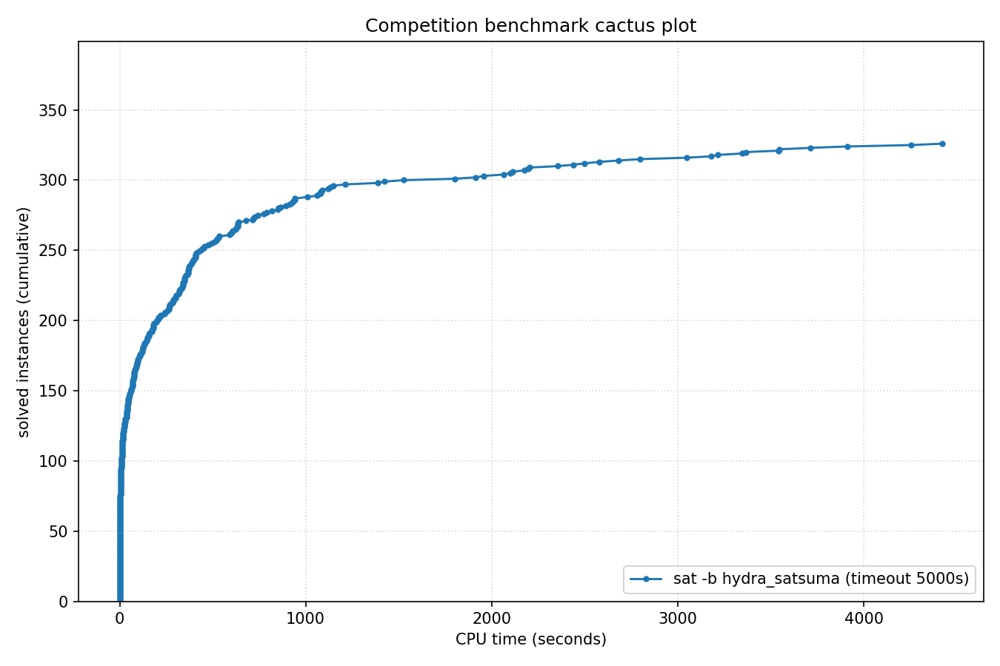

# Competition Benchmark Results (index=main_track_2026_official.jsonl, timeout=5000s, backend=hydra_satsuma, parallel=10)

## Summary

| Result | Count | % |
|--------|-------|---|
| SAT | 136 | 34.8% |
| UNSAT | 190 | 48.6% |
| TIMEOUT | 65 | 16.6% |
| **Total** | 391 | 100% |

### Solver effort (mean (min-max))

| Group | N | Paths covered | Conflicts | Conf/s | Restarts | Rst/s |
|-------|---|---------------|-----------|--------|----------|-------|
| SAT | 136 | — | — | — | — | — |
| UNSAT | 190 | — | — | — | — | — |
| TIMEOUT | 65 | — | — | — | — | — |
| Total | 391 | — | — | — | — | — |

## Cactus plot

## Per-problem results

| Problem | Result | Solve time | UNSAT proof time | Paths | Total | Conf | Rst |
|---------|--------|------------|------------------|-------|-------|------|-----|
| 17.normalised | SAT | 76.9244s | — | — | — | — | — |
| 8.normalised | SAT | 43.7189s | — | — | — | — | — |
| 10.normalised | SAT | 44.8535s | — | — | — | — | — |
| 14.normalised | SAT | 7.0907s | — | — | — | — | — |
| 13.normalised | SAT | 6.5259s | — | — | — | — | — |
| 18.normalised | SAT | 11.4748s | — | — | — | — | — |
| 3.normalised | SAT | 12.0846s | — | — | — | — | — |
| 2.normalised | SAT | 18.3012s | — | — | — | — | — |
| 1.normalised | SAT | 21.3879s | — | — | — | — | — |
| 20.normalised | SAT | 3.7075s | — | — | — | — | — |
| SC25_Timetable_C_395_E_47_Cl_27_D_7_T_50.normalised | SAT | 22.7214s | — | — | — | — | — |
| 5.normalised | SAT | 27.7926s | — | — | — | — | — |
| 11.normalised | SAT | 42.2299s | — | — | — | — | — |
| SC25_Timetable_C_393_E_45_Cl_26_D_7_T_50.normalised | SAT | 16.569s | — | — | — | — | — |
| SC25_Timetable_C_481_E_49_Cl_32_D_7_T_58.normalised | SAT | 71.5489s | — | — | — | — | — |
| SC25_Timetable_C_496_E_48_Cl_33_D_7_T_50.normalised | SAT | 219.1604s | — | — | — | — | — |
| crusti_g2io_250_0.2_255_12.normalised | SAT | 241.427s | — | — | — | — | — |
| SC25_Timetable_C_495_E_48_Cl_33_D_7_T_50.normalised | SAT | 367.1175s | — | — | — | — | — |
| crusti_g2io_175_0.2_511_10.normalised | SAT | 45.4608s | — | — | — | — | — |
| crusti_g2io_250_0.2_255_24.normalised | SAT | 76.8225s | — | — | — | — | — |
| crusti_g2io_200_0.1_127_19.normalised | SAT | 40.0276s | — | — | — | — | — |
| crusti_g2io_250_0.2_255_31.normalised | SAT | 15.2492s | — | — | — | — | — |
| SC25_Timetable_C_495_E_50_Cl_33_D_7_T_50.normalised | SAT | 3911.3626s | — | — | — | — | — |
| crusti_g2io_250_0.2_255_18.normalised | SAT | 16.7527s | — | — | — | — | — |
| crusti_g2io_175_0.2_511_32.normalised | SAT | 13.3382s | — | — | — | — | — |
| SC25_Timetable_C_495_E_43_Cl_35_D_7_T_58.normalised | TIMEOUT | 4998.3556s | — | — | — | — | — |
| SC25_Timetable_C_470_E_39_Cl_32_D_7_T_58.normalised | TIMEOUT | 4999.2675s | — | — | — | — | — |
| SC25_Timetable_C_466_E_39_Cl_31_D_7_T_58.normalised | TIMEOUT | 4999.3979s | — | — | — | — | — |
| SC25_Timetable_C_498_E_46_Cl_34_D_7_T_50.normalised | TIMEOUT | 4999.6171s | — | — | — | — | — |
| SC25_Timetable_C_496_E_46_Cl_33_D_7_T_50.normalised | TIMEOUT | 4999.5647s | — | — | — | — | — |
| SC25_Timetable_C_475_E_39_Cl_33_D_7_T_58.normalised | TIMEOUT | 4999.2274s | — | — | — | — | — |
| crusti_g2io_225_0.1_31_25.normalised | SAT | 29.2381s | — | — | — | — | — |
| st_1391_70_12_1674.normalised | TIMEOUT | 4998.283s | — | — | — | — | — |
| st_826_34_8_3910.normalised | TIMEOUT | 4998.3091s | — | — | — | — | — |
| st_890_86_9_572.normalised | TIMEOUT | 4998.2913s | — | — | — | — | — |
| lockchart-group1-L190-K276-p8d4j1.normalised | SAT | 714.7025s | — | — | — | — | — |
| st_1352_53_23_3737.normalised | TIMEOUT | 4998.328s | — | — | — | — | — |
| lockchart-group2-rnd0.3-L19-K38-P8D4J1_1.normalised | TIMEOUT | 4998.3046s | — | — | — | — | — |
| lockchart-group1-L240-K345-p8d4j1.normalised | TIMEOUT | 4998.5376s | — | — | — | — | — |
| lockchart-group1-L220-K317-p8d4j1.normalised | TIMEOUT | 4998.8916s | — | — | — | — | — |
| b20 | UNSAT | 6.4757s | 7.7s | — | — | — | — |
| b20_1 | UNSAT | 4.3424s | 4.6s | — | — | — | — |
| s15850 | UNSAT | 0.9437s | 0.9s | — | — | — | — |
| b15 | UNSAT | 2.3044s | 3.4s | — | — | — | — |
| c7552 | UNSAT | 0.6856s | 0.5s | — | — | — | — |
| b22_1 | UNSAT | 7.3439s | 6.9s | — | — | — | — |
| b21 | UNSAT | 6.0563s | 7.2s | — | — | — | — |
| s38417 | UNSAT | 1.3651s | 0.7s | — | — | — | — |
| c3540 | UNSAT | 0.7753s | 0.9s | — | — | — | — |
| c5315 | UNSAT | 0.7422s | 0.6s | — | — | — | — |
| lockchart-group3-L15-K29-p4d3j1.normalised | UNSAT | 1059.7686s | 4106.9s | — | — | — | — |
| lockchart-group1-L255-K366-p8d4j1.normalised | TIMEOUT | 4998.5877s | — | — | — | — | — |
| lockchart-group3-L11-K23-p4d3j1.normalised | UNSAT | 1010.402s | 4247.1s | — | — | — | — |
| lockchart-group2-rnd0.3-L19-K38-P8D4J1_3 | TIMEOUT | 4998.2841s | — | — | — | — | — |
| lockchart-group3-L13-K26-p4d3j1.normalised | UNSAT | 1527.1004s | dsr-trim timeout (unchecked) | — | — | — | — |
| b19_1 | UNSAT | 363.6274s | 1195.3s | — | — | — | — |
| b19 | UNSAT | 389.9152s | 1185.6s | — | — | — | — |
| lockchart-group3-L12-K24-p4d3j1.normalised | UNSAT | 1387.4151s | dsr-trim timeout (unchecked) | — | — | — | — |
| oski15a01b74s_opt | UNSAT | 318.668s | 1157.0s | — | — | — | — |
| oski15a01b03s_opt | UNSAT | 385.8957s | 1898.2s | — | — | — | — |
| oski15a01b77s_opt | UNSAT | 286.8761s | 989.9s | — | — | — | — |
| oski15a01b64s_opt | UNSAT | 442.0733s | 1888.3s | — | — | — | — |
| oski15a01b62s_opt | UNSAT | 338.7864s | 1318.2s | — | — | — | — |
| oski15a01b19s_opt | UNSAT | 354.1082s | 1493.3s | — | — | — | — |
| lockchart-group2-rnd0.3-L19-K38-P8D4J1_2 | SAT | 4421.297s | — | — | — | — | — |
| gm24sparrc | UNSAT | 6.7352s | 13.5s | — | — | — | — |
| oski15a01b40s_opt | UNSAT | 366.3692s | 1729.1s | — | — | — | — |
| oski15a01b15s_opt | UNSAT | 474.9363s | 2141.1s | — | — | — | — |
| oski15a01b60s_opt | UNSAT | 331.2999s | 1350.3s | — | — | — | — |
| gm28sparrc | UNSAT | 12.3546s | 22.6s | — | — | — | — |
| gm32sparrc | UNSAT | 8.4358s | 27.1s | — | — | — | — |
| oski15a01b09s_opt | UNSAT | 346.6774s | 1190.9s | — | — | — | — |
| gm36sparrc | UNSAT | 5.1736s | 8.9s | — | — | — | — |
| gm20sparrc | UNSAT | 0.6588s | 0.5s | — | — | — | — |
| oski15a01b52s_opt | UNSAT | 366.4056s | 1420.1s | — | — | — | — |
| lockchart-group3-L14-K27-p4d3j1.normalised | UNSAT | 942.9418s | 3810.5s | — | — | — | — |
| oski15a01b02s_opt | UNSAT | 636.6409s | 3631.2s | — | — | — | — |
| case12.normalised | UNSAT | 15.7145s | 36.5s | — | — | — | — |
| case10 | SAT | 436.3736s | — | — | — | — | — |
| case6.normalised | SAT | 741.0486s | — | — | — | — | — |
| gm16spctrc | UNSAT | 525.0916s | 1539.5s | — | — | — | — |
| case7.normalised | SAT | 125.3417s | — | — | — | — | — |
| case18.normalised | UNSAT | 276.3791s | 652.7s | — | — | — | — |
| case1.normalised | SAT | 533.226s | — | — | — | — | — |
| case2 | SAT | 68.9709s | — | — | — | — | — |
| case9 | SAT | 69.914s | — | — | — | — | — |
| case19.normalised | SAT | 39.5205s | — | — | — | — | — |
| MVRoundRobin_n12_d10_v3 | UNSAT | 0.0239s | 0.5s | — | — | — | — |
| MVRoundRobin_n16_d10_v2 | UNSAT | 0.045s | 0.5s | — | — | — | — |
| MVRoundRobin_n12_d10_v2 | UNSAT | 0.0134s | 0.5s | — | — | — | — |
| RoundRobin_n17_d13 | UNSAT | 0.0034s | 0.5s | — | — | — | — |
| RoundRobin_n15_d13 | UNSAT | 0.0025s | 0.5s | — | — | — | — |
| RoundRobin_n18_d16 | UNSAT | 0.0045s | 0.5s | — | — | — | — |
| RoundRobin_n16_d14 | UNSAT | 0.0031s | 0.5s | — | — | — | — |
| RoundRobin_n16_d13 | UNSAT | 0.0029s | 0.5s | — | — | — | — |
| RoundRobin_n18_d15 | UNSAT | 0.0042s | 0.5s | — | — | — | — |
| MVRoundRobin_n20_d10_v2 | UNSAT | 0.1225s | 0.5s | — | — | — | — |
| MVRoundRobin_n12_d10_v4 | UNSAT | 0.0378s | 0.5s | — | — | — | — |
| MVRoundRobin_n20_d10_v3 | UNSAT | 0.213s | 1.0s | — | — | — | — |
| clqcl_30_7_6.normalised | UNSAT | 0.0124s | 1.6s | — | — | — | — |
| clqcl_30_8_7.normalised | UNSAT | 0.0203s | 2.6s | — | — | — | — |
| clqcl_30_11_10.normalised | UNSAT | 0.0712s | 9.8s | — | — | — | — |
| clqcl_25_9_8.normalised | UNSAT | 0.0194s | 2.6s | — | — | — | — |
| clqcl_70_6_5.normalised | UNSAT | 0.0613s | 7.7s | — | — | — | — |
| clqcl_25_7_6.normalised | UNSAT | 0.0093s | 1.0s | — | — | — | — |
| clqcl_30_9_8.normalised | UNSAT | 0.0319s | 4.1s | — | — | — | — |
| clqcl_60_6_5.normalised | UNSAT | 0.0472s | 4.6s | — | — | — | — |
| case11.normalised | SAT | 604.4347s | — | — | — | — | — |
| gm16spwtcl | TIMEOUT | 4999.1177s | — | — | — | — | — |
| clqcl_45_6_5.normalised | UNSAT | 0.0204s | 2.1s | — | — | — | — |
| clqcl_30_10_9.normalised | UNSAT | 0.0496s | 6.7s | — | — | — | — |
| gm24spctbk | TIMEOUT | 4998.9721s | — | — | — | — | — |
| gm32spctlf | TIMEOUT | 4999.2127s | — | — | — | — | — |
| gm16spwtrc | TIMEOUT | 4998.84s | — | — | — | — | — |
| case3 | UNSAT | 775.4344s | 3017.4s | — | — | — | — |
| gm24spctrc | TIMEOUT | 4999.0644s | — | — | — | — | — |
| gm20spctrc | TIMEOUT | 4998.7019s | — | — | — | — | — |
| case4 | TIMEOUT | 4998.3076s | — | — | — | — | — |
| 16_16_default_mapped_ultra_and_and_dadda_mapped_bit28 | UNSAT | 422.1057s | 1370.6s | — | — | — | — |
| 16_16_booth_dadda_origin_and_default_mapped_ultra_bit29 | UNSAT | 318.4911s | 1049.0s | — | — | — | — |
| 16_16_booth_wallace_mapped_and_default_origin_bit28 | UNSAT | 720.5577s | 2389.4s | — | — | — | — |
| 16_16_default_mapped_ultra_and_and_dadda_origin_bit28 | UNSAT | 454.2984s | 1512.1s | — | — | — | — |
| 16_16_booth_dadda_mapped_and_and_wallace_origin_bit28 | UNSAT | 792.2178s | 2662.6s | — | — | — | — |
| nla-digbench-scaling_dijkstra-u_valuebound1_transition | UNSAT | 1.3299s | 1.8s | — | — | — | — |
| cal182_cal182_transition | UNSAT | 4.8214s | 4.4s | — | — | — | — |
| bv_ILA_Piccolo_JALR_sanity_transition | UNSAT | 3.0823s | 10.9s | — | — | — | — |
| ramsey_3_6_19.normalised | TIMEOUT | 4998.2932s | — | — | — | — | — |
| bv_ILA_Piccolo_BEQ_sanity_transition | UNSAT | 3.11s | 10.1s | — | — | — | — |
| nla-digbench-scaling_freire1_valuebound1_transition | UNSAT | 2.2822s | 0.8s | — | — | — | — |
| ramsey_4_4_18.normalised | UNSAT | 932.8646s | 4394.7s | — | — | — | — |
| veer_axi_yosyshq_appnote_123_veer_axi-p06_transition | UNSAT | 10.4264s | 106.5s | — | — | — | — |
| 16_16_booth_dadda_mapped_and_booth_wallace_mapped | UNSAT | 819.3083s | 2450.0s | — | — | — | — |
| x-epic_a19-p15_transition | UNSAT | 2.1777s | 2.0s | — | — | — | — |
| bv_rocket_1951_transition | UNSAT | 9.2563s | 408.5s | — | — | — | — |
| x-epic_a10-p53_transition | UNSAT | 9.6633s | 117.9s | — | — | — | — |
| arles_thres10_p20_r4514 | UNSAT | 0.0052s | 0.5s | — | — | — | — |
| arles_thres20_p10_r7508 | UNSAT | 0.2711s | 0.3s | — | — | — | — |
| arles_thres10_p10_r8180 | UNSAT | 0.0036s | 0.5s | — | — | — | — |
| arles_thres20_p10_r7475 | UNSAT | 0.2949s | 0.3s | — | — | — | — |
| arles_thres10_p10_r8188 | UNSAT | 0.0065s | 0.5s | — | — | — | — |
| arles_thres20_p20_r4109 | UNSAT | 0.298s | 0.3s | — | — | — | — |
| arles_thres10_p10_r8186 | UNSAT | 0.0055s | 0.5s | — | — | — | — |
| 16_16_booth_dadda_origin_and_and_dadda_origin_bit29 | UNSAT | 400.9242s | 1217.3s | — | — | — | — |
| arles_thres20_p30_r2554 | UNSAT | 0.0039s | 0.5s | — | — | — | — |
| arles_thres10_p10_r8185 | UNSAT | 0.0029s | 0.5s | — | — | — | — |
| arles_thres20_p10_r7533 | UNSAT | 0.2466s | 0.3s | — | — | — | — |
| arles_thres10_p10_r8062 | UNSAT | 0.003s | 0.5s | — | — | — | — |
| arles_thres10_p10_r8184 | UNSAT | 0.0028s | 0.5s | — | — | — | — |
| bp4_CB_FPBEQ_FPBLE.normalised | UNSAT | 86.7326s | 528.3s | — | — | — | — |
| 16_16_booth_dadda_origin_and_and_dadda_origin_bit28 | UNSAT | 1087.2681s | 3958.8s | — | — | — | — |
| 16_16_booth_wallace_origin_and_and_dadda_mapped_bit28 | UNSAT | 913.3262s | 3020.6s | — | — | — | — |
| 2018D_VexRiscv-regch0-20-p1_step | UNSAT | 131.5225s | 1736.2s | — | — | — | — |
| bp4_CB_LP_FPBLE.normalised | UNSAT | 120.5632s | 909.5s | — | — | — | — |
| bp4_BC012_TCO_CSO_LP_FPBEQ_ZR.normalised | SAT | 144.4775s | — | — | — | — | — |
| bp4_CSO_AM_IXA_LP.normalised | UNSAT | 97.3595s | 1126.9s | — | — | — | — |
| bp4_BC012_AM_IXA_LPI.normalised | UNSAT | 195.3256s | 2200.2s | — | — | — | — |
| bp5_CSO.normalised | SAT | 285.6558s | — | — | — | — | — |
| bp4_TCO_CSO_ZR.normalised | SAT | 636.8097s | — | — | — | — | — |
| 16_16_and_wallace_origin_and_default_mapped_ultra_bit27 | UNSAT | 864.2701s | 3262.6s | — | — | — | — |
| 16_16_booth_dadda_mapped_and_and_wallace_mapped_bit28 | UNSAT | 852.2501s | 3407.6s | — | — | — | — |
| bp4_BC012_AM_FPBEQ_ZR.normalised | SAT | 2438.8983s | — | — | — | — | — |
| bp5.normalised | SAT | 1914.6833s | — | — | — | — | — |
| x-epic_a19-p16_step | UNSAT | 182.8471s | dsr-trim timeout (unchecked) | — | — | — | — |
| oddball_43_5_tto_zp.normalised | SAT | 72.0655s | — | — | — | — | — |
| bp4_TCO_CB_LP.normalised | UNSAT | 133.1033s | 1234.6s | — | — | — | — |
| bp4_CB_CSO_LP_FPBEQ_FPBLE.normalised | UNSAT | 210.9608s | 1524.4s | — | — | — | — |
| bp4_BC012_TCO_AM_FPBEQ_ZR.normalised | SAT | 1956.079s | — | — | — | — | — |
| nla-digbench-scaling_dijkstra-u_valuebound1_step | UNSAT | 246.2651s | dsr-trim timeout (unchecked) | — | — | — | — |
| bp4_BC012_IXA_LPI_FPBLE.normalised | UNSAT | 595.7296s | dsr-trim timeout (unchecked) | — | — | — | — |
| oddball_24_4_ttf.normalised | UNSAT | 265.0393s | 1689.5s | — | — | — | — |
| oddball_20_5_ttf.normalised | UNSAT | 4.2956s | 14.3s | — | — | — | — |
| oddball_13_5_ttf.normalised | UNSAT | 14.2309s | 64.1s | — | — | — | — |
| oddball_20_4_ttf.normalised | UNSAT | 7.2948s | 27.7s | — | — | — | — |
| oddball_44_5_tto_zp.normalised | SAT | 72.0713s | — | — | — | — | — |
| 16_16_booth_dadda_mapped_and_booth_wallace_origin | UNSAT | 2576.321s | dsr-trim timeout (unchecked) | — | — | — | — |
| bp4_TCO_AM_IXA_FPBLE.normalised | UNSAT | 349.4017s | 3741.9s | — | — | — | — |
| oddball_47_5_tto_zp.normalised | SAT | 1080.2451s | — | — | — | — | — |
| bp4_BC012_TCO_AM_IXA.normalised | UNSAT | 375.9665s | 4404.8s | — | — | — | — |
| oddball_51_5_tto_zp.normalised | SAT | 157.4231s | — | — | — | — | — |
| oddball_54_5_tto_zp.normalised | SAT | 406.4449s | — | — | — | — | — |
| 45-126477 | SAT | 186.3386s | — | — | — | — | — |
| qpr-bmp280-driver-5 | SAT | 2.8218s | — | — | — | — | — |
| bp4_BC012_AM_IXA_FPBLE.normalised | UNSAT | 372.0327s | 3731.0s | — | — | — | — |
| oddball_70_5_tto_zp.normalised | SAT | 3365.9469s | — | — | — | — | — |
| ssp-0.46172681388173037 | SAT | 323.7194s | — | — | — | — | — |
| clqcl_40_6_5.normalised | UNSAT | 0.0147s | 1.6s | — | — | — | — |
| gensys-ukn006.shuffled-as.sat05-3846 | UNSAT | 150.4886s | 423.0s | — | — | — | — |
| hid-uns-enc-6-1-0-0-0-0-26462 | UNSAT | 89.5542s | 231.8s | — | — | — | — |
| bench_5078.smt2 | SAT | 26.385s | — | — | — | — | — |
| le450_15a.col.15 | UNSAT | 0.4625s | 1.1s | — | — | — | — |
| x2_72.shuffled-as.sat03-1604 | UNSAT | 0.0021s | 0.5s | — | — | — | — |
| oddball_79_5_tto_zp.normalised | TIMEOUT | 4998.2862s | — | — | — | — | — |
| oddball_56_5_tto_zp.normalised | SAT | 4256.1256s | — | — | — | — | — |
| E02F20 | SAT | 14.109s | — | — | — | — | — |
| squ_ali_s10x10_c39_abix_SAT-sc2017 | SAT | 15.8065s | — | — | — | — | — |
| oddball_26_4_ttf.normalised | UNSAT | 605.3681s | 3760.0s | — | — | — | — |
| SCPC-900-27 | SAT | 639.6614s | — | — | — | — | — |
| mp1-bsat210-739 | UNSAT | 591.4392s | 1956.0s | — | — | — | — |
| oddball_28_4_ttf.normalised | UNSAT | 2110.2154s | dsr-trim timeout (unchecked) | — | — | — | — |
| oddball_33_4_ttf.normalised | UNSAT | 2176.7425s | dsr-trim timeout (unchecked) | — | — | — | — |
| 49-134444 | SAT | 1799.7674s | — | — | — | — | — |
| post-cbmc-aes-d-r2-noholes | UNSAT | 77.0628s | 645.2s | — | — | — | — |
| multiplier_16bits__miter_19 | TIMEOUT | 4998.3037s | — | — | — | — | — |
| two-trees-1023v.sanitized | TIMEOUT | 4998.2934s | — | — | — | — | — |
| cliquecoloring_n24_k6_c5 | UNSAT | 0.0058s | 0.5s | — | — | — | — |
| or_randxor_k3_n510_m510.sanitized | UNSAT | 3.7992s | 3.1s | — | — | — | — |
| oddball_29_4_ttf.normalised | UNSAT | 728.581s | dsr-trim timeout (unchecked) | — | — | — | — |
| 19.normalised | SAT | 13.0431s | — | — | — | — | — |
| transport-transport-three-cities-sequential-14nodes-1000size-4degree-100mindistance-4trucks-14packages-2008seed.020-NOTKNOWN | SAT | 63.4603s | — | — | — | — | — |
| bphp_p51_h50.sanitized | TIMEOUT | 4998.305s | — | — | — | — | — |
| cfi-rigid-t2-0048-04-or_3_shuffle_all | SAT | 161.6453s | — | — | — | — | — |
| mp1-Nb6T27 | SAT | 452.834s | — | — | — | — | — |
| oski15a01b70s_opt | UNSAT | 303.5554s | 952.7s | — | — | — | — |
| VanDerWaerden_pd_2-3-25_606 | SAT | 3345.5641s | — | — | — | — | — |
| 20180321_140833987_p_cnf_320_1120 | SAT | 2194.9692s | — | — | — | — | — |
| sted1_0x0-637 | SAT | 338.7886s | — | — | — | — | — |
| connm-ue-csp-sat-n1200-d-0.02-s405595518.shuffled-as.sat05-531 | TIMEOUT | 4998.2807s | — | — | — | — | — |
| hid-uns-enc-6-1-0-0-0-0-28258 | UNSAT | 45.5807s | 113.4s | — | — | — | — |
| simon-r22-1.sanitized | SAT | 0.3082s | — | — | — | — | — |
| hwmcc10-timeframe-expansion-k45-pdtpmsgoodbakery-tseitin | UNSAT | 47.6655s | 81.8s | — | — | — | — |
| 1-ZC-1024-K-117.sanitized | TIMEOUT | 4998.5847s | — | — | — | — | — |
| 1-ZC-512-K-60.sanitized | SAT | 410.0713s | — | — | — | — | — |
| 4g_5color_170_050_05 | SAT | 176.1874s | — | — | — | — | — |
| stone-width3chain-nmarkers-13_shuffled | UNSAT | 56.1629s | dsr-trim timeout (unchecked) | — | — | — | — |
| sum_of_3_cubes_94_bits_30 | TIMEOUT | 4998.5608s | — | — | — | — | — |
| puzzle57_sat | TIMEOUT | 4998.8026s | — | — | — | — | — |
| ssp-0.497665446947731 | SAT | 348.3137s | — | — | — | — | — |
| sat-bench-trig-taylor2 | UNSAT | 321.4784s | 616.2s | — | — | — | — |
| lockchart-group1-L235-K339-p8d4j1.normalised | TIMEOUT | 4998.5056s | — | — | — | — | — |
| mchess_20 | UNSAT | 0.001s | 0.5s | — | — | — | — |
| ncc_none_5047_6_3_3_3_0_435991723 | SAT | 27.2542s | — | — | — | — | — |
| floodit_4_n70_k10_m229 | SAT | 127.946s | — | — | — | — | — |
| LZMAFile_write_12 | UNSAT | 0.2941s | 0.3s | — | — | — | — |
| newpol29-4 | UNSAT | 406.5522s | 1751.3s | — | — | — | — |
| RoundRobin_n17_d14 | UNSAT | 0.0044s | 0.5s | — | — | — | — |
| ezfact64_6.shuffled-as.sat05-453 | SAT | 0.0778s | — | — | — | — | — |
| mchess_17 | UNSAT | 0.0008s | 0.5s | — | — | — | — |
| ncc_none_3001_7_3_3_1_31_435991723 | SAT | 43.1428s | — | — | — | — | — |
| gto_p50c314 | TIMEOUT | 4998.2989s | — | — | — | — | — |
| ecarev-110-1031-23-40-8-sc2018 | SAT | 222.0061s | — | — | — | — | — |
| crn_40_1521_s | TIMEOUT | 4998.3453s | — | — | — | — | — |
| slp-synthesis-aes-bottom22 | TIMEOUT | 4998.659s | — | — | — | — | — |
| mp1-blockpuzzle_5x10_s8_free3 | UNSAT | 3.0991s | 6.1s | — | — | — | — |
| satcoin-genesis-UNSAT-12300 | UNSAT | 509.3863s | 586.9s | — | — | — | — |
| x2_64.shuffled-as.sat03-1603 | UNSAT | 0.002s | 0.5s | — | — | — | — |
| urqh5x5.shuffled-as.sat03-1481.cnf.mis-127.debugged | TIMEOUT | 4998.3132s | — | — | — | — | — |
| UNSAT_MS_opt_termes_p20.pddl_105 | TIMEOUT | 4998.6246s | — | — | — | — | — |
| lec_mult_DvK_12x11.sanitized | UNSAT | 2100.5364s | dsr-trim timeout (unchecked) | — | — | — | — |
| bench_3098.smt2 | SAT | 17.1638s | — | — | — | — | — |
| homer12.shuffled | UNSAT | 0.3108s | 0.3s | — | — | — | — |
| peb-pyrofpyr-15-neq-3_shuffled | UNSAT | 266.2116s | 198.4s | — | — | — | — |
| baseballcover12with25_and4positions | SAT | 393.1773s | — | — | — | — | — |
| UNSAT_MS_opt_snake_p17.pddl_61 | TIMEOUT | 4999.0925s | — | — | — | — | — |
| Steiner-729-112-bce | TIMEOUT | 4998.3634s | — | — | — | — | — |
| cube-11-h14-sat | SAT | 519.7118s | — | — | — | — | — |
| color-11-3.shuffled-as.sat05-445 | TIMEOUT | 4998.3314s | — | — | — | — | — |
| mdp-28-10-sat | SAT | 109.4347s | — | — | — | — | — |
| 005 | SAT | 300.63s | — | — | — | — | — |
| bvsub_06991 | UNSAT | 18.7038s | 338.3s | — | — | — | — |
| SCPC-500-7 | UNSAT | 29.9204s | 74.4s | — | — | — | — |
| sum_of_3_cubes_108_bits_52 | TIMEOUT | 4998.6478s | — | — | — | — | — |
| Mycielski-11-hints-1 | UNSAT | 357.2178s | 1040.5s | — | — | — | — |
| oddball_80_5_tto_zp.normalised | TIMEOUT | 4999.101s | — | — | — | — | — |
| 1-ET-512-K-98.sanitized | TIMEOUT | 4998.3474s | — | — | — | — | — |
| rook-44-1-1 | UNSAT | 105.0703s | 338.0s | — | — | — | — |
| aes_decry_2_rounds.debugged | UNSAT | 87.7545s | 708.7s | — | — | — | — |
| Mycielski-10-hints-6 | TIMEOUT | 4998.5279s | — | — | — | — | — |
| 008-80-8 | SAT | 3216.7204s | — | — | — | — | — |
| 170224890 | SAT | 37.0959s | — | — | — | — | — |
| rphp_p6_r540 | UNSAT | 3.2544s | 156.7s | — | — | — | — |
| shuffling-1-s1931574585-of-bench-sat04-328.used-as.sat04-449 | UNSAT | 4.1586s | 4.9s | — | — | — | — |
| sncf_model_ixl_bmc_depth_15 | TIMEOUT | 4998.7839s | — | — | — | — | — |
| x9-12022.sat.sanitized | SAT | 1211.8134s | — | — | — | — | — |
| bvurem_17.smt2 | UNSAT | 621.4676s | 3571.5s | — | — | — | — |
| connm-ue-csp-sat-n1200-d-0.02-s383740539.sat05-534.reshuffled-07 | SAT | 2682.4716s | — | — | — | — | — |
| posixpath_expanduser_14 | UNSAT | 0.2833s | 0.3s | — | — | — | — |
| queen12_12.col.12 | UNSAT | 0.3794s | 0.4s | — | — | — | — |
| HCP-470-105 | SAT | 1134.4517s | — | — | — | — | — |
| aes_32_4_keyfind_1 | TIMEOUT | 4998.2871s | — | — | — | — | — |
| ssp-0.046166496845693274 | TIMEOUT | 4998.4151s | — | — | — | — | — |
| hcp_d14_14 | SAT | 2356.2145s | — | — | — | — | — |
| mp1-blockpuzzle_5x12_s6_free3 | UNSAT | 5.1799s | 11.0s | — | — | — | — |
| sted5_0x0-157 | SAT | 1079.1838s | — | — | — | — | — |
| MVD_ADS_S11_7_7 | SAT | 6.9124s | — | — | — | — | — |
| oddball_22_5_ttf.normalised | UNSAT | 3.0852s | 9.1s | — | — | — | — |
| q_query_3_L200_coli.sat | UNSAT | 100.3095s | 1179.0s | — | — | — | — |
| gt-025.shuffled-as.sat05-1306 | UNSAT | 0.5602s | 0.4s | — | — | — | — |
| si2-r001-m200-00 | SAT | 10.8169s | — | — | — | — | — |
| linvrinv5.shuffled-as.sat05-564 | UNSAT | 850.758s | 4342.8s | — | — | — | — |
| EDP3-16000 | TIMEOUT | 4998.5212s | — | — | — | — | — |
| case13.normalised | SAT | 24.9414s | — | — | — | — | — |
| x9-11067.sat.sanitized | SAT | 66.4566s | — | — | — | — | — |
| stable-400-0.1-11-98765432140011 | SAT | 116.1s | — | — | — | — | — |
| Karatsuba4477457x5308417 | SAT | 50.6751s | — | — | — | — | — |
| abw-T-dwt__592.mtx-w98 | SAT | 69.9597s | — | — | — | — | — |
| SGI_30_60_28_40_7-log.shuffled-as.sat03-127 | UNSAT | 2063.942s | dsr-trim timeout (unchecked) | — | — | — | — |
| FmlaImplyChain_3_7_7.sanitized | UNSAT | 181.2601s | 284.0s | — | — | — | — |
| clauses-8.shuffled-as.sat05-1969 | SAT | 110.7781s | — | — | — | — | — |
| constraints_16_0.4_1.sanitized | UNSAT | 52.0876s | 118.6s | — | — | — | — |
| 01-integer-programming-20-30-40 | SAT | 679.5511s | — | — | — | — | — |
| x9-11035.sat.sanitized | SAT | 4.6066s | — | — | — | — | — |
| esawn_uw3.debugged | SAT | 17.616s | — | — | — | — | — |
| mrpp_8x8#20_16 | SAT | 11.1865s | — | — | — | — | — |
| 01-integer-programming-5-10-100 | TIMEOUT | 4998.4386s | — | — | — | — | — |
| Kakuro-easy-138-ext.xml.hg_5 | SAT | 201.4338s | — | — | — | — | — |
| sp5-26-19-bin-nons-tree-noid | SAT | 1424.5661s | — | — | — | — | — |
| 31.smt2 | SAT | 92.9541s | — | — | — | — | — |
| or_randxor_k3_n590_m590.sanitized | UNSAT | 6.6764s | 7.9s | — | — | — | — |
| strips-gripper-12t22.shuffled-as.sat05-1151 | UNSAT | 7.1119s | 12.2s | — | — | — | — |
| sted5_0x1e3-120 | SAT | 69.3593s | — | — | — | — | — |
| floodit_7_n70_k10_m230 | SAT | 80.5593s | — | — | — | — | — |
| pyhala-braun-unsat-40-4-02.shuffled-as.sat05-459 | UNSAT | 41.2898s | 85.7s | — | — | — | — |
| oski15a01b38s_opt | UNSAT | 336.1805s | 1211.5s | — | — | — | — |
| grs-48-160 | UNSAT | 942.0306s | dsr-trim timeout (unchecked) | — | — | — | — |
| sgen1-unsat-103-100.cnf.mis-78.debugged | UNSAT | 257.4891s | 1181.7s | — | — | — | — |
| eq.atree.braun.13.unsat | UNSAT | 2798.181s | dsr-trim timeout (unchecked) | — | — | — | — |
| md5_48_3 | SAT | 14.3473s | — | — | — | — | — |
| w19-8.0 | UNSAT | 120.3139s | 378.6s | — | — | — | — |
| x9-12096.sat.sanitized | SAT | 626.9664s | — | — | — | — | — |
| Folkman-185-152478531.sanitized | SAT | 174.943s | — | — | — | — | — |
| satcoin-genesis-UNSAT-6120 | UNSAT | 492.0277s | 597.8s | — | — | — | — |
| hash_table_find_safety_size_21 | UNSAT | 142.7649s | dsr-trim timeout (unchecked) | — | — | — | — |
| 59-131122 | SAT | 895.0645s | — | — | — | — | — |
| med30.shuffled | SAT | 1.6656s | — | — | — | — | — |
| shuffling-1-s1948244678-of-bench-sat04-301.used-as.sat04-476 | UNSAT | 82.8911s | 224.7s | — | — | — | — |
| 46-128972 | SAT | 370.3095s | — | — | — | — | — |
| abw-T-dwt__592.mtx-w102 | SAT | 413.467s | — | — | — | — | — |
| gt-ordering-unsat-gt-045.sat05-1310.reshuffled-07 | UNSAT | 3.5276s | 3.0s | — | — | — | — |
| LABS_n089_goal008-sc2013 | SAT | 1122.0001s | — | — | — | — | — |
| asconhashv12_opt64_H8_M2-1yQCyA0j_m2_6.c | SAT | 4.1567s | — | — | — | — | — |
| satcoin-genesis-SAT-16 | SAT | 3.4811s | — | — | — | — | — |
| SAT_instance_N=85 | TIMEOUT | 4998.4348s | — | — | — | — | — |
| SAT_dat.k40.debugged | UNSAT | 157.5216s | 418.3s | — | — | — | — |
| stable-400-0.1-12-98765432140012 | SAT | 3047.5072s | — | — | — | — | — |
| mdp-32-12-sat | SAT | 1073.5248s | — | — | — | — | — |
| safe-50-h49-unsat | TIMEOUT | 4998.3581s | — | — | — | — | — |
| puzzle42_unsat | TIMEOUT | 4998.4328s | — | — | — | — | — |
| battleship-20-39-sat | SAT | 61.5429s | — | — | — | — | — |
| hantzsche_wendt_unit_83 | UNSAT | 536.5026s | 1829.5s | — | — | — | — |
| mm-2x3-8-8-sb.1.shuffled-as.sat03-1504.used-as.sat04-829 | UNSAT | 207.6543s | 640.2s | — | — | — | — |
| SE_PR_stb_588_138.apx_1 | SAT | 2.5362s | — | — | — | — | — |
| gus-md5-15 | TIMEOUT | 4998.6037s | — | — | — | — | — |
| ex025_19 | UNSAT | 3540.1013s | dsr-trim timeout (unchecked) | — | — | — | — |
| reconf10_22_queen20_3_8667 | SAT | 924.4755s | — | — | — | — | — |
| manthey_DimacsSorterHalf_35_9 | SAT | 182.96s | — | — | — | — | — |
| Q3inK12 | SAT | 54.46s | — | — | — | — | — |
| full-bg-gb-9-ce | SAT | 3180.6558s | — | — | — | — | — |
| b04_s_unknown | SAT | 148.0571s | — | — | — | — | — |
| Kakuro-easy-106-ext.xml.hg_6 | SAT | 173.1727s | — | — | — | — | — |
| summle_X8651_steps8_I1-2-2-4-4-8-25-100 | SAT | 12.2155s | — | — | — | — | — |
| Break_14_60.xml | SAT | 37.3515s | — | — | — | — | — |
| asconhashv12_opt64_H6_M2-4XKSMr_m1_3_U25.c | UNSAT | 97.636s | 104.7s | — | — | — | — |
| urqh1c5x5.shuffled-as.sat03-1468.cnf.mis-103.debugged | TIMEOUT | 4998.2822s | — | — | — | — | — |
| ncc_none_12477_5_3_3_0_0_435991723 | UNSAT | 20.462s | 454.5s | — | — | — | — |
| gus-md5-14-sc2009 | TIMEOUT | 4998.4188s | — | — | — | — | — |
| shuffling-2-s340247357-of-bench-sat04-361.used-as.sat04-638 | UNSAT | 1.979s | 2.2s | — | — | — | — |
| IBM_FV_2004_rule_batch_1_31_2_SAT_dat.k95.debugged | UNSAT | 36.6625s | 60.6s | — | — | — | — |
| PRP_40_40 | SAT | 28.9927s | — | — | — | — | — |
| baseballcover13with25_and1positions | SAT | 51.3909s | — | — | — | — | — |
| vlsat2_40896_6104639.dimacs | TIMEOUT | 4998.5195s | — | — | — | — | — |
| at-least-two-sokoban-sequential-p145-microban-sequential.030-NOTKNOWN | UNSAT | 288.6203s | 1818.6s | — | — | — | — |
| clauses-8.renamed-as.sat05-1964 | SAT | 125.1436s | — | — | — | — | — |
| tseitingrid6x185_shuffled | UNSAT | 0.0263s | 0.5s | — | — | — | — |
| rphp5_045_shuffled | UNSAT | 0.2861s | 0.4s | — | — | — | — |
| 5col160_15_6.shuffled | TIMEOUT | 4998.2777s | — | — | — | — | — |
| ex095_8 | UNSAT | 2500.1792s | dsr-trim timeout (unchecked) | — | — | — | — |
| Circuit_multiplier37 | SAT | 8.7845s | — | — | — | — | — |
| linked_list_swap_contents_safety_unwind57 | UNSAT | 36.6374s | 1981.7s | — | — | — | — |
| post-cbmc-aes-ee-r2-noholes | UNSAT | 78.5893s | 670.9s | — | — | — | — |
| 48-134487 | SAT | 3710.8161s | — | — | — | — | — |
| oski15a01b42s_opt | UNSAT | 300.549s | 863.8s | — | — | — | — |
| rbsat-v760c43649g8 | SAT | 1148.6661s | — | — | — | — | — |
| baseballcover11with22_and2positions | SAT | 341.0302s | — | — | — | — | — |
| sin-mitern26 | UNSAT | 270.706s | 591.8s | — | — | — | — |
| sgp_9-4-8.shuffled-as.sat05-2673 | TIMEOUT | 4998.6413s | — | — | — | — | — |
| GP_100_951_33 | SAT | 15.3183s | — | — | — | — | — |
| g2-T122.1.0 | UNSAT | 397.2016s | 392.9s | — | — | — | — |
| SC23_Timetable_C_476_E_50_Cl_32_D_6_T_50 | SAT | 93.7147s | — | — | — | — | — |
| pyhala-braun-sat-40-4-03.shuffled-as.sat03-1541 | SAT | 0.2081s | — | — | — | — | — |
| battleship-19-19-unsat | TIMEOUT | 4998.275s | — | — | — | — | — |
| sum_of_3_cubes_145_bits_74 | TIMEOUT | 4999.063s | — | — | — | — | — |
| vlsat2_21573_2289124.dimacs | SAT | 7.4634s | — | — | — | — | — |
| toughsat_factoring_895s | SAT | 267.5334s | — | — | — | — | — |
| marg6x6.shuffled-as.sat03-1456.cnf.mis-119.debugged | TIMEOUT | 4998.3056s | — | — | — | — | — |
| worker_50_50_30_0.8 | TIMEOUT | 4998.2966s | — | — | — | — | — |
| ctl_4201_555_unsat_pre | UNSAT | 633.9048s | 1871.1s | — | — | — | — |
| xor_op_n46_d3 | UNSAT | 2204.0391s | dsr-trim timeout (unchecked) | — | — | — | — |
| 30_2 | TIMEOUT | 4998.3076s | — | — | — | — | — |
| b2005-p3-14x14c17h9-Ser8-0 | TIMEOUT | 4999.0228s | — | — | — | — | — |
| mp1-rubikcube220 | TIMEOUT | 4998.3149s | — | — | — | — | — |
| custmulsb2x32o | UNSAT | 3547.1724s | dsr-trim timeout (unchecked) | — | — | — | — |
