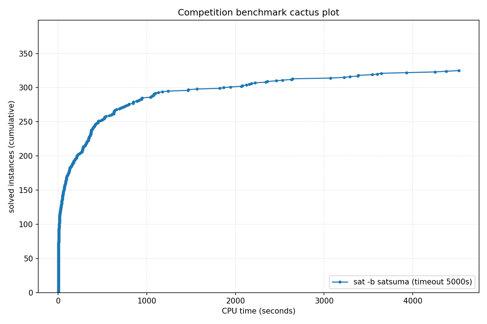

# Competition Benchmark Results (index=main_track_2026_official.jsonl, timeout=5000s, backend=satsuma, parallel=10)

## Summary

| Result | Count | % |
|--------|-------|---|
| SAT | 136 | 34.8% |
| UNSAT | 189 | 48.3% |
| TIMEOUT | 66 | 16.9% |
| **Total** | 391 | 100% |

### Solver effort (mean (min-max))

| Group | N | Paths covered | Conflicts | Conf/s | Restarts | Rst/s |
|-------|---|---------------|-----------|--------|----------|-------|
| SAT | 136 | — | — | — | — | — |
| UNSAT | 189 | — | — | — | — | — |
| TIMEOUT | 66 | — | — | — | — | — |
| Total | 391 | — | — | — | — | — |

## Cactus plot

## Per-problem results

| Problem | Result | Solve time | UNSAT proof time | Paths | Total | Conf | Rst |
|---------|--------|------------|------------------|-------|-------|------|-----|
| 17.normalised | SAT | 88.0182s | — | — | — | — | — |
| 8.normalised | SAT | 54.5885s | — | — | — | — | — |
| 10.normalised | SAT | 56.0905s | — | — | — | — | — |
| 14.normalised | SAT | 7.9807s | — | — | — | — | — |
| 13.normalised | SAT | 7.3758s | — | — | — | — | — |
| 18.normalised | SAT | 13.3647s | — | — | — | — | — |
| 3.normalised | SAT | 14.0344s | — | — | — | — | — |
| 2.normalised | SAT | 18.4329s | — | — | — | — | — |
| 1.normalised | SAT | 23.7504s | — | — | — | — | — |
| 20.normalised | SAT | 3.5233s | — | — | — | — | — |
| SC25_Timetable_C_395_E_47_Cl_27_D_7_T_50.normalised | SAT | 19.2656s | — | — | — | — | — |
| 5.normalised | SAT | 30.2803s | — | — | — | — | — |
| SC25_Timetable_C_393_E_45_Cl_26_D_7_T_50.normalised | SAT | 15.5851s | — | — | — | — | — |
| 11.normalised | SAT | 45.1566s | — | — | — | — | — |
| SC25_Timetable_C_481_E_49_Cl_32_D_7_T_58.normalised | SAT | 63.2868s | — | — | — | — | — |
| SC25_Timetable_C_496_E_48_Cl_33_D_7_T_50.normalised | SAT | 216.2006s | — | — | — | — | — |
| crusti_g2io_250_0.2_255_12.normalised | SAT | 239.3081s | — | — | — | — | — |
| SC25_Timetable_C_495_E_48_Cl_33_D_7_T_50.normalised | SAT | 371.1285s | — | — | — | — | — |
| crusti_g2io_175_0.2_511_10.normalised | SAT | 46.8666s | — | — | — | — | — |
| crusti_g2io_250_0.2_255_24.normalised | SAT | 78.2965s | — | — | — | — | — |
| crusti_g2io_200_0.1_127_19.normalised | SAT | 39.7709s | — | — | — | — | — |
| crusti_g2io_250_0.2_255_31.normalised | SAT | 16.0104s | — | — | — | — | — |
| SC25_Timetable_C_495_E_50_Cl_33_D_7_T_50.normalised | SAT | 3928.8609s | — | — | — | — | — |
| crusti_g2io_250_0.2_255_18.normalised | SAT | 16.8862s | — | — | — | — | — |
| crusti_g2io_175_0.2_511_32.normalised | SAT | 13.2447s | — | — | — | — | — |
| SC25_Timetable_C_498_E_46_Cl_34_D_7_T_50.normalised | TIMEOUT | 4998.4103s | — | — | — | — | — |
| SC25_Timetable_C_470_E_39_Cl_32_D_7_T_58.normalised | TIMEOUT | 4998.7359s | — | — | — | — | — |
| SC25_Timetable_C_496_E_46_Cl_33_D_7_T_50.normalised | TIMEOUT | 4998.6923s | — | — | — | — | — |
| SC25_Timetable_C_466_E_39_Cl_31_D_7_T_58.normalised | TIMEOUT | 4998.9667s | — | — | — | — | — |
| SC25_Timetable_C_495_E_43_Cl_35_D_7_T_58.normalised | TIMEOUT | 4998.9324s | — | — | — | — | — |
| SC25_Timetable_C_475_E_39_Cl_33_D_7_T_58.normalised | TIMEOUT | 4998.3047s | — | — | — | — | — |
| crusti_g2io_225_0.1_31_25.normalised | SAT | 29.4014s | — | — | — | — | — |
| st_1391_70_12_1674.normalised | TIMEOUT | 4998.3566s | — | — | — | — | — |
| st_826_34_8_3910.normalised | TIMEOUT | 4998.3649s | — | — | — | — | — |
| st_890_86_9_572.normalised | TIMEOUT | 4998.3037s | — | — | — | — | — |
| lockchart-group1-L190-K276-p8d4j1.normalised | SAT | 752.5651s | — | — | — | — | — |
| st_1352_53_23_3737.normalised | TIMEOUT | 4998.2744s | — | — | — | — | — |
| lockchart-group2-rnd0.3-L19-K38-P8D4J1_1.normalised | TIMEOUT | 4998.3394s | — | — | — | — | — |
| lockchart-group1-L240-K345-p8d4j1.normalised | TIMEOUT | 4998.5566s | — | — | — | — | — |
| lockchart-group1-L220-K317-p8d4j1.normalised | TIMEOUT | 4998.5294s | — | — | — | — | — |
| b20 | UNSAT | 6.3396s | 7.7s | — | — | — | — |
| b20_1 | UNSAT | 4.3617s | 4.6s | — | — | — | — |
| s15850 | UNSAT | 0.9975s | 1.0s | — | — | — | — |
| b15 | UNSAT | 2.3452s | 3.4s | — | — | — | — |
| c7552 | UNSAT | 0.6393s | 0.6s | — | — | — | — |
| b22_1 | UNSAT | 7.3059s | 6.9s | — | — | — | — |
| b21 | UNSAT | 6.0445s | 7.3s | — | — | — | — |
| s38417 | UNSAT | 1.3882s | 0.8s | — | — | — | — |
| c3540 | UNSAT | 0.7684s | 0.9s | — | — | — | — |
| c5315 | UNSAT | 0.7342s | 0.7s | — | — | — | — |
| lockchart-group3-L15-K29-p4d3j1.normalised | UNSAT | 1096.9835s | 4121.7s | — | — | — | — |
| lockchart-group1-L255-K366-p8d4j1.normalised | TIMEOUT | 4998.6456s | — | — | — | — | — |
| lockchart-group3-L11-K23-p4d3j1.normalised | UNSAT | 1039.8113s | 4196.7s | — | — | — | — |
| lockchart-group2-rnd0.3-L19-K38-P8D4J1_3 | TIMEOUT | 4998.3128s | — | — | — | — | — |
| lockchart-group3-L13-K26-p4d3j1.normalised | UNSAT | 1564.0074s | dsr-trim timeout (unchecked) | — | — | — | — |
| b19_1 | UNSAT | 362.0689s | 1193.5s | — | — | — | — |
| b19 | UNSAT | 390.1853s | 1207.2s | — | — | — | — |
| oski15a01b74s_opt | UNSAT | 317.8937s | 1164.2s | — | — | — | — |
| lockchart-group3-L12-K24-p4d3j1.normalised | UNSAT | 1464.6498s | dsr-trim timeout (unchecked) | — | — | — | — |
| oski15a01b03s_opt | UNSAT | 391.513s | 1734.4s | — | — | — | — |
| oski15a01b77s_opt | UNSAT | 285.1899s | 987.3s | — | — | — | — |
| oski15a01b64s_opt | UNSAT | 448.9294s | 1873.5s | — | — | — | — |
| oski15a01b62s_opt | UNSAT | 344.511s | 1336.7s | — | — | — | — |
| oski15a01b19s_opt | UNSAT | 357.4199s | 1506.7s | — | — | — | — |
| gm24sparrc | UNSAT | 7.032s | 13.4s | — | — | — | — |
| lockchart-group2-rnd0.3-L19-K38-P8D4J1_2 | SAT | 4520.444s | — | — | — | — | — |
| oski15a01b40s_opt | UNSAT | 370.7432s | 1747.5s | — | — | — | — |
| oski15a01b15s_opt | UNSAT | 477.7481s | 2135.2s | — | — | — | — |
| oski15a01b60s_opt | UNSAT | 339.4323s | 1351.3s | — | — | — | — |
| gm28sparrc | UNSAT | 11.6178s | 22.0s | — | — | — | — |
| gm32sparrc | UNSAT | 8.1068s | 26.9s | — | — | — | — |
| gm36sparrc | UNSAT | 5.1375s | 8.9s | — | — | — | — |
| oski15a01b09s_opt | UNSAT | 347.7916s | 1195.0s | — | — | — | — |
| gm20sparrc | UNSAT | 0.6721s | 0.5s | — | — | — | — |
| oski15a01b52s_opt | UNSAT | 372.4956s | 1404.2s | — | — | — | — |
| lockchart-group3-L14-K27-p4d3j1.normalised | UNSAT | 939.8612s | 3828.4s | — | — | — | — |
| oski15a01b02s_opt | UNSAT | 629.3271s | 3845.2s | — | — | — | — |
| case12.normalised | UNSAT | 15.6798s | 36.3s | — | — | — | — |
| case10 | SAT | 439.5493s | — | — | — | — | — |
| case6.normalised | SAT | 739.6745s | — | — | — | — | — |
| gm16spctrc | UNSAT | 525.1421s | 1531.7s | — | — | — | — |
| case7.normalised | SAT | 125.4174s | — | — | — | — | — |
| case18.normalised | UNSAT | 275.4067s | 659.2s | — | — | — | — |
| case1.normalised | SAT | 524.6685s | — | — | — | — | — |
| case2 | SAT | 68.6933s | — | — | — | — | — |
| case9 | SAT | 69.1875s | — | — | — | — | — |
| case19.normalised | SAT | 37.4872s | — | — | — | — | — |
| MVRoundRobin_n12_d10_v3 | UNSAT | 1.0173s | 5.1s | — | — | — | — |
| MVRoundRobin_n16_d10_v2 | UNSAT | 1.397s | 6.2s | — | — | — | — |
| MVRoundRobin_n12_d10_v2 | UNSAT | 0.6604s | 1.5s | — | — | — | — |
| RoundRobin_n17_d13 | UNSAT | 0.503s | 0.6s | — | — | — | — |
| RoundRobin_n15_d13 | UNSAT | 0.4877s | 0.5s | — | — | — | — |
| RoundRobin_n18_d16 | UNSAT | 0.566s | 0.8s | — | — | — | — |
| RoundRobin_n16_d14 | UNSAT | 0.4514s | 0.5s | — | — | — | — |
| RoundRobin_n16_d13 | UNSAT | 0.3939s | 0.5s | — | — | — | — |
| RoundRobin_n18_d15 | UNSAT | 0.6397s | 0.8s | — | — | — | — |
| MVRoundRobin_n20_d10_v2 | UNSAT | 3.449s | 21.7s | — | — | — | — |
| case11.normalised | SAT | 624.3081s | — | — | — | — | — |
| MVRoundRobin_n12_d10_v4 | UNSAT | 1.6407s | 13.4s | — | — | — | — |
| clqcl_30_7_6.normalised | UNSAT | 0.3117s | 0.4s | — | — | — | — |
| clqcl_30_8_7.normalised | UNSAT | 0.4147s | 0.4s | — | — | — | — |
| clqcl_30_11_10.normalised | UNSAT | 0.4388s | 0.6s | — | — | — | — |
| clqcl_25_9_8.normalised | UNSAT | 0.3093s | 0.4s | — | — | — | — |
| clqcl_70_6_5.normalised | UNSAT | 0.5751s | 0.6s | — | — | — | — |
| clqcl_25_7_6.normalised | UNSAT | 0.3189s | 0.3s | — | — | — | — |
| clqcl_30_9_8.normalised | UNSAT | 0.3746s | 0.4s | — | — | — | — |
| clqcl_60_6_5.normalised | UNSAT | 0.5557s | 0.5s | — | — | — | — |
| MVRoundRobin_n20_d10_v3 | UNSAT | 5.4941s | 73.0s | — | — | — | — |
| gm16spwtcl | TIMEOUT | 4998.5314s | — | — | — | — | — |
| clqcl_45_6_5.normalised | UNSAT | 0.3921s | 0.4s | — | — | — | — |
| clqcl_30_10_9.normalised | UNSAT | 0.3818s | 0.5s | — | — | — | — |
| gm24spctbk | TIMEOUT | 4998.4574s | — | — | — | — | — |
| gm32spctlf | TIMEOUT | 4999.2108s | — | — | — | — | — |
| gm16spwtrc | TIMEOUT | 4998.455s | — | — | — | — | — |
| case3 | UNSAT | 792.5297s | 3028.1s | — | — | — | — |
| gm24spctrc | TIMEOUT | 4998.469s | — | — | — | — | — |
| gm20spctrc | TIMEOUT | 4998.394s | — | — | — | — | — |
| case4 | TIMEOUT | 4998.3033s | — | — | — | — | — |
| 16_16_default_mapped_ultra_and_and_dadda_mapped_bit28 | UNSAT | 411.1322s | 1328.2s | — | — | — | — |
| 16_16_booth_wallace_mapped_and_default_origin_bit28 | UNSAT | 704.61s | 2356.4s | — | — | — | — |
| 16_16_booth_dadda_origin_and_default_mapped_ultra_bit29 | UNSAT | 314.3733s | 1031.3s | — | — | — | — |
| 16_16_default_mapped_ultra_and_and_dadda_origin_bit28 | UNSAT | 450.1959s | 1453.2s | — | — | — | — |
| 16_16_booth_dadda_mapped_and_and_wallace_origin_bit28 | UNSAT | 771.9906s | 2573.6s | — | — | — | — |
| nla-digbench-scaling_dijkstra-u_valuebound1_transition | UNSAT | 1.1519s | 1.8s | — | — | — | — |
| cal182_cal182_transition | UNSAT | 1.4915s | 4.3s | — | — | — | — |
| bv_ILA_Piccolo_JALR_sanity_transition | UNSAT | 2.4725s | 10.5s | — | — | — | — |
| bv_ILA_Piccolo_BEQ_sanity_transition | UNSAT | 2.7177s | 10.0s | — | — | — | — |
| nla-digbench-scaling_freire1_valuebound1_transition | UNSAT | 0.6532s | 0.7s | — | — | — | — |
| ramsey_3_6_19.normalised | TIMEOUT | 4998.2703s | — | — | — | — | — |
| ramsey_4_4_18.normalised | UNSAT | 947.8276s | 4316.2s | — | — | — | — |
| veer_axi_yosyshq_appnote_123_veer_axi-p06_transition | UNSAT | 10.0841s | 105.4s | — | — | — | — |
| 16_16_booth_dadda_mapped_and_booth_wallace_mapped | UNSAT | 801.411s | 2507.1s | — | — | — | — |
| x-epic_a19-p15_transition | UNSAT | 1.3429s | 2.1s | — | — | — | — |
| bv_rocket_1951_transition | UNSAT | 9.1178s | 404.3s | — | — | — | — |
| 16_16_booth_dadda_origin_and_and_dadda_origin_bit29 | UNSAT | 385.2066s | 1273.3s | — | — | — | — |
| arles_thres10_p20_r4514 | UNSAT | 0.2928s | 0.3s | — | — | — | — |
| arles_thres20_p10_r7508 | UNSAT | 0.3944s | 0.3s | — | — | — | — |
| arles_thres10_p10_r8180 | UNSAT | 0.3062s | 0.3s | — | — | — | — |
| arles_thres20_p10_r7475 | UNSAT | 0.321s | 0.3s | — | — | — | — |
| arles_thres10_p10_r8188 | UNSAT | 0.3775s | 0.3s | — | — | — | — |
| arles_thres20_p20_r4109 | UNSAT | 0.3698s | 0.4s | — | — | — | — |
| arles_thres10_p10_r8186 | UNSAT | 0.3002s | 0.4s | — | — | — | — |
| arles_thres20_p30_r2554 | UNSAT | 0.3786s | 0.4s | — | — | — | — |
| arles_thres10_p10_r8185 | UNSAT | 0.3432s | 0.3s | — | — | — | — |
| arles_thres10_p10_r8062 | UNSAT | 0.2698s | 0.3s | — | — | — | — |
| arles_thres20_p10_r7533 | UNSAT | 0.3675s | 0.3s | — | — | — | — |
| arles_thres10_p10_r8184 | UNSAT | 0.3662s | 0.3s | — | — | — | — |
| x-epic_a10-p53_transition | UNSAT | 9.5534s | 117.8s | — | — | — | — |
| bp4_CB_FPBEQ_FPBLE.normalised | UNSAT | 82.9703s | 521.2s | — | — | — | — |
| 16_16_booth_wallace_origin_and_and_dadda_mapped_bit28 | UNSAT | 884.3105s | 2988.6s | — | — | — | — |
| 16_16_booth_dadda_origin_and_and_dadda_origin_bit28 | UNSAT | 1065.9732s | 3763.8s | — | — | — | — |
| 2018D_VexRiscv-regch0-20-p1_step | UNSAT | 127.336s | 1741.0s | — | — | — | — |
| bp4_CB_LP_FPBLE.normalised | UNSAT | 115.1794s | 805.0s | — | — | — | — |
| bp4_BC012_TCO_CSO_LP_FPBEQ_ZR.normalised | SAT | 131.9453s | — | — | — | — | — |
| bp4_CSO_AM_IXA_LP.normalised | UNSAT | 97.1876s | 1135.7s | — | — | — | — |
| bp4_BC012_AM_IXA_LPI.normalised | UNSAT | 210.7285s | 2213.8s | — | — | — | — |
| bp5_CSO.normalised | SAT | 281.2095s | — | — | — | — | — |
| bp4_TCO_CSO_ZR.normalised | SAT | 627.3472s | — | — | — | — | — |
| 16_16_and_wallace_origin_and_default_mapped_ultra_bit27 | UNSAT | 846.7417s | 3203.9s | — | — | — | — |
| 16_16_booth_dadda_mapped_and_and_wallace_mapped_bit28 | UNSAT | 845.6631s | 3221.6s | — | — | — | — |
| bp4_BC012_AM_FPBEQ_ZR.normalised | SAT | 2361.1122s | — | — | — | — | — |
| bp5.normalised | SAT | 1868.4423s | — | — | — | — | — |
| x-epic_a19-p16_step | UNSAT | 184.0186s | dsr-trim timeout (unchecked) | — | — | — | — |
| oddball_43_5_tto_zp.normalised | SAT | 72.8819s | — | — | — | — | — |
| bp4_TCO_CB_LP.normalised | UNSAT | 133.0551s | 1165.0s | — | — | — | — |
| bp4_CB_CSO_LP_FPBEQ_FPBLE.normalised | UNSAT | 203.8528s | 1538.4s | — | — | — | — |
| bp4_BC012_TCO_AM_FPBEQ_ZR.normalised | SAT | 1943.7334s | — | — | — | — | — |
| nla-digbench-scaling_dijkstra-u_valuebound1_step | UNSAT | 243.9797s | 4920.7s | — | — | — | — |
| bp4_BC012_IXA_LPI_FPBLE.normalised | UNSAT | 576.3685s | dsr-trim timeout (unchecked) | — | — | — | — |
| oddball_24_4_ttf.normalised | UNSAT | 265.7783s | 1689.1s | — | — | — | — |
| oddball_20_5_ttf.normalised | UNSAT | 4.1211s | 13.8s | — | — | — | — |
| oddball_13_5_ttf.normalised | UNSAT | 14.0702s | 62.9s | — | — | — | — |
| oddball_44_5_tto_zp.normalised | SAT | 69.9391s | — | — | — | — | — |
| oddball_20_4_ttf.normalised | UNSAT | 7.2037s | 28.8s | — | — | — | — |
| 16_16_booth_dadda_mapped_and_booth_wallace_origin | UNSAT | 2529.7677s | dsr-trim timeout (unchecked) | — | — | — | — |
| bp4_TCO_AM_IXA_FPBLE.normalised | UNSAT | 341.8656s | 3783.6s | — | — | — | — |
| oddball_51_5_tto_zp.normalised | SAT | 160.4175s | — | — | — | — | — |
| oddball_47_5_tto_zp.normalised | SAT | 1075.3309s | — | — | — | — | — |
| bp4_BC012_TCO_AM_IXA.normalised | UNSAT | 362.9576s | 4362.5s | — | — | — | — |
| oddball_54_5_tto_zp.normalised | SAT | 407.0442s | — | — | — | — | — |
| bp4_BC012_AM_IXA_FPBLE.normalised | UNSAT | 369.1199s | 3882.6s | — | — | — | — |
| qpr-bmp280-driver-5 | SAT | 2.4599s | — | — | — | — | — |
| 45-126477 | SAT | 187.5939s | — | — | — | — | — |
| oddball_70_5_tto_zp.normalised | SAT | 3380.6057s | — | — | — | — | — |
| ssp-0.46172681388173037 | SAT | 321.8205s | — | — | — | — | — |
| clqcl_40_6_5.normalised | UNSAT | 0.3314s | 0.4s | — | — | — | — |
| gensys-ukn006.shuffled-as.sat05-3846 | UNSAT | 150.681s | 430.5s | — | — | — | — |
| hid-uns-enc-6-1-0-0-0-0-26462 | UNSAT | 89.8125s | 234.9s | — | — | — | — |
| bench_5078.smt2 | SAT | 24.2864s | — | — | — | — | — |
| le450_15a.col.15 | UNSAT | 0.3908s | 1.1s | — | — | — | — |
| x2_72.shuffled-as.sat03-1604 | UNSAT | 0.3877s | 0.3s | — | — | — | — |
| oddball_79_5_tto_zp.normalised | TIMEOUT | 4998.3892s | — | — | — | — | — |
| oddball_56_5_tto_zp.normalised | SAT | 4251.0097s | — | — | — | — | — |
| E02F20 | SAT | 13.9139s | — | — | — | — | — |
| squ_ali_s10x10_c39_abix_SAT-sc2017 | SAT | 15.8799s | — | — | — | — | — |
| oddball_26_4_ttf.normalised | UNSAT | 599.0951s | 3649.9s | — | — | — | — |
| SCPC-900-27 | SAT | 640.7028s | — | — | — | — | — |
| oddball_33_4_ttf.normalised | UNSAT | 2180.2073s | dsr-trim timeout (unchecked) | — | — | — | — |
| oddball_28_4_ttf.normalised | UNSAT | 2078.4944s | dsr-trim timeout (unchecked) | — | — | — | — |
| mp1-bsat210-739 | UNSAT | 657.8738s | 1972.4s | — | — | — | — |
| 49-134444 | SAT | 1820.6836s | — | — | — | — | — |
| post-cbmc-aes-d-r2-noholes | UNSAT | 77.2566s | 643.2s | — | — | — | — |
| multiplier_16bits__miter_19 | TIMEOUT | 4998.3191s | — | — | — | — | — |
| two-trees-1023v.sanitized | TIMEOUT | 4998.2515s | — | — | — | — | — |
| cliquecoloring_n24_k6_c5 | UNSAT | 0.3194s | 0.3s | — | — | — | — |
| or_randxor_k3_n510_m510.sanitized | UNSAT | 3.8943s | 3.2s | — | — | — | — |
| oddball_29_4_ttf.normalised | UNSAT | 724.5058s | dsr-trim timeout (unchecked) | — | — | — | — |
| 19.normalised | SAT | 13.4241s | — | — | — | — | — |
| transport-transport-three-cities-sequential-14nodes-1000size-4degree-100mindistance-4trucks-14packages-2008seed.020-NOTKNOWN | SAT | 60.6203s | — | — | — | — | — |
| bphp_p51_h50.sanitized | TIMEOUT | 4998.3058s | — | — | — | — | — |
| cfi-rigid-t2-0048-04-or_3_shuffle_all | SAT | 161.9583s | — | — | — | — | — |
| mp1-Nb6T27 | SAT | 452.4072s | — | — | — | — | — |
| oski15a01b70s_opt | UNSAT | 305.3529s | 982.0s | — | — | — | — |
| VanDerWaerden_pd_2-3-25_606 | SAT | 3383.8892s | — | — | — | — | — |
| 20180321_140833987_p_cnf_320_1120 | SAT | 2153.7007s | — | — | — | — | — |
| sted1_0x0-637 | SAT | 338.7781s | — | — | — | — | — |
| connm-ue-csp-sat-n1200-d-0.02-s405595518.shuffled-as.sat05-531 | TIMEOUT | 4998.295s | — | — | — | — | — |
| hid-uns-enc-6-1-0-0-0-0-28258 | UNSAT | 45.9037s | 112.5s | — | — | — | — |
| simon-r22-1.sanitized | SAT | 0.3047s | — | — | — | — | — |
| hwmcc10-timeframe-expansion-k45-pdtpmsgoodbakery-tseitin | UNSAT | 47.9335s | 80.4s | — | — | — | — |
| 1-ZC-512-K-60.sanitized | SAT | 412.6097s | — | — | — | — | — |
| 1-ZC-1024-K-117.sanitized | TIMEOUT | 4998.5802s | — | — | — | — | — |
| 4g_5color_170_050_05 | SAT | 174.1482s | — | — | — | — | — |
| stone-width3chain-nmarkers-13_shuffled | UNSAT | 54.6878s | dsr-trim timeout (unchecked) | — | — | — | — |
| sum_of_3_cubes_94_bits_30 | TIMEOUT | 4998.3275s | — | — | — | — | — |
| puzzle57_sat | TIMEOUT | 4998.3103s | — | — | — | — | — |
| ssp-0.497665446947731 | SAT | 335.4335s | — | — | — | — | — |
| sat-bench-trig-taylor2 | UNSAT | 322.1459s | 618.7s | — | — | — | — |
| lockchart-group1-L235-K339-p8d4j1.normalised | TIMEOUT | 4998.5435s | — | — | — | — | — |
| newpol29-4 | UNSAT | 424.2425s | 1727.7s | — | — | — | — |
| ncc_none_5047_6_3_3_3_0_435991723 | SAT | 26.5056s | — | — | — | — | — |
| gto_p50c314 | TIMEOUT | 4998.2787s | — | — | — | — | — |
| LZMAFile_write_12 | UNSAT | 0.2699s | 0.3s | — | — | — | — |
| floodit_4_n70_k10_m229 | SAT | 123.188s | — | — | — | — | — |
| RoundRobin_n17_d14 | UNSAT | 0.5513s | 0.6s | — | — | — | — |
| ezfact64_6.shuffled-as.sat05-453 | SAT | 29.9687s | — | — | — | — | — |
| crn_40_1521_s | TIMEOUT | 4998.3015s | — | — | — | — | — |
| ncc_none_3001_7_3_3_1_31_435991723 | SAT | 44.3268s | — | — | — | — | — |
| slp-synthesis-aes-bottom22 | TIMEOUT | 4998.2852s | — | — | — | — | — |
| ecarev-110-1031-23-40-8-sc2018 | SAT | 223.2363s | — | — | — | — | — |
| satcoin-genesis-UNSAT-12300 | UNSAT | 518.6833s | 590.1s | — | — | — | — |
| urqh5x5.shuffled-as.sat03-1481.cnf.mis-127.debugged | TIMEOUT | 4998.3114s | — | — | — | — | — |
| mp1-blockpuzzle_5x10_s8_free3 | UNSAT | 2.9605s | 6.0s | — | — | — | — |
| UNSAT_MS_opt_termes_p20.pddl_105 | TIMEOUT | 4998.3559s | — | — | — | — | — |
| x2_64.shuffled-as.sat03-1603 | UNSAT | 0.3152s | 0.3s | — | — | — | — |
| lec_mult_DvK_12x11.sanitized | UNSAT | 2122.8109s | dsr-trim timeout (unchecked) | — | — | — | — |
| UNSAT_MS_opt_snake_p17.pddl_61 | TIMEOUT | 4999.1459s | — | — | — | — | — |
| Steiner-729-112-bce | TIMEOUT | 4998.3058s | — | — | — | — | — |
| bench_3098.smt2 | SAT | 15.7781s | — | — | — | — | — |
| homer12.shuffled | UNSAT | 0.3228s | 0.3s | — | — | — | — |
| mchess_20 | TIMEOUT | 4998.2954s | — | — | — | — | — |
| baseballcover12with25_and4positions | SAT | 369.9194s | — | — | — | — | — |
| peb-pyrofpyr-15-neq-3_shuffled | UNSAT | 252.7119s | 198.3s | — | — | — | — |
| cube-11-h14-sat | SAT | 508.3484s | — | — | — | — | — |
| color-11-3.shuffled-as.sat05-445 | TIMEOUT | 4998.3135s | — | — | — | — | — |
| mdp-28-10-sat | SAT | 108.7836s | — | — | — | — | — |
| bvsub_06991 | UNSAT | 6.8288s | 336.2s | — | — | — | — |
| sum_of_3_cubes_108_bits_52 | TIMEOUT | 4998.3614s | — | — | — | — | — |
| 005 | SAT | 304.3688s | — | — | — | — | — |
| SCPC-500-7 | UNSAT | 29.3551s | 73.5s | — | — | — | — |
| Mycielski-11-hints-1 | UNSAT | 364.5309s | 1245.7s | — | — | — | — |
| oddball_80_5_tto_zp.normalised | TIMEOUT | 4999.316s | — | — | — | — | — |
| 008-80-8 | SAT | 3290.8252s | — | — | — | — | — |
| 1-ET-512-K-98.sanitized | TIMEOUT | 4998.3868s | — | — | — | — | — |
| aes_decry_2_rounds.debugged | UNSAT | 89.7797s | 696.7s | — | — | — | — |
| Mycielski-10-hints-6 | TIMEOUT | 4998.3317s | — | — | — | — | — |
| rook-44-1-1 | UNSAT | 106.4832s | 341.9s | — | — | — | — |
| 170224890 | SAT | 37.2485s | — | — | — | — | — |
| rphp_p6_r540 | UNSAT | 3.2447s | 161.8s | — | — | — | — |
| sncf_model_ixl_bmc_depth_15 | TIMEOUT | 4998.7915s | — | — | — | — | — |
| shuffling-1-s1931574585-of-bench-sat04-328.used-as.sat04-449 | UNSAT | 4.1025s | 4.8s | — | — | — | — |
| bvurem_17.smt2 | UNSAT | 608.1247s | 3631.1s | — | — | — | — |
| mchess_17 | UNSAT | 4379.2072s | dsr-trim timeout (unchecked) | — | — | — | — |
| x9-12022.sat.sanitized | SAT | 1240.8625s | — | — | — | — | — |
| connm-ue-csp-sat-n1200-d-0.02-s383740539.sat05-534.reshuffled-07 | SAT | 2630.6534s | — | — | — | — | — |
| posixpath_expanduser_14 | UNSAT | 0.2719s | 0.3s | — | — | — | — |
| queen12_12.col.12 | UNSAT | 0.356s | 0.4s | — | — | — | — |
| aes_32_4_keyfind_1 | TIMEOUT | 4998.2674s | — | — | — | — | — |
| ssp-0.046166496845693274 | TIMEOUT | 4998.303s | — | — | — | — | — |
| HCP-470-105 | SAT | 1130.0918s | — | — | — | — | — |
| hcp_d14_14 | SAT | 2343.204s | — | — | — | — | — |
| mp1-blockpuzzle_5x12_s6_free3 | UNSAT | 4.8664s | 11.1s | — | — | — | — |
| sted5_0x0-157 | SAT | 1079.6943s | — | — | — | — | — |
| MVD_ADS_S11_7_7 | SAT | 6.6694s | — | — | — | — | — |
| oddball_22_5_ttf.normalised | UNSAT | 2.9759s | 9.0s | — | — | — | — |
| q_query_3_L200_coli.sat | UNSAT | 92.285s | 1152.1s | — | — | — | — |
| gt-025.shuffled-as.sat05-1306 | UNSAT | 0.5638s | 0.5s | — | — | — | — |
| si2-r001-m200-00 | SAT | 10.5355s | — | — | — | — | — |
| SGI_30_60_28_40_7-log.shuffled-as.sat03-127 | UNSAT | 2064.1192s | dsr-trim timeout (unchecked) | — | — | — | — |
| case13.normalised | SAT | 25.5869s | — | — | — | — | — |
| FmlaImplyChain_3_7_7.sanitized | UNSAT | 193.5481s | 298.4s | — | — | — | — |
| x9-11067.sat.sanitized | SAT | 67.6928s | — | — | — | — | — |
| stable-400-0.1-11-98765432140011 | SAT | 118.8518s | — | — | — | — | — |
| Karatsuba4477457x5308417 | SAT | 52.1654s | — | — | — | — | — |
| abw-T-dwt__592.mtx-w98 | SAT | 71.7897s | — | — | — | — | — |
| linvrinv5.shuffled-as.sat05-564 | UNSAT | 847.1526s | 4369.3s | — | — | — | — |
| EDP3-16000 | TIMEOUT | 4998.3705s | — | — | — | — | — |
| clauses-8.shuffled-as.sat05-1969 | SAT | 111.8603s | — | — | — | — | — |
| constraints_16_0.4_1.sanitized | UNSAT | 52.6185s | 121.3s | — | — | — | — |
| 01-integer-programming-20-30-40 | SAT | 690.6896s | — | — | — | — | — |
| x9-11035.sat.sanitized | SAT | 4.7435s | — | — | — | — | — |
| esawn_uw3.debugged | SAT | 22.0491s | — | — | — | — | — |
| mrpp_8x8#20_16 | SAT | 11.2133s | — | — | — | — | — |
| 01-integer-programming-5-10-100 | TIMEOUT | 4998.3079s | — | — | — | — | — |
| Kakuro-easy-138-ext.xml.hg_5 | SAT | 203.8139s | — | — | — | — | — |
| sp5-26-19-bin-nons-tree-noid | SAT | 1467.2212s | — | — | — | — | — |
| or_randxor_k3_n590_m590.sanitized | UNSAT | 6.8249s | 7.9s | — | — | — | — |
| strips-gripper-12t22.shuffled-as.sat05-1151 | UNSAT | 7.072s | 12.3s | — | — | — | — |
| 31.smt2 | SAT | 90.195s | — | — | — | — | — |
| sted5_0x1e3-120 | SAT | 68.9087s | — | — | — | — | — |
| floodit_7_n70_k10_m230 | SAT | 80.9646s | — | — | — | — | — |
| pyhala-braun-unsat-40-4-02.shuffled-as.sat05-459 | UNSAT | 41.0962s | 86.1s | — | — | — | — |
| oski15a01b38s_opt | UNSAT | 346.8121s | 1235.6s | — | — | — | — |
| sgen1-unsat-103-100.cnf.mis-78.debugged | UNSAT | 266.1538s | 1195.4s | — | — | — | — |
| grs-48-160 | UNSAT | 913.8526s | dsr-trim timeout (unchecked) | — | — | — | — |
| eq.atree.braun.13.unsat | UNSAT | 2643.5015s | dsr-trim timeout (unchecked) | — | — | — | — |
| md5_48_3 | SAT | 8.0731s | — | — | — | — | — |
| w19-8.0 | UNSAT | 118.556s | 368.7s | — | — | — | — |
| x9-12096.sat.sanitized | SAT | 624.7672s | — | — | — | — | — |
| hash_table_find_safety_size_21 | UNSAT | 141.7717s | dsr-trim timeout (unchecked) | — | — | — | — |
| satcoin-genesis-UNSAT-6120 | UNSAT | 495.7983s | 589.1s | — | — | — | — |
| Folkman-185-152478531.sanitized | SAT | 173.5559s | — | — | — | — | — |
| shuffling-1-s1948244678-of-bench-sat04-301.used-as.sat04-476 | UNSAT | 82.6385s | 222.9s | — | — | — | — |
| med30.shuffled | SAT | 1.6822s | — | — | — | — | — |
| 59-131122 | SAT | 898.6973s | — | — | — | — | — |
| 46-128972 | SAT | 367.0772s | — | — | — | — | — |
| abw-T-dwt__592.mtx-w102 | SAT | 418.3791s | — | — | — | — | — |
| gt-ordering-unsat-gt-045.sat05-1310.reshuffled-07 | UNSAT | 3.4303s | 3.0s | — | — | — | — |
| SAT_instance_N=85 | TIMEOUT | 4998.3034s | — | — | — | — | — |
| asconhashv12_opt64_H8_M2-1yQCyA0j_m2_6.c | SAT | 3.8017s | — | — | — | — | — |
| satcoin-genesis-SAT-16 | SAT | 3.3133s | — | — | — | — | — |
| LABS_n089_goal008-sc2013 | SAT | 1052.0936s | — | — | — | — | — |
| SAT_dat.k40.debugged | UNSAT | 156.1541s | 388.9s | — | — | — | — |
| stable-400-0.1-12-98765432140012 | SAT | 3069.8527s | — | — | — | — | — |
| mdp-32-12-sat | SAT | 1082.2343s | — | — | — | — | — |
| safe-50-h49-unsat | TIMEOUT | 4998.3999s | — | — | — | — | — |
| puzzle42_unsat | TIMEOUT | 4998.3087s | — | — | — | — | — |
| battleship-20-39-sat | SAT | 61.2952s | — | — | — | — | — |
| hantzsche_wendt_unit_83 | UNSAT | 539.7623s | 1763.7s | — | — | — | — |
| mm-2x3-8-8-sb.1.shuffled-as.sat03-1504.used-as.sat04-829 | UNSAT | 207.8828s | 643.0s | — | — | — | — |
| SE_PR_stb_588_138.apx_1 | SAT | 2.5628s | — | — | — | — | — |
| ex025_19 | UNSAT | 3600.874s | dsr-trim timeout (unchecked) | — | — | — | — |
| gus-md5-15 | TIMEOUT | 4998.3072s | — | — | — | — | — |
| manthey_DimacsSorterHalf_35_9 | SAT | 183.0862s | — | — | — | — | — |
| reconf10_22_queen20_3_8667 | SAT | 938.8076s | — | — | — | — | — |
| Q3inK12 | SAT | 56.1368s | — | — | — | — | — |
| full-bg-gb-9-ce | SAT | 3225.213s | — | — | — | — | — |
| b04_s_unknown | SAT | 149.6593s | — | — | — | — | — |
| Kakuro-easy-106-ext.xml.hg_6 | SAT | 171.7709s | — | — | — | — | — |
| summle_X8651_steps8_I1-2-2-4-4-8-25-100 | SAT | 6.6688s | — | — | — | — | — |
| Break_14_60.xml | SAT | 37.9576s | — | — | — | — | — |
| asconhashv12_opt64_H6_M2-4XKSMr_m1_3_U25.c | UNSAT | 98.7763s | 106.1s | — | — | — | — |
| ncc_none_12477_5_3_3_0_0_435991723 | UNSAT | 18.9717s | 448.7s | — | — | — | — |
| urqh1c5x5.shuffled-as.sat03-1468.cnf.mis-103.debugged | TIMEOUT | 4998.2609s | — | — | — | — | — |
| gus-md5-14-sc2009 | TIMEOUT | 4998.2899s | — | — | — | — | — |
| shuffling-2-s340247357-of-bench-sat04-361.used-as.sat04-638 | UNSAT | 1.9063s | 2.3s | — | — | — | — |
| IBM_FV_2004_rule_batch_1_31_2_SAT_dat.k95.debugged | UNSAT | 33.2876s | 61.1s | — | — | — | — |
| PRP_40_40 | SAT | 28.0436s | — | — | — | — | — |
| baseballcover13with25_and1positions | SAT | 48.7574s | — | — | — | — | — |
| vlsat2_40896_6104639.dimacs | TIMEOUT | 4998.5831s | — | — | — | — | — |
| 5col160_15_6.shuffled | TIMEOUT | 4998.2747s | — | — | — | — | — |
| at-least-two-sokoban-sequential-p145-microban-sequential.030-NOTKNOWN | UNSAT | 280.7917s | 2091.7s | — | — | — | — |
| tseitingrid6x185_shuffled | UNSAT | 14.0657s | 1.1s | — | — | — | — |
| rphp5_045_shuffled | UNSAT | 0.2832s | 0.4s | — | — | — | — |
| clauses-8.renamed-as.sat05-1964 | SAT | 127.602s | — | — | — | — | — |
| ex095_8 | UNSAT | 2459.9687s | dsr-trim timeout (unchecked) | — | — | — | — |
| Circuit_multiplier37 | SAT | 8.7303s | — | — | — | — | — |
| linked_list_swap_contents_safety_unwind57 | UNSAT | 36.5003s | 2017.8s | — | — | — | — |
| post-cbmc-aes-ee-r2-noholes | UNSAT | 84.994s | 671.5s | — | — | — | — |
| 48-134487 | SAT | 3647.0746s | — | — | — | — | — |
| oski15a01b42s_opt | UNSAT | 306.0104s | 869.2s | — | — | — | — |
| baseballcover11with22_and2positions | SAT | 278.7821s | — | — | — | — | — |
| rbsat-v760c43649g8 | SAT | 1176.3136s | — | — | — | — | — |
| sin-mitern26 | UNSAT | 274.5121s | 560.0s | — | — | — | — |
| GP_100_951_33 | SAT | 11.7751s | — | — | — | — | — |
| sgp_9-4-8.shuffled-as.sat05-2673 | TIMEOUT | 4998.3569s | — | — | — | — | — |
| g2-T122.1.0 | UNSAT | 398.7164s | 392.5s | — | — | — | — |
| SC23_Timetable_C_476_E_50_Cl_32_D_6_T_50 | SAT | 93.9207s | — | — | — | — | — |
| pyhala-braun-sat-40-4-03.shuffled-as.sat03-1541 | SAT | 40.8577s | — | — | — | — | — |
| battleship-19-19-unsat | TIMEOUT | 4998.2989s | — | — | — | — | — |
| sum_of_3_cubes_145_bits_74 | TIMEOUT | 4998.4487s | — | — | — | — | — |
| vlsat2_21573_2289124.dimacs | SAT | 6.9573s | — | — | — | — | — |
| toughsat_factoring_895s | SAT | 269.5807s | — | — | — | — | — |
| marg6x6.shuffled-as.sat03-1456.cnf.mis-119.debugged | TIMEOUT | 4998.4689s | — | — | — | — | — |
| worker_50_50_30_0.8 | TIMEOUT | 4998.2627s | — | — | — | — | — |
| ctl_4201_555_unsat_pre | UNSAT | 634.9056s | 1921.4s | — | — | — | — |
| xor_op_n46_d3 | UNSAT | 2219.5315s | dsr-trim timeout (unchecked) | — | — | — | — |
| 30_2 | TIMEOUT | 4998.2837s | — | — | — | — | — |
| b2005-p3-14x14c17h9-Ser8-0 | TIMEOUT | 4998.4798s | — | — | — | — | — |
| mp1-rubikcube220 | TIMEOUT | 4998.3857s | — | — | — | — | — |
| custmulsb2x32o | UNSAT | 3544.7901s | dsr-trim timeout (unchecked) | — | — | — | — |
