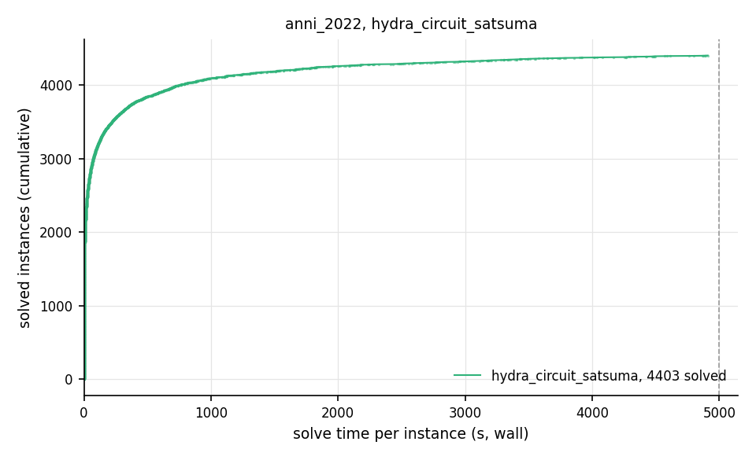

# Competition Benchmark Results (index=anni_2022.jsonl, timeout=5000s, backend=hydra_circuit_satsuma, parallel=10)

From the duo run in `/Users/greg/projects/sat_benchmarks/runs/anni_2022_duo`, alongside satsuma; checks off; sat at 59baa26.

## Summary

| Result | Count | % |
|--------|-------|---|
| SAT | 1991 | 37.2% |
| UNSAT | 2412 | 45.0% |
| TIMEOUT | 952 | 17.8% |
| **Total** | 5355 | 100% |

## Cactus plot

## Per-problem results

| Problem | Result | Solve time | UNSAT proof time | Paths | Total | Conf | Rst |
|---------|--------|------------|------------------|-------|-------|------|-----|
| 6s16 | UNSAT | 0.8961s | skipped (--no-verify) | — | — | — | — |
| snw_13_9_pre | SAT | 10.7789s | — | — | — | — | — |
| traffic_f_unknown | UNSAT | 79.8115s | skipped (--no-verify) | — | — | — | — |
| rope_0030.shuffled | UNSAT | 0.6044s | skipped (--no-verify) | — | — | — | — |
| fclqcolor-20-15-15.shuffled-as.sat05-1270 | SAT | 1.0482s | — | — | — | — | — |
| rphp4_065_shuffled | UNSAT | 0.3739s | skipped (--no-verify) | — | — | — | — |
| SGI_30_60_24_40_2-dir.shuffled-as.sat03-118 | UNSAT | 153.7553s | skipped (--no-verify) | — | — | — | — |
| spg_420_280 | UNSAT | 91.5581s | skipped (--no-verify) | — | — | — | — |
| 4col220_9_1.shuffled | SAT | 585.2702s | — | — | — | — | — |
| mm-2x2-5-0-s.1.shuffled-as.sat03-1496 | UNSAT | 0.6661s | skipped (--no-verify) | — | — | — | — |
| ex179_11 | SAT | 52.871s | — | — | — | — | — |
| desmul.miter.used-as.sat04-330 | UNSAT | 4.3929s | skipped (--no-verify) | — | — | — | — |
| ctl_4291_567_7_unsat | UNSAT | 301.4844s | skipped (--no-verify) | — | — | — | — |
| SAT_dat.k10 | UNSAT | 58.1196s | skipped (--no-verify) | — | — | — | — |
| ortholatin-7 | SAT | 6.8638s | — | — | — | — | — |
| ibm-2004-03-k70 | SAT | 3.8741s | — | — | — | — | — |
| barman-pfile10-038.sas.ex.15 | UNSAT | 39.7845s | skipped (--no-verify) | — | — | — | — |
| minand064 | UNSAT | 0.991s | skipped (--no-verify) | — | — | — | — |
| iso-brn008.shuffled-as.sat05-2933 | SAT | 0.2748s | — | — | — | — | — |
| hwb-n24-01-S1048418025.shuffled-as.sat03-1617 | UNSAT | 46.4151s | skipped (--no-verify) | — | — | — | — |
| ndist.b.21497 | SAT | 2.6521s | — | — | — | — | — |
| sgen4-sat-280-8 | TIMEOUT | 4998.2894s | — | — | — | — | — |
| rand_net70-40-10.shuffled | UNSAT | 0.3097s | skipped (--no-verify) | — | — | — | — |
| vmpc_28.shuffled-as.sat05-1957 | SAT | 85.5417s | — | — | — | — | — |
| 3col20_5_6.shuffled | UNSAT | 0.3036s | skipped (--no-verify) | — | — | — | — |
| phnf-size10-exclusive-equilarge_l3.used-as.sat04-895.sat05-4189.reshuffled-07 | TIMEOUT | 4999.2748s | — | — | — | — | — |
| sp4-33-bin-nons-flat-noid | UNSAT | 55.9721s | skipped (--no-verify) | — | — | — | — |
| 3col60_5_9.shuffled | UNSAT | 0.3221s | skipped (--no-verify) | — | — | — | — |
| SC21_Timetable_C_140_E_29_Cl_10_S_15 | TIMEOUT | 4999.0955s | — | — | — | — | — |
| slp-synthesis-aes-top27 | SAT | 22.2001s | — | — | — | — | — |
| eqspwtrc16bparrc16 | TIMEOUT | 4998.2498s | — | — | — | — | — |
| f8bidw | UNSAT | 93.301s | skipped (--no-verify) | — | — | — | — |
| gensys-icl003.shuffled-as.sat05-3824 | UNSAT | 17.1725s | skipped (--no-verify) | — | — | — | — |
| rope_0012.shuffled | UNSAT | 0.3226s | skipped (--no-verify) | — | — | — | — |
| ssAES_4-4-8_round_8-10_faultAt_8_fault_injections_2_seed_1579630418 | SAT | 154.8762s | — | — | — | — | — |
| shift1add.10000 | UNSAT | 10.0046s | skipped (--no-verify) | — | — | — | — |
| SGI_30_70_28_60_1-log.shuffled-as.sat03-176 | TIMEOUT | 4998.3538s | — | — | — | — | — |
| aim-200-6_0-yes1-4.mis-135.debugged | TIMEOUT | 4998.5698s | — | — | — | — | — |
| 9symml_gr_2pin_w6.shuffled | SAT | 0.6045s | — | — | — | — | — |
| smulo016 | UNSAT | 2.8662s | skipped (--no-verify) | — | — | — | — |
| mrpp_6x6#18_20 | SAT | 13.2331s | — | — | — | — | — |
| SGI_30_70_27_50_3-dir.shuffled-as.sat03-169 | UNSAT | 1442.2648s | skipped (--no-verify) | — | — | — | — |
| connm-ue-csp-sat-n600-d0.04-s1979668539.used-as.sat04-981 | UNSAT | 17.4435s | skipped (--no-verify) | — | — | — | — |
| T107.2.0 | UNSAT | 216.9283s | skipped (--no-verify) | — | — | — | — |
| crafted_n12_d6_c3_num26 | UNSAT | 88.3266s | skipped (--no-verify) | — | — | — | — |
| ecgrid6x155_shuffled | UNSAT | 3437.6987s | skipped (--no-verify) | — | — | — | — |
| E04F19 | SAT | 6.098s | — | — | — | — | — |
| shuffling-2-s1480152728-of-bench-sat04-434.used-as.sat04-711 | UNSAT | 56.5155s | skipped (--no-verify) | — | — | — | — |
| urquhart3_25bis.shuffled | UNSAT | 0.0016s | veripb (not run here) | — | — | — | — |
| manol-pipe-c10id_s | UNSAT | 2.1532s | skipped (--no-verify) | — | — | — | — |
| 10pipe_q0_k | UNSAT | 140.7132s | skipped (--no-verify) | — | — | — | — |
| 003-23-80 | SAT | 399.9911s | — | — | — | — | — |
| mrpp_4x4#12_12 | UNSAT | 5.5289s | skipped (--no-verify) | — | — | — | — |
| arcfour_initialPermutation_6_14 | UNSAT | 139.3067s | skipped (--no-verify) | — | — | — | — |
| velev-npe-1.0-9dlx-b71 | TIMEOUT | 4999.1635s | — | — | — | — | — |
| cms-scheel-md5-families-r24-c11-p1-4-6-9-10-11-13-15-17-18-19 | SAT | 35.3883s | — | — | — | — | — |
| slp-synthesis-aes-bottom24 | TIMEOUT | 4998.2358s | — | — | — | — | — |
| mp1-squ_ali_s10x10_c39_abio_SAT | SAT | 135.7842s | — | — | — | — | — |
| sgen1-unsat-139-100.mis-105.debugged | TIMEOUT | 4998.2382s | — | — | — | — | — |
| sdiv40prop | TIMEOUT | 4998.228s | — | — | — | — | — |
| goldb-heqc-i8mul | UNSAT | 16.2384s | skipped (--no-verify) | — | — | — | — |
| mrpp_6x6#12_8 | UNSAT | 0.3467s | skipped (--no-verify) | — | — | — | — |
| ctl_4201_555_unsat | UNSAT | 558.7941s | skipped (--no-verify) | — | — | — | — |
| SC21_Timetable_C_542_E_71_Cl_36_S_35 | SAT | 84.9851s | — | — | — | — | — |
| 53-131587 | SAT | 1253.8315s | — | — | — | — | — |
| 8-5-6 | SAT | 461.7958s | — | — | — | — | — |
| EDP3-12000 | SAT | 57.0458s | — | — | — | — | — |
| ps_200_300_70 | UNSAT | 248.2474s | skipped (--no-verify) | — | — | — | — |
| equilarge_l5.sat05-522.reshuffled-07 | TIMEOUT | 4998.3662s | — | — | — | — | — |
| pyhala-braun-sat-35-4-04.shuffled | SAT | 0.1569s | — | — | — | — | — |
| smtlib-qfbv-aigs-countbits128-tseitin | UNSAT | 2019.1001s | skipped (--no-verify) | — | — | — | — |
| Urquhart-s3-b3.shuffled-as.sat03-1556 | UNSAT | 0.0019s | veripb (not run here) | — | — | — | — |
| Q3inK08 | SAT | 0.2651s | — | — | — | — | — |
| dead-dnd008.shuffled-as.sat05-3114 | UNSAT | 304.7578s | skipped (--no-verify) | — | — | — | — |
| g2-hwmcc15deep-bobpcihm-k32 | UNSAT | 3579.0031s | skipped (--no-verify) | — | — | — | — |
| ncc_none_7047_6_3_3_0_0_420 | UNSAT | 177.8587s | skipped (--no-verify) | — | — | — | — |
| clauses-8 | SAT | 150.4729s | — | — | — | — | — |
| traffic_b_unsat | UNSAT | 79.0468s | skipped (--no-verify) | — | — | — | — |
| php-025-024.shuffled-as.sat05-1191 | UNSAT | 0.0032s | veripb (not run here) | — | — | — | — |
| Kakuro-easy-117-ext.xml.hg_5 | SAT | 143.0186s | — | — | — | — | — |
| blocks-4-ipc5-h21-unknown | UNSAT | 19.7868s | skipped (--no-verify) | — | — | — | — |
| rbsat-v945c61409gyes1 | TIMEOUT | 4998.3374s | — | — | — | — | — |
| b2005-p2-14x14c17h9-Ser4-0 | TIMEOUT | 4999.154s | — | — | — | — | — |
| partial-10-17-u | TIMEOUT | 4998.3596s | — | — | — | — | — |
| total-5-15-u | TIMEOUT | 4998.3732s | — | — | — | — | — |
| mod4block_2vars_10gates_u2_autoenc-sc2009 | SAT | 39.523s | — | — | — | — | — |
| li-test4-97.shuffled-as.sat03-375 | TIMEOUT | 4998.2628s | — | — | — | — | — |
| urqh2x5.shuffled-as.sat03-1473 | UNSAT | 0.0014s | veripb (not run here) | — | — | — | — |
| AProVE07-27 | UNSAT | 71.9299s | skipped (--no-verify) | — | — | — | — |
| vmpc_34.shuffled-as.sat05-1958-sc2005 | TIMEOUT | 4998.2895s | — | — | — | — | — |
| aes_decry_2_rounds.debugged | UNSAT | 89.9177s | skipped (--no-verify) | — | — | — | — |
| AProVE09-17 | SAT | 2.7547s | — | — | — | — | — |
| 3col120_5_2.shuffled | SAT | 0.4017s | — | — | — | — | — |
| mm-1x10-10-10-sb.1.shuffled-as.sat03-1489 | SAT | 2.9662s | — | — | — | — | — |
| 6s133-sc2014 | UNSAT | 1.1249s | skipped (--no-verify) | — | — | — | — |
| genurq8Sat.shuffled-as.sat03-1514 | SAT | 0.3598s | — | — | — | — | — |
| ablmulub2x32o-sc2016 | UNSAT | 66.9597s | skipped (--no-verify) | — | — | — | — |
| connm-ue-csp-sat-n1200-d-0.02-s1528687777.used-as.sat04-953 | SAT | 1411.9715s | — | — | — | — | — |
| satch2ways16w | TIMEOUT | 4998.2929s | — | — | — | — | — |
| x2_128.shuffled-as.sat03-1598 | UNSAT | 0.003s | veripb (not run here) | — | — | — | — |
| 20-100-lambda100-49_sat | SAT | 63.0123s | — | — | — | — | — |
| atco_enc3_opt1_03_53 | SAT | 196.4428s | — | — | — | — | — |
| ctl_4291_567_1_unsat_pre | UNSAT | 712.1576s | skipped (--no-verify) | — | — | — | — |
| SGI_30_80_21_90_2-log.shuffled-as.sat03-198 | TIMEOUT | 4998.2712s | — | — | — | — | — |
| rook-55-0-1 | TIMEOUT | 4998.29s | — | — | — | — | — |
| 3col300_5_2.shuffled | SAT | 3.3571s | — | — | — | — | — |
| 3col280_5_8.shuffled | SAT | 2.1519s | — | — | — | — | — |
| edges-025-4-7932777-1-00 | UNSAT | 4285.7666s | skipped (--no-verify) | — | — | — | — |
| TimetableCNFEncoding_5_UNKNOWN-sc2018 | TIMEOUT | 4998.3971s | — | — | — | — | — |
| satsgi-n23himBHm26-p0-q248 | SAT | 0.2409s | — | — | — | — | — |
| rope_0003.shuffled | UNSAT | 0.2292s | skipped (--no-verify) | — | — | — | — |
| 4g_5color_166_100_02 | SAT | 1105.8458s | — | — | — | — | — |
| marg2x5.shuffled-as.sat03-1443 | UNSAT | 0.0007s | veripb (not run here) | — | — | — | — |
| mod3block_2vars_9gates_u2_autoenc | TIMEOUT | 4998.2606s | — | — | — | — | — |
| SGI_30_40_30_20_2-dir.shuffled-as.sat05-442 | UNSAT | 276.7622s | skipped (--no-verify) | — | — | — | — |
| Kakuro-easy-125-ext.xml.hg_4 | UNSAT | 2643.5079s | skipped (--no-verify) | — | — | — | — |
| jgiraldezlevy.2200.9086.08.40.136 | SAT | 19.7854s | — | — | — | — | — |
| longmult9 | UNSAT | 1.368s | skipped (--no-verify) | — | — | — | — |
| shuffling-2-s554396412-of-bench-sat04-318.used-as.sat04-598 | UNSAT | 312.5061s | skipped (--no-verify) | — | — | — | — |
| dead-dnd006.shuffled-as.sat05-3112 | UNSAT | 192.7906s | skipped (--no-verify) | — | — | — | — |
| new-difficult-28-302-26-75 | SAT | 0.355s | — | — | — | — | — |
| ctl_4291_567_9_unsat_pre | UNSAT | 367.8545s | skipped (--no-verify) | — | — | — | — |
| hypercube4.shuffled-as.sat03-1434 | UNSAT | 0.001s | veripb (not run here) | — | — | — | — |
| frb45-21-1.used-as.sat04-883 | SAT | 591.6991s | — | — | — | — | — |
| EDP3-50000 | TIMEOUT | 4998.5504s | — | — | — | — | — |
| unsat-set-a-fclqcolor-20-13-14.sat05-1278.reshuffled-07-sc2007 | UNSAT | 0.46s | skipped (--no-verify) | — | — | — | — |
| UTI-20-10p0-sc2009 | UNSAT | 226.2209s | skipped (--no-verify) | — | — | — | — |
| shuffling-2-s2123257475-of-bench-sat04-327.used-as.sat04-589 | UNSAT | 3.2725s | skipped (--no-verify) | — | — | — | — |
| Q32inK10 | UNSAT | 0.6324s | skipped (--no-verify) | — | — | — | — |
| baseballcover14with25 | UNSAT | 70.7197s | skipped (--no-verify) | — | — | — | — |
| mrpp_6x6#14_12 | SAT | 1.4044s | — | — | — | — | — |
| g2-T96.1.1 | UNSAT | 29.2184s | skipped (--no-verify) | — | — | — | — |
| mod2c-rand3bip-sat-230-1.shuffled-as.sat05-2503 | SAT | 18.8546s | — | — | — | — | — |
| battleship-13-25-sat | SAT | 0.2894s | — | — | — | — | — |
| hwb-n30-01-S682466202.shuffled-as.sat03-1632 | TIMEOUT | 4998.2377s | — | — | — | — | — |
| rubikcube701-sc2017 | UNSAT | 743.1176s | skipped (--no-verify) | — | — | — | — |
| aes_32_2_keyfind_1 | SAT | 187.6252s | — | — | — | — | — |
| rbsat-v945c61409g4 | SAT | 111.682s | — | — | — | — | — |
| g2-newton.8.3.i.smt2-cvc4 | SAT | 6.745s | — | — | — | — | — |
| f2clk_40.shuffled | UNSAT | 12.3228s | skipped (--no-verify) | — | — | — | — |
| ex065_24 | TIMEOUT | 4998.7991s | — | — | — | — | — |
| safe009_pso.oepc_true-unreach-call.i-cbmc-u2 | UNSAT | 55.2755s | skipped (--no-verify) | — | — | — | — |
| gensys-icl003.shuffled-as.sat05-2715 | UNSAT | 2.969s | skipped (--no-verify) | — | — | — | — |
| mp1-Nb5T15 | SAT | 10.1101s | — | — | — | — | — |
| 5col120_15_5.shuffled | UNSAT | 52.6509s | skipped (--no-verify) | — | — | — | — |
| equilarge_l2.shuffled-as.sat05-519 | TIMEOUT | 4998.2622s | — | — | — | — | — |
| 3col260_5_9.shuffled | SAT | 1.6146s | — | — | — | — | — |
| sat-strips-gripper-12t23.sat05-1144.reshuffled-07 | SAT | 1.1792s | — | — | — | — | — |
| easier-php-035-029.sat05-1179.reshuffled-07 | UNSAT | 0.0059s | veripb (not run here) | — | — | — | — |
| em_7_4_9_cmp | SAT | 1.2546s | — | — | — | — | — |
| crafted_n10_d6_c4_num10 | UNSAT | 99.343s | skipped (--no-verify) | — | — | — | — |
| SGI_30_80_29_60_7-dir.shuffled-as.sat03-217 | TIMEOUT | 4998.2596s | — | — | — | — | — |
| dated-5-13-u | UNSAT | 201.8676s | skipped (--no-verify) | — | — | — | — |
| 3col160_5_6.shuffled | SAT | 0.2905s | — | — | — | — | — |
| rnd-v25-e13-k3 | SAT | 1.8464s | — | — | — | — | — |
| atco_enc1_opt1_15_240 | SAT | 10.2288s | — | — | — | — | — |
| minor032 | UNSAT | 0.4331s | skipped (--no-verify) | — | — | — | — |
| g2-T133.2.1 | TIMEOUT | 4999.0869s | — | — | — | — | — |
| q_query_3_l45_lambda | UNSAT | 24.7726s | skipped (--no-verify) | — | — | — | — |
| VanDerWaerden_2-3-12_135 | UNSAT | 41.4987s | skipped (--no-verify) | — | — | — | — |
| mrpp_6x6#14_10 | SAT | 0.8462s | — | — | — | — | — |
| mp1-9_3 | SAT | 4.4509s | — | — | — | — | — |
| g2-T103.2.1 | UNSAT | 757.1095s | skipped (--no-verify) | — | — | — | — |
| ezfact64_9.shuffled-as.sat03-1525 | SAT | 0.0803s | — | — | — | — | — |
| SGI_30_80_23_90_10-log.shuffled-as.sat03-202 | TIMEOUT | 4998.2877s | — | — | — | — | — |
| Mycielski-11-hints-3 | UNSAT | 395.5095s | skipped (--no-verify) | — | — | — | — |
| VanDerWaerden_pd_2-3-24_592 | SAT | 2846.0064s | — | — | — | — | — |
| bqwh.50.750.shuffled-as.sat05-434 | TIMEOUT | 4998.2987s | — | — | — | — | — |
| slp-synthesis-aes-bottom22 | TIMEOUT | 4998.4418s | — | — | — | — | — |
| s85-100 | UNSAT | 81.7084s | skipped (--no-verify) | — | — | — | — |
| sgen1-sat-230-100 | TIMEOUT | 4998.2235s | — | — | — | — | — |
| partial-10-11-u-sc2007 | TIMEOUT | 4998.2826s | — | — | — | — | — |
| satsgi-n24himBHm28-p0-q282 | SAT | 0.2749s | — | — | — | — | — |
| bvslt_13916 | UNSAT | 103.9059s | skipped (--no-verify) | — | — | — | — |
| hwb-n32-01-S1491788039.shuffled-as.sat03-1637 | TIMEOUT | 4998.2526s | — | — | — | — | — |
| barman-pfile10-038.sas.cr.25 | UNSAT | 22.6442s | skipped (--no-verify) | — | — | — | — |
| satcoin-genesis-SAT-4 | SAT | 3.5087s | — | — | — | — | — |
| VanDerWaerden_pd_2-3-29_809 | TIMEOUT | 4998.3628s | — | — | — | — | — |
| rook-51-0-0 | UNSAT | 1085.1453s | skipped (--no-verify) | — | — | — | — |
| smtlib-qfbv-aigs-bin_libsmbsharemodes_vc6201-tseitin | SAT | 1.8038s | — | — | — | — | — |
| depots3_v01a.renamed-as.sat05-3950 | SAT | 0.4285s | — | — | — | — | — |
| puzzle35_sat | SAT | 3683.4292s | — | — | — | — | — |
| ezfact32_10.shuffled | SAT | 0.0166s | — | — | — | — | — |
| slp-synthesis-aes-bottom16 | UNSAT | 1449.0381s | skipped (--no-verify) | — | — | — | — |
| VanDerWaerden_2-3-16_238 | TIMEOUT | 4998.2995s | — | — | — | — | — |
| sokoban-p20.sas.cr.27 | UNSAT | 3858.1288s | skipped (--no-verify) | — | — | — | — |
| crafted_n12_d6_c4_num27 | UNSAT | 125.2656s | skipped (--no-verify) | — | — | — | — |
| SGI_30_60_28_40_2-dir.shuffled-as.sat03-124-sc2002 | UNSAT | 1672.2032s | skipped (--no-verify) | — | — | — | — |
| driverlog2_v01a.renamed-as.sat05-3961 | SAT | 0.3784s | — | — | — | — | — |
| udiv45prop | UNSAT | 481.991s | skipped (--no-verify) | — | — | — | — |
| g2-mult1.c.50.smt2-cvc4 | SAT | 2.6863s | — | — | — | — | — |
| complete-500-0.1-1-9876543215001 | SAT | 0.6246s | — | — | — | — | — |
| satcoin-genesis-SAT-10 | SAT | 4.2149s | — | — | — | — | — |
| edn_9789_8_0.51000000.unsat | UNSAT | 9.3539s | skipped (--no-verify) | — | — | — | — |
| gcdmax16bits_22 | SAT | 18.6224s | — | — | — | — | — |
| T84.2.0 | UNSAT | 276.1525s | skipped (--no-verify) | — | — | — | — |
| at-least-two-smtlib-qfbv-aigs-ext_con_032_008_0256-tseitin | UNSAT | 5.6101s | skipped (--no-verify) | — | — | — | — |
| 20180321_140826713_p_cnf_320_1120 | SAT | 1.3891s | — | — | — | — | — |
| mod2c-rand3bip-unsat-120-3.shuffled-as.sat05-2340 | UNSAT | 0.5442s | skipped (--no-verify) | — | — | — | — |
| x1.1_64.shuffled-as.sat03-1585 | UNSAT | 0.0018s | veripb (not run here) | — | — | — | — |
| 3col140_5_1.shuffled | SAT | 0.47s | — | — | — | — | — |
| 26_stack_cas_longest_true-unreach-call.i-cbmc-u2-sc2016 | SAT | 115.1537s | — | — | — | — | — |
| lksat-n900-m3357-k3-l5-s241765501.used-as.sat04-936 | SAT | 0.392s | — | — | — | — | — |
| x2_16.shuffled | UNSAT | 0.0007s | veripb (not run here) | — | — | — | — |
| mrpp_6x6#12_9 | SAT | 0.6832s | — | — | — | — | — |
| instance_n8_i9_pp_ci_ce | TIMEOUT | 4998.3262s | — | — | — | — | — |
| 008 | SAT | 689.2274s | — | — | — | — | — |
| connm-ue-csp-sat-n1200-d0.00-s1415961664.shuffled-as.sat05-529 | TIMEOUT | 4998.2935s | — | — | — | — | — |
| hypercube5.shuffled-as.sat03-1435 | UNSAT | 0.0021s | veripb (not run here) | — | — | — | — |
| tseitingrid6x175_shuffled | UNSAT | 0.0273s | veripb (not run here) | — | — | — | — |
| marg5x5.shuffled-as.sat03-1455 | UNSAT | 0.0017s | veripb (not run here) | — | — | — | — |
| rand_net40-60-1.shuffled | UNSAT | 0.3559s | skipped (--no-verify) | — | — | — | — |
| puzzle47_sat | TIMEOUT | 4998.3547s | — | — | — | — | — |
| ctl_4201_555_unsat_pre | UNSAT | 663.0658s | skipped (--no-verify) | — | — | — | — |
| hidden-k3-s0-r5-n700-03-S1609878926.shuffled-as.sat05-487 | TIMEOUT | 4998.2809s | — | — | — | — | — |
| UTI-20-10t1 | SAT | 10.748s | — | — | — | — | — |
| x2_72.shuffled-as.sat03-1604 | UNSAT | 0.002s | veripb (not run here) | — | — | — | — |
| mod2c-rand3bip-unsat-105-3.shuffled-as.sat05-2325 | UNSAT | 0.5516s | skipped (--no-verify) | — | — | — | — |
| gt-ordering-unsat-gt-045.sat05-1310.reshuffled-07 | UNSAT | 3.4552s | skipped (--no-verify) | — | — | — | — |
| bv-term-small-rw_1492.smt2 | SAT | 0.3568s | — | — | — | — | — |
| gss-18-s100 | SAT | 89.8386s | — | — | — | — | — |
| comb3.shuffled | UNSAT | 1.3548s | skipped (--no-verify) | — | — | — | — |
| Kakuro-easy-089-ext.xml.hg_4 | SAT | 88.6519s | — | — | — | — | — |
| edn_20403_12_0.08000000.unsat | UNSAT | 3.7255s | skipped (--no-verify) | — | — | — | — |
| 6-4-6-sc2018 | TIMEOUT | 4998.3336s | — | — | — | — | — |
| barman-pfile07-027.sas.cr.37 | UNSAT | 35.1641s | skipped (--no-verify) | — | — | — | — |
| ccp-s8-facto3 | UNSAT | 0.0125s | veripb (not run here) | — | — | — | — |
| dspam_dump_vc972 | UNSAT | 4.0322s | skipped (--no-verify) | — | — | — | — |
| satcoin-genesis-SAT-64 | SAT | 3.8816s | — | — | — | — | — |
| atco_enc1_opt2_10_15 | UNSAT | 63.0547s | skipped (--no-verify) | — | — | — | — |
| tseitingrid5x185_shuffled | UNSAT | 0.0248s | veripb (not run here) | — | — | — | — |
| mp1-klieber2017s-0500-023-t12 | SAT | 71.0164s | — | — | — | — | — |
| 4col280_9_9.shuffled | TIMEOUT | 4998.3138s | — | — | — | — | — |
| Eternity-10-06_c18 | SAT | 377.4863s | — | — | — | — | — |
| c6bi_i | UNSAT | 10.4265s | skipped (--no-verify) | — | — | — | — |
| sgi-difficult4 | SAT | 0.2972s | — | — | — | — | — |
| size_4_5_5_i037_w31_r9 | UNSAT | 978.5926s | skipped (--no-verify) | — | — | — | — |
| MD5-28-3 | SAT | 973.9324s | — | — | — | — | — |
| transport-transport-city-sequential-25nodes-1000size-3degree-100mindistance-3trucks-10packages-2008seed.060-SAT | SAT | 24.3988s | — | — | — | — | — |
| g2-hwmcc15deep-bob12s02-k16 | TIMEOUT | 4998.298s | — | — | — | — | — |
| mm-2x3-8-8-sb.1.shuffled-as.sat03-1504 | UNSAT | 220.7298s | skipped (--no-verify) | — | — | — | — |
| hsat_vc12072 | UNSAT | 6.9863s | skipped (--no-verify) | — | — | — | — |
| GreenTao_2-3-5_528 | UNSAT | 121.2645s | skipped (--no-verify) | — | — | — | — |
| abw-V-nos6.mtx-w220 | SAT | 169.69s | — | — | — | — | — |
| Haystacks-ext-12_c18 | UNSAT | 92.2535s | skipped (--no-verify) | — | — | — | — |
| by-X-2-7-100 | UNSAT | 517.5484s | skipped (--no-verify) | — | — | — | — |
| total-10-11-u | UNSAT | 9.3127s | skipped (--no-verify) | — | — | — | — |
| SGI_30_70_28_60_5-dir.shuffled-as.sat03-177 | TIMEOUT | 4998.2933s | — | — | — | — | — |
| AProVE09-03 | SAT | 1.6139s | — | — | — | — | — |
| mrpp_8x8#24_14 | SAT | 7.3436s | — | — | — | — | — |
| rbsat-v945c61409gyes2 | SAT | 406.4859s | — | — | — | — | — |
| Steiner-9-5-bce | UNSAT | 0.3134s | skipped (--no-verify) | — | — | — | — |
| blocks-blocks-36-0.160-NOTKNOWN | SAT | 68.4092s | — | — | — | — | — |
| eqbpdtlf18sparcl18 | TIMEOUT | 4998.3151s | — | — | — | — | — |
| fdmus_b15_296 | UNSAT | 0.3789s | skipped (--no-verify) | — | — | — | — |
| marg3x5.shuffled-as.sat03-1452 | UNSAT | 0.0011s | veripb (not run here) | — | — | — | — |
| mrpp_8x8#20_14 | SAT | 7.421s | — | — | — | — | — |
| test_v7_r17_vr5_c1_s25451.smt2-cvc4 | TIMEOUT | 4998.4622s | — | — | — | — | — |
| phnf-size10-exclusive-equilarge_l2.used-as.sat04-894.sat05-4188.reshuffled-07 | TIMEOUT | 4998.4503s | — | — | — | — | — |
| genurq25Sat.shuffled-as.sat03-1507 | SAT | 9.961s | — | — | — | — | — |
| T93.2.0 | UNSAT | 312.9717s | skipped (--no-verify) | — | — | — | — |
| manol-pipe-c10nidw | UNSAT | 202.3203s | skipped (--no-verify) | — | — | — | — |
| fclqcolor-14-09-12.shuffled-as.sat05-1284 | UNSAT | 0.3171s | skipped (--no-verify) | — | — | — | — |
| Schur_161_5_d43 | UNSAT | 64.2351s | skipped (--no-verify) | — | — | — | — |
| Mat323.shuffled | TIMEOUT | 4998.2829s | — | — | — | — | — |
| mp1-klieber2017s-0300-034-t12 | SAT | 35.8065s | — | — | — | — | — |
| test_v7_r7_vr10_c1_s32506.smt2-cvc4 | SAT | 98.5378s | — | — | — | — | — |
| shuffling-1-s1931574585-of-bench-sat04-328.used-as.sat04-449 | UNSAT | 4.1239s | skipped (--no-verify) | — | — | — | — |
| crafted_n11_d6_c3_num4 | UNSAT | 83.5913s | skipped (--no-verify) | — | — | — | — |
| countbitsarray32_32 | TIMEOUT | 4998.2818s | — | — | — | — | — |
| modgen-n200-m90860q08c40-21438 | UNSAT | 0.3016s | skipped (--no-verify) | — | — | — | — |
| modgen-n200-m90860q08c40-14424 | UNSAT | 6.7193s | skipped (--no-verify) | — | — | — | — |
| ssAES_4-4-4_round_7-10_faultAt_7_fault_injections_2_seed_1564286498 | TIMEOUT | 4998.2804s | — | — | — | — | — |
| E03N17 | UNSAT | 0.9932s | skipped (--no-verify) | — | — | — | — |
| strips-gripper-18t35.shuffled-as.sat05-1147 | SAT | 58.7253s | — | — | — | — | — |
| VanDerWaerden_2-3-19_349 | TIMEOUT | 4998.2841s | — | — | — | — | — |
| instance_n3_i3_pp | SAT | 0.2871s | — | — | — | — | — |
| crafted_n11_d6_c4_num19 | UNSAT | 109.1843s | skipped (--no-verify) | — | — | — | — |
| phnf-size10-exclusive-equilarge_l1.used-as.sat04-893.sat05-4187.reshuffled-07 | TIMEOUT | 4998.5349s | — | — | — | — | — |
| k2fix_gr_2pin_w9.shuffled-as.sat03-438 | UNSAT | 13.6772s | skipped (--no-verify) | — | — | — | — |
| pyhala-braun-sat-40-4-03.shuffled-as.sat03-1541 | SAT | 0.2285s | — | — | — | — | — |
| ctl_4291_567_5_unsat_pre | TIMEOUT | 4998.2826s | — | — | — | — | — |
| mp1-blockpuzzle_8x8_s1_free4 | UNSAT | 7.174s | skipped (--no-verify) | — | — | — | — |
| cnt07.shuffled | SAT | 0.432s | — | — | — | — | — |
| udiv48prop | UNSAT | 716.2224s | skipped (--no-verify) | — | — | — | — |
| hwb-n20-03-S1899964371.shuffled-as.sat03-1609 | UNSAT | 2.11s | skipped (--no-verify) | — | — | — | — |
| Urquhart-s5-b7.shuffled | UNSAT | 0.0042s | veripb (not run here) | — | — | — | — |
| ferry10_v01a.renamed-as.sat05-3993 | SAT | 0.4576s | — | — | — | — | — |
| rphp4_100_shuffled | UNSAT | 0.3677s | skipped (--no-verify) | — | — | — | — |
| maxor032 | UNSAT | 2.9884s | skipped (--no-verify) | — | — | — | — |
| VanDerWaerden_pd_2-3-21_399 | SAT | 75.6265s | — | — | — | — | — |
| a_rphp045_05 | UNSAT | 1388.2076s | skipped (--no-verify) | — | — | — | — |
| 62bits_11.dimacs | TIMEOUT | 4998.2928s | — | — | — | — | — |
| 5col180_15_2.shuffled | TIMEOUT | 4998.2776s | — | — | — | — | — |
| pb_300_04_lb_06 | UNSAT | 54.8367s | skipped (--no-verify) | — | — | — | — |
| rbsat-v2100c215164gyes4 | TIMEOUT | 4998.2945s | — | — | — | — | — |
| sokoban-p20.sas.cr.33 | TIMEOUT | 4998.3799s | — | — | — | — | — |
| SGI_30_60_25_40_2-dir.shuffled-as.sat03-120 | UNSAT | 721.5778s | skipped (--no-verify) | — | — | — | — |
| 9pipe_k | UNSAT | 226.8809s | skipped (--no-verify) | — | — | — | — |
| sokoban-p20.sas.cr.39 | TIMEOUT | 4998.38s | — | — | — | — | — |
| dislog_a14_x14_n24 | SAT | 590.5761s | — | — | — | — | — |
| gus-md5-08 | UNSAT | 42.5218s | skipped (--no-verify) | — | — | — | — |
| gripper13u.shuffled-as.sat03-395 | UNSAT | 477.0698s | skipped (--no-verify) | — | — | — | — |
| shuffling-1-s716603489-of-bench-sat04-317.used-as.sat04-460 | SAT | 92.4952s | — | — | — | — | — |
| fermat-907547022132073 | SAT | 31.442s | — | — | — | — | — |
| ndist.b.26986 | SAT | 2.0737s | — | — | — | — | — |
| tseitingrid7x200_shuffled | UNSAT | 0.039s | veripb (not run here) | — | — | — | — |
| partial-5-17-s | SAT | 456.5996s | — | — | — | — | — |
| longmult6 | UNSAT | 0.4688s | skipped (--no-verify) | — | — | — | — |
| pb_400_09_lb_05 | SAT | 36.556s | — | — | — | — | — |
| mrpp_8x8#22_20 | SAT | 14.662s | — | — | — | — | — |
| een-pico-prop05-50 | UNSAT | 3.9853s | skipped (--no-verify) | — | — | — | — |
| vlsat2_16676_1598591.dimacs | SAT | 6.7422s | — | — | — | — | — |
| 52bits_12.dimacs | SAT | 1622.0628s | — | — | — | — | — |
| sat-grid-pbl-0070.sat05-1334.reshuffled-07 | SAT | 10.7615s | — | — | — | — | — |
| phnf-size10-exclusive-equilarge_m3.used-as.sat04-900.sat05-4186.reshuffled-07 | TIMEOUT | 4998.4399s | — | — | — | — | — |
| 002-80-12 | TIMEOUT | 4998.4707s | — | — | — | — | — |
| ae_rphp095_04 | UNSAT | 875.7989s | skipped (--no-verify) | — | — | — | — |
| manthey_single-ordered-initialized-w48-b6 | UNSAT | 102.6634s | skipped (--no-verify) | — | — | — | — |
| UR-20-5p1-sc2009 | SAT | 87.0697s | — | — | — | — | — |
| queen8-8-9 | SAT | 2.2164s | — | — | — | — | — |
| Eternity-10-05_c18 | SAT | 6.432s | — | — | — | — | — |
| transport-transport-city-sequential-25nodes-1000size-3degree-100mindistance-3trucks-10packages-2008seed.040-NOTKNOWN | SAT | 41.2178s | — | — | — | — | — |
| 12pipe_bug7_q0 | SAT | 36.3662s | — | — | — | — | — |
| lksat-n1100-m4103-k3-l5-s558351420.used-as.sat04-934 | SAT | 0.7224s | — | — | — | — | — |
| mp1-9_9 | SAT | 31.6629s | — | — | — | — | — |
| driverlog2_ks99i.shuffled-as.sat05-4019 | SAT | 0.349s | — | — | — | — | — |
| gensys-ukn002.shuffled-as.sat05-3842 | UNSAT | 106.8493s | skipped (--no-verify) | — | — | — | — |
| frg1mul.miter.used-as.sat04-331 | UNSAT | 2.0243s | skipped (--no-verify) | — | — | — | — |
| mp1-24.6 | TIMEOUT | 4998.3423s | — | — | — | — | — |
| crafted_n12_d6_c3_num19 | UNSAT | 163.1731s | skipped (--no-verify) | — | — | — | — |
| Urquhart-s5-b3.shuffled-as.sat03-1572 | UNSAT | 0.0038s | veripb (not run here) | — | — | — | — |
| php-018-018.shuffled-as.sat05-1161 | SAT | 0.3127s | — | — | — | — | — |
| frb53-24-2.used-as.sat04-888 | TIMEOUT | 4998.295s | — | — | — | — | — |
| 289-sat-6x9 | SAT | 0.3063s | — | — | — | — | — |
| puzzle34_unsat | UNSAT | 1146.4203s | skipped (--no-verify) | — | — | — | — |
| pop96_shuffled | UNSAT | 50.4079s | skipped (--no-verify) | — | — | — | — |
| fdmus_b22_355 | UNSAT | 0.3442s | skipped (--no-verify) | — | — | — | — |
| connm-ue-csp-sat-n600-d0.02-s1676244754.shuffled-as.sat05-535 | UNSAT | 30.0292s | skipped (--no-verify) | — | — | — | — |
| modgen-n200-m90860q08c40-16597 | SAT | 1.2715s | — | — | — | — | — |
| shift1add.15982 | UNSAT | 69.9928s | skipped (--no-verify) | — | — | — | — |
| 20-100-lambda100-89_sat | SAT | 79.0749s | — | — | — | — | — |
| rand_net70-40-1.shuffled | UNSAT | 0.3799s | skipped (--no-verify) | — | — | — | — |
| bart19.shuffled | SAT | 0.3146s | — | — | — | — | — |
| par32-2.shuffled-as.sat03-1534 | TIMEOUT | 4998.3319s | — | — | — | — | — |
| AProVE07-01 | UNSAT | 1178.8966s | skipped (--no-verify) | — | — | — | — |
| VanDerWaerden_pd_2-3-18_313 | UNSAT | 4.0856s | skipped (--no-verify) | — | — | — | — |
| srhd-sgi-m27-q255-n25-p15-s2076598 | SAT | 157.1678s | — | — | — | — | — |
| UTI-10-5t1 | SAT | 2.3791s | — | — | — | — | — |
| SAT_dat.k35-31_2_rule_2 | UNSAT | 146.6563s | skipped (--no-verify) | — | — | — | — |
| rnd-v25-e81-k8 | UNSAT | 1840.7318s | skipped (--no-verify) | — | — | — | — |
| LABS_n071_goal001 | UNSAT | 1229.2782s | skipped (--no-verify) | — | — | — | — |
| rnd-v25-e67-k8 | TIMEOUT | 4998.3432s | — | — | — | — | — |
| f7nidw | UNSAT | 42.2928s | skipped (--no-verify) | — | — | — | — |
| hid-uns-enc-6-1-0-0-0-0-30547 | UNSAT | 42.175s | skipped (--no-verify) | — | — | — | — |
| pmg-14-UNSAT.sat05-3942.reshuffled-07 | UNSAT | 0.006s | veripb (not run here) | — | — | — | — |
| T77.2.0 | UNSAT | 281.6896s | skipped (--no-verify) | — | — | — | — |
| g2-T108.2.1 | TIMEOUT | 4999.2224s | — | — | — | — | — |
| g2-ak128boothbg2msisc | SAT | 2.8101s | — | — | — | — | — |
| connm-ue-csp-sat-n1200-d-0.04-s706145924.used-as.sat04-971 | SAT | 650.7658s | — | — | — | — | — |
| 008-80-8 | SAT | 3337.9506s | — | — | — | — | — |
| ibm-2002-04r-k80 | SAT | 15.9834s | — | — | — | — | — |
| mm-2x2-5-5-sb.1.shuffled-as.sat03-1498 | UNSAT | 0.6748s | skipped (--no-verify) | — | — | — | — |
| 6s139 | UNSAT | 14.3125s | skipped (--no-verify) | — | — | — | — |
| mod2-rand3bip-sat-260-3.shuffled-as.sat05-2235 | SAT | 0.0007s | — | — | — | — | — |
| ferry8_v01a.shuffled-as.sat05-4073 | SAT | 0.3683s | — | — | — | — | — |
| vlsat2_112_4223 | UNSAT | 49.7995s | skipped (--no-verify) | — | — | — | — |
| sted1_0x1e3-200 | TIMEOUT | 4998.3008s | — | — | — | — | — |
| crafted_n10_d6_c2_num6 | UNSAT | 37.3233s | skipped (--no-verify) | — | — | — | — |
| 49-132779 | SAT | 130.8054s | — | — | — | — | — |
| s105-100 | UNSAT | 3026.1686s | skipped (--no-verify) | — | — | — | — |
| sted1_0x0-380-sc2018 | TIMEOUT | 4998.2964s | — | — | — | — | — |
| gensys-brn004.shuffled-as.sat05-2748 | SAT | 0.3723s | — | — | — | — | — |
| sat_prob_63 | TIMEOUT | 4998.2859s | — | — | — | — | — |
| SGI_30_70_25_50_7-log.shuffled-as.sat03-162 | UNSAT | 3510.5149s | skipped (--no-verify) | — | — | — | — |
| mm-2x3-6-6-sb.1.shuffled-as.sat03-1502 | UNSAT | 1.9437s | skipped (--no-verify) | — | — | — | — |
| sokoban-p20.sas.ex.21 | TIMEOUT | 4998.3537s | — | — | — | — | — |
| mod2-3cage-unsat-9-18.shuffled-as.sat05-2593 | UNSAT | 0.0011s | veripb (not run here) | — | — | — | — |
| mulhs008 | UNSAT | 2.576s | skipped (--no-verify) | — | — | — | — |
| stone-width3chain-nmarkers-20_shuffled | TIMEOUT | 4999.307s | — | — | — | — | — |
| 3col180_5_6.shuffled | SAT | 0.5733s | — | — | — | — | — |
| g2-ak128boothdiagoaig | TIMEOUT | 4998.4008s | — | — | — | — | — |
| add_01_1000_4.smt2-cvc4 | UNSAT | 8.3236s | skipped (--no-verify) | — | — | — | — |
| 10142772393204023fw.shuffled-as.sat03-1661 | SAT | 0.0779s | — | — | — | — | — |
| c9nidw | UNSAT | 120.7843s | skipped (--no-verify) | — | — | — | — |
| 4pipe_4_ooo | UNSAT | 3.549s | skipped (--no-verify) | — | — | — | — |
| g2-test_v5_r10_vr10_c1_s21502.smt2-cvc4 | UNSAT | 186.5062s | skipped (--no-verify) | — | — | — | — |
| grid-strips-grid-y-3.045-NOTKNOWN | SAT | 152.5665s | — | — | — | — | — |
| shuffling-1-s1722048485-of-bench-sat04-437.used-as.sat04-576 | UNSAT | 2.9849s | skipped (--no-verify) | — | — | — | — |
| too_large_gr_rcs_w9.shuffled | SAT | 0.7673s | — | — | — | — | — |
| 4col240_9_2.shuffled | TIMEOUT | 4998.2931s | — | — | — | — | — |
| modgen-n200-m90860q08c40-18788 | SAT | 7.1131s | — | — | — | — | — |
| traffic_r_sat | SAT | 30.4998s | — | — | — | — | — |
| phnf-size10-exclusive-all.used-as.sat04-986.sat05-4198.reshuffled-07 | UNSAT | 136.504s | skipped (--no-verify) | — | — | — | — |
| g2-T169.1.0 | SAT | 216.4326s | — | — | — | — | — |
| mm-2x3-6-6-s.1.shuffled-as.sat03-1501 | UNSAT | 20.5253s | skipped (--no-verify) | — | — | — | — |
| depots1_v01a.shuffled-as.sat05-4013 | SAT | 0.2684s | — | — | — | — | — |
| SGI_30_40_30_20_2-log.shuffled-as.sat03-105 | UNSAT | 2786.3912s | skipped (--no-verify) | — | — | — | — |
| prime2209-90 | SAT | 2.2466s | — | — | — | — | — |
| AProVE11-12 | SAT | 13.7077s | — | — | — | — | — |
| shuffling-1-s147121172-of-bench-sat04-433.used-as.sat04-572 | UNSAT | 192.1647s | skipped (--no-verify) | — | — | — | — |
| 3col100_5_1.shuffled | SAT | 0.3129s | — | — | — | — | — |
| grain-55-80-0s0-seed-125-45-init-40 | UNSAT | 124.2744s | skipped (--no-verify) | — | — | — | — |
| hcp_CP16_16 | SAT | 24.8476s | — | — | — | — | — |
| mp1-21.3 | SAT | 72.8552s | — | — | — | — | — |
| g2-hwmcc15deep-bobpcihm-k33 | UNSAT | 3234.9917s | skipped (--no-verify) | — | — | — | — |
| rbsat-v2640c305320g6 | TIMEOUT | 4998.2896s | — | — | — | — | — |
| iso-brn008.shuffled-as.sat05-2702 | SAT | 0.4236s | — | — | — | — | — |
| ibm-2002-24r3-k100 | UNSAT | 14.1316s | skipped (--no-verify) | — | — | — | — |
| bvurem_20.smt2 | TIMEOUT | 4998.3073s | — | — | — | — | — |
| unsat-pbl-00150.sat05-1328.reshuffled-07 | UNSAT | 0.8012s | skipped (--no-verify) | — | — | — | — |
| urqh1c5x5.shuffled-as.sat03-1468.mis-103.debugged | TIMEOUT | 4998.3344s | — | — | — | — | — |
| jgiraldezlevy.2200.9086.08.40.41 | SAT | 44.3947s | — | — | — | — | — |
| 59-131147 | SAT | 570.2661s | — | — | — | — | — |
| minand128 | UNSAT | 21.6236s | skipped (--no-verify) | — | — | — | — |
| aaai10-planning-ipc5-pipesworld-18-step16 | SAT | 41.9516s | — | — | — | — | — |
| ca016.shuffled | UNSAT | 0.3098s | skipped (--no-verify) | — | — | — | — |
| Schur_161_5_d39 | UNSAT | 1620.8172s | skipped (--no-verify) | — | — | — | — |
| total-10-13-u | UNSAT | 77.7738s | skipped (--no-verify) | — | — | — | — |
| eqbpwtrc10spctbk10 | UNSAT | 78.6171s | skipped (--no-verify) | — | — | — | — |
| complete-500-0.1-15-98765432150015 | SAT | 0.6173s | — | — | — | — | — |
| Timetable_C_151_E_34_Cl_10_S_4 | TIMEOUT | 4998.3566s | — | — | — | — | — |
| mp1-klieber2017s-1200-024-eq | UNSAT | 44.36s | skipped (--no-verify) | — | — | — | — |
| ndist.b.20499 | SAT | 1.6468s | — | — | — | — | — |
| frb56-25-1.used-as.sat04-889 | SAT | 2284.0172s | — | — | — | — | — |
| sgen1-unsat-85-100 | UNSAT | 165.0075s | skipped (--no-verify) | — | — | — | — |
| pb_300_04_lb_05 | UNSAT | 33.2262s | skipped (--no-verify) | — | — | — | — |
| ccp-s5-facto2 | UNSAT | 0.001s | veripb (not run here) | — | — | — | — |
| gensys-brn100.shuffled-as.sat05-3765 | SAT | 1.1275s | — | — | — | — | — |
| cruxmiter29seed9 | UNSAT | 126.7829s | skipped (--no-verify) | — | — | — | — |
| gensys-icl003.shuffled-as.sat05-3129 | UNSAT | 3.2589s | skipped (--no-verify) | — | — | — | — |
| satellite3_v01a.shuffled-as.sat05-4056 | SAT | 0.2766s | — | — | — | — | — |
| 12pipe_bug4_q0 | SAT | 11.4113s | — | — | — | — | — |
| HCP-470-60 | SAT | 1644.6715s | — | — | — | — | — |
| slp-synthesis-aes-bottom13-sc2011 | UNSAT | 13.2893s | skipped (--no-verify) | — | — | — | — |
| sha1.shuffled | TIMEOUT | 4998.2991s | — | — | — | — | — |
| ex175_18-sc2018 | SAT | 248.0027s | — | — | — | — | — |
| battleship-24-57-sat | SAT | 0.4785s | — | — | — | — | — |
| too_large_gr_rcs_w6.shuffled | UNSAT | 0.577s | skipped (--no-verify) | — | — | — | — |
| 001 | SAT | 346.6644s | — | — | — | — | — |
| 008 | SAT | 3173.1957s | — | — | — | — | — |
| sgp_5-6-8.shuffled-as.sat05-2669 | SAT | 86.1242s | — | — | — | — | — |
| Circuit_multiplier24 | SAT | 108.6995s | — | — | — | — | — |
| tseitingrid6x180_shuffled | UNSAT | 0.0267s | veripb (not run here) | — | — | — | — |
| mulhs016-sc2009 | TIMEOUT | 4998.2887s | — | — | — | — | — |
| 289-sat-6x20 | SAT | 0.4077s | — | — | — | — | — |
| driverlog3_v01a.shuffled-as.sat05-4030 | SAT | 0.3296s | — | — | — | — | — |
| randomG-n17-d05 | UNSAT | 2506.5533s | skipped (--no-verify) | — | — | — | — |
| mp1-22.1 | SAT | 331.6638s | — | — | — | — | — |
| SGI_30_70_30_60_2-dir.shuffled-as.sat03-185 | TIMEOUT | 4998.3032s | — | — | — | — | — |
| cache_10.shuffled | SAT | 13.6561s | — | — | — | — | — |
| dist6.c-sc2018 | UNSAT | 24.857s | skipped (--no-verify) | — | — | — | — |
| srhd-sgi-m32-q369.75-n30-p30-s25693430 | SAT | 0.3781s | — | — | — | — | — |
| ca064.shuffled | UNSAT | 0.3292s | skipped (--no-verify) | — | — | — | — |
| mod3block_4vars_12gates_b2_restricted | TIMEOUT | 4998.3796s | — | — | — | — | — |
| alu4mul.miter.used-as.sat04-326 | UNSAT | 5.656s | skipped (--no-verify) | — | — | — | — |
| 3col80_5_4.shuffled | SAT | 0.3233s | — | — | — | — | — |
| course_flat_0.12_2018_3_5 | TIMEOUT | 4998.4028s | — | — | — | — | — |
| marg3x3add4d1.shuffled-as.sat03-1447 | UNSAT | 0.0008s | veripb (not run here) | — | — | — | — |
| 64bits_11.dimacs | TIMEOUT | 4998.2884s | — | — | — | — | — |
| newton.2.3.i.smt2-stp212 | UNSAT | 196.6207s | skipped (--no-verify) | — | — | — | — |
| 9pipe_q0_k | UNSAT | 99.7624s | skipped (--no-verify) | — | — | — | — |
| unsat-set-a-clqcolor-10-06-07.sat05-1250.reshuffled-07 | UNSAT | 0.3578s | skipped (--no-verify) | — | — | — | — |
| simon-s02b-r4b1k1.1 | SAT | 30.6333s | — | — | — | — | — |
| logistics-rotate-09t6.shuffled-as.sat05-1133 | SAT | 4.9647s | — | — | — | — | — |
| mm-2x3-8-8-s.1.shuffled-as.sat03-1503 | TIMEOUT | 4998.3219s | — | — | — | — | — |
| modgen-n200-m90860q08c40-1585 | SAT | 1.5867s | — | — | — | — | — |
| dp09s09.shuffled | SAT | 0.5761s | — | — | — | — | — |
| driverlog6_v01a.renamed-as.sat05-3968 | SAT | 0.2802s | — | — | — | — | — |
| sted5_0x0-157 | SAT | 1021.7486s | — | — | — | — | — |
| 4col120_9_2.shuffled | UNSAT | 42.1826s | skipped (--no-verify) | — | — | — | — |
| snw_13_8_CCSpreOptpre | UNSAT | 21.8316s | skipped (--no-verify) | — | — | — | — |
| li-exam-64.used-as.sat04-302 | TIMEOUT | 4998.3182s | — | — | — | — | — |
| c8bidw | UNSAT | 39.0759s | skipped (--no-verify) | — | — | — | — |
| rpoc_xits_09_UNSAT | UNSAT | 5.9542s | skipped (--no-verify) | — | — | — | — |
| sortnet-7-ipc5-h15-unsat | TIMEOUT | 4998.3287s | — | — | — | — | — |
| 9vliw_m_9stages_iq3_C1_bug8 | SAT | 47.1707s | — | — | — | — | — |
| traffic_r_uc_sat | SAT | 74.2644s | — | — | — | — | — |
| mod2-rand3bip-sat-230-1.shuffled-as.sat05-2188 | SAT | 0.0005s | — | — | — | — | — |
| prime2209-65 | SAT | 1.599s | — | — | — | — | — |
| Robertson-k8 | UNSAT | 2175.7594s | skipped (--no-verify) | — | — | — | — |
| mrpp_8x8#22_16 | SAT | 13.175s | — | — | — | — | — |
| 10pipe_k | UNSAT | 239.7246s | skipped (--no-verify) | — | — | — | — |
| 4col180_9_1.shuffled | TIMEOUT | 4998.32s | — | — | — | — | — |
| rand_net50-25-1.shuffled | UNSAT | 0.3393s | skipped (--no-verify) | — | — | — | — |
| combined-crypto1-wff-seed-121-wffvars-500-cryptocplx-31-overlap-2 | SAT | 44.5898s | — | — | — | — | — |
| 170058143 | SAT | 25.1174s | — | — | — | — | — |
| EDP3-13000 | SAT | 246.3471s | — | — | — | — | — |
| openstacks-sequencedstrips-nonadl-nonnegated-os-sequencedstrips-p30_3.075-NOTKNOWN | SAT | 22.2367s | — | — | — | — | — |
| c9b_i | UNSAT | 4.9891s | skipped (--no-verify) | — | — | — | — |
| shuffling-2-s961664232-of-bench-sat04-430.used-as.sat04-707 | UNSAT | 360.8546s | skipped (--no-verify) | — | — | — | — |
| aes_64_2_keyfind_1 | TIMEOUT | 4998.3227s | — | — | — | — | — |
| ccp-s6-facto2 | UNSAT | 0.0025s | veripb (not run here) | — | — | — | — |
| 58bits_13.dimacs | TIMEOUT | 4998.285s | — | — | — | — | — |
| p01_lb_05 | UNSAT | 8.6714s | skipped (--no-verify) | — | — | — | — |
| edges-072-3-7902777-18 | UNSAT | 33.8824s | skipped (--no-verify) | — | — | — | — |
| blocks-blocks-37-1.130-NOTKNOWN | UNSAT | 269.0458s | skipped (--no-verify) | — | — | — | — |
| Mycielski-10-hints-8 | TIMEOUT | 4998.4024s | — | — | — | — | — |
| b1904P3-8x8c11h0SAT | TIMEOUT | 4998.3284s | — | — | — | — | — |
| crafted_n10_d6_c4_num3 | UNSAT | 146.6148s | skipped (--no-verify) | — | — | — | — |
| shuffling-1-s1735667200-of-bench-sat04-332.used-as.sat04-445 | UNSAT | 5.8105s | skipped (--no-verify) | — | — | — | — |
| dp02s02.shuffled | SAT | 0.2749s | — | — | — | — | — |
| maximum_constrained_partition_18_bits_n200 | SAT | 29.6846s | — | — | — | — | — |
| gensys-brn003.shuffled-as.sat05-2680 | SAT | 0.5888s | — | — | — | — | — |
| tseitingrid7x135_shuffled | UNSAT | 0.0285s | veripb (not run here) | — | — | — | — |
| ferry10.shuffled-as.sat03-378 | SAT | 0.3753s | — | — | — | — | — |
| gt-016.shuffled-as.sat05-1291 | UNSAT | 0.3886s | skipped (--no-verify) | — | — | — | — |
| lksat-n1100-m7545-k4-l4-s420878730.used-as.sat04-926 | SAT | 3.4133s | — | — | — | — | — |
| rand_net40-40-5.shuffled | UNSAT | 0.3077s | skipped (--no-verify) | — | — | — | — |
| ccp-s8-facto1 | UNSAT | 0.0017s | veripb (not run here) | — | — | — | — |
| ecgrid6x210_shuffled | TIMEOUT | 4998.2948s | — | — | — | — | — |
| iso-ukn007.shuffled-as.sat05-3388 | UNSAT | 0.3961s | skipped (--no-verify) | — | — | — | — |
| jkkk-random-132906006427000-10-10-36-SUM-sat | SAT | 24.1939s | — | — | — | — | — |
| fphp-012-010.shuffled-as.sat05-1214 | UNSAT | 0.0007s | veripb (not run here) | — | — | — | — |
| size_4_4_4_i4096_r8 | UNSAT | 116.7897s | skipped (--no-verify) | — | — | — | — |
| ktf_TF-8.tf_4_0.02_37 | TIMEOUT | 4998.3043s | — | — | — | — | — |
| gss-20-s100 | SAT | 255.1622s | — | — | — | — | — |
| qurt.c.20.smt2-cvc4 | TIMEOUT | 4998.5165s | — | — | — | — | — |
| edit_distance023_281 | SAT | 191.7691s | — | — | — | — | — |
| srhd-sgi-m62-q1327.5-n60-p30-s52708253 | SAT | 1.6035s | — | — | — | — | — |
| gensys-ukn006.shuffled-as.sat05-3846 | UNSAT | 153.4247s | skipped (--no-verify) | — | — | — | — |
| shuffling-2-s25242449-of-bench-sat04-727.used-as.sat04-753 | SAT | 30.1809s | — | — | — | — | — |
| phnf-size10-exclusive-equilarge_m1.used-as.sat04-898.shuffled-as.sat05-4191 | TIMEOUT | 4998.3701s | — | — | — | — | — |
| 5col160_15_6.shuffled | TIMEOUT | 4998.3435s | — | — | — | — | — |
| size_5_5_5_i041_r12 | SAT | 484.7225s | — | — | — | — | — |
| mod2-rand3bip-unsat-150-1.shuffled-as.sat05-2654 | UNSAT | 0.0017s | veripb (not run here) | — | — | — | — |
| manthey_DimacsSorter_31_6 | SAT | 2.4256s | — | — | — | — | — |
| php-014-012.shuffled-as.sat05-1173 | UNSAT | 0.0009s | veripb (not run here) | — | — | — | — |
| C202_FW_SZ_61 | UNSAT | 0.5119s | skipped (--no-verify) | — | — | — | — |
| 002-80-4 | SAT | 79.0054s | — | — | — | — | — |
| UCG-10-10p1 | SAT | 10.8757s | — | — | — | — | — |
| dated-5-19-u | UNSAT | 1692.8763s | skipped (--no-verify) | — | — | — | — |
| tseitingrid6x165_shuffled | UNSAT | 0.0255s | veripb (not run here) | — | — | — | — |
| php-040-040.shuffled-as.sat05-1166 | SAT | 0.4128s | — | — | — | — | — |
| gensys-icl008.shuffled-as.sat05-2720 | UNSAT | 3.1467s | skipped (--no-verify) | — | — | — | — |
| rand_net40-60-10.shuffled | UNSAT | 0.3491s | skipped (--no-verify) | — | — | — | — |
| fphp-025-025.shuffled-as.sat05-1205 | SAT | 0.3431s | — | — | — | — | — |
| b2005-p5-14x14c17h9-Ser3-0 | TIMEOUT | 4998.3491s | — | — | — | — | — |
| mp1-ps_5000_21250_3_0_0.8_0_1.60_6 | TIMEOUT | 4998.3247s | — | — | — | — | — |
| tph14 | UNSAT | 0.602s | skipped (--no-verify) | — | — | — | — |
| e_rphp065_04 | UNSAT | 115.2087s | skipped (--no-verify) | — | — | — | — |
| eqsparrc12bpdtlf12 | UNSAT | 3742.1024s | skipped (--no-verify) | — | — | — | — |
| sted5_0x24204-70 | TIMEOUT | 4998.3848s | — | — | — | — | — |
| sgp_6-6-10.shuffled-as.sat05-2670 | SAT | 682.123s | — | — | — | — | — |
| 289-sat-5x8 | SAT | 0.3726s | — | — | — | — | — |
| shuffling-1-s765004498-of-bench-sat04-365.used-as.sat04-504 | UNSAT | 32.0133s | skipped (--no-verify) | — | — | — | — |
| fphp-045-045.shuffled-as.sat05-1209 | SAT | 0.4682s | — | — | — | — | — |
| cache_05.shuffled | SAT | 8.9259s | — | — | — | — | — |
| cms-scheel-md5-families-r24-c6-p1-4-6-13-14-18 | SAT | 194.3603s | — | — | — | — | — |
| mp1-rubikcube820 | TIMEOUT | 4998.322s | — | — | — | — | — |
| 6s126 | UNSAT | 16.0807s | skipped (--no-verify) | — | — | — | — |
| bart22.shuffled | SAT | 0.3702s | — | — | — | — | — |
| AProVE09-25 | SAT | 31.0396s | — | — | — | — | — |
| SGI_30_70_18_80_10-log.shuffled-as.sat03-141 | UNSAT | 2956.8537s | skipped (--no-verify) | — | — | — | — |
| g2-gss-36-s100 | TIMEOUT | 4998.2691s | — | — | — | — | — |
| f10bi | UNSAT | 126.3854s | skipped (--no-verify) | — | — | — | — |
| ferry7_v01i.renamed-as.sat05-4003 | SAT | 0.5151s | — | — | — | — | — |
| 7pipe.shuffled-as.sat03-415 | UNSAT | 41.6788s | skipped (--no-verify) | — | — | — | — |
| shuffling-2-s356209203-of-bench-sat04-338.used-as.sat04-616 | UNSAT | 8.2999s | skipped (--no-verify) | — | — | — | — |
| randomG-Mix-n18-d05 | TIMEOUT | 4998.2828s | — | — | — | — | — |
| 170055892 | SAT | 5.0633s | — | — | — | — | — |
| rbsat-v2100c215164g4-sc2011 | TIMEOUT | 4998.371s | — | — | — | — | — |
| pop99_shuffled | UNSAT | 99.5881s | skipped (--no-verify) | — | — | — | — |
| mod2-rand3bip-sat-240-3.shuffled-as.sat05-2205 | SAT | 0.0006s | — | — | — | — | — |
| gto_p60c343 | TIMEOUT | 4998.4825s | — | — | — | — | — |
| SAT_dat.k100.debugged | TIMEOUT | 4998.3065s | — | — | — | — | — |
| edit_distance007_85 | UNSAT | 389.8415s | skipped (--no-verify) | — | — | — | — |
| snw_16_8_nopre-sc2016 | UNSAT | 1785.9396s | skipped (--no-verify) | — | — | — | — |
| Urquhart-s4-b4.shuffled | UNSAT | 0.0031s | veripb (not run here) | — | — | — | — |
| f9b | UNSAT | 57.8231s | skipped (--no-verify) | — | — | — | — |
| hypercube7.shuffled-as.sat03-1437 | UNSAT | 0.0248s | veripb (not run here) | — | — | — | — |
| 2004_rb10Sd.k85 | UNSAT | 3.7449s | skipped (--no-verify) | — | — | — | — |
| example2_gr_rcs_w5.shuffled | UNSAT | 1.1871s | skipped (--no-verify) | — | — | — | — |
| q_query_3_L80_coli.sat | UNSAT | 23.7682s | skipped (--no-verify) | — | — | — | — |
| am_8_8.used-as.sat04-341 | TIMEOUT | 4998.3289s | — | — | — | — | — |
| ktf_TF-6.tf_4_0.04_51 | TIMEOUT | 4998.3008s | — | — | — | — | — |
| mp1-klieber2017s-0300-035-t12 | SAT | 31.4273s | — | — | — | — | — |
| countbitsrotate016 | UNSAT | 3.9375s | skipped (--no-verify) | — | — | — | — |
| em_7_3_6_fbc | SAT | 187.3605s | — | — | — | — | — |
| 3col220_5_9.shuffled | SAT | 0.6309s | — | — | — | — | — |
| pmg-11-UNSAT.sat05-3939.reshuffled-07.mis-111.debugged | TIMEOUT | 4998.2896s | — | — | — | — | — |
| term1mul.miter.shuffled-as.sat03-357 | UNSAT | 1.8229s | skipped (--no-verify) | — | — | — | — |
| EDP3-30000 | TIMEOUT | 4998.4854s | — | — | — | — | — |
| cnt10.shuffled-as.sat03-418 | SAT | 9.5177s | — | — | — | — | — |
| LABS_n074_goal006 | SAT | 1954.244s | — | — | — | — | — |
| color-15-4.shuffled-as.sat03-1485 | SAT | 21.0965s | — | — | — | — | — |
| shuffling-2-s340247357-of-bench-sat04-361.used-as.sat04-638 | UNSAT | 1.9371s | skipped (--no-verify) | — | — | — | — |
| term1_gr_rcs_w4.shuffled | SAT | 0.3375s | — | — | — | — | — |
| mp1-squ_any_s09x07_c27_abix_UNS | UNSAT | 225.4943s | skipped (--no-verify) | — | — | — | — |
| vlsat2_56_1042 | UNSAT | 8.057s | skipped (--no-verify) | — | — | — | — |
| prime2209-93 | SAT | 2.3403s | — | — | — | — | — |
| factoring94418953x321534781 | SAT | 202.7412s | — | — | — | — | — |
| comb2.shuffled | UNSAT | 4.9717s | skipped (--no-verify) | — | — | — | — |
| smtlib-qfbv-aigs-bin_libsmbsharemodes_vc5759-tseitin | SAT | 2.4569s | — | — | — | — | — |
| modgen-n200-m90860q08c40-13845 | TIMEOUT | 4998.2814s | — | — | — | — | — |
| gripper14u.shuffled-as.sat03-397 | UNSAT | 743.0929s | skipped (--no-verify) | — | — | — | — |
| mod2-rand3bip-unsat-105-1.shuffled-as.sat05-2609 | UNSAT | 0.0014s | veripb (not run here) | — | — | — | — |
| instance_n7_i8_pp_ci_ce | UNSAT | 395.9103s | skipped (--no-verify) | — | — | — | — |
| w19-8.0 | UNSAT | 119.7074s | skipped (--no-verify) | — | — | — | — |
| rbsat-v760c43649gyes7 | SAT | 420.8288s | — | — | — | — | — |
| aaai10-planning-ipc5-pathways-17-step20 | UNSAT | 50.5536s | skipped (--no-verify) | — | — | — | — |
| TimetableCNFEncoding_3_UNKNOWN | TIMEOUT | 4998.4454s | — | — | — | — | — |
| SGI_30_80_26_70_4-dir.shuffled-as.sat03-207 | UNSAT | 4037.9623s | skipped (--no-verify) | — | — | — | — |
| w19-5.1 | UNSAT | 330.8758s | skipped (--no-verify) | — | — | — | — |
| shuffling-1-s37489193-of-bench-sat04-720.used-as.sat04-733 | SAT | 50.3509s | — | — | — | — | — |
| ctl_4291_567_10_unsat | UNSAT | 388.9496s | skipped (--no-verify) | — | — | — | — |
| Urquhart-s3-b10.shuffled | UNSAT | 0.002s | veripb (not run here) | — | — | — | — |
| rnd-v25-e80-k10 | TIMEOUT | 4998.4182s | — | — | — | — | — |
| iso-icl008.shuffled-as.sat05-3242 | UNSAT | 0.3953s | skipped (--no-verify) | — | — | — | — |
| pbl-00070.shuffled-as.sat05-1324.shuffled-as.sat05-1324 | UNSAT | 0.4278s | skipped (--no-verify) | — | — | — | — |
| 9vliw_m_9stages_iq3_C1_bug2 | SAT | 17.3552s | — | — | — | — | — |
| atco_enc3_opt2_10_12 | UNSAT | 373.3353s | skipped (--no-verify) | — | — | — | — |
| fclqcolor-16-11-14.shuffled-as.sat05-1285 | UNSAT | 0.3909s | skipped (--no-verify) | — | — | — | — |
| Kittell-k7 | UNSAT | 1847.4644s | skipped (--no-verify) | — | — | — | — |
| rbsat-v1375c111739gyes5 | SAT | 2758.1691s | — | — | — | — | — |
| 3col200_5_5.shuffled | SAT | 1.8391s | — | — | — | — | — |
| shift1add.21964 | UNSAT | 42.8835s | skipped (--no-verify) | — | — | — | — |
| x2_80.shuffled | UNSAT | 0.0026s | veripb (not run here) | — | — | — | — |
| driverlog3_ks99i.renamed-as.sat05-3953 | SAT | 0.3274s | — | — | — | — | — |
| 3bitadd_31.shuffled | SAT | 1.0199s | — | — | — | — | — |
| velev-dlx-uns-1.0-05 | UNSAT | 185.9905s | skipped (--no-verify) | — | — | — | — |
| rook-42-1-1 | UNSAT | 144.8427s | skipped (--no-verify) | — | — | — | — |
| cms-scheel-md4-families-r24-c5-p0-5-11-13-18 | SAT | 401.5517s | — | — | — | — | — |
| crafted_n12_d6_c3_num10 | UNSAT | 86.279s | skipped (--no-verify) | — | — | — | — |
| sgen3-n240-s78945233-sat | TIMEOUT | 4998.3207s | — | — | — | — | — |
| CNP-5-1700 | SAT | 46.9854s | — | — | — | — | — |
| Composite-048BitPrimes-1.sat05-504.reshuffled-07 | TIMEOUT | 4998.3058s | — | — | — | — | — |
| velev-vliw-sat-4.0-b1 | SAT | 58.2142s | — | — | — | — | — |
| baseballcover11with22_and2positions | SAT | 350.0157s | — | — | — | — | — |
| SGI_30_70_23_50_1-log.shuffled-as.sat03-157 | UNSAT | 1658.2773s | skipped (--no-verify) | — | — | — | — |
| qwh.35.405.shuffled-as.sat03-1651 | SAT | 1.2964s | — | — | — | — | — |
| 3col40_5_3.shuffled | UNSAT | 0.3304s | skipped (--no-verify) | — | — | — | — |
| grid-pbl-0080.shuffled-as.sat05-1344.shuffled-as.sat05-1344 | UNSAT | 12.4697s | skipped (--no-verify) | — | — | — | — |
| harder-fphp-070-069.sat05-1240.reshuffled-07 | UNSAT | 0.0649s | veripb (not run here) | — | — | — | — |
| a_rphp098_04 | UNSAT | 986.1978s | skipped (--no-verify) | — | — | — | — |
| gripper10.shuffled-as.sat03-388 | SAT | 5.0762s | — | — | — | — | — |
| rnd-v25-e212-k9 | UNSAT | 3617.4528s | skipped (--no-verify) | — | — | — | — |
| homer11.shuffled | UNSAT | 0.3082s | skipped (--no-verify) | — | — | — | — |
| x1.1_64.shuffled-as.sat03-1585.mis-125.debugged | TIMEOUT | 4998.263s | — | — | — | — | — |
| ssa2670-133 | UNSAT | 0.3585s | skipped (--no-verify) | — | — | — | — |
| ecgrid6x175_shuffled | TIMEOUT | 4998.3013s | — | — | — | — | — |
| sgen3-n170-s56409011-unsat | TIMEOUT | 4998.2961s | — | — | — | — | — |
| mp1-klieber2017s-1600-023-eq | UNSAT | 113.2508s | skipped (--no-verify) | — | — | — | — |
| UCG-20-10p0 | UNSAT | 187.7134s | skipped (--no-verify) | — | — | — | — |
| rbsat-v760c43649gyes6 | SAT | 212.2043s | — | — | — | — | — |
| spg_300_300 | UNSAT | 109.5808s | skipped (--no-verify) | — | — | — | — |
| sgen1-unsat-121-100.mis-90.debugged | TIMEOUT | 4998.3536s | — | — | — | — | — |
| zfcp | UNSAT | 2.0932s | skipped (--no-verify) | — | — | — | — |
| barrel2 | UNSAT | 0.2865s | skipped (--no-verify) | — | — | — | — |
| fdmus_b22_662 | UNSAT | 0.3482s | skipped (--no-verify) | — | — | — | — |
| rotmul.miter.used-as.sat04-336 | UNSAT | 2.1413s | skipped (--no-verify) | — | — | — | — |
| 6s166 | UNSAT | 1.791s | skipped (--no-verify) | — | — | — | — |
| Problem11_label51_false-unreach-call.c | SAT | 73.2483s | — | — | — | — | — |
| x2_56.shuffled-as.sat03-1602.mis-110.debugged | TIMEOUT | 4998.3532s | — | — | — | — | — |
| iso-brn006.shuffled-as.sat05-3506 | SAT | 0.4481s | — | — | — | — | — |
| SAT_instance_N=93 | TIMEOUT | 4998.2864s | — | — | — | — | — |
| mod2-rand3bip-sat-280-1.shuffled-as.sat05-2263 | SAT | 0.0006s | — | — | — | — | — |
| c8bidw_s | UNSAT | 3.0557s | skipped (--no-verify) | — | — | — | — |
| dp12u11.shuffled-as.sat03-423 | UNSAT | 45.1492s | skipped (--no-verify) | — | — | — | — |
| iso-brn005.shuffled-as.sat05-2699 | SAT | 0.5511s | — | — | — | — | — |
| minandmaxor064 | UNSAT | 23.3618s | skipped (--no-verify) | — | — | — | — |
| q_query_3_L60_coli.sat | SAT | 8.9119s | — | — | — | — | — |
| instance_n9_i9_pp | SAT | 28.6197s | — | — | — | — | — |
| bqwh.40.1.520.shuffled-as.sat05-432 | TIMEOUT | 4998.35s | — | — | — | — | — |
| rnd-v25-e157-k12 | TIMEOUT | 4998.3324s | — | — | — | — | — |
| smtlib-qfbv-aigs-VS3-benchmark-S2-tseitin | UNSAT | 1034.6063s | skipped (--no-verify) | — | — | — | — |
| quad_res_r29_m32 | TIMEOUT | 4998.2792s | — | — | — | — | — |
| x1_36.shuffled | UNSAT | 0.0012s | veripb (not run here) | — | — | — | — |
| mod2-rand3bip-sat-210-3.shuffled-as.sat05-2160 | SAT | 0.0004s | — | — | — | — | — |
| manthey_DimacsSorterHalf_37_3 | SAT | 13.8776s | — | — | — | — | — |
| ooo.tag10.ucl.sat.chaff.4.1.bryant | UNSAT | 0.4576s | skipped (--no-verify) | — | — | — | — |
| hsat_vc12016 | UNSAT | 7.7303s | skipped (--no-verify) | — | — | — | — |
| hitag2-10-60-0-0xdf7fa6426edec07-17 | UNSAT | 589.3275s | skipped (--no-verify) | — | — | — | — |
| total-5-11-u | UNSAT | 4.1425s | skipped (--no-verify) | — | — | — | — |
| 50bits_13.dimacs | SAT | 586.1581s | — | — | — | — | — |
| barman-pfile08-032.sas.ex.7 | UNSAT | 7.0374s | skipped (--no-verify) | — | — | — | — |
| s77-100 | UNSAT | 16.2901s | skipped (--no-verify) | — | — | — | — |
| tph18 | UNSAT | 1.1354s | skipped (--no-verify) | — | — | — | — |
| manol-pipe-g6bi | UNSAT | 1.0076s | skipped (--no-verify) | — | — | — | — |
| g2-ak128astepmodasaig | TIMEOUT | 4998.5314s | — | — | — | — | — |
| satch2ways18wu | TIMEOUT | 4998.3162s | — | — | — | — | — |
| sokoban-p20.sas.cr.21 | UNSAT | 252.2858s | skipped (--no-verify) | — | — | — | — |
| ACG-15-10p1 | SAT | 70.3691s | — | — | — | — | — |
| le450_25b.col.25 | UNSAT | 0.76s | skipped (--no-verify) | — | — | — | — |
| srhd-sgi-m37-q505.75-n35-p15-s48276711 | SAT | 0.4487s | — | — | — | — | — |
| php-050-040.shuffled-as.sat05-1182 | UNSAT | 0.0161s | veripb (not run here) | — | — | — | — |
| post-cbmc-aes-d-r2-noholes | UNSAT | 76.8308s | skipped (--no-verify) | — | — | — | — |
| c10ni_i | UNSAT | 55.1776s | skipped (--no-verify) | — | — | — | — |
| gensys-brn008.shuffled-as.sat05-3427 | SAT | 0.8611s | — | — | — | — | — |
| square.2.0.i.smt2-cvc4 | UNSAT | 147.0203s | skipped (--no-verify) | — | — | — | — |
| crn_11_100_s | SAT | 1.1383s | — | — | — | — | — |
| UR-10-5p0 | UNSAT | 11.6623s | skipped (--no-verify) | — | — | — | — |
| AProVE11-16 | SAT | 8.8346s | — | — | — | — | — |
| safe029_power.opt_false-unreach-call.i-cbmc-u2 | SAT | 11.9356s | — | — | — | — | — |
| rand_net50-60-10.shuffled | UNSAT | 0.3592s | skipped (--no-verify) | — | — | — | — |
| ncc_none_12477_5_3_3_0_0_435991723 | UNSAT | 28.633s | skipped (--no-verify) | — | — | — | — |
| maxxor128 | TIMEOUT | 4998.3178s | — | — | — | — | — |
| bart15.shuffled | SAT | 0.3436s | — | — | — | — | — |
| mp1-rubikcube212 | TIMEOUT | 4998.3093s | — | — | — | — | — |
| g2-T135.1.1 | UNSAT | 289.8456s | skipped (--no-verify) | — | — | — | — |
| 12pipe_q0_k | UNSAT | 375.1866s | skipped (--no-verify) | — | — | — | — |
| gensys-icl007.shuffled-as.sat05-3133 | UNSAT | 400.5078s | skipped (--no-verify) | — | — | — | — |
| mod2c-rand3bip-sat-220-1.shuffled-as.sat05-2488 | SAT | 20.9199s | — | — | — | — | — |
| ca128.shuffled | UNSAT | 0.5076s | skipped (--no-verify) | — | — | — | — |
| full-bf-ga-7-ce | SAT | 158.8612s | — | — | — | — | — |
| sdiv20prop | TIMEOUT | 4998.2549s | — | — | — | — | — |
| connm-ue-csp-sat-n600-d0.00-s573116943.shuffled-as.sat05-527 | UNSAT | 116.5218s | skipped (--no-verify) | — | — | — | — |
| rook-56-0-0 | UNSAT | 1392.1225s | skipped (--no-verify) | — | — | — | — |
| inithx.i.1-cn-54.used-as.sat04-324 | SAT | 3.5882s | — | — | — | — | — |
| atco_enc1_opt2_10_14 | UNSAT | 88.4994s | skipped (--no-verify) | — | — | — | — |
| 289-sat-12x15 | SAT | 0.6478s | — | — | — | — | — |
| 6s11-opt | UNSAT | 24.3216s | skipped (--no-verify) | — | — | — | — |
| 999999000001nc.shuffled-as.sat03-1675 | UNSAT | 30.6757s | skipped (--no-verify) | — | — | — | — |
| edges-070-3-10062999-36 | UNSAT | 38.5939s | skipped (--no-verify) | — | — | — | — |
| rope_0007.shuffled | UNSAT | 0.2957s | skipped (--no-verify) | — | — | — | — |
| sp5-21-15-bin-stri-tree-noid | SAT | 100.3546s | — | — | — | — | — |
| rand_net50-25-10.shuffled | UNSAT | 0.3388s | skipped (--no-verify) | — | — | — | — |
| countbitswegner128-sc2011 | UNSAT | 1308.239s | skipped (--no-verify) | — | — | — | — |
| korf-15 | UNSAT | 1.394s | skipped (--no-verify) | — | — | — | — |
| x2_56.shuffled | UNSAT | 0.0016s | veripb (not run here) | — | — | — | — |
| edit_distance023_282 | SAT | 82.161s | — | — | — | — | — |
| goldb-heqc-k2mul | UNSAT | 10.3962s | skipped (--no-verify) | — | — | — | — |
| hwb-n32-03-S717522696.shuffled-as.sat05-499 | TIMEOUT | 4998.2978s | — | — | — | — | — |
| mp1-ps_5000_21250_3_0_0.8_0_1.60_0 | TIMEOUT | 4998.3311s | — | — | — | — | — |
| ae_rphp045_05 | UNSAT | 1506.3355s | skipped (--no-verify) | — | — | — | — |
| hwb-n26-03-S540351185.sat05-490.reshuffled-07 | UNSAT | 387.7489s | skipped (--no-verify) | — | — | — | — |
| c10i_i | UNSAT | 12.1149s | skipped (--no-verify) | — | — | — | — |
| mp1-squ_any_s09x07_c27_sinx_UNS | UNSAT | 31.3839s | skipped (--no-verify) | — | — | — | — |
| ibm-2002-20r-k75 | SAT | 19.5048s | — | — | — | — | — |
| rand_net40-60-5.shuffled | UNSAT | 0.374s | skipped (--no-verify) | — | — | — | — |
| aes_id | TIMEOUT | 4998.3973s | — | — | — | — | — |
| Timetable_C_241_E_45_Cl_16_S_14 | TIMEOUT | 4998.3406s | — | — | — | — | — |
| satsgi-n24himBHm27-p0-q257 | SAT | 0.3114s | — | — | — | — | — |
| sted5_0x0-40 | SAT | 1.4477s | — | — | — | — | — |
| ER_500_40_2.apx_0 | UNSAT | 35.2495s | skipped (--no-verify) | — | — | — | — |
| manthey_DimacsSorterHalf_29_2 | SAT | 4.0612s | — | — | — | — | — |
| fsf-300-354-2-2-3-2.23.opt | SAT | 12.7142s | — | — | — | — | — |
| g6b | UNSAT | 0.553s | skipped (--no-verify) | — | — | — | — |
| sokoban-p16.sas.cr.39 | TIMEOUT | 4998.392s | — | — | — | — | — |
| rbsat-v2400c266431g10 | TIMEOUT | 4998.3336s | — | — | — | — | — |
| peb-pyrofpyr-15-neq-3_shuffled | UNSAT | 258.598s | skipped (--no-verify) | — | — | — | — |
| mod2c-rand3bip-unsat-135-2.sat05-2354.reshuffled-07 | UNSAT | 2.1769s | skipped (--no-verify) | — | — | — | — |
| f10n | UNSAT | 111.4406s | skipped (--no-verify) | — | — | — | — |
| mod5block_2vars_12gates | TIMEOUT | 4998.4023s | — | — | — | — | — |
| UR-20-5t0 | UNSAT | 8.3518s | skipped (--no-verify) | — | — | — | — |
| iso-brn007.shuffled-as.sat05-2701 | SAT | 0.4483s | — | — | — | — | — |
| bf1355-446 | UNSAT | 0.3368s | skipped (--no-verify) | — | — | — | — |
| tseitingrid7x155_shuffled | UNSAT | 0.0314s | veripb (not run here) | — | — | — | — |
| satch2ways15u | UNSAT | 279.8002s | skipped (--no-verify) | — | — | — | — |
| hgen8-n320-03-S1572374531.sat05-485.reshuffled-07 | TIMEOUT | 4998.3004s | — | — | — | — | — |
| pbl-00300.shuffled-as.sat05-1321.shuffled-as.sat05-1321 | SAT | 2.9711s | — | — | — | — | — |
| 007 | SAT | 53.0171s | — | — | — | — | — |
| clqcolor-20-15-18.shuffled-as.sat05-1262 | UNSAT | 0.5002s | skipped (--no-verify) | — | — | — | — |
| ccp-s7-facto4 | UNSAT | 0.0149s | veripb (not run here) | — | — | — | — |
| shift1add.22961 | UNSAT | 44.0186s | skipped (--no-verify) | — | — | — | — |
| snw_13_8_CCSpreOptnopre | UNSAT | 32.4316s | skipped (--no-verify) | — | — | — | — |
| g2-hwmcc15deep-bob12s02-k17 | TIMEOUT | 4998.3346s | — | — | — | — | — |
| SGI_30_50_30_20_1-dir.shuffled-as.sat05-439 | UNSAT | 28.7152s | skipped (--no-verify) | — | — | — | — |
| clqcolor-16-11-14.shuffled-as.sat05-1261 | TIMEOUT | 4998.299s | — | — | — | — | — |
| bqwh.60.1080.shuffled-as.sat03-1649 | TIMEOUT | 4998.3032s | — | — | — | — | — |
| hitag2-7-60-0-0xc048b9ebae66e9d-32-SAT | SAT | 1331.2133s | — | — | — | — | — |
| bf1355-530 | UNSAT | 0.3562s | skipped (--no-verify) | — | — | — | — |
| gto_p50c291 | TIMEOUT | 4998.32s | — | — | — | — | — |
| hgen7-n390-01-S248216171.sat05-478.reshuffled-07 | TIMEOUT | 4998.2955s | — | — | — | — | — |
| 4col260_9_6.shuffled | TIMEOUT | 4998.2929s | — | — | — | — | — |
| Nb39T6 | UNSAT | 1693.4397s | skipped (--no-verify) | — | — | — | — |
| tph16 | UNSAT | 0.8029s | skipped (--no-verify) | — | — | — | — |
| iso-brn001.shuffled-as.sat05-3624 | SAT | 0.3364s | — | — | — | — | — |
| contest04-lksat-n1000-m6860-k4-l4-s1935114289.sat05-523.reshuffled-07 | UNSAT | 313.0897s | skipped (--no-verify) | — | — | — | — |
| MM-23-2-2-2-2-M | TIMEOUT | 4998.3132s | — | — | — | — | — |
| Schur_161_5_d24 | TIMEOUT | 4998.3949s | — | — | — | — | — |
| rphp4_110_shuffled | UNSAT | 0.4034s | skipped (--no-verify) | — | — | — | — |
| SAT_dat.k95-24_1_rule_2 | UNSAT | 322.903s | skipped (--no-verify) | — | — | — | — |
| ctl_4291_567_2_unsat_pre-sc2013 | UNSAT | 697.5513s | skipped (--no-verify) | — | — | — | — |
| SC21_Timetable_C_136_E_41_Cl_9_S_15 | TIMEOUT | 4998.4252s | — | — | — | — | — |
| 2000009987nc.shuffled-as.sat03-1665 | UNSAT | 2.5638s | skipped (--no-verify) | — | — | — | — |
| mp1-ps_5000_21250_3_0_0.7_0_1.50_4 | TIMEOUT | 4998.2952s | — | — | — | — | — |
| hard-10-U-9007 | UNSAT | 9.6972s | skipped (--no-verify) | — | — | — | — |
| instance_n8_i9_pp | SAT | 57.9639s | — | — | — | — | — |
| Schur_160_5_d31 | TIMEOUT | 4998.3169s | — | — | — | — | — |
| mrpp_4x4#6_12 | SAT | 0.414s | — | — | — | — | — |
| 6s169-opt-sc2014 | UNSAT | 0.946s | skipped (--no-verify) | — | — | — | — |
| QG7-gensys-icl006.sat05-3132.reshuffled-07 | UNSAT | 87.9864s | skipped (--no-verify) | — | — | — | — |
| mp1-23.7 | TIMEOUT | 4998.2921s | — | — | — | — | — |
| iso-ukn003.shuffled-as.sat05-3384 | SAT | 0.4147s | — | — | — | — | — |
| g2-hwmcc15deep-intel066-k10 | UNSAT | 2273.3857s | skipped (--no-verify) | — | — | — | — |
| SGI_30_70_20_60_10-dir.shuffled-as.sat03-144 | UNSAT | 445.3041s | skipped (--no-verify) | — | — | — | — |
| g2-gss-24-s100 | TIMEOUT | 4998.3187s | — | — | — | — | — |
| simon03:sat02:w08_14.used-as.sat04-359 | SAT | 11.2516s | — | — | — | — | — |
| apn-sbox5-cut3-symmbreak | TIMEOUT | 4998.3031s | — | — | — | — | — |
| dspam_dump_vc973 | UNSAT | 5.1104s | skipped (--no-verify) | — | — | — | — |
| mod2-rand3bip-sat-290-2.shuffled-as.sat05-2279 | SAT | 0.0012s | — | — | — | — | — |
| custmulsb2x32o | UNSAT | 3786.9213s | skipped (--no-verify) | — | — | — | — |
| shift1add.12991 | UNSAT | 44.4543s | skipped (--no-verify) | — | — | — | — |
| ACG-10-10p1 | SAT | 13.4845s | — | — | — | — | — |
| mp1-Nb5T14 | TIMEOUT | 4998.2616s | — | — | — | — | — |
| course_flat_0.2_2018_3 | SAT | 43.0082s | — | — | — | — | — |
| Kakuro-easy-065-ext.xml.hg_3 | UNSAT | 792.3326s | skipped (--no-verify) | — | — | — | — |
| openstacks-sequencedstrips-nonadl-nonnegated-os-sequencedstrips-p30_1.085-SAT | SAT | 20.0568s | — | — | — | — | — |
| mod2c-rand3bip-sat-150-2.shuffled-as.sat05-2384 | SAT | 0.4957s | — | — | — | — | — |
| UCG-20-5p1 | SAT | 71.7808s | — | — | — | — | — |
| VanDerWaerden_pd_2-3-18_311 | SAT | 3.2716s | — | — | — | — | — |
| grid-pbl-0100.shuffled-as.sat05-1337.shuffled-as.sat05-1337 | SAT | 13.4121s | — | — | — | — | — |
| post-c32s-gcdm16-23 | UNSAT | 17.9873s | skipped (--no-verify) | — | — | — | — |
| fdmus_b15_421 | UNSAT | 0.3621s | skipped (--no-verify) | — | — | — | — |
| ndist.b.29481 | SAT | 2.3096s | — | — | — | — | — |
| harder-fphp-018-017.sat05-1231.reshuffled-07 | UNSAT | 0.0031s | veripb (not run here) | — | — | — | — |
| rbsat-v2640c305320gyes2 | TIMEOUT | 4998.2962s | — | — | — | — | — |
| sgen1-unsat-133-100.mis-99.debugged | TIMEOUT | 4998.2873s | — | — | — | — | — |
| dlx2_cc | UNSAT | 0.5549s | skipped (--no-verify) | — | — | — | — |
| par32-4.shuffled | SAT | 4331.0418s | — | — | — | — | — |
| tph10 | UNSAT | 0.3463s | skipped (--no-verify) | — | — | — | — |
| shuffling-1-s1322003189-of-bench-sat04-344.used-as.sat04-483 | UNSAT | 104.9619s | skipped (--no-verify) | — | — | — | — |
| rbsat-v2400c266431g6 | TIMEOUT | 4998.2625s | — | — | — | — | — |
| bvult_16967 | UNSAT | 292.5829s | skipped (--no-verify) | — | — | — | — |
| iso-brn004.shuffled-as.sat05-3504 | SAT | 0.4752s | — | — | — | — | — |
| gus-md5-07 | UNSAT | 19.5941s | skipped (--no-verify) | — | — | — | — |
| Nb45T6 | UNSAT | 2509.8109s | skipped (--no-verify) | — | — | — | — |
| SocialGolfers-6-6-6-cp_c18 | TIMEOUT | 4998.4516s | — | — | — | — | — |
| ex039_33 | SAT | 56.6551s | — | — | — | — | — |
| bf1355-598 | UNSAT | 0.3316s | skipped (--no-verify) | — | — | — | — |
| c880_gr_rcs_w5.shuffled | UNSAT | 0.7003s | skipped (--no-verify) | — | — | — | — |
| bf1355-227 | UNSAT | 0.351s | skipped (--no-verify) | — | — | — | — |
| apn-sbox6-cut4-helpbox23 | TIMEOUT | 4998.4131s | — | — | — | — | — |
| ferry6_ks99a.shuffled-as.sat05-4063 | SAT | 0.3595s | — | — | — | — | — |
| ACG-20-10p1 | SAT | 112.3444s | — | — | — | — | — |
| 5col140_15_6.shuffled | UNSAT | 1803.7598s | skipped (--no-verify) | — | — | — | — |
| sgen1-unsat-73-100 | UNSAT | 15.6055s | skipped (--no-verify) | — | — | — | — |
| shuffling-1-s1704429820-of-bench-sat04-721.used-as.sat04-734 | SAT | 28.4356s | — | — | — | — | — |
| smtlib-qfbv-aigs-ext_con_032_008_0256-tseitin | UNSAT | 2.4387s | skipped (--no-verify) | — | — | — | — |
| gensys-brn003.shuffled-as.sat05-2747 | SAT | 0.4199s | — | — | — | — | — |
| em_11_3_4_all | SAT | 24.7061s | — | — | — | — | — |
| maxor064 | UNSAT | 51.9171s | skipped (--no-verify) | — | — | — | — |
| zfcp_sat_bench_2_8.debugged | SAT | 8.3174s | — | — | — | — | — |
| par32-1-c.shuffled-as.sat03-1531-sc2002 | TIMEOUT | 4998.3171s | — | — | — | — | — |
| rbsat-v760c43649gyes8 | SAT | 38.8271s | — | — | — | — | — |
| ferry9_v01a.renamed-as.sat05-4009 | SAT | 0.4094s | — | — | — | — | — |
| dated-10-13-u | UNSAT | 51.2301s | skipped (--no-verify) | — | — | — | — |
| 6s13-opt | UNSAT | 39.359s | skipped (--no-verify) | — | — | — | — |
| shuffling-1-s580450786-of-bench-sat04-719.used-as.sat04-732 | UNSAT | 2131.8622s | skipped (--no-verify) | — | — | — | — |
| dp08u07.shuffled | UNSAT | 0.7917s | skipped (--no-verify) | — | — | — | — |
| rbsat-v1150c84314gyes2 | TIMEOUT | 4998.3031s | — | — | — | — | — |
| w10_45.shuffled | UNSAT | 1.6261s | skipped (--no-verify) | — | — | — | — |
| toughsat_24bits_2 | SAT | 78.381s | — | — | — | — | — |
| smtlib-qfbv-aigs-bin_libsmbclient_vc1225238-tseitin | SAT | 1.7242s | — | — | — | — | — |
| hwmcc10-timeframe-expansion-k45-pdtpmspalu-tseitin-sc2011 | UNSAT | 601.7976s | skipped (--no-verify) | — | — | — | — |
| Ptn-7824-b17 | SAT | 10.4216s | — | — | — | — | — |
| g2-T102.2.1 | UNSAT | 1752.7153s | skipped (--no-verify) | — | — | — | — |
| mp1-ps_5000_21250_3_0_0.7_0_1.45_0 | TIMEOUT | 4998.2775s | — | — | — | — | — |
| ibm-2002-22r-k60 | UNSAT | 31.8958s | skipped (--no-verify) | — | — | — | — |
| f7 | UNSAT | 3.0052s | skipped (--no-verify) | — | — | — | — |
| rook-42-0-1 | UNSAT | 609.3704s | skipped (--no-verify) | — | — | — | — |
| iso-icl004.shuffled-as.sat05-3238 | UNSAT | 0.3317s | skipped (--no-verify) | — | — | — | — |
| 289-unsat-17x30 | TIMEOUT | 4998.3237s | — | — | — | — | — |
| satcoin-genesis-SAT-4096 | SAT | 143.0567s | — | — | — | — | — |
| sss-sat-1.shuffled | SAT | 0.5094s | — | — | — | — | — |
| satsgi-n18himBHm21-p0-q167 | SAT | 0.3265s | — | — | — | — | — |
| g6n | UNSAT | 0.5465s | skipped (--no-verify) | — | — | — | — |
| f8nidw | UNSAT | 113.3061s | skipped (--no-verify) | — | — | — | — |
| a_rphp035_05 | UNSAT | 183.814s | skipped (--no-verify) | — | — | — | — |
| edn_2948_14_0.97000000.unsat | UNSAT | 5.1817s | skipped (--no-verify) | — | — | — | — |
| sgp_9-8-8.sat05-2674.reshuffled-07 | TIMEOUT | 4998.5263s | — | — | — | — | — |
| Kakuro-easy-120-ext.xml.hg_6 | SAT | 106.1636s | — | — | — | — | — |
| shuffling-1-s1769330284-of-bench-sat04-422.used-as.sat04-561 | UNSAT | 59.7763s | skipped (--no-verify) | — | — | — | — |
| complete-300-0.1-18-98765432130018 | SAT | 0.3533s | — | — | — | — | — |
| hcp_d12_12 | SAT | 139.8351s | — | — | — | — | — |
| velev-eng-uns-1.0-04a | UNSAT | 4.6172s | skipped (--no-verify) | — | — | — | — |
| shift1add.29940 | UNSAT | 238.3568s | skipped (--no-verify) | — | — | — | — |
| satellite4_v01a.renamed-as.sat05-3991 | SAT | 0.4536s | — | — | — | — | — |
| gigamax.used-as.sat04-984 | UNSAT | 0.9612s | skipped (--no-verify) | — | — | — | — |
| ibm-2002-27r-k95 | SAT | 12.1715s | — | — | — | — | — |
| string_compare_safety_cbmc_unwinding_870 | UNSAT | 752.9129s | skipped (--no-verify) | — | — | — | — |
| vlsat2_30195_3855554.dimacs | TIMEOUT | 4998.4585s | — | — | — | — | — |
| ctl_3791_556_unsat | TIMEOUT | 4998.2906s | — | — | — | — | — |
| hid-uns-enc-6-1-0-0-0-0-28258 | UNSAT | 47.1214s | skipped (--no-verify) | — | — | — | — |
| vmpc_24 | SAT | 5.7372s | — | — | — | — | — |
| mp1-klieber2017s-0490-022-t12 | SAT | 15.7047s | — | — | — | — | — |
| MM-23-2-4-B | TIMEOUT | 4998.3209s | — | — | — | — | — |
| manol-pipe-c6nidw_i | UNSAT | 17.6353s | skipped (--no-verify) | — | — | — | — |
| ak032modbtsimpbisc | UNSAT | 1012.59s | skipped (--no-verify) | — | — | — | — |
| hgen6-4-24-n650-03-S528656311.shuffled-as.sat03-847 | TIMEOUT | 4998.3269s | — | — | — | — | — |
| Circuit_multiplier18 | SAT | 4909.4116s | — | — | — | — | — |
| b2005-p1-12x12c10h7-Ser3-0 | TIMEOUT | 4998.7248s | — | — | — | — | — |
| shuffling-1-s1771355652-of-bench-sat04-989.used-as.sat04-997 | UNSAT | 2.7473s | skipped (--no-verify) | — | — | — | — |
| 73.smt2 | UNSAT | 50.7217s | skipped (--no-verify) | — | — | — | — |
| rbsat-v2400c266431g5-sc2009 | TIMEOUT | 4998.2871s | — | — | — | — | — |
| srhd-sgi-m52-q1041.25-n50-p30-s30907550 | SAT | 0.8484s | — | — | — | — | — |
| sokoban-sequential-p145-microban-sequential.050-NOTKNOWN | SAT | 4886.8648s | — | — | — | — | — |
| rook-59-1-1 | UNSAT | 1330.8295s | skipped (--no-verify) | — | — | — | — |
| assoc_mult_err_3.c | UNSAT | 11.6378s | skipped (--no-verify) | — | — | — | — |
| rnd-v25-e233-k8 | UNSAT | 3747.4541s | skipped (--no-verify) | — | — | — | — |
| lisa21_2_a.shuffled | SAT | 0.0407s | — | — | — | — | — |
| EDP3-18000 | TIMEOUT | 4998.5277s | — | — | — | — | — |
| 9vliw_m_9stages_iq3_C1_bug3 | SAT | 26.0871s | — | — | — | — | — |
| dead-dnd009.shuffled-as.sat05-3115 | UNSAT | 62.6762s | skipped (--no-verify) | — | — | — | — |
| at-least-two-aaai10-planning-ipc5-pipesworld-12-step15 | UNSAT | 91.7797s | skipped (--no-verify) | — | — | — | — |
| connm-ue-csp-sat-n800-d-0.04-s433006629.used-as.sat04-967 | SAT | 104.3993s | — | — | — | — | — |
| 62bits_14.dimacs | TIMEOUT | 4998.2995s | — | — | — | — | — |
| mp1-squ_any_s09x07_c27_sinz_UNS | UNSAT | 32.6834s | skipped (--no-verify) | — | — | — | — |
| gensys-ukn005.shuffled-as.sat05-3845 | SAT | 1.4998s | — | — | — | — | — |
| g9bidw | UNSAT | 20.1756s | skipped (--no-verify) | — | — | — | — |
| rphp5_080_shuffled | UNSAT | 0.3367s | skipped (--no-verify) | — | — | — | — |
| gt-ordering-unsat-gt-030.sat05-1307.reshuffled-07 | UNSAT | 0.87s | skipped (--no-verify) | — | — | — | — |
| mp1-klieber2017s-1200-023-eq | UNSAT | 76.557s | skipped (--no-verify) | — | — | — | — |
| g2-hwmcc15deep-oski15a10b06s-k24 | UNSAT | 2002.4588s | skipped (--no-verify) | — | — | — | — |
| apex7_gr_2pin_w4.shuffled | UNSAT | 0.416s | skipped (--no-verify) | — | — | — | — |
| g2-gss-40-s100 | TIMEOUT | 4998.4168s | — | — | — | — | — |
| velev-pipe-uns-1.1-07 | UNSAT | 24.4558s | skipped (--no-verify) | — | — | — | — |
| battleship-3-5-sat | SAT | 0.318s | — | — | — | — | — |
| ndhf_xits_21_SAT | SAT | 3.9758s | — | — | — | — | — |
| Ptn-7824-b05 | SAT | 2952.3749s | — | — | — | — | — |
| crafted_n11_d6_c3_num18 | UNSAT | 64.0148s | skipped (--no-verify) | — | — | — | — |
| php-020-020.shuffled-as.sat05-1162 | SAT | 0.3227s | — | — | — | — | — |
| battleship-11-11-unsat | UNSAT | 0.3552s | skipped (--no-verify) | — | — | — | — |
| 22930-0601-11.smt2 | UNSAT | 763.4821s | skipped (--no-verify) | — | — | — | — |
| mp1-ps_5000_21250_3_0_0.6_0_1.50_0 | TIMEOUT | 4998.2954s | — | — | — | — | — |
| c7n | UNSAT | 3.1425s | skipped (--no-verify) | — | — | — | — |
| hgen3-v400-s344840348.shuffled-as.sat05-470 | TIMEOUT | 4998.3163s | — | — | — | — | — |
| UR-15-10p0 | UNSAT | 118.5571s | skipped (--no-verify) | — | — | — | — |
| shuffling-1-s57793011-of-bench-sat04-724.used-as.sat04-737 | SAT | 69.6628s | — | — | — | — | — |
| 10-3-13 | SAT | 1507.7393s | — | — | — | — | — |
| transport-transport-three-cities-sequential-14nodes-1000size-4degree-100mindistance-4trucks-14packages-2008seed.010-NOTKNOWN | UNSAT | 9.0477s | skipped (--no-verify) | — | — | — | — |
| g2-hwmcc15deep-6s33-k33 | UNSAT | 116.6639s | skipped (--no-verify) | — | — | — | — |
| rphp4_070_shuffled | UNSAT | 0.3406s | skipped (--no-verify) | — | — | — | — |
| grid-pbl-0060.shuffled-as.sat05-1342.shuffled-as.sat05-1342 | UNSAT | 10.1819s | skipped (--no-verify) | — | — | — | — |
| Nb29T6 | UNSAT | 734.8307s | skipped (--no-verify) | — | — | — | — |
| sgen4-unsat-89-1 | UNSAT | 297.1414s | skipped (--no-verify) | — | — | — | — |
| rbsat-v1150c84314gyes5 | TIMEOUT | 4998.3061s | — | — | — | — | — |
| ferry9.shuffled-as.sat03-386 | SAT | 0.4356s | — | — | — | — | — |
| frb70-13-2.used-as.sat04-876 | SAT | 188.6158s | — | — | — | — | — |
| connm-ue-csp-sat-n600-d-0.02-s1022905465.used-as.sat04-951 | SAT | 0.8159s | — | — | — | — | — |
| mp1-Nb6T25 | SAT | 790.3587s | — | — | — | — | — |
| lisa19_99_a.shuffled | SAT | 0.0366s | — | — | — | — | — |
| c10bidw_s | UNSAT | 5.1116s | skipped (--no-verify) | — | — | — | — |
| 58bits_11.dimacs | SAT | 1819.1547s | — | — | — | — | — |
| 170104584 | SAT | 788.8275s | — | — | — | — | — |
| iso-brn008.shuffled-as.sat05-3508 | SAT | 0.4648s | — | — | — | — | — |
| T56.2.0 | UNSAT | 221.4942s | skipped (--no-verify) | — | — | — | — |
| eulcbip-8-UNSAT.sat05-3937.reshuffled-07 | UNSAT | 0.0052s | veripb (not run here) | — | — | — | — |
| fdmus_b22_172 | UNSAT | 0.3838s | skipped (--no-verify) | — | — | — | — |
| Schur_160_5_d41 | SAT | 53.2416s | — | — | — | — | — |
| sv-comp19_prop-reachsafety.race-4_2-thread_local_vars_false-unreach-call.i-witness | SAT | 52.7233s | — | — | — | — | — |
| queen13_13.col.13 | UNSAT | 0.4292s | skipped (--no-verify) | — | — | — | — |
| sudoku_81x81_unknown | TIMEOUT | 4998.3087s | — | — | — | — | — |
| Ptn-7824-b14 | SAT | 66.7548s | — | — | — | — | — |
| mod2-rand3bip-sat-270-3.shuffled-as.sat05-2250 | SAT | 0.0012s | — | — | — | — | — |
| php-030-025.shuffled-as.sat05-1178 | UNSAT | 0.0101s | veripb (not run here) | — | — | — | — |
| c7n_s | UNSAT | 0.3495s | skipped (--no-verify) | — | — | — | — |
| ramsey-30-4 | SAT | 5.7731s | — | — | — | — | — |
| complete-400-0.1-3-9876543214003 | SAT | 0.4434s | — | — | — | — | — |
| ak064simpbbg2btaig | SAT | 0.9994s | — | — | — | — | — |
| mp1-qpr-bmp280-driver-14 | SAT | 2.0462s | — | — | — | — | — |
| iso-ukn005.shuffled-as.sat05-3386 | UNSAT | 0.3916s | skipped (--no-verify) | — | — | — | — |
| php-025-025.shuffled-as.sat05-1163 | SAT | 0.3132s | — | — | — | — | — |
| quad_res_r37_m39 | TIMEOUT | 4998.3035s | — | — | — | — | — |
| atco_enc2_opt2_10_21-sc2014 | SAT | 28.9353s | — | — | — | — | — |
| string_compare_safety_cbmc_unwinding_900 | UNSAT | 470.0346s | skipped (--no-verify) | — | — | — | — |
| puzzle51_unsat | TIMEOUT | 4998.409s | — | — | — | — | — |
| GreenTao_2-4-4_511 | SAT | 25.4545s | — | — | — | — | — |
| bivium-39-200-0s0-0x163b785faa4bfb1b3b894a9206768a6c3d5d6f038b3797c4c2-99 | UNSAT | 452.297s | skipped (--no-verify) | — | — | — | — |
| mp1-ps_5000_21250_3_0_0.8_0_1.70_8 | TIMEOUT | 4998.342s | — | — | — | — | — |
| maxxor064 | UNSAT | 144.9519s | skipped (--no-verify) | — | — | — | — |
| mrpp_6x6#10_20 | SAT | 2.3077s | — | — | — | — | — |
| blocks-blocks-36-0.140-NOTKNOWN | SAT | 53.0546s | — | — | — | — | — |
| sgen1-unsat-97-100.mis-72.debugged | UNSAT | 1.3181s | skipped (--no-verify) | — | — | — | — |
| mrpp_8x8#24_12 | SAT | 9.3148s | — | — | — | — | — |
| dlx2_ca | UNSAT | 0.4663s | skipped (--no-verify) | — | — | — | — |
| eqbpdtlf12bparrc12 | UNSAT | 92.3247s | skipped (--no-verify) | — | — | — | — |
| connm-ue-csp-sat-n800-d0.02-s111845174.sat05-536.reshuffled-07 | UNSAT | 983.7722s | skipped (--no-verify) | — | — | — | — |
| 002 | SAT | 790.0063s | — | — | — | — | — |
| ais8.mis-97.debugged | UNSAT | 1.6904s | skipped (--no-verify) | — | — | — | — |
| ktf_TF-4.tf_2_0.02_18 | UNSAT | 22.1306s | skipped (--no-verify) | — | — | — | — |
| shuffling-1-s1530771508-of-bench-sat04-323.used-as.sat04-454 | SAT | 13.0875s | — | — | — | — | — |
| shuffling-2-s644021767-of-bench-sat04-362.used-as.sat04-639 | UNSAT | 7.5927s | skipped (--no-verify) | — | — | — | — |
| c9idw_i | UNSAT | 19.5148s | skipped (--no-verify) | — | — | — | — |
| harder-fphp-050-049.sat05-1238.reshuffled-07 | UNSAT | 0.0295s | veripb (not run here) | — | — | — | — |
| driverlog8_ks99i.shuffled-as.sat05-4025 | SAT | 0.4265s | — | — | — | — | — |
| w10_60.shuffled | UNSAT | 3.2078s | skipped (--no-verify) | — | — | — | — |
| rbsat-v2640c305320g4 | TIMEOUT | 4998.3657s | — | — | — | — | — |
| php-030-030.shuffled-as.sat05-1164 | SAT | 0.3577s | — | — | — | — | — |
| 4col160_9_8.shuffled | TIMEOUT | 4998.304s | — | — | — | — | — |
| 289-sat-6x19 | SAT | 0.4258s | — | — | — | — | — |
| genurq30Sat.shuffled-as.sat03-1508 | SAT | 10.9042s | — | — | — | — | — |
| countbitssrl032-sc2009 | UNSAT | 20.176s | skipped (--no-verify) | — | — | — | — |
| sha1r17m149ABCD_p | SAT | 1043.3132s | — | — | — | — | — |
| strips-gripper-16t31.shuffled-as.sat05-1146 | SAT | 3.1398s | — | — | — | — | — |
| SGI_30_80_25_80_5-log.shuffled-as.sat03-206 | TIMEOUT | 4998.4229s | — | — | — | — | — |
| hitag2-10-60-0-0x0ffdbe60727f161-57 | UNSAT | 718.2312s | skipped (--no-verify) | — | — | — | — |
| edit_distance025_450 | SAT | 1572.8825s | — | — | — | — | — |
| hitag2-10-60-0-0xbc15b17d0353413-10 | UNSAT | 686.4987s | skipped (--no-verify) | — | — | — | — |
| full-bf-ga-9-ce | SAT | 55.2662s | — | — | — | — | — |
| test_v7_r12_vr10_c1_s18160.smt2-cvc4 | TIMEOUT | 4998.4151s | — | — | — | — | — |
| x1_48.shuffled-as.sat03-1592 | UNSAT | 0.0033s | veripb (not run here) | — | — | — | — |
| srhd-sgi-m42-q585-n40-p15-s54275047 | SAT | 0.6048s | — | — | — | — | — |
| grid_10_20.shuffled | UNSAT | 0.5027s | skipped (--no-verify) | — | — | — | — |
| shuffling-1-s1029132062-of-bench-sat04-990.used-as.sat04-998 | UNSAT | 1.2076s | skipped (--no-verify) | — | — | — | — |
| sgi-difficult7 | SAT | 0.3242s | — | — | — | — | — |
| reg_s_2_unknown | UNSAT | 1753.542s | skipped (--no-verify) | — | — | — | — |
| iso-icl007.shuffled-as.sat05-2732 | UNSAT | 0.5804s | skipped (--no-verify) | — | — | — | — |
| iso-ukn006.shuffled-as.sat05-3629 | SAT | 0.3251s | — | — | — | — | — |
| sted1_0x24204-380 | TIMEOUT | 4998.489s | — | — | — | — | — |
| par32-5.shuffled-as.sat03-1540 | TIMEOUT | 4998.3198s | — | — | — | — | — |
| mrpp_8x8#18_16 | SAT | 6.8474s | — | — | — | — | — |
| sv-comp19_prop-reachsafety.newton_2_2_true-unreach-call_true-termination.i-witness | UNSAT | 109.9507s | skipped (--no-verify) | — | — | — | — |
| rope_2500.shuffled-as.sat03-1549 | UNSAT | 65.9266s | skipped (--no-verify) | — | — | — | — |
| mp1-klieber2017s-0490-023-t12 | SAT | 62.3396s | — | — | — | — | — |
| crafted_n12_d6_c3_num22 | UNSAT | 100.1585s | skipped (--no-verify) | — | — | — | — |
| gensys-ukn004.shuffled-as.sat05-3844 | UNSAT | 393.5493s | skipped (--no-verify) | — | — | — | — |
| hid-uns-enc-6-1-0-0-0-0-31380 | UNSAT | 44.9838s | skipped (--no-verify) | — | — | — | — |
| mod2c-rand3bip-sat-190-3.shuffled-as.sat05-2445 | SAT | 1.5321s | — | — | — | — | — |
| 2dlx_cc_mc_ex_bp_f.shuffled | UNSAT | 1.1866s | skipped (--no-verify) | — | — | — | — |
| AProVE11-09 | SAT | 4.516s | — | — | — | — | — |
| hgen3-v350-s524562458.shuffled-as.sat03-1688 | TIMEOUT | 4998.2934s | — | — | — | — | — |
| blocks-4-ipc5-h22-unknown | UNSAT | 24.3536s | skipped (--no-verify) | — | — | — | — |
| sokoban-sequential-p145-microban-sequential.070-NOTKNOWN | SAT | 2824.4195s | — | — | — | — | — |
| IBM_FV_2004_rule_batch_01_SAT_dat.k95 | SAT | 4.0571s | — | — | — | — | — |
| ezfact48_8.shuffled | UNSAT | 4.0461s | skipped (--no-verify) | — | — | — | — |
| bart21.shuffled | SAT | 0.3498s | — | — | — | — | — |
| commutativity.c | TIMEOUT | 4998.2952s | — | — | — | — | — |
| QG6-dead-dnd002.sat05-2713.reshuffled-07 | UNSAT | 2.8023s | skipped (--no-verify) | — | — | — | — |
| snw_16_8_pre | UNSAT | 1254.5832s | skipped (--no-verify) | — | — | — | — |
| bv-term-small-rw_1294.smt2 | TIMEOUT | 4998.2931s | — | — | — | — | — |
| CNP-5-1300 | SAT | 6.1691s | — | — | — | — | — |
| em_9_3_5_fbc | SAT | 1523.0623s | — | — | — | — | — |
| ak064boothboothisc | UNSAT | 1.4188s | skipped (--no-verify) | — | — | — | — |
| g2-T99.2.0 | UNSAT | 9.7279s | skipped (--no-verify) | — | — | — | — |
| ex177_12 | TIMEOUT | 4998.5262s | — | — | — | — | — |
| 5col100_15_6.shuffled | UNSAT | 2.4835s | skipped (--no-verify) | — | — | — | — |
| connm-ue-csp-sat-n800-d0.00-s621582426.used-as.sat04-946 | SAT | 2.365s | — | — | — | — | — |
| rbsat-v945c61409gyes10 | SAT | 1738.1067s | — | — | — | — | — |
| qg3-8.shuffled | SAT | 0.3581s | — | — | — | — | — |
| apn-sbox6-cut4-helpbox30 | SAT | 276.7864s | — | — | — | — | — |
| Schur_160_5_d22 | TIMEOUT | 4998.3432s | — | — | — | — | — |
| gto_p50c312 | TIMEOUT | 4998.3006s | — | — | — | — | — |
| mm-2x2-7-7-sb.1.shuffled-as.sat03-1493 | SAT | 1.9779s | — | — | — | — | — |
| driverlog8_v01a.shuffled-as.sat05-4037 | SAT | 0.3804s | — | — | — | — | — |
| aaai10-planning-ipc5-pipesworld-27-step13 | UNSAT | 57.6485s | skipped (--no-verify) | — | — | — | — |
| bart28.shuffled | SAT | 0.3822s | — | — | — | — | — |
| at-least-two-ibm-2004-23-k100 | SAT | 133.6754s | — | — | — | — | — |
| mod2c-rand3bip-sat-210-3.shuffled-as.sat05-2475 | SAT | 9.5004s | — | — | — | — | — |
| udiv35prop | UNSAT | 82.9961s | skipped (--no-verify) | — | — | — | — |
| uniqinv45prop | UNSAT | 74.6809s | skipped (--no-verify) | — | — | — | — |
| rbsat-v2100c215164gyes7 | TIMEOUT | 4998.3541s | — | — | — | — | — |
| shuffling-2-s1548269416-of-bench-sat04-346.used-as.sat04-624 | UNSAT | 371.7681s | skipped (--no-verify) | — | — | — | — |
| satsgi-n21himBHm25-p0-q212 | SAT | 0.3278s | — | — | — | — | — |
| ramsey.sat05-511.reshuffled-07 | UNSAT | 3207.1681s | skipped (--no-verify) | — | — | — | — |
| am_7_7.used-as.sat04-340 | TIMEOUT | 4998.3255s | — | — | — | — | — |
| srhd-sgi-m32-q326.25-n30-p15-s44266159 | SAT | 0.3652s | — | — | — | — | — |
| bvadd_27966 | UNSAT | 139.0735s | skipped (--no-verify) | — | — | — | — |
| sgen1-unsat-115-100.mis-87.debugged | TIMEOUT | 4998.3149s | — | — | — | — | — |
| Kakuro-easy-132-ext.xml.hg_8 | SAT | 293.3704s | — | — | — | — | — |
| f600 | SAT | 1.4459s | — | — | — | — | — |
| g7nidw | UNSAT | 4.3001s | skipped (--no-verify) | — | — | — | — |
| 6g_5color_170_030_04 | TIMEOUT | 4998.3107s | — | — | — | — | — |
| mp1-ps_5000_21250_3_0_0.6_0_1.45_4 | TIMEOUT | 4998.2975s | — | — | — | — | — |
| ibm-2004-1_11-k80 | SAT | 16.2841s | — | — | — | — | — |
| spg_200_307 | UNSAT | 442.946s | skipped (--no-verify) | — | — | — | — |
| k2fix_gr_2pinvar_w8.shuffled-as.sat03-435 | UNSAT | 1040.2624s | skipped (--no-verify) | — | — | — | — |
| iso-brn005.shuffled-as.sat05-3505 | SAT | 0.4751s | — | — | — | — | — |
| fsf-300-354-2-2-3-2.14.opt | SAT | 346.1061s | — | — | — | — | — |
| mp1-Nb6T07 | UNSAT | 119.0626s | skipped (--no-verify) | — | — | — | — |
| sum_of_3_cubes_108_bits_52 | TIMEOUT | 4998.4265s | — | — | — | — | — |
| goldberg03:hard_eq_check:i10mul.miter.used-as.sat04-333 | UNSAT | 7.9813s | skipped (--no-verify) | — | — | — | — |
| Timetable_C_392_E_62_Cl_26_S_28 | SAT | 34.179s | — | — | — | — | — |
| rbsat-v945c61409gyes1 | SAT | 8.7067s | — | — | — | — | — |
| apn-sbox6-cut5-helpbox28 | SAT | 1285.18s | — | — | — | — | — |
| ibm-2002-11r1-k45 | SAT | 18.0261s | — | — | — | — | — |
| mrpp_6x6#10_10 | SAT | 0.6696s | — | — | — | — | — |
| vlsat2_35929_5082743.dimacs | TIMEOUT | 4998.5126s | — | — | — | — | — |
| med30.shuffled | SAT | 1.7569s | — | — | — | — | — |
| LABS_n070_goal001 | UNSAT | 1035.8567s | skipped (--no-verify) | — | — | — | — |
| mp1-ps_5000_21250_3_0_0.8_0_1.50_6 | UNSAT | 20.6917s | skipped (--no-verify) | — | — | — | — |
| 20180322_164241842_p_cnf_320_1120 | SAT | 11.9974s | — | — | — | — | — |
| 170059081 | SAT | 4.9342s | — | — | — | — | — |
| Mycielski-11-hints-4 | UNSAT | 45.8111s | skipped (--no-verify) | — | — | — | — |
| sokoban-p16.sas.ex.23-sc2016 | TIMEOUT | 4998.3929s | — | — | — | — | — |
| satellite3_v01i.shuffled-as.sat05-4057 | SAT | 0.4266s | — | — | — | — | — |
| connm-ue-csp-sat-n600-d0.02-s1837695259.used-as.sat04-960 | UNSAT | 5.1517s | skipped (--no-verify) | — | — | — | — |
| SGI_30_60_19_60_6-log.shuffled-as.sat03-113 | UNSAT | 2323.3688s | skipped (--no-verify) | — | — | — | — |
| logistics-unsat-logistics-rotate-11t5.sat05-1141.reshuffled-07 | UNSAT | 8.2229s | skipped (--no-verify) | — | — | — | — |
| narain-vpn-clauses-10 | UNSAT | 41.221s | skipped (--no-verify) | — | — | — | — |
| marg4x4.shuffled-as.sat03-1454 | UNSAT | 0.0027s | veripb (not run here) | — | — | — | — |
| itox_vc979 | UNSAT | 6.6514s | skipped (--no-verify) | — | — | — | — |
| pbl-00090.shuffled-as.sat05-1316.shuffled-as.sat05-1316 | SAT | 0.489s | — | — | — | — | — |
| crafted_n12_d6_c4_num4 | UNSAT | 118.4204s | skipped (--no-verify) | — | — | — | — |
| shuffling-1-s1607689246-of-bench-sat04-351.used-as.sat04-490 | UNSAT | 459.6474s | skipped (--no-verify) | — | — | — | — |
| bv-term-small-rw_1220.smt2 | TIMEOUT | 4998.2949s | — | — | — | — | — |
| sgen1-unsat-121-100 | TIMEOUT | 4998.3279s | — | — | — | — | — |
| marg2x2.shuffled-as.sat03-1440 | UNSAT | 0.0009s | veripb (not run here) | — | — | — | — |
| pb_400_09_lb_04 | UNSAT | 214.0507s | skipped (--no-verify) | — | — | — | — |
| transport-transport-three-cities-sequential-14nodes-1000size-4degree-100mindistance-4trucks-14packages-2008seed.020-NOTKNOWN | SAT | 62.851s | — | — | — | — | — |
| ferry8_ks99a.renamed-as.sat05-4004 | SAT | 0.3958s | — | — | — | — | — |
| srhd-sgi-m47-q742.5-n45-p15-s28972035 | SAT | 0.7266s | — | — | — | — | — |
| twoall.used-as.sat04-985 | UNSAT | 9.6717s | skipped (--no-verify) | — | — | — | — |
| rand_net60-25-10.shuffled | UNSAT | 0.3485s | skipped (--no-verify) | — | — | — | — |
| at-least-two-traffic_b_unsat | UNSAT | 159.8791s | skipped (--no-verify) | — | — | — | — |
| cz-3-7-7 | UNSAT | 310.6574s | skipped (--no-verify) | — | — | — | — |
| genurq20Sat.shuffled-as.sat03-1506 | SAT | 4.492s | — | — | — | — | — |
| 001 | SAT | 1348.9026s | — | — | — | — | — |
| newton.2.3.i.smt2-cvc4-sc2016 | UNSAT | 534.4959s | skipped (--no-verify) | — | — | — | — |
| fphp-045-035.shuffled-as.sat05-1223 | UNSAT | 0.0132s | veripb (not run here) | — | — | — | — |
| cnt08.shuffled | SAT | 0.6911s | — | — | — | — | — |
| hitag2-10-60-0-0xe14721bd199894a-99 | UNSAT | 871.5273s | skipped (--no-verify) | — | — | — | — |
| gensys-brn006.shuffled-as.sat05-3425 | SAT | 0.741s | — | — | — | — | — |
| c9bidw_i | UNSAT | 74.0988s | skipped (--no-verify) | — | — | — | — |
| aes_24_4_keyfind_2-sc2013 | SAT | 536.4906s | — | — | — | — | — |
| modgen-n200-m90860q08c40-6295 | UNSAT | 0.374s | skipped (--no-verify) | — | — | — | — |
| w19-20.1 | UNSAT | 145.4621s | skipped (--no-verify) | — | — | — | — |
| bob12m06 | UNSAT | 4.9418s | skipped (--no-verify) | — | — | — | — |
| mchess_17 | UNSAT | 0.0018s | veripb (not run here) | — | — | — | — |
| hitag2-8-60-0-0xb2021557d918860-94 | UNSAT | 939.8406s | skipped (--no-verify) | — | — | — | — |
| ps_300_322_20 | SAT | 9.1364s | — | — | — | — | — |
| ndist.b.20998 | SAT | 1.5909s | — | — | — | — | — |
| rbsat-v2400c266431gyes7 | TIMEOUT | 4998.3062s | — | — | — | — | — |
| logistics-rotate-10t6.shuffled-as.sat05-1134 | SAT | 7.092s | — | — | — | — | — |
| shuffling-1-s1666656867-of-bench-sat04-427.used-as.sat04-566 | SAT | 17.7038s | — | — | — | — | — |
| SGI_30_80_20_90_10-log.shuffled-as.sat03-196 | TIMEOUT | 4998.5533s | — | — | — | — | — |
| shift1add.17976 | UNSAT | 80.465s | skipped (--no-verify) | — | — | — | — |
| vmpc_21.renamed-as.sat05-1923 | SAT | 2.6901s | — | — | — | — | — |
| openstacks-sequencedstrips-nonadl-nonnegated-os-sequencedstrips-p30_1.025-NOTKNOWN | UNSAT | 601.4867s | skipped (--no-verify) | — | — | — | — |
| 8pipe_q0_k | UNSAT | 39.4543s | skipped (--no-verify) | — | — | — | — |
| clauses-4.shuffled-as.sat05-1967 | SAT | 10.1753s | — | — | — | — | — |
| crafted_n12_d6_c4_num11 | UNSAT | 129.9577s | skipped (--no-verify) | — | — | — | — |
| mp1-ps_5000_21250_3_0_0.6_0_1.45_2 | TIMEOUT | 4998.2899s | — | — | — | — | — |
| ACG-20-10p0 | UNSAT | 250.5929s | skipped (--no-verify) | — | — | — | — |
| Schur_160_5_d27 | TIMEOUT | 4998.289s | — | — | — | — | — |
| AProVE07-03 | UNSAT | 53.5231s | skipped (--no-verify) | — | — | — | — |
| si2-b03m-m400-03 | SAT | 2.5999s | — | — | — | — | — |
| rbsat-v2640c305320gyes10 | TIMEOUT | 4998.3135s | — | — | — | — | — |
| 170223547 | SAT | 1.3994s | — | — | — | — | — |
| rbsat-v760c43649g9 | SAT | 142.3636s | — | — | — | — | — |
| hitag2-10-60-0-0xfee9637399d85a2-78 | UNSAT | 660.701s | skipped (--no-verify) | — | — | — | — |
| rbsat-v760c43649gyes8 | SAT | 1722.0914s | — | — | — | — | — |
| 20180322_164245263_p_cnf_320_1120 | SAT | 5.9396s | — | — | — | — | — |
| fixedbandwidth-eq-31_shuffled | UNSAT | 706.1536s | skipped (--no-verify) | — | — | — | — |
| 4col200_9_5.shuffled | TIMEOUT | 4998.3193s | — | — | — | — | — |
| hwb-n26-02-S1189729474.shuffled-as.sat03-1623 | UNSAT | 224.0141s | skipped (--no-verify) | — | — | — | — |
| phnf-size10-exclusive-equilarge_m2.used-as.sat04-899.shuffled-as.sat05-4185 | TIMEOUT | 4998.3619s | — | — | — | — | — |
| IBM_FV_2004_rule_batch_22_SAT_dat.k100 | SAT | 21.8597s | — | — | — | — | — |
| hgen8-n260-01-S1597732451.shuffled-as.sat05-480 | TIMEOUT | 4998.39s | — | — | — | — | — |
| test_v3_r3_vr10_c1_s24300.smt2-stp212 | SAT | 6.6516s | — | — | — | — | — |
| shuffling-2-s1080347346-of-bench-sat04-432.used-as.sat04-709 | UNSAT | 18.8105s | skipped (--no-verify) | — | — | — | — |
| g2-hwmcc15deep-bobpcihm-k31 | UNSAT | 2169.3101s | skipped (--no-verify) | — | — | — | — |
| satcoin-genesis-SAT-32 | SAT | 4.2482s | — | — | — | — | — |
| ktf_TF-3.tf_2_0.02_24 | UNSAT | 1973.0705s | skipped (--no-verify) | — | — | — | — |
| battleship-20-39-sat | SAT | 61.9159s | — | — | — | — | — |
| SGI_30_60_28_50_8-dir.shuffled-as.sat03-128 | UNSAT | 1301.7822s | skipped (--no-verify) | — | — | — | — |
| newton.4.3.i.smt2-stp212 | UNSAT | 168.9058s | skipped (--no-verify) | — | — | — | — |
| blocks-blocks-36-0.150-NOTKNOWN | SAT | 73.067s | — | — | — | — | — |
| atco_enc2_opt2_05_9-sc2014 | SAT | 88.3989s | — | — | — | — | — |
| ndist.b.22495 | SAT | 1.7004s | — | — | — | — | — |
| preimage_80r_493m_160h_seed_457 | SAT | 172.9246s | — | — | — | — | — |
| mod2-rand3bip-unsat-90-1.shuffled-as.sat05-2594 | UNSAT | 0.0024s | veripb (not run here) | — | — | — | — |
| slp-synthesis-aes-top21-sc2011 | TIMEOUT | 4998.3141s | — | — | — | — | — |
| rand_net50-25-5.shuffled | UNSAT | 0.3146s | skipped (--no-verify) | — | — | — | — |
| x2_40.shuffled-as.sat03-1599 | UNSAT | 0.0025s | veripb (not run here) | — | — | — | — |
| edges-024-4-7787777-1-00 | UNSAT | 471.488s | skipped (--no-verify) | — | — | — | — |
| total-5-11-s | SAT | 2.7071s | — | — | — | — | — |
| ASG_96_len112_known_last13_2_u | UNSAT | 345.5905s | skipped (--no-verify) | — | — | — | — |
| iso-ukn001.shuffled-as.sat05-3343 | UNSAT | 0.3503s | skipped (--no-verify) | — | — | — | — |
| bf1355-741 | UNSAT | 0.3285s | skipped (--no-verify) | — | — | — | — |
| em_7_4_9_exp | SAT | 0.3936s | — | — | — | — | — |
| par32-5-c.shuffled | TIMEOUT | 4998.3269s | — | — | — | — | — |
| IBM_FV_2004_rule_batch_2_31_1_SAT_dat.k80.debugged | TIMEOUT | 4998.3032s | — | — | — | — | — |
| iso-brn002.shuffled-as.sat05-2927 | SAT | 0.3303s | — | — | — | — | — |
| par32-2.debugged | SAT | 0.6827s | — | — | — | — | — |
| par32-3.shuffled | TIMEOUT | 4998.3391s | — | — | — | — | — |
| rand_net70-30-1.shuffled | UNSAT | 0.3622s | skipped (--no-verify) | — | — | — | — |
| manthey_single-ordered-initialized-w32-b9 | UNSAT | 4.4782s | skipped (--no-verify) | — | — | — | — |
| mod2c-rand3bip-unsat-150-2.shuffled-as.sat05-2369 | UNSAT | 781.2033s | skipped (--no-verify) | — | — | — | — |
| homer19.shuffled | UNSAT | 0.3222s | skipped (--no-verify) | — | — | — | — |
| velev-pipe-o-uns-1.0-7 | UNSAT | 87.6277s | skipped (--no-verify) | — | — | — | — |
| genurq6Sat.shuffled-as.sat03-1512 | SAT | 0.3031s | — | — | — | — | — |
| em_7_4_8_all | SAT | 0.4068s | — | — | — | — | — |
| srhd-sgi-m52-q918.75-n50-p15-s98191766 | SAT | 0.9025s | — | — | — | — | — |
| qwh.40.528.shuffled-as.sat03-1652 | SAT | 9.7302s | — | — | — | — | — |
| MD5-29-4 | TIMEOUT | 4998.283s | — | — | — | — | — |
| g2-slp-synthesis-aes-top24 | SAT | 345.7332s | — | — | — | — | — |
| bob12s04 | UNSAT | 51.3006s | skipped (--no-verify) | — | — | — | — |
| urqh3x6.shuffled-as.sat03-1479 | UNSAT | 0.0083s | veripb (not run here) | — | — | — | — |
| ae_rphp056_05 | TIMEOUT | 4998.2925s | — | — | — | — | — |
| TT7F-34-24C | TIMEOUT | 4998.7275s | — | — | — | — | — |
| mod2c-rand3bip-unsat-90-3.shuffled-as.sat05-2310 | UNSAT | 0.7129s | skipped (--no-verify) | — | — | — | — |
| UCG-15-5p0 | UNSAT | 27.8072s | skipped (--no-verify) | — | — | — | — |
| cms-scheel-md5-families-r24-c7-p1-3-6-10-11-14-15 | UNSAT | 22.8778s | skipped (--no-verify) | — | — | — | — |
| unsat-pbl-00090.sat05-1326.reshuffled-07 | UNSAT | 0.4783s | skipped (--no-verify) | — | — | — | — |
| fsf-300-354-2-2-3-2.85.opt | SAT | 21.5951s | — | — | — | — | — |
| TimetableCNFEncoding_1_UNKNOWN | SAT | 93.3156s | — | — | — | — | — |
| ndist.b.27485 | SAT | 2.1083s | — | — | — | — | — |
| fphp-020-015.shuffled-as.sat05-1218 | UNSAT | 0.0033s | veripb (not run here) | — | — | — | — |
| bf1355-621 | UNSAT | 0.3662s | skipped (--no-verify) | — | — | — | — |
| Haystacks-ext-13_c18 | UNSAT | 2666.0853s | skipped (--no-verify) | — | — | — | — |
| Karatsuba6972593x13466917 | SAT | 200.7311s | — | — | — | — | — |
| fclqcolor-14-08-09.shuffled-as.sat05-1276 | UNSAT | 0.3619s | skipped (--no-verify) | — | — | — | — |
| smtlib-qfbv-aigs-lfsr_004_127_112-tseitin | UNSAT | 21.3686s | skipped (--no-verify) | — | — | — | — |
| aes_32_3_keyfind_1-sc2011 | SAT | 125.8142s | — | — | — | — | — |
| jgiraldezlevy.2200.9086.08.40.188 | SAT | 20.3526s | — | — | — | — | — |
| srhd-sgi-m62-q1504.5-n60-p30-s88600538 | SAT | 1.3885s | — | — | — | — | — |
| q_query_2_L324_coli | UNSAT | 12.1732s | skipped (--no-verify) | — | — | — | — |
| Circuit_multiplier34 | SAT | 288.5224s | — | — | — | — | — |
| VanDerWaerden_pd_2-3-18_298 | SAT | 5.6818s | — | — | — | — | — |
| aes_equiv_encry_3_rounds.debugged | UNSAT | 266.1792s | skipped (--no-verify) | — | — | — | — |
| ps_200_305_70 | UNSAT | 370.1713s | skipped (--no-verify) | — | — | — | — |
| hgen3-v350-s1711636364.shuffled-as.sat03-1687 | TIMEOUT | 4998.3785s | — | — | — | — | — |
| mod2c-rand3bip-sat-200-1.shuffled-as.sat05-2458 | SAT | 4.1168s | — | — | — | — | — |
| puzzle42_sat | TIMEOUT | 4998.3433s | — | — | — | — | — |
| g2-ak128paralsimpbaig | TIMEOUT | 4998.3819s | — | — | — | — | — |
| gensys-brn007.shuffled-as.sat05-3426 | SAT | 1.0197s | — | — | — | — | — |
| ak032modbtmodbtisc | UNSAT | 0.6471s | skipped (--no-verify) | — | — | — | — |
| uniqinv30prop | UNSAT | 9.0486s | skipped (--no-verify) | — | — | — | — |
| pbl-00400.shuffled-as.sat05-1322.shuffled-as.sat05-1322 | SAT | 12.6098s | — | — | — | — | — |
| 2bitcomp_5.hg_20 | TIMEOUT | 4998.8362s | — | — | — | — | — |
| hgen3-v500-s1803930514.shuffled-as.sat03-1693 | TIMEOUT | 4998.2966s | — | — | — | — | — |
| 4g_6color_366_060_06 | TIMEOUT | 4998.5626s | — | — | — | — | — |
| mrpp_8x8#16_10 | SAT | 1.4161s | — | — | — | — | — |
| shuffling-1-s1891661652-of-bench-sat04-325.used-as.sat04-452 | SAT | 31.3032s | — | — | — | — | — |
| 4col100_9_9.shuffled | UNSAT | 3.0987s | skipped (--no-verify) | — | — | — | — |
| mizh-sha0-35-2 | SAT | 10.04s | — | — | — | — | — |
| hitag2-7-60-0-0x5f8ec0ffa4b15c6-25 | UNSAT | 586.6245s | skipped (--no-verify) | — | — | — | — |
| rope_7500.shuffled-as.sat05-463 | UNSAT | 1306.4321s | skipped (--no-verify) | — | — | — | — |
| MVD_ADS_S11_7_7 | SAT | 6.7053s | — | — | — | — | — |
| safe-50-h50-sat | SAT | 105.0268s | — | — | — | — | — |
| Ptn-7824-b12 | SAT | 87.0142s | — | — | — | — | — |
| b04_s_unknown_pre | SAT | 6.3094s | — | — | — | — | — |
| manthey_single-ordered-initialized-w44-b7 | UNSAT | 81.4697s | skipped (--no-verify) | — | — | — | — |
| hard-0-U-7061 | UNSAT | 3.8982s | skipped (--no-verify) | — | — | — | — |
| abw-N-bcsstk07.mtx-w35 | SAT | 3646.3798s | — | — | — | — | — |
| rbsat-v760c43649gyes4 | SAT | 630.0848s | — | — | — | — | — |
| dp10u09.shuffled | UNSAT | 2.1791s | skipped (--no-verify) | — | — | — | — |
| FIFO.used-as.sat04-991 | UNSAT | 5.0629s | skipped (--no-verify) | — | — | — | — |
| g2-hwmcc15deep-intel065-k11 | UNSAT | 2152.6723s | skipped (--no-verify) | — | — | — | — |
| gt-014.shuffled-as.sat05-1302 | UNSAT | 0.3628s | skipped (--no-verify) | — | — | — | — |
| SC21_Timetable_C_512_E_66_Cl_34_S_35 | TIMEOUT | 4998.6396s | — | — | — | — | — |
| rovers4_ks99i.renamed-as.sat05-3973 | SAT | 0.3438s | — | — | — | — | — |
| E02F22 | SAT | 26.7321s | — | — | — | — | — |
| fclqcolor-08-06-07.shuffled-as.sat05-1281 | UNSAT | 0.3087s | skipped (--no-verify) | — | — | — | — |
| sgen3-n260-s62321009-sat | TIMEOUT | 4998.3264s | — | — | — | — | — |
| urqh5x5.shuffled-as.sat03-1481 | UNSAT | 0.0135s | veripb (not run here) | — | — | — | — |
| urqh1c3x5.shuffled-as.sat03-1465 | UNSAT | 0.0072s | veripb (not run here) | — | — | — | — |
| shuffling-2-s600266287-of-bench-sat04-431.used-as.sat04-708 | TIMEOUT | 4998.39s | — | — | — | — | — |
| b2005-p3-14x14c17h9-Ser3-0 | TIMEOUT | 4998.4503s | — | — | — | — | — |
| fphp-050-050.shuffled-as.sat05-1210 | SAT | 0.5417s | — | — | — | — | — |
| sv-comp19_prop-reachsafety.fib_bench_longest_false-unreach-call.i-witness | SAT | 52.9917s | — | — | — | — | — |
| rope_0050.shuffled | UNSAT | 0.4863s | skipped (--no-verify) | — | — | — | — |
| gensys-brn100.shuffled-as.sat05-2844 | SAT | 0.4327s | — | — | — | — | — |
| shuffling-2-s309728486-of-bench-sat04-729.used-as.sat04-755 | SAT | 88.2658s | — | — | — | — | — |
| bart11.shuffled | SAT | 0.3723s | — | — | — | — | — |
| instance_n7_i7_pp | SAT | 5.4324s | — | — | — | — | — |
| cnt06.shuffled | SAT | 0.3774s | — | — | — | — | — |
| sha0_36_5 | SAT | 185.7486s | — | — | — | — | — |
| rand_net60-30-10.shuffled | UNSAT | 0.3521s | skipped (--no-verify) | — | — | — | — |
| aaai10-planning-ipc5-pipesworld-27-step14 | SAT | 104.5737s | — | — | — | — | — |
| jgiraldezlevy.2200.9086.08.40.158 | SAT | 4.4095s | — | — | — | — | — |
| CNP-5-500 | SAT | 30.1142s | — | — | — | — | — |
| avg-checker-4-24.shuffled | SAT | 0.5889s | — | — | — | — | — |
| pret150_60.mis-99.debugged | TIMEOUT | 4998.3353s | — | — | — | — | — |
| edit_distance031_284 | UNSAT | 653.4098s | skipped (--no-verify) | — | — | — | — |
| 11pipe_11_ooo | UNSAT | 1920.4211s | skipped (--no-verify) | — | — | — | — |
| fdmus_b22_113 | UNSAT | 0.4077s | skipped (--no-verify) | — | — | — | — |
| HCP-446-105 | SAT | 792.7208s | — | — | — | — | — |
| rpoc_xits_17_SAT | SAT | 0.8642s | — | — | — | — | — |
| SocialGolfers-6-6-7-cp_c18 | TIMEOUT | 4998.3094s | — | — | — | — | — |
| rpoc_xits_10_UNKNOWN | UNSAT | 16.3999s | skipped (--no-verify) | — | — | — | — |
| grid-pbl-0060.shuffled-as.sat05-1333.shuffled-as.sat05-1333 | SAT | 10.9391s | — | — | — | — | — |
| SGI_30_80_24_80_9-log.shuffled-as.sat03-204 | TIMEOUT | 4998.3046s | — | — | — | — | — |
| rook-47-1-1 | UNSAT | 472.4681s | skipped (--no-verify) | — | — | — | — |
| SAT_dat.k95-24_1_rule_3 | UNSAT | 312.8288s | skipped (--no-verify) | — | — | — | — |
| TimetableCNFEncoding_20_UNKNOWN | SAT | 53.4499s | — | — | — | — | — |
| mod2c-rand3bip-sat-210-2.shuffled-as.sat05-2474 | SAT | 3.9924s | — | — | — | — | — |
| hidden-k3-s0-r5-n700-01-S2069048075.shuffled-as.sat05-488 | TIMEOUT | 4998.2488s | — | — | — | — | — |
| MVD_ADS_S1_5_5 | UNSAT | 10.3844s | skipped (--no-verify) | — | — | — | — |
| shuffling-2-s603990491-of-bench-sat04-321.used-as.sat04-595 | SAT | 4.4538s | — | — | — | — | — |
| dist5.c | UNSAT | 27.8248s | skipped (--no-verify) | — | — | — | — |
| urqh3x4.shuffled-as.sat03-1477 | UNSAT | 0.0061s | veripb (not run here) | — | — | — | — |
| ezfact256_1.shuffled | TIMEOUT | 4998.3432s | — | — | — | — | — |
| g2-hwmcc15deep-oski15a10b08s-k23 | UNSAT | 1385.3192s | skipped (--no-verify) | — | — | — | — |
| tseitingrid7x170_shuffled | UNSAT | 0.0325s | veripb (not run here) | — | — | — | — |
| ip36.shuffled | UNSAT | 7.3406s | skipped (--no-verify) | — | — | — | — |
| UR-10-5p1 | SAT | 11.8736s | — | — | — | — | — |
| 53-129696 | SAT | 401.9148s | — | — | — | — | — |
| problem_19.smt2 | UNSAT | 125.1604s | skipped (--no-verify) | — | — | — | — |
| atco_enc1_opt2_10_16 | SAT | 155.0108s | — | — | — | — | — |
| Nb7T44-sc2017 | SAT | 8.6033s | — | — | — | — | — |
| frb59-26-1.used-as.sat04-891-sc2011 | TIMEOUT | 4998.2868s | — | — | — | — | — |
| UCG-15-10p0 | UNSAT | 88.2414s | skipped (--no-verify) | — | — | — | — |
| php-025-020.shuffled-as.sat05-1177 | UNSAT | 0.0062s | veripb (not run here) | — | — | — | — |
| c8n_i | UNSAT | 3.55s | skipped (--no-verify) | — | — | — | — |
| alu2_gr_rcs_w7.shuffled | UNSAT | 1.0248s | skipped (--no-verify) | — | — | — | — |
| 12pipe_bug3_q0 | SAT | 30.9068s | — | — | — | — | — |
| 79.smt2 | TIMEOUT | 4998.3484s | — | — | — | — | — |
| Urquhart-s3-b1.shuffled | UNSAT | 0.0221s | veripb (not run here) | — | — | — | — |
| g2-hwmcc15deep-beemhanoi4b1-k32 | UNSAT | 530.1246s | skipped (--no-verify) | — | — | — | — |
| total-10-13-s | SAT | 6.4041s | — | — | — | — | — |
| srhd-sgi-m37-q505.75-n35-p30-s59841049 | SAT | 0.4105s | — | — | — | — | — |
| f9idw | UNSAT | 161.2378s | skipped (--no-verify) | — | — | — | — |
| iso-brn009.shuffled-as.sat05-2703 | SAT | 0.3876s | — | — | — | — | — |
| QG7a-gensys-icl001.sat05-3822.reshuffled-07 | UNSAT | 22.0455s | skipped (--no-verify) | — | — | — | — |
| fphp-060-059.shuffled-as.sat05-1239 | UNSAT | 0.0429s | veripb (not run here) | — | — | — | — |
| g2-hwmcc15deep-beemloyd3b1-k31 | UNSAT | 160.5981s | skipped (--no-verify) | — | — | — | — |
| mp1-9_22 | SAT | 960.3713s | — | — | — | — | — |
| pb_300_10_lb_13 | SAT | 47.2166s | — | — | — | — | — |
| b04_s_2_unknown_pre-sc2013 | SAT | 546.7346s | — | — | — | — | — |
| shuffling-2-s928541943-of-bench-sat04-316.used-as.sat04-600 | UNSAT | 3.1764s | skipped (--no-verify) | — | — | — | — |
| tseitingrid6x200_shuffled | UNSAT | 0.037s | veripb (not run here) | — | — | — | — |
| stone-width3chain-nmarkers-12_shuffled | UNSAT | 38.9898s | skipped (--no-verify) | — | — | — | — |
| MD5-29-3 | TIMEOUT | 4998.2944s | — | — | — | — | — |
| patat-08-comp-3 | SAT | 7.1896s | — | — | — | — | — |
| SGI_30_70_22_70_7-dir.shuffled-as.sat03-154 | UNSAT | 2775.4274s | skipped (--no-verify) | — | — | — | — |
| hgen3-v550-s918732479.shuffled-as.sat03-1697 | SAT | 14.6791s | — | — | — | — | — |
| hwb-n30-03-S44661219.shuffled-as.sat05-496 | TIMEOUT | 4998.2983s | — | — | — | — | — |
| sgen4-unsat-65-1 | UNSAT | 3.3197s | skipped (--no-verify) | — | — | — | — |
| Urquhart-s5-b6.shuffled | UNSAT | 0.0066s | veripb (not run here) | — | — | — | — |
| magicSquare-9_glb | SAT | 14.0297s | — | — | — | — | — |
| cruxmiter28seed8 | UNSAT | 114.1157s | skipped (--no-verify) | — | — | — | — |
| gensys-brn001.shuffled-as.sat05-3127 | SAT | 0.345s | — | — | — | — | — |
| logistics-rotate-08t6.shuffled-as.sat05-1132 | SAT | 2.8424s | — | — | — | — | — |
| total-10-19-u | TIMEOUT | 4998.3701s | — | — | — | — | — |
| Circuit_multiplier45 | SAT | 1124.845s | — | — | — | — | — |
| phnf-size10-exclusive-luckySeven.used-as.sat04-990.sat05-4196.reshuffled-07 | UNSAT | 17.7888s | skipped (--no-verify) | — | — | — | — |
| 6s165 | UNSAT | 0.7507s | skipped (--no-verify) | — | — | — | — |
| w19-49.0 | UNSAT | 189.2322s | skipped (--no-verify) | — | — | — | — |
| 2dlx_ca_mc_ex_bp_f.shuffled | UNSAT | 0.704s | skipped (--no-verify) | — | — | — | — |
| strips-gripper-18t34.shuffled-as.sat05-1154 | TIMEOUT | 4998.4119s | — | — | — | — | — |
| dalumul.miter.shuffled-as.sat03-349 | UNSAT | 5.4354s | skipped (--no-verify) | — | — | — | — |
| qg2-7.shuffled | SAT | 0.2911s | — | — | — | — | — |
| 12pipe_bug9_q0 | SAT | 12.5633s | — | — | — | — | — |
| lei450-05b-05 | SAT | 0.6744s | — | — | — | — | — |
| eqbpdtlf16spdtlf16 | TIMEOUT | 4998.297s | — | — | — | — | — |
| UTI-20-5p0 | UNSAT | 172.4784s | skipped (--no-verify) | — | — | — | — |
| connm-ue-csp-sat-n1200-d-0.02-s405595518.shuffled-as.sat05-531 | TIMEOUT | 4998.3696s | — | — | — | — | — |
| edit_distance031_283 | UNSAT | 413.6243s | skipped (--no-verify) | — | — | — | — |
| rovers1_ks99i.renamed-as.sat05-3971 | SAT | 0.3623s | — | — | — | — | — |
| rbsat-v945c61409g10 | SAT | 47.3826s | — | — | — | — | — |
| phnf-size10-exclusive-twoall.used-as.sat04-985.shuffled-as.sat05-4197 | UNSAT | 48.1849s | skipped (--no-verify) | — | — | — | — |
| countbitsarray08_32 | TIMEOUT | 4998.3463s | — | — | — | — | — |
| g2-T106.2.0 | UNSAT | 3492.2513s | skipped (--no-verify) | — | — | — | — |
| mp1-ps_5000_21250_3_0_0.8_0_1.70_2 | TIMEOUT | 4998.355s | — | — | — | — | — |
| school1_nsh.col.14 | UNSAT | 0.5946s | skipped (--no-verify) | — | — | — | — |
| driverlog5_ks99i.renamed-as.sat05-3955 | SAT | 0.3624s | — | — | — | — | — |
| mod4block_2vars_8gates_u2 | UNSAT | 18.3728s | skipped (--no-verify) | — | — | — | — |
| sokoban-p20.sas.ex.23-sc2016 | TIMEOUT | 4998.4904s | — | — | — | — | — |
| 46bits_11.dimacs | SAT | 2.6857s | — | — | — | — | — |
| x1mul.miter.shuffled-as.sat03-359 | UNSAT | 5.6292s | skipped (--no-verify) | — | — | — | — |
| rsdecoder_fsm1.dimacs.filtered | UNSAT | 2.235s | skipped (--no-verify) | — | — | — | — |
| x1_24.shuffled | UNSAT | 0.0021s | veripb (not run here) | — | — | — | — |
| peb-pyrofpyr-13-neq-3_shuffled | UNSAT | 171.9282s | skipped (--no-verify) | — | — | — | — |
| shift1add.26949 | UNSAT | 62.3907s | skipped (--no-verify) | — | — | — | — |
| Mat317.shuffled-as.sat05-458 | TIMEOUT | 4998.3518s | — | — | — | — | — |
| bob12s06-sc2013 | UNSAT | 318.8574s | skipped (--no-verify) | — | — | — | — |
| prime_a22_b22 | SAT | 86.1068s | — | — | — | — | — |
| modgen-n200-m90860q08c40-25297 | SAT | 1.8915s | — | — | — | — | — |
| equilarge_m4.used-as.sat04-901 | TIMEOUT | 4998.265s | — | — | — | — | — |
| fdmus_b21_167 | UNSAT | 0.3493s | skipped (--no-verify) | — | — | — | — |
| gt-ordering-unsat-gt-025.sat05-1306.reshuffled-07 | UNSAT | 0.5797s | skipped (--no-verify) | — | — | — | — |
| ACG-10-10t0 | UNSAT | 4.0496s | skipped (--no-verify) | — | — | — | — |
| bart30.shuffled | SAT | 0.3941s | — | — | — | — | — |
| icos_stretch.shuffled-as.sat03-1439 | UNSAT | 0.0027s | veripb (not run here) | — | — | — | — |
| par32-1.debugged | SAT | 0.7329s | — | — | — | — | — |
| atco_enc1_opt2_20_12 | UNSAT | 757.0568s | skipped (--no-verify) | — | — | — | — |
| GracefulGraph-K04-P04_c18 | SAT | 63.4929s | — | — | — | — | — |
| connm-ue-csp-sat-n1200-d0.02-s1536169827.used-as.sat04-962 | TIMEOUT | 4998.2912s | — | — | — | — | — |
| slp-synthesis-aes-bottom17 | TIMEOUT | 4998.3209s | — | — | — | — | — |
| jarvi-eq-atree-9 | UNSAT | 7.3198s | skipped (--no-verify) | — | — | — | — |
| squ_any_s09x07_c27_abio_UNS-sc2017 | UNSAT | 207.3376s | skipped (--no-verify) | — | — | — | — |
| UR-20-5p0 | UNSAT | 137.5762s | skipped (--no-verify) | — | — | — | — |
| apn-sbox6-cut3-helpbox29 | SAT | 79.3806s | — | — | — | — | — |
| tseitingrid7x120_shuffled | UNSAT | 0.0235s | veripb (not run here) | — | — | — | — |
| f2000.shuffled | SAT | 37.9938s | — | — | — | — | — |
| Kakuro-easy-157-ext.xml.hg_4 | UNSAT | 1243.7522s | skipped (--no-verify) | — | — | — | — |
| ndhf_xits_16_UNKNOWN | TIMEOUT | 4998.4337s | — | — | — | — | — |
| md5_48_4 | SAT | 19.0455s | — | — | — | — | — |
| 20-100-frag12-32_sat | SAT | 3200.2292s | — | — | — | — | — |
| dp03u02.shuffled | UNSAT | 0.3183s | skipped (--no-verify) | — | — | — | — |
| 6pipe_6_ooo.shuffled-as.sat03-413 | UNSAT | 54.6822s | skipped (--no-verify) | — | — | — | — |
| rbsat-v1150c84314gyes10 | TIMEOUT | 4998.296s | — | — | — | — | — |
| Pb-chnl20-21_c18 | UNSAT | 0.3765s | skipped (--no-verify) | — | — | — | — |
| barman-pfile10-040.sas.cr.21 | UNSAT | 19.2798s | skipped (--no-verify) | — | — | — | — |
| cms-scheel-md4-families-r24-c8-p2-3-4-5-7-12-16-19 | SAT | 20.062s | — | — | — | — | — |
| smulo032-sc2012 | UNSAT | 89.571s | skipped (--no-verify) | — | — | — | — |
| transport-transport-two-cities-sequential-15nodes-1000size-3degree-100mindistance-3trucks-10packages-2008seed.040-SAT | SAT | 44.316s | — | — | — | — | — |
| rphp4_140_shuffled | UNSAT | 0.4785s | skipped (--no-verify) | — | — | — | — |
| ferry5_ks99i.shuffled-as.sat05-4061 | SAT | 0.3154s | — | — | — | — | — |
| ibm-2004-2_02_1-k100 | UNSAT | 3.8594s | skipped (--no-verify) | — | — | — | — |
| 4col140_9_7.shuffled | UNSAT | 602.4164s | skipped (--no-verify) | — | — | — | — |
| CNP-5-1600 | SAT | 16.8302s | — | — | — | — | — |
| crafted_n12_d6_c4_num23 | UNSAT | 153.4273s | skipped (--no-verify) | — | — | — | — |
| par32-4.debugged | SAT | 0.7659s | — | — | — | — | — |
| vmpc_29.shuffled-as.sat05-1948 | SAT | 239.3753s | — | — | — | — | — |
| color-10-3.shuffled-as.sat03-1483 | SAT | 1.2746s | — | — | — | — | — |
| rbsat-v760c43649gyes4 | SAT | 15.1241s | — | — | — | — | — |
| g2-gss-34-s100 | TIMEOUT | 4998.318s | — | — | — | — | — |
| hwb-n28-02-S818962541.shuffled-as.sat03-1628 | UNSAT | 1532.5683s | skipped (--no-verify) | — | — | — | — |
| fphp-014-013.shuffled-as.sat05-1229 | UNSAT | 0.0022s | veripb (not run here) | — | — | — | — |
| connm-ue-csp-sat-n800-d0.04-s1788334438.shuffled-as.sat05-543 | UNSAT | 3394.3469s | skipped (--no-verify) | — | — | — | — |
| bqwh.60.1152.shuffled-as.sat03-1650 | TIMEOUT | 4998.297s | — | — | — | — | — |
| palac-uts-l06-ipc5-h34 | SAT | 15.5255s | — | — | — | — | — |
| 005 | SAT | 293.526s | — | — | — | — | — |
| satsgi-n22himBHm25-p0-q229 | SAT | 0.2839s | — | — | — | — | — |
| 58bits_10.dimacs | TIMEOUT | 4998.3287s | — | — | — | — | — |
| 42bits_12.dimacs | SAT | 13.1711s | — | — | — | — | — |
| ecgrid6x225_shuffled | TIMEOUT | 4998.3635s | — | — | — | — | — |
| frb40-19-2.used-as.sat04-882 | SAT | 11.4993s | — | — | — | — | — |
| SGI_30_80_26_70_4-log.shuffled-as.sat03-208 | TIMEOUT | 4998.3001s | — | — | — | — | — |
| TimetableCNFEncoding_9_UNKNOWN | TIMEOUT | 4998.332s | — | — | — | — | — |
| med19.shuffled | SAT | 0.3702s | — | — | — | — | — |
| post-cbmc-aes-ee-r2-noholes | UNSAT | 82.013s | skipped (--no-verify) | — | — | — | — |
| hsat_vc11773 | UNSAT | 6.3037s | skipped (--no-verify) | — | — | — | — |
| uts-l06-ipc5-h29-unknown | UNSAT | 8.6223s | skipped (--no-verify) | — | — | — | — |
| pbl-00100.shuffled-as.sat05-1317.shuffled-as.sat05-1317 | SAT | 0.8974s | — | — | — | — | — |
| fsf-300-354-2-2-3-2.89.opt | SAT | 40.5985s | — | — | — | — | — |
| cnf-r4-b4-k1.shuffled | SAT | 1.7786s | — | — | — | — | — |
| uniqinv25prop | UNSAT | 0.4814s | skipped (--no-verify) | — | — | — | — |
| MUS-v300-1 | UNSAT | 105.0958s | skipped (--no-verify) | — | — | — | — |
| MVD_ADS_S3_5_5 | UNSAT | 10.3685s | skipped (--no-verify) | — | — | — | — |
| aaai10-planning-ipc5-TPP-21-step11-sc2011 | UNSAT | 159.5925s | skipped (--no-verify) | — | — | — | — |
| x2_64.shuffled-as.sat03-1603.mis-125.debugged | TIMEOUT | 4998.2972s | — | — | — | — | — |
| md5_47_2 | SAT | 27.8152s | — | — | — | — | — |
| prime2209-74 | SAT | 1.7712s | — | — | — | — | — |
| rand_net70-40-5.shuffled | UNSAT | 0.3623s | skipped (--no-verify) | — | — | — | — |
| Schur_160_5_d24 | TIMEOUT | 4998.2768s | — | — | — | — | — |
| partial-5-13-s | SAT | 11.4183s | — | — | — | — | — |
| ccp-s9-facto3 | UNSAT | 0.0236s | veripb (not run here) | — | — | — | — |
| php12e12 | UNSAT | 0.3069s | skipped (--no-verify) | — | — | — | — |
| mod2c-rand3bip-sat-170-1.shuffled-as.sat05-2413 | SAT | 1.1138s | — | — | — | — | — |
| LABS_n089_goal008-sc2013 | SAT | 1043.145s | — | — | — | — | — |
| pb_400_05_lb_00 | SAT | 79.3334s | — | — | — | — | — |
| ex175_17-sc2018 | SAT | 667.7902s | — | — | — | — | — |
| MD5-30-2 | TIMEOUT | 4998.3134s | — | — | — | — | — |
| g2-T93.2.1 | UNSAT | 361.0335s | skipped (--no-verify) | — | — | — | — |
| bivium-39-200-0s0-0x5fa955de2b4f64d00226837d226c955de4566ce95f660180d7-30 | UNSAT | 533.4508s | skipped (--no-verify) | — | — | — | — |
| g2-T55.2.0 | UNSAT | 61.2821s | skipped (--no-verify) | — | — | — | — |
| spg_300_301 | UNSAT | 78.9881s | skipped (--no-verify) | — | — | — | — |
| php-018-017.shuffled-as.sat05-1189 | UNSAT | 0.0034s | veripb (not run here) | — | — | — | — |
| sgen1-unsat-85-100.mis-63.debugged | UNSAT | 20.3574s | skipped (--no-verify) | — | — | — | — |
| clus-1200-4800-20-20-002.shuffled-as.sat03-1086 | SAT | 0.5533s | — | — | — | — | — |
| uum8.smt2-stp212 | UNSAT | 1.9085s | skipped (--no-verify) | — | — | — | — |
| sgen3-n180-s33098896-unsat | TIMEOUT | 4998.2942s | — | — | — | — | — |
| connm-ue-csp-sat-n1200-d-0.04-s190929140.used-as.sat04-968 | SAT | 1463.6735s | — | — | — | — | — |
| Schur_161_5_d34 | TIMEOUT | 4998.2887s | — | — | — | — | — |
| ca032.shuffled | UNSAT | 0.3019s | skipped (--no-verify) | — | — | — | — |
| C171_FR.mis-128.debugged | UNSAT | 7.7855s | skipped (--no-verify) | — | — | — | — |
| puzzle39_sat | TIMEOUT | 4998.2807s | — | — | — | — | — |
| ctl_4291_567_11_unsat_pre | UNSAT | 3404.1747s | skipped (--no-verify) | — | — | — | — |
| sted5_0x0-60 | SAT | 602.3067s | — | — | — | — | — |
| manol-pipe-c8nidw | UNSAT | 81.8877s | skipped (--no-verify) | — | — | — | — |
| smtlib-qfbv-aigs-bin_libmsrpc_vc1228572-tseitin | SAT | 2.9048s | — | — | — | — | — |
| manol-pipe-g10b | UNSAT | 7.7886s | skipped (--no-verify) | — | — | — | — |
| rook-52-0-1 | UNSAT | 2596.388s | skipped (--no-verify) | — | — | — | — |
| f6b | UNSAT | 0.8613s | skipped (--no-verify) | — | — | — | — |
| vlsat2_34161_4607712.dimacs | SAT | 15.0137s | — | — | — | — | — |
| WS_500_16_70_10.apx_0 | SAT | 156.7389s | — | — | — | — | — |
| homer06.shuffled | UNSAT | 0.3029s | skipped (--no-verify) | — | — | — | — |
| sokoban-p20.sas.cr.37 | TIMEOUT | 4998.322s | — | — | — | — | — |
| fdmus_b21_242 | UNSAT | 0.3331s | skipped (--no-verify) | — | — | — | — |
| grid-strips-grid-y-3.035-NOTKNOWN | UNSAT | 183.1354s | skipped (--no-verify) | — | — | — | — |
| homer18.shuffled | UNSAT | 0.2863s | skipped (--no-verify) | — | — | — | — |
| manthey_DimacsSorter_36_4 | SAT | 19.9374s | — | — | — | — | — |
| shuffling-1-s1519120721-of-bench-sat04-718.used-as.sat04-731 | UNSAT | 1275.4321s | skipped (--no-verify) | — | — | — | — |
| smtlib-qfbv-aigs-servers_slapd_a_vc149789-tseitin | SAT | 2.4575s | — | — | — | — | — |
| connm-ue-csp-sat-n800-d0.00-s1734008126.used-as.sat04-943 | TIMEOUT | 4998.2775s | — | — | — | — | — |
| fixedbandwidth-eq-33_shuffled | UNSAT | 540.3645s | skipped (--no-verify) | — | — | — | — |
| satellite1_ks99i.renamed-as.sat05-3982 | SAT | 0.3151s | — | — | — | — | — |
| crafted_n10_d6_c2_num17 | UNSAT | 40.2317s | skipped (--no-verify) | — | — | — | — |
| 8pipe_k | UNSAT | 84.2382s | skipped (--no-verify) | — | — | — | — |
| Schur_160_5_d26 | TIMEOUT | 4998.3329s | — | — | — | — | — |
| e_rphp065_05 | TIMEOUT | 4998.2926s | — | — | — | — | — |
| ex187_10 | SAT | 39.5894s | — | — | — | — | — |
| Nb11T118 | TIMEOUT | 4998.4187s | — | — | — | — | — |
| motors-stuck-2-k315-sat.used-as.sat04-435 | SAT | 22.4492s | — | — | — | — | — |
| Nb27T6 | UNSAT | 511.2374s | skipped (--no-verify) | — | — | — | — |
| hcb3.shuffled-as.sat03-1431 | UNSAT | 0.0026s | veripb (not run here) | — | — | — | — |
| g2-ak128simpbbg2asaig | SAT | 3.0535s | — | — | — | — | — |
| VanDerWaerden_pd_2-3-23_506 | SAT | 4590.4263s | — | — | — | — | — |
| shuffling-1-s1870372346-of-bench-sat04-423.used-as.sat04-562 | SAT | 14.5746s | — | — | — | — | — |
| b2005-p1-12x12c10h7-Ser4-0 | TIMEOUT | 4998.5494s | — | — | — | — | — |
| combined-crypto1-wff-seed-132-wffvars-500-cryptocplx-31-overlap-2 | SAT | 136.4365s | — | — | — | — | — |
| contest04-connm-ue-csp-sat-n800-d0.04-s362703357.sat05-548.reshuffled-07 | UNSAT | 69.165s | skipped (--no-verify) | — | — | — | — |
| gensys-ukn004.shuffled-as.sat05-3347 | UNSAT | 269.2641s | skipped (--no-verify) | — | — | — | — |
| 3bitadd_32.gz.CP3-cnfmiter | UNSAT | 3.2582s | skipped (--no-verify) | — | — | — | — |
| vmpc_27 | SAT | 22.0871s | — | — | — | — | — |
| fifo8_200.shuffled | UNSAT | 4.1979s | skipped (--no-verify) | — | — | — | — |
| E04F15 | UNSAT | 0.9449s | skipped (--no-verify) | — | — | — | — |
| mp1-ps_5000_21250_3_0_0.7_0_1.50_0 | TIMEOUT | 4998.2539s | — | — | — | — | — |
| bob12m02-opt | UNSAT | 26.5681s | skipped (--no-verify) | — | — | — | — |
| partial-10-11-s-sc2007 | SAT | 55.0798s | — | — | — | — | — |
| puzzle34_sat | SAT | 374.6254s | — | — | — | — | — |
| grid-strips-grid-y-4.025-NOTKNOWN | UNSAT | 7.992s | skipped (--no-verify) | — | — | — | — |
| instance_n3_i4_pp | UNSAT | 0.3262s | skipped (--no-verify) | — | — | — | — |
| dated-10-15-s | SAT | 4.9759s | — | — | — | — | — |
| rand_net40-30-1.shuffled | UNSAT | 0.3326s | skipped (--no-verify) | — | — | — | — |
| 38bits_10.dimacs | SAT | 1.9233s | — | — | — | — | — |
| puzzle36_sat | SAT | 2415.1741s | — | — | — | — | — |
| c6bid_i | UNSAT | 13.3159s | skipped (--no-verify) | — | — | — | — |
| c6bidw_s | UNSAT | 1.4344s | skipped (--no-verify) | — | — | — | — |
| sum_of_3_cubes_42_bits_96 | SAT | 38.2866s | — | — | — | — | — |
| school1.col.14 | UNSAT | 0.6777s | skipped (--no-verify) | — | — | — | — |
| marg3x3add4.shuffled-as.sat03-1446 | UNSAT | 0.0025s | veripb (not run here) | — | — | — | — |
| hid-uns-enc-6-1-0-0-0-0-28527 | UNSAT | 23.3072s | skipped (--no-verify) | — | — | — | — |
| mp1-klieber2017s-0300-033-t12 | SAT | 53.482s | — | — | — | — | — |
| 289-sat-6x8 | SAT | 0.3285s | — | — | — | — | — |
| gus-md5-06 | UNSAT | 14.5789s | skipped (--no-verify) | — | — | — | — |
| grid_10_15.shuffled | UNSAT | 0.3898s | skipped (--no-verify) | — | — | — | — |
| 22930-0426-195.smt2 | UNSAT | 737.8925s | skipped (--no-verify) | — | — | — | — |
| quad_res_r28_m29 | TIMEOUT | 4998.3242s | — | — | — | — | — |
| Mycielski-10-hints-5 | TIMEOUT | 4998.3813s | — | — | — | — | — |
| toughsat_factoring_428s | SAT | 27.5848s | — | — | — | — | — |
| smtlib-qfbv-aigs-innfeed_innfeed_vc37051-tseitin | SAT | 0.9827s | — | — | — | — | — |
| CNP-5-900 | SAT | 62.1512s | — | — | — | — | — |
| aes_64_1_keyfind_1 | SAT | 307.6973s | — | — | — | — | — |
| grain-53-80-0s0-seed-125-4-init-35 | UNSAT | 129.2271s | skipped (--no-verify) | — | — | — | — |
| gensys-ukn009.shuffled-as.sat05-3849 | UNSAT | 226.3335s | skipped (--no-verify) | — | — | — | — |
| connm-ue-csp-sat-n1200-d0.02-s1099787414.shuffled-as.sat05-542 | TIMEOUT | 4998.3027s | — | — | — | — | — |
| hanoi4.shuffled | SAT | 0.3308s | — | — | — | — | — |
| SGI_30_70_23_60_5-dir.shuffled-as.sat03-160 | TIMEOUT | 4998.2853s | — | — | — | — | — |
| rand_net70-25-10.shuffled | UNSAT | 0.3254s | skipped (--no-verify) | — | — | — | — |
| prime2209-77 | SAT | 1.9056s | — | — | — | — | — |
| rbsat-v945c61409gyes9-sc2009 | SAT | 52.9903s | — | — | — | — | — |
| urqh1c2x6.shuffled-as.sat03-1461 | UNSAT | 0.0035s | veripb (not run here) | — | — | — | — |
| shuffling-1-s849090124-of-bench-sat04-347.used-as.sat04-486 | UNSAT | 588.4188s | skipped (--no-verify) | — | — | — | — |
| rpoc_xits_11_UNKNOWN | UNSAT | 152.3748s | skipped (--no-verify) | — | — | — | — |
| pop93_shuffled | UNSAT | 41.6798s | skipped (--no-verify) | — | — | — | — |
| g10nid | UNSAT | 34.8585s | skipped (--no-verify) | — | — | — | — |
| connm-ue-csp-sat-n800-d0.04-s1930250646.shuffled-as.sat05-545 | TIMEOUT | 4998.328s | — | — | — | — | — |
| gensys-ukn001.shuffled-as.sat05-3500 | SAT | 0.725s | — | — | — | — | — |
| bvashr_0710 | UNSAT | 8.295s | skipped (--no-verify) | — | — | — | — |
| Ptn-7824-b13 | SAT | 54.085s | — | — | — | — | — |
| rphp4_135_shuffled | UNSAT | 0.4387s | skipped (--no-verify) | — | — | — | — |
| Schur_161_5_d32 | TIMEOUT | 4998.2969s | — | — | — | — | — |
| problem_23.smt2 | UNSAT | 230.5317s | skipped (--no-verify) | — | — | — | — |
| 999999000001nw.sat05-447.reshuffled-07 | UNSAT | 40.6295s | skipped (--no-verify) | — | — | — | — |
| logistics-rotate-10t5.shuffled-as.sat05-1140 | UNSAT | 8.8811s | skipped (--no-verify) | — | — | — | — |
| satsgi-n25himBHm27-p0-q250 | SAT | 0.3087s | — | — | — | — | — |
| dspam_dump_vc949 | UNSAT | 1.446s | skipped (--no-verify) | — | — | — | — |
| combined-crypto1-wff-seed-107-wffvars-500-cryptocplx-31-overlap-2 | SAT | 16.9233s | — | — | — | — | — |
| gto_p60c238-sc2018 | UNSAT | 52.8126s | skipped (--no-verify) | — | — | — | — |
| b_unsat_pre | UNSAT | 247.4957s | skipped (--no-verify) | — | — | — | — |
| 1dlx_c_iq60_a | UNSAT | 717.5448s | skipped (--no-verify) | — | — | — | — |
| satsgi-n26himBHm28-p0-q293 | SAT | 0.3541s | — | — | — | — | — |
| Grain_no_init_ver1_out200_known_last104_0_u | UNSAT | 733.1059s | skipped (--no-verify) | — | — | — | — |
| pb_400_03_lb_07 | UNSAT | 1962.2586s | skipped (--no-verify) | — | — | — | — |
| fdmus_b20_424 | UNSAT | 0.352s | skipped (--no-verify) | — | — | — | — |
| connm-ue-csp-sat-n1200-d-0.04-s1819178820.used-as.sat04-974 | SAT | 0.4042s | — | — | — | — | — |
| 6g_5color_170_020_04 | SAT | 9.8293s | — | — | — | — | — |
| glassy-sat-sel_N210_n.shuffled | SAT | 0.516s | — | — | — | — | — |
| Mycielski-10-hints-7 | TIMEOUT | 4998.302s | — | — | — | — | — |
| course0.2_2018_3-sc2018 | SAT | 30.1464s | — | — | — | — | — |
| rnd-v25-e217-k10 | TIMEOUT | 4998.3241s | — | — | — | — | — |
| ccp-s6-facto3 | UNSAT | 0.0082s | veripb (not run here) | — | — | — | — |
| crafted_n11_d6_c3_num17 | UNSAT | 72.4673s | skipped (--no-verify) | — | — | — | — |
| ls16-normalized.gz.CP3-cnfmiter | UNSAT | 6.5085s | skipped (--no-verify) | — | — | — | — |
| logistics-rotate-09t5.shuffled-as.sat05-1139 | UNSAT | 2.2352s | skipped (--no-verify) | — | — | — | — |
| korf-18 | UNSAT | 67.4589s | skipped (--no-verify) | — | — | — | — |
| cms-scheel-md5-families-r24-c5-p6-11-15-16-19 | UNSAT | 23.4498s | skipped (--no-verify) | — | — | — | — |
| hard-12-U-7061 | UNSAT | 8.573s | skipped (--no-verify) | — | — | — | — |
| s117-100 | TIMEOUT | 4998.3186s | — | — | — | — | — |
| gss-25-s100 | TIMEOUT | 4998.3356s | — | — | — | — | — |
| hole10.mis-98.debugged | UNSAT | 1.3384s | skipped (--no-verify) | — | — | — | — |
| mrpp_6x6#16_16 | SAT | 3.4008s | — | — | — | — | — |
| mrpp_8x8#18_13 | SAT | 4.0749s | — | — | — | — | — |
| rook-57-1-1 | UNSAT | 1469.686s | skipped (--no-verify) | — | — | — | — |
| gt-035.shuffled-as.sat05-1296 | UNSAT | 1.4758s | skipped (--no-verify) | — | — | — | — |
| simon-s03-w08-15 | SAT | 9.7805s | — | — | — | — | — |
| jgiraldezlevy.2200.9086.08.40.93 | SAT | 12.839s | — | — | — | — | — |
| AProVE11-01 | SAT | 3.6784s | — | — | — | — | — |
| eulcbip-7-UNSAT.shuffled-as.sat05-3936.mis-100.debugged | TIMEOUT | 4998.2688s | — | — | — | — | — |
| bvsub_19952.smt2 | UNSAT | 4078.6933s | skipped (--no-verify) | — | — | — | — |
| grid-strips-grid-y-3.065-SAT | SAT | 60.6894s | — | — | — | — | — |
| hgen8-n320-01-S1432474240.sat05-483.reshuffled-07 | TIMEOUT | 4998.3126s | — | — | — | — | — |
| rbsat-v1560c133795gyes9 | TIMEOUT | 4998.2761s | — | — | — | — | — |
| term1_gr_2pin_w4.shuffled | SAT | 0.3869s | — | — | — | — | — |
| AProVE09-05 | SAT | 1.0783s | — | — | — | — | — |
| atco_enc2_opt2_05_4 | UNSAT | 272.2472s | skipped (--no-verify) | — | — | — | — |
| apn-sbox6-cut3-helpbox30 | SAT | 164.6003s | — | — | — | — | — |
| tph20 | UNSAT | 1.6083s | skipped (--no-verify) | — | — | — | — |
| depots1_ks99i.renamed-as.sat05-3943 | SAT | 0.2909s | — | — | — | — | — |
| gensys-brn008.shuffled-as.sat05-3673 | SAT | 0.7012s | — | — | — | — | — |
| minxor032 | UNSAT | 1.743s | skipped (--no-verify) | — | — | — | — |
| f6bidw | UNSAT | 7.4206s | skipped (--no-verify) | — | — | — | — |
| 289-sat-11x9 | SAT | 0.4478s | — | — | — | — | — |
| abw-K-dwt__234.mtx-w54 | TIMEOUT | 4998.2743s | — | — | — | — | — |
| g2-T1.2.1 | UNSAT | 774.156s | skipped (--no-verify) | — | — | — | — |
| rbsat-v1820c171155g5 | TIMEOUT | 4998.2804s | — | — | — | — | — |
| php-018-014.shuffled-as.sat05-1175 | UNSAT | 0.0031s | veripb (not run here) | — | — | — | — |
| bx-d-4-7-8 | SAT | 1263.6125s | — | — | — | — | — |
| connm-ue-csp-sat-n1200-d0.04-s559842757.shuffled-as.sat05-549 | TIMEOUT | 4998.2921s | — | — | — | — | — |
| crafted_n12_d6_c4_num20 | UNSAT | 108.2174s | skipped (--no-verify) | — | — | — | — |
| ktf_TF-4.tf_4_0.04_35 | UNSAT | 778.6522s | skipped (--no-verify) | — | — | — | — |
| E15N10 | UNSAT | 0.3258s | skipped (--no-verify) | — | — | — | — |
| urquhart2_25.shuffled | UNSAT | 0.0017s | veripb (not run here) | — | — | — | — |
| bvadd_29740 | UNSAT | 163.0379s | skipped (--no-verify) | — | — | — | — |
| sgen1-sat-180-100 | SAT | 1234.0284s | — | — | — | — | — |
| too_large_gr_rcs_w7.shuffled | SAT | 0.6113s | — | — | — | — | — |
| connm-ue-csp-sat-n800-d0.02-s925928766.used-as.sat04-961 | UNSAT | 183.0783s | skipped (--no-verify) | — | — | — | — |
| T125.2.0 | UNSAT | 219.9943s | skipped (--no-verify) | — | — | — | — |
| s113-100.mis-84.debugged | TIMEOUT | 4998.2775s | — | — | — | — | — |
| gto_p50c314_1 | TIMEOUT | 4998.3391s | — | — | — | — | — |
| hwmcc10-timeframe-expansion-k50-pdtpmsns2-tseitin | UNSAT | 158.1028s | skipped (--no-verify) | — | — | — | — |
| gto_p60c234 | UNSAT | 51.0938s | skipped (--no-verify) | — | — | — | — |
| gus-md5-12 | TIMEOUT | 4998.2919s | — | — | — | — | — |
| mp1-blockpuzzle_5x10_s3_free4 | UNSAT | 5.3248s | skipped (--no-verify) | — | — | — | — |
| ae_rphp062_05 | TIMEOUT | 4998.2887s | — | — | — | — | — |
| SGI_30_70_20_60_10-log.shuffled-as.sat03-145 | UNSAT | 2523.8607s | skipped (--no-verify) | — | — | — | — |
| bqwh.36.2.432.shuffled-as.sat03-1643 | SAT | 147.9722s | — | — | — | — | — |
| uts-l06-ipc5-h33-unknown | UNSAT | 18.1677s | skipped (--no-verify) | — | — | — | — |
| sgp_9-4-8.shuffled-as.sat05-2673 | TIMEOUT | 4998.301s | — | — | — | — | — |
| mp1-ps_5000_21250_3_0_0.8_0_1.50_8 | UNSAT | 42.18s | skipped (--no-verify) | — | — | — | — |
| srhd-sgi-m62-q1327.5-n60-p15-s1351253 | SAT | 1.5738s | — | — | — | — | — |
| ndist.b.24491 | SAT | 1.8127s | — | — | — | — | — |
| hwmcc10-timeframe-expansion-k45-pdtpmsgoodbakery-tseitin | UNSAT | 47.6172s | skipped (--no-verify) | — | — | — | — |
| AProVE09-06 | SAT | 40.531s | — | — | — | — | — |
| bvsub_06991 | UNSAT | 25.6218s | skipped (--no-verify) | — | — | — | — |
| php-050-050.shuffled-as.sat05-1168 | SAT | 0.4867s | — | — | — | — | — |
| 9symml_gr_rcs_w5.shuffled | UNSAT | 0.4246s | skipped (--no-verify) | — | — | — | — |
| fdmus_b14_141 | UNSAT | 0.3194s | skipped (--no-verify) | — | — | — | — |
| SGI_30_70_20_70_1-log.shuffled-as.sat03-147 | TIMEOUT | 4998.2894s | — | — | — | — | — |
| 20-100-lambda100-14_sat | SAT | 29.6448s | — | — | — | — | — |
| rpoc_xits_12_UNKNOWN | UNSAT | 1110.2292s | skipped (--no-verify) | — | — | — | — |
| vmpc_22.shuffled-as.sat05-1956 | SAT | 4.5167s | — | — | — | — | — |
| ex051_9 | UNSAT | 1300.6394s | skipped (--no-verify) | — | — | — | — |
| mrpp_8x8#22_10 | UNSAT | 0.5923s | skipped (--no-verify) | — | — | — | — |
| gensys-brn009.shuffled-as.sat05-2686 | SAT | 0.4665s | — | — | — | — | — |
| fdmus_b22_141 | UNSAT | 0.3454s | skipped (--no-verify) | — | — | — | — |
| Trivium_no_init_out350_known_last143_1_u | UNSAT | 308.2163s | skipped (--no-verify) | — | — | — | — |
| hard-20-U-10652 | UNSAT | 17.351s | skipped (--no-verify) | — | — | — | — |
| 6g_5color_166_100_01 | TIMEOUT | 4999.1413s | — | — | — | — | — |
| manthey_single-ordered-initialized-w42-b8 | UNSAT | 82.3513s | skipped (--no-verify) | — | — | — | — |
| mod2c-rand3bip-sat-230-2.shuffled-as.sat05-2504 | SAT | 1.5085s | — | — | — | — | — |
| post-cbmc-aes-d-r1 | UNSAT | 5.6212s | skipped (--no-verify) | — | — | — | — |
| srhd-sgi-m27-q225-n25-p30-s70617701 | SAT | 0.9545s | — | — | — | — | — |
| qg5-12.shuffled | UNSAT | 0.5125s | skipped (--no-verify) | — | — | — | — |
| g2-T58.2.0 | UNSAT | 93.8364s | skipped (--no-verify) | — | — | — | — |
| 5cnf_3500_3500_30f1.shuffled | UNSAT | 0.3328s | skipped (--no-verify) | — | — | — | — |
| pb_300_09_lb_07 | SAT | 31.8994s | — | — | — | — | — |
| g2-T109.2.0 | UNSAT | 712.048s | skipped (--no-verify) | — | — | — | — |
| manthey_DimacsSorter_31_4 | SAT | 2.0504s | — | — | — | — | — |
| ak064paralbg2btaig | SAT | 1.0478s | — | — | — | — | — |
| php-010-009.shuffled-as.sat05-1185 | UNSAT | 0.0004s | veripb (not run here) | — | — | — | — |
| uts-l06-ipc5-h30-unknown | UNSAT | 16.3958s | skipped (--no-verify) | — | — | — | — |
| slp-synthesis-aes-top22 | TIMEOUT | 4998.3161s | — | — | — | — | — |
| TT7F-34-25 | TIMEOUT | 4998.6854s | — | — | — | — | — |
| Q3inK11 | SAT | 2.6289s | — | — | — | — | — |
| si2-r001-m200-09 | SAT | 24.9882s | — | — | — | — | — |
| hitag2-10-60-0-0x2201a94920a2d2e-8 | UNSAT | 915.4034s | skipped (--no-verify) | — | — | — | — |
| 11pipe_k | UNSAT | 433.1269s | skipped (--no-verify) | — | — | — | — |
| fclqcolor-12-08-10.shuffled-as.sat05-1283 | UNSAT | 0.3581s | skipped (--no-verify) | — | — | — | — |
| openstacks-sequencedstrips-nonadl-nonnegated-os-sequencedstrips-p30_3.045-NOTKNOWN | TIMEOUT | 4998.3753s | — | — | — | — | — |
| QG6-dead-dnd001.sat05-2742.reshuffled-07 | UNSAT | 3.0569s | skipped (--no-verify) | — | — | — | — |
| jgiraldezlevy.2200.9086.08.40.83 | SAT | 57.4005s | — | — | — | — | — |
| driverlog4_ks99i.shuffled-as.sat05-4021 | SAT | 0.3809s | — | — | — | — | — |
| pb_300_05_lb_11 | UNSAT | 678.8104s | skipped (--no-verify) | — | — | — | — |
| s61-100 | UNSAT | 2.1865s | skipped (--no-verify) | — | — | — | — |
| dated-5-11-s | SAT | 1.9226s | — | — | — | — | — |
| fphp-010-008.shuffled-as.sat05-1213 | UNSAT | 0.0016s | veripb (not run here) | — | — | — | — |
| c880_gr_rcs_w7.shuffled | SAT | 1.1201s | — | — | — | — | — |
| coll400_16bit | UNSAT | 17.8681s | skipped (--no-verify) | — | — | — | — |
| gus-md5-04 | UNSAT | 6.1601s | skipped (--no-verify) | — | — | — | — |
| Composite-096BitPrimes-0.sat05-507.reshuffled-07 | TIMEOUT | 4998.3126s | — | — | — | — | — |
| mp1-squ_ali_s10x10_c39_sinx_SAT | SAT | 1.056s | — | — | — | — | — |
| post-cbmc-aes-ee-r3-noholes | UNSAT | 278.3221s | skipped (--no-verify) | — | — | — | — |
| mrpp_4x4#10_16 | SAT | 1.3735s | — | — | — | — | — |
| 50bits_11.dimacs | SAT | 163.7983s | — | — | — | — | — |
| gripper12u.used-as.sat04-424 | UNSAT | 35.9911s | skipped (--no-verify) | — | — | — | — |
| ktf_TF-3.tf_3_0.02_24 | UNSAT | 63.2433s | skipped (--no-verify) | — | — | — | — |
| VanDerWaerden_2-3-14_186 | UNSAT | 4893.0607s | skipped (--no-verify) | — | — | — | — |
| bart12.shuffled | SAT | 0.3481s | — | — | — | — | — |
| rand_net70-30-10.shuffled | UNSAT | 0.3466s | skipped (--no-verify) | — | — | — | — |
| crafted_n12_d6_c3_num18 | UNSAT | 96.057s | skipped (--no-verify) | — | — | — | — |
| total-5-13-u | UNSAT | 5.1374s | skipped (--no-verify) | — | — | — | — |
| mp1-ps_5000_21250_3_0_0.6_0_1.50_4 | TIMEOUT | 4998.2818s | — | — | — | — | — |
| knight_18 | SAT | 134.8433s | — | — | — | — | — |
| c7nidw_i | UNSAT | 41.3929s | skipped (--no-verify) | — | — | — | — |
| hwb-n32-02-S1478512323.shuffled-as.sat05-498 | TIMEOUT | 4998.2956s | — | — | — | — | — |
| g2-modgen-n200-m90860q08c40-6967 | SAT | 15.6509s | — | — | — | — | — |
| mchess_20 | UNSAT | 0.0019s | veripb (not run here) | — | — | — | — |
| frb56-25-2.used-as.sat04-890 | TIMEOUT | 4998.3032s | — | — | — | — | — |
| fermat-931960058139995587 | TIMEOUT | 4998.2827s | — | — | — | — | — |
| srhd-sgi-m47-q742.5-n45-p30-s17570390 | SAT | 0.7112s | — | — | — | — | — |
| battleship-18-35-sat | SAT | 35.4594s | — | — | — | — | — |
| a_rphp085_04 | UNSAT | 433.5293s | skipped (--no-verify) | — | — | — | — |
| connm-ue-csp-sat-n800-d0.02-s1147901776.shuffled-as.sat05-541 | UNSAT | 71.1523s | skipped (--no-verify) | — | — | — | — |
| SGI_30_70_20_70_5-dir.shuffled-as.sat03-148 | UNSAT | 3358.849s | skipped (--no-verify) | — | — | — | — |
| sgen1-sat-180-100.mis-143.debugged | TIMEOUT | 4998.2997s | — | — | — | — | — |
| partial-10-13-s | SAT | 468.5462s | — | — | — | — | — |
| smtlib-qfbv-aigs-bin_eventlogadm_vc352372-tseitin | SAT | 8.9733s | — | — | — | — | — |
| mp1-klieber2017s-2000-023-eq | UNSAT | 119.4465s | skipped (--no-verify) | — | — | — | — |
| 20-100-frag12-14_sat | SAT | 54.0693s | — | — | — | — | — |
| 40bits_10.dimacs | SAT | 3.5396s | — | — | — | — | — |
| VanDerWaerden_pd_2-3-27_663 | SAT | 4490.5552s | — | — | — | — | — |
| EDP3-70000 | TIMEOUT | 4998.9165s | — | — | — | — | — |
| transport-transport-three-cities-sequential-14nodes-1000size-4degree-100mindistance-4trucks-14packages-2008seed.030-NOTKNOWN | SAT | 155.8275s | — | — | — | — | — |
| jgiraldezlevy.2200.9086.08.40.109 | UNSAT | 376.6985s | skipped (--no-verify) | — | — | — | — |
| hgen3-v500-s1349121860.sat05-473.reshuffled-07 | TIMEOUT | 4998.3527s | — | — | — | — | — |
| shift1add.19970 | UNSAT | 44.556s | skipped (--no-verify) | — | — | — | — |
| Urquhart-s4-b9.shuffled | UNSAT | 0.0046s | veripb (not run here) | — | — | — | — |
| 006-23-96 | TIMEOUT | 4998.2906s | — | — | — | — | — |
| battleship-10-18-sat | SAT | 0.3897s | — | — | — | — | — |
| fixedbandwidth-eq-42_shuffled | UNSAT | 182.8747s | skipped (--no-verify) | — | — | — | — |
| gensys-icl007.shuffled-as.sat05-2719 | UNSAT | 3.9879s | skipped (--no-verify) | — | — | — | — |
| g2-T155.1.0 | UNSAT | 20.3555s | skipped (--no-verify) | — | — | — | — |
| fphp-060-060.shuffled-as.sat05-1211 | SAT | 0.6919s | — | — | — | — | — |
| fsf-300-354-2-2-3-2.35.opt | SAT | 19.7242s | — | — | — | — | — |
| manthey_single-ordered-initialized-w14-b7 | SAT | 0.3243s | — | — | — | — | — |
| hard-6-U-7061 | UNSAT | 6.1735s | skipped (--no-verify) | — | — | — | — |
| gensys-brn005.shuffled-as.sat05-2749 | SAT | 0.4569s | — | — | — | — | — |
| rand_net50-30-10.shuffled | UNSAT | 0.3683s | skipped (--no-verify) | — | — | — | — |
| ak128modasbg2asisc | SAT | 2.1258s | — | — | — | — | — |
| pb_300_06_lb_02 | SAT | 148.1782s | — | — | — | — | — |
| mrpp_4x4#4_5 | SAT | 0.3276s | — | — | — | — | — |
| gensys-icl004.shuffled-as.sat05-2716 | UNSAT | 3.2982s | skipped (--no-verify) | — | — | — | — |
| 10142772393204023nw.shuffled-as.sat03-1663 | SAT | 0.0696s | — | — | — | — | — |
| bf1355-666 | UNSAT | 0.3406s | skipped (--no-verify) | — | — | — | — |
| e2_2.c.smt2-cvc4 | SAT | 0.9485s | — | — | — | — | — |
| iso-icl002.shuffled-as.sat05-3236 | UNSAT | 0.3274s | skipped (--no-verify) | — | — | — | — |
| frb75-13-1.used-as.sat04-877 | SAT | 404.9043s | — | — | — | — | — |
| ca002.shuffled | UNSAT | 0.308s | skipped (--no-verify) | — | — | — | — |
| gt-040.shuffled-as.sat05-1309 | UNSAT | 2.1171s | skipped (--no-verify) | — | — | — | — |
| q_query_3_l39_lambda | SAT | 2.1807s | — | — | — | — | — |
| ibm-2004-01-k90 | SAT | 5.6074s | — | — | — | — | — |
| LABS_n082_goal007 | SAT | 1085.0574s | — | — | — | — | — |
| s97-100 | UNSAT | 3493.8238s | skipped (--no-verify) | — | — | — | — |
| hwmcc10-timeframe-expansion-k50-nusmvreactorp4-tseitin | UNSAT | 0.6706s | skipped (--no-verify) | — | — | — | — |
| clqcolor-14-08-09.shuffled-as.sat05-1252 | UNSAT | 0.3765s | skipped (--no-verify) | — | — | — | — |
| iso-ukn009.shuffled-as.sat05-3390 | UNSAT | 0.4075s | skipped (--no-verify) | — | — | — | — |
| em_7_3_6_exp | SAT | 6.3037s | — | — | — | — | — |
| myciel6-cn.used-as.sat04-319 | UNSAT | 458.6306s | skipped (--no-verify) | — | — | — | — |
| depots2_v01a.renamed-as.sat05-3948 | SAT | 0.2842s | — | — | — | — | — |
| f9bidw | UNSAT | 276.0142s | skipped (--no-verify) | — | — | — | — |
| mrpp_4x4#8_8 | SAT | 0.3686s | — | — | — | — | — |
| MD5-32-4 | TIMEOUT | 4998.2903s | — | — | — | — | — |
| safe-30-h30-sat | SAT | 11.7752s | — | — | — | — | — |
| SAT_dat.k65 | UNSAT | 120.4898s | skipped (--no-verify) | — | — | — | — |
| bart13.shuffled | SAT | 0.3381s | — | — | — | — | — |
| gensys-brn001.shuffled-as.sat05-3934 | SAT | 0.6551s | — | — | — | — | — |
| pals_floodmax.5_overflow_false-unreach-call.ufo.UNBOUNDED.pals.c | UNSAT | 726.2469s | skipped (--no-verify) | — | — | — | — |
| ak064diagodiagoisc | UNSAT | 3.3634s | skipped (--no-verify) | — | — | — | — |
| iso-icl005.shuffled-as.sat05-2730 | UNSAT | 0.4532s | skipped (--no-verify) | — | — | — | — |
| jkkk-random-132906006204477-10-10-35-OR-sat | SAT | 8.2048s | — | — | — | — | — |
| instance_n8_i8_pp_ci_ce | SAT | 13.5301s | — | — | — | — | — |
| mp1-ps_5000_21250_3_0_0.6_0_1.50_8 | TIMEOUT | 4998.2522s | — | — | — | — | — |
| hcp_d14_14 | SAT | 2248.444s | — | — | — | — | — |
| QG6-gensys-icl009.sat05-2721.reshuffled-07 | UNSAT | 3.6682s | skipped (--no-verify) | — | — | — | — |
| rbcl_xits_14_SAT | SAT | 0.9684s | — | — | — | — | — |
| eqbparrc18spwtrc18 | TIMEOUT | 4998.2737s | — | — | — | — | — |
| c7552-s.shuffled | UNSAT | 0.5934s | skipped (--no-verify) | — | — | — | — |
| shift1add.25952 | UNSAT | 172.0132s | skipped (--no-verify) | — | — | — | — |
| rbsat-v1150c84314gyes5 | TIMEOUT | 4998.2954s | — | — | — | — | — |
| ibm-2004-19-k90 | SAT | 13.3531s | — | — | — | — | — |
| slp-synthesis-aes-bottom18-sc2011 | TIMEOUT | 4998.2678s | — | — | — | — | — |
| ndist.b.26487 | SAT | 2.0294s | — | — | — | — | — |
| snw_13_8_CCSpreOptEncpre | UNSAT | 61.7616s | skipped (--no-verify) | — | — | — | — |
| avg-checker-4-23.shuffled | UNSAT | 0.5125s | skipped (--no-verify) | — | — | — | — |
| 6s139 | UNSAT | 688.1351s | skipped (--no-verify) | — | — | — | — |
| pb_200_05_lb_00 | UNSAT | 809.3892s | skipped (--no-verify) | — | — | — | — |
| manthey_single-ordered-initialized-w40-b10 | UNSAT | 34.7288s | skipped (--no-verify) | — | — | — | — |
| g2-mizh-md5-47-5 | SAT | 27.4327s | — | — | — | — | — |
| connm-ue-csp-sat-n1200-d0.00-s1875077647.shuffled-as.sat05-530 | TIMEOUT | 4998.2905s | — | — | — | — | — |
| mp1-9_31 | SAT | 11.4286s | — | — | — | — | — |
| pyhala-braun-unsat-30-4-01.shuffled | UNSAT | 2.4793s | skipped (--no-verify) | — | — | — | — |
| iso-ukn006.shuffled-as.sat05-3387 | SAT | 0.3628s | — | — | — | — | — |
| maxxor032-sc2011 | UNSAT | 11.7876s | skipped (--no-verify) | — | — | — | — |
| SAT_dat.k65 | UNSAT | 2.707s | skipped (--no-verify) | — | — | — | — |
| ax-d-4-7-5 | SAT | 317.1873s | — | — | — | — | — |
| fixedbandwidth-eq-39_shuffled | UNSAT | 307.4119s | skipped (--no-verify) | — | — | — | — |
| a_rphp065_04 | UNSAT | 126.7241s | skipped (--no-verify) | — | — | — | — |
| rook-50-0-0 | UNSAT | 814.9826s | skipped (--no-verify) | — | — | — | — |
| dislog_a12_x12_n22 | SAT | 117.1059s | — | — | — | — | — |
| g2-hwmcc15deep-6s516r-k17 | UNSAT | 255.6125s | skipped (--no-verify) | — | — | — | — |
| tseitingrid6x185_shuffled | UNSAT | 0.0356s | veripb (not run here) | — | — | — | — |
| q_query_3_l37_lambda | SAT | 1.3717s | — | — | — | — | — |
| partial-5-19-u-sc2007 | TIMEOUT | 4998.3449s | — | — | — | — | — |
| E10N10 | UNSAT | 0.3464s | skipped (--no-verify) | — | — | — | — |
| modgen-n200-m90860q08c40-12992 | UNSAT | 0.3517s | skipped (--no-verify) | — | — | — | — |
| sted1_0x1e3-100 | SAT | 724.7244s | — | — | — | — | — |
| pmg-13-UNSAT.sat05-3941.reshuffled-07 | UNSAT | 0.0069s | veripb (not run here) | — | — | — | — |
| tseitingrid7x185_shuffled | UNSAT | 0.0337s | veripb (not run here) | — | — | — | — |
| barman-pfile09-036.sas.cr.33 | UNSAT | 36.6639s | skipped (--no-verify) | — | — | — | — |
| ca008.shuffled | UNSAT | 0.2937s | skipped (--no-verify) | — | — | — | — |
| atco_enc3_opt2_18_44 | SAT | 116.0529s | — | — | — | — | — |
| spg_330_400 | UNSAT | 2468.3425s | skipped (--no-verify) | — | — | — | — |
| g2-gss-26-s100 | TIMEOUT | 4998.2844s | — | — | — | — | — |
| 143.smt2 | TIMEOUT | 4998.3201s | — | — | — | — | — |
| 7-4-7 | TIMEOUT | 4998.3376s | — | — | — | — | — |
| at-least-two-traffic_f_unknown | UNSAT | 191.3672s | skipped (--no-verify) | — | — | — | — |
| IBM_FV_2004_rule_batch_26_SAT_dat.k95 | UNSAT | 6.7865s | skipped (--no-verify) | — | — | — | — |
| SGI_30_60_23_50_8-log.shuffled-as.sat03-117 | TIMEOUT | 4998.3386s | — | — | — | — | — |
| atco_enc1_opt2_10_12 | UNSAT | 60.0695s | skipped (--no-verify) | — | — | — | — |
| atco_enc2_opt1_10_21 | SAT | 3.9727s | — | — | — | — | — |
| manthey_single-ordered-initialized-w44-b6 | UNSAT | 43.2327s | skipped (--no-verify) | — | — | — | — |
| fclqcolor-30-20-26.shuffled-as.sat05-1288 | UNSAT | 2.1044s | skipped (--no-verify) | — | — | — | — |
| MD5-30-5 | TIMEOUT | 4998.3049s | — | — | — | — | — |
| slp-synthesis-aes-bottom14 | UNSAT | 58.9053s | skipped (--no-verify) | — | — | — | — |
| sokoban-p19.sas.cr.23 | UNSAT | 0.8648s | skipped (--no-verify) | — | — | — | — |
| urqh3x3.shuffled-as.sat03-1476 | UNSAT | 0.0038s | veripb (not run here) | — | — | — | — |
| safe027_pso.opt_true-unreach-call.i-cbmc-u2 | UNSAT | 9.5888s | skipped (--no-verify) | — | — | — | — |
| hcp_d24_24 | TIMEOUT | 4998.3145s | — | — | — | — | — |
| connm-ue-csp-sat-n800-d0.00-s547693512.shuffled-as.sat05-525 | TIMEOUT | 4998.298s | — | — | — | — | — |
| fsf-300-354-2-2-3-2.63.opt | SAT | 339.7112s | — | — | — | — | — |
| 170222843 | SAT | 1.4932s | — | — | — | — | — |
| g2-ak128modbtbg1asaig | SAT | 2.7549s | — | — | — | — | — |
| LABS_n091_goal009 | SAT | 92.0513s | — | — | — | — | — |
| aes_64_4_keyfind_1 | TIMEOUT | 4998.3073s | — | — | — | — | — |
| battleship-15-15-unsat | UNSAT | 6.3027s | skipped (--no-verify) | — | — | — | — |
| transport-transport-city-sequential-35nodes-1000size-4degree-100mindistance-4trucks-14packages-2008seed.050-SAT | SAT | 154.5693s | — | — | — | — | — |
| gensys-ukn003.shuffled-as.sat05-2726 | UNSAT | 2.8646s | skipped (--no-verify) | — | — | — | — |
| Urquhart-s3-b7.shuffled | UNSAT | 0.0032s | veripb (not run here) | — | — | — | — |
| qg6-12.shuffled | UNSAT | 1.1901s | skipped (--no-verify) | — | — | — | — |
| itox_vc909 | SAT | 7.3797s | — | — | — | — | — |
| SGI_30_70_26_60_1-dir.shuffled-as.sat03-167 | UNSAT | 1544.8844s | skipped (--no-verify) | — | — | — | — |
| gaussian.c.75.smt2-cvc4 | SAT | 290.4427s | — | — | — | — | — |
| at-least-two-aaai10-planning-ipc5-pathways-17-step20 | UNSAT | 114.9389s | skipped (--no-verify) | — | — | — | — |
| VanDerWaerden_2-3-20_389 | TIMEOUT | 4998.2752s | — | — | — | — | — |
| satcoin-genesis-SAT-3 | SAT | 3.9588s | — | — | — | — | — |
| clqcolor-16-10-11.shuffled-as.sat05-1253 | UNSAT | 0.3601s | skipped (--no-verify) | — | — | — | — |
| at-least-two-vmpc_28 | SAT | 1315.2943s | — | — | — | — | — |
| c8nidw_s | UNSAT | 5.6206s | skipped (--no-verify) | — | — | — | — |
| sum_of_3_cubes_51_bits_80 | SAT | 27.0328s | — | — | — | — | — |
| mp1-Nb5T06 | UNSAT | 9.6608s | skipped (--no-verify) | — | — | — | — |
| easier-fphp-035-029.sat05-1221.reshuffled-07 | UNSAT | 0.0094s | veripb (not run here) | — | — | — | — |
| g2-hwmcc15deep-6s341r-k19 | UNSAT | 273.5303s | skipped (--no-verify) | — | — | — | — |
| avg_true-unreach-call.i | UNSAT | 68.3345s | skipped (--no-verify) | — | — | — | — |
| iso-brn006.shuffled-as.sat05-2931 | SAT | 0.3124s | — | — | — | — | — |
| knight_20 | SAT | 240.4345s | — | — | — | — | — |
| fsf-300-354-2-2-3-2.9.opt | SAT | 67.2601s | — | — | — | — | — |
| q_query_3_L70_coli.sat | SAT | 15.763s | — | — | — | — | — |
| sgen4-sat-250-8 | TIMEOUT | 4998.3521s | — | — | — | — | — |
| blocks-blocks-36-0.130-NOTKNOWN | SAT | 56.6674s | — | — | — | — | — |
| SE_PR_WS_500_16_70_10.apx_0 | SAT | 1655.7409s | — | — | — | — | — |
| manthey_single-ordered-initialized-w54-b9 | SAT | 9.3515s | — | — | — | — | — |
| pbl-00250.shuffled-as.sat05-1320.shuffled-as.sat05-1320 | SAT | 3.368s | — | — | — | — | — |
| Ptn-7824-b19 | SAT | 918.8372s | — | — | — | — | — |
| vda_gr_rcs_w8.shuffled | SAT | 6.4748s | — | — | — | — | — |
| mp1-tri_ali_s11_c35_sinz_UNS | UNSAT | 10.8442s | skipped (--no-verify) | — | — | — | — |
| VanDerWaerden_pd_2-3-21_406 | UNSAT | 453.2673s | skipped (--no-verify) | — | — | — | — |
| dp04u03.shuffled | UNSAT | 0.3149s | skipped (--no-verify) | — | — | — | — |
| php-012-010.shuffled-as.sat05-1172 | UNSAT | 0.0016s | veripb (not run here) | — | — | — | — |
| cvs_vc81760 | UNSAT | 1.0758s | skipped (--no-verify) | — | — | — | — |
| apn-sbox6-cut5-helpbox30 | SAT | 55.0054s | — | — | — | — | — |
| cms-scheel-md4-families-r24-c6-p2-4-9-16-17-19 | UNSAT | 16.0554s | skipped (--no-verify) | — | — | — | — |
| fsf-300-354-2-2-3-2.44.opt | SAT | 233.7452s | — | — | — | — | — |
| Q3inK10 | SAT | 0.7056s | — | — | — | — | — |
| sgen1-unsat-127-100.mis-96.debugged | TIMEOUT | 4998.2937s | — | — | — | — | — |
| shuffling-2-s1241010979-of-bench-sat04-429.used-as.sat04-706 | UNSAT | 2920.1208s | skipped (--no-verify) | — | — | — | — |
| tseitingrid7x160_shuffled-sc2016 | UNSAT | 0.0304s | veripb (not run here) | — | — | — | — |
| 6s9 | UNSAT | 29.1024s | skipped (--no-verify) | — | — | — | — |
| SGI_30_80_20_90_10-dir.shuffled-as.sat03-195 | TIMEOUT | 4998.3325s | — | — | — | — | — |
| hanoi6.shuffled-as.sat03-1526 | SAT | 2.5167s | — | — | — | — | — |
| tseitingrid4x200_shuffled | UNSAT | 0.0226s | veripb (not run here) | — | — | — | — |
| 6s131-opt | UNSAT | 24.5533s | skipped (--no-verify) | — | — | — | — |
| ecarev-110-1031-23-40-8-sc2018 | SAT | 216.3758s | — | — | — | — | — |
| mrpp_6x6#18_12 | SAT | 3.1842s | — | — | — | — | — |
| gto_p60c231_1 | UNSAT | 13.1254s | skipped (--no-verify) | — | — | — | — |
| iso-ukn004.shuffled-as.sat05-3385 | SAT | 0.3606s | — | — | — | — | — |
| GreenTao_2-4-5_4232 | TIMEOUT | 4998.3111s | — | — | — | — | — |
| mp1-blockpuzzle_5x10_s8_free3 | UNSAT | 3.0759s | skipped (--no-verify) | — | — | — | — |
| UCG-15-10p1 | SAT | 59.5436s | — | — | — | — | — |
| SAT_dat.k45 | UNSAT | 39.4354s | skipped (--no-verify) | — | — | — | — |
| beempgsol5b1 | UNSAT | 0.8904s | skipped (--no-verify) | — | — | — | — |
| ibm-2004-1_11-k25 | UNSAT | 2.6936s | skipped (--no-verify) | — | — | — | — |
| c6bi | UNSAT | 11.4601s | skipped (--no-verify) | — | — | — | — |
| SGI_30_70_28_60_1-dir.shuffled-as.sat03-175 | UNSAT | 1526.2337s | skipped (--no-verify) | — | — | — | — |
| rope_0020.shuffled | UNSAT | 0.3569s | skipped (--no-verify) | — | — | — | — |
| urqh1c2x4.shuffled-as.sat03-1459 | UNSAT | 0.0021s | veripb (not run here) | — | — | — | — |
| crafted_n10_d6_c3_num18 | UNSAT | 68.9933s | skipped (--no-verify) | — | — | — | — |
| aes_64_3_keyfind_1 | TIMEOUT | 4998.2621s | — | — | — | — | — |
| gto_p60c231 | UNSAT | 8.3633s | skipped (--no-verify) | — | — | — | — |
| 289-unsat-21x14 | TIMEOUT | 4998.307s | — | — | — | — | — |
| mod2c-rand3bip-sat-180-1.shuffled-as.sat05-2428 | SAT | 0.8674s | — | — | — | — | — |
| AProVE07-16 | UNSAT | 14.0489s | skipped (--no-verify) | — | — | — | — |
| Dodecahedron-k7 | TIMEOUT | 4998.306s | — | — | — | — | — |
| apn-sbox6-cut4-helpbox31-sc2018 | SAT | 212.9538s | — | — | — | — | — |
| clqcolor-14-09-09.shuffled-as.sat05-1244 | SAT | 0.4111s | — | — | — | — | — |
| hwmcc10-timeframe-expansion-k45-pdtvissoap1-tseitin | UNSAT | 35.7977s | skipped (--no-verify) | — | — | — | — |
| manthey_single-ordered-initialized-w20-b7 | UNSAT | 0.4441s | skipped (--no-verify) | — | — | — | — |
| pbl-00100.shuffled-as.sat05-1327.shuffled-as.sat05-1327 | UNSAT | 0.546s | skipped (--no-verify) | — | — | — | — |
| rook-44-0-1 | UNSAT | 831.2153s | skipped (--no-verify) | — | — | — | — |
| Steiner-135-33-bce | TIMEOUT | 4998.3058s | — | — | — | — | — |
| satellite1_v01i.shuffled-as.sat05-4053 | SAT | 0.3407s | — | — | — | — | — |
| fsf-300-354-2-2-3-2.70.opt | SAT | 67.6873s | — | — | — | — | — |
| SGI_30_80_23_80_3-dir.shuffled-as.sat03-199 | TIMEOUT | 4998.3011s | — | — | — | — | — |
| dead-dnd004.shuffled-as.sat05-3110 | UNSAT | 70.3888s | skipped (--no-verify) | — | — | — | — |
| UCG-10-5p0 | UNSAT | 9.0908s | skipped (--no-verify) | — | — | — | — |
| shuffling-2-s113738192-of-bench-sat04-420.used-as.sat04-697 | UNSAT | 13.5358s | skipped (--no-verify) | — | — | — | — |
| newpol6-6 | UNSAT | 130.0637s | skipped (--no-verify) | — | — | — | — |
| 20180322_164224543_p_cnf_320_1120-sc2018 | SAT | 37.1575s | — | — | — | — | — |
| manol-pipe-f10ni | UNSAT | 120.2544s | skipped (--no-verify) | — | — | — | — |
| urqh1c6x6.shuffled-as.sat03-1469 | UNSAT | 0.011s | veripb (not run here) | — | — | — | — |
| hsat_vc11817 | UNSAT | 7.0694s | skipped (--no-verify) | — | — | — | — |
| 6pipe.shuffled-as.sat03-414 | UNSAT | 15.9709s | skipped (--no-verify) | — | — | — | — |
| crafted_n12_d5_c4_num6 | UNSAT | 29.8115s | skipped (--no-verify) | — | — | — | — |
| grid-pbl-0250.shuffled-as.sat05-1340.shuffled-as.sat05-1340 | SAT | 39.0357s | — | — | — | — | — |
| ndhf_xits_15_UNKNOWN | TIMEOUT | 4998.3628s | — | — | — | — | — |
| instance_n8_i8_pp | SAT | 8.0864s | — | — | — | — | — |
| LABS_n068_goal001 | UNSAT | 737.6889s | skipped (--no-verify) | — | — | — | — |
| rbsat-v1560c133795gyes1 | TIMEOUT | 4998.2795s | — | — | — | — | — |
| uum16.smt2-cvc4 | TIMEOUT | 4998.2817s | — | — | — | — | — |
| g2-ak128boothbg1btisc | SAT | 3.2378s | — | — | — | — | — |
| g2-hwmcc15deep-6s44-k40 | UNSAT | 368.6124s | skipped (--no-verify) | — | — | — | — |
| SGI_30_70_30_40_3-dir.shuffled-as.sat03-181 | UNSAT | 358.3353s | skipped (--no-verify) | — | — | — | — |
| driverlog3_v01i.shuffled-as.sat05-4031 | SAT | 0.3295s | — | — | — | — | — |
| ferry6_v01i.renamed-as.sat05-3999 | SAT | 0.3896s | — | — | — | — | — |
| 9dlx_vliw_at_b_iq7 | UNSAT | 857.3715s | skipped (--no-verify) | — | — | — | — |
| grid_15_15.shuffled | UNSAT | 0.5631s | skipped (--no-verify) | — | — | — | — |
| c10bid_s | UNSAT | 5.0581s | skipped (--no-verify) | — | — | — | — |
| iso-ukn003.shuffled-as.sat05-2677 | UNSAT | 0.5171s | skipped (--no-verify) | — | — | — | — |
| traffic_3b_unknown | UNSAT | 84.8895s | skipped (--no-verify) | — | — | — | — |
| tseitingrid7x195_shuffled | UNSAT | 0.0384s | veripb (not run here) | — | — | — | — |
| 289-unsat-5x41 | TIMEOUT | 4998.2929s | — | — | — | — | — |
| bivium-40-200-0s0-0x92fc13b11169afbb2ef11a684d9fe9a19e743cd6aa5ce23fb5-19 | UNSAT | 180.3725s | skipped (--no-verify) | — | — | — | — |
| sv-comp19_prop-reachsafety.26_stack_cas_longer_false-unreach-call.i-witness | SAT | 51.0592s | — | — | — | — | — |
| equilarge_l1.used-as.sat04-893 | TIMEOUT | 4998.2977s | — | — | — | — | — |
| rovers2_v01a.shuffled-as.sat05-4044 | SAT | 0.3054s | — | — | — | — | — |
| SGI_30_70_19_80_8-dir.shuffled-as.sat03-142 | UNSAT | 497.1177s | skipped (--no-verify) | — | — | — | — |
| fdmus_b21_111 | UNSAT | 0.3542s | skipped (--no-verify) | — | — | — | — |
| udiv46prop | UNSAT | 446.2745s | skipped (--no-verify) | — | — | — | — |
| MD5-29-2 | TIMEOUT | 4998.3276s | — | — | — | — | — |
| Schur_161_5_d27 | TIMEOUT | 4998.2599s | — | — | — | — | — |
| sted6_0x1e3-97 | SAT | 50.3913s | — | — | — | — | — |
| eq2csparrc162cbpwtcl16 | TIMEOUT | 4998.2874s | — | — | — | — | — |
| mod2-rand3bip-unsat-135-1.shuffled-as.sat05-2639 | UNSAT | 0.0032s | veripb (not run here) | — | — | — | — |
| fphp-070-070.shuffled-as.sat05-1212 | SAT | 0.9211s | — | — | — | — | — |
| gensys-icl006.shuffled-as.sat05-2718 | UNSAT | 3.374s | skipped (--no-verify) | — | — | — | — |
| rbsat-v760c43649g1 | SAT | 8.0228s | — | — | — | — | — |
| hwmcc10-timeframe-expansion-k45-bc57sensorsp1-tseitin | UNSAT | 0.8842s | skipped (--no-verify) | — | — | — | — |
| x2_72.shuffled-as.sat03-1604.mis-141.debugged | TIMEOUT | 4998.2786s | — | — | — | — | — |
| mod2-rand3bip-sat-200-2.shuffled-as.sat05-2144 | SAT | 0.0011s | — | — | — | — | — |
| c10bidw_i | UNSAT | 93.2328s | skipped (--no-verify) | — | — | — | — |
| randomG-n18-d05 | TIMEOUT | 4998.2603s | — | — | — | — | — |
| VanDerWaerden_2-3-31_930 | TIMEOUT | 4998.3169s | — | — | — | — | — |
| SAT_dat.k100 | UNSAT | 34.0834s | skipped (--no-verify) | — | — | — | — |
| ccp-s7-facto3 | UNSAT | 0.0122s | veripb (not run here) | — | — | — | — |
| g10bid | UNSAT | 34.4857s | skipped (--no-verify) | — | — | — | — |
| tseitingrid4x190_shuffled | UNSAT | 0.0224s | veripb (not run here) | — | — | — | — |
| apn-sbox6-cut5-helpbox23 | TIMEOUT | 4998.37s | — | — | — | — | — |
| bqwh.50.825.shuffled-as.sat03-1648 | TIMEOUT | 4998.3328s | — | — | — | — | — |
| blocks-blocks-36-0.120-NOTKNOWN-sc2011 | UNSAT | 554.7011s | skipped (--no-verify) | — | — | — | — |
| bob12s09-opt | UNSAT | 36.4484s | skipped (--no-verify) | — | — | — | — |
| ibm-2004-23-k100 | SAT | 42.2993s | — | — | — | — | — |
| par32-3-c.shuffled | TIMEOUT | 4998.4004s | — | — | — | — | — |
| preimage_80r_493m_160h_seed_249 | SAT | 2124.0679s | — | — | — | — | — |
| Urquhart-s3-b5.shuffled | UNSAT | 0.0035s | veripb (not run here) | — | — | — | — |
| hwb-n20-01-S208144465.shuffled-as.sat03-1607 | UNSAT | 3.6573s | skipped (--no-verify) | — | — | — | — |
| ex145_10 | TIMEOUT | 4998.3705s | — | — | — | — | — |
| mp1-ps_5000_21250_3_0_0.6_0_1.50_2 | TIMEOUT | 4998.2543s | — | — | — | — | — |
| mrpp_4x4#4_16 | SAT | 0.4816s | — | — | — | — | — |
| fphp-030-025.shuffled-as.sat05-1220 | UNSAT | 0.0087s | veripb (not run here) | — | — | — | — |
| shuffling-2-s1016393551-of-bench-sat04-357.used-as.sat04-634 | UNSAT | 6.3029s | skipped (--no-verify) | — | — | — | — |
| iso-icl002.shuffled-as.sat05-2727 | UNSAT | 0.4325s | skipped (--no-verify) | — | — | — | — |
| bvsdiv_19.smt2 | UNSAT | 365.7063s | skipped (--no-verify) | — | — | — | — |
| jgiraldezlevy.2200.9086.08.40.108 | UNSAT | 1105.3301s | skipped (--no-verify) | — | — | — | — |
| crafted_n11_d6_c4_num14 | UNSAT | 161.7533s | skipped (--no-verify) | — | — | — | — |
| SGI_30_60_30_30_2-dir.shuffled-as.sat03-132 | UNSAT | 183.2064s | skipped (--no-verify) | — | — | — | — |
| sgen6-1320-5-1 | TIMEOUT | 4998.3241s | — | — | — | — | — |
| sted2_0x0-343 | SAT | 128.224s | — | — | — | — | — |
| SGI_30_60_28_30_1-log.shuffled-as.sat03-2 | SAT | 943.7568s | — | — | — | — | — |
| strips-gripper-08t14.shuffled-as.sat05-1156 | UNSAT | 0.9045s | skipped (--no-verify) | — | — | — | — |
| SGI_30_80_16_90_1-dir.shuffled-as.sat03-187 | UNSAT | 2144.7756s | skipped (--no-verify) | — | — | — | — |
| phnf-size10-exclusive-myciel6-c.used-as.sat04-318.shuffled-as.sat05-4199 | UNSAT | 808.6173s | skipped (--no-verify) | — | — | — | — |
| gt-020.shuffled-as.sat05-1293 | UNSAT | 0.4084s | skipped (--no-verify) | — | — | — | — |
| fdmus_b21_96 | UNSAT | 0.3297s | skipped (--no-verify) | — | — | — | — |
| strips-gripper-14t27.shuffled-as.sat05-1145 | SAT | 9.7497s | — | — | — | — | — |
| g2-hwmcc15deep-beemcmbrdg7f2-k32 | UNSAT | 334.2141s | skipped (--no-verify) | — | — | — | — |
| x2_32.shuffled | UNSAT | 0.0025s | veripb (not run here) | — | — | — | — |
| Nb51T6-sc2018 | TIMEOUT | 4998.9529s | — | — | — | — | — |
| shuffling-2-s192031989-of-bench-sat04-342.used-as.sat04-620 | TIMEOUT | 4998.2983s | — | — | — | — | — |
| Sz512_15128_0.smt2-stp212 | SAT | 84.567s | — | — | — | — | — |
| rbcl_xits_13_UNKNOWN-sc2009 | TIMEOUT | 4998.3227s | — | — | — | — | — |
| abb313GPIA-8-cn.used-as.sat04-315 | UNSAT | 8.3645s | skipped (--no-verify) | — | — | — | — |
| Brinkmann-k9 | TIMEOUT | 4998.2767s | — | — | — | — | — |
| prime_200560490131 | UNSAT | 37.0926s | skipped (--no-verify) | — | — | — | — |
| hwmcc10-timeframe-expansion-k45-bobsmhdlc2-tseitin | UNSAT | 78.6856s | skipped (--no-verify) | — | — | — | — |
| shuffling-1-s1615066517-of-bench-sat04-717.used-as.sat04-730 | UNSAT | 19.8704s | skipped (--no-verify) | — | — | — | — |
| qg7-11.shuffled | UNSAT | 0.4353s | skipped (--no-verify) | — | — | — | — |
| satch2ways16 | UNSAT | 4612.0246s | skipped (--no-verify) | — | — | — | — |
| 20-100-lambda100-89_unsat | UNSAT | 232.8378s | skipped (--no-verify) | — | — | — | — |
| SGI_30_80_28_70_8-log.shuffled-as.sat03-216 | TIMEOUT | 4998.2873s | — | — | — | — | — |
| fixedbandwidth-eq-32_shuffled | UNSAT | 448.9306s | skipped (--no-verify) | — | — | — | — |
| gt-018.shuffled-as.sat05-1292 | UNSAT | 0.4094s | skipped (--no-verify) | — | — | — | — |
| TimetableCNFEncoding_17_UNKNOWN | SAT | 1174.2968s | — | — | — | — | — |
| mizh-sha0-36-1 | SAT | 40.4979s | — | — | — | — | — |
| baseballcover12with25_and5positions | UNSAT | 3649.6853s | skipped (--no-verify) | — | — | — | — |
| DLTM_twitter405_71_12 | SAT | 10.9076s | — | — | — | — | — |
| CompositeRSA576.shuffled-as.sat05-509 | TIMEOUT | 4998.4598s | — | — | — | — | — |
| Sz512_15127_3.smt2-cvc4 | UNSAT | 22.5722s | skipped (--no-verify) | — | — | — | — |
| CNP-5-800 | SAT | 21.1078s | — | — | — | — | — |
| php-012-011.shuffled-as.sat05-1186 | UNSAT | 0.0014s | veripb (not run here) | — | — | — | — |
| 7999999957nc.shuffled-as.sat03-1673 | UNSAT | 4.3059s | skipped (--no-verify) | — | — | — | — |
| tseitingrid5x195_shuffled | UNSAT | 0.0324s | veripb (not run here) | — | — | — | — |
| jgiraldezlevy.2200.9086.08.40.8 | SAT | 15.4122s | — | — | — | — | — |
| full-bg-gb-6-ce | TIMEOUT | 4998.2787s | — | — | — | — | — |
| rbsat-v760c43649g9 | SAT | 1164.4058s | — | — | — | — | — |
| maximum_constrained_partition_14_bits_n200 | SAT | 11.1516s | — | — | — | — | — |
| rook-63-1-1 | UNSAT | 1830.1644s | skipped (--no-verify) | — | — | — | — |
| ferry9_ks99a.renamed-as.sat05-4008 | SAT | 0.4215s | — | — | — | — | — |
| DLTM_twitter845_79_18 | SAT | 30.0673s | — | — | — | — | — |
| mp1-blockpuzzle_9x9_s8_free7 | SAT | 3.8279s | — | — | — | — | — |
| mod2c-rand3bip-sat-150-1.shuffled-as.sat05-2383 | SAT | 0.5958s | — | — | — | — | — |
| modgen-n200-m90860q08c40-19419 | SAT | 3.2806s | — | — | — | — | — |
| qwh.60.1728.shuffled-as.sat03-1659 | SAT | 35.4455s | — | — | — | — | — |
| gensys-brn008.shuffled-as.sat05-2752 | SAT | 0.384s | — | — | — | — | — |
| rook-72-1-1 | UNSAT | 2941.5202s | skipped (--no-verify) | — | — | — | — |
| mp1-ps_5000_21250_3_0_0.8_0_1.55_2 | UNSAT | 358.3551s | skipped (--no-verify) | — | — | — | — |
| connm-ue-csp-sat-n1200-d0.04-s1346193895.shuffled-as.sat05-544 | TIMEOUT | 4998.293s | — | — | — | — | — |
| mrpp_8x8#24_16 | SAT | 13.3663s | — | — | — | — | — |
| iso-ukn008.shuffled-as.sat05-3389 | UNSAT | 0.4345s | skipped (--no-verify) | — | — | — | — |
| hid-uns-enc-9-1-0-0-0-0-24642 | TIMEOUT | 4998.2742s | — | — | — | — | — |
| 14pipe_q0_k | UNSAT | 885.6739s | skipped (--no-verify) | — | — | — | — |
| mrpp_4x4#8_7 | SAT | 0.4074s | — | — | — | — | — |
| mp1-klieber2017s-0500-022-t12 | SAT | 55.8771s | — | — | — | — | — |
| fvp-unsat.shuffled | SAT | 2.8099s | — | — | — | — | — |
| le450_15b.col.15-sc2018 | UNSAT | 0.515s | skipped (--no-verify) | — | — | — | — |
| ak128simpbbg2msisc | SAT | 2.5304s | — | — | — | — | — |
| ferry7_ks99a.shuffled-as.sat05-4067 | SAT | 0.3678s | — | — | — | — | — |
| hard-10-U-15228 | UNSAT | 12.9503s | skipped (--no-verify) | — | — | — | — |
| atco_enc1_opt1_05_21 | SAT | 8.604s | — | — | — | — | — |
| hwmcc10-timeframe-expansion-k45-pdtswvtms14x8p1-tseitin | UNSAT | 6.0451s | skipped (--no-verify) | — | — | — | — |
| mod2-3g14-sat.shuffled-as.sat05-2141 | SAT | 0.0008s | — | — | — | — | — |
| fixedbandwidth-eq-36_shuffled | UNSAT | 475.976s | skipped (--no-verify) | — | — | — | — |
| abw-O-impcol_d.mtx-w101 | SAT | 50.2086s | — | — | — | — | — |
| gensys-brn004.shuffled-as.sat05-2681 | SAT | 0.669s | — | — | — | — | — |
| mrpp_6x6#16_9 | UNSAT | 0.6472s | skipped (--no-verify) | — | — | — | — |
| post-cbmc-aes-ee-r2 | UNSAT | 78.3796s | skipped (--no-verify) | — | — | — | — |
| tph11 | UNSAT | 0.3908s | skipped (--no-verify) | — | — | — | — |
| apn-sbox6-cut3-helpbox26 | TIMEOUT | 4998.3398s | — | — | — | — | — |
| frb50-23-1.used-as.sat04-885 | SAT | 3730.553s | — | — | — | — | — |
| mrpp_4x4#8_10 | SAT | 0.5618s | — | — | — | — | — |
| gt-030.shuffled-as.sat05-1295 | UNSAT | 0.9216s | skipped (--no-verify) | — | — | — | — |
| php-016-015.shuffled-as.sat05-1188 | UNSAT | 0.0025s | veripb (not run here) | — | — | — | — |
| mp1-Nb7T46 | SAT | 13.2947s | — | — | — | — | — |
| ecgrid6x215_shuffled | TIMEOUT | 4998.2806s | — | — | — | — | — |
| sp5-21-15-one-stri-tree-noid | SAT | 162.6048s | — | — | — | — | — |
| spg_420_350 | UNSAT | 695.3214s | skipped (--no-verify) | — | — | — | — |
| mp1-klieber2017s-1600-024-eq | UNSAT | 97.4248s | skipped (--no-verify) | — | — | — | — |
| rbcl_xits_11_UNKNOWN | UNSAT | 447.6193s | skipped (--no-verify) | — | — | — | — |
| rbsat-v1820c171155gyes3 | TIMEOUT | 4998.293s | — | — | — | — | — |
| clqcolor-20-13-14.shuffled-as.sat05-1254 | UNSAT | 0.4247s | skipped (--no-verify) | — | — | — | — |
| connm-ue-csp-sat-n600-d-0.04-s1138027697.used-as.sat04-972 | SAT | 0.3568s | — | — | — | — | — |
| gensys-icl009.shuffled-as.sat05-3135 | UNSAT | 177.5541s | skipped (--no-verify) | — | — | — | — |
| urquhart4_25bis.shuffled-as.sat03-1554.mis-127.debugged | TIMEOUT | 4998.3377s | — | — | — | — | — |
| ezfact16_10.shuffled | UNSAT | 0.2996s | skipped (--no-verify) | — | — | — | — |
| rope_5000.shuffled | UNSAT | 338.5999s | skipped (--no-verify) | — | — | — | — |
| barman-pfile08-030.sas.cr.27 | UNSAT | 21.9344s | skipped (--no-verify) | — | — | — | — |
| hard-15-U-10652 | UNSAT | 21.0672s | skipped (--no-verify) | — | — | — | — |
| partial-5-11-u-sc2007 | TIMEOUT | 4998.3207s | — | — | — | — | — |
| gensys-brn006.shuffled-as.sat05-2750 | SAT | 0.4729s | — | — | — | — | — |
| velev-vliw-uns-4.0-9 | UNSAT | 204.0478s | skipped (--no-verify) | — | — | — | — |
| rook-42-0-0 | UNSAT | 218.8011s | skipped (--no-verify) | — | — | — | — |
| sv-comp19_prop-reachsafety.barrier_3t_true-unreach-call.i-witness | SAT | 711.3362s | — | — | — | — | — |
| sgen1-unsat-151-100.mis-114.debugged | TIMEOUT | 4998.2907s | — | — | — | — | — |
| SGI_30_80_27_70_7-dir.shuffled-as.sat03-211 | TIMEOUT | 4998.2876s | — | — | — | — | — |
| VanDerWaerden_2-3-32_1006 | TIMEOUT | 4998.2844s | — | — | — | — | — |
| hid-uns-enc-7-1-0-0-0-0-20364 | TIMEOUT | 4998.2999s | — | — | — | — | — |
| iso-brn009.shuffled-as.sat05-2934 | SAT | 0.3338s | — | — | — | — | — |
| rbsat-v760c43649g2 | UNSAT | 4295.2413s | skipped (--no-verify) | — | — | — | — |
| mp1-9_24 | SAT | 59.1517s | — | — | — | — | — |
| Mycielski-11-hints-2 | UNSAT | 41.5324s | skipped (--no-verify) | — | — | — | — |
| ad-A-3-7-17 | UNSAT | 1897.4847s | skipped (--no-verify) | — | — | — | — |
| ablmulub16x4o | UNSAT | 54.1994s | skipped (--no-verify) | — | — | — | — |
| 170058440 | SAT | 504.6627s | — | — | — | — | — |
| string_compare_safety_cbmc_unwinding_780 | UNSAT | 426.421s | skipped (--no-verify) | — | — | — | — |
| hwmcc10-timeframe-expansion-k50-bc57sensorsp2-tseitin | UNSAT | 1.079s | skipped (--no-verify) | — | — | — | — |
| gripper11.shuffled-as.sat03-390 | SAT | 6.9533s | — | — | — | — | — |
| mrpp_6x6#16_20 | SAT | 4.7076s | — | — | — | — | — |
| dead-dnd002.shuffled-as.sat05-3108 | UNSAT | 162.7493s | skipped (--no-verify) | — | — | — | — |
| shift1add.23958 | UNSAT | 149.1742s | skipped (--no-verify) | — | — | — | — |
| vmpc_30-sc2007 | SAT | 773.389s | — | — | — | — | — |
| clqcolor-08-06-07.shuffled-as.sat05-1257 | UNSAT | 0.3208s | skipped (--no-verify) | — | — | — | — |
| logistics-rotate-07t6.shuffled-as.sat05-1131 | SAT | 1.484s | — | — | — | — | — |
| mp1-Nb5T07 | UNSAT | 106.8321s | skipped (--no-verify) | — | — | — | — |
| sokoban-p20.sas.cr.29 | TIMEOUT | 4998.381s | — | — | — | — | — |
| color-18-4.sat05-443.reshuffled-07 | TIMEOUT | 4998.2954s | — | — | — | — | — |
| em_7_4_9_fbc | SAT | 3.2435s | — | — | — | — | — |
| rnd-v25-e246-k8 | TIMEOUT | 4998.3055s | — | — | — | — | — |
| 289-sat-7x6.mis-125.debugged | TIMEOUT | 4998.3055s | — | — | — | — | — |
| SAT_dat.k90 | SAT | 43.7918s | — | — | — | — | — |
| ferry8_ks99i.renamed-as.sat05-4005 | SAT | 0.6826s | — | — | — | — | — |
| mrpp_8x8#16_11 | SAT | 1.3709s | — | — | — | — | — |
| prime2209-88 | SAT | 2.1439s | — | — | — | — | — |
| fdmus_b15_291 | UNSAT | 0.3478s | skipped (--no-verify) | — | — | — | — |
| IBM_FV_2004_rule_batch_2_31_2_SAT_dat.k25.debugged | UNSAT | 8.4974s | skipped (--no-verify) | — | — | — | — |
| iso-ukn001.shuffled-as.sat05-2740 | UNSAT | 0.4759s | skipped (--no-verify) | — | — | — | — |
| VanDerWaerden_pd_2-3-22_462 | SAT | 767.4259s | — | — | — | — | — |
| queen8_8.col.9 | UNSAT | 5.9355s | skipped (--no-verify) | — | — | — | — |
| 6s20-sc2013 | UNSAT | 181.2646s | skipped (--no-verify) | — | — | — | — |
| C250_FW.mis-138.debugged | UNSAT | 8.6538s | skipped (--no-verify) | — | — | — | — |
| SAT_instance_N=99 | TIMEOUT | 4998.4773s | — | — | — | — | — |
| battleship-7-12-unsat | UNSAT | 23.8851s | skipped (--no-verify) | — | — | — | — |
| edit_distance025_448 | SAT | 755.9503s | — | — | — | — | — |
| c7nidw | UNSAT | 39.4529s | skipped (--no-verify) | — | — | — | — |
| satellite1_v01a.shuffled-as.sat05-4052 | SAT | 0.3165s | — | — | — | — | — |
| myciel6-tr.used-as.sat04-320 | UNSAT | 409.4498s | skipped (--no-verify) | — | — | — | — |
| g2-ak128paralbg2asaig | SAT | 2.2748s | — | — | — | — | — |
| MUS-v320-3 | UNSAT | 622.8375s | skipped (--no-verify) | — | — | — | — |
| clus-1200-4919-10-10-002.shuffled-as.sat03-1091 | SAT | 2.5434s | — | — | — | — | — |
| gensys-brn004.shuffled-as.sat05-3423 | SAT | 0.8039s | — | — | — | — | — |
| Urquhart-s5-b3.shuffled-as.sat03-1572.mis-95.debugged | TIMEOUT | 4998.2873s | — | — | — | — | — |
| mrpp_8x8#20_24 | SAT | 30.4239s | — | — | — | — | — |
| slp-synthesis-aes-bottom26-sc2011 | TIMEOUT | 4998.3094s | — | — | — | — | — |
| ccp-s10-facto3 | UNSAT | 0.0479s | veripb (not run here) | — | — | — | — |
| iso-ukn004.shuffled-as.sat05-3385 | SAT | 0.3831s | — | — | — | — | — |
| mp1-blockpuzzle_5x10_s5_free3 | UNSAT | 2.9888s | skipped (--no-verify) | — | — | — | — |
| rbsat-v2400c266431gyes6 | TIMEOUT | 4998.2898s | — | — | — | — | — |
| QG7-dead-dnd005.sat05-3111.reshuffled-07 | UNSAT | 102.2878s | skipped (--no-verify) | — | — | — | — |
| med17.shuffled | SAT | 0.3579s | — | — | — | — | — |
| hanoi5u.shuffled-as.sat03-401 | UNSAT | 3.1721s | skipped (--no-verify) | — | — | — | — |
| dp05u04.shuffled | UNSAT | 0.3483s | skipped (--no-verify) | — | — | — | — |
| longmult7 | UNSAT | 0.556s | skipped (--no-verify) | — | — | — | — |
| ndhf_xits_20_SAT | SAT | 5.0213s | — | — | — | — | — |
| SGI_30_50_30_20_5-dir.shuffled-as.sat05-441 | UNSAT | 53.9557s | skipped (--no-verify) | — | — | — | — |
| battleship-10-10-unsat | UNSAT | 0.3367s | skipped (--no-verify) | — | — | — | — |
| atco_enc3_opt1_04_50 | SAT | 80.0305s | — | — | — | — | — |
| rnd-v25-e32-k4 | UNSAT | 300.1735s | skipped (--no-verify) | — | — | — | — |
| ncc_none_5047_6_3_3_3_0_435991723 | SAT | 36.5154s | — | — | — | — | — |
| dp05s05.shuffled | SAT | 0.3349s | — | — | — | — | — |
| qwh.60.1620.shuffled-as.sat03-1657 | SAT | 118.9707s | — | — | — | — | — |
| g2-T112.1.0 | UNSAT | 440.0507s | skipped (--no-verify) | — | — | — | — |
| ctl_4291_567_9_unsat | UNSAT | 349.4609s | skipped (--no-verify) | — | — | — | — |
| vda_gr_rcs_w7.shuffled | UNSAT | 1.0921s | skipped (--no-verify) | — | — | — | — |
| UTI-15-5p1 | SAT | 21.9334s | — | — | — | — | — |
| test_v7_r17_vr10_c1_s3680.smt2-stp212 | TIMEOUT | 4998.4097s | — | — | — | — | — |
| grid-pbl-0070.shuffled-as.sat05-1343.shuffled-as.sat05-1343 | UNSAT | 10.7226s | skipped (--no-verify) | — | — | — | — |
| traffic_3_uc_sat | SAT | 45.067s | — | — | — | — | — |
| hcp_CP18_18 | SAT | 396.1616s | — | — | — | — | — |
| SAT_dat.k75 | UNSAT | 3.707s | skipped (--no-verify) | — | — | — | — |
| hanoi6_on.shuffled | SAT | 1.0085s | — | — | — | — | — |
| ndist.b.27984 | SAT | 2.134s | — | — | — | — | — |
| qg5-10.shuffled | UNSAT | 0.3943s | skipped (--no-verify) | — | — | — | — |
| ndist.b.28483 | SAT | 2.1957s | — | — | — | — | — |
| T92.2.0 | UNSAT | 213.5372s | skipped (--no-verify) | — | — | — | — |
| manol-pipe-c9n_i | UNSAT | 4.3927s | skipped (--no-verify) | — | — | — | — |
| CNP-5-0 | SAT | 121.6668s | — | — | — | — | — |
| AProVE09-07 | SAT | 1.1359s | — | — | — | — | — |
| mrpp_4x4#6_16 | SAT | 0.3993s | — | — | — | — | — |
| rovers1_v01a.renamed-as.sat05-3975 | SAT | 0.3516s | — | — | — | — | — |
| dated-5-13-s | SAT | 2.4652s | — | — | — | — | — |
| vda_gr_rcs_w9.shuffled | SAT | 1.0084s | — | — | — | — | — |
| jgiraldezlevy.2200.9086.08.40.149-sr2015 | SAT | 3.9756s | — | — | — | — | — |
| phnf-size10-exclusive-philo.used-as.sat04-988.sat05-4195.reshuffled-07 | UNSAT | 103.39s | skipped (--no-verify) | — | — | — | — |
| mp1-squ_any_s09x07_c27_bail_UNS | UNSAT | 191.8168s | skipped (--no-verify) | — | — | — | — |
| gto_p60c241 | UNSAT | 35.3304s | skipped (--no-verify) | — | — | — | — |
| driverlog6_ks99i.shuffled-as.sat05-4023 | SAT | 0.2994s | — | — | — | — | — |
| shuffling-2-s524759601-of-bench-sat04-350.used-as.sat04-627 | UNSAT | 240.8684s | skipped (--no-verify) | — | — | — | — |
| Mickey_out250_known_last146_0_u | UNSAT | 255.6939s | skipped (--no-verify) | — | — | — | — |
| mod2c-3cage-unsat-9-1.shuffled-as.sat05-2548 | UNSAT | 6.3444s | skipped (--no-verify) | — | — | — | — |
| arcfour_initialPermutation_5_32 | TIMEOUT | 4998.2965s | — | — | — | — | — |
| Steiner-15-7-bce | UNSAT | 0.302s | skipped (--no-verify) | — | — | — | — |
| tseitingrid7x180_shuffled | UNSAT | 0.0334s | veripb (not run here) | — | — | — | — |
| mod3block_2vars_11gates_u2_autoenc | SAT | 1676.4085s | — | — | — | — | — |
| f9 | UNSAT | 53.1245s | skipped (--no-verify) | — | — | — | — |
| sted1_0x0-637 | SAT | 330.4243s | — | — | — | — | — |
| QG7a-gensys-icl009.sat05-3830.reshuffled-07 | UNSAT | 154.5978s | skipped (--no-verify) | — | — | — | — |
| sted5_0x0_n90-157 | SAT | 1589.8549s | — | — | — | — | — |
| by-alt-5-7 | SAT | 29.2435s | — | — | — | — | — |
| 289-sat-4x8 | SAT | 0.2453s | — | — | — | — | — |
| g2-hwmcc15deep-6s161-k17 | UNSAT | 534.4891s | skipped (--no-verify) | — | — | — | — |
| gensys-ukn003.shuffled-as.sat05-3346 | UNSAT | 357.9162s | skipped (--no-verify) | — | — | — | — |
| rbsat-v945c61409gyes10 | SAT | 65.4631s | — | — | — | — | — |
| hid-uns-enc-6-1-0-0-0-0-18969 | UNSAT | 21.1129s | skipped (--no-verify) | — | — | — | — |
| test_v7_r17_vr1_c1_s30331.smt2-stp212 | UNSAT | 496.5963s | skipped (--no-verify) | — | — | — | — |
| edn_9789_6_0.31000000.unsat | UNSAT | 11.605s | skipped (--no-verify) | — | — | — | — |
| blocks-blocks-37-1.150-SAT | SAT | 24.1466s | — | — | — | — | — |
| gensys-icl005.shuffled-as.sat05-3826 | UNSAT | 95.6195s | skipped (--no-verify) | — | — | — | — |
| MD5-28-4 | SAT | 2836.2094s | — | — | — | — | — |
| SAT_dat.k80-24_1_rule_1 | UNSAT | 206.6242s | skipped (--no-verify) | — | — | — | — |
| srhd-sgi-m27-q255-n25-p30-s39712998 | SAT | 0.3103s | — | — | — | — | — |
| mix034_rmo.opt_false-unreach-call.i-cbmc-u2 | SAT | 12.8758s | — | — | — | — | — |
| quad_res_r35_m36 | TIMEOUT | 4998.2887s | — | — | — | — | — |
| urqh6x6.shuffled-as.sat03-1482 | UNSAT | 0.0166s | veripb (not run here) | — | — | — | — |
| manol-pipe-c10nidw_s | UNSAT | 14.5242s | skipped (--no-verify) | — | — | — | — |
| too_large_gr_rcs_w5.shuffled | UNSAT | 0.4652s | skipped (--no-verify) | — | — | — | — |
| satsgi-n24himBHm26-p0-q256 | SAT | 0.3272s | — | — | — | — | — |
| AProVE07-20 | UNSAT | 12.3542s | skipped (--no-verify) | — | — | — | — |
| battleship-19-37-sat | SAT | 0.4029s | — | — | — | — | — |
| exams_flat_0.04_2017_9 | SAT | 205.464s | — | — | — | — | — |
| sted4_0x0_n159-185 | SAT | 101.9324s | — | — | — | — | — |
| stone-width3chain-nmarkers-10_shuffled | UNSAT | 15.8352s | skipped (--no-verify) | — | — | — | — |
| jgiraldezlevy.2200.9086.08.40.194 | SAT | 2.9849s | — | — | — | — | — |
| ooo.tag12.ucl.sat.chaff.4.1.bryant | UNSAT | 0.8432s | skipped (--no-verify) | — | — | — | — |
| sgen1-sat-270-100 | TIMEOUT | 4998.2737s | — | — | — | — | — |
| hsat_vc12070 | UNSAT | 6.4511s | skipped (--no-verify) | — | — | — | — |
| SGI_30_60_20_50_3-dir.shuffled-as.sat03-114 | UNSAT | 620.4395s | skipped (--no-verify) | — | — | — | — |
| IBM_FV_2004_rule_batch_2_31_2_SAT_dat.k45.debugged-sc2012 | UNSAT | 2087.6947s | skipped (--no-verify) | — | — | — | — |
| rand_net70-30-5.shuffled | UNSAT | 0.3514s | skipped (--no-verify) | — | — | — | — |
| SC21_Timetable_C_136_E_36_Cl_9_S_15 | TIMEOUT | 4998.2819s | — | — | — | — | — |
| driverlog7_ks99i.shuffled-as.sat05-4024 | SAT | 0.4042s | — | — | — | — | — |
| phnf-size10-exclusive-FIFO.used-as.sat04-991.shuffled-as.sat05-4192 | UNSAT | 89.3261s | skipped (--no-verify) | — | — | — | — |
| qwh.60.1800.shuffled-as.sat03-1660 | SAT | 49.677s | — | — | — | — | — |
| clus-1200-4919-10-10-001.shuffled-as.sat03-1090 | SAT | 1.0286s | — | — | — | — | — |
| T86.2.0 | UNSAT | 324.8675s | skipped (--no-verify) | — | — | — | — |
| g2-gss-28-s100 | TIMEOUT | 4998.2858s | — | — | — | — | — |
| IBM_FV_2004_rule_batch_3_31_1_SAT_dat.k35.debugged | UNSAT | 33.2921s | skipped (--no-verify) | — | — | — | — |
| cube-9-h11-sat | SAT | 114.5869s | — | — | — | — | — |
| total-5-19-u | UNSAT | 1118.7461s | skipped (--no-verify) | — | — | — | — |
| Urquhart-s5-b2.shuffled-as.sat03-1571 | UNSAT | 0.0074s | veripb (not run here) | — | — | — | — |
| jkkk-one-one-11-38-sat | SAT | 99.9865s | — | — | — | — | — |
| EDP3-9000 | SAT | 10.5284s | — | — | — | — | — |
| een-pico-prop05-75 | UNSAT | 6.3682s | skipped (--no-verify) | — | — | — | — |
| UCG-20-10p1-sc2009 | SAT | 170.2383s | — | — | — | — | — |
| SAT_instance_N=75 | TIMEOUT | 4998.3035s | — | — | — | — | — |
| AProVE11-02 | SAT | 3.6009s | — | — | — | — | — |
| fdmus_b21_112 | UNSAT | 0.3546s | skipped (--no-verify) | — | — | — | — |
| avg-checker-5-35.shuffled | SAT | 1.4242s | — | — | — | — | — |
| satsgi-n22himBHm26-p0-q256 | SAT | 0.3579s | — | — | — | — | — |
| ps_200_323_70 | UNSAT | 977.717s | skipped (--no-verify) | — | — | — | — |
| baseballcover15with25 | UNSAT | 39.6538s | skipped (--no-verify) | — | — | — | — |
| linvrinv4.shuffled-as.sat05-563 | UNSAT | 0.8262s | skipped (--no-verify) | — | — | — | — |
| apn-sbox5-cut4-symmbreak | TIMEOUT | 4998.307s | — | — | — | — | — |
| aes_128_1_keyfind_1 | TIMEOUT | 4998.3035s | — | — | — | — | — |
| ps_200_317_70 | UNSAT | 628.103s | skipped (--no-verify) | — | — | — | — |
| ASG_96_len112_known_last12_2 | SAT | 1111.7903s | — | — | — | — | — |
| TT7F-34-27 | TIMEOUT | 4998.4319s | — | — | — | — | — |
| fsf-300-354-2-2-3-2.56.opt | SAT | 21.2613s | — | — | — | — | — |
| rphp4_155_shuffled | UNSAT | 0.4819s | skipped (--no-verify) | — | — | — | — |
| php-016-013.shuffled-as.sat05-1174 | UNSAT | 0.0022s | veripb (not run here) | — | — | — | — |
| SGI_30_80_27_70_7-log.shuffled-as.sat03-212 | TIMEOUT | 4998.3199s | — | — | — | — | — |
| LABS_n087_goal008-sc2013 | SAT | 295.7859s | — | — | — | — | — |
| grain-53-80-0s0-seed-125-8-init-35 | UNSAT | 167.4562s | skipped (--no-verify) | — | — | — | — |
| UTI-15-5p0 | UNSAT | 63.3018s | skipped (--no-verify) | — | — | — | — |
| Schur_160_5_d28 | TIMEOUT | 4998.3259s | — | — | — | — | — |
| mod2c-rand3bip-sat-240-3.shuffled-as.sat05-2520 | SAT | 4.4258s | — | — | — | — | — |
| strips-gripper-08t15.shuffled-as.sat05-1149 | SAT | 0.5797s | — | — | — | — | — |
| mutcb12 | UNSAT | 0.0011s | veripb (not run here) | — | — | — | — |
| rnd-v25-e87-k10 | TIMEOUT | 4998.5342s | — | — | — | — | — |
| rbsat-v760c43649gyes3 | SAT | 272.3792s | — | — | — | — | — |
| partial-10-13-u | TIMEOUT | 4998.3269s | — | — | — | — | — |
| Kakuro-easy-112-ext.xml.hg_7 | SAT | 68.6982s | — | — | — | — | — |
| fphp-014-012.shuffled-as.sat05-1215 | UNSAT | 0.0021s | veripb (not run here) | — | — | — | — |
| atco_enc1_opt1_10_15 | SAT | 62.5477s | — | — | — | — | — |
| sp4-33-one-nons-flat-noid | SAT | 37.4253s | — | — | — | — | — |
| hid-uns-enc-6-1-0-0-0-0-18123 | UNSAT | 19.6019s | skipped (--no-verify) | — | — | — | — |
| c3540-s.shuffled | UNSAT | 0.3724s | skipped (--no-verify) | — | — | — | — |
| string_compare_safety_cbmc_unwinding_630 | UNSAT | 272.7066s | skipped (--no-verify) | — | — | — | — |
| 62bits_10.dimacs | TIMEOUT | 4998.2922s | — | — | — | — | — |
| ferry10_ks99a.renamed-as.sat05-3992 | SAT | 0.4993s | — | — | — | — | — |
| g2-hwmcc15deep-bobpcihm-k30 | UNSAT | 2091.0358s | skipped (--no-verify) | — | — | — | — |
| 9symml_gr_rcs_w6.shuffled | SAT | 0.4399s | — | — | — | — | — |
| MASG_72_keystream76_0 | TIMEOUT | 4998.2768s | — | — | — | — | — |
| satch2ways12wu | UNSAT | 2.4019s | skipped (--no-verify) | — | — | — | — |
| connm-ue-csp-sat-n1200-d-0.02-s383740539.sat05-534.reshuffled-07 | SAT | 2644.5218s | — | — | — | — | — |
| ex015_14 | UNSAT | 2697.3014s | skipped (--no-verify) | — | — | — | — |
| f10bid | UNSAT | 358.3878s | skipped (--no-verify) | — | — | — | — |
| AProVE11-08 | SAT | 12.8339s | — | — | — | — | — |
| SGI_30_70_21_70_7-log.shuffled-as.sat03-153 | TIMEOUT | 4998.2687s | — | — | — | — | — |
| ferry7_ks99i.shuffled-as.sat05-4068 | SAT | 0.4993s | — | — | — | — | — |
| gss-13-s100 | SAT | 8.0573s | — | — | — | — | — |
| clqcolor-30-19-20.shuffled-as.sat05-1256 | UNSAT | 1.0512s | skipped (--no-verify) | — | — | — | — |
| dp03s03.shuffled | SAT | 0.3122s | — | — | — | — | — |
| bvsub_12973.smt2 | UNSAT | 2108.9259s | skipped (--no-verify) | — | — | — | — |
| manthey_single-ordered-initialized-w50-b6 | UNSAT | 190.9912s | skipped (--no-verify) | — | — | — | — |
| bf1355-466 | UNSAT | 0.4315s | skipped (--no-verify) | — | — | — | — |
| manol-pipe-c7b_i | UNSAT | 2.9814s | skipped (--no-verify) | — | — | — | — |
| full-bg-gb-8-ce | SAT | 115.2296s | — | — | — | — | — |
| sv-comp19_prop-reachsafety.triangular-longer_false-unreach-call.i-witness | SAT | 51.664s | — | — | — | — | — |
| isqrt2_32 | UNSAT | 28.0482s | skipped (--no-verify) | — | — | — | — |
| driverlog4_v01a.renamed-as.sat05-3965 | SAT | 0.3001s | — | — | — | — | — |
| een-tip-sat-texas-tp-5e | SAT | 0.4645s | — | — | — | — | — |
| s81-100 | UNSAT | 108.6805s | skipped (--no-verify) | — | — | — | — |
| 8-4-8 | TIMEOUT | 4998.3438s | — | — | — | — | — |
| string_compare_safety_cbmc_unwinding_940 | UNSAT | 884.7715s | skipped (--no-verify) | — | — | — | — |
| ncc_none_2_18_9_3_0_0_435991723 | UNSAT | 828.0661s | skipped (--no-verify) | — | — | — | — |
| Schur_160_5_d39 | SAT | 403.1615s | — | — | — | — | — |
| courses0.2_2017_9 | SAT | 135.8599s | — | — | — | — | — |
| mp1-klieber2017s-1000-024-eq | UNSAT | 9.8888s | skipped (--no-verify) | — | — | — | — |
| fclqcolor-30-19-20.shuffled-as.sat05-1280 | UNSAT | 1.0551s | skipped (--no-verify) | — | — | — | — |
| Nb44T6 | UNSAT | 1761.0178s | skipped (--no-verify) | — | — | — | — |
| mrpp_4x4#4_4 | UNSAT | 0.3485s | skipped (--no-verify) | — | — | — | — |
| gensys-brn009.shuffled-as.sat05-3428 | SAT | 0.9648s | — | — | — | — | — |
| MD5-30-4 | TIMEOUT | 4998.3099s | — | — | — | — | — |
| iffyInterleavedModMult-8.smt2 | UNSAT | 1434.7655s | skipped (--no-verify) | — | — | — | — |
| cruxmiter29seed4 | UNSAT | 76.9469s | skipped (--no-verify) | — | — | — | — |
| eqsparcl12bpwtrc12 | UNSAT | 3402.3774s | skipped (--no-verify) | — | — | — | — |
| stone-width3chain-nmarkers-11_shuffled | UNSAT | 29.0924s | skipped (--no-verify) | — | — | — | — |
| 2013113162201nc.shuffled-as.sat03-1667 | SAT | 0.0385s | — | — | — | — | — |
| 20-100-frag12-0_sat | SAT | 87.6496s | — | — | — | — | — |
| TT7F-33-24D | TIMEOUT | 4998.5399s | — | — | — | — | — |
| connm-ue-csp-sat-n600-d0.00-s742588954.used-as.sat04-945 | SAT | 8.207s | — | — | — | — | — |
| dated-10-17-u | UNSAT | 256.5551s | skipped (--no-verify) | — | — | — | — |
| abb313GPIA-9-cn.used-as.sat04-322 | SAT | 161.3154s | — | — | — | — | — |
| string_compare_safety_cbmc_unwinding_690 | UNSAT | 466.18s | skipped (--no-verify) | — | — | — | — |
| rnd-v25-e178-k12 | TIMEOUT | 4998.3421s | — | — | — | — | — |
| ferry12.shuffled-as.sat03-382 | SAT | 2.0132s | — | — | — | — | — |
| hid-uns-enc-6-1-0-0-0-0-14492 | UNSAT | 34.1082s | skipped (--no-verify) | — | — | — | — |
| ndist.b.21996 | SAT | 1.6524s | — | — | — | — | — |
| gto_p50c307 | TIMEOUT | 4998.3119s | — | — | — | — | — |
| baseballcover13with25 | SAT | 47.6535s | — | — | — | — | — |
| Nb8T60 | TIMEOUT | 4998.3059s | — | — | — | — | — |
| custmulun16x16o | TIMEOUT | 4998.3577s | — | — | — | — | — |
| 10-4-10 | TIMEOUT | 4998.4466s | — | — | — | — | — |
| gss-29-s100 | TIMEOUT | 4998.3106s | — | — | — | — | — |
| iso-ukn008.shuffled-as.sat05-3631 | UNSAT | 0.378s | skipped (--no-verify) | — | — | — | — |
| gensys-ukn009.shuffled-as.sat05-3352 | SAT | 0.418s | — | — | — | — | — |
| rbsat-v2640c305320gyes3 | TIMEOUT | 4998.301s | — | — | — | — | — |
| g2-T100.2.0 | UNSAT | 1125.9344s | skipped (--no-verify) | — | — | — | — |
| fphp-040-040.shuffled-as.sat05-1208 | SAT | 0.4155s | — | — | — | — | — |
| toughsat_factoring_148s | SAT | 18.6834s | — | — | — | — | — |
| openstacks-p30_3.085-SAT | SAT | 18.9627s | — | — | — | — | — |
| par32-4-c.shuffled | TIMEOUT | 4998.3061s | — | — | — | — | — |
| marijn-philips | UNSAT | 78.5949s | skipped (--no-verify) | — | — | — | — |
| ibm-2002-05r-k90 | SAT | 8.8432s | — | — | — | — | — |
| mp1-blockpuzzle_9x9_s7_free9 | SAT | 5.4101s | — | — | — | — | — |
| iso-icl004.shuffled-as.sat05-2729 | UNSAT | 0.5218s | skipped (--no-verify) | — | — | — | — |
| pb_300_10_lb_06 | UNSAT | 119.5739s | skipped (--no-verify) | — | — | — | — |
| rphp4_145_shuffled | UNSAT | 0.4783s | skipped (--no-verify) | — | — | — | — |
| velev-vliw-uns-2.0-iq4 | UNSAT | 218.2694s | skipped (--no-verify) | — | — | — | — |
| crafted_n10_d6_c2_num5 | UNSAT | 18.9636s | skipped (--no-verify) | — | — | — | — |
| gt-060.shuffled-as.sat05-1312 | UNSAT | 11.0024s | skipped (--no-verify) | — | — | — | — |
| ex045_7 | SAT | 144.5778s | — | — | — | — | — |
| shuffling-1-s957317036-of-bench-sat04-986.used-as.sat04-994 | UNSAT | 5.7736s | skipped (--no-verify) | — | — | — | — |
| connm-ue-csp-sat-n600-d-0.04-s1865234776.used-as.sat04-966 | SAT | 0.4805s | — | — | — | — | — |
| snw_16_9_CCSpre | TIMEOUT | 4998.4436s | — | — | — | — | — |
| hcp_CP24_24 | TIMEOUT | 4998.3473s | — | — | — | — | — |
| grid-pbl-0090.shuffled-as.sat05-1345.shuffled-as.sat05-1345 | UNSAT | 12.8387s | skipped (--no-verify) | — | — | — | — |
| ecarev-110-1031-23-40-6 | SAT | 286.0917s | — | — | — | — | — |
| g2-ak128astepbg2asisc | SAT | 2.0546s | — | — | — | — | — |
| sokoban-p01.sas.ex.17 | UNSAT | 15.31s | skipped (--no-verify) | — | — | — | — |
| CompositeRSA640.used-as.sat04-871 | TIMEOUT | 4998.4817s | — | — | — | — | — |
| tseitingrid6x160_shuffled | UNSAT | 0.0272s | veripb (not run here) | — | — | — | — |
| emptyroom-4-h22-sat | SAT | 20.1675s | — | — | — | — | — |
| SGI_30_80_24_80_9-dir.shuffled-as.sat03-203 | TIMEOUT | 4998.326s | — | — | — | — | — |
| MD5-29-5 | TIMEOUT | 4998.3158s | — | — | — | — | — |
| rope_0150.shuffled | UNSAT | 0.5371s | skipped (--no-verify) | — | — | — | — |
| example2_gr_2pin_w6.shuffled | SAT | 1.13s | — | — | — | — | — |
| mp1-ps_5000_21250_3_0_0.8_0_1.60_4 | TIMEOUT | 4998.2928s | — | — | — | — | — |
| course0.12_2018_3_1 | SAT | 250.4516s | — | — | — | — | — |
| rphp5_100_shuffled | UNSAT | 0.3862s | skipped (--no-verify) | — | — | — | — |
| bc56-sensors-1-k391-unsat.shuffled-as.sat03-404 | UNSAT | 273.9516s | skipped (--no-verify) | — | — | — | — |
| g2-ak128modbtbg1asisc | SAT | 2.0738s | — | — | — | — | — |
| newpol34-4 | UNSAT | 221.8677s | skipped (--no-verify) | — | — | — | — |
| 4g_5color_170_050_05 | SAT | 160.9997s | — | — | — | — | — |
| dp04u03.shuffled | UNSAT | 0.3253s | skipped (--no-verify) | — | — | — | — |
| SAT_dat.k85-24_1_rule_3 | UNSAT | 233.9424s | skipped (--no-verify) | — | — | — | — |
| 289-unsat-9x32 | TIMEOUT | 4998.3247s | — | — | — | — | — |
| EDP3-8000 | SAT | 4.2003s | — | — | — | — | — |
| ndhf_xits_14_UNSAT | TIMEOUT | 4998.3706s | — | — | — | — | — |
| qg7-12.shuffled | UNSAT | 0.6959s | skipped (--no-verify) | — | — | — | — |
| 002-23-96 | SAT | 1273.0499s | — | — | — | — | — |
| snw_13_9_CCSEncpre | SAT | 18.3002s | — | — | — | — | — |
| iso-icl009.shuffled-as.sat05-2734 | UNSAT | 0.4497s | skipped (--no-verify) | — | — | — | — |
| rovers4_v01a.renamed-as.sat05-3979 | SAT | 0.2907s | — | — | — | — | — |
| manthey_single-ordered-initialized-w26-b7 | UNSAT | 0.9802s | skipped (--no-verify) | — | — | — | — |
| example2_gr_2pin_w5.shuffled | UNSAT | 1.104s | skipped (--no-verify) | — | — | — | — |
| f10i | UNSAT | 99.6982s | skipped (--no-verify) | — | — | — | — |
| Nb37T6 | UNSAT | 1776.2476s | skipped (--no-verify) | — | — | — | — |
| em_8_4_5_cmp | SAT | 138.1599s | — | — | — | — | — |
| Trivium_no_init_out350_known_last142_1 | SAT | 393.1228s | — | — | — | — | — |
| bivium-39-200-0s0-0x53e7622aad02b083b53dcd6a4a76f54a150ceb996ea1dfa300-63 | UNSAT | 296.7014s | skipped (--no-verify) | — | — | — | — |
| QG7-dead-dnd001.sat05-3419.reshuffled-07 | UNSAT | 127.3651s | skipped (--no-verify) | — | — | — | — |
| courses_flat_0.16_2017_9 | SAT | 522.4035s | — | — | — | — | — |
| c10nid_s | UNSAT | 15.5286s | skipped (--no-verify) | — | — | — | — |
| LABS_n039_goal002 | UNSAT | 934.3542s | skipped (--no-verify) | — | — | — | — |
| partial-5-13-u | TIMEOUT | 4998.4859s | — | — | — | — | — |
| instance_n6_i7_pp_ci_ce | UNSAT | 10.0395s | skipped (--no-verify) | — | — | — | — |
| iso-brn001.shuffled-as.sat05-3372 | SAT | 0.3075s | — | — | — | — | — |
| satch2ways12u | UNSAT | 2.4763s | skipped (--no-verify) | — | — | — | — |
| mod2c-rand3bip-sat-160-2.shuffled-as.sat05-2399 | SAT | 0.5923s | — | — | — | — | — |
| sted1_0x0-649 | TIMEOUT | 4998.3855s | — | — | — | — | — |
| connm-ue-csp-sat-n600-d0.02-s725301372.shuffled-as.sat05-540 | UNSAT | 27.2535s | skipped (--no-verify) | — | — | — | — |
| fphp-025-024.shuffled-as.sat05-1233 | UNSAT | 0.0072s | veripb (not run here) | — | — | — | — |
| tph15 | UNSAT | 0.6689s | skipped (--no-verify) | — | — | — | — |
| E05X15 | UNSAT | 1.6189s | skipped (--no-verify) | — | — | — | — |
| SAT_instance_N=85 | TIMEOUT | 4998.3021s | — | — | — | — | — |
| minxorminand128 | UNSAT | 362.5854s | skipped (--no-verify) | — | — | — | — |
| 7-5-6 | TIMEOUT | 4998.3835s | — | — | — | — | — |
| 48bits_14.dimacs | SAT | 304.6073s | — | — | — | — | — |
| rbsat-v760c43649gyes2 | SAT | 204.5932s | — | — | — | — | — |
| ndhf_xits_17_UNKNOWN | TIMEOUT | 4998.3214s | — | — | — | — | — |
| mp1-tri_ali_s11_c35_abio_UNS | UNSAT | 22.8038s | skipped (--no-verify) | — | — | — | — |
| sha1r17m148ABCD | SAT | 351.6361s | — | — | — | — | — |
| MVD_ADS_S7_6_6 | UNSAT | 5.304s | skipped (--no-verify) | — | — | — | — |
| complete-400-0.1-16-98765432140016 | SAT | 0.4844s | — | — | — | — | — |
| sokoban-p20.sas.cr.31 | TIMEOUT | 4998.3316s | — | — | — | — | — |
| T82.2.0 | UNSAT | 227.1178s | skipped (--no-verify) | — | — | — | — |
| eq.atree.braun.11.unsat | UNSAT | 130.4323s | skipped (--no-verify) | — | — | — | — |
| een-tip-sat-vis-eisen | SAT | 0.9882s | — | — | — | — | — |
| connm-ue-csp-sat-n800-d-0.02-s1817482900.used-as.sat04-952 | SAT | 0.915s | — | — | — | — | — |
| sha1r17m147ABCD | SAT | 878.7046s | — | — | — | — | — |
| partial-10-19-s | SAT | 1663.8201s | — | — | — | — | — |
| test_v7_r12_vr10_c1_s18160.smt2-stp212 | TIMEOUT | 4998.3568s | — | — | — | — | — |
| rphp4_080_shuffled | UNSAT | 0.326s | skipped (--no-verify) | — | — | — | — |
| mp1-rubikcube031 | TIMEOUT | 4998.2699s | — | — | — | — | — |
| f8idw | UNSAT | 83.7702s | skipped (--no-verify) | — | — | — | — |
| sgen1-unsat-145-100.mis-108.debugged | TIMEOUT | 4998.2999s | — | — | — | — | — |
| rand_net60-40-1.shuffled | UNSAT | 0.3499s | skipped (--no-verify) | — | — | — | — |
| 6s16-opt | UNSAT | 23.4431s | skipped (--no-verify) | — | — | — | — |
| mrpp_4x4#6_24 | SAT | 1.0931s | — | — | — | — | — |
| driverlog7_v01a.shuffled-as.sat05-4036 | SAT | 0.2815s | — | — | — | — | — |
| snw_13_8_pre | UNSAT | 572.9849s | skipped (--no-verify) | — | — | — | — |
| php-045-044.shuffled-as.sat05-1195 | UNSAT | 0.0149s | veripb (not run here) | — | — | — | — |
| rbsat-v945c61409gyes2 | TIMEOUT | 4998.3029s | — | — | — | — | — |
| T103.2.0 | UNSAT | 231.577s | skipped (--no-verify) | — | — | — | — |
| barrel7 | UNSAT | 0.5698s | skipped (--no-verify) | — | — | — | — |
| manol-pipe-g10bidw | UNSAT | 37.3957s | skipped (--no-verify) | — | — | — | — |
| iso-ukn009.shuffled-as.sat05-3632 | SAT | 0.3958s | — | — | — | — | — |
| iso-icl006.shuffled-as.sat05-3240 | UNSAT | 0.317s | skipped (--no-verify) | — | — | — | — |
| snw_16_9_Encpre | TIMEOUT | 4998.3952s | — | — | — | — | — |
| squ_ali_s10x10_c39_abix_SAT-sc2017 | SAT | 15.3831s | — | — | — | — | — |
| gus-md5-14-sc2009 | TIMEOUT | 4998.2933s | — | — | — | — | — |
| ecgrid6x135_shuffled | UNSAT | 1134.7504s | skipped (--no-verify) | — | — | — | — |
| DLTM_twitter799_70_12 | UNSAT | 471.815s | skipped (--no-verify) | — | — | — | — |
| gensys-brn009.shuffled-as.sat05-2753 | SAT | 0.3704s | — | — | — | — | — |
| dist10.c | UNSAT | 24.1831s | skipped (--no-verify) | — | — | — | — |
| course_flat_0.16_2018_3 | SAT | 878.899s | — | — | — | — | — |
| hgen8-n320-01-S1432474240.shuffled-as.sat03-890 | TIMEOUT | 4998.2909s | — | — | — | — | — |
| ecgrid6x250_shuffled | TIMEOUT | 4998.3168s | — | — | — | — | — |
| prime2209-83 | SAT | 1.9421s | — | — | — | — | — |
| total-5-13-s | SAT | 2.8505s | — | — | — | — | — |
| em_7_4_8_fbc | SAT | 41.2449s | — | — | — | — | — |
| jkkk-one-one-10-34-sat | SAT | 2.3206s | — | — | — | — | — |
| modgen-n200-m90860q08c40-4208 | SAT | 12.8014s | — | — | — | — | — |
| jgiraldezlevy.2200.9086.08.40.33 | SAT | 4.3661s | — | — | — | — | — |
| tph9 | UNSAT | 0.3407s | skipped (--no-verify) | — | — | — | — |
| countbitsarray04_32 | TIMEOUT | 4998.3312s | — | — | — | — | — |
| fphp-016-013.shuffled-as.sat05-1216 | UNSAT | 0.0027s | veripb (not run here) | — | — | — | — |
| ktf_TF-6.tf_4_0.06_77 | SAT | 39.9554s | — | — | — | — | — |
| gus-md5-09 | UNSAT | 142.0564s | skipped (--no-verify) | — | — | — | — |
| ssa2670-140 | UNSAT | 0.3446s | skipped (--no-verify) | — | — | — | — |
| shuffling-2-s876707344-of-bench-sat04-988.used-as.sat04-1004 | UNSAT | 4.076s | skipped (--no-verify) | — | — | — | — |
| combined-crypto1-wff-seed-3-wffvars-450-cryptocplx-40-overlap-2 | SAT | 43.1813s | — | — | — | — | — |
| 3col240_5_10.shuffled | SAT | 0.6001s | — | — | — | — | — |
| rovers2_ks99i.shuffled-as.sat05-4039 | SAT | 0.3209s | — | — | — | — | — |
| velev-pipe-sat-1.0-b7 | SAT | 150.5308s | — | — | — | — | — |
| quadratic_loose_error.c | UNSAT | 30.6075s | skipped (--no-verify) | — | — | — | — |
| E00N15 | UNSAT | 0.9121s | skipped (--no-verify) | — | — | — | — |
| EDP3-90000 | TIMEOUT | 4998.7248s | — | — | — | — | — |
| tseitingrid7x165_shuffled | UNSAT | 0.0308s | veripb (not run here) | — | — | — | — |
| manthey_single-ordered-initialized-w40-b8 | UNSAT | 36.3994s | skipped (--no-verify) | — | — | — | — |
| equilarge_m3.used-as.sat04-900 | TIMEOUT | 4998.3002s | — | — | — | — | — |
| queueinvar12 | UNSAT | 0.3617s | skipped (--no-verify) | — | — | — | — |
| 42.shuffled | UNSAT | 0.3466s | skipped (--no-verify) | — | — | — | — |
| 289-sat-11x4.mis-131.debugged | TIMEOUT | 4998.3029s | — | — | — | — | — |
| satch2ways15wu | UNSAT | 261.7413s | skipped (--no-verify) | — | — | — | — |
| Kakuro-easy-156-ext.xml.hg_7 | SAT | 93.1761s | — | — | — | — | — |
| php-012-012.shuffled-as.sat05-1158 | SAT | 0.3091s | — | — | — | — | — |
| bart17.shuffled | SAT | 0.2741s | — | — | — | — | — |
| Composite-032BitPrimes-1.used-as.sat04-863 | SAT | 4019.4667s | — | — | — | — | — |
| IBM_FV_2004_rule_batch_3_11_SAT_dat.k90 | UNSAT | 79.9528s | skipped (--no-verify) | — | — | — | — |
| SGI_30_80_17_90_7-log.shuffled-as.sat03-190 | UNSAT | 2492.687s | skipped (--no-verify) | — | — | — | — |
| grid_05_10.shuffled | UNSAT | 0.3089s | skipped (--no-verify) | — | — | — | — |
| SGI_30_70_29_50_3-log.shuffled-as.sat03-180 | TIMEOUT | 4998.3231s | — | — | — | — | — |
| erin2_0x0-379 | SAT | 102.2486s | — | — | — | — | — |
| abb313GPIA-8-c.used-as.sat04-314 | UNSAT | 4.8359s | skipped (--no-verify) | — | — | — | — |
| dlx2_aa | UNSAT | 0.3505s | skipped (--no-verify) | — | — | — | — |
| rbsat-v1150c84314gyes1 | TIMEOUT | 4998.2818s | — | — | — | — | — |
| rbcl_xits_06_UNSAT | UNSAT | 0.5986s | skipped (--no-verify) | — | — | — | — |
| sv-comp19_prop-reachsafety.sine_8_true-unreach-call_true-termination.i-witness | UNSAT | 3.4213s | skipped (--no-verify) | — | — | — | — |
| ex067_10 | SAT | 35.4755s | — | — | — | — | — |
| crafted_n10_d6_c4_num19 | UNSAT | 92.4399s | skipped (--no-verify) | — | — | — | — |
| gensys-ukn009.shuffled-as.sat05-3588 | UNSAT | 99.9549s | skipped (--no-verify) | — | — | — | — |
| 20-100-p100-55_unsat | UNSAT | 1354.4019s | skipped (--no-verify) | — | — | — | — |
| sgen1-unsat-151-100 | TIMEOUT | 4998.3169s | — | — | — | — | — |
| clqcolor-20-15-15.shuffled-as.sat05-1246 | SAT | 0.5306s | — | — | — | — | — |
| hgen8-n260-02-S1396509323.shuffled-as.sat05-481 | TIMEOUT | 4998.2814s | — | — | — | — | — |
| sokoban-p16.sas.ex.15-sc2016 | UNSAT | 686.7182s | skipped (--no-verify) | — | — | — | — |
| SAT_dat.k55 | SAT | 29.6587s | — | — | — | — | — |
| equilarge_l3.shuffled-as.sat05-520 | TIMEOUT | 4998.3206s | — | — | — | — | — |
| sted12a_0x1e1-67 | TIMEOUT | 4998.316s | — | — | — | — | — |
| ecarev-110-1031-23-40-7 | SAT | 72.0088s | — | — | — | — | — |
| dp09u08.shuffled | UNSAT | 1.1737s | skipped (--no-verify) | — | — | — | — |
| aes_32_1_keyfind_1 | SAT | 0.3427s | — | — | — | — | — |
| AProVE07-15 | UNSAT | 3.656s | skipped (--no-verify) | — | — | — | — |
| instance_n5_i5_pp_ci_ce | SAT | 0.8172s | — | — | — | — | — |
| logistics-rotate-06t5.shuffled-as.sat05-1136 | UNSAT | 0.4567s | skipped (--no-verify) | — | — | — | — |
| aim-200-6_0-yes1-3.mis-136.debugged | TIMEOUT | 4998.2712s | — | — | — | — | — |
| LABS_n051_goal004 | SAT | 888.4077s | — | — | — | — | — |
| simon-s02b-k2f-gr-rcs-w8 | UNSAT | 2.4597s | skipped (--no-verify) | — | — | — | — |
| rope_0011.shuffled | UNSAT | 0.3473s | skipped (--no-verify) | — | — | — | — |
| jgiraldezlevy.2200.9086.08.40.180 | UNSAT | 1669.9231s | skipped (--no-verify) | — | — | — | — |
| unsat-set-b-fclqcolor-10-07-09.sat05-1282.reshuffled-07.mis-140.debugged | UNSAT | 1539.4083s | skipped (--no-verify) | — | — | — | — |
| combined-crypto1-wff-seed-18-wffvars-450-cryptocplx-40-overlap-2 | SAT | 70.4097s | — | — | — | — | — |
| Kakuro-easy-149-ext.xml.hg_4 | UNSAT | 3340.9208s | skipped (--no-verify) | — | — | — | — |
| sgen6-960-5-1 | UNSAT | 717.7843s | skipped (--no-verify) | — | — | — | — |
| rand_net70-25-1.shuffled | UNSAT | 0.3433s | skipped (--no-verify) | — | — | — | — |
| rope_0001.shuffled | UNSAT | 0.2913s | skipped (--no-verify) | — | — | — | — |
| battleship-16-16-unsat | UNSAT | 44.0323s | skipped (--no-verify) | — | — | — | — |
| Kakuro-easy-127-ext.xml.hg_6 | SAT | 310.7644s | — | — | — | — | — |
| MUS-v330-2 | UNSAT | 567.3281s | skipped (--no-verify) | — | — | — | — |
| g2-hwmcc15deep-6s33-k34 | UNSAT | 145.2444s | skipped (--no-verify) | — | — | — | — |
| HCP-446-60 | SAT | 152.8388s | — | — | — | — | — |
| VanDerWaerden_pd_2-3-20_390 | UNSAT | 112.4126s | skipped (--no-verify) | — | — | — | — |
| fdmus_b15_307 | UNSAT | 0.3887s | skipped (--no-verify) | — | — | — | — |
| rbsat-v760c43649gyes1 | SAT | 231.3117s | — | — | — | — | — |
| shuffling-1-s833081156-of-bench-sat04-343.used-as.sat04-482 | UNSAT | 58.7134s | skipped (--no-verify) | — | — | — | — |
| sokoban-p09.sas.cr.25 | UNSAT | 12.7049s | skipped (--no-verify) | — | — | — | — |
| E02F20 | SAT | 13.9129s | — | — | — | — | — |
| hsat_vc12062 | UNSAT | 7.0862s | skipped (--no-verify) | — | — | — | — |
| puzzle30_sat | SAT | 237.2594s | — | — | — | — | — |
| Hidoku_enu_8 | SAT | 49.2766s | — | — | — | — | — |
| hwmcc15deep-oski15a10b10s-k22-sc2017 | UNSAT | 2088.6789s | skipped (--no-verify) | — | — | — | — |
| fdmus_b15_463 | UNSAT | 0.3995s | skipped (--no-verify) | — | — | — | — |
| php-020-019.shuffled-as.sat05-1190 | UNSAT | 0.0043s | veripb (not run here) | — | — | — | — |
| eqbpdtlf14spctbk14 | TIMEOUT | 4998.3342s | — | — | — | — | — |
| ex177_13 | TIMEOUT | 4998.346s | — | — | — | — | — |
| php-045-035.shuffled-as.sat05-1181 | UNSAT | 0.0132s | veripb (not run here) | — | — | — | — |
| modgen-n200-m90860q08c40-22556 | SAT | 1.3225s | — | — | — | — | — |
| fphp-018-018.shuffled-as.sat05-1203 | SAT | 0.3153s | — | — | — | — | — |
| CNP-5-1200 | SAT | 19.7154s | — | — | — | — | — |
| g2-hwmcc15deep-intel032-k84 | UNSAT | 395.6629s | skipped (--no-verify) | — | — | — | — |
| sted1_0x24204-330 | SAT | 29.3019s | — | — | — | — | — |
| urquhart3_25.shuffled-as.sat03-1553 | UNSAT | 0.0039s | veripb (not run here) | — | — | — | — |
| ex025_19 | UNSAT | 3181.6249s | skipped (--no-verify) | — | — | — | — |
| Grain_no_init_ver1_out200_known_last104_0 | SAT | 274.0216s | — | — | — | — | — |
| GreenTao_2-4-5_4231 | TIMEOUT | 4998.3644s | — | — | — | — | — |
| uum12.smt2 | UNSAT | 1955.1064s | skipped (--no-verify) | — | — | — | — |
| 4g_6color_180_100_02 | TIMEOUT | 4998.5731s | — | — | — | — | — |
| modgen-n200-m90860q08c40-11953 | SAT | 1.8649s | — | — | — | — | — |
| AProVE09-12 | SAT | 1.0623s | — | — | — | — | — |
| sha0_35_1 | SAT | 17.6395s | — | — | — | — | — |
| SGI_30_70_23_60_1-log.shuffled-as.sat03-159 | TIMEOUT | 4998.2665s | — | — | — | — | — |
| blocks-blocks-37-1.120-NOTKNOWN | UNSAT | 46.735s | skipped (--no-verify) | — | — | — | — |
| mrpp_8x8#18_12 | UNSAT | 0.8216s | skipped (--no-verify) | — | — | — | — |
| SGI_30_70_21_60_7-log.shuffled-as.sat03-151 | UNSAT | 4494.0484s | skipped (--no-verify) | — | — | — | — |
| contest04-lksat-n1100-m7545-k4-l4-s310659001.sat05-524.reshuffled-07 | UNSAT | 109.4731s | skipped (--no-verify) | — | — | — | — |
| rbsat-v2400c266431gyes3 | TIMEOUT | 4998.3744s | — | — | — | — | — |
| T98.2.0 | UNSAT | 281.245s | skipped (--no-verify) | — | — | — | — |
| iso-icl003.shuffled-as.sat05-3237 | UNSAT | 0.3728s | skipped (--no-verify) | — | — | — | — |
| ibm-2004-04-k100 | SAT | 12.8675s | — | — | — | — | — |
| cnt09.shuffled | SAT | 2.0824s | — | — | — | — | — |
| complete-400-0.1-12-98765432140012 | SAT | 0.4748s | — | — | — | — | — |
| aaai10-planning-ipc5-pipesworld-18-step15 | UNSAT | 13.0474s | skipped (--no-verify) | — | — | — | — |
| SGI_30_60_28_30_1-dir.shuffled-as.sat05-438 | SAT | 1862.9699s | — | — | — | — | — |
| ps_300_301_30 | SAT | 10.9486s | — | — | — | — | — |
| prime2209-94 | SAT | 2.3549s | — | — | — | — | — |
| manthey_DimacsSorterHalf_37_8 | SAT | 5.7708s | — | — | — | — | — |
| ACG-15-5p0 | UNSAT | 40.496s | skipped (--no-verify) | — | — | — | — |
| color-19-4.shuffled-as.sat05-444 | TIMEOUT | 4998.3123s | — | — | — | — | — |
| hwmcc15deep-6s516r-k18-sc2017 | UNSAT | 642.4612s | skipped (--no-verify) | — | — | — | — |
| smtlib-qfbv-aigs-bin_libsmbsharemodes_vc4322-tseitin | SAT | 15.5781s | — | — | — | — | — |
| lksat-n1000-m3730-k3-l5-s1971651595.used-as.sat04-931 | UNSAT | 32.6674s | skipped (--no-verify) | — | — | — | — |
| manol-pipe-c7bidw_i | UNSAT | 25.4794s | skipped (--no-verify) | — | — | — | — |
| vmpc_36.shuffled-as.sat05-1954 | TIMEOUT | 4998.4294s | — | — | — | — | — |
| g2-T105.2.1 | UNSAT | 1777.4959s | skipped (--no-verify) | — | — | — | — |
| Nb8T61 | SAT | 12.82s | — | — | — | — | — |
| prime2209-92 | SAT | 2.2681s | — | — | — | — | — |
| IsoLator-6-23 | TIMEOUT | 4998.6157s | — | — | — | — | — |
| Sz512_15128_1.smt2-cvc4 | SAT | 291.4008s | — | — | — | — | — |
| instance_n3_i3_pp_ci_ce | SAT | 0.3528s | — | — | — | — | — |
| spg_200_301 | UNSAT | 465.5071s | skipped (--no-verify) | — | — | — | — |
| gus-md5-11 | TIMEOUT | 4998.2798s | — | — | — | — | — |
| w08_10.shuffled | UNSAT | 5.5989s | skipped (--no-verify) | — | — | — | — |
| connm-ue-csp-sat-n800-d-0.04-s1751189365.used-as.sat04-970 | SAT | 0.9179s | — | — | — | — | — |
| rnd-v25-e188-k11 | TIMEOUT | 4998.2945s | — | — | — | — | — |
| rand_net60-60-5.shuffled | UNSAT | 0.4144s | skipped (--no-verify) | — | — | — | — |
| mrpp_6x6#20_10 | UNSAT | 5.4664s | skipped (--no-verify) | — | — | — | — |
| ak128astepbg2msaig | SAT | 2.5686s | — | — | — | — | — |
| e_rphp056_05 | TIMEOUT | 4998.3106s | — | — | — | — | — |
| iso-brn006.shuffled-as.sat05-2700 | SAT | 0.4885s | — | — | — | — | — |
| Nb8T63 | TIMEOUT | 4998.3413s | — | — | — | — | — |
| schur-triples-7-90 | SAT | 65.9451s | — | — | — | — | — |
| abw-X-can__715.mtx-w103 | SAT | 262.4656s | — | — | — | — | — |
| mp1-ps_5000_21250_3_0_0.8_0_1.55_6 | UNSAT | 3306.971s | skipped (--no-verify) | — | — | — | — |
| velev-live-2.0-02 | UNSAT | 5.185s | skipped (--no-verify) | — | — | — | — |
| snw_13_9_preOpt_pre | SAT | 3.9854s | — | — | — | — | — |
| fdmus_b20_498 | UNSAT | 0.3639s | skipped (--no-verify) | — | — | — | — |
| em_9_3_5_all | SAT | 4.3517s | — | — | — | — | — |
| rook-56-1-1 | UNSAT | 470.2907s | skipped (--no-verify) | — | — | — | — |
| bevhcube4.shuffled-as.sat03-1426 | UNSAT | 0.0024s | veripb (not run here) | — | — | — | — |
| mp1-blockpuzzle_9x9_s7_free8 | SAT | 48.5492s | — | — | — | — | — |
| dspam_dump_vc950 | UNSAT | 1.568s | skipped (--no-verify) | — | — | — | — |
| harder-fphp-016-015.sat05-1230.reshuffled-07 | UNSAT | 0.0029s | veripb (not run here) | — | — | — | — |
| hitag2-10-60-0-0xac23f1205f76343-96 | UNSAT | 980.9957s | skipped (--no-verify) | — | — | — | — |
| eq.atree.braun.8.unsat | UNSAT | 2.7326s | skipped (--no-verify) | — | — | — | — |
| SGI_30_60_19_60_6-dir.shuffled-as.sat03-112 | UNSAT | 653.715s | skipped (--no-verify) | — | — | — | — |
| ibm-2002-19r-k100 | SAT | 14.5255s | — | — | — | — | — |
| hgen2-v400-s161064952.shuffled-as.sat03-1681 | TIMEOUT | 4998.3509s | — | — | — | — | — |
| SGI_30_60_28_50_8-log.shuffled-as.sat03-129 | TIMEOUT | 4998.381s | — | — | — | — | — |
| SGI_30_70_16_90_5-log.shuffled-as.sat03-139 | TIMEOUT | 4998.2817s | — | — | — | — | — |
| test_v7_r12_vr1_c1_s22787.smt2-cvc4 | UNSAT | 1125.3092s | skipped (--no-verify) | — | — | — | — |
| newpol36-4 | UNSAT | 389.3499s | skipped (--no-verify) | — | — | — | — |
| T96.2.0 | UNSAT | 243.2629s | skipped (--no-verify) | — | — | — | — |
| rovers5_v01a.shuffled-as.sat05-4048 | SAT | 0.385s | — | — | — | — | — |
| grid-pbl-0100.shuffled-as.sat05-1346.shuffled-as.sat05-1346 | UNSAT | 15.6695s | skipped (--no-verify) | — | — | — | — |
| AProVE09-22 | SAT | 0.7203s | — | — | — | — | — |
| scc_1213_40_10_3.apx_0 | SAT | 51.5066s | — | — | — | — | — |
| qwh.60.1692.shuffled-as.sat03-1658 | SAT | 17.2023s | — | — | — | — | — |
| crafted_n10_d6_c4_num9 | UNSAT | 92.7465s | skipped (--no-verify) | — | — | — | — |
| urqh1c2x2.shuffled-as.sat03-1457 | UNSAT | 0.0016s | veripb (not run here) | — | — | — | — |
| ctl_4291_567_12_unsat_pre | UNSAT | 296.3311s | skipped (--no-verify) | — | — | — | — |
| crafted_n12_d6_c4_num8 | UNSAT | 138.8123s | skipped (--no-verify) | — | — | — | — |
| g2-gss-32-s100 | TIMEOUT | 4998.2952s | — | — | — | — | — |
| hwmcc10-timeframe-expansion-k45-pdtswvqis8x8p2-tseitin | UNSAT | 4.2149s | skipped (--no-verify) | — | — | — | — |
| satellite3_ks99i.renamed-as.sat05-3984 | SAT | 0.396s | — | — | — | — | — |
| bvsub_08985.smt2 | UNSAT | 544.9639s | skipped (--no-verify) | — | — | — | — |
| fclqcolor-10-06-07.shuffled-as.sat05-1274 | UNSAT | 0.3232s | skipped (--no-verify) | — | — | — | — |
| q_query_3_l40_lambda | SAT | 2.0381s | — | — | — | — | — |
| Composite-024BitPrimes-1.used-as.sat04-861 | SAT | 28.6356s | — | — | — | — | — |
| mod2c-rand3bip-sat-180-2.shuffled-as.sat05-2429 | SAT | 0.5466s | — | — | — | — | — |
| mp1-blockpuzzle_9x9_s1_free8 | SAT | 10.1706s | — | — | — | — | — |
| shift1add.28943 | UNSAT | 67.1793s | skipped (--no-verify) | — | — | — | — |
| sted1_0x0-330 | SAT | 111.1849s | — | — | — | — | — |
| 4g_5color_170_060_05 | TIMEOUT | 4998.4254s | — | — | — | — | — |
| factoring29986577x29986577 | SAT | 25.7802s | — | — | — | — | — |
| battleship-14-26-sat | SAT | 5.6592s | — | — | — | — | — |
| rbsat-v1375c111739g6 | TIMEOUT | 4998.3959s | — | — | — | — | — |
| rphp5_095_shuffled | UNSAT | 0.3793s | skipped (--no-verify) | — | — | — | — |
| 20-100-lambda100-14_unsat | UNSAT | 21.7849s | skipped (--no-verify) | — | — | — | — |
| manol-pipe-f9n | UNSAT | 52.523s | skipped (--no-verify) | — | — | — | — |
| bv-term-small-rw_206.smt2 | TIMEOUT | 4998.2696s | — | — | — | — | — |
| le450_25a.col.25 | UNSAT | 0.7594s | skipped (--no-verify) | — | — | — | — |
| sted1_0x0_n438-636 | SAT | 924.0346s | — | — | — | — | — |
| gensys-icl002.shuffled-as.sat05-2714 | UNSAT | 2.2473s | skipped (--no-verify) | — | — | — | — |
| toughsat_24bits_0 | SAT | 43.0483s | — | — | — | — | — |
| fermat-770131695059117 | SAT | 203.0883s | — | — | — | — | — |
| barman-pfile10-040.sas.cr.17 | UNSAT | 13.3653s | skipped (--no-verify) | — | — | — | — |
| SGI_30_80_18_90_3-log.shuffled-as.sat03-194 | TIMEOUT | 4998.2715s | — | — | — | — | — |
| 4pipe_3_ooo | UNSAT | 4.1209s | skipped (--no-verify) | — | — | — | — |
| qwh.50.1250.shuffled-as.sat03-1655 | SAT | 10.8054s | — | — | — | — | — |
| 6s184 | UNSAT | 0.7819s | skipped (--no-verify) | — | — | — | — |
| Schur_161_5_d40 | UNSAT | 376.6925s | skipped (--no-verify) | — | — | — | — |
| SGI_30_70_15_90_1-log.shuffled-as.sat03-137 | UNSAT | 451.6004s | skipped (--no-verify) | — | — | — | — |
| rphp4_095_shuffled | UNSAT | 0.3928s | skipped (--no-verify) | — | — | — | — |
| ak128boothboothisc | UNSAT | 5.0223s | skipped (--no-verify) | — | — | — | — |
| 289-sat-11x10 | SAT | 0.412s | — | — | — | — | — |
| mrpp_4x4#6_5 | UNSAT | 0.3724s | skipped (--no-verify) | — | — | — | — |
| HCP-506-60 | SAT | 62.8243s | — | — | — | — | — |
| rbsat-v760c43649g4 | SAT | 959.4769s | — | — | — | — | — |
| E04N18 | UNSAT | 0.766s | skipped (--no-verify) | — | — | — | — |
| Ptn-7824-b01 | TIMEOUT | 4998.2979s | — | — | — | — | — |
| SGI_30_60_30_40_6-log.shuffled-as.sat03-135 | UNSAT | 1523.1913s | skipped (--no-verify) | — | — | — | — |
| hgen8-n260-03-S722413478.shuffled-as.sat03-887 | TIMEOUT | 4998.3003s | — | — | — | — | — |
| MM-23-2-2-2-2-3 | TIMEOUT | 4998.2611s | — | — | — | — | — |
| slp-synthesis-aes-bottom25 | TIMEOUT | 4998.2674s | — | — | — | — | — |
| LABS_n052_goal004 | SAT | 963.2543s | — | — | — | — | — |
| velev-engi-uns-1.0-5c1 | UNSAT | 2.2747s | skipped (--no-verify) | — | — | — | — |
| iso-brn100.shuffled-as.sat05-3025 | SAT | 0.314s | — | — | — | — | — |
| term1_gr_rcs_w3.shuffled | UNSAT | 0.2752s | skipped (--no-verify) | — | — | — | — |
| hwmcc10-timeframe-expansion-k45-nusmvguidancep9-tseitin | UNSAT | 2.8639s | skipped (--no-verify) | — | — | — | — |
| fsf-300-354-2-2-3-2.107.opt | SAT | 168.9148s | — | — | — | — | — |
| quad_res_r34_m36 | TIMEOUT | 4998.2842s | — | — | — | — | — |
| g2-modgen-n200-m90860q08c40-3230 | SAT | 359.5926s | — | — | — | — | — |
| icbrt2_32 | UNSAT | 4.2801s | skipped (--no-verify) | — | — | — | — |
| aes_128_3_keyfind_1 | TIMEOUT | 4998.2859s | — | — | — | — | — |
| VanDerWaerden_pd_2-3-26_635 | TIMEOUT | 4998.2655s | — | — | — | — | — |
| genurq6Sat.shuffled-as.sat03-1512.mis-112.debugged | TIMEOUT | 4998.2971s | — | — | — | — | — |
| g2-T65.2.1 | UNSAT | 351.1695s | skipped (--no-verify) | — | — | — | — |
| eq.atree.braun.7.unsat | UNSAT | 0.8671s | skipped (--no-verify) | — | — | — | — |
| f7idw | UNSAT | 25.5714s | skipped (--no-verify) | — | — | — | — |
| 15pipe_q0_k | UNSAT | 1315.3086s | skipped (--no-verify) | — | — | — | — |
| rbsat-v945c61409g3 | SAT | 3475.0682s | — | — | — | — | — |
| SGI_30_80_18_80_2-dir.shuffled-as.sat03-191 | TIMEOUT | 4998.2894s | — | — | — | — | — |
| vmpc_26 | SAT | 2.2162s | — | — | — | — | — |
| pb_400_02_lb_15 | SAT | 15.7456s | — | — | — | — | — |
| g2-T75.2.0 | UNSAT | 81.7685s | skipped (--no-verify) | — | — | — | — |
| frb80-14-1.used-as.sat04-879 | SAT | 1931.8881s | — | — | — | — | — |
| fclqcolor-18-14-11.gz.CP3-cnfmiter | UNSAT | 9.1185s | skipped (--no-verify) | — | — | — | — |
| sat_prob_3 | UNSAT | 15.1647s | skipped (--no-verify) | — | — | — | — |
| sgp_7-7-7.shuffled-as.sat05-2672 | TIMEOUT | 4998.3414s | — | — | — | — | — |
| mod2c-rand3bip-sat-250-2.shuffled-as.sat05-2534 | SAT | 24.7647s | — | — | — | — | — |
| arcfour_initialPermutation_6_15 | UNSAT | 258.4147s | skipped (--no-verify) | — | — | — | — |
| ak128diagobg2asaig | SAT | 2.2268s | — | — | — | — | — |
| Composite-064BitPrimes-0.shuffled-as.sat05-505 | TIMEOUT | 4998.3155s | — | — | — | — | — |
| c880_gr_rcs_w6.shuffled | UNSAT | 0.9416s | skipped (--no-verify) | — | — | — | — |
| manthey_single-ordered-initialized-w46-b7 | UNSAT | 132.5377s | skipped (--no-verify) | — | — | — | — |
| prime2209-64 | SAT | 1.5794s | — | — | — | — | — |
| ibm-2004-06-k90 | SAT | 14.0069s | — | — | — | — | — |
| QG6-gensys-icl001.sat05-2695.reshuffled-07 | UNSAT | 3.666s | skipped (--no-verify) | — | — | — | — |
| ndist.b.25988 | SAT | 1.918s | — | — | — | — | — |
| mod2c-rand3bip-sat-250-1.shuffled-as.sat05-2533 | SAT | 48.6364s | — | — | — | — | — |
| hwmcc10-timeframe-expansion-k50-nusmvguidancep1-tseitin | UNSAT | 1.7987s | skipped (--no-verify) | — | — | — | — |
| pmg-12-UNSAT.sat05-3940.reshuffled-07.mis-126.debugged | TIMEOUT | 4998.4149s | — | — | — | — | — |
| aloul-chnl11-13 | UNSAT | 0.2785s | skipped (--no-verify) | — | — | — | — |
| post-cbmc-aes-ele | UNSAT | 8.9054s | skipped (--no-verify) | — | — | — | — |
| hitag2-8-60-0-0xa3b8497b8aad6d7-42 | UNSAT | 718.4961s | skipped (--no-verify) | — | — | — | — |
| Ptn-7824-b06 | TIMEOUT | 4998.3236s | — | — | — | — | — |
| traffic_fb_unknown | UNSAT | 92.9706s | skipped (--no-verify) | — | — | — | — |
| mp1-ps_5000_21250_3_0_0.8_0_1.55_8 | TIMEOUT | 4998.2599s | — | — | — | — | — |
| frb59-26-2.used-as.sat04-892 | TIMEOUT | 4998.2807s | — | — | — | — | — |
| 6s126-opt | UNSAT | 388.5404s | skipped (--no-verify) | — | — | — | — |
| prime2209-86 | SAT | 2.086s | — | — | — | — | — |
| counting-harder-php-014-013.sat05-1187.reshuffled-07 | UNSAT | 0.0019s | veripb (not run here) | — | — | — | — |
| IsoLator-6-27 | TIMEOUT | 4998.5433s | — | — | — | — | — |
| marg3x4.shuffled-as.sat03-1451 | UNSAT | 0.0022s | veripb (not run here) | — | — | — | — |
| dp02u01.shuffled | UNSAT | 0.3075s | skipped (--no-verify) | — | — | — | — |
| sdiv15prop | UNSAT | 76.0779s | skipped (--no-verify) | — | — | — | — |
| satellite2_v01a.renamed-as.sat05-3987 | SAT | 0.3441s | — | — | — | — | — |
| simon-mixed-s02bis-05 | UNSAT | 46.7056s | skipped (--no-verify) | — | — | — | — |
| manol-pipe-c7b | UNSAT | 3.8044s | skipped (--no-verify) | — | — | — | — |
| hwmcc10-timeframe-expansion-k50-bc57sensorsp0neg-tseitin | UNSAT | 0.9504s | skipped (--no-verify) | — | — | — | — |
| C210_FW_UT_8630 | UNSAT | 0.4526s | skipped (--no-verify) | — | — | — | — |
| gensys-ukn001.shuffled-as.sat05-3235 | SAT | 0.41s | — | — | — | — | — |
| VanDerWaerden_pd_2-3-19_339 | UNSAT | 9.477s | skipped (--no-verify) | — | — | — | — |
| mizh-sha0-35-4 | SAT | 50.6419s | — | — | — | — | — |
| maxand128 | UNSAT | 6.2652s | skipped (--no-verify) | — | — | — | — |
| TT7F-34-24D | TIMEOUT | 4998.7459s | — | — | — | — | — |
| bqwh.40.reg.520.sat05-433.reshuffled-07 | TIMEOUT | 4998.4016s | — | — | — | — | — |
| manthey_single-ordered-initialized-w52-b6 | UNSAT | 326.206s | skipped (--no-verify) | — | — | — | — |
| AProVE09-24 | SAT | 9.212s | — | — | — | — | — |
| LABS_n053_goal004 | SAT | 177.0528s | — | — | — | — | — |
| mod2-rand3bip-sat-250-3.shuffled-as.sat05-2220 | SAT | 0.001s | — | — | — | — | — |
| fclqcolor-25-16-17.shuffled-as.sat05-1279 | UNSAT | 0.6682s | skipped (--no-verify) | — | — | — | — |
| magicSquare-8_glb | SAT | 7.419s | — | — | — | — | — |
| rbsat-v760c43649gyes6 | SAT | 24.235s | — | — | — | — | — |
| gto_p60c235 | UNSAT | 34.212s | skipped (--no-verify) | — | — | — | — |
| 6s123 | UNSAT | 13.7899s | skipped (--no-verify) | — | — | — | — |
| sted5_0x0-50 | SAT | 26.0913s | — | — | — | — | — |
| velev-pipe-sat-1.0-b10 | SAT | 18.8497s | — | — | — | — | — |
| sv-comp19_prop-reachsafety.newton_3_7_false-unreach-call_true-termination.i-witness | SAT | 139.8062s | — | — | — | — | — |
| gripper13.used-as.sat04-425 | SAT | 15.3757s | — | — | — | — | — |
| rope_0200.shuffled | UNSAT | 0.4468s | skipped (--no-verify) | — | — | — | — |
| abw-N-bcsstk07.mtx-w44 | UNSAT | 1784.8845s | skipped (--no-verify) | — | — | — | — |
| jkkk-random-132906006493326-10-10-35-SUM-sat | SAT | 12.9049s | — | — | — | — | — |
| 4pipe_1_ooo | UNSAT | 3.3757s | skipped (--no-verify) | — | — | — | — |
| bvadd_27079 | UNSAT | 131.9956s | skipped (--no-verify) | — | — | — | — |
| Urquhart-s4-b2.shuffled | UNSAT | 0.0018s | veripb (not run here) | — | — | — | — |
| 2000009987fw.shuffled-as.sat03-1664 | UNSAT | 3.2221s | skipped (--no-verify) | — | — | — | — |
| EDP3-17000 | TIMEOUT | 4998.3351s | — | — | — | — | — |
| eqspctbk12bpwtrc12 | UNSAT | 4476.0711s | skipped (--no-verify) | — | — | — | — |
| 6s9 | UNSAT | 0.9485s | skipped (--no-verify) | — | — | — | — |
| mp1-ps_5000_21250_3_0_0.7_0_1.50_8 | TIMEOUT | 4998.3301s | — | — | — | — | — |
| em_8_4_5_all | SAT | 2.6334s | — | — | — | — | — |
| x1_56.shuffled-as.sat03-1593.mis-109.debugged | TIMEOUT | 4998.4194s | — | — | — | — | — |
| fclqcolor-20-15-12.gz.CP3-cnfmiter | UNSAT | 58.3067s | skipped (--no-verify) | — | — | — | — |
| hgen8-n320-02-S1127428711.sat05-484.reshuffled-07 | TIMEOUT | 4998.3047s | — | — | — | — | — |
| lksat-n900-m6174-k4-l4-s1248752198.used-as.sat04-927 | UNSAT | 10.3223s | skipped (--no-verify) | — | — | — | — |
| 13pipe_k | UNSAT | 1151.1059s | skipped (--no-verify) | — | — | — | — |
| battleship-10-19-sat | SAT | 0.3636s | — | — | — | — | — |
| 48bits_13.dimacs | SAT | 62.86s | — | — | — | — | — |
| c7b_s | UNSAT | 0.3338s | skipped (--no-verify) | — | — | — | — |
| gus-md5-16 | TIMEOUT | 4998.3291s | — | — | — | — | — |
| dated-10-11-u | UNSAT | 43.8427s | skipped (--no-verify) | — | — | — | — |
| Ptn-7824-b15 | SAT | 25.8458s | — | — | — | — | — |
| dist4.c | UNSAT | 26.0992s | skipped (--no-verify) | — | — | — | — |
| transport-transport-city-sequential-35nodes-1000size-4degree-100mindistance-4trucks-14packages-2008seed.010-NOTKNOWN | UNSAT | 4.6124s | skipped (--no-verify) | — | — | — | — |
| huck.col.11 | UNSAT | 0.3153s | skipped (--no-verify) | — | — | — | — |
| bart10.shuffled | SAT | 0.3022s | — | — | — | — | — |
| ctl_4291_567_5_unsat | TIMEOUT | 4998.2878s | — | — | — | — | — |
| manthey_single-ordered-initialized-w44-b9 | UNSAT | 131.9743s | skipped (--no-verify) | — | — | — | — |
| pb_300_10_lb_07 | UNSAT | 200.2011s | skipped (--no-verify) | — | — | — | — |
| ssAES_4-4-8_round_7-10_faultAt_8_fault_injections_2_seed_1579630418 | SAT | 124.3175s | — | — | — | — | — |
| toughsat_factoring_958s | SAT | 0.604s | — | — | — | — | — |
| complete-500-0.1-8-9876543215008 | SAT | 0.5944s | — | — | — | — | — |
| rbsat-v1375c111739gyes10 | SAT | 337.6872s | — | — | — | — | — |
| fdmus_b21_481 | UNSAT | 0.354s | skipped (--no-verify) | — | — | — | — |
| Schur_160_5_d38-sc2016 | SAT | 1810.5527s | — | — | — | — | — |
| rbsat-v1150c84314gyes1 | SAT | 4873.2988s | — | — | — | — | — |
| vlsat2_702_14170 | SAT | 21.0778s | — | — | — | — | — |
| manthey_single-ordered-initialized-w22-b6 | UNSAT | 0.5004s | skipped (--no-verify) | — | — | — | — |
| battleship-4-6-unsat | UNSAT | 0.3036s | skipped (--no-verify) | — | — | — | — |
| rbsat-v2640c305320gyes10 | TIMEOUT | 4998.3127s | — | — | — | — | — |
| fphp-030-030.shuffled-as.sat05-1206 | SAT | 0.3326s | — | — | — | — | — |
| 9-4-10 | TIMEOUT | 4998.4094s | — | — | — | — | — |
| grid-pbl-0200.shuffled-as.sat05-1339.shuffled-as.sat05-1339 | SAT | 20.8042s | — | — | — | — | — |
| rphp4_150_shuffled | UNSAT | 0.5212s | skipped (--no-verify) | — | — | — | — |
| prime2209-71 | SAT | 1.7436s | — | — | — | — | — |
| ktf_TF-1.tf_4_0.06_101 | SAT | 129.7955s | — | — | — | — | — |
| hwmcc10-timeframe-expansion-k50-pdtvisns2p3-tseitin | UNSAT | 8.4272s | skipped (--no-verify) | — | — | — | — |
| hcp_r20_20 | SAT | 9.5777s | — | — | — | — | — |
| Ptn-7824-b10 | SAT | 135.204s | — | — | — | — | — |
| depots1_v01i.renamed-as.sat05-3947 | SAT | 0.3042s | — | — | — | — | — |
| SGI_30_60_25_40_2-log.shuffled-as.sat03-121 | TIMEOUT | 4998.3135s | — | — | — | — | — |
| sokoban-p20.sas.ex.17-sc2016 | TIMEOUT | 4999.2045s | — | — | — | — | — |
| sted5_0x1e3-40 | TIMEOUT | 4998.3895s | — | — | — | — | — |
| mp1-bsat210-739 | UNSAT | 585.3221s | skipped (--no-verify) | — | — | — | — |
| g2-ak128simpbbg1sbisc | SAT | 3.7518s | — | — | — | — | — |
| rbsat-v1150c84314gyes3 | TIMEOUT | 4998.3057s | — | — | — | — | — |
| manthey_DimacsSorterHalf_37_6 | SAT | 0.6762s | — | — | — | — | — |
| total-10-15-s-sc2007 | SAT | 32.5418s | — | — | — | — | — |
| baseballcover12with24_and2positions | SAT | 332.2779s | — | — | — | — | — |
| E13N10 | UNSAT | 0.3669s | skipped (--no-verify) | — | — | — | — |
| sokoban-p20.sas.ex.15-sc2016 | TIMEOUT | 4999.0107s | — | — | — | — | — |
| gss-33-s100-sc2009 | TIMEOUT | 4998.3111s | — | — | — | — | — |
| blocks-blocks-37-1.140-NOTKNOWN | SAT | 62.6788s | — | — | — | — | — |
| g125.shuffled | SAT | 631.4591s | — | — | — | — | — |
| logistics-rotate-08t5.shuffled-as.sat05-1138 | UNSAT | 1.3349s | skipped (--no-verify) | — | — | — | — |
| test_v5_r5_vr1_c1_s15604.smt2-stp212 | SAT | 14.5353s | — | — | — | — | — |
| jkkk-random-132906006148277-10-10-34-SUM-sat | SAT | 58.4199s | — | — | — | — | — |
| clqcolor-25-16-17.shuffled-as.sat05-1255 | UNSAT | 0.6197s | skipped (--no-verify) | — | — | — | — |
| grieu-vmpc-31 | SAT | 717.6365s | — | — | — | — | — |
| rbsat-v1820c171155gyes6 | TIMEOUT | 4998.3176s | — | — | — | — | — |
| MUS-v320-1 | UNSAT | 634.8767s | skipped (--no-verify) | — | — | — | — |
| g2-slp-synthesis-aes-top30 | SAT | 24.6549s | — | — | — | — | — |
| pb_300_05_lb_16 | SAT | 34.6889s | — | — | — | — | — |
| Mycielski-10-hints-6 | TIMEOUT | 4998.3685s | — | — | — | — | — |
| SGI_30_70_26_60_3-log.shuffled-as.sat03-4 | SAT | 322.9597s | — | — | — | — | — |
| rook-61-1-1 | UNSAT | 1713.1375s | skipped (--no-verify) | — | — | — | — |
| UCG-15-5p1 | SAT | 23.7254s | — | — | — | — | — |
| ndist.b.29980 | SAT | 2.2853s | — | — | — | — | — |
| gt-018.shuffled-as.sat05-1304 | UNSAT | 0.4051s | skipped (--no-verify) | — | — | — | — |
| sum_of_3_cubes_37_bits_87 | SAT | 274.6344s | — | — | — | — | — |
| SAT_dat.k30 | UNSAT | 50.6332s | skipped (--no-verify) | — | — | — | — |
| Ptn-7824-b04 | TIMEOUT | 4998.2946s | — | — | — | — | — |
| hgen8-n260-02-S1396509323.shuffled-as.sat03-886 | TIMEOUT | 4998.3511s | — | — | — | — | — |
| ncc_none_2_19_5_3_1_0_435991723 | SAT | 2999.0024s | — | — | — | — | — |
| hgen3-v550-s1180212793.shuffled-as.sat03-1695 | SAT | 218.3062s | — | — | — | — | — |
| T129.2.0 | UNSAT | 234.6376s | skipped (--no-verify) | — | — | — | — |
| c5315.shuffled | UNSAT | 0.4361s | skipped (--no-verify) | — | — | — | — |
| schur-triples-7-60 | SAT | 243.0907s | — | — | — | — | — |
| rbsat-v760c43649g7 | TIMEOUT | 4998.3097s | — | — | — | — | — |
| minandmaxor032 | UNSAT | 2.223s | skipped (--no-verify) | — | — | — | — |
| exam0.04_2018_3 | SAT | 99.126s | — | — | — | — | — |
| partial-5-19-s | SAT | 59.7916s | — | — | — | — | — |
| ex175_20 | SAT | 165.2886s | — | — | — | — | — |
| sha1r17m146ABCD | SAT | 277.674s | — | — | — | — | — |
| vlsat2_57038_10572502.dimacs | SAT | 15.7087s | — | — | — | — | — |
| rnd_150_29_u | UNSAT | 11.0932s | skipped (--no-verify) | — | — | — | — |
| Urquhart-s4-b5.shuffled | UNSAT | 0.0059s | veripb (not run here) | — | — | — | — |
| stable-400-0.1-12-98765432140012 | SAT | 3069.2446s | — | — | — | — | — |
| 6g_6color_366_040_04 | TIMEOUT | 4998.5821s | — | — | — | — | — |
| SGI_30_60_30_40_6-dir.shuffled-as.sat03-134 | UNSAT | 134.3158s | skipped (--no-verify) | — | — | — | — |
| g2-ak128modasbg1sbisc | SAT | 2.4873s | — | — | — | — | — |
| VanDerWaerden_pd_2-3-21_404 | SAT | 61.8258s | — | — | — | — | — |
| clqcolor-25-18-23.shuffled-as.sat05-1263 | UNSAT | 1.0027s | skipped (--no-verify) | — | — | — | — |
| connm-ue-csp-sat-n600-d0.04-s1211252026.used-as.sat04-978 | UNSAT | 22.5538s | skipped (--no-verify) | — | — | — | — |
| g2-hwmcc15deep-6s340rb63-k22 | UNSAT | 500.6075s | skipped (--no-verify) | — | — | — | — |
| uts-l05-ipc5-h26-unsat | UNSAT | 7.3622s | skipped (--no-verify) | — | — | — | — |
| terminator_03_true-unreach-call_true-termination.i | UNSAT | 176.8804s | skipped (--no-verify) | — | — | — | — |
| VanDerWaerden_pd_2-3-23_508 | TIMEOUT | 4998.328s | — | — | — | — | — |
| apn-sbox6-cut4-helpbox26 | SAT | 1080.8094s | — | — | — | — | — |
| 50bits_10.dimacs | SAT | 933.1105s | — | — | — | — | — |
| mrpp_8x8#18_20 | SAT | 12.6487s | — | — | — | — | — |
| Urquhart-s3-b9.shuffled | UNSAT | 0.0028s | veripb (not run here) | — | — | — | — |
| rbsat-v945c61409gyes3 | SAT | 51.8755s | — | — | — | — | — |
| instance_n7_i8_pp | SAT | 31.346s | — | — | — | — | — |
| apn-sbox6-cut5-helpbox26 | TIMEOUT | 4998.4214s | — | — | — | — | — |
| par32-1.shuffled | TIMEOUT | 4998.4226s | — | — | — | — | — |
| mrpp_6x6#12_16 | SAT | 1.5024s | — | — | — | — | — |
| total-10-17-u | UNSAT | 269.4741s | skipped (--no-verify) | — | — | — | — |
| rand_net60-60-10.shuffled | UNSAT | 0.3844s | skipped (--no-verify) | — | — | — | — |
| manthey_DimacsSorterHalf_33_1 | SAT | 1.1586s | — | — | — | — | — |
| fdmus_b14_210 | UNSAT | 0.3681s | skipped (--no-verify) | — | — | — | — |
| C880mul.miter.shuffled-as.sat03-348 | UNSAT | 0.4739s | skipped (--no-verify) | — | — | — | — |
| QG7-gensys-icl001.sat05-2926.reshuffled-07 | UNSAT | 8.2809s | skipped (--no-verify) | — | — | — | — |
| clauses-8.renamed-as.sat05-1964 | SAT | 132.0314s | — | — | — | — | — |
| prime_119218851371 | UNSAT | 28.9535s | skipped (--no-verify) | — | — | — | — |
| SAT_dat.k85-sc2013 | UNSAT | 249.6172s | skipped (--no-verify) | — | — | — | — |
| bart20.shuffled | SAT | 0.4153s | — | — | — | — | — |
| x2_44.shuffled-as.sat03-1600 | UNSAT | 0.0033s | veripb (not run here) | — | — | — | — |
| eulcbip-8-UNSAT.sat05-3937.reshuffled-07.mis-120.debugged | TIMEOUT | 4998.2943s | — | — | — | — | — |
| unsat-pbl-00200.sat05-1329.reshuffled-07 | UNSAT | 0.7723s | skipped (--no-verify) | — | — | — | — |
| clus-1200-4800-45-30-003.shuffled-as.sat03-1082 | SAT | 1.181s | — | — | — | — | — |
| eqspdtlf14bpwtrc14 | TIMEOUT | 4998.3016s | — | — | — | — | — |
| prime2209-97 | SAT | 2.3434s | — | — | — | — | — |
| mrpp_4x4#10_9 | SAT | 0.7515s | — | — | — | — | — |
| g2-T99.2.1 | UNSAT | 987.8781s | skipped (--no-verify) | — | — | — | — |
| g2-ak128boothbg2asisc | SAT | 2.6884s | — | — | — | — | — |
| pals_lcr-var-start-time.5_true-unreach-call.ufo.UNBOUNDED.pals.c | UNSAT | 37.2904s | skipped (--no-verify) | — | — | — | — |
| IsoLator-6-20 | TIMEOUT | 4998.4553s | — | — | — | — | — |
| f7b | UNSAT | 5.1609s | skipped (--no-verify) | — | — | — | — |
| uts-l06-ipc5-h35-unknown | SAT | 18.083s | — | — | — | — | — |
| cube-9-h10-unsat | UNSAT | 93.4082s | skipped (--no-verify) | — | — | — | — |
| IBM_FV_2004_rule_batch_3_11_SAT_dat.k100 | UNSAT | 104.4839s | skipped (--no-verify) | — | — | — | — |
| GreenTao_2-3-5_527 | SAT | 0.9073s | — | — | — | — | — |
| tseitingrid7x175_shuffled | UNSAT | 0.0364s | veripb (not run here) | — | — | — | — |
| pbl-00060.shuffled-as.sat05-1323.shuffled-as.sat05-1323 | UNSAT | 0.4871s | skipped (--no-verify) | — | — | — | — |
| g2-T88.2.1 | UNSAT | 214.7943s | skipped (--no-verify) | — | — | — | — |
| Nb49T6 | UNSAT | 4473.891s | skipped (--no-verify) | — | — | — | — |
| VanDerWaerden_pd_2-3-28_727 | TIMEOUT | 4998.3817s | — | — | — | — | — |
| SGI_30_70_23_50_1-dir.shuffled-as.sat03-156 | UNSAT | 231.9805s | skipped (--no-verify) | — | — | — | — |
| sted5_0x24204-60 | TIMEOUT | 4998.365s | — | — | — | — | — |
| blocks-blocks-36-0.180-SAT | SAT | 129.0481s | — | — | — | — | — |
| gensys-icl005.shuffled-as.sat05-2717 | UNSAT | 3.5461s | skipped (--no-verify) | — | — | — | — |
| marg6x6.shuffled-as.sat03-1456.mis-119.debugged | TIMEOUT | 4998.3052s | — | — | — | — | — |
| iso-brn001.shuffled-as.sat05-2741 | SAT | 0.4267s | — | — | — | — | — |
| sgen6-840-5-1 | UNSAT | 78.7101s | skipped (--no-verify) | — | — | — | — |
| Mycielski-10-hints-9 | TIMEOUT | 4998.3276s | — | — | — | — | — |
| dspam_dump_vc1081 | UNSAT | 1.7469s | skipped (--no-verify) | — | — | — | — |
| manthey_single-ordered-initialized-w50-b7 | UNSAT | 479.4075s | skipped (--no-verify) | — | — | — | — |
| VanDerWaerden_2-3-20_388 | TIMEOUT | 4998.2869s | — | — | — | — | — |
| mp1-Nb7T45 | SAT | 2909.2376s | — | — | — | — | — |
| par32-2-c.debugged | SAT | 0.3939s | — | — | — | — | — |
| Urquhart-s5-b10.shuffled | UNSAT | 0.0068s | veripb (not run here) | — | — | — | — |
| rbsat-v1150c84314gyes7 | TIMEOUT | 4998.3009s | — | — | — | — | — |
| marg2x7.shuffled-as.sat03-1445 | UNSAT | 0.0022s | veripb (not run here) | — | — | — | — |
| string_compare_safety_cbmc_unwinding_600 | UNSAT | 286.9134s | skipped (--no-verify) | — | — | — | — |
| Mycielski-10-hints-10 | UNSAT | 10.3081s | skipped (--no-verify) | — | — | — | — |
| Nb13T166 | TIMEOUT | 4998.6243s | — | — | — | — | — |
| strips-gripper-20t39.shuffled-as.sat05-1148 | SAT | 111.5942s | — | — | — | — | — |
| stone-width3chain-nmarkers-17_shuffled | UNSAT | 3173.7842s | skipped (--no-verify) | — | — | — | — |
| rbsat-v945c61409gyes6 | SAT | 203.1681s | — | — | — | — | — |
| vlsat2_113_1150 | SAT | 2.8782s | — | — | — | — | — |
| apn-sbox6-cut4-helpbox28 | SAT | 1602.3274s | — | — | — | — | — |
| sgen3-n130-s30940966-unsat | TIMEOUT | 4998.2872s | — | — | — | — | — |
| HCP-424-60 | SAT | 387.5796s | — | — | — | — | — |
| complete-500-0.1-7-9876543215007 | SAT | 0.648s | — | — | — | — | — |
| E00N23 | UNSAT | 1218.4894s | skipped (--no-verify) | — | — | — | — |
| complete-300-0.1-8-9876543213008 | SAT | 0.3769s | — | — | — | — | — |
| SGI_30_70_18_80_10-dir.shuffled-as.sat03-140 | UNSAT | 1111.5283s | skipped (--no-verify) | — | — | — | — |
| snw_16_9_pre | TIMEOUT | 4998.5023s | — | — | — | — | — |
| ctl_4291_567_2_unsat-sc2013 | UNSAT | 810.1742s | skipped (--no-verify) | — | — | — | — |
| hcp_r26_26 | SAT | 49.6514s | — | — | — | — | — |
| g2-ak128modbtsimpbaig | TIMEOUT | 4998.3174s | — | — | — | — | — |
| iso-brn003.shuffled-as.sat05-2697 | SAT | 0.329s | — | — | — | — | — |
| jgiraldezlevy.2200.9086.08.40.85 | SAT | 7.5428s | — | — | — | — | — |
| rphp4_125_shuffled | UNSAT | 0.4614s | skipped (--no-verify) | — | — | — | — |
| rphp4_105_shuffled | UNSAT | 0.3796s | skipped (--no-verify) | — | — | — | — |
| em_7_3_6_cmp | SAT | 35.5506s | — | — | — | — | — |
| tseitingrid6x190_shuffled | UNSAT | 0.0251s | veripb (not run here) | — | — | — | — |
| ccp-s9-facto1 | UNSAT | 0.0054s | veripb (not run here) | — | — | — | — |
| iso-icl001.shuffled-as.sat05-3107 | UNSAT | 0.2941s | skipped (--no-verify) | — | — | — | — |
| manthey_single-ordered-initialized-w20-b10 | SAT | 0.3171s | — | — | — | — | — |
| homer20.shuffled | UNSAT | 0.2761s | skipped (--no-verify) | — | — | — | — |
| q_query_3_l38_lambda | SAT | 3.0617s | — | — | — | — | — |
| barman-pfile07-028.sas.ex.15 | UNSAT | 33.8874s | skipped (--no-verify) | — | — | — | — |
| itox_vc1033 | SAT | 7.3203s | — | — | — | — | — |
| ndist.b.23493 | SAT | 1.7834s | — | — | — | — | — |
| fdmus_b21_250 | UNSAT | 0.3158s | skipped (--no-verify) | — | — | — | — |
| sha1r17m66a | SAT | 155.4873s | — | — | — | — | — |
| grid_15_20.shuffled | UNSAT | 0.7729s | skipped (--no-verify) | — | — | — | — |
| apn-sbox6-cut3-helpbox31 | SAT | 400.7909s | — | — | — | — | — |
| hanoi4u.shuffled-as.sat03-399 | UNSAT | 0.5354s | skipped (--no-verify) | — | — | — | — |
| mp1-ps_5000_21250_3_0_0.7_0_1.50_2 | TIMEOUT | 4998.2741s | — | — | — | — | — |
| queueinvar14 | UNSAT | 0.4429s | skipped (--no-verify) | — | — | — | — |
| Composite-064BitPrimes-1.used-as.sat04-867 | TIMEOUT | 4998.2844s | — | — | — | — | — |
| openstacks-sequencedstrips-nonadl-nonnegated-os-sequencedstrips-p30_1.075-NOTKNOWN | SAT | 45.7705s | — | — | — | — | — |
| 289-unsat-21x40 | TIMEOUT | 4998.3857s | — | — | — | — | — |
| hsat_vc11813 | UNSAT | 7.9454s | skipped (--no-verify) | — | — | — | — |
| string_compare_safety_cbmc_unwinding_680 | UNSAT | 483.1261s | skipped (--no-verify) | — | — | — | — |
| q_query_3_l43_lambda | SAT | 4.8938s | — | — | — | — | — |
| sha1r17m75a | SAT | 197.5437s | — | — | — | — | — |
| IBM_FV_2004_rule_batch_30_SAT_dat.k75 | SAT | 523.9267s | — | — | — | — | — |
| 48bits_11.dimacs | SAT | 90.2179s | — | — | — | — | — |
| ps_300_311_20 | SAT | 9.1171s | — | — | — | — | — |
| g2-hwmcc15deep-oski15a10b10s-k20 | UNSAT | 1109.1712s | skipped (--no-verify) | — | — | — | — |
| mm-3x1-9-9-s.1.shuffled-as.sat03-1494 | SAT | 0.3889s | — | — | — | — | — |
| c8nidw_i | UNSAT | 48.0618s | skipped (--no-verify) | — | — | — | — |
| em_11_3_4_fbc | SAT | 295.8364s | — | — | — | — | — |
| Grain_no_init_ver1_out200_known_last105_0 | SAT | 128.8229s | — | — | — | — | — |
| beempgsol2b1 | UNSAT | 10.0692s | skipped (--no-verify) | — | — | — | — |
| toughsat_factoring_895s | SAT | 277.5437s | — | — | — | — | — |
| babic-dspam-vc949 | UNSAT | 1.49s | skipped (--no-verify) | — | — | — | — |
| connm-ue-csp-sat-n1200-d0.00-s1756632460.shuffled-as.sat05-526 | TIMEOUT | 4998.2804s | — | — | — | — | — |
| 01-integer-programming-20-30-40 | SAT | 613.116s | — | — | — | — | — |
| test_v7_r17_vr5_c1_s2807.smt2-stp212 | TIMEOUT | 4998.3965s | — | — | — | — | — |
| dspam_dump_vc1104 | UNSAT | 7.632s | skipped (--no-verify) | — | — | — | — |
| dislog_a19_x19_n29 | TIMEOUT | 4998.3771s | — | — | — | — | — |
| clqcolor-08-06-06.shuffled-as.sat05-1241 | SAT | 0.2915s | — | — | — | — | — |
| Schur_160_5_d43 | SAT | 10.5412s | — | — | — | — | — |
| QG7a-gensys-ukn001.sat05-3841.reshuffled-07 | SAT | 1.3706s | — | — | — | — | — |
| SC21_Timetable_C_466_E_62_Cl_31_S_30 | SAT | 45.1903s | — | — | — | — | — |
| mchess_18 | UNSAT | 0.0014s | veripb (not run here) | — | — | — | — |
| tseitingrid4x185_shuffled | UNSAT | 0.0272s | veripb (not run here) | — | — | — | — |
| sokoban-p20.sas.cr.35-sc2016 | TIMEOUT | 4998.502s | — | — | — | — | — |
| clqcolor-30-20-26.shuffled-as.sat05-1264 | TIMEOUT | 4998.4862s | — | — | — | — | — |
| mp1-Nb7T43 | SAT | 5.856s | — | — | — | — | — |
| clqcolor-12-08-10.shuffled-as.sat05-1259 | UNSAT | 0.2734s | skipped (--no-verify) | — | — | — | — |
| mrpp_6x6#18_24 | SAT | 12.1314s | — | — | — | — | — |
| pb_200_03_lb_03 | SAT | 15.6592s | — | — | — | — | — |
| SAT_instance_N=55 | TIMEOUT | 4998.2754s | — | — | — | — | — |
| dp08s08.shuffled | SAT | 0.4699s | — | — | — | — | — |
| fsf-300-354-2-2-3-2.57.opt | SAT | 42.658s | — | — | — | — | — |
| bvsmod_18.smt2 | UNSAT | 868.264s | skipped (--no-verify) | — | — | — | — |
| ex095_8 | UNSAT | 2582.1565s | skipped (--no-verify) | — | — | — | — |
| rand_net60-40-10.shuffled | UNSAT | 0.3646s | skipped (--no-verify) | — | — | — | — |
| ooo.rf8.ucl.sat.chaff.4.1.bryant | UNSAT | 0.4746s | skipped (--no-verify) | — | — | — | — |
| IBM_FV_2004_rule_batch_20_SAT_dat.k75 | SAT | 16.9344s | — | — | — | — | — |
| mm-2x2-5-5-s.1.shuffled-as.sat03-1497 | UNSAT | 0.7136s | skipped (--no-verify) | — | — | — | — |
| prime2209-89 | SAT | 2.0879s | — | — | — | — | — |
| crafted_n10_d6_c4_num4 | UNSAT | 93.7851s | skipped (--no-verify) | — | — | — | — |
| Urquhart-s3-b6.shuffled | UNSAT | 0.0053s | veripb (not run here) | — | — | — | — |
| rovers1_v01i.renamed-as.sat05-3976 | SAT | 0.3232s | — | — | — | — | — |
| vlsat2_15960_1464039.dimacs | TIMEOUT | 4998.37s | — | — | — | — | — |
| instance_n5_i6_pp | SAT | 3.4666s | — | — | — | — | — |
| AProVE09-11 | SAT | 0.7366s | — | — | — | — | — |
| mp1-klieber2017s-0490-024-t12 | SAT | 69.7364s | — | — | — | — | — |
| ferry5_v01i.renamed-as.sat05-3995 | SAT | 0.3706s | — | — | — | — | — |
| gensys-ukn004.shuffled-as.sat05-2745 | UNSAT | 3.3625s | skipped (--no-verify) | — | — | — | — |
| k2fix_gr_rcs_w9.shuffled | UNSAT | 20.6354s | skipped (--no-verify) | — | — | — | — |
| mm-1x10-10-10-s.1.shuffled-as.sat03-1488 | SAT | 0.4196s | — | — | — | — | — |
| linvrinv9.sat05-568.reshuffled-07 | TIMEOUT | 4998.3829s | — | — | — | — | — |
| battleship-10-17-sat | SAT | 1.5871s | — | — | — | — | — |
| stone-width3chain-nmarkers-13_shuffled | UNSAT | 60.9953s | skipped (--no-verify) | — | — | — | — |
| sqrt_Householder_pseudoconstant_true-unreach-call.c | TIMEOUT | 4998.8172s | — | — | — | — | — |
| Schur_161_5_d42 | UNSAT | 100.4401s | skipped (--no-verify) | — | — | — | — |
| ecarev-110-1031-23-40-5 | SAT | 130.0589s | — | — | — | — | — |
| fclqcolor-08-05-06.shuffled-as.sat05-1273 | UNSAT | 0.276s | skipped (--no-verify) | — | — | — | — |
| IBM_FV_2004_rule_batch_30_SAT_dat.k55 | SAT | 66.6367s | — | — | — | — | — |
| p160_1 | TIMEOUT | 4998.283s | — | — | — | — | — |
| openstacks-sequencedstrips-nonadl-nonnegated-os-sequencedstrips-p30_3.025-NOTKNOWN | UNSAT | 1135.48s | skipped (--no-verify) | — | — | — | — |
| 50bits_14.dimacs | SAT | 339.628s | — | — | — | — | — |
| 23.shuffled | UNSAT | 0.3204s | skipped (--no-verify) | — | — | — | — |
| UR-15-10p1 | SAT | 121.966s | — | — | — | — | — |
| Cake_9_20 | TIMEOUT | 4998.2817s | — | — | — | — | — |
| Ptn-7824-b11 | SAT | 1367.3148s | — | — | — | — | — |
| rovers5_ks99i.renamed-as.sat05-3974 | SAT | 0.4081s | — | — | — | — | — |
| g2-T81.2.1 | UNSAT | 347.7528s | skipped (--no-verify) | — | — | — | — |
| ecgrid6x240_shuffled | TIMEOUT | 4998.2982s | — | — | — | — | — |
| sokoban-p04.sas.ex.13 | UNSAT | 8.1085s | skipped (--no-verify) | — | — | — | — |
| CNP-5-100 | SAT | 53.2431s | — | — | — | — | — |
| valves-gates-1-k617-unsat.shuffled-as.sat03-412 | UNSAT | 803.2717s | skipped (--no-verify) | — | — | — | — |
| Timetable_C_181_E_34_Cl_12_S_10 | TIMEOUT | 4998.3042s | — | — | — | — | — |
| CNP-5-1400 | SAT | 21.2403s | — | — | — | — | — |
| dspam_dump_vc1093 | UNSAT | 1.4571s | skipped (--no-verify) | — | — | — | — |
| atco_enc1_opt1_04_32-sc2014 | SAT | 40.7245s | — | — | — | — | — |
| urq55 | UNSAT | 0.0036s | veripb (not run here) | — | — | — | — |
| MM-23-no-type3 | TIMEOUT | 4998.3604s | — | — | — | — | — |
| preimage_80r_491m_160h_seed_71 | TIMEOUT | 4998.2543s | — | — | — | — | — |
| VanDerWaerden_pd_2-3-22_445 | UNSAT | 541.8313s | skipped (--no-verify) | — | — | — | — |
| instance_n9_i9_pp_ci_ce | SAT | 367.0298s | — | — | — | — | — |
| rand_net40-40-1.shuffled | UNSAT | 0.3613s | skipped (--no-verify) | — | — | — | — |
| sortnet-6-ipc5-h11-unsat | UNSAT | 34.4994s | skipped (--no-verify) | — | — | — | — |
| dislog_a11_x11_n21 | SAT | 12.4255s | — | — | — | — | — |
| sum_of_3_cubes_52_bits_39 | TIMEOUT | 4998.3192s | — | — | — | — | — |
| vdamul.miter.shuffled-as.sat03-358 | UNSAT | 1.7451s | skipped (--no-verify) | — | — | — | — |
| Schur_161_5_d33 | TIMEOUT | 4998.3628s | — | — | — | — | — |
| PRESENT_round_1-32_faultAt_30_fault_injections_10_seed_1579630418 | TIMEOUT | 4998.273s | — | — | — | — | — |
| Pb-chnl15-16_c18 | UNSAT | 0.2973s | skipped (--no-verify) | — | — | — | — |
| Urquhart-s4-b1.shuffled | UNSAT | 0.0044s | veripb (not run here) | — | — | — | — |
| Timetable_C_241_E_34_Cl_16_S_12 | TIMEOUT | 4998.3221s | — | — | — | — | — |
| g2-gss-38-s100 | TIMEOUT | 4998.2795s | — | — | — | — | — |
| gt-012.shuffled-as.sat05-1301 | UNSAT | 0.318s | skipped (--no-verify) | — | — | — | — |
| ex175_18 | SAT | 208.3836s | — | — | — | — | — |
| urqh1c3x4.shuffled-as.sat03-1464 | UNSAT | 0.0043s | veripb (not run here) | — | — | — | — |
| preimage_80r_491m_160h_seed_7 | SAT | 2981.5352s | — | — | — | — | — |
| f9nidw | UNSAT | 261.8318s | skipped (--no-verify) | — | — | — | — |
| sted2_0x1e3-216 | SAT | 100.865s | — | — | — | — | — |
| stone-width3chain-nmarkers-19_shuffled | TIMEOUT | 4998.7947s | — | — | — | — | — |
| mulhs032 | TIMEOUT | 4998.2872s | — | — | — | — | — |
| rbsat-v2640c305320gyes3 | TIMEOUT | 4998.3547s | — | — | — | — | — |
| mod2c-rand3bip-sat-200-2.shuffled-as.sat05-2459 | SAT | 5.3317s | — | — | — | — | — |
| Timetable_C_466_E_50_Cl_31_S_28 | SAT | 208.8774s | — | — | — | — | — |
| rnd-v25-e81-k9 | SAT | 358.1133s | — | — | — | — | — |
| ktf_TF-7.tf_3_0.06_113 | SAT | 12.1803s | — | — | — | — | — |
| e_rphp035_05 | UNSAT | 168.3996s | skipped (--no-verify) | — | — | — | — |
| IsoLator-6-22 | TIMEOUT | 4998.4911s | — | — | — | — | — |
| mp1-Nb6T30 | SAT | 2.3109s | — | — | — | — | — |
| Urquhart-s4-b8.shuffled | UNSAT | 0.0049s | veripb (not run here) | — | — | — | — |
| rnd-v25-e178-k13 | SAT | 1482.1001s | — | — | — | — | — |
| gensys-brn007.shuffled-as.sat05-2751 | SAT | 0.3895s | — | — | — | — | — |
| modgen-n200-m90860q08c40-15163 | UNSAT | 0.3798s | skipped (--no-verify) | — | — | — | — |
| sin.c.75.smt2-cvc4 | TIMEOUT | 4998.4378s | — | — | — | — | — |
| pb_400_09_lb_02 | UNSAT | 195.6599s | skipped (--no-verify) | — | — | — | — |
| transport-transport-two-cities-sequential-15nodes-1000size-3degree-100mindistance-3trucks-10packages-2008seed.020-NOTKNOWN | SAT | 443.9328s | — | — | — | — | — |
| IBM_FV_2004_rule_batch_1_31_2_SAT_dat.k95.debugged | UNSAT | 36.673s | skipped (--no-verify) | — | — | — | — |
| uniqinv47prop-sc2018 | UNSAT | 170.7142s | skipped (--no-verify) | — | — | — | — |
| smtlib-qfbv-aigs-bin_libsmbclient_vc1228502-tseitin | SAT | 3.2217s | — | — | — | — | — |
| bart25.shuffled | SAT | 0.3767s | — | — | — | — | — |
| mchess_16 | UNSAT | 0.0017s | veripb (not run here) | — | — | — | — |
| Sz1024_34824.smt2-stp212 | SAT | 623.5262s | — | — | — | — | — |
| b2005-p4-12x12c10h7-Ser3-0 | TIMEOUT | 4998.5743s | — | — | — | — | — |
| ak128paralparalisc | UNSAT | 3.0634s | skipped (--no-verify) | — | — | — | — |
| EDP3-16000 | TIMEOUT | 4998.3516s | — | — | — | — | — |
| marg2x6.shuffled-as.sat03-1444 | UNSAT | 0.0021s | veripb (not run here) | — | — | — | — |
| aes_equiv_encry_3_rounds.debugged-sc2012 | UNSAT | 286.9379s | skipped (--no-verify) | — | — | — | — |
| Problem14_label19_true-unreach-call.c | UNSAT | 24.7784s | skipped (--no-verify) | — | — | — | — |
| php-016-016.shuffled-as.sat05-1160 | SAT | 0.34s | — | — | — | — | — |
| hsat_vc12072 | UNSAT | 7.0155s | skipped (--no-verify) | — | — | — | — |
| gto_p60c233 | UNSAT | 24.3454s | skipped (--no-verify) | — | — | — | — |
| rbsat-v945c61409g5 | SAT | 26.9061s | — | — | — | — | — |
| ex145_11 | TIMEOUT | 4998.4051s | — | — | — | — | — |
| gss-31-s100 | TIMEOUT | 4998.323s | — | — | — | — | — |
| mp1-blockpuzzle_9x9_s1_free7 | SAT | 37.4307s | — | — | — | — | — |
| sha1r17m67a_p | SAT | 47.6947s | — | — | — | — | — |
| ccp-s7-facto2 | UNSAT | 0.0079s | veripb (not run here) | — | — | — | — |
| q_query_3_L90_coli.sat | UNSAT | 26.8325s | skipped (--no-verify) | — | — | — | — |
| maxxororand128 | TIMEOUT | 4998.334s | — | — | — | — | — |
| rbsat-v760c43649g3 | SAT | 1811.4464s | — | — | — | — | — |
| g2-ak128diagodiagoisc | UNSAT | 2.9351s | skipped (--no-verify) | — | — | — | — |
| MVD_ADS_S10_6_6 | UNSAT | 2.6816s | skipped (--no-verify) | — | — | — | — |
| pb_300_03_lb_13 | SAT | 6.3417s | — | — | — | — | — |
| atco_enc1_opt1_18_18 | SAT | 11.1563s | — | — | — | — | — |
| 9symml_gr_2pin_w5.shuffled | UNSAT | 0.5619s | skipped (--no-verify) | — | — | — | — |
| VanDerWaerden_pd_2-3-22_443 | SAT | 19.6551s | — | — | — | — | — |
| f1000.shuffled | SAT | 30.4583s | — | — | — | — | — |
| at-least-two-sokoban-sequential-p145-microban-sequential.030-NOTKNOWN | UNSAT | 293.3769s | skipped (--no-verify) | — | — | — | — |
| ncc_none_2_18_8_3_1_0_435991723 | SAT | 332.2631s | — | — | — | — | — |
| rand_net50-30-5.shuffled | UNSAT | 0.4081s | skipped (--no-verify) | — | — | — | — |
| rnd_100_28_u | UNSAT | 8.271s | skipped (--no-verify) | — | — | — | — |
| k_unsat-sc2013 | TIMEOUT | 4998.2707s | — | — | — | — | — |
| sp5-21-15-bin-stri-flat-noid | SAT | 42.5911s | — | — | — | — | — |
| HCP-470-420 | SAT | 2173.6935s | — | — | — | — | — |
| ae_rphp035_05 | UNSAT | 126.7126s | skipped (--no-verify) | — | — | — | — |
| crafted_n10_d6_c2_num13 | UNSAT | 39.8015s | skipped (--no-verify) | — | — | — | — |
| gt-020.shuffled-as.sat05-1305 | UNSAT | 0.5337s | skipped (--no-verify) | — | — | — | — |
| T105.2.0 | UNSAT | 220.4202s | skipped (--no-verify) | — | — | — | — |
| rook-68-1-1 | UNSAT | 1512.755s | skipped (--no-verify) | — | — | — | — |
| c10ni | UNSAT | 123.6973s | skipped (--no-verify) | — | — | — | — |
| fphp-035-034.shuffled-as.sat05-1235 | UNSAT | 0.0097s | veripb (not run here) | — | — | — | — |
| rook-54-1-1 | UNSAT | 622.6699s | skipped (--no-verify) | — | — | — | — |
| partial-5-15-u | TIMEOUT | 4998.3257s | — | — | — | — | — |
| g10bi | UNSAT | 19.8168s | skipped (--no-verify) | — | — | — | — |
| hid-uns-enc-7-1-0-0-0-0-11545 | TIMEOUT | 4998.2893s | — | — | — | — | — |
| c6bid | UNSAT | 22.9723s | skipped (--no-verify) | — | — | — | — |
| snw_16_9_CCSpreOptpre | SAT | 197.8342s | — | — | — | — | — |
| transport-transport-city-sequential-35nodes-1000size-4degree-100mindistance-4trucks-14packages-2008seed.020-NOTKNOWN | SAT | 63.1836s | — | — | — | — | — |
| crn_20_360_u | UNSAT | 68.5522s | skipped (--no-verify) | — | — | — | — |
| hwb-n28-01-S136611085.shuffled-as.sat05-491 | UNSAT | 316.3814s | skipped (--no-verify) | — | — | — | — |
| MVD_ADS_S5_6_6 | UNSAT | 6.4402s | skipped (--no-verify) | — | — | — | — |
| E00N10 | UNSAT | 0.3514s | skipped (--no-verify) | — | — | — | — |
| bob12m04 | UNSAT | 5.3891s | skipped (--no-verify) | — | — | — | — |
| manthey_DimacsSorterHalf_29_8 | SAT | 87.1323s | — | — | — | — | — |
| crafted_n12_d6_c3_num16 | UNSAT | 89.6905s | skipped (--no-verify) | — | — | — | — |
| sp5-26-19-una-nons-tree-noid | SAT | 3332.5812s | — | — | — | — | — |
| rphp5_090_shuffled | UNSAT | 0.3627s | skipped (--no-verify) | — | — | — | — |
| lang28.gz.CP3-cnfmiter | UNSAT | 208.798s | skipped (--no-verify) | — | — | — | — |
| Nb13T165 | TIMEOUT | 4998.7008s | — | — | — | — | — |
| LABS_n038_goal002 | UNSAT | 648.588s | skipped (--no-verify) | — | — | — | — |
| spg_200_300 | UNSAT | 857.8171s | skipped (--no-verify) | — | — | — | — |
| stb_531_83.apx_0 | SAT | 239.7198s | — | — | — | — | — |
| Chvatal-k5 | SAT | 0.7906s | — | — | — | — | — |
| mul_03_3000_1.smt2-cvc4 | TIMEOUT | 4998.313s | — | — | — | — | — |
| rbcl_xits_07_UNSAT | UNSAT | 0.7942s | skipped (--no-verify) | — | — | — | — |
| battleship-11-21-sat | SAT | 0.3598s | — | — | — | — | — |
| mrpp_8x8#16_20 | SAT | 9.3033s | — | — | — | — | — |
| AProVE09-15 | SAT | 9.2743s | — | — | — | — | — |
| itox_vc1216 | UNSAT | 6.0804s | skipped (--no-verify) | — | — | — | — |
| abw-Q-494_bus.mtx-w242 | TIMEOUT | 4998.4404s | — | — | — | — | — |
| iso-brn009.shuffled-as.sat05-3509 | SAT | 0.4766s | — | — | — | — | — |
| Schur_160_5_d36 | SAT | 210.0402s | — | — | — | — | — |
| SGI_30_70_26_40_6-dir.shuffled-as.sat03-163 | UNSAT | 1245.3249s | skipped (--no-verify) | — | — | — | — |
| sha1r17m63a_p | SAT | 6.7762s | — | — | — | — | — |
| iso-icl100.shuffled-as.sat05-3334 | UNSAT | 0.4057s | skipped (--no-verify) | — | — | — | — |
| sgen1-unsat-145-100 | TIMEOUT | 4998.2921s | — | — | — | — | — |
| g2-T89.2.1 | UNSAT | 284.0382s | skipped (--no-verify) | — | — | — | — |
| beempgsol5b1 | UNSAT | 10.6288s | skipped (--no-verify) | — | — | — | — |
| sokoban-p16.sas.ex.19-sc2016 | TIMEOUT | 4999.0885s | — | — | — | — | — |
| TimetableCNFEncoding_6_UNKNOWN | TIMEOUT | 4998.3769s | — | — | — | — | — |
| fdmus_b22_133 | UNSAT | 0.3485s | skipped (--no-verify) | — | — | — | — |
| satch2ways15 | UNSAT | 576.7617s | skipped (--no-verify) | — | — | — | — |
| dp04s04.shuffled | SAT | 0.3495s | — | — | — | — | — |
| ex175_17 | SAT | 753.6408s | — | — | — | — | — |
| mp1-rubikcube012 | UNSAT | 1726.8658s | skipped (--no-verify) | — | — | — | — |
| urqh1c4x4.shuffled-as.sat03-1467 | UNSAT | 0.005s | veripb (not run here) | — | — | — | — |
| tseitingrid7x140_shuffled | UNSAT | 0.022s | veripb (not run here) | — | — | — | — |
| fdmus_b22_488 | UNSAT | 0.3309s | skipped (--no-verify) | — | — | — | — |
| 5cnf_4300_4300_170.shuffled | SAT | 11.0978s | — | — | — | — | — |
| prime2209-99 | SAT | 2.4763s | — | — | — | — | — |
| AProVE11-10 | SAT | 9.4549s | — | — | — | — | — |
| eqsparrc14spctbk14 | TIMEOUT | 4998.3542s | — | — | — | — | — |
| stable-300-0.1-20-98765432130020 | SAT | 16.5371s | — | — | — | — | — |
| 4g_5color_168_100_02 | TIMEOUT | 4998.3506s | — | — | — | — | — |
| spg_400_281 | UNSAT | 378.2574s | skipped (--no-verify) | — | — | — | — |
| fdmus_b22_669 | UNSAT | 0.4499s | skipped (--no-verify) | — | — | — | — |
| preimage_80r_494m_160h_seed_378 | SAT | 758.0053s | — | — | — | — | — |
| crafted_n12_d5_c4_num27 | UNSAT | 25.9896s | skipped (--no-verify) | — | — | — | — |
| 002-80-8 | SAT | 292.8372s | — | — | — | — | — |
| md5_47_4 | SAT | 61.926s | — | — | — | — | — |
| at-least-two-hwmcc10-timeframe-expansion-k50-pdtviseisenberg2-tseitin | UNSAT | 186.8099s | skipped (--no-verify) | — | — | — | — |
| satsgi-n28himBHm30-p0-q333 | SAT | 0.3448s | — | — | — | — | — |
| mrpp_4x4#6_20 | SAT | 0.5947s | — | — | — | — | — |
| g2-hwmcc15deep-6s105-k35 | UNSAT | 447.9252s | skipped (--no-verify) | — | — | — | — |
| driverlog2_v01i.shuffled-as.sat05-4029 | SAT | 0.3593s | — | — | — | — | — |
| battleship-9-17-sat | SAT | 0.3466s | — | — | — | — | — |
| connm-ue-csp-sat-n800-d-0.02-s1542454144.shuffled-as.sat05-533 | SAT | 4568.3705s | — | — | — | — | — |
| Mat26.shuffled | UNSAT | 11.577s | skipped (--no-verify) | — | — | — | — |
| abw-Q-494_bus.mtx-w208 | SAT | 352.8211s | — | — | — | — | — |
| aim-200-6_0-yes1-2.mis-138.debugged | TIMEOUT | 4998.2704s | — | — | — | — | — |
| AProVE07-06 | UNSAT | 10.7028s | skipped (--no-verify) | — | — | — | — |
| sokoban-p20.sas.cr.25 | UNSAT | 1654.3563s | skipped (--no-verify) | — | — | — | — |
| course0.16_2018_3_5 | SAT | 81.9757s | — | — | — | — | — |
| ctl_4291_567_11_unsat | UNSAT | 3057.6348s | skipped (--no-verify) | — | — | — | — |
| pals_lcr-var-start-time.6_true-unreach-call.ufo.UNBOUNDED.pals.c | UNSAT | 59.9429s | skipped (--no-verify) | — | — | — | — |
| hwmcc10-timeframe-expansion-k50-pdtviseisenberg2-tseitin | UNSAT | 13.3412s | skipped (--no-verify) | — | — | — | — |
| simon-mixed-s02bis-05 | SAT | 13.1082s | — | — | — | — | — |
| iso-icl005.shuffled-as.sat05-3239 | UNSAT | 0.3354s | skipped (--no-verify) | — | — | — | — |
| iso-ukn002.shuffled-as.sat05-2676 | UNSAT | 0.438s | skipped (--no-verify) | — | — | — | — |
| shuffling-1-s1948244678-of-bench-sat04-301.used-as.sat04-476 | UNSAT | 82.7197s | skipped (--no-verify) | — | — | — | — |
| ibm-2004-2_14-k45 | UNSAT | 3.4581s | skipped (--no-verify) | — | — | — | — |
| mrpp_4x4#6_6 | SAT | 0.3118s | — | — | — | — | — |
| tseitingrid6x170_shuffled | UNSAT | 0.0271s | veripb (not run here) | — | — | — | — |
| w15 | UNSAT | 546.8833s | skipped (--no-verify) | — | — | — | — |
| SGI_30_80_27_80_2-dir.shuffled-as.sat03-213 | TIMEOUT | 4998.3453s | — | — | — | — | — |
| eqsparcl10bpwtrc10 | UNSAT | 60.8392s | skipped (--no-verify) | — | — | — | — |
| aaai10-planning-ipc5-pathways-17-step21-sc2011 | SAT | 222.1173s | — | — | — | — | — |
| 009-23-64 | SAT | 939.6634s | — | — | — | — | — |
| mrpp_6x6#14_24 | SAT | 4.1918s | — | — | — | — | — |
| srhd-sgi-m42-q585-n40-p30-s19690873 | SAT | 0.5611s | — | — | — | — | — |
| uts-l06-ipc5-h28-unknown | UNSAT | 11.0395s | skipped (--no-verify) | — | — | — | — |
| modgen-n200-m90860q08c40-9056 | SAT | 17.9743s | — | — | — | — | — |
| minxor128 | UNSAT | 232.5856s | skipped (--no-verify) | — | — | — | — |
| modgen-n200-m90860q08c40-1006 | SAT | 3.4968s | — | — | — | — | — |
| g2-hwmcc15deep-beemfwt4b1-k48 | TIMEOUT | 4998.5359s | — | — | — | — | — |
| 53-131674 | SAT | 765.466s | — | — | — | — | — |
| sum_of_3_cubes_145_bits_74 | TIMEOUT | 4998.4259s | — | — | — | — | — |
| mm-2x2-7-7-s.1.shuffled-as.sat03-1492 | SAT | 0.3967s | — | — | — | — | — |
| Steiner-243-46-bce | TIMEOUT | 4998.2751s | — | — | — | — | — |
| cms-scheel-md4-families-r24-c4-p6-13-17-19 | SAT | 51.8624s | — | — | — | — | — |
| C168_FW_UT_851 | UNSAT | 0.4731s | skipped (--no-verify) | — | — | — | — |
| GreenTao_2-3-6_2072 | TIMEOUT | 4998.3017s | — | — | — | — | — |
| cnt05.shuffled | SAT | 0.3622s | — | — | — | — | — |
| lksat-n1000-m3730-k3-l5-s355744870.used-as.sat04-932 | UNSAT | 6.1119s | skipped (--no-verify) | — | — | — | — |
| dead-dnd007.shuffled-as.sat05-3113 | UNSAT | 249.2296s | skipped (--no-verify) | — | — | — | — |
| linvrinv8.sat05-567.reshuffled-07 | TIMEOUT | 4998.2751s | — | — | — | — | — |
| connm-ue-csp-sat-n800-d-0.04-s1850729252.used-as.sat04-973 | SAT | 0.7212s | — | — | — | — | — |
| c7bidw | UNSAT | 25.1097s | skipped (--no-verify) | — | — | — | — |
| toughsat_factoring_inf | TIMEOUT | 4998.2869s | — | — | — | — | — |
| dated-10-13-s | SAT | 5.6042s | — | — | — | — | — |
| 6-4-7 | TIMEOUT | 4998.3151s | — | — | — | — | — |
| sat_prob_83 | UNSAT | 334.3981s | skipped (--no-verify) | — | — | — | — |
| SAT_instance_N=49 | TIMEOUT | 4998.2588s | — | — | — | — | — |
| bx-d-4-7-6 | TIMEOUT | 4998.2897s | — | — | — | — | — |
| connm-ue-csp-sat-n600-d-0.02-s113737977.used-as.sat04-954 | SAT | 0.6486s | — | — | — | — | — |
| sv-comp19_prop-reachsafety.newton_3_6_false-unreach-call_true-termination.i-witness | SAT | 306.0925s | — | — | — | — | — |
| rphp5_040_shuffled | UNSAT | 0.3394s | skipped (--no-verify) | — | — | — | — |
| hard-13-U-9007 | UNSAT | 11.2458s | skipped (--no-verify) | — | — | — | — |
| driverlog1_ks99i.shuffled-as.sat05-4018 | SAT | 0.321s | — | — | — | — | — |
| mod2c-rand3bip-sat-170-3.shuffled-as.sat05-2415 | SAT | 0.5128s | — | — | — | — | — |
| 6s165-nonopt | UNSAT | 0.3805s | skipped (--no-verify) | — | — | — | — |
| SC21_Timetable_C_181_E_34_Cl_12_S_4 | TIMEOUT | 4998.2971s | — | — | — | — | — |
| dspam_dump_vc962 | UNSAT | 1.4277s | skipped (--no-verify) | — | — | — | — |
| 9vliw_m_9stages_iq3_C1_bug7 | SAT | 32.9525s | — | — | — | — | — |
| total-5-19-s | SAT | 9.3212s | — | — | — | — | — |
| gto_p50c311 | TIMEOUT | 4998.3142s | — | — | — | — | — |
| urqh1c3x3.shuffled-as.sat03-1463 | UNSAT | 0.003s | veripb (not run here) | — | — | — | — |
| srhd-sgi-m42-q663-n40-p15-s72490337 | SAT | 0.5808s | — | — | — | — | — |
| full-bf-ga-6-ce | TIMEOUT | 4998.301s | — | — | — | — | — |
| ctl_3082_415_unsat_pre | UNSAT | 605.575s | skipped (--no-verify) | — | — | — | — |
| Timetable_C_437_E_62_Cl_29_S_28 | SAT | 37.3557s | — | — | — | — | — |
| sokoban-p16.sas.ex.17 | UNSAT | 3440.9163s | skipped (--no-verify) | — | — | — | — |
| c6nid | UNSAT | 29.0912s | skipped (--no-verify) | — | — | — | — |
| sgen6-1200-5-1 | TIMEOUT | 4998.33s | — | — | — | — | — |
| partial-5-17-u | TIMEOUT | 4998.3652s | — | — | — | — | — |
| maxxororand032 | UNSAT | 29.6112s | skipped (--no-verify) | — | — | — | — |
| gt-ordering-unsat-gt-035.sat05-1308.reshuffled-07 | UNSAT | 1.3051s | skipped (--no-verify) | — | — | — | — |
| VanDerWaerden_2-3-13_160 | UNSAT | 434.3768s | skipped (--no-verify) | — | — | — | — |
| w10_75.shuffled | SAT | 5.6462s | — | — | — | — | — |
| iso-brn007.shuffled-as.sat05-3507 | SAT | 0.516s | — | — | — | — | — |
| clqcolor-14-09-12.shuffled-as.sat05-1260 | UNSAT | 0.337s | skipped (--no-verify) | — | — | — | — |
| sokoban-p10.sas.cr.35 | UNSAT | 3.2956s | skipped (--no-verify) | — | — | — | — |
| sha1r17m146ABCD_p | SAT | 1466.6486s | — | — | — | — | — |
| clus-1200-4800-45-30-002.shuffled-as.sat03-1081 | SAT | 0.6107s | — | — | — | — | — |
| sgp_7-4-6.shuffled-as.sat05-2671 | TIMEOUT | 4998.3181s | — | — | — | — | — |
| fifo8_400.shuffled | UNSAT | 12.432s | skipped (--no-verify) | — | — | — | — |
| manol-pipe-c9nidw_s | UNSAT | 6.8757s | skipped (--no-verify) | — | — | — | — |
| grid-pbl-0090.shuffled-as.sat05-1336.shuffled-as.sat05-1336 | SAT | 12.6953s | — | — | — | — | — |
| sgen1-unsat-133-100 | TIMEOUT | 4998.328s | — | — | — | — | — |
| manthey_single-ordered-initialized-w26-b8 | UNSAT | 1.1257s | skipped (--no-verify) | — | — | — | — |
| g2-T50.2.0 | UNSAT | 814.543s | skipped (--no-verify) | — | — | — | — |
| hwmcc10-timeframe-expansion-k45-nusmvtcastp2-tseitin | UNSAT | 2.4006s | skipped (--no-verify) | — | — | — | — |
| qg5-11.shuffled | SAT | 0.4619s | — | — | — | — | — |
| ibm-2004-1_31_2-k25 | UNSAT | 2.8627s | skipped (--no-verify) | — | — | — | — |
| VanDerWaerden_2-3-17_279 | TIMEOUT | 4998.2681s | — | — | — | — | — |
| SGI_30_70_26_60_1-log.shuffled-as.sat03-168 | TIMEOUT | 4998.3076s | — | — | — | — | — |
| MD5-31-5 | TIMEOUT | 4998.3157s | — | — | — | — | — |
| queen12_12.col.12 | UNSAT | 0.3918s | skipped (--no-verify) | — | — | — | — |
| hid-uns-enc-6-1-0-0-0-0-2907 | UNSAT | 59.3145s | skipped (--no-verify) | — | — | — | — |
| fdmus_b14_134 | UNSAT | 0.3409s | skipped (--no-verify) | — | — | — | — |
| php-045-045.shuffled-as.sat05-1167 | SAT | 0.4616s | — | — | — | — | — |
| mrpp_8x8#12_9 | UNSAT | 0.4586s | skipped (--no-verify) | — | — | — | — |
| SGI_30_70_26_60_3-dir.shuffled-as.sat03-3 | SAT | 47.253s | — | — | — | — | — |
| abw-I-ash85.mtx-w24 | TIMEOUT | 4998.3356s | — | — | — | — | — |
| mod2c-rand3bip-sat-240-1.shuffled-as.sat05-2518 | SAT | 42.7956s | — | — | — | — | — |
| SGI_30_70_19_80_8-log.shuffled-as.sat03-143 | UNSAT | 895.2346s | skipped (--no-verify) | — | — | — | — |
| mod2-rand3bip-sat-220-2.sat05-2174.reshuffled-07 | SAT | 0.001s | — | — | — | — | — |
| manol-pipe-g10bid_i | UNSAT | 93.4901s | skipped (--no-verify) | — | — | — | — |
| 10142772393204023nc.shuffled-as.sat03-1662 | SAT | 0.0673s | — | — | — | — | — |
| mp1-Nb7T08 | TIMEOUT | 4998.292s | — | — | — | — | — |
| SGI_30_70_21_60_7-dir.shuffled-as.sat03-150 | UNSAT | 585.4454s | skipped (--no-verify) | — | — | — | — |
| rbsat-v760c43649gyes10 | SAT | 5.2974s | — | — | — | — | — |
| aes_128_2_keyfind_1 | TIMEOUT | 4998.292s | — | — | — | — | — |
| test_v3_r8_vr5_c1_s8257.smt2-stp212 | UNSAT | 13.503s | skipped (--no-verify) | — | — | — | — |
| gensys-ukn006.shuffled-as.sat05-3349 | UNSAT | 27.5288s | skipped (--no-verify) | — | — | — | — |
| fphp-010-009.shuffled-as.sat05-1227 | UNSAT | 0.0012s | veripb (not run here) | — | — | — | — |
| ssp-0.046166496845693274 | TIMEOUT | 4998.3617s | — | — | — | — | — |
| hard-18-U-10652 | UNSAT | 12.1662s | skipped (--no-verify) | — | — | — | — |
| gensys-icl006.shuffled-as.sat05-3827 | UNSAT | 143.9871s | skipped (--no-verify) | — | — | — | — |
| srhd-sgi-m52-q918.75-n50-p30-s52376212 | SAT | 0.9786s | — | — | — | — | — |
| AProVE09-13 | SAT | 0.4041s | — | — | — | — | — |
| 7cnf20_90000_90000_7.shuffled | SAT | 0.3324s | — | — | — | — | — |
| battleship-12-12-unsat | UNSAT | 0.6527s | skipped (--no-verify) | — | — | — | — |
| SGI_30_70_26_40_6-log.shuffled-as.sat03-164 | TIMEOUT | 4998.5069s | — | — | — | — | — |
| E10X15 | UNSAT | 0.4114s | skipped (--no-verify) | — | — | — | — |
| c499_gr_2pin_w6.shuffled | SAT | 0.6154s | — | — | — | — | — |
| g2-T169.2.0 | UNSAT | 151.0291s | skipped (--no-verify) | — | — | — | — |
| randomG-B-Mix-n18-d05 | TIMEOUT | 4998.3195s | — | — | — | — | — |
| am_6_6.used-as.sat04-339 | UNSAT | 224.1438s | skipped (--no-verify) | — | — | — | — |
| gensys-icl002.shuffled-as.sat05-3128 | UNSAT | 1.5732s | skipped (--no-verify) | — | — | — | — |
| ACG-20-5t0 | UNSAT | 4.8596s | skipped (--no-verify) | — | — | — | — |
| fsf-300-354-2-2-3-2.58.opt | SAT | 251.6982s | — | — | — | — | — |
| barman-pfile08-032.sas.ex.15 | UNSAT | 30.6197s | skipped (--no-verify) | — | — | — | — |
| SC21_Timetable_C_557_E_73_Cl_37_S_35 | SAT | 53.5598s | — | — | — | — | — |
| eqbparrc12spctbk12 | UNSAT | 4801.4851s | skipped (--no-verify) | — | — | — | — |
| LABS_n060_goal005 | SAT | 246.4515s | — | — | — | — | — |
| fclqcolor-10-07-07.shuffled-as.sat05-1266 | SAT | 0.3316s | — | — | — | — | — |
| sokoban-sequential-p145-microban-sequential.040-NOTKNOWN | UNSAT | 948.3085s | skipped (--no-verify) | — | — | — | — |
| Problem14_label20_true-unreach-call.c | UNSAT | 19.7894s | skipped (--no-verify) | — | — | — | — |
| 289-sat-5x8.mis-119.debugged | TIMEOUT | 4998.3003s | — | — | — | — | — |
| Urquhart-s5-b9.shuffled | UNSAT | 0.0082s | veripb (not run here) | — | — | — | — |
| sted5_0x1e3-20 | TIMEOUT | 4998.3427s | — | — | — | — | — |
| ph10 | UNSAT | 0.0011s | veripb (not run here) | — | — | — | — |
| jgiraldezlevy.2200.9086.08.40.2 | SAT | 337.2592s | — | — | — | — | — |
| smtlib-qfbv-aigs-src_wget_vc18517-tseitin | SAT | 1.7288s | — | — | — | — | — |
| Urquhart-s5-b1.shuffled-as.sat03-1570 | UNSAT | 0.0051s | veripb (not run here) | — | — | — | — |
| sha1r17m147ABCD_p | SAT | 213.6936s | — | — | — | — | — |
| rbsat-v760c43649gyes5 | SAT | 28.7123s | — | — | — | — | — |
| een-tip-uns-nusmv-t5.B | UNSAT | 2.1256s | skipped (--no-verify) | — | — | — | — |
| mrpp_6x6#12_24 | SAT | 2.944s | — | — | — | — | — |
| combined-crypto1-wff-seed-102-wffvars-500-cryptocplx-31-overlap-2 | SAT | 93.5625s | — | — | — | — | — |
| fclqcolor-12-08-08.shuffled-as.sat05-1267 | SAT | 0.3648s | — | — | — | — | — |
| gensys-ukn006.shuffled-as.sat05-3585 | UNSAT | 1.8876s | skipped (--no-verify) | — | — | — | — |
| stone-width3chain-nmarkers-16_shuffled | UNSAT | 1824.3359s | skipped (--no-verify) | — | — | — | — |
| udiv40prop | UNSAT | 214.4479s | skipped (--no-verify) | — | — | — | — |
| newton.5.1.i.smt2-cvc4 | SAT | 21.5732s | — | — | — | — | — |
| grid-strips-grid-y-3.055-NOTKNOWN | SAT | 82.2357s | — | — | — | — | — |
| combined-crypto1-wff-seed-101-wffvars-500-cryptocplx-31-overlap-2 | SAT | 1.0757s | — | — | — | — | — |
| SGI_30_50_30_20_3-log.shuffled-as.sat03-109 | UNSAT | 881.685s | skipped (--no-verify) | — | — | — | — |
| grid-pbl-0150.shuffled-as.sat05-1347.shuffled-as.sat05-1347 | UNSAT | 19.0539s | skipped (--no-verify) | — | — | — | — |
| atco_enc3_opt1_13_48 | SAT | 73.6904s | — | — | — | — | — |
| ctl_3082_415_unsat | UNSAT | 575.8627s | skipped (--no-verify) | — | — | — | — |
| SGI_30_80_15_90_4-dir.shuffled-as.sat03-6 | SAT | 1685.3461s | — | — | — | — | — |
| Steiner-729-113-bce | TIMEOUT | 4998.3168s | — | — | — | — | — |
| jgiraldezlevy.2200.9086.08.40.135 | UNSAT | 539.8688s | skipped (--no-verify) | — | — | — | — |
| DLTM_twitter845_79_19 | SAT | 121.3534s | — | — | — | — | — |
| bart16.shuffled | SAT | 0.3284s | — | — | — | — | — |
| rbsat-v945c61409gyes4 | SAT | 991.4244s | — | — | — | — | — |
| Schur_160_5_d25 | TIMEOUT | 4998.3164s | — | — | — | — | — |
| mp1-ps_5000_21250_3_0_0.8_0_1.60_2 | TIMEOUT | 4998.298s | — | — | — | — | — |
| pb_300_10_lb_08-sc2014 | UNSAT | 361.8533s | skipped (--no-verify) | — | — | — | — |
| qwh.60.1440.shuffled-as.sat03-1656 | SAT | 9.1847s | — | — | — | — | — |
| Schur_160_5_d30 | TIMEOUT | 4998.2915s | — | — | — | — | — |
| MD5-32-1 | TIMEOUT | 4998.291s | — | — | — | — | — |
| fermat-33106286870663 | SAT | 13.8474s | — | — | — | — | — |
| fclqcolor-12-07-08.shuffled-as.sat05-1275 | UNSAT | 0.3167s | skipped (--no-verify) | — | — | — | — |
| uts-l06-ipc5-h31-unknown | UNSAT | 14.3068s | skipped (--no-verify) | — | — | — | — |
| dp04s04.shuffled | SAT | 0.3311s | — | — | — | — | — |
| SGI_30_70_28_60_5-log.shuffled-as.sat03-178 | TIMEOUT | 4998.2993s | — | — | — | — | — |
| partial-5-15-s | SAT | 42.7962s | — | — | — | — | — |
| ibm-2004-3_02_3-k95 | SAT | 2.2766s | — | — | — | — | — |
| total-10-15-u-sc2007 | TIMEOUT | 4998.3641s | — | — | — | — | — |
| gensys-brn006.shuffled-as.sat05-2683 | SAT | 0.9709s | — | — | — | — | — |
| g2-hwmcc15deep-oski15a14b04s-k16 | UNSAT | 175.0433s | skipped (--no-verify) | — | — | — | — |
| urq35 | UNSAT | 0.0043s | veripb (not run here) | — | — | — | — |
| combined-crypto1-wff-seed-110-wffvars-500-cryptocplx-31-overlap-2 | SAT | 11.3115s | — | — | — | — | — |
| TT7F-34-26 | TIMEOUT | 4998.5128s | — | — | — | — | — |
| srhd-sgi-m47-q841.5-n45-p15-s16393788 | SAT | 0.6737s | — | — | — | — | — |
| ibm-2004-3_11-k60 | UNSAT | 30.499s | skipped (--no-verify) | — | — | — | — |
| f2clk_30.shuffled | UNSAT | 3.3353s | skipped (--no-verify) | — | — | — | — |
| ex051_9-sc2018 | UNSAT | 1488.4586s | skipped (--no-verify) | — | — | — | — |
| instance_n6_i7_pp | SAT | 1.7489s | — | — | — | — | — |
| UR-10-10t0 | UNSAT | 3.8384s | skipped (--no-verify) | — | — | — | — |
| gensys-brn006.shuffled-as.sat05-3671 | SAT | 0.8651s | — | — | — | — | — |
| gensys-icl004.shuffled-as.sat05-3130 | UNSAT | 0.5271s | skipped (--no-verify) | — | — | — | — |
| c10id | UNSAT | 30.6571s | skipped (--no-verify) | — | — | — | — |
| modgen-n200-m90860q08c40-3866 | UNSAT | 0.3466s | skipped (--no-verify) | — | — | — | — |
| ibm-2002-29r-k75 | SAT | 7.3609s | — | — | — | — | — |
| urqh1c2x5.shuffled-as.sat03-1460 | UNSAT | 0.0026s | veripb (not run here) | — | — | — | — |
| sokoban-p17.sas.ex.11 | UNSAT | 10.1513s | skipped (--no-verify) | — | — | — | — |
| driverlog4_v01i.shuffled-as.sat05-4033 | SAT | 0.355s | — | — | — | — | — |
| php-035-035.shuffled-as.sat05-1165 | SAT | 0.3759s | — | — | — | — | — |
| Schur_161_5_d29 | TIMEOUT | 4998.3075s | — | — | — | — | — |
| strips-gripper-12t22.shuffled-as.sat05-1151 | UNSAT | 7.0286s | skipped (--no-verify) | — | — | — | — |
| depots3_ks99i.renamed-as.sat05-3945 | SAT | 0.3873s | — | — | — | — | — |
| ferry8_v01i.renamed-as.sat05-4007 | SAT | 0.5299s | — | — | — | — | — |
| iso-brn003.shuffled-as.sat05-2928 | UNSAT | 0.3573s | skipped (--no-verify) | — | — | — | — |
| urqh5x5.shuffled-as.sat03-1481.mis-127.debugged | TIMEOUT | 4998.2835s | — | — | — | — | — |
| hcp_d16_16 | TIMEOUT | 4998.347s | — | — | — | — | — |
| peb-pyrofpyr-12-neq-3_shuffled | UNSAT | 114.4657s | skipped (--no-verify) | — | — | — | — |
| fphp-020-020.shuffled-as.sat05-1204 | SAT | 0.3225s | — | — | — | — | — |
| strips-gripper-10t18.shuffled-as.sat05-1150 | UNSAT | 2.5447s | skipped (--no-verify) | — | — | — | — |
| shuffling-2-s162517441-of-bench-sat04-987.used-as.sat04-1003 | UNSAT | 8.1223s | skipped (--no-verify) | — | — | — | — |
| Q32inK08 | SAT | 0.3457s | — | — | — | — | — |
| pb_400_10_lb_00 | SAT | 12.5052s | — | — | — | — | — |
| sha1r17m72a_p | SAT | 16.0048s | — | — | — | — | — |
| c10ni_s | UNSAT | 1.9537s | skipped (--no-verify) | — | — | — | — |
| crafted_n11_d6_c3_num2 | UNSAT | 70.7847s | skipped (--no-verify) | — | — | — | — |
| Sz512_15127_5.smt2-stp212 | TIMEOUT | 4998.2983s | — | — | — | — | — |
| SGI_30_60_28_40_10-log.shuffled-as.sat03-123 | TIMEOUT | 4998.3176s | — | — | — | — | — |
| si2-b06m-m1000-03 | SAT | 4.9425s | — | — | — | — | — |
| hgen7-n390-02-S178568232.shuffled-as.sat03-861 | TIMEOUT | 4998.2968s | — | — | — | — | — |
| homer07.shuffled | UNSAT | 0.3064s | skipped (--no-verify) | — | — | — | — |
| atco_enc1_opt2_05_4 | UNSAT | 224.5868s | skipped (--no-verify) | — | — | — | — |
| snw_13_8_CCSEncnopre | UNSAT | 356.7414s | skipped (--no-verify) | — | — | — | — |
| rbsat-v1820c171155g3 | TIMEOUT | 4998.3174s | — | — | — | — | — |
| cmu-bmc-barrel6 | UNSAT | 0.4777s | skipped (--no-verify) | — | — | — | — |
| abw-R-dwt__503.mtx-w64 | SAT | 231.3138s | — | — | — | — | — |
| aes_16_10_keyfind_3 | SAT | 110.5495s | — | — | — | — | — |
| MM-23-2-2-2-4-A | TIMEOUT | 4998.3405s | — | — | — | — | — |
| ndist.b.28982 | SAT | 2.3122s | — | — | — | — | — |
| 289-sat-4x8.mis-95.debugged | UNSAT | 662.0254s | skipped (--no-verify) | — | — | — | — |
| dubois50.mis-99.debugged | TIMEOUT | 4998.2981s | — | — | — | — | — |
| snw_13_9_preOptEncpre | SAT | 4.2416s | — | — | — | — | — |
| rbsat-v760c43649gyes1 | SAT | 9.724s | — | — | — | — | — |
| rphp5_055_shuffled | UNSAT | 0.3536s | skipped (--no-verify) | — | — | — | — |
| iso-ukn004.shuffled-as.sat05-3627 | SAT | 0.3643s | — | — | — | — | — |
| sokoban-p20.sas.ex.11 | UNSAT | 326.1476s | skipped (--no-verify) | — | — | — | — |
| gto_p60c239 | UNSAT | 34.997s | skipped (--no-verify) | — | — | — | — |
| hitag2-8-60-0-0xfba1a41b5dfd7f7-52 | UNSAT | 844.434s | skipped (--no-verify) | — | — | — | — |
| em_7_4_9_all | SAT | 0.4381s | — | — | — | — | — |
| qg3-9.shuffled | UNSAT | 1.1651s | skipped (--no-verify) | — | — | — | — |
| pbl-00150.shuffled-as.sat05-1318.shuffled-as.sat05-1318 | SAT | 0.7509s | — | — | — | — | — |
| f6n | UNSAT | 1.1868s | skipped (--no-verify) | — | — | — | — |
| stb_792_333.apx_0 | SAT | 44.7202s | — | — | — | — | — |
| icbrt1_32 | UNSAT | 4.2045s | skipped (--no-verify) | — | — | — | — |
| 5-SATISFIABLE | SAT | 648.0918s | — | — | — | — | — |
| manol-pipe-c6bidw_i | UNSAT | 15.8789s | skipped (--no-verify) | — | — | — | — |
| ccp-s9-facto4 | UNSAT | 0.0452s | veripb (not run here) | — | — | — | — |
| g2-T85.2.1 | UNSAT | 277.0247s | skipped (--no-verify) | — | — | — | — |
| minandmaxor016 | UNSAT | 0.6003s | skipped (--no-verify) | — | — | — | — |
| MVD_ADS_S11_6_7 | SAT | 3.9382s | — | — | — | — | — |
| satellite2_v01i.shuffled-as.sat05-4055 | SAT | 0.4155s | — | — | — | — | — |
| rbsat-v760c43649g5 | SAT | 967.5631s | — | — | — | — | — |
| hwmcc10-timeframe-expansion-k50-bc57sensorsp3-tseitin | UNSAT | 1.4855s | skipped (--no-verify) | — | — | — | — |
| iso-icl007.shuffled-as.sat05-3241 | UNSAT | 0.3799s | skipped (--no-verify) | — | — | — | — |
| qg4-8.shuffled | UNSAT | 0.3622s | skipped (--no-verify) | — | — | — | — |
| rook-44-1-1 | UNSAT | 105.4599s | skipped (--no-verify) | — | — | — | — |
| logistics-rotate-12t5.shuffled-as.sat05-1142 | UNSAT | 19.2706s | skipped (--no-verify) | — | — | — | — |
| 5cnf_4300_4300_110.shuffled | SAT | 10.1698s | — | — | — | — | — |
| commutativity3.c | TIMEOUT | 4998.3209s | — | — | — | — | — |
| itox_vc1138 | SAT | 6.8581s | — | — | — | — | — |
| sp5-21-15-una-stri-flat-noid | SAT | 22.6367s | — | — | — | — | — |
| ibm-2004-23-k80 | SAT | 25.203s | — | — | — | — | — |
| Schur_161_5_d37 | TIMEOUT | 4998.3254s | — | — | — | — | — |
| ibm-2002-22r-k75 | SAT | 13.1352s | — | — | — | — | — |
| mrpp_8x8#20_20 | SAT | 23.2088s | — | — | — | — | — |
| LABS_n071_goal006 | SAT | 900.6189s | — | — | — | — | — |
| hsat_vc11944 | UNSAT | 6.7165s | skipped (--no-verify) | — | — | — | — |
| fsf-300-354-2-2-3-2.1.opt | SAT | 1056.8964s | — | — | — | — | — |
| g2-slp-synthesis-aes-top28 | SAT | 36.082s | — | — | — | — | — |
| iso-brn005.shuffled-as.sat05-2930 | UNSAT | 0.3306s | skipped (--no-verify) | — | — | — | — |
| Circuit_multiplier53 | SAT | 1811.8523s | — | — | — | — | — |
| ex157_10 | SAT | 35.7214s | — | — | — | — | — |
| instance_n4_i5_pp | UNSAT | 0.5119s | skipped (--no-verify) | — | — | — | — |
| SGI_30_60_24_40_2-log.shuffled-as.sat03-119 | UNSAT | 1179.8853s | skipped (--no-verify) | — | — | — | — |
| clus-1200-4800-45-30-001.shuffled-as.sat03-1080 | SAT | 0.7091s | — | — | — | — | — |
| hard-15-U-8013 | UNSAT | 10.0505s | skipped (--no-verify) | — | — | — | — |
| grid-strips-grid-y-4.045-SAT | SAT | 41.5607s | — | — | — | — | — |
| instance_n2_i3_pp | UNSAT | 0.3199s | skipped (--no-verify) | — | — | — | — |
| DLTM_twitter454_70_12 | SAT | 199.3862s | — | — | — | — | — |
| rnd-v25-e39-k6 | UNSAT | 1505.2825s | skipped (--no-verify) | — | — | — | — |
| sha1r17m145ABCD | SAT | 836.4509s | — | — | — | — | — |
| CNP-5-1900 | SAT | 30.358s | — | — | — | — | — |
| rbsat-v945c61409gyes5 | TIMEOUT | 4998.2743s | — | — | — | — | — |
| aaai10-planning-ipc5-pathways-13-step17 | UNSAT | 76.9351s | skipped (--no-verify) | — | — | — | — |
| DLTM_twitter304_77_11 | UNSAT | 409.7713s | skipped (--no-verify) | — | — | — | — |
| ibm-2002-30r-k85 | SAT | 212.735s | — | — | — | — | — |
| AProVE11-07 | SAT | 10.0699s | — | — | — | — | — |
| prime2209-70 | SAT | 1.7114s | — | — | — | — | — |
| gto_p60c295 | TIMEOUT | 4998.3213s | — | — | — | — | — |
| pbl-00400.shuffled-as.sat05-1332.shuffled-as.sat05-1332 | UNSAT | 11.7391s | skipped (--no-verify) | — | — | — | — |
| g2-ak128modasbg1msisc | SAT | 2.9174s | — | — | — | — | — |
| battleship-12-23-sat | SAT | 0.301s | — | — | — | — | — |
| fclqcolor-16-11-11.shuffled-as.sat05-1269 | SAT | 0.3591s | — | — | — | — | — |
| dspam_dump_vc950 | UNSAT | 1.449s | skipped (--no-verify) | — | — | — | — |
| rovers4_v01i.renamed-as.sat05-3980 | SAT | 0.2978s | — | — | — | — | — |
| instance_n7_i7_pp_ci_ce | SAT | 2.6858s | — | — | — | — | — |
| bivium-39-200-0s0-0xdcfb6ab71951500b8e460045bd45afee15c87e08b0072eb174-43 | UNSAT | 396.6199s | skipped (--no-verify) | — | — | — | — |
| bevhcube6.shuffled-as.sat03-1428 | UNSAT | 0.0077s | veripb (not run here) | — | — | — | — |
| g2-test_v7_r7_vr5_c1_s14675.smt2-cvc4 | SAT | 14.983s | — | — | — | — | — |
| Pappus-k7 | TIMEOUT | 4998.3196s | — | — | — | — | — |
| prime2209-72 | SAT | 1.7658s | — | — | — | — | — |
| hsat_vc12016 | UNSAT | 6.406s | skipped (--no-verify) | — | — | — | — |
| rand_net60-25-5.shuffled | UNSAT | 0.3331s | skipped (--no-verify) | — | — | — | — |
| gensys-ukn002.sat05-2744.reshuffled-07 | UNSAT | 3.3821s | skipped (--no-verify) | — | — | — | — |
| sum_of_3_cubes_76_bits_84 | TIMEOUT | 4998.3139s | — | — | — | — | — |
| toughsat_factoring_426s | SAT | 86.138s | — | — | — | — | — |
| sdiv25prop | TIMEOUT | 4998.353s | — | — | — | — | — |
| fdmus_b20_492 | UNSAT | 0.3687s | skipped (--no-verify) | — | — | — | — |
| Schur_161_5_d36 | TIMEOUT | 4998.6041s | — | — | — | — | — |
| randomG-Mix-n17-d05 | UNSAT | 4429.1873s | skipped (--no-verify) | — | — | — | — |
| hanoi4.shuffled-as.sat03-398 | SAT | 0.5004s | — | — | — | — | — |
| hgen6-4-24-n650-01-S745170967.shuffled-as.sat03-845 | SAT | 3188.4998s | — | — | — | — | — |
| mrpp_8x8#12_10 | SAT | 0.7618s | — | — | — | — | — |
| SGI_30_70_22_70_7-log.shuffled-as.sat03-155 | TIMEOUT | 4998.2911s | — | — | — | — | — |
| SAT_dat.k20 | UNSAT | 44.2014s | skipped (--no-verify) | — | — | — | — |
| crafted_n12_d6_c3_num21 | UNSAT | 98.1791s | skipped (--no-verify) | — | — | — | — |
| EDP3-10000 | SAT | 11.3717s | — | — | — | — | — |
| anbul-dated-5-15-u | UNSAT | 16.8504s | skipped (--no-verify) | — | — | — | — |
| Urquhart-s3-b8.shuffled | UNSAT | 0.0034s | veripb (not run here) | — | — | — | — |
| newpol29-4 | UNSAT | 411.011s | skipped (--no-verify) | — | — | — | — |
| mp1-klieber2017s-2000-022-eq | UNSAT | 257.549s | skipped (--no-verify) | — | — | — | — |
| IBM_FV_2004_rule_batch_01_SAT_dat.k100 | SAT | 5.4726s | — | — | — | — | — |
| dodecahedron.shuffled-as.sat03-1429 | UNSAT | 0.0016s | veripb (not run here) | — | — | — | — |
| urquhart2_25bis.shuffled | UNSAT | 0.0017s | veripb (not run here) | — | — | — | — |
| mp1-9_49 | SAT | 24.1494s | — | — | — | — | — |
| mod3block_4vars_11gates_b2 | TIMEOUT | 4998.6132s | — | — | — | — | — |
| mp1-ps_5000_21250_3_0_0.7_0_1.45_6 | TIMEOUT | 4998.27s | — | — | — | — | — |
| ak128paralbg2msisc | SAT | 2.1461s | — | — | — | — | — |
| srhd-sgi-m62-q1504.5-n60-p15-s80450670 | SAT | 1.3976s | — | — | — | — | — |
| complete-400-0.1-7-9876543214007 | SAT | 0.4674s | — | — | — | — | — |
| sin2.c.2.smt2-cvc4 | SAT | 4.3459s | — | — | — | — | — |
| mod2-rand3bip-sat-300-3.shuffled-as.sat05-2295 | SAT | 0.0006s | — | — | — | — | — |
| mp1-ps_5000_21250_3_0_0.7_0_1.45_8 | TIMEOUT | 4998.2615s | — | — | — | — | — |
| hitag2-8-60-0-0x880693399044612-25-SAT | SAT | 702.4015s | — | — | — | — | — |
| gss-17-s100 | SAT | 59.3198s | — | — | — | — | — |
| 005 | SAT | 1665.8924s | — | — | — | — | — |
| fsf-300-354-2-2-3-2.10.opt | SAT | 89.6638s | — | — | — | — | — |
| uniqinv40prop | UNSAT | 1.4036s | skipped (--no-verify) | — | — | — | — |
| Kakuro-easy-051-ext.xml.hg_4 | UNSAT | 675.4741s | skipped (--no-verify) | — | — | — | — |
| combined-crypto1-wff-seed-8-wffvars-450-cryptocplx-40-overlap-2 | SAT | 110.4154s | — | — | — | — | — |
| frb35-17-5_ext | SAT | 19.0514s | — | — | — | — | — |
| mp1-ps_5000_21250_3_0_0.8_0_1.50_4 | UNSAT | 46.6482s | skipped (--no-verify) | — | — | — | — |
| crafted_n10_d6_c3_num3 | UNSAT | 45.9747s | skipped (--no-verify) | — | — | — | — |
| ibm-2004-3_02_1-k95 | UNSAT | 2.8157s | skipped (--no-verify) | — | — | — | — |
| MM-23-2-2-2-3-4 | TIMEOUT | 4998.3045s | — | — | — | — | — |
| mrpp_8x8#18_14 | SAT | 4.2467s | — | — | — | — | — |
| sted5_0x1e3-60 | TIMEOUT | 4998.2929s | — | — | — | — | — |
| jkkk-random-132906006204477-10-10-32-OR-unsat | UNSAT | 53.0279s | skipped (--no-verify) | — | — | — | — |
| Schur_161_5_d30 | TIMEOUT | 4998.3022s | — | — | — | — | — |
| satch2ways19u | TIMEOUT | 4998.2719s | — | — | — | — | — |
| iso-icl006.shuffled-as.sat05-2731 | UNSAT | 0.4346s | skipped (--no-verify) | — | — | — | — |
| rope_0009.shuffled | UNSAT | 0.3344s | skipped (--no-verify) | — | — | — | — |
| 6s137 | UNSAT | 239.4139s | skipped (--no-verify) | — | — | — | — |
| mod2c-rand3bip-sat-190-1.shuffled-as.sat05-2443 | SAT | 0.6549s | — | — | — | — | — |
| gss-16-s100 | SAT | 29.3347s | — | — | — | — | — |
| VanDerWaerden_pd_2-3-23_507 | UNSAT | 1478.8901s | skipped (--no-verify) | — | — | — | — |
| am_4_4.shuffled-as.sat03-360 | UNSAT | 0.3359s | skipped (--no-verify) | — | — | — | — |
| modgen-n200-m90860q08c40-1876 | SAT | 4.2522s | — | — | — | — | — |
| mrpp_4x4#8_16 | SAT | 0.6411s | — | — | — | — | — |
| total-5-17-s | SAT | 7.803s | — | — | — | — | — |
| prime2209-96 | SAT | 2.3491s | — | — | — | — | — |
| 6s168-opt | UNSAT | 0.9037s | skipped (--no-verify) | — | — | — | — |
| SGI_30_70_20_70_1-dir.shuffled-as.sat03-146 | UNSAT | 1041.225s | skipped (--no-verify) | — | — | — | — |
| SGI_30_80_18_80_2-log.shuffled-as.sat03-192 | TIMEOUT | 4998.2924s | — | — | — | — | — |
| ak128modbtbg2msisc | SAT | 2.2827s | — | — | — | — | — |
| rbcl_xits_12_UNKNOWN | TIMEOUT | 4998.3534s | — | — | — | — | — |
| jgiraldezlevy.2200.9086.08.40.46 | UNSAT | 173.6845s | skipped (--no-verify) | — | — | — | — |
| 010-23-80 | SAT | 795.577s | — | — | — | — | — |
| eulcbip-9-UNSAT.shuffled-as.sat05-3938 | UNSAT | 0.0067s | veripb (not run here) | — | — | — | — |
| c10n | UNSAT | 9.4134s | skipped (--no-verify) | — | — | — | — |
| ncc_none_21015_5_3_3_0_0_11 | UNSAT | 146.6158s | skipped (--no-verify) | — | — | — | — |
| gensys-icl008.shuffled-as.sat05-3134 | UNSAT | 99.8639s | skipped (--no-verify) | — | — | — | — |
| HCP-529-420 | SAT | 141.7283s | — | — | — | — | — |
| EDP3-11000 | SAT | 13.0979s | — | — | — | — | — |
| jkkk-random-132906006632161-10-10-33-OR-sat | SAT | 169.4239s | — | — | — | — | — |
| vlsat2_29736_3780419.dimacs | SAT | 12.1623s | — | — | — | — | — |
| fdmus_b20_240 | UNSAT | 0.3741s | skipped (--no-verify) | — | — | — | — |
| ip50.shuffled-as.sat03-434 | UNSAT | 4.6181s | skipped (--no-verify) | — | — | — | — |
| f10id | UNSAT | 232.5449s | skipped (--no-verify) | — | — | — | — |
| ibm-2004-29-k55 | SAT | 2.5965s | — | — | — | — | — |
| 12pipe_k | UNSAT | 573.3402s | skipped (--no-verify) | — | — | — | — |
| mp1-Nb5T16 | SAT | 11.0007s | — | — | — | — | — |
| mp1-blockpuzzle_5x10_s2_free5 | UNSAT | 5.4397s | skipped (--no-verify) | — | — | — | — |
| string_compare_safety_cbmc_unwinding_730 | UNSAT | 392.0092s | skipped (--no-verify) | — | — | — | — |
| peb-pyrofpyr-11-neq-3_shuffled | UNSAT | 74.878s | skipped (--no-verify) | — | — | — | — |
| edit_distance019_312 | SAT | 374.2827s | — | — | — | — | — |
| rbsat-v2400c266431gyes2 | TIMEOUT | 4998.349s | — | — | — | — | — |
| rnd-v25-e122-k12 | TIMEOUT | 4998.3455s | — | — | — | — | — |
| baseballcover13with25_and1positions | SAT | 53.5883s | — | — | — | — | — |
| g2-T65.2.0 | UNSAT | 107.6593s | skipped (--no-verify) | — | — | — | — |
| crafted_n10_d6_c3_num5 | UNSAT | 38.2959s | skipped (--no-verify) | — | — | — | — |
| Kakuro-easy-148-ext.xml.hg_8 | SAT | 75.6576s | — | — | — | — | — |
| ak128boothbg2btisc | SAT | 3.3814s | — | — | — | — | — |
| g2-T154.1.0 | UNSAT | 27.9209s | skipped (--no-verify) | — | — | — | — |
| factoring54018521x562448657 | TIMEOUT | 4998.285s | — | — | — | — | — |
| Circuit_multiplier29 | SAT | 1231.4506s | — | — | — | — | — |
| ACG-20-5p0 | UNSAT | 106.2952s | skipped (--no-verify) | — | — | — | — |
| sgen3-n160-s73223945-unsat | TIMEOUT | 4998.3118s | — | — | — | — | — |
| rook-46-1-1 | UNSAT | 550.5626s | skipped (--no-verify) | — | — | — | — |
| Schur_160_5_d21 | SAT | 221.8713s | — | — | — | — | — |
| palac-sn7-ipc5-h16 | SAT | 39.9194s | — | — | — | — | — |
| rbsat-v945c61409gyes7 | SAT | 1065.2366s | — | — | — | — | — |
| mrpp_6x6#18_10 | SAT | 2.5642s | — | — | — | — | — |
| vmpc_25.shuffled-as.sat05-1945 | SAT | 33.6258s | — | — | — | — | — |
| sum_of_3_cubes_50_bits_91 | SAT | 3.3139s | — | — | — | — | — |
| mp1-rubikcube512 | UNSAT | 3919.6793s | skipped (--no-verify) | — | — | — | — |
| E03N15 | UNSAT | 0.5529s | skipped (--no-verify) | — | — | — | — |
| Schur_160_5_d32 | SAT | 1097.5371s | — | — | — | — | — |
| smtlib-qfbv-aigs-lfsr_008_079_112-tseitin | UNSAT | 53.5804s | skipped (--no-verify) | — | — | — | — |
| eqbparrc14spwtcl14 | TIMEOUT | 4998.3095s | — | — | — | — | — |
| Schur_161_5_d28 | TIMEOUT | 4998.3079s | — | — | — | — | — |
| TimetableCNFEncoding_8_UNKNOWN | TIMEOUT | 4998.3847s | — | — | — | — | — |
| q_query_3_l42_lambda | SAT | 2.9121s | — | — | — | — | — |
| f6nidw | UNSAT | 8.1251s | skipped (--no-verify) | — | — | — | — |
| x1_96.shuffled-as.sat03-1597 | UNSAT | 0.0053s | veripb (not run here) | — | — | — | — |
| example2_gr_rcs_w6.shuffled | SAT | 1.7647s | — | — | — | — | — |
| new-difficult-21-168-19-90 | SAT | 0.3048s | — | — | — | — | — |
| LABS_n081_goal007 | SAT | 339.0935s | — | — | — | — | — |
| SGI_30_60_20_50_3-log.shuffled-as.sat03-115 | TIMEOUT | 4998.2643s | — | — | — | — | — |
| rope_0100.shuffled | UNSAT | 0.5777s | skipped (--no-verify) | — | — | — | — |
| lksat-n18000-m48060-k3-l3-s597649638.used-as.sat04-905 | SAT | 1.196s | — | — | — | — | — |
| ACG-20-5p1 | SAT | 95.7396s | — | — | — | — | — |
| mm-1x6-6-6-sb.1.shuffled-as.sat03-1491 | SAT | 0.4444s | — | — | — | — | — |
| s57-100 | UNSAT | 0.5598s | skipped (--no-verify) | — | — | — | — |
| sted3_0x0_n201-239 | SAT | 110.7313s | — | — | — | — | — |
| UTI-20-5p1 | SAT | 76.429s | — | — | — | — | — |
| spg_200_317 | UNSAT | 1039.4532s | skipped (--no-verify) | — | — | — | — |
| bqwh.33.381.shuffled-as.sat03-1642 | SAT | 18.3302s | — | — | — | — | — |
| instance_n6_i6_pp | SAT | 1.1046s | — | — | — | — | — |
| rphp5_075_shuffled | UNSAT | 0.3644s | skipped (--no-verify) | — | — | — | — |
| rbsat-v945c61409g6 | UNSAT | 2556.5523s | skipped (--no-verify) | — | — | — | — |
| Problem14_label48_true-unreach-call.c | UNSAT | 66.7893s | skipped (--no-verify) | — | — | — | — |
| ex009_10 | SAT | 60.2294s | — | — | — | — | — |
| hwb-n20-02-S1178225014.shuffled-as.sat03-1608 | UNSAT | 5.7978s | skipped (--no-verify) | — | — | — | — |
| phnf-size10-exclusive-philips.used-as.sat04-301.shuffled-as.sat05-4190 | UNSAT | 98.7756s | skipped (--no-verify) | — | — | — | — |
| smtlib-qfbv-aigs-innfeed_innfeed_vc36608-tseitin | SAT | 0.9386s | — | — | — | — | — |
| Schur_161_5_d22 | TIMEOUT | 4998.2992s | — | — | — | — | — |
| itox_vc1130 | SAT | 6.2626s | — | — | — | — | — |
| fifo8_100.shuffled | UNSAT | 6.0157s | skipped (--no-verify) | — | — | — | — |
| unsat-pbl-00250.sat05-1330.reshuffled-07 | UNSAT | 2.2471s | skipped (--no-verify) | — | — | — | — |
| LABS_n095_goal008 | SAT | 721.9384s | — | — | — | — | — |
| SAT_dat.k80 | UNSAT | 128.1635s | skipped (--no-verify) | — | — | — | — |
| homer13.shuffled | UNSAT | 0.2896s | skipped (--no-verify) | — | — | — | — |
| ss_8 | UNSAT | 76.6925s | skipped (--no-verify) | — | — | — | — |
| iso-brn004.shuffled-as.sat05-2698 | SAT | 0.4851s | — | — | — | — | — |
| 12pipe_bug8 | SAT | 24.5429s | — | — | — | — | — |
| cube-11-h13-unsat | UNSAT | 797.5569s | skipped (--no-verify) | — | — | — | — |
| safe-30-h29-unsat | TIMEOUT | 4998.3166s | — | — | — | — | — |
| mod2c-rand3bip-sat-230-3.shuffled-as.sat05-2505 | SAT | 1.9519s | — | — | — | — | — |
| sdiv30prop | TIMEOUT | 4998.2694s | — | — | — | — | — |
| VanDerWaerden_pd_2-3-24_567 | SAT | 372.4272s | — | — | — | — | — |
| full-bg-gb-9-ce | SAT | 3136.9103s | — | — | — | — | — |
| fdmus_b15_303 | UNSAT | 0.3565s | skipped (--no-verify) | — | — | — | — |
| manol-pipe-g10id | UNSAT | 9.0115s | skipped (--no-verify) | — | — | — | — |
| eqbpdtlf14bpwtcl14 | UNSAT | 50.1276s | skipped (--no-verify) | — | — | — | — |
| gensys-brn002.shuffled-as.sat05-2679 | SAT | 0.3926s | — | — | — | — | — |
| atco_enc2_opt2_20_11 | UNSAT | 317.4576s | skipped (--no-verify) | — | — | — | — |
| Schur_160_5_d29 | TIMEOUT | 4998.289s | — | — | — | — | — |
| quad_res_r26_m27 | TIMEOUT | 4998.267s | — | — | — | — | — |
| MD5-32-3 | TIMEOUT | 4998.3472s | — | — | — | — | — |
| rand_net50-40-10.shuffled | UNSAT | 0.3914s | skipped (--no-verify) | — | — | — | — |
| 8-4-9 | TIMEOUT | 4998.4075s | — | — | — | — | — |
| rook-76-1-1 | UNSAT | 2481.7079s | skipped (--no-verify) | — | — | — | — |
| velev-vliw-uns-4.0-9-i1 | UNSAT | 970.2644s | skipped (--no-verify) | — | — | — | — |
| gensys-brn007.shuffled-as.sat05-2684 | UNSAT | 3.6913s | skipped (--no-verify) | — | — | — | — |
| php-070-057.shuffled-as.sat05-1184 | UNSAT | 0.0454s | veripb (not run here) | — | — | — | — |
| c499_gr_2pin_w5.shuffled | UNSAT | 0.5142s | skipped (--no-verify) | — | — | — | — |
| gensys-brn002.shuffled-as.sat05-3421 | SAT | 0.8632s | — | — | — | — | — |
| hwb-n22-01-S1917708524.shuffled-as.sat03-1612 | UNSAT | 4.5003s | skipped (--no-verify) | — | — | — | — |
| b1904P3-8x8c11h7UNSAT | UNSAT | 243.0307s | skipped (--no-verify) | — | — | — | — |
| mod2c-rand3bip-sat-170-2.shuffled-as.sat05-2414 | SAT | 1.1785s | — | — | — | — | — |
| dp11s11.shuffled | SAT | 0.6243s | — | — | — | — | — |
| queueinvar4 | UNSAT | 0.3226s | skipped (--no-verify) | — | — | — | — |
| 58-134003 | SAT | 869.3666s | — | — | — | — | — |
| MD5-31-4 | TIMEOUT | 4998.3136s | — | — | — | — | — |
| dp07u06.shuffled | UNSAT | 0.5026s | skipped (--no-verify) | — | — | — | — |
| ferry12u.shuffled-as.sat03-383 | SAT | 0.6211s | — | — | — | — | — |
| mp1-blockpuzzle_9x9_s1_free9 | SAT | 4.6033s | — | — | — | — | — |
| prime2209-95 | SAT | 2.2805s | — | — | — | — | — |
| 3pipe_1_ooo | UNSAT | 1.0593s | skipped (--no-verify) | — | — | — | — |
| Schur_160_5_d37 | SAT | 2493.4203s | — | — | — | — | — |
| c10bi | UNSAT | 79.2388s | skipped (--no-verify) | — | — | — | — |
| VanDerWaerden_pd_2-3-18_300 | UNSAT | 7.9115s | skipped (--no-verify) | — | — | — | — |
| new-difficult-20-152-18-95 | SAT | 0.2794s | — | — | — | — | — |
| hsat_vc11803 | UNSAT | 7.1448s | skipped (--no-verify) | — | — | — | — |
| frb65-12-2.used-as.sat04-874 | SAT | 4.0512s | — | — | — | — | — |
| fdmus_b20_238 | UNSAT | 0.3615s | skipped (--no-verify) | — | — | — | — |
| rand_net70-60-10.shuffled | UNSAT | 0.3902s | skipped (--no-verify) | — | — | — | — |
| AProVE07-25 | UNSAT | 2237.1704s | skipped (--no-verify) | — | — | — | — |
| 20-100-lambda100-47_unsat | UNSAT | 205.0774s | skipped (--no-verify) | — | — | — | — |
| satsgi-n23himBHm27-p0-q251 | SAT | 0.3451s | — | — | — | — | — |
| eqsparrc16spwtcl16 | TIMEOUT | 4998.2868s | — | — | — | — | — |
| MVD_ADS_S11_8_7 | SAT | 3.7561s | — | — | — | — | — |
| sokoban-p16.sas.ex.21-sc2016 | TIMEOUT | 4999.1927s | — | — | — | — | — |
| rphp4_115_shuffled | UNSAT | 0.4122s | skipped (--no-verify) | — | — | — | — |
| ferry8.shuffled-as.sat03-384 | SAT | 0.3732s | — | — | — | — | — |
| hgen3-v450-s432353833.shuffled-as.sat05-472 | TIMEOUT | 4998.3105s | — | — | — | — | — |
| hcp_CP22_22 | TIMEOUT | 4998.385s | — | — | — | — | — |
| ASG_72_keystream76_1 | SAT | 673.9989s | — | — | — | — | — |
| unsat-set-b-fclqcolor-10-07-09.sat05-1282.reshuffled-07 | UNSAT | 0.3326s | skipped (--no-verify) | — | — | — | — |
| vlsat2_11_26 | UNSAT | 90.0038s | skipped (--no-verify) | — | — | — | — |
| een-pico-prop00-75 | UNSAT | 7.9845s | skipped (--no-verify) | — | — | — | — |
| strips-gripper-14t26.shuffled-as.sat05-1152 | UNSAT | 123.2716s | skipped (--no-verify) | — | — | — | — |
| arcfour_initialPermutation_6_56 | TIMEOUT | 4998.3126s | — | — | — | — | — |
| mp1-rubikcube401 | UNSAT | 693.3666s | skipped (--no-verify) | — | — | — | — |
| strips-gripper-10t19.shuffled-as.sat05-1143 | SAT | 0.6882s | — | — | — | — | — |
| hsat_vc11813 | UNSAT | 7.1759s | skipped (--no-verify) | — | — | — | — |
| tseitingrid4x195_shuffled | UNSAT | 0.0223s | veripb (not run here) | — | — | — | — |
| Kakuro-easy-127-ext.xml.hg_7 | SAT | 134.4441s | — | — | — | — | — |
| mod2c-rand3bip-sat-190-2.shuffled-as.sat05-2444 | SAT | 0.6788s | — | — | — | — | — |
| mm-1x6-6-6-s.1.shuffled-as.sat03-1490 | SAT | 0.3491s | — | — | — | — | — |
| 289-unsat-6x34 | TIMEOUT | 4998.2922s | — | — | — | — | — |
| prime2209-100 | SAT | 2.5114s | — | — | — | — | — |
| mod2c-rand3bip-sat-210-1.shuffled-as.sat05-2473 | SAT | 0.7047s | — | — | — | — | — |
| spg_200_321 | UNSAT | 171.0963s | skipped (--no-verify) | — | — | — | — |
| courses_flat_0.12_2017_9 | TIMEOUT | 4998.4471s | — | — | — | — | — |
| gensys-ukn005.shuffled-as.sat05-3348 | UNSAT | 319.0022s | skipped (--no-verify) | — | — | — | — |
| Karatsuba7654321x1234567 | SAT | 62.9242s | — | — | — | — | — |
| mod2-rand3bip-unsat-120-2.shuffled-as.sat05-2625 | UNSAT | 0.0032s | veripb (not run here) | — | — | — | — |
| srhd-sgi-m32-q369.75-n30-p15-s59317012 | SAT | 0.3791s | — | — | — | — | — |
| Steiner-27-10-bce | UNSAT | 0.3946s | skipped (--no-verify) | — | — | — | — |
| IBM_FV_2004_rule_batch_1_31_1_SAT_dat.k40.debugged | UNSAT | 150.7498s | skipped (--no-verify) | — | — | — | — |
| driverlog5_v01a.shuffled-as.sat05-4034 | SAT | 0.3184s | — | — | — | — | — |
| crafted_n10_d6_c2_num2 | UNSAT | 39.8487s | skipped (--no-verify) | — | — | — | — |
| TimetableCNFEncoding_2_UNKNOWN | TIMEOUT | 4998.3934s | — | — | — | — | — |
| rbsat-v1820c171155g4 | TIMEOUT | 4998.3049s | — | — | — | — | — |
| smtlib-qfbv-aigs-bin_libmsrpc_vc1225336-tseitin | SAT | 2.3518s | — | — | — | — | — |
| T122.2.0 | UNSAT | 344.1741s | skipped (--no-verify) | — | — | — | — |
| shuffling-2-s1338284274-of-bench-sat04-725.used-as.sat04-751 | SAT | 20.5101s | — | — | — | — | — |
| rphp4_160_shuffled | UNSAT | 0.5212s | skipped (--no-verify) | — | — | — | — |
| hard-7-U-10652 | UNSAT | 12.3123s | skipped (--no-verify) | — | — | — | — |
| gensys-brn007.shuffled-as.sat05-3672 | SAT | 1.0098s | — | — | — | — | — |
| ps_200_316_70 | UNSAT | 882.6736s | skipped (--no-verify) | — | — | — | — |
| w19-2.0 | UNSAT | 247.9614s | skipped (--no-verify) | — | — | — | — |
| 1dlx_c_iq57_a | UNSAT | 695.6501s | skipped (--no-verify) | — | — | — | — |
| Kakuro-easy-097-ext.xml.hg_4 | UNSAT | 1104.3064s | skipped (--no-verify) | — | — | — | — |
| linvrinv5.sat05-564.reshuffled-07 | UNSAT | 586.4483s | skipped (--no-verify) | — | — | — | — |
| Mario-t-hard-5_c18 | SAT | 23.5196s | — | — | — | — | — |
| gus-md5-10 | UNSAT | 941.8345s | skipped (--no-verify) | — | — | — | — |
| driverlog1_v01a.shuffled-as.sat05-4026 | SAT | 0.3499s | — | — | — | — | — |
| instance_n5_i5_pp | SAT | 0.5619s | — | — | — | — | — |
| TimetableCNFEncoding_4_UNKNOWN | TIMEOUT | 4998.3941s | — | — | — | — | — |
| b1904P3-8x8c11h7SAT | SAT | 607.2819s | — | — | — | — | — |
| mp1-Nb6T28 | SAT | 5.5745s | — | — | — | — | — |
| rbsat-v945c61409g8 | SAT | 566.9314s | — | — | — | — | — |
| SAT_instance_N=33 | SAT | 663.2302s | — | — | — | — | — |
| pmg-12-UNSAT.sat05-3940.reshuffled-07 | UNSAT | 0.0036s | veripb (not run here) | — | — | — | — |
| hwmcc10-timeframe-expansion-k45-pdtviseisenberg1-tseitin | UNSAT | 15.4498s | skipped (--no-verify) | — | — | — | — |
| mrpp_8x8#10_9 | SAT | 0.9547s | — | — | — | — | — |
| modgen-n200-m90860q08c40-18972 | SAT | 15.1138s | — | — | — | — | — |
| een-tip-sat-nusmv-tt5.B | SAT | 2.1487s | — | — | — | — | — |
| IsoLator-6-25 | TIMEOUT | 4998.5308s | — | — | — | — | — |
| SGI_30_80_17_90_7-dir.shuffled-as.sat03-189 | UNSAT | 674.3734s | skipped (--no-verify) | — | — | — | — |
| manthey_DimacsSorterHalf_31_8 | SAT | 5.5918s | — | — | — | — | — |
| Urquhart-s5-b5.shuffled | UNSAT | 0.0105s | veripb (not run here) | — | — | — | — |
| smulo064 | TIMEOUT | 4998.4125s | — | — | — | — | — |
| IsoLator-6-24 | TIMEOUT | 4998.5264s | — | — | — | — | — |
| transport-transport-city-sequential-25nodes-1000size-3degree-100mindistance-3trucks-10packages-2008seed.030-NOTKNOWN | SAT | 15.9207s | — | — | — | — | — |
| g2-hwmcc15deep-beembkry8b1-k45 | UNSAT | 447.7627s | skipped (--no-verify) | — | — | — | — |
| manthey_single-ordered-initialized-w22-b8 | UNSAT | 0.5769s | skipped (--no-verify) | — | — | — | — |
| gt-045.shuffled-as.sat05-1298 | UNSAT | 2.2893s | skipped (--no-verify) | — | — | — | — |
| c10idw_i | UNSAT | 28.9108s | skipped (--no-verify) | — | — | — | — |
| fphp-050-040.shuffled-as.sat05-1224 | UNSAT | 0.0184s | veripb (not run here) | — | — | — | — |
| SGI_30_70_21_70_7-dir.shuffled-as.sat03-152 | UNSAT | 3302.3492s | skipped (--no-verify) | — | — | — | — |
| dated-5-19-s | SAT | 3.3598s | — | — | — | — | — |
| rand_net50-40-5.shuffled | UNSAT | 0.3744s | skipped (--no-verify) | — | — | — | — |
| g2-gss-30-s100 | SAT | 2176.0989s | — | — | — | — | — |
| rbsat-v945c61409g10 | TIMEOUT | 4998.3082s | — | — | — | — | — |
| md5_48_3 | SAT | 14.153s | — | — | — | — | — |
| rook-47-0-1 | UNSAT | 1999.4937s | skipped (--no-verify) | — | — | — | — |
| edit_distance041_183 | UNSAT | 59.348s | skipped (--no-verify) | — | — | — | — |
| sokoban-p20.sas.ex.13 | UNSAT | 2060.5633s | skipped (--no-verify) | — | — | — | — |
| logistics-rotate-06t6.shuffled-as.sat05-1130 | SAT | 0.9206s | — | — | — | — | — |
| manthey_single-ordered-initialized-w46-b8 | UNSAT | 213.6922s | skipped (--no-verify) | — | — | — | — |
| gensys-ukn003.shuffled-as.sat05-3582 | SAT | 0.8691s | — | — | — | — | — |
| dated-10-15-u | UNSAT | 7.7942s | skipped (--no-verify) | — | — | — | — |
| ferry6_ks99i.renamed-as.sat05-3997 | SAT | 0.4152s | — | — | — | — | — |
| connm-ue-csp-sat-n1200-d0.02-s1280749859.used-as.sat04-959 | TIMEOUT | 4998.3098s | — | — | — | — | — |
| clauses-6.shuffled-as.sat05-1968 | SAT | 39.8631s | — | — | — | — | — |
| ACG-15-5p1 | SAT | 34.1811s | — | — | — | — | — |
| mp1-bsat192-689 | UNSAT | 64.2499s | skipped (--no-verify) | — | — | — | — |
| rbsat-v945c61409g3 | TIMEOUT | 4998.5929s | — | — | — | — | — |
| fsf-300-354-2-2-3-2.77.opt | SAT | 52.0102s | — | — | — | — | — |
| gss-21-s100 | SAT | 248.025s | — | — | — | — | — |
| MUS-v310-4-sc2013 | UNSAT | 378.8229s | skipped (--no-verify) | — | — | — | — |
| smtlib-qfbv-aigs-src_wget_vc17912-tseitin | SAT | 2.5488s | — | — | — | — | — |
| satch2ways13wu | UNSAT | 14.9898s | skipped (--no-verify) | — | — | — | — |
| g2-ak128paralbg1sbisc | SAT | 2.5613s | — | — | — | — | — |
| Mickey_out250_known_last147_0_u | UNSAT | 103.6462s | skipped (--no-verify) | — | — | — | — |
| ecarev-110-4099-22-30-4 | SAT | 298.5663s | — | — | — | — | — |
| mp1-blockpuzzle_9x9_s5_free3 | UNSAT | 6.3104s | skipped (--no-verify) | — | — | — | — |
| quad_res_r31_m35 | TIMEOUT | 4998.3216s | — | — | — | — | — |
| gensys-brn001.shuffled-as.sat05-2743 | SAT | 0.3507s | — | — | — | — | — |
| CNP-5-1000 | SAT | 31.2607s | — | — | — | — | — |
| c6288.shuffled | UNSAT | 0.443s | skipped (--no-verify) | — | — | — | — |
| Grain_no_init_ver1_out200_known_last105_0_u | UNSAT | 151.1297s | skipped (--no-verify) | — | — | — | — |
| s113-100 | TIMEOUT | 4998.4024s | — | — | — | — | — |
| rbsat-v1375c111739g4 | TIMEOUT | 4998.3241s | — | — | — | — | — |
| jkkk-random-132906006427000-10-10-35-OR-sat | SAT | 160.8062s | — | — | — | — | — |
| c10id_i | UNSAT | 28.6914s | skipped (--no-verify) | — | — | — | — |
| ps_300_312_20 | SAT | 12.4269s | — | — | — | — | — |
| vmpc_35.renamed-as.sat05-1921 | TIMEOUT | 4998.2868s | — | — | — | — | — |
| cube-11-h14-sat | SAT | 504.6517s | — | — | — | — | — |
| 46bits_14.dimacs | SAT | 120.5974s | — | — | — | — | — |
| fsf-300-354-2-2-3-2.86.opt | SAT | 110.2202s | — | — | — | — | — |
| mod2c-3cage-unsat-10-3.sat05-2568.reshuffled-07.mis-104.debugged | TIMEOUT | 4998.2845s | — | — | — | — | — |
| T87.2.0 | UNSAT | 182.9377s | skipped (--no-verify) | — | — | — | — |
| LABS_n078_goal006 | TIMEOUT | 4998.3103s | — | — | — | — | — |
| c6288-s.shuffled | UNSAT | 0.3668s | skipped (--no-verify) | — | — | — | — |
| hcp_d22_22 | TIMEOUT | 4998.3055s | — | — | — | — | — |
| Paley13-k9 | SAT | 0.3934s | — | — | — | — | — |
| sha1r17m66a_p | SAT | 73.2949s | — | — | — | — | — |
| rbsat-v2100c215164g9 | TIMEOUT | 4998.274s | — | — | — | — | — |
| T90.2.0 | UNSAT | 209.2294s | skipped (--no-verify) | — | — | — | — |
| VanDerWaerden_pd_2-3-26_633 | TIMEOUT | 4998.3233s | — | — | — | — | — |
| UR-15-10t0 | UNSAT | 6.7967s | skipped (--no-verify) | — | — | — | — |
| quad_res_r32_m35 | TIMEOUT | 4998.3127s | — | — | — | — | — |
| mrpp_8x8#8_9 | UNSAT | 0.4517s | skipped (--no-verify) | — | — | — | — |
| hgen6-4-20-n650-02-S1892759963.shuffled-as.sat03-821 | SAT | 1321.102s | — | — | — | — | — |
| rbsat-v1375c111739g2 | TIMEOUT | 4998.2791s | — | — | — | — | — |
| mp1-Nb6T06 | UNSAT | 11.9008s | skipped (--no-verify) | — | — | — | — |
| dp10s10.shuffled | SAT | 0.5724s | — | — | — | — | — |
| uniqinv46prop | UNSAT | 80.8996s | skipped (--no-verify) | — | — | — | — |
| sgen1-unsat-109-100-sc2009 | TIMEOUT | 4998.3122s | — | — | — | — | — |
| gensys-icl007.shuffled-as.sat05-3828 | UNSAT | 305.7193s | skipped (--no-verify) | — | — | — | — |
| urqh3x5.shuffled-as.sat03-1478 | UNSAT | 0.0069s | veripb (not run here) | — | — | — | — |
| prime_a20_b20 | SAT | 16.2343s | — | — | — | — | — |
| test_v7_r12_vr1_c1_s10576.smt2 | UNSAT | 281.3888s | skipped (--no-verify) | — | — | — | — |
| bf1355-127 | UNSAT | 0.3709s | skipped (--no-verify) | — | — | — | — |
| at-least-two-traffic_pcb_unknown | UNSAT | 191.8955s | skipped (--no-verify) | — | — | — | — |
| pb_400_03_lb_05 | UNSAT | 668.9269s | skipped (--no-verify) | — | — | — | — |
| urq45 | UNSAT | 0.0053s | veripb (not run here) | — | — | — | — |
| instance_n4_i4_pp | SAT | 0.4081s | — | — | — | — | — |
| gto_p50c345_1 | TIMEOUT | 4998.3078s | — | — | — | — | — |
| sdiv16prop | UNSAT | 196.9379s | skipped (--no-verify) | — | — | — | — |
| barman-pfile06-022.sas.ex.7 | UNSAT | 4.2428s | skipped (--no-verify) | — | — | — | — |
| LABS_n041_goal003 | SAT | 1314.5622s | — | — | — | — | — |
| fifo4_33 | UNSAT | 0.5303s | skipped (--no-verify) | — | — | — | — |
| SAT_instance_N=69 | TIMEOUT | 4998.3208s | — | — | — | — | — |
| php-020-015.shuffled-as.sat05-1176 | UNSAT | 0.0032s | veripb (not run here) | — | — | — | — |
| em_7_4_8_exp | SAT | 0.3978s | — | — | — | — | — |
| satsgi-n17himBHm20-p0-q146 | SAT | 0.2706s | — | — | — | — | — |
| fdmus_b20_388 | UNSAT | 0.36s | skipped (--no-verify) | — | — | — | — |
| dated-5-17-s | SAT | 3.9913s | — | — | — | — | — |
| lksat-n900-m3357-k3-l5-s950595579.used-as.sat04-938 | SAT | 0.7069s | — | — | — | — | — |
| Kakuro-easy-052-ext.xml.hg_4 | SAT | 109.6344s | — | — | — | — | — |
| VanDerWaerden_pd_2-3-20_381 | UNSAT | 33.9303s | skipped (--no-verify) | — | — | — | — |
| atco_enc3_opt2_05_21 | SAT | 125.9238s | — | — | — | — | — |
| ndist.b.20000 | SAT | 1.5559s | — | — | — | — | — |
| 6s12 | UNSAT | 0.7741s | skipped (--no-verify) | — | — | — | — |
| mp1-klieber2017s-1600-022-eq | UNSAT | 103.8173s | skipped (--no-verify) | — | — | — | — |
| newpol6-7 | UNSAT | 4014.1869s | skipped (--no-verify) | — | — | — | — |
| SAT_dat.k70-24_1_rule_3 | UNSAT | 137.9681s | skipped (--no-verify) | — | — | — | — |
| php-070-070.shuffled-as.sat05-1170 | SAT | 0.7564s | — | — | — | — | — |
| countbitssrl064 | UNSAT | 567.8406s | skipped (--no-verify) | — | — | — | — |
| E00X23 | UNSAT | 919.6436s | skipped (--no-verify) | — | — | — | — |
| mrpp_6x6#10_12 | SAT | 1.1042s | — | — | — | — | — |
| fclqcolor-16-10-11.shuffled-as.sat05-1277 | UNSAT | 0.3805s | skipped (--no-verify) | — | — | — | — |
| podwr001_power.opt_false-unreach-call.i-cbmc-u2 | SAT | 22.5495s | — | — | — | — | — |
| SC21_Timetable_C_527_E_71_Cl_35_S_35 | SAT | 68.0813s | — | — | — | — | — |
| newpol7-6 | UNSAT | 136.3801s | skipped (--no-verify) | — | — | — | — |
| randomG-B-Mix-n19-d05 | TIMEOUT | 4998.2654s | — | — | — | — | — |
| LABS_n064_goal005 | TIMEOUT | 4998.3099s | — | — | — | — | — |
| edn_25208_14_37.38000000.unsat | UNSAT | 7.664s | skipped (--no-verify) | — | — | — | — |
| elf.rf7.ucl.sat.chaff.4.1.bryant | UNSAT | 0.3196s | skipped (--no-verify) | — | — | — | — |
| prime2209-82 | SAT | 1.9943s | — | — | — | — | — |
| ccp-s10-facto2 | UNSAT | 0.0199s | veripb (not run here) | — | — | — | — |
| ferry6_v01a.shuffled-as.sat05-4065 | SAT | 0.3316s | — | — | — | — | — |
| rovers2_v01i.shuffled-as.sat05-4045 | SAT | 0.3158s | — | — | — | — | — |
| countbitswegner064 | UNSAT | 19.3454s | skipped (--no-verify) | — | — | — | — |
| php-070-069.shuffled-as.sat05-1198 | UNSAT | 0.0536s | veripb (not run here) | — | — | — | — |
| barman-pfile10-037.sas.ex.7 | UNSAT | 10.1134s | skipped (--no-verify) | — | — | — | — |
| linvrinv3.shuffled-as.sat05-562 | UNSAT | 0.3138s | skipped (--no-verify) | — | — | — | — |
| complete-300-0.1-4-9876543213004 | SAT | 0.3743s | — | — | — | — | — |
| g2-T49.2.0 | UNSAT | 576.9813s | skipped (--no-verify) | — | — | — | — |
| iso-icl001.shuffled-as.sat05-2712 | UNSAT | 0.4285s | skipped (--no-verify) | — | — | — | — |
| AProVE07-21 | UNSAT | 0.9997s | skipped (--no-verify) | — | — | — | — |
| hgen2-v450-s41511877.shuffled-as.sat03-1682 | TIMEOUT | 4998.3197s | — | — | — | — | — |
| edn_9789_21_46.05000000.unsat | UNSAT | 14.0784s | skipped (--no-verify) | — | — | — | — |
| strips-gripper-16t30.shuffled-as.sat05-1153 | UNSAT | 3774.7119s | skipped (--no-verify) | — | — | — | — |
| mizh-sha0-35-5 | SAT | 19.421s | — | — | — | — | — |
| fdmus_b20_381 | UNSAT | 0.3404s | skipped (--no-verify) | — | — | — | — |
| mod2c-rand3bip-sat-220-2.sat05-2489.reshuffled-07 | SAT | 17.4108s | — | — | — | — | — |
| gensys-ukn007.shuffled-as.sat05-3586 | UNSAT | 2.0958s | skipped (--no-verify) | — | — | — | — |
| stone-width3chain-nmarkers-09_shuffled | UNSAT | 24.5164s | skipped (--no-verify) | — | — | — | — |
| cms-scheel-md5-families-r24-c4-p1-3-4-16 | SAT | 24.0646s | — | — | — | — | — |
| LABS_n072_goal006 | SAT | 128.338s | — | — | — | — | — |
| vlsat2_37758_5364539.dimacs | SAT | 15.5819s | — | — | — | — | — |
| rbsat-v1150c84314gyes7 | TIMEOUT | 4998.3377s | — | — | — | — | — |
| pals_lcr.8_overflow_false-unreach-call.ufo.UNBOUNDED.pals.c | UNSAT | 139.4264s | skipped (--no-verify) | — | — | — | — |
| korf-17 | UNSAT | 30.6568s | skipped (--no-verify) | — | — | — | — |
| aaai10-planning-ipc5-pipesworld-12-step16 | SAT | 55.2838s | — | — | — | — | — |
| qg0-7.shuffled | SAT | 0.379s | — | — | — | — | — |
| hcb5.shuffled-as.sat03-1433 | UNSAT | 0.0451s | veripb (not run here) | — | — | — | — |
| srhd-sgi-m37-q446.25-n35-p30-s33692332 | SAT | 0.4371s | — | — | — | — | — |
| c6bidw | UNSAT | 23.0878s | skipped (--no-verify) | — | — | — | — |
| dated-5-15-s | SAT | 2.6413s | — | — | — | — | — |
| aes_32_5_keyfind_1 | TIMEOUT | 4998.2816s | — | — | — | — | — |
| fclqcolor-20-15-18.shuffled-as.sat05-1286 | UNSAT | 0.5174s | skipped (--no-verify) | — | — | — | — |
| SGI_30_60_28_40_2-log.shuffled-as.sat03-125 | TIMEOUT | 4998.2975s | — | — | — | — | — |
| sha1r17m63a | SAT | 127.0365s | — | — | — | — | — |
| SAT_dat.k100-24_1_rule_1 | UNSAT | 328.1153s | skipped (--no-verify) | — | — | — | — |
| 289-unsat-7x39 | TIMEOUT | 4998.294s | — | — | — | — | — |
| Steiner-729-112-bce | TIMEOUT | 4998.2804s | — | — | — | — | — |
| equilarge_l4.used-as.sat04-896 | TIMEOUT | 4998.2799s | — | — | — | — | — |
| sted1_0x1e3-393 | SAT | 696.1993s | — | — | — | — | — |
| assoc2.c | TIMEOUT | 4998.2967s | — | — | — | — | — |
| g2-hwmcc15deep-beemlifts3b1-k29 | UNSAT | 562.2166s | skipped (--no-verify) | — | — | — | — |
| mrpp_6x6#14_20 | SAT | 1.5665s | — | — | — | — | — |
| factoring87654321x12345678 | SAT | 63.4809s | — | — | — | — | — |
| prime2209-84 | SAT | 2.0775s | — | — | — | — | — |
| babic-dspam-vc1080 | UNSAT | 2.8006s | skipped (--no-verify) | — | — | — | — |
| MUS-v300-2 | UNSAT | 351.2183s | skipped (--no-verify) | — | — | — | — |
| si2-b03m-m800-03 | SAT | 4.604s | — | — | — | — | — |
| velev-vliw-sat-4.0-b4 | SAT | 52.9652s | — | — | — | — | — |
| c6n | UNSAT | 3.5465s | skipped (--no-verify) | — | — | — | — |
| gt-016.shuffled-as.sat05-1303 | UNSAT | 0.37s | skipped (--no-verify) | — | — | — | — |
| urquhart4_25bis.shuffled | UNSAT | 0.0039s | veripb (not run here) | — | — | — | — |
| depots2_v01i.renamed-as.sat05-3949 | SAT | 0.3711s | — | — | — | — | — |
| hwmcc10-timeframe-expansion-k50-bjrb07amba2andenv-tseitin | UNSAT | 4.934s | skipped (--no-verify) | — | — | — | — |
| IBM_FV_2004_rule_batch_30_SAT_dat.k80 | SAT | 55.5413s | — | — | — | — | — |
| SC21_Timetable_C_241_E_34_Cl_16_S_13 | TIMEOUT | 4998.3274s | — | — | — | — | — |
| aes_32_4_keyfind_1 | TIMEOUT | 4998.2978s | — | — | — | — | — |
| fsf-300-354-2-2-3-2.104.opt | SAT | 462.4143s | — | — | — | — | — |
| 6g_5color_164_100_01 | SAT | 40.8399s | — | — | — | — | — |
| c499_gr_rcs_w5.shuffled | UNSAT | 0.452s | skipped (--no-verify) | — | — | — | — |
| 6-3-8 | SAT | 15.0186s | — | — | — | — | — |
| php-035-034.shuffled-as.sat05-1193 | UNSAT | 0.0104s | veripb (not run here) | — | — | — | — |
| Timetable_C_392_E_50_Cl_26_S_28 | SAT | 27.2799s | — | — | — | — | — |
| mp1-tri_ali_s11_c35_bail_UNS | UNSAT | 23.3102s | skipped (--no-verify) | — | — | — | — |
| UR-15-5t0 | UNSAT | 5.2375s | skipped (--no-verify) | — | — | — | — |
| 53-131174 | SAT | 164.6714s | — | — | — | — | — |
| shift1add.18973 | UNSAT | 87.5825s | skipped (--no-verify) | — | — | — | — |
| rand_net50-60-5.shuffled | UNSAT | 0.3899s | skipped (--no-verify) | — | — | — | — |
| manthey_single-ordered-initialized-w48-b7 | UNSAT | 305.9422s | skipped (--no-verify) | — | — | — | — |
| Nb42T6 | UNSAT | 3431.6962s | skipped (--no-verify) | — | — | — | — |
| mp1-blockpuzzle_7x10_s7_free8 | SAT | 137.6461s | — | — | — | — | — |
| mod2c-rand3bip-sat-220-3.shuffled-as.sat05-2490 | SAT | 7.0835s | — | — | — | — | — |
| mp1-tri_ali_s11_c35_sinx_UNS | UNSAT | 11.4845s | skipped (--no-verify) | — | — | — | — |
| ecgrid6x195_shuffled | TIMEOUT | 4998.3165s | — | — | — | — | — |
| ak064paralparalisc | UNSAT | 2.9563s | skipped (--no-verify) | — | — | — | — |
| mm-2x2-6-6-s.1.shuffled-as.sat03-1499 | UNSAT | 24.4808s | skipped (--no-verify) | — | — | — | — |
| b1904P1-8x8c6h5SAT | SAT | 708.3592s | — | — | — | — | — |
| sgen1-unsat-127-100 | TIMEOUT | 4998.3399s | — | — | — | — | — |
| 2000009987nw.shuffled-as.sat03-1666 | UNSAT | 2.9319s | skipped (--no-verify) | — | — | — | — |
| newton_3_6_false-unreach-call.i | SAT | 125.7907s | — | — | — | — | — |
| atco_enc3_opt2_10_14 | UNSAT | 429.8135s | skipped (--no-verify) | — | — | — | — |
| a_rphp056_05 | TIMEOUT | 4998.2849s | — | — | — | — | — |
| mod3block_4vars_11gates_b2_restricted | UNSAT | 335.3892s | skipped (--no-verify) | — | — | — | — |
| 289-sat-6x8.mis-143.debugged | TIMEOUT | 4998.5459s | — | — | — | — | — |
| Urquhart-s3-b4.shuffled | UNSAT | 0.0043s | veripb (not run here) | — | — | — | — |
| gensys-ukn005.shuffled-as.sat05-3584 | UNSAT | 3.4047s | skipped (--no-verify) | — | — | — | — |
| sv-comp19_prop-reachsafety.queue_longer_false-unreach-call.i-witness | SAT | 439.8583s | — | — | — | — | — |
| transport-transport-city-sequential-25nodes-1000size-3degree-100mindistance-3trucks-10packages-2008seed.020-NOTKNOWN | SAT | 3.8705s | — | — | — | — | — |
| rphp5_045_shuffled | UNSAT | 0.3419s | skipped (--no-verify) | — | — | — | — |
| sv-comp19_prop-reachsafety.sigma_false-unreach-call.i-witness | SAT | 464.0812s | — | — | — | — | — |
| mrpp_4x4#10_20 | SAT | 1.9539s | — | — | — | — | — |
| fdmus_b20_141 | UNSAT | 0.3649s | skipped (--no-verify) | — | — | — | — |
| Schur_161_5_d38 | UNSAT | 3550.1286s | skipped (--no-verify) | — | — | — | — |
| bvsmod_19.smt2 | UNSAT | 2130.9026s | skipped (--no-verify) | — | — | — | — |
| Subisomorphism-g10-g23_c18 | UNSAT | 244.9466s | skipped (--no-verify) | — | — | — | — |
| rbsat-v2400c266431g9 | TIMEOUT | 4998.3276s | — | — | — | — | — |
| mod5block_1var_7gates | SAT | 1.2241s | — | — | — | — | — |
| mp1-squ_ali_s10x10_c39_bail_SAT | SAT | 0.4192s | — | — | — | — | — |
| 9vliw_m_9stages_iq3_C1_bug10 | SAT | 41.0032s | — | — | — | — | — |
| total-10-19-s | SAT | 15.6199s | — | — | — | — | — |
| rphp4_075_shuffled | UNSAT | 0.3536s | skipped (--no-verify) | — | — | — | — |
| marg3x3add8ch.shuffled-as.sat03-1448 | UNSAT | 0.0025s | veripb (not run here) | — | — | — | — |
| bivium-39-200-0s0-0x1b770901581bbb2863c83835583d7ce4e1fafd907076320542-34 | UNSAT | 560.0796s | skipped (--no-verify) | — | — | — | — |
| uniqinv20prop | UNSAT | 0.3822s | skipped (--no-verify) | — | — | — | — |
| eqbpwtcl10spwtcl10 | UNSAT | 89.1121s | skipped (--no-verify) | — | — | — | — |
| filter1_true-unreach-call.c | UNSAT | 284.4754s | skipped (--no-verify) | — | — | — | — |
| frb50-23-2.used-as.sat04-886 | TIMEOUT | 4998.2847s | — | — | — | — | — |
| ecgrid6x165_shuffled | TIMEOUT | 4998.3288s | — | — | — | — | — |
| EDP3-15000 | TIMEOUT | 4998.338s | — | — | — | — | — |
| fphp-025-020.shuffled-as.sat05-1219 | UNSAT | 0.006s | veripb (not run here) | — | — | — | — |
| rbsat-v760c43649g8 | SAT | 1173.5204s | — | — | — | — | — |
| SAT_dat.k100-24_1_rule_2 | UNSAT | 306.9393s | skipped (--no-verify) | — | — | — | — |
| hgen6-4-24-n520-02-S1443767688.shuffled-as.sat03-841 | SAT | 309.1359s | — | — | — | — | — |
| manthey_single-ordered-initialized-w18-b8 | UNSAT | 0.3951s | skipped (--no-verify) | — | — | — | — |
| 4g_6color_182_100_02 | TIMEOUT | 4999.1834s | — | — | — | — | — |
| manol-pipe-f6bi | UNSAT | 2.1917s | skipped (--no-verify) | — | — | — | — |
| sp4-33-una-stri-flat-noid | UNSAT | 76.06s | skipped (--no-verify) | — | — | — | — |
| grid-strips-grid-y-4.035-NOTKNOWN | SAT | 15.6874s | — | — | — | — | — |
| lksat-n1100-m4103-k3-l5-s558351420.used-as.sat04-934 | SAT | 0.7702s | — | — | — | — | — |
| IBM_FV_2004_rule_batch_07_SAT_dat.k95 | UNSAT | 1.7564s | skipped (--no-verify) | — | — | — | — |
| fsf-300-354-2-2-3-2.81.opt | SAT | 63.6536s | — | — | — | — | — |
| prime2209-78 | SAT | 1.9811s | — | — | — | — | — |
| hgen6-4-24-n650-02-S838982304.shuffled-as.sat03-846 | TIMEOUT | 4998.2835s | — | — | — | — | — |
| apn-sbox6-cut4-helpbox29 | SAT | 1236.1857s | — | — | — | — | — |
| pmg-11-UNSAT.shuffled-as.sat05-3939 | UNSAT | 0.0034s | veripb (not run here) | — | — | — | — |
| lksat-n1000-m6860-k4-l4-s1863877314.used-as.sat04-921 | SAT | 4.7649s | — | — | — | — | — |
| tph6 | UNSAT | 0.3091s | skipped (--no-verify) | — | — | — | — |
| Timetable_C_226_E_34_Cl_15_S_12 | TIMEOUT | 4998.3325s | — | — | — | — | — |
| crn_40_1521_s | TIMEOUT | 4998.3154s | — | — | — | — | — |
| fdmus_b15_304 | UNSAT | 0.3473s | skipped (--no-verify) | — | — | — | — |
| newpol4-6 | UNSAT | 25.2107s | skipped (--no-verify) | — | — | — | — |
| rbsat-v760c43649g3 | SAT | 56.3213s | — | — | — | — | — |
| sokoban-p20.sas.ex.19 | TIMEOUT | 4999.1539s | — | — | — | — | — |
| urqh4x4.shuffled-as.sat03-1480 | UNSAT | 0.0072s | veripb (not run here) | — | — | — | — |
| SGI_30_50_30_20_3-dir.shuffled-as.sat05-440 | UNSAT | 44.7837s | skipped (--no-verify) | — | — | — | — |
| string_compare_safety_cbmc_unwinding_670 | UNSAT | 553.2523s | skipped (--no-verify) | — | — | — | — |
| Timetable_C_181_E_34_Cl_12_S_6 | TIMEOUT | 4998.3047s | — | — | — | — | — |
| gus-md5-15 | TIMEOUT | 4998.3002s | — | — | — | — | — |
| IBM_FV_2004_rule_batch_23_SAT_dat.k90 | SAT | 74.9332s | — | — | — | — | — |
| rsdecoder6.dimacs.filtered | UNSAT | 2.3556s | skipped (--no-verify) | — | — | — | — |
| g2-hwmcc15deep-6s341r-k16 | UNSAT | 131.8292s | skipped (--no-verify) | — | — | — | — |
| rbsat-v1150c84314g1 | SAT | 198.145s | — | — | — | — | — |
| hsat_vc11935 | UNSAT | 6.9508s | skipped (--no-verify) | — | — | — | — |
| ferry10u.shuffled-as.sat03-379 | SAT | 0.5451s | — | — | — | — | — |
| bob12m09-opt | UNSAT | 30.3987s | skipped (--no-verify) | — | — | — | — |
| 53-131220 | SAT | 175.4539s | — | — | — | — | — |
| SAT_instance_N=43 | TIMEOUT | 4998.295s | — | — | — | — | — |
| mulhs064 | TIMEOUT | 4998.3097s | — | — | — | — | — |
| jgiraldezlevy.2200.9086.08.40.28 | SAT | 28.4845s | — | — | — | — | — |
| prime2209-68 | SAT | 1.6988s | — | — | — | — | — |
| course_flat_0.12_2018_3 | TIMEOUT | 4998.6175s | — | — | — | — | — |
| cms-scheel-md5-families-r24-c8-p0-3-5-6-14-16-18-19-sc2018 | SAT | 140.0481s | — | — | — | — | — |
| genurq15Sat.shuffled-as.sat03-1505 | SAT | 1.2175s | — | — | — | — | — |
| pbl-00200.shuffled-as.sat05-1319.shuffled-as.sat05-1319 | SAT | 0.8222s | — | — | — | — | — |
| lksat-n2000-m6840-k3-l4-s597665846.used-as.sat04-917 | SAT | 0.4702s | — | — | — | — | — |
| 50bit.dimacs | TIMEOUT | 4998.4347s | — | — | — | — | — |
| mp1-rubikcube301 | UNSAT | 950.9681s | skipped (--no-verify) | — | — | — | — |
| spg_200_316 | UNSAT | 874.2869s | skipped (--no-verify) | — | — | — | — |
| sqrt_ineq_3.c | SAT | 9.6205s | — | — | — | — | — |
| 64bits_13.dimacs | TIMEOUT | 4998.2851s | — | — | — | — | — |
| 20-100-frag12-53_sat | SAT | 96.7344s | — | — | — | — | — |
| Steiner-243-45-bce | TIMEOUT | 4998.3141s | — | — | — | — | — |
| Sz512_15127_4.smt2-cvc4 | TIMEOUT | 4998.3157s | — | — | — | — | — |
| mod2c-rand3bip-sat-250-3.shuffled-as.sat05-2535 | SAT | 16.2841s | — | — | — | — | — |
| 6s153 | UNSAT | 27.161s | skipped (--no-verify) | — | — | — | — |
| battleship-17-33-sat | SAT | 1.1837s | — | — | — | — | — |
| ACG-10-5p0 | UNSAT | 13.083s | skipped (--no-verify) | — | — | — | — |
| manthey_single-ordered-initialized-w20-b8 | UNSAT | 0.4564s | skipped (--no-verify) | — | — | — | — |
| Urquhart-s3-b2.shuffled | UNSAT | 0.0034s | veripb (not run here) | — | — | — | — |
| php-014-014.shuffled-as.sat05-1159 | SAT | 0.2887s | — | — | — | — | — |
| fdmus_b20_349 | UNSAT | 0.3588s | skipped (--no-verify) | — | — | — | — |
| smtlib-qfbv-aigs-bin_eventlogadm_vc331235-tseitin | SAT | 9.7269s | — | — | — | — | — |
| iso-ukn009.shuffled-as.sat05-3632 | SAT | 0.4384s | — | — | — | — | — |
| sgen1-unsat-103-100.mis-78.debugged | UNSAT | 251.7003s | skipped (--no-verify) | — | — | — | — |
| ccp-s10-facto1 | UNSAT | 0.01s | veripb (not run here) | — | — | — | — |
| mp1-blockpuzzle_7x10_s10_free4 | UNSAT | 5.7331s | skipped (--no-verify) | — | — | — | — |
| dead-dnd003.shuffled-as.sat05-3109 | UNSAT | 98.0449s | skipped (--no-verify) | — | — | — | — |
| randomG-B-Mix-n16-d05 | UNSAT | 637.1684s | skipped (--no-verify) | — | — | — | — |
| hwmcc10-timeframe-expansion-k45-pdtvisns3p02-tseitin | UNSAT | 155.7572s | skipped (--no-verify) | — | — | — | — |
| hcp_CP14_14 | SAT | 47.0496s | — | — | — | — | — |
| em_14_7_3_exp | SAT | 26.4127s | — | — | — | — | — |
| baseballcover14with25_and2positions | UNSAT | 345.736s | skipped (--no-verify) | — | — | — | — |
| g2-hwmcc15deep-6s188-k46 | UNSAT | 1288.7036s | skipped (--no-verify) | — | — | — | — |
| rbsat-v1150c84314g7 | TIMEOUT | 4998.2836s | — | — | — | — | — |
| fixedbandwidth-eq-37_shuffled | UNSAT | 684.3598s | skipped (--no-verify) | — | — | — | — |
| at-least-two-maris-s03-gripper11 | SAT | 195.3542s | — | — | — | — | — |
| 01-integer-programming-5-10-100 | TIMEOUT | 4998.3166s | — | — | — | — | — |
| Kakuro-easy-126-ext.xml.hg_7 | SAT | 106.1444s | — | — | — | — | — |
| qwh.40.544.shuffled-as.sat03-1653 | SAT | 8.4121s | — | — | — | — | — |
| Kakuro-easy-115-ext.xml.hg_5 | SAT | 167.7122s | — | — | — | — | — |
| sat_prob_143 | TIMEOUT | 4998.4435s | — | — | — | — | — |
| marg3x3.shuffled-as.sat03-1450 | UNSAT | 0.0017s | veripb (not run here) | — | — | — | — |
| bv-term-small-rw_350.smt2 | TIMEOUT | 4998.361s | — | — | — | — | — |
| 6s19 | UNSAT | 23.9399s | skipped (--no-verify) | — | — | — | — |
| EDP3-60000 | TIMEOUT | 4998.5771s | — | — | — | — | — |
| g2-hwmcc15deep-6s161-k18 | UNSAT | 896.3796s | skipped (--no-verify) | — | — | — | — |
| gt-040.shuffled-as.sat05-1297 | UNSAT | 1.8678s | skipped (--no-verify) | — | — | — | — |
| gensys-icl002.shuffled-as.sat05-3823 | UNSAT | 6.4149s | skipped (--no-verify) | — | — | — | — |
| UTI-20-10p1 | SAT | 261.2376s | — | — | — | — | — |
| tseitingrid6x155_shuffled | UNSAT | 0.0227s | veripb (not run here) | — | — | — | — |
| ae_rphp075_04 | UNSAT | 261.7644s | skipped (--no-verify) | — | — | — | — |
| homer09.shuffled | UNSAT | 0.2966s | skipped (--no-verify) | — | — | — | — |
| 49-133045 | SAT | 1669.8234s | — | — | — | — | — |
| Kakuro-easy-104-ext.xml.hg_6 | SAT | 45.2095s | — | — | — | — | — |
| AProVE09-08 | SAT | 1.1289s | — | — | — | — | — |
| crafted_n12_d6_c3_num30 | UNSAT | 97.4191s | skipped (--no-verify) | — | — | — | — |
| MD5-27-4 | SAT | 3.9538s | — | — | — | — | — |
| crafted_n10_d6_c3_num11 | UNSAT | 37.9707s | skipped (--no-verify) | — | — | — | — |
| sncf_model_ixl_bmc_depth_10 | TIMEOUT | 4998.5749s | — | — | — | — | — |
| hitag2-8-60-0-0xdcdbc8bf368ee73-37 | UNSAT | 542.7501s | skipped (--no-verify) | — | — | — | — |
| preimage_80r_491m_160h_seed_391 | TIMEOUT | 4998.3302s | — | — | — | — | — |
| AProVE09-01 | SAT | 2.4215s | — | — | — | — | — |
| par32-2-c.shuffled-as.sat03-1533 | TIMEOUT | 4998.2978s | — | — | — | — | — |
| QG7a-gensys-icl004.sat05-3825.reshuffled-07 | UNSAT | 5.5434s | skipped (--no-verify) | — | — | — | — |
| mod4block_2vars_8gates_u2_autoenc | UNSAT | 677.3445s | skipped (--no-verify) | — | — | — | — |
| hitag2-10-60-0-0xa360966c6eb75c4-62 | UNSAT | 697.6236s | skipped (--no-verify) | — | — | — | — |
| lang23.gz.CP3-cnfmiter | UNSAT | 61.1225s | skipped (--no-verify) | — | — | — | — |
| EDP3-80000 | TIMEOUT | 4998.7033s | — | — | — | — | — |
| QG7a-gensys-brn004.sat05-3669.reshuffled-07 | SAT | 1.6947s | — | — | — | — | — |
| mp1-ps_5000_21250_3_0_0.7_0_1.45_2 | TIMEOUT | 4998.3183s | — | — | — | — | — |
| g2-T141.1.0 | SAT | 236.7899s | — | — | — | — | — |
| gensys-ukn008.shuffled-as.sat05-3351 | UNSAT | 430.6635s | skipped (--no-verify) | — | — | — | — |
| sv-comp19_prop-reachsafety.newton_2_8_false-unreach-call_true-termination.i-witness | SAT | 55.3629s | — | — | — | — | — |
| satch2ways14u | UNSAT | 86.7853s | skipped (--no-verify) | — | — | — | — |
| hidden-k3-s0-r5-n700-02-S350203913.shuffled-as.sat03-971 | TIMEOUT | 4998.2674s | — | — | — | — | — |
| sgen1-unsat-109-100.mis-81.debugged | UNSAT | 1525.4121s | skipped (--no-verify) | — | — | — | — |
| queen14_14.col.14 | UNSAT | 0.7475s | skipped (--no-verify) | — | — | — | — |
| VanDerWaerden_pd_2-3-22_464 | UNSAT | 1720.1725s | skipped (--no-verify) | — | — | — | — |
| countbitssrl128 | TIMEOUT | 4998.5093s | — | — | — | — | — |
| dimacs | UNSAT | 497.7129s | skipped (--no-verify) | — | — | — | — |
| 20-100-p100-55_sat | SAT | 234.3929s | — | — | — | — | — |
| SAT_dat.k85-24_1_rule_2 | UNSAT | 241.8654s | skipped (--no-verify) | — | — | — | — |
| combined-crypto1-wff-seed-12-wffvars-450-cryptocplx-40-overlap-2 | SAT | 9.2398s | — | — | — | — | — |
| mod4block_2vars_9gates_u2_autoenc | TIMEOUT | 4998.3125s | — | — | — | — | — |
| barman-pfile10-040.sas.ex.15 | UNSAT | 48.5538s | skipped (--no-verify) | — | — | — | — |
| frb75-13-2.used-as.sat04-878 | SAT | 226.3674s | — | — | — | — | — |
| eqbpdtlf14spdtlf14 | TIMEOUT | 4998.2868s | — | — | — | — | — |
| g2-hwmcc15deep-6s188-k44 | UNSAT | 581.5905s | skipped (--no-verify) | — | — | — | — |
| php-060-048.shuffled-as.sat05-1183 | UNSAT | 0.0282s | veripb (not run here) | — | — | — | — |
| sat_prob_23 | UNSAT | 115.6805s | skipped (--no-verify) | — | — | — | — |
| abw-I-ash85.mtx-w25 | TIMEOUT | 4998.3237s | — | — | — | — | — |
| CNP-5-200 | SAT | 9.5292s | — | — | — | — | — |
| php-060-060.shuffled-as.sat05-1169 | SAT | 0.6137s | — | — | — | — | — |
| iso-brn007.shuffled-as.sat05-2932 | SAT | 0.3829s | — | — | — | — | — |
| AProVE07-26-sc2007 | TIMEOUT | 4998.2951s | — | — | — | — | — |
| smtlib-qfbv-aigs-nlzbe256-tseitin | UNSAT | 30.3758s | skipped (--no-verify) | — | — | — | — |
| prime2209-75 | SAT | 1.8718s | — | — | — | — | — |
| jgiraldezlevy.2200.9086.08.40.167 | TIMEOUT | 4998.3045s | — | — | — | — | — |
| queueinvar20 | UNSAT | 0.517s | skipped (--no-verify) | — | — | — | — |
| rbsat-v2640c305320gyes5 | TIMEOUT | 4998.2638s | — | — | — | — | — |
| rbsat-v760c43649g10 | SAT | 1.168s | — | — | — | — | — |
| UR-10-10p1 | SAT | 14.0103s | — | — | — | — | — |
| slp-synthesis-aes-bottom15 | UNSAT | 327.8952s | skipped (--no-verify) | — | — | — | — |
| n320p5q2_n.apx_16 | SAT | 10.3778s | — | — | — | — | — |
| arcfour_initialPermutation_6_24 | TIMEOUT | 4998.2976s | — | — | — | — | — |
| ferry7_v01a.renamed-as.sat05-4002 | SAT | 0.3696s | — | — | — | — | — |
| anbul-part-10-15-s | SAT | 159.1037s | — | — | — | — | — |
| g2-ak128astepbg1btisc | SAT | 2.6987s | — | — | — | — | — |
| grid-pbl-0150.shuffled-as.sat05-1338.shuffled-as.sat05-1338 | SAT | 18.6308s | — | — | — | — | — |
| Schur_160_5_d23 | TIMEOUT | 4998.3206s | — | — | — | — | — |
| shift1add.13988 | UNSAT | 18.3464s | skipped (--no-verify) | — | — | — | — |
| ndhf_xits_10_UNSAT | UNSAT | 14.1532s | skipped (--no-verify) | — | — | — | — |
| cruxmiter32seed4 | UNSAT | 2966.5763s | skipped (--no-verify) | — | — | — | — |
| ctl_4291_567_6_unsat_pre | TIMEOUT | 4998.2897s | — | — | — | — | — |
| SAT_dat.k95-24_1_rule_1 | UNSAT | 317.9015s | skipped (--no-verify) | — | — | — | — |
| fsf-300-354-2-2-3-2.106.opt | SAT | 346.2441s | — | — | — | — | — |
| grid-pbl-0300.shuffled-as.sat05-1350.shuffled-as.sat05-1350 | UNSAT | 51.1519s | skipped (--no-verify) | — | — | — | — |
| grid-pebbling-sat-grid-pbl-0300.sat05-1341.sat05-1341.reshuffled-07 | SAT | 49.2835s | — | — | — | — | — |
| prime2209-79 | SAT | 1.977s | — | — | — | — | — |
| Timetable_C_392_E_50_Cl_26_S_26 | SAT | 72.8644s | — | — | — | — | — |
| SAT_instance_N=111 | TIMEOUT | 4998.3174s | — | — | — | — | — |
| combined-crypto1-wff-seed-108-wffvars-500-cryptocplx-31-overlap-2 | SAT | 69.0451s | — | — | — | — | — |
| Paley17-k10 | UNSAT | 615.7174s | skipped (--no-verify) | — | — | — | — |
| 48bits_12.dimacs | SAT | 127.1619s | — | — | — | — | — |
| uts-l05-ipc5-h27-unknown | UNSAT | 8.6817s | skipped (--no-verify) | — | — | — | — |
| 6s10 | UNSAT | 0.777s | skipped (--no-verify) | — | — | — | — |
| b2005-p4-12x12c10h7-Ser4-0 | TIMEOUT | 4998.6095s | — | — | — | — | — |
| abw-N-bcsstk07.mtx-w38 | TIMEOUT | 4998.6147s | — | — | — | — | — |
| mp1-blockpuzzle_9x9_s8_free3 | UNSAT | 6.4771s | skipped (--no-verify) | — | — | — | — |
| preimage_80r_490m_160h_seed_6 | TIMEOUT | 4998.3151s | — | — | — | — | — |
| cmu-bmc-longmult15 | UNSAT | 0.4249s | skipped (--no-verify) | — | — | — | — |
| LABS_n044_goal003 | SAT | 1580.1021s | — | — | — | — | — |
| mizh-sha0-36-4 | SAT | 32.9767s | — | — | — | — | — |
| new-difficult-23-189-21-75 | SAT | 0.3232s | — | — | — | — | — |
| em_14_7_3_fbc | SAT | 945.6183s | — | — | — | — | — |
| transport-transport-city-sequential-25nodes-1000size-3degree-100mindistance-3trucks-10packages-2008seed.050-NOTKNOWN | SAT | 57.9144s | — | — | — | — | — |
| g7n | UNSAT | 0.9563s | skipped (--no-verify) | — | — | — | — |
| Schur_161_5_d23 | TIMEOUT | 4998.2874s | — | — | — | — | — |
| course_flat_0.12_2018_3_3 | SAT | 1684.0603s | — | — | — | — | — |
| manthey_single-ordered-initialized-w44-b8 | UNSAT | 148.0409s | skipped (--no-verify) | — | — | — | — |
| satcoin-genesis-SAT-9 | SAT | 4.7364s | — | — | — | — | — |
| vlsat2_21114_2240429.dimacs | TIMEOUT | 4998.3899s | — | — | — | — | — |
| hwb-n28-03-S1967922763.shuffled-as.sat03-1629 | UNSAT | 1327.2389s | skipped (--no-verify) | — | — | — | — |
| SC21_Timetable_C_181_E_34_Cl_12_S_8 | TIMEOUT | 4998.3204s | — | — | — | — | — |
| cnf-r4-b3-k1.shuffled | SAT | 3.2906s | — | — | — | — | — |
| ecarev-110-1031-23-40-3 | UNSAT | 9.2481s | skipped (--no-verify) | — | — | — | — |
| eq.atree.braun.12.unsat | UNSAT | 663.2048s | skipped (--no-verify) | — | — | — | — |
| mrpp_8x8#20_16 | SAT | 10.3843s | — | — | — | — | — |
| peb-pyrofpyr-14-neq-3_shuffled | UNSAT | 247.6769s | skipped (--no-verify) | — | — | — | — |
| mod2c-rand3bip-sat-150-3.shuffled-as.sat05-2385 | SAT | 0.4663s | — | — | — | — | — |
| mp1-blockpuzzle_5x12_s6_free3 | UNSAT | 5.1583s | skipped (--no-verify) | — | — | — | — |
| ibm-2002-22r-k80 | SAT | 12.7577s | — | — | — | — | — |
| crafted_n12_d6_c4_num6 | UNSAT | 131.2404s | skipped (--no-verify) | — | — | — | — |
| ps_300_314_20 | SAT | 9.9992s | — | — | — | — | — |
| prime2209-80 | SAT | 2.0143s | — | — | — | — | — |
| gt-030.shuffled-as.sat05-1295 | UNSAT | 0.9388s | skipped (--no-verify) | — | — | — | — |
| gto_p50c345 | TIMEOUT | 4998.3192s | — | — | — | — | — |
| connm-ue-csp-sat-n600-d-0.02-s755459911.used-as.sat04-948 | SAT | 0.3298s | — | — | — | — | — |
| AProVE09-19 | SAT | 1.4587s | — | — | — | — | — |
| QG7-gensys-icl100.sat05-3226.reshuffled-07 | UNSAT | 405.8933s | skipped (--no-verify) | — | — | — | — |
| velev-vliw-sat-2.0-b6 | SAT | 79.1574s | — | — | — | — | — |
| Timetable_C_497_E_62_Cl_33_S_30 | SAT | 219.3206s | — | — | — | — | — |
| c7552mul.miter.shuffled-as.sat03-347 | UNSAT | 2.0203s | skipped (--no-verify) | — | — | — | — |
| mrpp_8x8#24_24 | SAT | 124.4978s | — | — | — | — | — |
| hwmcc10-timeframe-expansion-k50-eijkbs6669-tseitin | UNSAT | 231.4966s | skipped (--no-verify) | — | — | — | — |
| modgen-n200-m90860q08c40-2087 | SAT | 23.6654s | — | — | — | — | — |
| post-cbmc-aes-d-r1-noholes | UNSAT | 4.7572s | skipped (--no-verify) | — | — | — | — |
| sgp_5-5-6.shuffled-as.sat05-2675 | SAT | 35.8491s | — | — | — | — | — |
| si2-r001-m200-00 | SAT | 11.3209s | — | — | — | — | — |
| php-030-029.shuffled-as.sat05-1192 | UNSAT | 0.0091s | veripb (not run here) | — | — | — | — |
| MM-23-3-3-M | TIMEOUT | 4998.2976s | — | — | — | — | — |
| php14e14 | UNSAT | 0.3399s | skipped (--no-verify) | — | — | — | — |
| ecgrid6x185_shuffled | TIMEOUT | 4998.3134s | — | — | — | — | — |
| sum_of_3_cubes_94_bits_30 | TIMEOUT | 4998.3509s | — | — | — | — | — |
| Ptn-7824-b08 | SAT | 52.6326s | — | — | — | — | — |
| MD5-28-2 | TIMEOUT | 4998.299s | — | — | — | — | — |
| rnd_100_28_s | SAT | 2.8289s | — | — | — | — | — |
| battleship-14-27-sat | SAT | 0.358s | — | — | — | — | — |
| 16pipe_16_ooo | TIMEOUT | 4998.4728s | — | — | — | — | — |
| gensys-brn005.shuffled-as.sat05-3670 | SAT | 1.8441s | — | — | — | — | — |
| hcp_CP20_20 | TIMEOUT | 4998.3173s | — | — | — | — | — |
| g9nidw | UNSAT | 17.5038s | skipped (--no-verify) | — | — | — | — |
| gensys-ukn004.shuffled-as.sat05-3583 | SAT | 0.8331s | — | — | — | — | — |
| gss-14-s100 | SAT | 11.6003s | — | — | — | — | — |
| vlsat2_142_6781 | UNSAT | 76.6023s | skipped (--no-verify) | — | — | — | — |
| frb80-14-2.used-as.sat04-880 | SAT | 147.3274s | — | — | — | — | — |
| f10nidw-sc2012 | UNSAT | 511.0165s | skipped (--no-verify) | — | — | — | — |
| Mickey_out250_known_last147_0 | SAT | 52.5414s | — | — | — | — | — |
| factoring39916801x54018521 | SAT | 139.1076s | — | — | — | — | — |
| e_rphp096_04 | UNSAT | 820.4744s | skipped (--no-verify) | — | — | — | — |
| ibm-2004-29-k25 | UNSAT | 2.8674s | skipped (--no-verify) | — | — | — | — |
| mod3block_2vars_10gates_u2_autoenc | TIMEOUT | 4998.3673s | — | — | — | — | — |
| md5_47_1 | SAT | 28.7328s | — | — | — | — | — |
| ccp-s6-facto4 | UNSAT | 0.0106s | veripb (not run here) | — | — | — | — |
| SGI_30_60_29_30_6-log.shuffled-as.sat03-131 | TIMEOUT | 4998.294s | — | — | — | — | — |
| 289-unsat-6x40 | TIMEOUT | 4998.2908s | — | — | — | — | — |
| rook-54-0-0 | UNSAT | 1207.3122s | skipped (--no-verify) | — | — | — | — |
| dlx1c.ucl.sat.chaff.4.1.bryant | UNSAT | 0.5141s | skipped (--no-verify) | — | — | — | — |
| C168_FW_UT_518 | SAT | 0.3959s | — | — | — | — | — |
| sp5-26-19-bin-stri-flat-noid | SAT | 4762.2468s | — | — | — | — | — |
| TT7F-34-24B | TIMEOUT | 4998.7289s | — | — | — | — | — |
| f10bidw | UNSAT | 632.835s | skipped (--no-verify) | — | — | — | — |
| Mickey_out250_known_last146_0 | SAT | 67.3915s | — | — | — | — | — |
| rbsat-v1150c84314g2 | TIMEOUT | 4998.3139s | — | — | — | — | — |
| SGI_30_70_30_50_10-dir.shuffled-as.sat03-183 | UNSAT | 3552.2187s | skipped (--no-verify) | — | — | — | — |
| fdmus_b17_1456 | UNSAT | 0.3964s | skipped (--no-verify) | — | — | — | — |
| string_compare_safety_cbmc_unwinding_930 | UNSAT | 729.0395s | skipped (--no-verify) | — | — | — | — |
| frb-40-19-1-mgd_c18 | SAT | 3.3953s | — | — | — | — | — |
| mp1-ps_5000_21250_3_0_0.6_0_1.50_6 | TIMEOUT | 4998.2964s | — | — | — | — | — |
| ndhf_xits_13_UNSAT | UNSAT | 1617.4091s | skipped (--no-verify) | — | — | — | — |
| eq.atree.braun.10.unsat | UNSAT | 35.3104s | skipped (--no-verify) | — | — | — | — |
| snw_17_9_CCSpreOptEncpre | TIMEOUT | 4998.4681s | — | — | — | — | — |
| tph7 | UNSAT | 0.3331s | skipped (--no-verify) | — | — | — | — |
| slp-synthesis-aes-bottom19 | TIMEOUT | 4998.3213s | — | — | — | — | — |
| fsf-300-354-2-2-3-2.7.opt | SAT | 109.4946s | — | — | — | — | — |
| clqcolor-25-18-18.shuffled-as.sat05-1247 | SAT | 0.9907s | — | — | — | — | — |
| AProVE07-02 | UNSAT | 49.3671s | skipped (--no-verify) | — | — | — | — |
| gt-014.shuffled-as.sat05-1290 | UNSAT | 0.3071s | skipped (--no-verify) | — | — | — | — |
| bf1355-359 | UNSAT | 0.3682s | skipped (--no-verify) | — | — | — | — |
| sha1r17m67a | SAT | 153.7133s | — | — | — | — | — |
| UCG-20-5t0 | UNSAT | 8.2882s | skipped (--no-verify) | — | — | — | — |
| mp1-Nb7T42 | SAT | 88.3107s | — | — | — | — | — |
| itox_vc1216 | UNSAT | 6.3507s | skipped (--no-verify) | — | — | — | — |
| pb_200_10_lb_15 | UNSAT | 81.8936s | skipped (--no-verify) | — | — | — | — |
| ibm-2002-07r-k100 | UNSAT | 5.1607s | skipped (--no-verify) | — | — | — | — |
| rope_0500.shuffled | UNSAT | 3.8401s | skipped (--no-verify) | — | — | — | — |
| pbl-00300.shuffled-as.sat05-1331.shuffled-as.sat05-1331 | UNSAT | 7.5091s | skipped (--no-verify) | — | — | — | — |
| Sz512_15128_1.smt2 | SAT | 189.8009s | — | — | — | — | — |
| babic-dspam-vc973 | UNSAT | 5.3571s | skipped (--no-verify) | — | — | — | — |
| ktf_TF-3.tf_4_0.04_48 | TIMEOUT | 4998.2902s | — | — | — | — | — |
| rphp5_070_shuffled | UNSAT | 0.3552s | skipped (--no-verify) | — | — | — | — |
| CNP-5-1500 | SAT | 37.6705s | — | — | — | — | — |
| edit_distance025_449 | SAT | 1966.9411s | — | — | — | — | — |
| mp1-ps_5000_21250_3_0_0.8_0_1.50_0 | UNSAT | 17.4904s | skipped (--no-verify) | — | — | — | — |
| hitag2-7-60-0-0x39ff85d4ef127de-52 | UNSAT | 649.5642s | skipped (--no-verify) | — | — | — | — |
| clqcolor-12-08-08.shuffled-as.sat05-1243 | SAT | 0.3359s | — | — | — | — | — |
| sgen1-sat-160-100.mis-127.debugged | TIMEOUT | 4998.3211s | — | — | — | — | — |
| hgen2-v500-s1216665065.shuffled-as.sat03-1683 | TIMEOUT | 4998.3822s | — | — | — | — | — |
| eq.atree.braun.13.unsat | UNSAT | 2484.5905s | skipped (--no-verify) | — | — | — | — |
| sgen1-sat-100-100 | SAT | 0.9116s | — | — | — | — | — |
| 5cnf_3900_3900_060.shuffled | UNSAT | 2.3793s | skipped (--no-verify) | — | — | — | — |
| gensys-ukn002.shuffled-as.sat05-3345 | SAT | 0.4151s | — | — | — | — | — |
| satch2ways17w | TIMEOUT | 4998.318s | — | — | — | — | — |
| rbsat-v945c61409g7 | SAT | 1125.8774s | — | — | — | — | — |
| snw_16_9_preOpt_pre | SAT | 108.8759s | — | — | — | — | — |
| x1.1_56.shuffled-as.sat03-1584.mis-110.debugged | TIMEOUT | 4998.2906s | — | — | — | — | — |
| b1904P1-8x8c6h7SAT | SAT | 308.7624s | — | — | — | — | — |
| spg_300_312 | UNSAT | 95.5661s | skipped (--no-verify) | — | — | — | — |
| ccp-s8-facto4 | UNSAT | 0.0254s | veripb (not run here) | — | — | — | — |
| AProVE07-08 | UNSAT | 59.0964s | skipped (--no-verify) | — | — | — | — |
| LABS_n070_goal006 | SAT | 82.7937s | — | — | — | — | — |
| rand_net40-40-10.shuffled | UNSAT | 0.3683s | skipped (--no-verify) | — | — | — | — |
| lksat-n20000-m53400-k3-l3-s786543729.used-as.sat04-908 | UNSAT | 1.5261s | skipped (--no-verify) | — | — | — | — |
| strips-gripper-20t38.shuffled-as.sat05-1155 | TIMEOUT | 4998.3275s | — | — | — | — | — |
| mp1-ps_5000_21250_3_0_0.8_0_1.55_4 | UNSAT | 3114.2103s | skipped (--no-verify) | — | — | — | — |
| logistics-rotate-07t5.shuffled-as.sat05-1137 | UNSAT | 1.042s | skipped (--no-verify) | — | — | — | — |
| TimetableCNFEncoding_10_UNKNOWN | TIMEOUT | 4998.3504s | — | — | — | — | — |
| gensys-brn003.shuffled-as.sat05-3668 | SAT | 1.1678s | — | — | — | — | — |
| manthey_single-ordered-initialized-w48-b9 | UNSAT | 459.4843s | skipped (--no-verify) | — | — | — | — |
| 9vliw_m_9stages_iq3_C1_bug6 | SAT | 35.3411s | — | — | — | — | — |
| mod3block_4vars_12gates_b2 | TIMEOUT | 4998.5225s | — | — | — | — | — |
| c499_gr_rcs_w6.shuffled | SAT | 0.4236s | — | — | — | — | — |
| Sz512_15127_1.smt2-stp212 | TIMEOUT | 4998.3976s | — | — | — | — | — |
| frb45-21-2.used-as.sat04-884 | SAT | 79.5164s | — | — | — | — | — |
| smtlib-qfbv-aigs-bin_libsmbclient_vc1225819-tseitin | SAT | 3.0599s | — | — | — | — | — |
| sgen1-sat-140-100.mis-111.debugged | TIMEOUT | 4998.3247s | — | — | — | — | — |
| rbsat-v760c43649g7 | SAT | 112.1454s | — | — | — | — | — |
| g6bid | UNSAT | 1.7555s | skipped (--no-verify) | — | — | — | — |
| Mat25.shuffled | UNSAT | 0.7869s | skipped (--no-verify) | — | — | — | — |
| sgen1-sat-120-100 | SAT | 1.0548s | — | — | — | — | — |
| SAT_instance_N=31 | SAT | 60.2415s | — | — | — | — | — |
| SAT_dat.k90.debugged | UNSAT | 282.7992s | skipped (--no-verify) | — | — | — | — |
| fphp-016-016.shuffled-as.sat05-1202 | SAT | 0.3251s | — | — | — | — | — |
| g2-modgen-n200-m90860q08c40-13698 | SAT | 54.0886s | — | — | — | — | — |
| sokoban-sequential-p145-microban-sequential.080-SAT | TIMEOUT | 4998.4289s | — | — | — | — | — |
| bart18.shuffled | SAT | 0.3357s | — | — | — | — | — |
| satcoin-genesis-SAT-16 | SAT | 4.222s | — | — | — | — | — |
| rbcl_xits_10_UNKNOWN | UNSAT | 73.779s | skipped (--no-verify) | — | — | — | — |
| sortnet-8-ipc5-h18-unsat | TIMEOUT | 4998.3632s | — | — | — | — | — |
| problem_21.smt2 | UNSAT | 0.3998s | skipped (--no-verify) | — | — | — | — |
| genurq3Sat.shuffled-as.sat03-1509 | SAT | 0.2895s | — | — | — | — | — |
| hard-25-U-7061 | UNSAT | 5.1381s | skipped (--no-verify) | — | — | — | — |
| SE_PR_stb_531_83.apx_1 | SAT | 84.8837s | — | — | — | — | — |
| dated-10-19-s | SAT | 10.3215s | — | — | — | — | — |
| SGI_30_70_30_50_10-log.shuffled-as.sat03-184 | TIMEOUT | 4998.3489s | — | — | — | — | — |
| Mycielski-11-hints-1 | UNSAT | 370.6398s | skipped (--no-verify) | — | — | — | — |
| Schur_161_5_d41 | UNSAT | 158.5786s | skipped (--no-verify) | — | — | — | — |
| WS_400_16_90_70.apx_0 | UNSAT | 36.4362s | skipped (--no-verify) | — | — | — | — |
| fdmus_b17_1324 | UNSAT | 0.3752s | skipped (--no-verify) | — | — | — | — |
| atco_enc2_opt1_20_11 | UNSAT | 397.7169s | skipped (--no-verify) | — | — | — | — |
| 170225515 | SAT | 25.4282s | — | — | — | — | — |
| 6s17-opt | UNSAT | 38.0566s | skipped (--no-verify) | — | — | — | — |
| rand_net60-25-1.shuffled | UNSAT | 0.3801s | skipped (--no-verify) | — | — | — | — |
| le450_25c.col.25 | UNSAT | 1.0298s | skipped (--no-verify) | — | — | — | — |
| rbsat-v760c43649gyes7 | SAT | 15.1956s | — | — | — | — | — |
| sgen1-sat-290-100 | TIMEOUT | 4998.2862s | — | — | — | — | — |
| barman-pfile10-039.sas.ex.15 | UNSAT | 52.8688s | skipped (--no-verify) | — | — | — | — |
| 20-100-lambda100-65_sat | SAT | 5.6855s | — | — | — | — | — |
| modgen-n200-m90860q08c40-5377 | UNSAT | 0.3691s | skipped (--no-verify) | — | — | — | — |
| rphp5_065_shuffled | SAT | 1.0989s | — | — | — | — | — |
| Q3inK13 | TIMEOUT | 4998.642s | — | — | — | — | — |
| gt-012.shuffled-as.sat05-1289 | UNSAT | 0.3447s | skipped (--no-verify) | — | — | — | — |
| SGI_30_60_28_40_10-dir.shuffled-as.sat03-122 | UNSAT | 419.7072s | skipped (--no-verify) | — | — | — | — |
| at-least-two-vmpc_26 | UNSAT | 315.361s | skipped (--no-verify) | — | — | — | — |
| mp1-ps_5000_21250_3_0_0.6_0_1.45_0 | TIMEOUT | 4998.2816s | — | — | — | — | — |
| maxxororand064 | UNSAT | 471.9546s | skipped (--no-verify) | — | — | — | — |
| Ptn-7824-b09 | SAT | 25.7876s | — | — | — | — | — |
| sokoban-sequential-p145-microban-sequential.060-NOTKNOWN | SAT | 4168.5276s | — | — | — | — | — |
| bqwh.36.4.432.shuffled-as.sat03-1644 | SAT | 1.9395s | — | — | — | — | — |
| puzzle60_sat | TIMEOUT | 4998.3012s | — | — | — | — | — |
| dated-10-19-u | TIMEOUT | 4998.3398s | — | — | — | — | — |
| Circuit_multiplier22 | SAT | 487.4279s | — | — | — | — | — |
| iso-ukn002.shuffled-as.sat05-3625 | SAT | 0.4412s | — | — | — | — | — |
| vmpc_23.shuffled-as.sat05-1959 | SAT | 2.2706s | — | — | — | — | — |
| course0.2_2018_3_5 | SAT | 23.6711s | — | — | — | — | — |
| dislog_a18_x18_n28 | TIMEOUT | 4998.3249s | — | — | — | — | — |
| filter_iir_true-unreach-call.c | UNSAT | 626.8212s | skipped (--no-verify) | — | — | — | — |
| 003 | SAT | 3304.2718s | — | — | — | — | — |
| Ptn-7824-b02 | TIMEOUT | 4998.2763s | — | — | — | — | — |
| partial-10-19-u | TIMEOUT | 4998.3943s | — | — | — | — | — |
| rope_0300.shuffled | UNSAT | 1.4148s | skipped (--no-verify) | — | — | — | — |
| prime2209-81 | SAT | 1.9852s | — | — | — | — | — |
| genurq7Sat.shuffled-as.sat03-1513.mis-135.debugged | TIMEOUT | 4998.3006s | — | — | — | — | — |
| shift1add.16979 | UNSAT | 68.9516s | skipped (--no-verify) | — | — | — | — |
| fphp-012-012.shuffled-as.sat05-1200 | SAT | 0.3156s | — | — | — | — | — |
| MD5-30-1 | TIMEOUT | 4998.2844s | — | — | — | — | — |
| par32-3.debugged | SAT | 0.7996s | — | — | — | — | — |
| f6bid | UNSAT | 4.4015s | skipped (--no-verify) | — | — | — | — |
| minand016 | UNSAT | 0.3259s | skipped (--no-verify) | — | — | — | — |
| fdmus_b22_102 | UNSAT | 0.3675s | skipped (--no-verify) | — | — | — | — |
| minxorminand064 | UNSAT | 31.6349s | skipped (--no-verify) | — | — | — | — |
| E05F18 | SAT | 4.6886s | — | — | — | — | — |
| miza-sr06-sha0-35-03 | SAT | 7.3464s | — | — | — | — | — |
| bob12m04 | UNSAT | 43.2163s | skipped (--no-verify) | — | — | — | — |
| hwb-n24-02-S786928571.shuffled-as.sat03-1618 | UNSAT | 70.339s | skipped (--no-verify) | — | — | — | — |
| urqh1c2x7.shuffled-as.sat03-1462 | UNSAT | 0.0031s | veripb (not run here) | — | — | — | — |
| genurq4Sat.shuffled-as.sat03-1510 | SAT | 0.3518s | — | — | — | — | — |
| ctl_4291_567_6_unsat | TIMEOUT | 4998.3548s | — | — | — | — | — |
| hwmcc10-timeframe-expansion-k50-pdtswvsam6x8p3-tseitin | UNSAT | 5.4662s | skipped (--no-verify) | — | — | — | — |
| 289-sat-12x14 | SAT | 0.5916s | — | — | — | — | — |
| gt-060.shuffled-as.sat05-1300 | UNSAT | 8.8046s | skipped (--no-verify) | — | — | — | — |
| rbsat-v2100c215164gyes2 | TIMEOUT | 4998.2866s | — | — | — | — | — |
| manthey_single-ordered-initialized-w48-b8 | SAT | 40.3634s | — | — | — | — | — |
| g2-hwmcc15deep-beemhanoi4b1-k37 | UNSAT | 1235.6836s | skipped (--no-verify) | — | — | — | — |
| bob12s02 | UNSAT | 8.29s | skipped (--no-verify) | — | — | — | — |
| mp1-blockpuzzle_5x10_s7_free4 | UNSAT | 4.3901s | skipped (--no-verify) | — | — | — | — |
| cmu-bmc-longmult13 | UNSAT | 0.9443s | skipped (--no-verify) | — | — | — | — |
| CNP-5-600 | SAT | 20.5565s | — | — | — | — | — |
| Kakuro-easy-132-ext.xml.hg_9 | SAT | 135.0122s | — | — | — | — | — |
| post-cbmc-zfcp-2.8-u2-noholes | SAT | 8.4873s | — | — | — | — | — |
| LABS_n069_goal001 | UNSAT | 891.9988s | skipped (--no-verify) | — | — | — | — |
| edit_distance023_283 | SAT | 210.4936s | — | — | — | — | — |
| AProVE11-13 | SAT | 4.7021s | — | — | — | — | — |
| 49-133485 | SAT | 530.9116s | — | — | — | — | — |
| b2005-p1-14x14c17h9-Ser3-0 | TIMEOUT | 4999.2369s | — | — | — | — | — |
| urqh1c2x3.shuffled-as.sat03-1458 | UNSAT | 0.0018s | veripb (not run here) | — | — | — | — |
| hwmcc10-timeframe-expansion-k45-pdtswvrod6x8p1-tseitin | UNSAT | 7.5805s | skipped (--no-verify) | — | — | — | — |
| UCG-20-5p0 | UNSAT | 64.42s | skipped (--no-verify) | — | — | — | — |
| LABS_n079_goal006 | TIMEOUT | 4998.2858s | — | — | — | — | — |
| urqh2x3.shuffled-as.sat03-1471 | UNSAT | 0.0025s | veripb (not run here) | — | — | — | — |
| dated-5-11-u | UNSAT | 5.0828s | skipped (--no-verify) | — | — | — | — |
| g2-hwmcc15deep-6s340rb63-k16 | UNSAT | 19.787s | skipped (--no-verify) | — | — | — | — |
| php-040-032.shuffled-as.sat05-1180 | UNSAT | 0.0111s | veripb (not run here) | — | — | — | — |
| preimage_80r_495m_160h_seed_379 | SAT | 769.6483s | — | — | — | — | — |
| 9vliw_m_9stages_iq3_C1_bug5 | SAT | 32.8011s | — | — | — | — | — |
| crafted_n12_d6_c4_num9 | UNSAT | 171.5453s | skipped (--no-verify) | — | — | — | — |
| fdmus_b15_294 | UNSAT | 0.3602s | skipped (--no-verify) | — | — | — | — |
| randomG-n19-d05 | TIMEOUT | 4998.3821s | — | — | — | — | — |
| bvadd_17322 | UNSAT | 73.1773s | skipped (--no-verify) | — | — | — | — |
| ferry11u.shuffled-as.sat03-381 | SAT | 0.441s | — | — | — | — | — |
| rbsat-v945c61409gyes5 | SAT | 491.3371s | — | — | — | — | — |
| 13pipe_q0_k | UNSAT | 547.2692s | skipped (--no-verify) | — | — | — | — |
| EDP3-14000 | SAT | 263.108s | — | — | — | — | — |
| ndhf_xits_09_UNSAT | UNSAT | 4.3768s | skipped (--no-verify) | — | — | — | — |
| rbsat-v760c43649g4 | UNSAT | 108.62s | skipped (--no-verify) | — | — | — | — |
| clus-1200-4919-10-10-003.shuffled-as.sat03-1092 | SAT | 0.7708s | — | — | — | — | — |
| ip25.shuffled | UNSAT | 3.1858s | skipped (--no-verify) | — | — | — | — |
| hypercube6.shuffled-as.sat03-1436 | UNSAT | 0.0124s | veripb (not run here) | — | — | — | — |
| battleship-24-46-sat | SAT | 42.0044s | — | — | — | — | — |
| vlsat2_15440_1409906.dimacs | TIMEOUT | 4998.365s | — | — | — | — | — |
| srhd-sgi-m27-q225-n25-p15-s58217873 | SAT | 0.3367s | — | — | — | — | — |
| SAT_instance_N=77 | TIMEOUT | 4998.2778s | — | — | — | — | — |
| tph17 | UNSAT | 0.9048s | skipped (--no-verify) | — | — | — | — |
| dp06u05.shuffled | UNSAT | 0.3794s | skipped (--no-verify) | — | — | — | — |
| ctl_4291_567_12_unsat | UNSAT | 183.846s | skipped (--no-verify) | — | — | — | — |
| homer10.shuffled | UNSAT | 0.3201s | skipped (--no-verify) | — | — | — | — |
| CNP-5-1800 | SAT | 6.7676s | — | — | — | — | — |
| vlsat2_32480_4362044.dimacs | TIMEOUT | 4998.4646s | — | — | — | — | — |
| ctl_4291_567_1_unsat | UNSAT | 651.3237s | skipped (--no-verify) | — | — | — | — |
| jkkk-random-132906006583172-10-10-32-OR-unsat | UNSAT | 93.9598s | skipped (--no-verify) | — | — | — | — |
| mrpp_4x4#4_24 | SAT | 0.4982s | — | — | — | — | — |
| course_flat_0.12_2018_3_1 | SAT | 30.1667s | — | — | — | — | — |
| SAT_dat.k30-30_rule | SAT | 20.9022s | — | — | — | — | — |
| iso-ukn003.shuffled-as.sat05-3626 | SAT | 0.4625s | — | — | — | — | — |
| srhd-sgi-m37-q446.25-n35-p15-s25120921 | SAT | 0.4212s | — | — | — | — | — |
| bart24.shuffled | SAT | 0.3468s | — | — | — | — | — |
| servers_slapd_a_vc149923 | SAT | 108.3578s | — | — | — | — | — |
| fdmus_b22_241 | UNSAT | 0.3427s | skipped (--no-verify) | — | — | — | — |
| newton.3.3.i.smt2-stp212 | UNSAT | 241.6759s | skipped (--no-verify) | — | — | — | — |
| fsf-300-354-2-2-3-2.46.opt | TIMEOUT | 4998.2953s | — | — | — | — | — |
| SGI_30_60_23_50_8-dir.shuffled-as.sat03-116 | UNSAT | 1793.3609s | skipped (--no-verify) | — | — | — | — |
| manthey_single-ordered-initialized-w12-b6 | SAT | 0.3374s | — | — | — | — | — |
| Sz512_15127_6.smt2-stp212 | UNSAT | 4257.1592s | skipped (--no-verify) | — | — | — | — |
| hitag2-8-60-0-0x1eb82244d7f1c3c-47 | UNSAT | 624.4103s | skipped (--no-verify) | — | — | — | — |
| Ptn-7824-b20 | SAT | 7.3366s | — | — | — | — | — |
| Timetable_C_241_E_45_Cl_16_S_16 | SAT | 134.7519s | — | — | — | — | — |
| AProVE09-20 | SAT | 11.0565s | — | — | — | — | — |
| gensys-brn005.shuffled-as.sat05-2682 | SAT | 0.8955s | — | — | — | — | — |
| ctl_4291_567_7_unsat_pre | UNSAT | 413.2283s | skipped (--no-verify) | — | — | — | — |
| sted1_0x0-350 | TIMEOUT | 4998.5095s | — | — | — | — | — |
| erin2_0x0_n207-379 | SAT | 928.0724s | — | — | — | — | — |
| UTI-15-10p1 | SAT | 44.2452s | — | — | — | — | — |
| sp5-21-15-una-nons-tree-noid | SAT | 28.3107s | — | — | — | — | — |
| fdmus_b21_422 | UNSAT | 0.3675s | skipped (--no-verify) | — | — | — | — |
| CNP-5-700 | SAT | 59.8435s | — | — | — | — | — |
| preimage_80r_490m_160h_seed_150 | TIMEOUT | 4998.3285s | — | — | — | — | — |
| crafted_n10_d6_c3_num10 | UNSAT | 37.3658s | skipped (--no-verify) | — | — | — | — |
| fphp-035-035.shuffled-as.sat05-1207 | SAT | 0.3637s | — | — | — | — | — |
| mrpp_4x4#8_12 | SAT | 0.373s | — | — | — | — | — |
| SGI_30_70_26_50_3-log.shuffled-as.sat03-166 | TIMEOUT | 4998.3187s | — | — | — | — | — |
| sqrt_ineq_2.c | SAT | 8.7801s | — | — | — | — | — |
| jgiraldezlevy.2200.9086.08.40.35 | SAT | 7.689s | — | — | — | — | — |
| sted1_0x0-420 | TIMEOUT | 4998.3338s | — | — | — | — | — |
| rbsat-v1150c84314gyes2 | TIMEOUT | 4998.3263s | — | — | — | — | — |
| mrpp_6x6#10_24 | SAT | 2.9679s | — | — | — | — | — |
| linvrinv6.shuffled-as.sat05-565 | TIMEOUT | 4998.2963s | — | — | — | — | — |
| Bibd-sc-10-03-08_c18 | SAT | 2.9132s | — | — | — | — | — |
| prime2209-69 | SAT | 1.7235s | — | — | — | — | — |
| q_query_3_L200_coli.sat | UNSAT | 98.3967s | skipped (--no-verify) | — | — | — | — |
| rphp5_050_shuffled | UNSAT | 0.3391s | skipped (--no-verify) | — | — | — | — |
| total-5-15-s | SAT | 4.3293s | — | — | — | — | — |
| bart27.shuffled | SAT | 0.4043s | — | — | — | — | — |
| mp1-ps_5000_21250_3_0_0.6_0_1.45_6 | TIMEOUT | 4998.2937s | — | — | — | — | — |
| em_11_3_4_cmp | SAT | 43.8877s | — | — | — | — | — |
| sgen3-n190-s29985700-unsat | TIMEOUT | 4998.2831s | — | — | — | — | — |
| srhd-sgi-m32-q326.25-n30-p30-s48700942 | SAT | 0.4698s | — | — | — | — | — |
| SGI_30_50_30_20_5-log.shuffled-as.sat03-111 | UNSAT | 894.0022s | skipped (--no-verify) | — | — | — | — |
| blocks-blocks-36-0.170-NOTKNOWN | SAT | 44.624s | — | — | — | — | — |
| course0.12_2018_3_5 | TIMEOUT | 4998.4195s | — | — | — | — | — |
| IBM_FV_2004_rule_batch_07_SAT_dat.k35 | UNSAT | 1.0393s | skipped (--no-verify) | — | — | — | — |
| ncc_none_21015_5_3_3_1_0_11 | SAT | 188.2079s | — | — | — | — | — |
| UR-15-5p0 | UNSAT | 46.2141s | skipped (--no-verify) | — | — | — | — |
| frb53-24-1.used-as.sat04-887 | TIMEOUT | 4998.443s | — | — | — | — | — |
| g2-T97.2.1 | UNSAT | 1955.8237s | skipped (--no-verify) | — | — | — | — |
| minandmaxor128 | UNSAT | 460.346s | skipped (--no-verify) | — | — | — | — |
| HCP-526-420 | SAT | 257.1943s | — | — | — | — | — |
| pb_300_10_lb_12 | SAT | 31.4761s | — | — | — | — | — |
| ak016modbtsimpbisc | UNSAT | 42.3812s | skipped (--no-verify) | — | — | — | — |
| g2-slp-synthesis-aes-top25 | SAT | 33.6362s | — | — | — | — | — |
| g2-mizh-md5-48-2 | SAT | 13.4703s | — | — | — | — | — |
| VanDerWaerden_pd_2-3-23_505 | SAT | 625.1698s | — | — | — | — | — |
| manthey_single-ordered-initialized-w18-b7 | UNSAT | 0.4075s | skipped (--no-verify) | — | — | — | — |
| Schur_161_5_d26 | TIMEOUT | 4998.5734s | — | — | — | — | — |
| mp1-rubikcube120 | TIMEOUT | 4998.3065s | — | — | — | — | — |
| C3-2-31 | SAT | 10.5969s | — | — | — | — | — |
| Schur_160_5_d34 | TIMEOUT | 4998.2738s | — | — | — | — | — |
| mp1-ps_5000_21250_3_0_0.8_0_1.70_6 | TIMEOUT | 4998.3089s | — | — | — | — | — |
| transport-transport-city-sequential-35nodes-1000size-4degree-100mindistance-4trucks-14packages-2008seed.030-NOTKNOWN | SAT | 90.363s | — | — | — | — | — |
| ctl_4291_567_8_unsat_pre | UNSAT | 2795.8385s | skipped (--no-verify) | — | — | — | — |
| MASG0_72_keystream76_0 | SAT | 402.3691s | — | — | — | — | — |
| ecarev-110-4099-22-30-7 | SAT | 188.2553s | — | — | — | — | — |
| apn-sbox6-cut5-helpbox29 | SAT | 177.9173s | — | — | — | — | — |
| esawn_uw3.debugged | SAT | 14.5481s | — | — | — | — | — |
| edit_distance035_393 | SAT | 409.6574s | — | — | — | — | — |
| pb_300_01_lb_00 | SAT | 22.6604s | — | — | — | — | — |
| safe-50-h49-unsat | TIMEOUT | 4998.4153s | — | — | — | — | — |
| gt-050.shuffled-as.sat05-1311 | UNSAT | 4.7533s | skipped (--no-verify) | — | — | — | — |
| battleship-27-54-sat | SAT | 4263.9681s | — | — | — | — | — |
| SGI_30_70_26_50_3-dir.shuffled-as.sat03-165 | UNSAT | 590.0778s | skipped (--no-verify) | — | — | — | — |
| LABS_n091_goal008 | SAT | 886.3977s | — | — | — | — | — |
| c2670 | UNSAT | 0.4097s | skipped (--no-verify) | — | — | — | — |
| clqcolor-16-11-11.shuffled-as.sat05-1245 | SAT | 0.3612s | — | — | — | — | — |
| 6g_6color_366_050_04 | SAT | 23.9077s | — | — | — | — | — |
| sted2_0x0_n219-342 | SAT | 921.3877s | — | — | — | — | — |
| dist7.c | UNSAT | 23.4747s | skipped (--no-verify) | — | — | — | — |
| at-least-two-traffic_kkb_unknown | UNSAT | 130.2767s | skipped (--no-verify) | — | — | — | — |
| iso-icl008.shuffled-as.sat05-2733 | UNSAT | 0.4792s | skipped (--no-verify) | — | — | — | — |
| mutcb16 | UNSAT | 0.0011s | veripb (not run here) | — | — | — | — |
| pbl-00070.shuffled-as.sat05-1314.shuffled-as.sat05-1314 | SAT | 0.4575s | — | — | — | — | — |
| crafted_n11_d6_c4_num4 | UNSAT | 112.0778s | skipped (--no-verify) | — | — | — | — |
| eqbpwtrc10bpdtlf10 | UNSAT | 8.8275s | skipped (--no-verify) | — | — | — | — |
| CNP-5-1100 | SAT | 14.1741s | — | — | — | — | — |
| slp-synthesis-aes-bottom21 | TIMEOUT | 4998.3533s | — | — | — | — | — |
| battleship-7-13-sat | SAT | 0.3583s | — | — | — | — | — |
| jgiraldezlevy.2200.9086.08.40.79 | SAT | 70.6975s | — | — | — | — | — |
| em_7_3_6_all | SAT | 4.3214s | — | — | — | — | — |
| ferry9u.shuffled-as.sat03-387 | SAT | 0.4503s | — | — | — | — | — |
| ferry11.shuffled-as.sat03-380 | SAT | 0.4963s | — | — | — | — | — |
| mp1-9_11 | SAT | 1.986s | — | — | — | — | — |
| mp1-ps_5000_21250_3_0_0.8_0_1.70_4 | TIMEOUT | 4998.2605s | — | — | — | — | — |
| IBM_FV_2004_rule_batch_26_SAT_dat.k90 | UNSAT | 6.4827s | skipped (--no-verify) | — | — | — | — |
| rand_net50-40-1.shuffled | UNSAT | 0.3664s | skipped (--no-verify) | — | — | — | — |
| mrpp_8x8#16_12 | SAT | 2.5921s | — | — | — | — | — |
| ndhf_xits_22_SAT | SAT | 1.5068s | — | — | — | — | — |
| VanDerWaerden_pd_2-3-25_606 | SAT | 3282.3089s | — | — | — | — | — |
| puzzle35_unsat | UNSAT | 2431.529s | skipped (--no-verify) | — | — | — | — |
| uts-l06-ipc5-h32-unknown | UNSAT | 18.6183s | skipped (--no-verify) | — | — | — | — |
| jgiraldezlevy.2200.9086.08.40.117 | SAT | 7.7615s | — | — | — | — | — |
| mp1-ps_5000_21250_3_0_0.8_0_1.55_0 | UNSAT | 3912.6909s | skipped (--no-verify) | — | — | — | — |
| fdmus_b20_341 | UNSAT | 0.3148s | skipped (--no-verify) | — | — | — | — |
| clus-1200-4800-20-20-001.shuffled-as.sat03-1085 | SAT | 0.3769s | — | — | — | — | — |
| FlowerSnark-k6 | UNSAT | 1815.7166s | skipped (--no-verify) | — | — | — | — |
| 6s103 | UNSAT | 324.7392s | skipped (--no-verify) | — | — | — | — |
| Schur_160_5_d35 | TIMEOUT | 4998.3089s | — | — | — | — | — |
| SGI_30_70_23_60_1-dir.shuffled-as.sat03-158 | UNSAT | 1879.4529s | skipped (--no-verify) | — | — | — | — |
| MVD_ADS_S10_5_6 | UNSAT | 2.6195s | skipped (--no-verify) | — | — | — | — |
| Nb8T62 | TIMEOUT | 4998.438s | — | — | — | — | — |
| vmpc_33.shuffled-as.sat05-1952 | SAT | 1570.9006s | — | — | — | — | — |
| homer12.shuffled | UNSAT | 0.3334s | skipped (--no-verify) | — | — | — | — |
| f8n | UNSAT | 10.278s | skipped (--no-verify) | — | — | — | — |
| sgen3-n200-s00813792-unsat | TIMEOUT | 4998.338s | — | — | — | — | — |
| countbitssrl016 | UNSAT | 1.2101s | skipped (--no-verify) | — | — | — | — |
| pb_200_03_lb_02 | UNSAT | 305.091s | skipped (--no-verify) | — | — | — | — |
| WS_500_32_30_10.apx_0 | UNSAT | 181.9879s | skipped (--no-verify) | — | — | — | — |
| s101-100 | UNSAT | 4266.9388s | skipped (--no-verify) | — | — | — | — |
| icosahedron.shuffled-as.sat03-1438 | UNSAT | 0.0021s | veripb (not run here) | — | — | — | — |
| qg4-9.shuffled | SAT | 0.3626s | — | — | — | — | — |
| hanoi5.shuffled-as.sat03-400 | SAT | 3.5605s | — | — | — | — | — |
| 1dlx_c_iq46_a | UNSAT | 253.0515s | skipped (--no-verify) | — | — | — | — |
| TimetableCNFEncoding_16_UNKNOWN | TIMEOUT | 4998.3914s | — | — | — | — | — |
| 007-80-12 | TIMEOUT | 4998.3498s | — | — | — | — | — |
| fphp-012-011.shuffled-as.sat05-1228 | UNSAT | 0.0014s | veripb (not run here) | — | — | — | — |
| smtlib-qfbv-aigs-bin_libsmbsharemodes_vc7701-tseitin | SAT | 5.6179s | — | — | — | — | — |
| sgen3-n300-s12830984-sat | TIMEOUT | 4998.3387s | — | — | — | — | — |
| homer08.shuffled | UNSAT | 0.3211s | skipped (--no-verify) | — | — | — | — |
| exam_flat_0.04_2018_3 | SAT | 675.2076s | — | — | — | — | — |
| mizh-sha0-36-3 | SAT | 51.8261s | — | — | — | — | — |
| new-difficult-26-243-24-70 | SAT | 0.3636s | — | — | — | — | — |
| q_query_3_l48_lambda | UNSAT | 22.6656s | skipped (--no-verify) | — | — | — | — |
| rook-49-1-1 | UNSAT | 672.8007s | skipped (--no-verify) | — | — | — | — |
| hgen6-4-20-n390-01-S682927285.shuffled-as.sat03-810 | SAT | 3124.3048s | — | — | — | — | — |
| LABS_n067_goal001 | UNSAT | 697.4864s | skipped (--no-verify) | — | — | — | — |
| 544707209399nc.shuffled-as.sat03-1670 | SAT | 0.0344s | — | — | — | — | — |
| preimage_80r_492m_160h_seed_136 | SAT | 3044.8671s | — | — | — | — | — |
| fphp-014-014.shuffled-as.sat05-1201 | SAT | 0.3169s | — | — | — | — | — |
| iso-ukn007.shuffled-as.sat05-3630 | UNSAT | 5.2279s | skipped (--no-verify) | — | — | — | — |
| UR-20-10p0 | UNSAT | 558.3646s | skipped (--no-verify) | — | — | — | — |
| connm-ue-csp-sat-n600-d0.04-s1793042357.used-as.sat04-975 | UNSAT | 15.4941s | skipped (--no-verify) | — | — | — | — |
| c10bi_i | UNSAT | 85.6496s | skipped (--no-verify) | — | — | — | — |
| new-difficult-24-193-22-70 | SAT | 0.3653s | — | — | — | — | — |
| een-pico-prop01-75 | UNSAT | 16.8258s | skipped (--no-verify) | — | — | — | — |
| IBM_FV_2004_rule_batch_1_31_2_SAT_dat.k65.debugged | UNSAT | 17.5253s | skipped (--no-verify) | — | — | — | — |
| fclqcolor-30-20-20.shuffled-as.sat05-1272 | SAT | 2.2635s | — | — | — | — | — |
| fsf-300-354-2-2-3-2.94.opt | SAT | 67.7845s | — | — | — | — | — |
| hwb-n24-03-S1887675605.shuffled-as.sat03-1619 | UNSAT | 28.1817s | skipped (--no-verify) | — | — | — | — |
| pb_400_09_lb_03 | UNSAT | 194.0532s | skipped (--no-verify) | — | — | — | — |
| alu2_gr_rcs_w8.shuffled | SAT | 0.6816s | — | — | — | — | — |
| tph8 | UNSAT | 0.3421s | skipped (--no-verify) | — | — | — | — |
| c7552.shuffled | UNSAT | 0.7039s | skipped (--no-verify) | — | — | — | — |
| 9vliw_m_9stages_iq3_C1_bug9 | SAT | 47.9479s | — | — | — | — | — |
| TT7F-33-24A | TIMEOUT | 4998.5668s | — | — | — | — | — |
| qwh.40.560.shuffled-as.sat03-1654 | SAT | 5.41s | — | — | — | — | — |
| SAT_instance_N=63 | TIMEOUT | 4998.3298s | — | — | — | — | — |
| eqspctbk14spwtcl14 | TIMEOUT | 4998.3159s | — | — | — | — | — |
| partial-10-17-s | SAT | 1828.2683s | — | — | — | — | — |
| HCP-526-105 | SAT | 19.7669s | — | — | — | — | — |
| sted1_0x1e3-300 | TIMEOUT | 4998.3317s | — | — | — | — | — |
| x1_72.shuffled-as.sat03-1595.mis-141.debugged | TIMEOUT | 4998.3517s | — | — | — | — | — |
| crafted_n11_d6_c3_num24 | UNSAT | 81.2883s | skipped (--no-verify) | — | — | — | — |
| lksat-n2200-m7524-k3-l4-s1174222436.used-as.sat04-918 | SAT | 0.9273s | — | — | — | — | — |
| g2-hwmcc15deep-6s366r-k72 | UNSAT | 685.1619s | skipped (--no-verify) | — | — | — | — |
| rbcl_xits_18_SAT | SAT | 0.8568s | — | — | — | — | — |
| driverlog1_v01i.shuffled-as.sat05-4027 | SAT | 0.436s | — | — | — | — | — |
| sted5_0x1e3-120 | SAT | 63.6417s | — | — | — | — | — |
| 170154931 | SAT | 9.4816s | — | — | — | — | — |
| apex7_gr_rcs_w5.shuffled | SAT | 0.4025s | — | — | — | — | — |
| tph19 | UNSAT | 1.3495s | skipped (--no-verify) | — | — | — | — |
| sha1r17m149ABCD | SAT | 711.8431s | — | — | — | — | — |
| total-10-11-s | SAT | 5.1625s | — | — | — | — | — |
| sortnet-8-ipc5-h19-sat | SAT | 347.1222s | — | — | — | — | — |
| phnf-size10-exclusive-myciel6-tr.used-as.sat04-320.shuffled-as.sat05-4200 | UNSAT | 358.733s | skipped (--no-verify) | — | — | — | — |
| SGI_30_80_23_80_3-log.shuffled-as.sat03-200 | TIMEOUT | 4998.345s | — | — | — | — | — |
| post-cbmc-aes-ele-noholes | UNSAT | 8.6274s | skipped (--no-verify) | — | — | — | — |
| atco_enc1_opt1_10_21 | SAT | 4.9404s | — | — | — | — | — |
| fclqcolor-08-06-06.shuffled-as.sat05-1265 | SAT | 0.2871s | — | — | — | — | — |
| bjrb07amba10andenv | UNSAT | 2.1267s | skipped (--no-verify) | — | — | — | — |
| bob12m02 | UNSAT | 0.7288s | skipped (--no-verify) | — | — | — | — |
| ecarev-110-4099-22-30-2 | SAT | 198.3627s | — | — | — | — | — |
| AProVE11-11 | UNSAT | 12.2332s | skipped (--no-verify) | — | — | — | — |
| connm-ue-csp-sat-n1200-d0.04-s736572600.sat05-546.reshuffled-07 | TIMEOUT | 4998.4146s | — | — | — | — | — |
| g2-hwmcc15deep-6s44-k38 | UNSAT | 261.3496s | skipped (--no-verify) | — | — | — | — |
| vlsat2_111_1186 | SAT | 5.1493s | — | — | — | — | — |
| fphp-045-044.shuffled-as.sat05-1237 | UNSAT | 0.0165s | veripb (not run here) | — | — | — | — |
| w10_70.shuffled | UNSAT | 5.3381s | skipped (--no-verify) | — | — | — | — |
| erin2_0x1e3-216 | SAT | 281.5522s | — | — | — | — | — |
| E02F17 | UNSAT | 4.837s | skipped (--no-verify) | — | — | — | — |
| e_rphp055_04 | UNSAT | 41.3973s | skipped (--no-verify) | — | — | — | — |
| LABS_n073_goal006 | SAT | 2101.4038s | — | — | — | — | — |
| battleship-8-15-sat | SAT | 0.3597s | — | — | — | — | — |
| abw-K-dwt__234.mtx-w55 | UNSAT | 830.0597s | skipped (--no-verify) | — | — | — | — |
| aaai10-planning-ipc5-TPP-30-step11 | SAT | 38.2923s | — | — | — | — | — |
| AProVE11-15 | SAT | 5.7043s | — | — | — | — | — |
| g2-ak128boothbg2msaig | SAT | 3.7803s | — | — | — | — | — |
| ssp-0.497665446947731 | SAT | 319.678s | — | — | — | — | — |
| TT7F-33-25 | TIMEOUT | 4998.4941s | — | — | — | — | — |
| CNP-5-400 | SAT | 21.6431s | — | — | — | — | — |
| hcp_CP26_26 | TIMEOUT | 4998.4329s | — | — | — | — | — |
| gss-19-s100 | SAT | 159.3528s | — | — | — | — | — |
| g2-T124.2.1 | UNSAT | 539.3888s | skipped (--no-verify) | — | — | — | — |
| SGI_30_60_29_30_6-dir.shuffled-as.sat03-130 | UNSAT | 629.106s | skipped (--no-verify) | — | — | — | — |
| mod2c-rand3bip-sat-160-1.shuffled-as.sat05-2398 | SAT | 0.6074s | — | — | — | — | — |
| snw_16_8_preOpt_pre | UNSAT | 126.5855s | skipped (--no-verify) | — | — | — | — |
| frb65-12-1.used-as.sat04-873 | SAT | 2.4385s | — | — | — | — | — |
| php-050-049.shuffled-as.sat05-1196 | UNSAT | 0.0195s | veripb (not run here) | — | — | — | — |
| 20180322_164226661_p_cnf_320_1120 | SAT | 4.7798s | — | — | — | — | — |
| apn-sbox6-cut3-helpbox23 | TIMEOUT | 4998.3481s | — | — | — | — | — |
| rand_net40-30-5.shuffled | UNSAT | 0.3204s | skipped (--no-verify) | — | — | — | — |
| hcp_d20_20 | TIMEOUT | 4998.2611s | — | — | — | — | — |
| marg6x6.shuffled-as.sat03-1456 | UNSAT | 0.0056s | veripb (not run here) | — | — | — | — |
| ktf_TF-4.tf_4_0.06_52 | TIMEOUT | 4998.3035s | — | — | — | — | — |
| unsat-set-a-clqcolor-12-07-08.sat05-1251.reshuffled-07 | UNSAT | 0.3071s | skipped (--no-verify) | — | — | — | — |
| urquhart4_25.shuffled | UNSAT | 0.0056s | veripb (not run here) | — | — | — | — |
| phnf-size10-exclusive-myciel6-cn.used-as.sat04-319.shuffled-as.sat05-4201 | UNSAT | 483.3678s | skipped (--no-verify) | — | — | — | — |
| rbsat-v760c43649gyes5 | SAT | 2278.297s | — | — | — | — | — |
| crafted_n12_d6_c4_num22 | UNSAT | 140.511s | skipped (--no-verify) | — | — | — | — |
| mp1-9_1 | SAT | 12.1523s | — | — | — | — | — |
| grid-pbl-0250.shuffled-as.sat05-1349.shuffled-as.sat05-1349 | UNSAT | 55.6101s | skipped (--no-verify) | — | — | — | — |
| rand_net50-30-1.shuffled | UNSAT | 0.3183s | skipped (--no-verify) | — | — | — | — |
| manthey_single-ordered-initialized-w42-b9 | UNSAT | 72.6056s | skipped (--no-verify) | — | — | — | — |
| LABS_n066_goal005-sc2013 | SAT | 2603.0633s | — | — | — | — | — |
| satsgi-n22himBHm24-p0-q195 | SAT | 0.2912s | — | — | — | — | — |
| pbl-00080.shuffled-as.sat05-1315.shuffled-as.sat05-1315 | SAT | 0.4576s | — | — | — | — | — |
| uum32.smt2 | TIMEOUT | 4998.261s | — | — | — | — | — |
| iso-brn002.shuffled-as.sat05-3502 | SAT | 0.3048s | — | — | — | — | — |
| prime_a24_b24 | SAT | 430.5846s | — | — | — | — | — |
| Cake_9_19 | TIMEOUT | 4998.2792s | — | — | — | — | — |
| iso-ukn002.shuffled-as.sat05-3383 | UNSAT | 0.3691s | skipped (--no-verify) | — | — | — | — |
| dislog_a13_x13_n23 | SAT | 186.5584s | — | — | — | — | — |
| quadratic_tight_error.c | UNSAT | 33.3575s | skipped (--no-verify) | — | — | — | — |
| sokoban-p18.sas.cr.29 | UNSAT | 1.3568s | skipped (--no-verify) | — | — | — | — |
| minor064 | UNSAT | 1.6216s | skipped (--no-verify) | — | — | — | — |
| rbsat-v1150c84314gyes4 | SAT | 1118.5666s | — | — | — | — | — |
| ibm-2002-21r-k95 | SAT | 6.2323s | — | — | — | — | — |
| rbsat-v2400c266431gyes1 | TIMEOUT | 4998.2782s | — | — | — | — | — |
| iso-brn004.shuffled-as.sat05-2929 | UNSAT | 0.3243s | skipped (--no-verify) | — | — | — | — |
| vlsat2_39552_5878762.dimacs | TIMEOUT | 4998.5225s | — | — | — | — | — |
| hgen8-n320-01-S1432474240.shuffled-as.sat03-890.used-as.sat04-841 | TIMEOUT | 4998.3324s | — | — | — | — | — |
| manol-pipe-g8nidw | UNSAT | 7.629s | skipped (--no-verify) | — | — | — | — |
| fsf-300-354-2-2-3-2.2.opt | SAT | 66.7681s | — | — | — | — | — |
| jgiraldezlevy.2200.9086.08.40.62 | SAT | 9.7611s | — | — | — | — | — |
| baseballcover13with25_and3positions | UNSAT | 604.8872s | skipped (--no-verify) | — | — | — | — |
| ae_rphp055_04 | UNSAT | 48.2767s | skipped (--no-verify) | — | — | — | — |
| jkkk-one-one-11-32-unsat | UNSAT | 30.9795s | skipped (--no-verify) | — | — | — | — |
| string_compare_safety_cbmc_unwinding_800 | UNSAT | 497.0416s | skipped (--no-verify) | — | — | — | — |
| AProVE09-21 | SAT | 1.0237s | — | — | — | — | — |
| manthey_DimacsSorterHalf_31_2 | SAT | 14.1277s | — | — | — | — | — |
| velev-pipe-o-uns-1.1-6 | UNSAT | 17.3476s | skipped (--no-verify) | — | — | — | — |
| ramsey-32-4 | SAT | 8.0734s | — | — | — | — | — |
| 54bits_13.dimacs | TIMEOUT | 4998.2617s | — | — | — | — | — |
| 006-23-80 | TIMEOUT | 4998.2732s | — | — | — | — | — |
| rbsat-v760c43649g8 | SAT | 11.734s | — | — | — | — | — |
| php-010-010.shuffled-as.sat05-1157 | SAT | 0.2627s | — | — | — | — | — |
| SAT_instance_N=72 | TIMEOUT | 4998.3283s | — | — | — | — | — |
| pb_300_02_lb_07 | SAT | 4.0662s | — | — | — | — | — |
| total-5-17-u | TIMEOUT | 4998.3674s | — | — | — | — | — |
| ncc_none_3_16_3_3_0_0_435991723 | UNSAT | 347.2344s | skipped (--no-verify) | — | — | — | — |
| smtlib-qfbv-aigs-bin_eventlogadm_vc344392-tseitin | SAT | 3.4632s | — | — | — | — | — |
| ferry8u.shuffled-as.sat03-385 | SAT | 0.3445s | — | — | — | — | — |
| SGI_30_70_27_50_3-log.shuffled-as.sat03-170 | TIMEOUT | 4998.2822s | — | — | — | — | — |
| 6s137 | UNSAT | 8.3076s | skipped (--no-verify) | — | — | — | — |
| SGI_30_80_27_80_2-log.shuffled-as.sat03-214 | TIMEOUT | 4998.3016s | — | — | — | — | — |
| dp09u08.shuffled | UNSAT | 1.1761s | skipped (--no-verify) | — | — | — | — |
| aaai10-planning-ipc5-rovers-18-step11 | UNSAT | 9.9306s | skipped (--no-verify) | — | — | — | — |
| ecarev-110-1031-23-40-2 | SAT | 92.2469s | — | — | — | — | — |
| tseitingrid7x130_shuffled | UNSAT | 0.0258s | veripb (not run here) | — | — | — | — |
| Kakuro-easy-045-ext.xml.hg_4 | UNSAT | 2776.6689s | skipped (--no-verify) | — | — | — | — |
| ip38.shuffled | UNSAT | 7.9012s | skipped (--no-verify) | — | — | — | — |
| fdmus_b21_359 | UNSAT | 0.3839s | skipped (--no-verify) | — | — | — | — |
| depots2_ks99i.renamed-as.sat05-3944 | SAT | 0.3199s | — | — | — | — | — |
| openstacks-sequencedstrips-nonadl-nonnegated-os-sequencedstrips-p30_3.035-NOTKNOWN | TIMEOUT | 4998.3995s | — | — | — | — | — |
| maxor128 | UNSAT | 1037.2593s | skipped (--no-verify) | — | — | — | — |
| g2-modgen-n200-m90860q08c40-29667 | SAT | 11.5384s | — | — | — | — | — |
| transport-transport-three-cities-sequential-14nodes-1000size-4degree-100mindistance-4trucks-14packages-2008seed.040-NOTKNOWN | SAT | 621.2269s | — | — | — | — | — |
| 6s130-opt | UNSAT | 34.5046s | skipped (--no-verify) | — | — | — | — |
| clauses-2.shuffled-as.sat05-1966 | SAT | 1.8672s | — | — | — | — | — |
| rope_0006.shuffled | UNSAT | 0.308s | skipped (--no-verify) | — | — | — | — |
| f8b | UNSAT | 13.3206s | skipped (--no-verify) | — | — | — | — |
| rand_net70-60-1.shuffled | UNSAT | 0.3525s | skipped (--no-verify) | — | — | — | — |
| UTI-20-10t0 | UNSAT | 11.3729s | skipped (--no-verify) | — | — | — | — |
| sha1r17m75a_p | SAT | 302.7049s | — | — | — | — | — |
| mrpp_8x8#22_24 | SAT | 35.2127s | — | — | — | — | — |
| gss-27-s100 | TIMEOUT | 4998.3222s | — | — | — | — | — |
| battleship-13-13-unsat | UNSAT | 0.8378s | skipped (--no-verify) | — | — | — | — |
| battleship-5-8-unsat | UNSAT | 0.2898s | skipped (--no-verify) | — | — | — | — |
| LABS_n072_goal001 | UNSAT | 1245.5152s | skipped (--no-verify) | — | — | — | — |
| g2-slp-synthesis-aes-top26 | SAT | 32.3499s | — | — | — | — | — |
| Schur_161_5_d21 | TIMEOUT | 4998.3412s | — | — | — | — | — |
| full-bg-gb-7-ce | SAT | 365.8765s | — | — | — | — | — |
| g2-mizh-md5-47-3 | SAT | 28.8408s | — | — | — | — | — |
| mrpp_8x8#24_20 | SAT | 25.1331s | — | — | — | — | — |
| Schur_160_5_d42 | SAT | 67.6551s | — | — | — | — | — |
| Mat27.shuffled | SAT | 0.6864s | — | — | — | — | — |
| slp-synthesis-aes-bottom20 | TIMEOUT | 4998.3045s | — | — | — | — | — |
| phnf-size10-exclusive-dekker.used-as.sat04-989.shuffled-as.sat05-4193 | UNSAT | 132.1203s | skipped (--no-verify) | — | — | — | — |
| mod4block_3vars_7gates | UNSAT | 314.5249s | skipped (--no-verify) | — | — | — | — |
| new-difficult-22-173-20-80 | SAT | 0.3161s | — | — | — | — | — |
| rope_0004.shuffled | UNSAT | 0.3093s | skipped (--no-verify) | — | — | — | — |
| mp1-ps_5000_21250_3_0_0.8_0_1.60_8 | TIMEOUT | 4998.3136s | — | — | — | — | — |
| preimage_80r_491m_160h_seed_407 | TIMEOUT | 4998.3098s | — | — | — | — | — |
| baseballcover12with23_and2positions | SAT | 345.406s | — | — | — | — | — |
| SGI_30_60_28_40_7-dir.shuffled-as.sat03-126 | UNSAT | 192.3956s | skipped (--no-verify) | — | — | — | — |
| snw_13_9_CCSpre | SAT | 9.1427s | — | — | — | — | — |
| traffic_pcb_unknown | UNSAT | 85.5532s | skipped (--no-verify) | — | — | — | — |
| fphp-040-032.shuffled-as.sat05-1222 | UNSAT | 0.0101s | veripb (not run here) | — | — | — | — |
| mod2-rand3bip-sat-210-2.sat05-2159.reshuffled-07.mis-144.debugged | TIMEOUT | 4998.3046s | — | — | — | — | — |
| connm-ue-csp-sat-n600-d0.00-s1227021255.used-as.sat04-939 | SAT | 1.2199s | — | — | — | — | — |
| baseballcover12with22_and2positions | UNSAT | 402.6045s | skipped (--no-verify) | — | — | — | — |
| ps_200_306_70 | UNSAT | 191.1833s | skipped (--no-verify) | — | — | — | — |
| b1904P2-8x8c9h7UNSAT | UNSAT | 1396.6275s | skipped (--no-verify) | — | — | — | — |
| hitag2-7-60-0-0xe8fa35372ed37e2-80 | UNSAT | 794.8807s | skipped (--no-verify) | — | — | — | — |
| grid_20_20.shuffled | UNSAT | 1.4091s | skipped (--no-verify) | — | — | — | — |
| ibm-2004-6_02_3-k100 | UNSAT | 3.2603s | skipped (--no-verify) | — | — | — | — |
| fphp-010-010.shuffled-as.sat05-1199 | SAT | 0.2967s | — | — | — | — | — |
| Problem14_label14_false-unreach-call.c | SAT | 39.1563s | — | — | — | — | — |
| bv-term-small-rw_848.smt2 | UNSAT | 1.2228s | skipped (--no-verify) | — | — | — | — |
| rbsat-v1560c133795gyes7 | TIMEOUT | 4998.3015s | — | — | — | — | — |
| hitag2-10-60-0-0xa04d664a73eac4d-66 | UNSAT | 764.4554s | skipped (--no-verify) | — | — | — | — |
| IBM_FV_2004_rule_batch_07_SAT_dat.k55 | UNSAT | 1.1327s | skipped (--no-verify) | — | — | — | — |
| IsoLator-6-18 | TIMEOUT | 4998.4401s | — | — | — | — | — |
| php-010-008.shuffled-as.sat05-1171 | UNSAT | 0.0009s | veripb (not run here) | — | — | — | — |
| g2-T104.1.0 | UNSAT | 2050.4286s | skipped (--no-verify) | — | — | — | — |
| q_query_3_L100_coli.sat | UNSAT | 31.4592s | skipped (--no-verify) | — | — | — | — |
| Steiner-45-16-bce | UNSAT | 3.0168s | skipped (--no-verify) | — | — | — | — |
| mutcb13 | UNSAT | 0.0009s | veripb (not run here) | — | — | — | — |
| hitag2-7-60-0-0xe97b5f1bee04d70-47 | UNSAT | 705.3436s | skipped (--no-verify) | — | — | — | — |
| aaai10-planning-ipc5-pipesworld-12-step15 | UNSAT | 70.4861s | skipped (--no-verify) | — | — | — | — |
| Schur_161_5_d35 | TIMEOUT | 4998.2924s | — | — | — | — | — |
| Steiner-135-32-bce | TIMEOUT | 4998.2698s | — | — | — | — | — |
| sted5_0x0-70 | TIMEOUT | 4998.3788s | — | — | — | — | — |
| genurq5Sat.shuffled-as.sat03-1511 | SAT | 0.377s | — | — | — | — | — |
| rook-60-0-1 | TIMEOUT | 4998.3578s | — | — | — | — | — |
| Schur_160_5_d33 | TIMEOUT | 4998.3107s | — | — | — | — | — |
| traffic_kkb_unknown | UNSAT | 87.911s | skipped (--no-verify) | — | — | — | — |
| ACG-15-10p0 | UNSAT | 124.2545s | skipped (--no-verify) | — | — | — | — |
| b1904P2-8x8c9h5SAT | TIMEOUT | 4998.4635s | — | — | — | — | — |
| 170153306 | SAT | 24.8012s | — | — | — | — | — |
| iso-ukn004.shuffled-as.sat05-2739 | UNSAT | 0.515s | skipped (--no-verify) | — | — | — | — |
| Kakuro-easy-118-ext.xml.hg_4 | SAT | 92.339s | — | — | — | — | — |
| Urquhart-s5-b8.shuffled | UNSAT | 0.0073s | veripb (not run here) | — | — | — | — |
| c9idw | UNSAT | 21.5752s | skipped (--no-verify) | — | — | — | — |
| sncf_model_ixl_bmc_depth_15 | TIMEOUT | 4998.7296s | — | — | — | — | — |
| ktf_TF-1.tf_3_0.02_34 | TIMEOUT | 4998.3249s | — | — | — | — | — |
| hard-14-U-15228 | UNSAT | 11.8164s | skipped (--no-verify) | — | — | — | — |
| UR-15-5p1 | SAT | 20.4466s | — | — | — | — | — |
| g2-hwmcc15deep-oski15a14b30s-k24 | UNSAT | 945.3191s | skipped (--no-verify) | — | — | — | — |
| minxorminand032 | UNSAT | 3.4924s | skipped (--no-verify) | — | — | — | — |
| ak064modasbg2asisc | SAT | 2.8916s | — | — | — | — | — |
| sokoban-p16.sas.cr.37 | UNSAT | 3902.1841s | skipped (--no-verify) | — | — | — | — |
| gensys-ukn008.shuffled-as.sat05-3848 | UNSAT | 16.2013s | skipped (--no-verify) | — | — | — | — |
| queueinvar8 | UNSAT | 0.3797s | skipped (--no-verify) | — | — | — | — |
| mp1-Nb7T07 | UNSAT | 130.9583s | skipped (--no-verify) | — | — | — | — |
| stable-400-0.1-5-9876543214005 | SAT | 557.7384s | — | — | — | — | — |
| vlsat2_40170_5970608.dimacs | SAT | 16.7862s | — | — | — | — | — |
| connm-ue-csp-sat-n600-d-0.04-s1239245797.used-as.sat04-969 | SAT | 0.535s | — | — | — | — | — |
| dislog_a09_x11_n20 | SAT | 22.1041s | — | — | — | — | — |
| 2dlx_ca_bp_f_liveness | TIMEOUT | 4998.7833s | — | — | — | — | — |
| IBM_FV_2004_rule_batch_1_31_1_SAT_dat.k90.debugged | TIMEOUT | 4998.3143s | — | — | — | — | — |
| fixedbandwidth-eq-34_shuffled | UNSAT | 815.2725s | skipped (--no-verify) | — | — | — | — |
| IBM_FV_2004_rule_batch_22_SAT_dat.k65 | SAT | 12.61s | — | — | — | — | — |
| tseitingrid6x195_shuffled | UNSAT | 0.0334s | veripb (not run here) | — | — | — | — |
| SGI_30_70_16_90_5-dir.shuffled-as.sat03-138 | UNSAT | 1023.8974s | skipped (--no-verify) | — | — | — | — |
| dated-10-17-s | SAT | 7.2868s | — | — | — | — | — |
| fdmus_b17_1327 | UNSAT | 0.4175s | skipped (--no-verify) | — | — | — | — |
| satsgi-n21himBHm24-p0-q201 | SAT | 0.3059s | — | — | — | — | — |
| g2-ak128modbtbg1btaig | SAT | 4.3356s | — | — | — | — | — |
| em_9_3_5_exp | SAT | 9.5526s | — | — | — | — | — |
| gss-15-s100 | SAT | 10.2187s | — | — | — | — | — |
| mp1-klieber2017s-0500-024-t12 | SAT | 119.4008s | — | — | — | — | — |
| 9-4-9 | TIMEOUT | 4998.4197s | — | — | — | — | — |
| clus-1200-4800-20-20-003.shuffled-as.sat03-1087 | SAT | 5.7644s | — | — | — | — | — |
| n320p5q2_n.apx_17 | UNSAT | 45.8837s | skipped (--no-verify) | — | — | — | — |
| 6s167-opt | UNSAT | 0.8309s | skipped (--no-verify) | — | — | — | — |
| ncc_none_2_17_4_3_0_0_435991723 | UNSAT | 690.1929s | skipped (--no-verify) | — | — | — | — |
| sokoban-p20.sas.cr.23 | UNSAT | 798.4022s | skipped (--no-verify) | — | — | — | — |
| satsgi-n25himBHm28-p0-q293 | SAT | 0.3566s | — | — | — | — | — |
| 289-unsat-14x34 | TIMEOUT | 4998.3489s | — | — | — | — | — |
| 7999999957nw.shuffled-as.sat03-1674 | UNSAT | 5.8194s | skipped (--no-verify) | — | — | — | — |
| ndist.b.22994 | SAT | 1.8667s | — | — | — | — | — |
| rbcl_xits_09_UNKNOWN | UNSAT | 4.7425s | skipped (--no-verify) | — | — | — | — |
| LABS_n100_goal009 | SAT | 576.7596s | — | — | — | — | — |
| bivium-40-200-0s0-0xd447c33176b6b675fd5f8dc3a5deda46569dc34eedf37da020-6 | UNSAT | 209.3392s | skipped (--no-verify) | — | — | — | — |
| b04_s_unknown | SAT | 147.8748s | — | — | — | — | — |
| newpol6-8 | TIMEOUT | 4998.3151s | — | — | — | — | — |
| combined-crypto1-wff-seed-115-wffvars-500-cryptocplx-31-overlap-2 | SAT | 11.8811s | — | — | — | — | — |
| T117.2.0 | UNSAT | 186.0868s | skipped (--no-verify) | — | — | — | — |
| slp-synthesis-aes-bottom12 | UNSAT | 3.5076s | skipped (--no-verify) | — | — | — | — |
| countbitsrotate128 | TIMEOUT | 4998.3104s | — | — | — | — | — |
| gensys-brn001.shuffled-as.sat05-3420 | SAT | 0.6139s | — | — | — | — | — |
| hcp_bij16_16 | TIMEOUT | 4999.0851s | — | — | — | — | — |
| MD5-32-5 | TIMEOUT | 4998.576s | — | — | — | — | — |
| fsf-300-354-2-2-3-2.75.opt | SAT | 259.3805s | — | — | — | — | — |
| safe028_tso.oepc_true-unreach-call.i-cbmc-u2 | UNSAT | 65.8009s | skipped (--no-verify) | — | — | — | — |
| 7999999957fw.shuffled-as.sat03-1672 | UNSAT | 5.4727s | skipped (--no-verify) | — | — | — | — |
| rbsat-v2400c266431g3 | TIMEOUT | 4998.3576s | — | — | — | — | — |
| manthey_single-ordered-initialized-w28-b8 | UNSAT | 1.7027s | skipped (--no-verify) | — | — | — | — |
| mutcb14 | UNSAT | 0.0011s | veripb (not run here) | — | — | — | — |
| prime2209-73 | SAT | 1.9165s | — | — | — | — | — |
| sted4_0x1e3-124 | SAT | 161.4542s | — | — | — | — | — |
| transport-transport-two-cities-sequential-15nodes-1000size-3degree-100mindistance-3trucks-10packages-2008seed.030-NOTKNOWN | SAT | 50.2033s | — | — | — | — | — |
| g2-hwmcc15deep-6s399b02-k02 | TIMEOUT | 4998.2994s | — | — | — | — | — |
| DLTM_twitter249_74_11 | UNSAT | 2595.9183s | skipped (--no-verify) | — | — | — | — |
| gensys-brn009.shuffled-as.sat05-3674 | SAT | 1.0266s | — | — | — | — | — |
| fphp-040-039.shuffled-as.sat05-1236 | UNSAT | 0.0132s | veripb (not run here) | — | — | — | — |
| gensys-ukn007.shuffled-as.sat05-3350 | UNSAT | 423.5178s | skipped (--no-verify) | — | — | — | — |
| Kakuro-easy-154-ext.xml.hg_4 | UNSAT | 1390.7439s | skipped (--no-verify) | — | — | — | — |
| UTI-10-10p1 | SAT | 15.4172s | — | — | — | — | — |
| rphp5_035_shuffled | UNSAT | 0.3411s | skipped (--no-verify) | — | — | — | — |
| iso-icl009.shuffled-as.sat05-3243 | UNSAT | 0.3692s | skipped (--no-verify) | — | — | — | — |
| tseitingrid6x145_shuffled | UNSAT | 0.0246s | veripb (not run here) | — | — | — | — |
| vmpc_32.shuffled-as.sat05-1951 | SAT | 3429.4707s | — | — | — | — | — |
| SC21_Timetable_C_140_E_32_Cl_30_S_10 | TIMEOUT | 4998.3417s | — | — | — | — | — |
| Nb14T194 | TIMEOUT | 4998.8087s | — | — | — | — | — |
| DLTM_twitter799_70_13 | SAT | 151.0204s | — | — | — | — | — |
| frb35-17-5-mgd_ext | SAT | 15.9048s | — | — | — | — | — |
| dspam_dump_vc1093 | UNSAT | 1.4053s | skipped (--no-verify) | — | — | — | — |
| Ptn-7824-b07 | SAT | 25.0801s | — | — | — | — | — |
| sncf_model_ixl_bmc_depth_09 | TIMEOUT | 4998.519s | — | — | — | — | — |
| problem_12.smt2 | TIMEOUT | 4998.299s | — | — | — | — | — |
| UR-20-10p1 | SAT | 222.4545s | — | — | — | — | — |
| vlsat2_30744_3925645.dimacs | SAT | 12.1916s | — | — | — | — | — |
| E04F17 | SAT | 3.9758s | — | — | — | — | — |
| AProVE11-05 | SAT | 6.4924s | — | — | — | — | — |
| gensys-ukn008.shuffled-as.sat05-3587 | UNSAT | 0.8358s | skipped (--no-verify) | — | — | — | — |
| MUS-v330-1 | UNSAT | 347.2609s | skipped (--no-verify) | — | — | — | — |
| ibm-2004-26-k25 | UNSAT | 8.3613s | skipped (--no-verify) | — | — | — | — |
| dp10s10.shuffled | SAT | 0.6142s | — | — | — | — | — |
| mrpp_6x6#16_12 | SAT | 2.3278s | — | — | — | — | — |
| mod2c-rand3bip-unsat-120-3.sat05-2340.reshuffled-07.mis-119.debugged | TIMEOUT | 4998.2713s | — | — | — | — | — |
| homer14.shuffled | UNSAT | 0.3286s | skipped (--no-verify) | — | — | — | — |
| ndist.b.23992 | SAT | 1.8013s | — | — | — | — | — |
| ncc_none_3001_7_3_3_1_31_435991723 | SAT | 58.7821s | — | — | — | — | — |
| urqh2x7.shuffled-as.sat03-1475 | UNSAT | 0.0046s | veripb (not run here) | — | — | — | — |
| Circuit_multiplier26 | SAT | 891.5689s | — | — | — | — | — |
| SGI_30_70_30_60_2-log.shuffled-as.sat03-186 | TIMEOUT | 4998.3394s | — | — | — | — | — |
| EDP3-40000 | TIMEOUT | 4998.4649s | — | — | — | — | — |
| modgen-n200-m90860q08c40-15606 | SAT | 2.0597s | — | — | — | — | — |
| SGI_30_80_16_90_1-log.shuffled-as.sat03-188 | UNSAT | 1353.6078s | skipped (--no-verify) | — | — | — | — |
| vlsat2_11_42 | UNSAT | 1.4862s | skipped (--no-verify) | — | — | — | — |
| instance_n4_i5_pp_ci_ce | UNSAT | 0.4011s | skipped (--no-verify) | — | — | — | — |
| ecarev-110-4099-22-30-5 | SAT | 287.976s | — | — | — | — | — |
| rook-58-1-1 | UNSAT | 1110.4373s | skipped (--no-verify) | — | — | — | — |
| modgen-n200-m90860q08c40-1434 | SAT | 4.3468s | — | — | — | — | — |
| rpoc_xits_14_UNKNOWN | TIMEOUT | 4998.3119s | — | — | — | — | — |
| ccp-s9-facto2 | UNSAT | 0.0156s | veripb (not run here) | — | — | — | — |
| md5_48_1 | SAT | 313.6049s | — | — | — | — | — |
| stone-width3chain-nmarkers-18_shuffled | UNSAT | 4866.461s | skipped (--no-verify) | — | — | — | — |
| sha1r17m72a | SAT | 79.7099s | — | — | — | — | — |
| VanDerWaerden_pd_2-3-20_388 | SAT | 122.8066s | — | — | — | — | — |
| q_query_3_L150_coli.sat | UNSAT | 50.0617s | skipped (--no-verify) | — | — | — | — |
| E05F20 | SAT | 39.563s | — | — | — | — | — |
| rphp5_085_shuffled | UNSAT | 0.4075s | skipped (--no-verify) | — | — | — | — |
| g2-hwmcc15deep-6s399b03-k02 | TIMEOUT | 4998.279s | — | — | — | — | — |
| bv-term-small-rw_503.smt2 | UNSAT | 124.842s | skipped (--no-verify) | — | — | — | — |
| crn_20_361_s | SAT | 65.5005s | — | — | — | — | — |
| Problem11_label29_false-unreach-call.c | SAT | 70.3053s | — | — | — | — | — |
| modgen-n200-m90860q08c40-28046 | UNSAT | 1.3632s | skipped (--no-verify) | — | — | — | — |
| mp1-qpr-bmp280-driver-5 | SAT | 2.9589s | — | — | — | — | — |
| group_mulr | UNSAT | 13.5024s | skipped (--no-verify) | — | — | — | — |
| le450_15c.col.15 | UNSAT | 0.671s | skipped (--no-verify) | — | — | — | — |
| em_14_7_3_all | SAT | 24.495s | — | — | — | — | — |
| udiv47prop | UNSAT | 630.8349s | skipped (--no-verify) | — | — | — | — |
| frb70-13-1.used-as.sat04-875 | SAT | 1.8468s | — | — | — | — | — |
| SGI_30_80_21_90_2-dir.shuffled-as.sat03-197 | TIMEOUT | 4998.2905s | — | — | — | — | — |
| arcfour_initialPermutation_6_16 | UNSAT | 480.9111s | skipped (--no-verify) | — | — | — | — |
| fermat-834855329100173267 | SAT | 2657.5583s | — | — | — | — | — |
| manthey_single-ordered-initialized-w46-b9 | UNSAT | 239.6505s | skipped (--no-verify) | — | — | — | — |
| dspam_dump_vc962 | UNSAT | 1.4108s | skipped (--no-verify) | — | — | — | — |
| c8idw_s | UNSAT | 1.6099s | skipped (--no-verify) | — | — | — | — |
| 6pipe_k | UNSAT | 11.9707s | skipped (--no-verify) | — | — | — | — |
| SGI_30_70_28_50_1-log.shuffled-as.sat03-174 | TIMEOUT | 4998.2944s | — | — | — | — | — |
| fixedbandwidth-eq-35_shuffled | UNSAT | 634.1613s | skipped (--no-verify) | — | — | — | — |
| GreenTao_2-4-4_512 | TIMEOUT | 4998.2536s | — | — | — | — | — |
| div2.c.20.smt2-stp212 | SAT | 6.3217s | — | — | — | — | — |
| 59-129706 | SAT | 837.1744s | — | — | — | — | — |
| mp1-Nb6T27 | SAT | 430.2914s | — | — | — | — | — |
| bob12m06 | UNSAT | 292.0856s | skipped (--no-verify) | — | — | — | — |
| 544707209399nw.shuffled-as.sat03-1671 | SAT | 0.0353s | — | — | — | — | — |
| ecgrid6x205_shuffled | TIMEOUT | 4998.3096s | — | — | — | — | — |
| quad_res_r21_m22 | SAT | 11.837s | — | — | — | — | — |
| mulhs16.smt2 | TIMEOUT | 4998.3326s | — | — | — | — | — |
| T62.2.0 | UNSAT | 313.7769s | skipped (--no-verify) | — | — | — | — |
| rbsat-v945c61409gyes4 | SAT | 259.5604s | — | — | — | — | — |
| hid-uns-enc-6-1-0-0-0-0-4779 | UNSAT | 18.7723s | skipped (--no-verify) | — | — | — | — |
| rand_net60-30-5.shuffled | UNSAT | 0.3505s | skipped (--no-verify) | — | — | — | — |
| 3blocks.mis-137.debugged | UNSAT | 3.2652s | skipped (--no-verify) | — | — | — | — |
| 6s133 | UNSAT | 29.6459s | skipped (--no-verify) | — | — | — | — |
| Composite-024BitPrimes-0.used-as.sat04-860 | SAT | 3.2135s | — | — | — | — | — |
| sp4-33-one-stri-tree-noid | UNSAT | 76.4613s | skipped (--no-verify) | — | — | — | — |
| fclqcolor-25-18-18.shuffled-as.sat05-1271 | SAT | 0.9339s | — | — | — | — | — |
| fphp-060-048.shuffled-as.sat05-1225 | UNSAT | 0.0336s | veripb (not run here) | — | — | — | — |
| e2_1.c.smt2-stp212 | SAT | 1.115s | — | — | — | — | — |
| rbsat-v2640c305320gyes8 | TIMEOUT | 4998.3219s | — | — | — | — | — |
| CNP-5-300 | SAT | 23.8569s | — | — | — | — | — |
| aes_128_10_keyfind_1 | TIMEOUT | 4998.4808s | — | — | — | — | — |
| linvrinv7.shuffled-as.sat05-566 | TIMEOUT | 4998.3782s | — | — | — | — | — |
| iso-brn002.shuffled-as.sat05-2696 | SAT | 0.4256s | — | — | — | — | — |
| mrpp_8x8#22_11 | SAT | 5.9955s | — | — | — | — | — |
| gto_p50c314 | TIMEOUT | 4998.4169s | — | — | — | — | — |
| LED_round_29-32_faultAt_29_fault_injections_5_seed_1579630418 | TIMEOUT | 4998.3624s | — | — | — | — | — |
| SGI_30_80_28_70_8-dir.shuffled-as.sat03-215 | TIMEOUT | 4998.4353s | — | — | — | — | — |
| grid_05_05.shuffled | UNSAT | 0.3472s | skipped (--no-verify) | — | — | — | — |
| rand_net60-30-1.shuffled | UNSAT | 0.3948s | skipped (--no-verify) | — | — | — | — |
| 2013113162201nw.shuffled-as.sat03-1668 | SAT | 0.0374s | — | — | — | — | — |
| ls15-normalized.gz.CP3-cnfmiter | UNSAT | 5.0563s | skipped (--no-verify) | — | — | — | — |
| total-10-17-s | SAT | 5.9814s | — | — | — | — | — |
| VanDerWaerden_pd_2-3-31_915 | TIMEOUT | 4998.3122s | — | — | — | — | — |
| quad_res_r33_m36 | TIMEOUT | 4998.318s | — | — | — | — | — |
| 289-unsat-21x39 | TIMEOUT | 4998.4094s | — | — | — | — | — |
| mod2c-rand3bip-sat-180-3.shuffled-as.sat05-2430 | SAT | 0.5964s | — | — | — | — | — |
| marg2x4.shuffled-as.sat03-1442 | UNSAT | 0.0015s | veripb (not run here) | — | — | — | — |
| Urquhart-s4-b10.shuffled | UNSAT | 0.0044s | veripb (not run here) | — | — | — | — |
| AProVE07-22 | UNSAT | 4.0464s | skipped (--no-verify) | — | — | — | — |
| unsat-set-b-fclqcolor-25-18-23.sat05-1287.reshuffled-07 | UNSAT | 1.1021s | skipped (--no-verify) | — | — | — | — |
| ps_5000_21250_3_0_0.7_0_1.45_4-sc2017 | TIMEOUT | 4998.2991s | — | — | — | — | — |
| 8-4-10 | TIMEOUT | 4998.4634s | — | — | — | — | — |
| gensys-ukn003.shuffled-as.sat05-3843 | UNSAT | 268.9922s | skipped (--no-verify) | — | — | — | — |
| c6n_s | UNSAT | 0.427s | skipped (--no-verify) | — | — | — | — |
| em_14_7_3_cmp | SAT | 2733.7487s | — | — | — | — | — |
| apn-sbox5-cut5-symmbreak | TIMEOUT | 4998.3506s | — | — | — | — | — |
| partial-5-11-s | SAT | 6.9727s | — | — | — | — | — |
| 51.smt2 | UNSAT | 38.6282s | skipped (--no-verify) | — | — | — | — |
| mrpp_6x6#16_24 | SAT | 6.2032s | — | — | — | — | — |
| ibm-2002-23r-k90 | SAT | 34.6187s | — | — | — | — | — |
| php-060-059.shuffled-as.sat05-1197 | UNSAT | 0.0369s | veripb (not run here) | — | — | — | — |
| Nb52T6 | TIMEOUT | 4999.2163s | — | — | — | — | — |
| b2005-p2-14x14c17h9-Ser3-0 | TIMEOUT | 4998.3703s | — | — | — | — | — |
| grid_10_10.shuffled | UNSAT | 0.5021s | skipped (--no-verify) | — | — | — | — |
| iso-icl003.shuffled-as.sat05-2728 | UNSAT | 0.5113s | skipped (--no-verify) | — | — | — | — |
| sp5-21-15-one-nons-tree-noid | SAT | 249.7368s | — | — | — | — | — |
| g2-mizh-md5-48-5 | SAT | 63.734s | — | — | — | — | — |
| crafted_n11_d6_c3_num7 | UNSAT | 90.2693s | skipped (--no-verify) | — | — | — | — |
| hanoi5.shuffled | SAT | 0.8389s | — | — | — | — | — |
| gt-050.shuffled-as.sat05-1299 | UNSAT | 5.249s | skipped (--no-verify) | — | — | — | — |
| GracefulGraph-K05-P02_c18 | SAT | 4.6979s | — | — | — | — | — |
| c5315-s | UNSAT | 0.4576s | skipped (--no-verify) | — | — | — | — |
| Kakuro-easy-150-ext.xml.hg_9 | SAT | 249.0447s | — | — | — | — | — |
| SGI_30_60_28_40_7-log.shuffled-as.sat03-127 | UNSAT | 2233.6299s | skipped (--no-verify) | — | — | — | — |
| rbsat-v760c43649g6 | SAT | 180.9646s | — | — | — | — | — |
| mp1-klieber2017s-1200-022-eq | UNSAT | 80.8825s | skipped (--no-verify) | — | — | — | — |
| em_8_4_5_exp | SAT | 2.6463s | — | — | — | — | — |
| rope_1000.shuffled | UNSAT | 12.3733s | skipped (--no-verify) | — | — | — | — |
| mrpp_6x6#10_8 | SAT | 0.5381s | — | — | — | — | — |
| Urquhart-s4-b6.shuffled | UNSAT | 0.0045s | veripb (not run here) | — | — | — | — |
| Sz1024_34824.smt2 | SAT | 418.1657s | — | — | — | — | — |
| phnf-size10-exclusive-gigamax.used-as.sat04-984.shuffled-as.sat05-4194 | UNSAT | 29.4841s | skipped (--no-verify) | — | — | — | — |
| SAT_dat.k100 | UNSAT | 13.555s | skipped (--no-verify) | — | — | — | — |
| tseitingrid7x125_shuffled | UNSAT | 0.0253s | veripb (not run here) | — | — | — | — |
| manol-pipe-c10nid_i | UNSAT | 130.8364s | skipped (--no-verify) | — | — | — | — |
| dp07s07.shuffled | SAT | 0.4459s | — | — | — | — | — |
| manol-pipe-c9 | UNSAT | 1.6057s | skipped (--no-verify) | — | — | — | — |
| hard-11-U-7061 | UNSAT | 4.4933s | skipped (--no-verify) | — | — | — | — |
| WS_300_24_90_10.apx_0 | UNSAT | 20.2844s | skipped (--no-verify) | — | — | — | — |
| hanoi6_fast.shuffled | SAT | 1.1103s | — | — | — | — | — |
| fphp-030-029.shuffled-as.sat05-1234 | UNSAT | 0.0118s | veripb (not run here) | — | — | — | — |
| mp1-klieber2017s-0300-032-t12 | SAT | 64.2773s | — | — | — | — | — |
| Steiner-405-71-bce | TIMEOUT | 4998.3097s | — | — | — | — | — |
| Kakuro-easy-041-ext.xml.hg_4 | UNSAT | 748.5609s | skipped (--no-verify) | — | — | — | — |
| rand_net50-30-5.shuffled | UNSAT | 0.3922s | skipped (--no-verify) | — | — | — | — |
| qg1-8.shuffled | SAT | 0.5526s | — | — | — | — | — |
| rook-48-0-1 | UNSAT | 1344.6228s | skipped (--no-verify) | — | — | — | — |
| a_rphp055_04 | UNSAT | 48.9644s | skipped (--no-verify) | — | — | — | — |
| rbsat-v945c61409gyes7 | TIMEOUT | 4998.5144s | — | — | — | — | — |
| pb_300_02_lb_06 | SAT | 15.7603s | — | — | — | — | — |
| string_compare_safety_cbmc_unwinding_700 | UNSAT | 361.2202s | skipped (--no-verify) | — | — | — | — |
| vlsat2_51_824 | UNSAT | 32.8831s | skipped (--no-verify) | — | — | — | — |
| emptyroom-4-h21-unsat | UNSAT | 32.1242s | skipped (--no-verify) | — | — | — | — |
| knight_16 | SAT | 5.9026s | — | — | — | — | — |
| vlsat2_144_7585 | UNSAT | 75.3933s | skipped (--no-verify) | — | — | — | — |
| ps_200_301_70 | UNSAT | 298.0644s | skipped (--no-verify) | — | — | — | — |
| too_large_gr_rcs_w8.shuffled | SAT | 0.7301s | — | — | — | — | — |
| SAT_dat.k70-24_1_rule_1 | UNSAT | 164.8404s | skipped (--no-verify) | — | — | — | — |
| grid-pbl-0200.shuffled-as.sat05-1348.shuffled-as.sat05-1348 | UNSAT | 27.1916s | skipped (--no-verify) | — | — | — | — |
| vlsat2_24450_2770239.dimacs | SAT | 10.5606s | — | — | — | — | — |
| ecgrid6x220_shuffled | TIMEOUT | 4998.3505s | — | — | — | — | — |
| TT7F-34-24E | TIMEOUT | 4998.8808s | — | — | — | — | — |
| atco_enc1_opt1_03_56 | SAT | 13.5452s | — | — | — | — | — |
| dated-10-11-s | SAT | 2.9682s | — | — | — | — | — |
| bart23.shuffled | SAT | 0.4092s | — | — | — | — | — |
| fphp-018-014.shuffled-as.sat05-1217 | UNSAT | 0.0028s | veripb (not run here) | — | — | — | — |
| baseballcover11with25_and5positions | SAT | 422.6346s | — | — | — | — | — |
| aaai10-planning-ipc5-rovers-18-step12 | SAT | 1.7916s | — | — | — | — | — |
| mod4block_2vars_11gates_u2_autoenc | SAT | 44.6172s | — | — | — | — | — |
| equilarge_m1.used-as.sat04-898 | TIMEOUT | 4998.4825s | — | — | — | — | — |
| randomG-n20-d05 | TIMEOUT | 4998.3406s | — | — | — | — | — |
| dist9.c | UNSAT | 29.7439s | skipped (--no-verify) | — | — | — | — |
| SGI_30_80_25_80_5-dir.shuffled-as.sat03-205 | TIMEOUT | 4998.3263s | — | — | — | — | — |
| genurq7Sat.shuffled-as.sat03-1513 | SAT | 0.3998s | — | — | — | — | — |
| hard-2-U-10652 | UNSAT | 6.1348s | skipped (--no-verify) | — | — | — | — |
| fdmus_b21_486 | UNSAT | 0.4081s | skipped (--no-verify) | — | — | — | — |
| ibm-2002-31_1r3-k30 | UNSAT | 15.1487s | skipped (--no-verify) | — | — | — | — |
| sted1_0x24204-350 | TIMEOUT | 4998.3621s | — | — | — | — | — |
| rbsat-v760c43649gyes2 | SAT | 31.4799s | — | — | — | — | — |
| iso-brn003.shuffled-as.sat05-3503 | SAT | 0.4792s | — | — | — | — | — |
| c10nidw_i | UNSAT | 131.6806s | skipped (--no-verify) | — | — | — | — |
| rbsat-v2640c305320g2 | TIMEOUT | 4998.567s | — | — | — | — | — |
| b_unsat-sc2013 | UNSAT | 525.0523s | skipped (--no-verify) | — | — | — | — |
| HCP-446-420 | SAT | 495.4892s | — | — | — | — | — |
| SGI_30_70_30_40_3-log.shuffled-as.sat03-182 | UNSAT | 4419.7212s | skipped (--no-verify) | — | — | — | — |
| shift1add.24955 | UNSAT | 168.0538s | skipped (--no-verify) | — | — | — | — |
| gss-23-s100 | SAT | 1774.0399s | — | — | — | — | — |
| bf1355-462 | UNSAT | 0.4477s | skipped (--no-verify) | — | — | — | — |
| sha1r17m145ABCD_p | SAT | 117.4725s | — | — | — | — | — |
| Ptn-7824-b03 | TIMEOUT | 4998.4291s | — | — | — | — | — |
| g2-hwmcc15deep-6s179-k17 | UNSAT | 220.4391s | skipped (--no-verify) | — | — | — | — |
| rbsat-v760c43649gyes9 | SAT | 119.2478s | — | — | — | — | — |
| eulcbip-7-UNSAT.shuffled-as.sat05-3936 | UNSAT | 0.0042s | veripb (not run here) | — | — | — | — |
| ndhf_xits_12_UNSAT | UNSAT | 306.3545s | skipped (--no-verify) | — | — | — | — |
| eqspwtcl14bpwtcl14 | TIMEOUT | 4998.3631s | — | — | — | — | — |
| g2-T124.2.0 | UNSAT | 255.7326s | skipped (--no-verify) | — | — | — | — |
| IsoLator-6-17 | TIMEOUT | 4998.5573s | — | — | — | — | — |
| s93-100 | UNSAT | 851.7153s | skipped (--no-verify) | — | — | — | — |
| Cake_8_16 | SAT | 4341.6377s | — | — | — | — | — |
| dp12s12.shuffled | SAT | 1.5674s | — | — | — | — | — |
| velev-pipe-1.0-09 | SAT | 20.6065s | — | — | — | — | — |
| slp-synthesis-aes-bottom23 | TIMEOUT | 4998.386s | — | — | — | — | — |
| pb_200_03_lb_01 | UNSAT | 160.8111s | skipped (--no-verify) | — | — | — | — |
| arcfour_initialPermutation_6_64 | TIMEOUT | 4998.3928s | — | — | — | — | — |
| 4g_6color_366_070_06 | TIMEOUT | 4998.7127s | — | — | — | — | — |
| hgen3-v500-s1920280160.shuffled-as.sat03-1694 | SAT | 32.8098s | — | — | — | — | — |
| Q32inK09 | UNSAT | 0.682s | skipped (--no-verify) | — | — | — | — |
| mp1-bsat180-648 | UNSAT | 32.9079s | skipped (--no-verify) | — | — | — | — |
| rbsat-v760c43649gyes10 | SAT | 108.6295s | — | — | — | — | — |
| rphp5_060_shuffled | UNSAT | 0.4975s | skipped (--no-verify) | — | — | — | — |
| 6s151 | UNSAT | 0.8033s | skipped (--no-verify) | — | — | — | — |
| SGI_30_70_27_60_5-log.shuffled-as.sat03-172 | TIMEOUT | 4998.3819s | — | — | — | — | — |
| marg3x3add8.shuffled-as.sat03-1449 | UNSAT | 0.0022s | veripb (not run here) | — | — | — | — |
| sp5-26-19-bin-nons-tree-noid | SAT | 1535.4606s | — | — | — | — | — |
| cz-alt-3-7 | UNSAT | 923.8345s | skipped (--no-verify) | — | — | — | — |
| GreenTao_2-5-5_34309 | TIMEOUT | 4998.4244s | — | — | — | — | — |
| hsat_vc12070 | UNSAT | 7.6305s | skipped (--no-verify) | — | — | — | — |
| 11pipe_q0_k | UNSAT | 235.9871s | skipped (--no-verify) | — | — | — | — |
| pb_400_04_lb_19 | SAT | 110.2125s | — | — | — | — | — |
| ctl_3791_556_unsat_pre | UNSAT | 665.3098s | skipped (--no-verify) | — | — | — | — |
| rbsat-v945c61409gyes8 | TIMEOUT | 4998.3792s | — | — | — | — | — |
| crafted_n10_d6_c4_num15 | UNSAT | 92.7048s | skipped (--no-verify) | — | — | — | — |
| mp1-ps_5000_21250_3_0_0.8_0_1.70_0 | TIMEOUT | 4998.3905s | — | — | — | — | — |
| qg6-11.shuffled | UNSAT | 0.6042s | skipped (--no-verify) | — | — | — | — |
| MD5-28-1 | SAT | 3171.4086s | — | — | — | — | — |
| bob12s06 | UNSAT | 5.7394s | skipped (--no-verify) | — | — | — | — |
| Schur_161_5_d20 | TIMEOUT | 4998.3673s | — | — | — | — | — |
| crn_40_1520_u | TIMEOUT | 4998.3706s | — | — | — | — | — |
| satsgi-n25himBHm29-p0-q290 | SAT | 0.537s | — | — | — | — | — |
| s69-100 | UNSAT | 4.7941s | skipped (--no-verify) | — | — | — | — |
| ak064modbtmodbtisc | UNSAT | 4.8089s | skipped (--no-verify) | — | — | — | — |
| mchess_15 | UNSAT | 0.0015s | veripb (not run here) | — | — | — | — |
| mod2-3cage-unsat-12.shuffled-as.sat05-2571 | UNSAT | 0.0034s | veripb (not run here) | — | — | — | — |
| gensys-icl005.shuffled-as.sat05-3131 | UNSAT | 63.892s | skipped (--no-verify) | — | — | — | — |
| 5cnf_3900_3900_220.shuffled | SAT | 5.2988s | — | — | — | — | — |
| 7pipe_k | UNSAT | 29.7163s | skipped (--no-verify) | — | — | — | — |
| fphp-070-057.shuffled-as.sat05-1226 | UNSAT | 0.0553s | veripb (not run here) | — | — | — | — |
| SGI_30_70_20_70_5-log.shuffled-as.sat03-149 | TIMEOUT | 4998.3832s | — | — | — | — | — |
| gensys-brn005.shuffled-as.sat05-3424 | SAT | 0.9811s | — | — | — | — | — |
| 004 | SAT | 23.7834s | — | — | — | — | — |
| crafted_n10_d6_c4_num21 | UNSAT | 103.4382s | skipped (--no-verify) | — | — | — | — |
| Ptn-7824-b16 | SAT | 41.099s | — | — | — | — | — |
| counting-easier-php-012-010.sat05-1172.reshuffled-07.mis-97.debugged | TIMEOUT | 4998.4489s | — | — | — | — | — |
| c7552 | UNSAT | 0.8275s | skipped (--no-verify) | — | — | — | — |
| fdmus_b17_1037 | UNSAT | 0.4866s | skipped (--no-verify) | — | — | — | — |
| SGI_30_80_18_90_3-dir.shuffled-as.sat03-193 | TIMEOUT | 4998.5791s | — | — | — | — | — |
| jgiraldezlevy.2200.9086.08.40.22 | SAT | 7.9267s | — | — | — | — | — |
| bv-term-small-rw_1159.smt2 | UNSAT | 61.4323s | skipped (--no-verify) | — | — | — | — |
| c6ni_i | UNSAT | 9.5894s | skipped (--no-verify) | — | — | — | — |
| IsoLator-6-19 | TIMEOUT | 4998.5485s | — | — | — | — | — |
| dated-5-17-u | UNSAT | 26.8284s | skipped (--no-verify) | — | — | — | — |
| pop90_shuffled | UNSAT | 40.7193s | skipped (--no-verify) | — | — | — | — |
| battleship-16-31-sat | SAT | 1.3686s | — | — | — | — | — |
| battleship-15-29-sat | SAT | 8.8798s | — | — | — | — | — |
| UCG-10-10t0 | UNSAT | 4.4764s | skipped (--no-verify) | — | — | — | — |
| combined-crypto1-wff-seed-133-wffvars-500-cryptocplx-31-overlap-2 | SAT | 151.0115s | — | — | — | — | — |
| pb_300_05_lb_17 | SAT | 62.8118s | — | — | — | — | — |
| dp06s06.shuffled | SAT | 0.4628s | — | — | — | — | — |
| gensys-brn003.shuffled-as.sat05-3422 | SAT | 1.0235s | — | — | — | — | — |
| q_query_3_l47_lambda | UNSAT | 25.9926s | skipped (--no-verify) | — | — | — | — |
| UTI-15-10p0 | UNSAT | 56.9318s | skipped (--no-verify) | — | — | — | — |
| urqh2x4.shuffled-as.sat03-1472 | UNSAT | 0.0028s | veripb (not run here) | — | — | — | — |
| gt-025.shuffled-as.sat05-1294 | UNSAT | 0.6233s | skipped (--no-verify) | — | — | — | — |
| bevhcube5.shuffled-as.sat03-1427 | UNSAT | 0.0043s | veripb (not run here) | — | — | — | — |
| ncc_none_12477_5_3_3_1_0_435991723 | SAT | 48.7466s | — | — | — | — | — |
| em_7_4_8_cmp | SAT | 155.0018s | — | — | — | — | — |
| c10idw | UNSAT | 34.2637s | skipped (--no-verify) | — | — | — | — |
| gensys-brn008.shuffled-as.sat05-2685 | UNSAT | 3.508s | skipped (--no-verify) | — | — | — | — |
| mp1-blockpuzzle_9x9_s1_free10 | SAT | 19.223s | — | — | — | — | — |
| g2-T118.2.1 | UNSAT | 602.2104s | skipped (--no-verify) | — | — | — | — |
| 6s153 | UNSAT | 15.3246s | skipped (--no-verify) | — | — | — | — |
| sum_of_3_cubes_87_bits_75 | TIMEOUT | 4998.4089s | — | — | — | — | — |
| bart14.shuffled | SAT | 0.7454s | — | — | — | — | — |
| arcfour_initialPermutation_6_40 | TIMEOUT | 4998.4327s | — | — | — | — | — |
| rphp4_085_shuffled | UNSAT | 0.4902s | skipped (--no-verify) | — | — | — | — |
| SGI_30_70_27_60_5-dir.shuffled-as.sat03-171 | TIMEOUT | 4998.5245s | — | — | — | — | — |
| fdmus_b20_171 | UNSAT | 0.4194s | skipped (--no-verify) | — | — | — | — |
| logistics-rotate-11t6.shuffled-as.sat05-1135 | SAT | 10.4844s | — | — | — | — | — |
| prime2209-87 | SAT | 2.3961s | — | — | — | — | — |
| rand_net40-30-10.shuffled | UNSAT | 0.4372s | skipped (--no-verify) | — | — | — | — |
| mchess_19 | UNSAT | 0.0016s | veripb (not run here) | — | — | — | — |
| 60-129673 | SAT | 1824.2637s | — | — | — | — | — |
| mizh-sha0-36-2 | SAT | 283.7071s | — | — | — | — | — |
| em_11_3_4_exp | SAT | 15.3514s | — | — | — | — | — |
| LABS_n045_goal003 | TIMEOUT | 4998.3786s | — | — | — | — | — |
| bart26.shuffled | SAT | 0.4871s | — | — | — | — | — |
| mp1-blockpuzzle_7x10_s9_free6 | UNSAT | 3.7098s | skipped (--no-verify) | — | — | — | — |
| Problem14_label57_false-unreach-call.c | SAT | 37.2006s | — | — | — | — | — |
| rand_net40-25-1.shuffled | UNSAT | 0.471s | skipped (--no-verify) | — | — | — | — |
| gensys-icl008.shuffled-as.sat05-3829 | UNSAT | 167.8962s | skipped (--no-verify) | — | — | — | — |
| MUS-v310-3 | UNSAT | 677.144s | skipped (--no-verify) | — | — | — | — |
| hard-9-U-10652 | UNSAT | 12.346s | skipped (--no-verify) | — | — | — | — |
| crn_11_99_u | UNSAT | 1.1811s | skipped (--no-verify) | — | — | — | — |
| ctl_4291_567_10_unsat_pre | UNSAT | 490.8872s | skipped (--no-verify) | — | — | — | — |
| hitag2-10-60-0-0x8edc44db7837bbf-65 | UNSAT | 624.4169s | skipped (--no-verify) | — | — | — | — |
| satch2ways18u | TIMEOUT | 4998.4347s | — | — | — | — | — |
| q_query_3_l44_lambda | UNSAT | 26.1752s | skipped (--no-verify) | — | — | — | — |
| HCP-522-105 | SAT | 35.3126s | — | — | — | — | — |
| rbsat-v1375c111739g6 | TIMEOUT | 4998.3506s | — | — | — | — | — |
| modgen-n200-m90860q08c40-29020 | UNSAT | 0.45s | skipped (--no-verify) | — | — | — | — |
| 6-5-6 | TIMEOUT | 4998.402s | — | — | — | — | — |
| ctl_4291_567_8_unsat | UNSAT | 3184.446s | skipped (--no-verify) | — | — | — | — |
| DLTM_twitter249_74_10 | UNSAT | 829.3943s | skipped (--no-verify) | — | — | — | — |
| fclqcolor-14-09-09.shuffled-as.sat05-1268 | SAT | 0.4555s | — | — | — | — | — |
| sgen1-unsat-139-100 | TIMEOUT | 4998.4044s | — | — | — | — | — |
| 289-unsat-14x38 | TIMEOUT | 4998.3837s | — | — | — | — | — |
| fdmus_b17_420 | UNSAT | 0.5145s | skipped (--no-verify) | — | — | — | — |
| MD5-32-2 | TIMEOUT | 4998.4071s | — | — | — | — | — |
| full-cy-caa.rules.7-7 | SAT | 12.8917s | — | — | — | — | — |
| 289-unsat-17x27 | TIMEOUT | 4998.5367s | — | — | — | — | — |
| IBM_FV_2004_rule_batch_07_SAT_dat.k90 | UNSAT | 1.8177s | skipped (--no-verify) | — | — | — | — |
| hard-2-U-9007 | UNSAT | 9.0963s | skipped (--no-verify) | — | — | — | — |
| Steiner-81-21-bce | TIMEOUT | 4998.3463s | — | — | — | — | — |
| homer16.shuffled | UNSAT | 0.4476s | skipped (--no-verify) | — | — | — | — |
| SC21_Timetable_C_121_E_34_Cl_8_S_4 | TIMEOUT | 4998.4643s | — | — | — | — | — |
| ibm-2002-25r-k10 | UNSAT | 30.4753s | skipped (--no-verify) | — | — | — | — |
| prime2209-85 | SAT | 2.3414s | — | — | — | — | — |
| le450_15a.col.15 | UNSAT | 0.5805s | skipped (--no-verify) | — | — | — | — |
| mp1-ps_5000_21250_3_0_0.6_0_1.45_8 | TIMEOUT | 4998.3966s | — | — | — | — | — |
| Urquhart-s4-b3.shuffled | UNSAT | 0.0045s | veripb (not run here) | — | — | — | — |
| shift1add.10997 | UNSAT | 31.1163s | skipped (--no-verify) | — | — | — | — |
| Nb54T6 | TIMEOUT | 4999.2145s | — | — | — | — | — |
| mod3block_3vars_9gates_restr | SAT | 1.6933s | — | — | — | — | — |
| smtlib-qfbv-aigs-bin_libmsrpc_vc1225297-tseitin | SAT | 1.9603s | — | — | — | — | — |
| mp1-blockpuzzle_9x9_s4_free3 | UNSAT | 6.5018s | skipped (--no-verify) | — | — | — | — |
| srhd-sgi-m42-q663-n40-p30-s67876261 | SAT | 0.6097s | — | — | — | — | — |
| Schur_161_5_d25 | TIMEOUT | 4998.3979s | — | — | — | — | — |
| hid-uns-enc-7-1-0-0-0-0-3557 | TIMEOUT | 4998.4415s | — | — | — | — | — |
| ndist.b.24990 | SAT | 2.1954s | — | — | — | — | — |
| bivium-40-200-0s0-0x66b619d7b8e447710bf43b794ded6cfaf1e75bb8a947e14c78-50 | UNSAT | 485.9393s | skipped (--no-verify) | — | — | — | — |
| smtlib-qfbv-aigs-bin_libsmbclient_vc1228447-tseitin | SAT | 3.7594s | — | — | — | — | — |
| hcp_d18_18 | TIMEOUT | 4998.3945s | — | — | — | — | — |
| hwmcc10-timeframe-expansion-k50-pdtvisns3p00-tseitin | UNSAT | 392.0122s | skipped (--no-verify) | — | — | — | — |
| McGee-k7 | TIMEOUT | 4998.3962s | — | — | — | — | — |
| DLTM_twitter690_74_15 | TIMEOUT | 4998.4399s | — | — | — | — | — |
| MD5-28-5 | SAT | 4482.7065s | — | — | — | — | — |
| SGI_30_70_15_90_1-dir.shuffled-as.sat03-136 | UNSAT | 520.0474s | skipped (--no-verify) | — | — | — | — |
| manthey_DimacsSorterHalf_37_9 | SAT | 353.2367s | — | — | — | — | — |
| edit_distance041_182 | UNSAT | 67.1037s | skipped (--no-verify) | — | — | — | — |
| rand_net40-25-5.shuffled | UNSAT | 0.4821s | skipped (--no-verify) | — | — | — | — |
| atco_enc2_opt1_15_100 | SAT | 8.6511s | — | — | — | — | — |
| urqh2x6.shuffled-as.sat03-1474 | UNSAT | 0.0041s | veripb (not run here) | — | — | — | — |
| tseitingrid5x200_shuffled | UNSAT | 0.0283s | veripb (not run here) | — | — | — | — |
| Urquhart-s4-b7.shuffled | UNSAT | 0.0046s | veripb (not run here) | — | — | — | — |
| E03X18 | SAT | 4.1628s | — | — | — | — | — |
| EDP3-20000 | TIMEOUT | 4998.4931s | — | — | — | — | — |
| prime2209-67 | SAT | 2.0334s | — | — | — | — | — |
| connm-ue-csp-sat-n800-d-0.02-s905895187.used-as.sat04-949 | SAT | 165.2546s | — | — | — | — | — |
| countbitsrotate032 | TIMEOUT | 4998.3665s | — | — | — | — | — |
| mod2-3cage-unsat-11.shuffled-as.sat05-2572 | UNSAT | 0.0033s | veripb (not run here) | — | — | — | — |
| mrpp_8x8#24_11 | UNSAT | 1.7243s | skipped (--no-verify) | — | — | — | — |
| 44bits_11.dimacs | SAT | 15.9756s | — | — | — | — | — |
| rbsat-v760c43649gyes3 | SAT | 20.4503s | — | — | — | — | — |
| rphp4_120_shuffled | UNSAT | 0.6231s | skipped (--no-verify) | — | — | — | — |
| slp-synthesis-aes-top23 | SAT | 410.0359s | — | — | — | — | — |
| openstacks-sequencedstrips-nonadl-nonnegated-os-sequencedstrips-p30_1.035-NOTKNOWN | TIMEOUT | 4998.4136s | — | — | — | — | — |
| rnd_100_32_s | SAT | 6.0353s | — | — | — | — | — |
| Schur_160_5_d40 | SAT | 283.0153s | — | — | — | — | — |
| avg-checker-5-34.shuffled | UNSAT | 2.0827s | skipped (--no-verify) | — | — | — | — |
| VanDerWaerden_pd_2-3-20_379 | SAT | 6.1456s | — | — | — | — | — |
| VanDerWaerden_pd_2-3-19_337 | SAT | 3.7643s | — | — | — | — | — |
| ncc_none_3047_7_3_3_1_0_1 | SAT | 62.94s | — | — | — | — | — |
| gto_p60c243 | UNSAT | 76.658s | skipped (--no-verify) | — | — | — | — |
| bivium-39-200-0s0-0x28df9231b320bd56dfb68bfc7c3f0ca20dbae6b0eba535ad91-98 | UNSAT | 351.1778s | skipped (--no-verify) | — | — | — | — |
| 46bits_12.dimacs | SAT | 39.0066s | — | — | — | — | — |
| bart29.shuffled | SAT | 0.5461s | — | — | — | — | — |
| mrpp_8x8#16_16 | SAT | 4.5212s | — | — | — | — | — |
| DLTM_twitter634_77_14 | SAT | 70.3835s | — | — | — | — | — |
| VanDerWaerden_2-3-18_312 | TIMEOUT | 4998.4755s | — | — | — | — | — |
| VanDerWaerden_pd_2-3-26_642 | TIMEOUT | 4998.391s | — | — | — | — | — |
| clqcolor-08-05-06.shuffled-as.sat05-1249 | UNSAT | 0.4399s | skipped (--no-verify) | — | — | — | — |
| SAT_dat.k80-24_1_rule_2 | UNSAT | 212.3091s | skipped (--no-verify) | — | — | — | — |
| mp1-tri_ali_s11_c35_abix_UNS | UNSAT | 31.1813s | skipped (--no-verify) | — | — | — | — |
| equilarge_m2.used-as.sat04-899 | TIMEOUT | 4998.3588s | — | — | — | — | — |
| newton.2.2.i.smt2-cvc4 | UNSAT | 114.9854s | skipped (--no-verify) | — | — | — | — |
| rand_net50-60-1.shuffled | UNSAT | 0.4892s | skipped (--no-verify) | — | — | — | — |
| DLTM_twitter774_83_17 | SAT | 225.4308s | — | — | — | — | — |
| Timetable_C_331_E_45_Cl_22_S_26 | TIMEOUT | 4998.4121s | — | — | — | — | — |
| aes_32_2_keyfind_1 | SAT | 2.9359s | — | — | — | — | — |
| satsgi-n19himBHm22-p0-q181 | SAT | 0.4455s | — | — | — | — | — |
| instance_n2_i2_pp | UNSAT | 0.4346s | skipped (--no-verify) | — | — | — | — |
| urquhart3_25.shuffled-as.sat03-1553.mis-101.debugged | TIMEOUT | 4998.4569s | — | — | — | — | — |
| velev-pipe-oun-1.1-05 | TIMEOUT | 4998.8695s | — | — | — | — | — |
| g2-modgen-n200-m90860q08c40-16823 | SAT | 21.2905s | — | — | — | — | — |
| si2-m4Dr2-m256-08 | SAT | 10.7553s | — | — | — | — | — |
| sin2.c.20.smt2-cvc4 | TIMEOUT | 4999.0102s | — | — | — | — | — |
| em_9_3_5_cmp | SAT | 2188.7879s | — | — | — | — | — |
| IsoLator-6-21 | TIMEOUT | 4998.6735s | — | — | — | — | — |
| E04F20 | SAT | 21.7305s | — | — | — | — | — |
| jkkk-one-one-10-30-unsat | UNSAT | 28.3129s | skipped (--no-verify) | — | — | — | — |
| term1_gr_2pin_w3.shuffled | UNSAT | 0.5803s | skipped (--no-verify) | — | — | — | — |
| isqrt1_32 | UNSAT | 28.2514s | skipped (--no-verify) | — | — | — | — |
| rpoc_xits_07_UNSAT | UNSAT | 1.8404s | skipped (--no-verify) | — | — | — | — |
| fsf-300-354-2-2-3-2.73.opt | SAT | 86.6216s | — | — | — | — | — |
| sdiv17prop | UNSAT | 555.0641s | skipped (--no-verify) | — | — | — | — |
| par32-5.debugged | SAT | 1.1593s | — | — | — | — | — |
| iso-ukn001.shuffled-as.sat05-3581 | SAT | 0.7081s | — | — | — | — | — |
| ecgrid6x230_shuffled | TIMEOUT | 4998.3876s | — | — | — | — | — |
| manthey_single-ordered-initialized-w24-b9 | UNSAT | 1.0146s | skipped (--no-verify) | — | — | — | — |
| manthey_DimacsSorter_31_0 | SAT | 1.5294s | — | — | — | — | — |
| tseitingrid5x180_shuffled | UNSAT | 0.0344s | veripb (not run here) | — | — | — | — |
| mod2c-rand3bip-sat-200-3.shuffled-as.sat05-2460 | SAT | 2.5184s | — | — | — | — | — |
| linvrinv2.shuffled-as.sat05-561 | UNSAT | 0.4585s | skipped (--no-verify) | — | — | — | — |
| ncc_none_5047_6_3_3_0_0_41 | UNSAT | 73.8483s | skipped (--no-verify) | — | — | — | — |
| AProVE07-11 | SAT | 68.1391s | — | — | — | — | — |
| ndhf_xits_11_UNSAT | UNSAT | 68.912s | skipped (--no-verify) | — | — | — | — |
| rope_0002.shuffled | UNSAT | 0.4571s | skipped (--no-verify) | — | — | — | — |
| hitag2-10-60-0-0xe6754daf48162bf-46 | UNSAT | 1006.673s | skipped (--no-verify) | — | — | — | — |
| sokoban-sequential-p145-microban-sequential.030-NOTKNOWN | UNSAT | 102.7228s | skipped (--no-verify) | — | — | — | — |
| HCP-529-60 | SAT | 16.8714s | — | — | — | — | — |
| SGI_30_70_25_50_7-dir.shuffled-as.sat03-161 | UNSAT | 292.6189s | skipped (--no-verify) | — | — | — | — |
| UTI-20-5t0 | UNSAT | 8.6588s | skipped (--no-verify) | — | — | — | — |
| UTI-10-10p0 | UNSAT | 28.9073s | skipped (--no-verify) | — | — | — | — |
| tph12 | UNSAT | 0.6475s | skipped (--no-verify) | — | — | — | — |
| modgen-n200-m90860q08c40-6336 | SAT | 2.3426s | — | — | — | — | — |
| hitag2-10-60-0-0xb7b72dfef34c17b-39 | UNSAT | 803.561s | skipped (--no-verify) | — | — | — | — |
| urqh1c5x5.shuffled-as.sat03-1468 | UNSAT | 0.0081s | veripb (not run here) | — | — | — | — |
| TT7F-33-24B | TIMEOUT | 4998.7126s | — | — | — | — | — |
| countbitsarray02_32 | UNSAT | 20.2266s | skipped (--no-verify) | — | — | — | — |
| 2bitmax_6.mis-133.debugged | UNSAT | 2722.6181s | skipped (--no-verify) | — | — | — | — |
| AProVE09-10 | SAT | 4.8934s | — | — | — | — | — |
| Steiner-405-70-bce | TIMEOUT | 4998.3947s | — | — | — | — | — |
| gensys-brn002.shuffled-as.sat05-2746 | SAT | 0.6378s | — | — | — | — | — |
| sted5_0x24204-50 | SAT | 145.4578s | — | — | — | — | — |
| ACG-10-10p0 | UNSAT | 26.6697s | skipped (--no-verify) | — | — | — | — |
| MVD_ADS_S4_5_5 | UNSAT | 7.404s | skipped (--no-verify) | — | — | — | — |
| een-tip-sat-nusmv-t5.B | SAT | 2.344s | — | — | — | — | — |
| sv-comp19_prop-reachsafety.square_5_true-unreach-call_true-termination.i-witness | UNSAT | 94.4459s | skipped (--no-verify) | — | — | — | — |
| rand_net70-60-5.shuffled | UNSAT | 0.5804s | skipped (--no-verify) | — | — | — | — |
| mrpp_6x6#12_20 | SAT | 2.97s | — | — | — | — | — |
| Ptn-7824-b18 | SAT | 224.0397s | — | — | — | — | — |
| DLTM_twitter454_70_11 | UNSAT | 154.9793s | skipped (--no-verify) | — | — | — | — |
| transport-transport-city-sequential-35nodes-1000size-4degree-100mindistance-4trucks-14packages-2008seed.040-NOTKNOWN | SAT | 71.5973s | — | — | — | — | — |
| smtlib-qfbv-aigs-lfsr_008_063_080-tseitin | UNSAT | 28.7632s | skipped (--no-verify) | — | — | — | — |
| tseitingrid7x190_shuffled | UNSAT | 0.0349s | veripb (not run here) | — | — | — | — |
| 170059722 | SAT | 20.4721s | — | — | — | — | — |
| manthey_DimacsSorter_30_4 | SAT | 12.7951s | — | — | — | — | — |
| ibm-2002-18r-k90 | SAT | 26.5788s | — | — | — | — | — |
| sha1r17m148ABCD_p | SAT | 1163.8786s | — | — | — | — | — |
| manthey_single-ordered-initialized-w24-b7 | UNSAT | 0.8549s | skipped (--no-verify) | — | — | — | — |
| MM-23-4-4-4-4-1 | TIMEOUT | 4998.4023s | — | — | — | — | — |
| atco_enc2_opt1_05_21 | SAT | 9.9107s | — | — | — | — | — |
| modgen-n200-m90860q08c40-14808 | TIMEOUT | 4998.3737s | — | — | — | — | — |
| equilarge_m5.used-as.sat04-902 | TIMEOUT | 4998.3793s | — | — | — | — | — |
| tseitingrid5x190_shuffled | UNSAT | 0.0268s | veripb (not run here) | — | — | — | — |
| GreenTao_2-5-5_34308 | TIMEOUT | 4998.4501s | — | — | — | — | — |
| gus-md5-05 | UNSAT | 8.666s | skipped (--no-verify) | — | — | — | — |
| crafted_n10_d6_c4_num8 | UNSAT | 95.9288s | skipped (--no-verify) | — | — | — | — |
| am_5_5.shuffled-as.sat03-361 | UNSAT | 1.2168s | skipped (--no-verify) | — | — | — | — |
| g7b | UNSAT | 1.1643s | skipped (--no-verify) | — | — | — | — |
| ibm-2002-26r-k45 | UNSAT | 3.7885s | skipped (--no-verify) | — | — | — | — |
| openstacks-sequencedstrips-nonadl-nonnegated-os-sequencedstrips-p30_1.045-NOTKNOWN | TIMEOUT | 4998.4344s | — | — | — | — | — |
| fixedbandwidth-eq-40_shuffled | UNSAT | 370.277s | skipped (--no-verify) | — | — | — | — |
| battleship-24-47-sat | SAT | 45.0435s | — | — | — | — | — |
| AProVE07-09 | UNSAT | 24.2429s | skipped (--no-verify) | — | — | — | — |
| itox_vc1044 | SAT | 7.8158s | — | — | — | — | — |
| rnd_100_27_s | SAT | 2.4719s | — | — | — | — | — |
| Schur_161_5_d31 | TIMEOUT | 4998.3881s | — | — | — | — | — |
| ex065_25 | SAT | 122.7645s | — | — | — | — | — |
| hcb4.shuffled-as.sat03-1432 | UNSAT | 0.013s | veripb (not run here) | — | — | — | — |
| AProVE11-06 | UNSAT | 687.7517s | skipped (--no-verify) | — | — | — | — |
| crafted_n11_d6_c4_num18 | UNSAT | 105.5253s | skipped (--no-verify) | — | — | — | — |
| E07N10 | UNSAT | 0.4872s | skipped (--no-verify) | — | — | — | — |
| prime2209-76 | SAT | 2.1878s | — | — | — | — | — |
| ndhf_xits_19_UNKNOWN-sc2011 | SAT | 5.1354s | — | — | — | — | — |
| SGI_30_70_28_50_1-dir.shuffled-as.sat03-173 | UNSAT | 2767.5198s | skipped (--no-verify) | — | — | — | — |
| clqcolor-10-07-07.shuffled-as.sat05-1242 | SAT | 0.4381s | — | — | — | — | — |
| hwmcc10-timeframe-expansion-k45-bobsm5378d2-tseitin | UNSAT | 16.4928s | skipped (--no-verify) | — | — | — | — |
| courses0.12_2017_9 | TIMEOUT | 4998.5123s | — | — | — | — | — |
| crafted_n10_d6_c3_num1 | UNSAT | 54.9155s | skipped (--no-verify) | — | — | — | — |
| mp1-Nb6T29 | SAT | 17.6444s | — | — | — | — | — |
| e2a_2.c.smt2-cvc4 | SAT | 0.8636s | — | — | — | — | — |
| course0.12_2018_3_3 | TIMEOUT | 4998.4057s | — | — | — | — | — |
| edn_25208_10_0.58000000.unsat | UNSAT | 10.7813s | skipped (--no-verify) | — | — | — | — |
| apn-sbox6-cut3-helpbox28 | SAT | 460.2521s | — | — | — | — | — |
| instance_n3_i4_pp_ci_ce | UNSAT | 0.3298s | skipped (--no-verify) | — | — | — | — |
| combined-crypto1-wff-seed-1-wffvars-450-cryptocplx-40-overlap-2 | SAT | 21.5916s | — | — | — | — | — |
| mod2c-rand3bip-sat-160-3.shuffled-as.sat05-2400 | SAT | 1.099s | — | — | — | — | — |
| ccp-s8-facto2 | UNSAT | 0.0114s | veripb (not run here) | — | — | — | — |
| Problem14_label55_true-unreach-call.c | UNSAT | 36.2328s | skipped (--no-verify) | — | — | — | — |
| gensys-ukn001.shuffled-as.sat05-2678 | UNSAT | 3.6565s | skipped (--no-verify) | — | — | — | — |
| LABS_n088_goal008 | SAT | 670.0814s | — | — | — | — | — |
| 289-unsat-13x32 | TIMEOUT | 4998.3545s | — | — | — | — | — |
| jgiraldezlevy.2200.9086.08.40.81 | SAT | 4.3428s | — | — | — | — | — |
| lksat-n900-m3357-k3-l5-s950595579.used-as.sat04-938 | SAT | 0.745s | — | — | — | — | — |
| ex145_11-sc2018 | TIMEOUT | 4998.3204s | — | — | — | — | — |
| stone-width3chain-nmarkers-15_shuffled | UNSAT | 982.1028s | skipped (--no-verify) | — | — | — | — |
| g2-gss-22-s100 | SAT | 1377.3757s | — | — | — | — | — |
| clqcolor-30-20-20.shuffled-as.sat05-1248 | SAT | 2.288s | — | — | — | — | — |
| mp1-ps_5000_21250_3_0_0.7_0_1.50_6 | TIMEOUT | 4998.3358s | — | — | — | — | — |
| g2-slp-synthesis-aes-top29 | SAT | 82.4585s | — | — | — | — | — |
| Schur_160_5_d20 | TIMEOUT | 4998.2834s | — | — | — | — | — |
| rope_0075.shuffled | UNSAT | 0.5037s | skipped (--no-verify) | — | — | — | — |
| g250.shuffled | TIMEOUT | 4998.319s | — | — | — | — | — |
| rand_net60-60-1.shuffled | UNSAT | 0.3805s | skipped (--no-verify) | — | — | — | — |
| crafted_n10_d6_c2_num16 | UNSAT | 45.7978s | skipped (--no-verify) | — | — | — | — |
| EDP3-19000 | TIMEOUT | 4998.447s | — | — | — | — | — |
| snw_16_9_preOptEncpre | SAT | 224.8484s | — | — | — | — | — |
| partial-10-15-u | TIMEOUT | 4998.4485s | — | — | — | — | — |
| bob12s02 | UNSAT | 0.609s | skipped (--no-verify) | — | — | — | — |
| rand_net70-25-5.shuffled | UNSAT | 0.3882s | skipped (--no-verify) | — | — | — | — |
| sv-comp19_prop-reachsafety.newton_3_8_false-unreach-call_true-termination.i-witness | SAT | 72.5473s | — | — | — | — | — |
| VanDerWaerden_2-3-15_218 | TIMEOUT | 4998.3157s | — | — | — | — | — |
| AProVE07-04 | UNSAT | 8.5349s | skipped (--no-verify) | — | — | — | — |
| mrpp_6x6#18_9 | UNSAT | 1.4227s | skipped (--no-verify) | — | — | — | — |
| T116.2.0 | UNSAT | 181.4942s | skipped (--no-verify) | — | — | — | — |
| 010 | SAT | 30.2419s | — | — | — | — | — |
| rand_net40-25-10.shuffled | UNSAT | 0.3471s | skipped (--no-verify) | — | — | — | — |
| IsoLator-6-26 | TIMEOUT | 4998.5724s | — | — | — | — | — |
| dspam_dump_vc1103 | UNSAT | 7.9484s | skipped (--no-verify) | — | — | — | — |
| Ptn-7824-b21 | SAT | 49.979s | — | — | — | — | — |
| SAT_dat.k100-24_1_rule_3 | UNSAT | 368.3248s | skipped (--no-verify) | — | — | — | — |
| Kakuro-easy-142-ext.xml.hg_8 | SAT | 134.8923s | — | — | — | — | — |
| color-11-3.sat05-445.reshuffled-07 | TIMEOUT | 4998.3373s | — | — | — | — | — |
| iso-ukn005.shuffled-as.sat05-3628 | SAT | 0.4765s | — | — | — | — | — |
| rphp4_090_shuffled | UNSAT | 0.4233s | skipped (--no-verify) | — | — | — | — |
| g2-T110.2.1 | UNSAT | 543.3689s | skipped (--no-verify) | — | — | — | — |
| smulo128 | TIMEOUT | 4998.4775s | — | — | — | — | — |
| pbl-00060.shuffled-as.sat05-1313.shuffled-as.sat05-1313 | SAT | 0.4554s | — | — | — | — | — |
| mp1-ps_5000_21250_3_0_0.8_0_1.50_2 | UNSAT | 49.5562s | skipped (--no-verify) | — | — | — | — |
| fdmus_b22_356 | UNSAT | 0.3857s | skipped (--no-verify) | — | — | — | — |
| smtlib-qfbv-aigs-rfunit_flat-64-tseitin | SAT | 2.3391s | — | — | — | — | — |
| bvslt_19860 | UNSAT | 330.2187s | skipped (--no-verify) | — | — | — | — |
| gensys-ukn007.shuffled-as.sat05-3847 | UNSAT | 117.4553s | skipped (--no-verify) | — | — | — | — |
| rope_0005.shuffled | UNSAT | 0.3292s | skipped (--no-verify) | — | — | — | — |
| HCP-470-105 | SAT | 1119.8428s | — | — | — | — | — |
| frb40-19-1.used-as.sat04-881 | SAT | 4.8812s | — | — | — | — | — |
| sted3_0x1e3-147 | SAT | 125.0439s | — | — | — | — | — |
| sted6_0x0-135 | SAT | 883.8418s | — | — | — | — | — |
| crafted_n10_d6_c2_num9 | UNSAT | 44.0184s | skipped (--no-verify) | — | — | — | — |
| g2-ak128boothmodasaig | TIMEOUT | 4998.5619s | — | — | — | — | — |
| instance_n5_i6_pp_ci_ce | UNSAT | 0.9561s | skipped (--no-verify) | — | — | — | — |
| srhd-sgi-m52-q1041.25-n50-p15-s99099953 | SAT | 0.8705s | — | — | — | — | — |
| exams0.04_2017_9 | SAT | 933.3391s | — | — | — | — | — |
| ak032diagodiagoisc | UNSAT | 0.5312s | skipped (--no-verify) | — | — | — | — |
| prime2209-91 | SAT | 2.3245s | — | — | — | — | — |
| rook-65-1-1 | UNSAT | 1220.873s | skipped (--no-verify) | — | — | — | — |
| lksat-n900-m6174-k4-l4-s819398222.used-as.sat04-929 | SAT | 0.6623s | — | — | — | — | — |
| g2-T83.2.1 | UNSAT | 358.4738s | skipped (--no-verify) | — | — | — | — |
| mp1-squ_ali_s10x10_c39_sinz_SAT | SAT | 3.8991s | — | — | — | — | — |
| SAT_dat.k75-24_1_rule_3 | UNSAT | 196.4392s | skipped (--no-verify) | — | — | — | — |
| grid-pbl-0080.shuffled-as.sat05-1335.shuffled-as.sat05-1335 | SAT | 13.4317s | — | — | — | — | — |
| 6s20 | UNSAT | 0.8359s | skipped (--no-verify) | — | — | — | — |
| crafted_n11_d6_c4_num2 | UNSAT | 172.8758s | skipped (--no-verify) | — | — | — | — |
| em_8_4_5_fbc | SAT | 199.4746s | — | — | — | — | — |
| fdmus_b22_162 | UNSAT | 0.4116s | skipped (--no-verify) | — | — | — | — |
| x1.1_72.shuffled-as.sat03-1586.mis-142.debugged | TIMEOUT | 4998.3044s | — | — | — | — | — |
| baseballcover14with25_and1positions | UNSAT | 65.6538s | skipped (--no-verify) | — | — | — | — |
| php-040-039.shuffled-as.sat05-1194 | UNSAT | 0.0106s | veripb (not run here) | — | — | — | — |
| g2-ak128diagobg1btaig | SAT | 3.7364s | — | — | — | — | — |
| fsf-300-354-2-2-3-2.8.opt | SAT | 44.7615s | — | — | — | — | — |
| bin_libsmbsharemodes_vc4083 | UNSAT | 26.61s | skipped (--no-verify) | — | — | — | — |
| 289-unsat-6x30 | SAT | 0.7772s | — | — | — | — | — |
| prime2209-98 | SAT | 2.6691s | — | — | — | — | — |
| cnf-r4-b2-k1.shuffled | SAT | 7.1909s | — | — | — | — | — |
| 9vliw_bp_mc.shuffled | UNSAT | 7.2377s | skipped (--no-verify) | — | — | — | — |
| q_query_3_l46_lambda | UNSAT | 28.5835s | skipped (--no-verify) | — | — | — | — |
| hid-uns-enc-6-1-0-0-0-0-19851 | UNSAT | 71.3103s | skipped (--no-verify) | — | — | — | — |
| hwmcc10-timeframe-expansion-k50-viscoherencep3-tseitin | UNSAT | 5.6148s | skipped (--no-verify) | — | — | — | — |
| toughsat_factoring_155s | SAT | 48.8576s | — | — | — | — | — |
| jkkk-random-132906006493326-10-10-35-OR-sat | SAT | 141.6175s | — | — | — | — | — |
| em_12_2_4_exp | SAT | 51.3474s | — | — | — | — | — |
| 289-sat-11x4 | SAT | 0.4227s | — | — | — | — | — |
| g2-T122.1.0 | UNSAT | 469.7559s | skipped (--no-verify) | — | — | — | — |
| owp_4vars_5gates | UNSAT | 0.5416s | skipped (--no-verify) | — | — | — | — |
| 289-sat-9x13 | SAT | 0.7707s | — | — | — | — | — |
| complete-300-0.1-7-9876543213007 | SAT | 0.5015s | — | — | — | — | — |
| satsgi-n23himBHm25-p0-q219 | SAT | 0.4391s | — | — | — | — | — |
| sv-comp19_prop-reachsafety.25_stack_longest_false-unreach-call.i-witness | SAT | 43.1901s | — | — | — | — | — |
| MM-22 | TIMEOUT | 4998.3513s | — | — | — | — | — |
| instance_n6_i6_pp_ci_ce | SAT | 2.4231s | — | — | — | — | — |
| SE_PR_stb_588_138.apx_1 | SAT | 2.792s | — | — | — | — | — |
| urqh1c3x6.shuffled-as.sat03-1466 | UNSAT | 0.0041s | veripb (not run here) | — | — | — | — |
| C208_FA_UT_3254 | UNSAT | 0.4838s | skipped (--no-verify) | — | — | — | — |
| battleship-43-85-sat | SAT | 1.4285s | — | — | — | — | — |
| SGI_30_80_29_60_7-log.shuffled-as.sat03-218 | TIMEOUT | 4998.3343s | — | — | — | — | — |
| velev-fvp-sat-3.0-b18 | SAT | 14.8178s | — | — | — | — | — |
| rnd-v25-e195-k11 | TIMEOUT | 4998.3811s | — | — | — | — | — |
| instance_n4_i4_pp_ci_ce | SAT | 0.4162s | — | — | — | — | — |
| SGI_30_80_23_90_10-dir.shuffled-as.sat03-201 | TIMEOUT | 4998.3398s | — | — | — | — | — |
| ca256.shuffled | UNSAT | 1.3774s | skipped (--no-verify) | — | — | — | — |
| rand_net60-40-5.shuffled | UNSAT | 0.3904s | skipped (--no-verify) | — | — | — | — |
| fdmus_b22_600 | UNSAT | 0.4519s | skipped (--no-verify) | — | — | — | — |
| GreenTao_2-3-6_2071 | TIMEOUT | 4998.2868s | — | — | — | — | — |
| bz-X-4-7-6 | SAT | 478.9654s | — | — | — | — | — |
| g10nidw | UNSAT | 41.9242s | skipped (--no-verify) | — | — | — | — |
| DLTM_twitter690_74_16 | SAT | 323.3735s | — | — | — | — | — |
| hwmcc10-timeframe-expansion-k50-pdtswvrod6x8p2-tseitin | UNSAT | 10.0255s | skipped (--no-verify) | — | — | — | — |
| Circuit_multiplier25 | SAT | 103.3311s | — | — | — | — | — |
| Urquhart-s5-b4.shuffled | UNSAT | 0.0066s | veripb (not run here) | — | — | — | — |
| rope_0010.shuffled | UNSAT | 0.3312s | skipped (--no-verify) | — | — | — | — |
| bf1355-123 | UNSAT | 0.3846s | skipped (--no-verify) | — | — | — | — |
| clqcolor-10-07-09.shuffled-as.sat05-1258 | UNSAT | 0.3003s | skipped (--no-verify) | — | — | — | — |
| mrpp_4x4#8_24 | SAT | 1.3393s | — | — | — | — | — |
| ablmulub8x16o | UNSAT | 338.7085s | skipped (--no-verify) | — | — | — | — |
| c10bid | UNSAT | 150.7409s | skipped (--no-verify) | — | — | — | — |
| gensys-ukn002.shuffled-as.sat05-3501 | SAT | 0.8958s | — | — | — | — | — |
| rbsat-v760c43649g5 | SAT | 11.5212s | — | — | — | — | — |
| ndist.b.25489 | SAT | 1.9816s | — | — | — | — | — |
| mod2c-rand3bip-sat-240-2.shuffled-as.sat05-2519 | SAT | 90.8773s | — | — | — | — | — |
