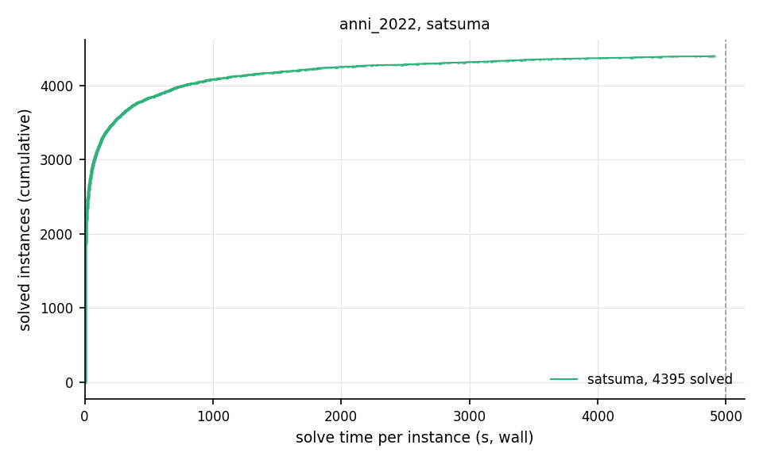

# Competition Benchmark Results (index=anni_2022.jsonl, timeout=5000s, backend=satsuma, parallel=10)

From the duo run in `/Users/greg/projects/sat_benchmarks/runs/anni_2022_duo`, alongside hydra_circuit_satsuma; checks off; sat at 59baa26.

## Summary

| Result | Count | % |
|--------|-------|---|
| SAT | 1990 | 37.2% |
| UNSAT | 2405 | 44.9% |
| TIMEOUT | 960 | 17.9% |
| **Total** | 5355 | 100% |

## Cactus plot

## Per-problem results

| Problem | Result | Solve time | UNSAT proof time | Paths | Total | Conf | Rst |
|---------|--------|------------|------------------|-------|-------|------|-----|
| 6s16 | UNSAT | 0.8752s | skipped (--no-verify) | — | — | — | — |
| snw_13_9_pre | SAT | 7.4188s | — | — | — | — | — |
| traffic_f_unknown | UNSAT | 76.6833s | skipped (--no-verify) | — | — | — | — |
| rope_0030.shuffled | UNSAT | 0.5867s | skipped (--no-verify) | — | — | — | — |
| fclqcolor-20-15-15.shuffled-as.sat05-1270 | SAT | 0.852s | — | — | — | — | — |
| rphp4_065_shuffled | UNSAT | 0.3392s | skipped (--no-verify) | — | — | — | — |
| SGI_30_60_24_40_2-dir.shuffled-as.sat03-118 | UNSAT | 151.6933s | skipped (--no-verify) | — | — | — | — |
| spg_420_280 | UNSAT | 77.4111s | skipped (--no-verify) | — | — | — | — |
| 4col220_9_1.shuffled | SAT | 584.4399s | — | — | — | — | — |
| mm-2x2-5-0-s.1.shuffled-as.sat03-1496 | UNSAT | 0.6024s | skipped (--no-verify) | — | — | — | — |
| ex179_11 | SAT | 46.7453s | — | — | — | — | — |
| desmul.miter.used-as.sat04-330 | UNSAT | 3.8127s | skipped (--no-verify) | — | — | — | — |
| ctl_4291_567_7_unsat | UNSAT | 302.5395s | skipped (--no-verify) | — | — | — | — |
| SAT_dat.k10 | UNSAT | 50.3796s | skipped (--no-verify) | — | — | — | — |
| ortholatin-7 | SAT | 6.8147s | — | — | — | — | — |
| ibm-2004-03-k70 | SAT | 1.6029s | — | — | — | — | — |
| barman-pfile10-038.sas.ex.15 | UNSAT | 29.1163s | skipped (--no-verify) | — | — | — | — |
| minand064 | UNSAT | 0.9253s | skipped (--no-verify) | — | — | — | — |
| iso-brn008.shuffled-as.sat05-2933 | SAT | 0.2719s | — | — | — | — | — |
| hwb-n24-01-S1048418025.shuffled-as.sat03-1617 | UNSAT | 45.9052s | skipped (--no-verify) | — | — | — | — |
| ndist.b.21497 | SAT | 0.6489s | — | — | — | — | — |
| sgen4-sat-280-8 | TIMEOUT | 4998.2806s | — | — | — | — | — |
| rand_net70-40-10.shuffled | UNSAT | 0.2903s | skipped (--no-verify) | — | — | — | — |
| vmpc_28.shuffled-as.sat05-1957 | SAT | 84.8821s | — | — | — | — | — |
| 3col20_5_6.shuffled | UNSAT | 0.2727s | skipped (--no-verify) | — | — | — | — |
| phnf-size10-exclusive-equilarge_l3.used-as.sat04-895.sat05-4189.reshuffled-07 | TIMEOUT | 4998.3633s | — | — | — | — | — |
| sp4-33-bin-nons-flat-noid | UNSAT | 55.8567s | skipped (--no-verify) | — | — | — | — |
| 3col60_5_9.shuffled | UNSAT | 0.3033s | skipped (--no-verify) | — | — | — | — |
| SC21_Timetable_C_140_E_29_Cl_10_S_15 | TIMEOUT | 4998.3192s | — | — | — | — | — |
| slp-synthesis-aes-top27 | SAT | 19.6169s | — | — | — | — | — |
| eqspwtrc16bparrc16 | TIMEOUT | 4998.2445s | — | — | — | — | — |
| f8bidw | UNSAT | 93.9097s | skipped (--no-verify) | — | — | — | — |
| gensys-icl003.shuffled-as.sat05-3824 | UNSAT | 17.1141s | skipped (--no-verify) | — | — | — | — |
| rope_0012.shuffled | UNSAT | 0.298s | skipped (--no-verify) | — | — | — | — |
| ssAES_4-4-8_round_8-10_faultAt_8_fault_injections_2_seed_1579630418 | SAT | 153.0434s | — | — | — | — | — |
| shift1add.10000 | UNSAT | 1.968s | skipped (--no-verify) | — | — | — | — |
| SGI_30_70_28_60_1-log.shuffled-as.sat03-176 | TIMEOUT | 4998.284s | — | — | — | — | — |
| aim-200-6_0-yes1-4.mis-135.debugged | TIMEOUT | 4998.2955s | — | — | — | — | — |
| 9symml_gr_2pin_w6.shuffled | SAT | 0.5292s | — | — | — | — | — |
| smulo016 | UNSAT | 2.8244s | skipped (--no-verify) | — | — | — | — |
| mrpp_6x6#18_20 | SAT | 12.9593s | — | — | — | — | — |
| SGI_30_70_27_50_3-dir.shuffled-as.sat03-169 | UNSAT | 1501.5753s | skipped (--no-verify) | — | — | — | — |
| connm-ue-csp-sat-n600-d0.04-s1979668539.used-as.sat04-981 | UNSAT | 17.4072s | skipped (--no-verify) | — | — | — | — |
| T107.2.0 | UNSAT | 217.4852s | skipped (--no-verify) | — | — | — | — |
| crafted_n12_d6_c3_num26 | UNSAT | 78.4906s | skipped (--no-verify) | — | — | — | — |
| ecgrid6x155_shuffled | UNSAT | 3412.8418s | skipped (--no-verify) | — | — | — | — |
| E04F19 | SAT | 5.5478s | — | — | — | — | — |
| shuffling-2-s1480152728-of-bench-sat04-434.used-as.sat04-711 | UNSAT | 51.9809s | skipped (--no-verify) | — | — | — | — |
| urquhart3_25bis.shuffled | UNSAT | 0.2474s | skipped (--no-verify) | — | — | — | — |
| manol-pipe-c10id_s | UNSAT | 1.7394s | skipped (--no-verify) | — | — | — | — |
| 10pipe_q0_k | UNSAT | 134.1351s | skipped (--no-verify) | — | — | — | — |
| 003-23-80 | SAT | 402.3283s | — | — | — | — | — |
| mrpp_4x4#12_12 | UNSAT | 5.3743s | skipped (--no-verify) | — | — | — | — |
| arcfour_initialPermutation_6_14 | UNSAT | 138.8263s | skipped (--no-verify) | — | — | — | — |
| velev-npe-1.0-9dlx-b71 | TIMEOUT | 4999.1635s | — | — | — | — | — |
| cms-scheel-md5-families-r24-c11-p1-4-6-9-10-11-13-15-17-18-19 | SAT | 22.5199s | — | — | — | — | — |
| slp-synthesis-aes-bottom24 | TIMEOUT | 4998.2358s | — | — | — | — | — |
| mp1-squ_ali_s10x10_c39_abio_SAT | SAT | 135.7794s | — | — | — | — | — |
| sgen1-unsat-139-100.mis-105.debugged | TIMEOUT | 4998.2382s | — | — | — | — | — |
| sdiv40prop | TIMEOUT | 4998.228s | — | — | — | — | — |
| goldb-heqc-i8mul | UNSAT | 15.8457s | skipped (--no-verify) | — | — | — | — |
| mrpp_6x6#12_8 | UNSAT | 0.2757s | skipped (--no-verify) | — | — | — | — |
| ctl_4201_555_unsat | UNSAT | 558.2682s | skipped (--no-verify) | — | — | — | — |
| SC21_Timetable_C_542_E_71_Cl_36_S_35 | SAT | 70.0863s | — | — | — | — | — |
| 53-131587 | SAT | 1252.2671s | — | — | — | — | — |
| 8-5-6 | SAT | 455.717s | — | — | — | — | — |
| EDP3-12000 | SAT | 54.1588s | — | — | — | — | — |
| ps_200_300_70 | UNSAT | 241.8929s | skipped (--no-verify) | — | — | — | — |
| equilarge_l5.sat05-522.reshuffled-07 | TIMEOUT | 4998.3662s | — | — | — | — | — |
| pyhala-braun-sat-35-4-04.shuffled | SAT | 1.0958s | — | — | — | — | — |
| smtlib-qfbv-aigs-countbits128-tseitin | UNSAT | 2018.8695s | skipped (--no-verify) | — | — | — | — |
| Urquhart-s3-b3.shuffled-as.sat03-1556 | UNSAT | 0.2589s | skipped (--no-verify) | — | — | — | — |
| Q3inK08 | SAT | 0.2631s | — | — | — | — | — |
| dead-dnd008.shuffled-as.sat05-3114 | UNSAT | 304.7113s | skipped (--no-verify) | — | — | — | — |
| g2-hwmcc15deep-bobpcihm-k32 | UNSAT | 3577.6606s | skipped (--no-verify) | — | — | — | — |
| ncc_none_7047_6_3_3_0_0_420 | UNSAT | 135.7994s | skipped (--no-verify) | — | — | — | — |
| clauses-8 | SAT | 146.7915s | — | — | — | — | — |
| traffic_b_unsat | UNSAT | 75.9986s | skipped (--no-verify) | — | — | — | — |
| php-025-024.shuffled-as.sat05-1191 | UNSAT | 0.3596s | skipped (--no-verify) | — | — | — | — |
| Kakuro-easy-117-ext.xml.hg_5 | SAT | 143.0185s | — | — | — | — | — |
| blocks-4-ipc5-h21-unknown | UNSAT | 18.9666s | skipped (--no-verify) | — | — | — | — |
| rbsat-v945c61409gyes1 | TIMEOUT | 4998.3374s | — | — | — | — | — |
| b2005-p2-14x14c17h9-Ser4-0 | TIMEOUT | 4999.154s | — | — | — | — | — |
| partial-10-17-u | TIMEOUT | 4998.3596s | — | — | — | — | — |
| total-5-15-u | TIMEOUT | 4998.3732s | — | — | — | — | — |
| mod4block_2vars_10gates_u2_autoenc-sc2009 | SAT | 39.4009s | — | — | — | — | — |
| li-test4-97.shuffled-as.sat03-375 | TIMEOUT | 4998.2628s | — | — | — | — | — |
| urqh2x5.shuffled-as.sat03-1473 | UNSAT | 0.281s | skipped (--no-verify) | — | — | — | — |
| AProVE07-27 | UNSAT | 71.8873s | skipped (--no-verify) | — | — | — | — |
| vmpc_34.shuffled-as.sat05-1958-sc2005 | TIMEOUT | 4998.2895s | — | — | — | — | — |
| aes_decry_2_rounds.debugged | UNSAT | 88.6158s | skipped (--no-verify) | — | — | — | — |
| AProVE09-17 | SAT | 2.3731s | — | — | — | — | — |
| 3col120_5_2.shuffled | SAT | 0.395s | — | — | — | — | — |
| mm-1x10-10-10-sb.1.shuffled-as.sat03-1489 | SAT | 2.7332s | — | — | — | — | — |
| 6s133-sc2014 | UNSAT | 0.9787s | skipped (--no-verify) | — | — | — | — |
| genurq8Sat.shuffled-as.sat03-1514 | SAT | 0.3583s | — | — | — | — | — |
| ablmulub2x32o-sc2016 | UNSAT | 66.9471s | skipped (--no-verify) | — | — | — | — |
| connm-ue-csp-sat-n1200-d-0.02-s1528687777.used-as.sat04-953 | SAT | 1411.9303s | — | — | — | — | — |
| satch2ways16w | TIMEOUT | 4998.2929s | — | — | — | — | — |
| x2_128.shuffled-as.sat03-1598 | UNSAT | 0.4318s | skipped (--no-verify) | — | — | — | — |
| 20-100-lambda100-49_sat | SAT | 62.195s | — | — | — | — | — |
| atco_enc3_opt1_03_53 | SAT | 174.7309s | — | — | — | — | — |
| ctl_4291_567_1_unsat_pre | UNSAT | 711.6107s | skipped (--no-verify) | — | — | — | — |
| SGI_30_80_21_90_2-log.shuffled-as.sat03-198 | TIMEOUT | 4998.2712s | — | — | — | — | — |
| rook-55-0-1 | TIMEOUT | 4998.29s | — | — | — | — | — |
| 3col300_5_2.shuffled | SAT | 3.3424s | — | — | — | — | — |
| 3col280_5_8.shuffled | SAT | 2.1375s | — | — | — | — | — |
| edges-025-4-7932777-1-00 | UNSAT | 4285.765s | skipped (--no-verify) | — | — | — | — |
| TimetableCNFEncoding_5_UNKNOWN-sc2018 | TIMEOUT | 4998.3971s | — | — | — | — | — |
| satsgi-n23himBHm26-p0-q248 | SAT | 0.2172s | — | — | — | — | — |
| rope_0003.shuffled | UNSAT | 0.2271s | skipped (--no-verify) | — | — | — | — |
| 4g_5color_166_100_02 | SAT | 1105.8458s | — | — | — | — | — |
| marg2x5.shuffled-as.sat03-1443 | UNSAT | 0.2859s | skipped (--no-verify) | — | — | — | — |
| mod3block_2vars_9gates_u2_autoenc | TIMEOUT | 4998.2606s | — | — | — | — | — |
| SGI_30_40_30_20_2-dir.shuffled-as.sat05-442 | UNSAT | 276.6482s | skipped (--no-verify) | — | — | — | — |
| Kakuro-easy-125-ext.xml.hg_4 | UNSAT | 2643.5078s | skipped (--no-verify) | — | — | — | — |
| jgiraldezlevy.2200.9086.08.40.136 | SAT | 19.7392s | — | — | — | — | — |
| longmult9 | UNSAT | 1.3518s | skipped (--no-verify) | — | — | — | — |
| shuffling-2-s554396412-of-bench-sat04-318.used-as.sat04-598 | UNSAT | 312.5006s | skipped (--no-verify) | — | — | — | — |
| dead-dnd006.shuffled-as.sat05-3112 | UNSAT | 192.7592s | skipped (--no-verify) | — | — | — | — |
| new-difficult-28-302-26-75 | SAT | 0.2938s | — | — | — | — | — |
| ctl_4291_567_9_unsat_pre | UNSAT | 367.2602s | skipped (--no-verify) | — | — | — | — |
| hypercube4.shuffled-as.sat03-1434 | UNSAT | 0.2284s | skipped (--no-verify) | — | — | — | — |
| frb45-21-1.used-as.sat04-883 | SAT | 591.6004s | — | — | — | — | — |
| EDP3-50000 | TIMEOUT | 4998.5504s | — | — | — | — | — |
| unsat-set-a-fclqcolor-20-13-14.sat05-1278.reshuffled-07-sc2007 | UNSAT | 0.3244s | skipped (--no-verify) | — | — | — | — |
| UTI-20-10p0-sc2009 | UNSAT | 221.1741s | skipped (--no-verify) | — | — | — | — |
| shuffling-2-s2123257475-of-bench-sat04-327.used-as.sat04-589 | UNSAT | 3.0882s | skipped (--no-verify) | — | — | — | — |
| Q32inK10 | UNSAT | 0.5837s | skipped (--no-verify) | — | — | — | — |
| baseballcover14with25 | UNSAT | 52.1977s | skipped (--no-verify) | — | — | — | — |
| mrpp_6x6#14_12 | SAT | 1.2908s | — | — | — | — | — |
| g2-T96.1.1 | UNSAT | 29.2184s | skipped (--no-verify) | — | — | — | — |
| mod2c-rand3bip-sat-230-1.shuffled-as.sat05-2503 | SAT | 18.8467s | — | — | — | — | — |
| battleship-13-25-sat | SAT | 0.2816s | — | — | — | — | — |
| hwb-n30-01-S682466202.shuffled-as.sat03-1632 | TIMEOUT | 4998.2377s | — | — | — | — | — |
| rubikcube701-sc2017 | UNSAT | 742.9996s | skipped (--no-verify) | — | — | — | — |
| aes_32_2_keyfind_1 | SAT | 187.6188s | — | — | — | — | — |
| rbsat-v945c61409g4 | SAT | 111.5835s | — | — | — | — | — |
| g2-newton.8.3.i.smt2-cvc4 | SAT | 4.5683s | — | — | — | — | — |
| f2clk_40.shuffled | UNSAT | 12.0493s | skipped (--no-verify) | — | — | — | — |
| ex065_24 | TIMEOUT | 4998.7991s | — | — | — | — | — |
| safe009_pso.oepc_true-unreach-call.i-cbmc-u2 | UNSAT | 53.2227s | skipped (--no-verify) | — | — | — | — |
| gensys-icl003.shuffled-as.sat05-2715 | UNSAT | 2.9523s | skipped (--no-verify) | — | — | — | — |
| mp1-Nb5T15 | SAT | 10.0795s | — | — | — | — | — |
| 5col120_15_5.shuffled | UNSAT | 52.6463s | skipped (--no-verify) | — | — | — | — |
| equilarge_l2.shuffled-as.sat05-519 | TIMEOUT | 4998.2622s | — | — | — | — | — |
| 3col260_5_9.shuffled | SAT | 1.6017s | — | — | — | — | — |
| sat-strips-gripper-12t23.sat05-1144.reshuffled-07 | SAT | 0.9229s | — | — | — | — | — |
| easier-php-035-029.sat05-1179.reshuffled-07 | UNSAT | 0.268s | skipped (--no-verify) | — | — | — | — |
| em_7_4_9_cmp | SAT | 1.2177s | — | — | — | — | — |
| crafted_n10_d6_c4_num10 | UNSAT | 99.3429s | skipped (--no-verify) | — | — | — | — |
| SGI_30_80_29_60_7-dir.shuffled-as.sat03-217 | TIMEOUT | 4998.2596s | — | — | — | — | — |
| dated-5-13-u | UNSAT | 200.0577s | skipped (--no-verify) | — | — | — | — |
| 3col160_5_6.shuffled | SAT | 0.2824s | — | — | — | — | — |
| rnd-v25-e13-k3 | SAT | 0.971s | — | — | — | — | — |
| atco_enc1_opt1_15_240 | SAT | 7.6273s | — | — | — | — | — |
| minor032 | UNSAT | 0.4254s | skipped (--no-verify) | — | — | — | — |
| g2-T133.2.1 | TIMEOUT | 4999.0869s | — | — | — | — | — |
| q_query_3_l45_lambda | UNSAT | 24.1162s | skipped (--no-verify) | — | — | — | — |
| VanDerWaerden_2-3-12_135 | UNSAT | 41.4873s | skipped (--no-verify) | — | — | — | — |
| mrpp_6x6#14_10 | SAT | 0.754s | — | — | — | — | — |
| mp1-9_3 | SAT | 4.2659s | — | — | — | — | — |
| g2-T103.2.1 | UNSAT | 757.1094s | skipped (--no-verify) | — | — | — | — |
| ezfact64_9.shuffled-as.sat03-1525 | SAT | 21.4072s | — | — | — | — | — |
| SGI_30_80_23_90_10-log.shuffled-as.sat03-202 | TIMEOUT | 4998.2877s | — | — | — | — | — |
| Mycielski-11-hints-3 | UNSAT | 382.9949s | skipped (--no-verify) | — | — | — | — |
| VanDerWaerden_pd_2-3-24_592 | SAT | 2845.8963s | — | — | — | — | — |
| bqwh.50.750.shuffled-as.sat05-434 | TIMEOUT | 4998.2987s | — | — | — | — | — |
| slp-synthesis-aes-bottom22 | TIMEOUT | 4998.4418s | — | — | — | — | — |
| s85-100 | UNSAT | 81.707s | skipped (--no-verify) | — | — | — | — |
| sgen1-sat-230-100 | TIMEOUT | 4998.2235s | — | — | — | — | — |
| partial-10-11-u-sc2007 | TIMEOUT | 4998.2826s | — | — | — | — | — |
| satsgi-n24himBHm28-p0-q282 | SAT | 0.2642s | — | — | — | — | — |
| bvslt_13916 | UNSAT | 49.3659s | skipped (--no-verify) | — | — | — | — |
| hwb-n32-01-S1491788039.shuffled-as.sat03-1637 | TIMEOUT | 4998.2526s | — | — | — | — | — |
| barman-pfile10-038.sas.cr.25 | UNSAT | 18.2307s | skipped (--no-verify) | — | — | — | — |
| satcoin-genesis-SAT-4 | SAT | 2.7411s | — | — | — | — | — |
| VanDerWaerden_pd_2-3-29_809 | TIMEOUT | 4998.3628s | — | — | — | — | — |
| rook-51-0-0 | UNSAT | 1084.3101s | skipped (--no-verify) | — | — | — | — |
| smtlib-qfbv-aigs-bin_libsmbsharemodes_vc6201-tseitin | SAT | 1.0688s | — | — | — | — | — |
| depots3_v01a.renamed-as.sat05-3950 | SAT | 0.3778s | — | — | — | — | — |
| puzzle35_sat | SAT | 3681.7242s | — | — | — | — | — |
| ezfact32_10.shuffled | SAT | 0.3492s | — | — | — | — | — |
| slp-synthesis-aes-bottom16 | UNSAT | 1448.5296s | skipped (--no-verify) | — | — | — | — |
| VanDerWaerden_2-3-16_238 | TIMEOUT | 4998.2995s | — | — | — | — | — |
| sokoban-p20.sas.cr.27 | UNSAT | 3857.3239s | skipped (--no-verify) | — | — | — | — |
| crafted_n12_d6_c4_num27 | UNSAT | 125.2655s | skipped (--no-verify) | — | — | — | — |
| SGI_30_60_28_40_2-dir.shuffled-as.sat03-124-sc2002 | UNSAT | 1672.156s | skipped (--no-verify) | — | — | — | — |
| driverlog2_v01a.renamed-as.sat05-3961 | SAT | 0.3685s | — | — | — | — | — |
| udiv45prop | UNSAT | 481.9603s | skipped (--no-verify) | — | — | — | — |
| g2-mult1.c.50.smt2-cvc4 | SAT | 1.3777s | — | — | — | — | — |
| complete-500-0.1-1-9876543215001 | SAT | 0.4714s | — | — | — | — | — |
| satcoin-genesis-SAT-10 | SAT | 3.4197s | — | — | — | — | — |
| edn_9789_8_0.51000000.unsat | UNSAT | 8.311s | skipped (--no-verify) | — | — | — | — |
| gcdmax16bits_22 | SAT | 18.3372s | — | — | — | — | — |
| T84.2.0 | UNSAT | 276.1524s | skipped (--no-verify) | — | — | — | — |
| at-least-two-smtlib-qfbv-aigs-ext_con_032_008_0256-tseitin | UNSAT | 2.8964s | skipped (--no-verify) | — | — | — | — |
| 20180321_140826713_p_cnf_320_1120 | SAT | 1.3871s | — | — | — | — | — |
| mod2c-rand3bip-unsat-120-3.shuffled-as.sat05-2340 | UNSAT | 0.5432s | skipped (--no-verify) | — | — | — | — |
| x1.1_64.shuffled-as.sat03-1585 | UNSAT | 0.2937s | skipped (--no-verify) | — | — | — | — |
| 3col140_5_1.shuffled | SAT | 0.4674s | — | — | — | — | — |
| 26_stack_cas_longest_true-unreach-call.i-cbmc-u2-sc2016 | SAT | 115.1536s | — | — | — | — | — |
| lksat-n900-m3357-k3-l5-s241765501.used-as.sat04-936 | SAT | 0.3863s | — | — | — | — | — |
| x2_16.shuffled | UNSAT | 0.3148s | skipped (--no-verify) | — | — | — | — |
| mrpp_6x6#12_9 | SAT | 0.6524s | — | — | — | — | — |
| instance_n8_i9_pp_ci_ce | TIMEOUT | 4998.3262s | — | — | — | — | — |
| 008 | SAT | 689.1212s | — | — | — | — | — |
| connm-ue-csp-sat-n1200-d0.00-s1415961664.shuffled-as.sat05-529 | TIMEOUT | 4998.2935s | — | — | — | — | — |
| hypercube5.shuffled-as.sat03-1435 | UNSAT | 0.2492s | skipped (--no-verify) | — | — | — | — |
| tseitingrid6x175_shuffled | UNSAT | 13.8289s | skipped (--no-verify) | — | — | — | — |
| marg5x5.shuffled-as.sat03-1455 | UNSAT | 0.2974s | skipped (--no-verify) | — | — | — | — |
| rand_net40-60-1.shuffled | UNSAT | 0.3474s | skipped (--no-verify) | — | — | — | — |
| puzzle47_sat | TIMEOUT | 4998.3547s | — | — | — | — | — |
| ctl_4201_555_unsat_pre | UNSAT | 662.8859s | skipped (--no-verify) | — | — | — | — |
| hidden-k3-s0-r5-n700-03-S1609878926.shuffled-as.sat05-487 | TIMEOUT | 4998.2809s | — | — | — | — | — |
| UTI-20-10t1 | SAT | 3.3045s | — | — | — | — | — |
| x2_72.shuffled-as.sat03-1604 | UNSAT | 0.2824s | skipped (--no-verify) | — | — | — | — |
| mod2c-rand3bip-unsat-105-3.shuffled-as.sat05-2325 | UNSAT | 0.5503s | skipped (--no-verify) | — | — | — | — |
| gt-ordering-unsat-gt-045.sat05-1310.reshuffled-07 | UNSAT | 3.3434s | skipped (--no-verify) | — | — | — | — |
| bv-term-small-rw_1492.smt2 | SAT | 0.337s | — | — | — | — | — |
| gss-18-s100 | SAT | 89.7081s | — | — | — | — | — |
| comb3.shuffled | UNSAT | 1.341s | skipped (--no-verify) | — | — | — | — |
| Kakuro-easy-089-ext.xml.hg_4 | SAT | 88.6519s | — | — | — | — | — |
| edn_20403_12_0.08000000.unsat | UNSAT | 2.9555s | skipped (--no-verify) | — | — | — | — |
| 6-4-6-sc2018 | TIMEOUT | 4998.3336s | — | — | — | — | — |
| barman-pfile07-027.sas.cr.37 | UNSAT | 30.1812s | skipped (--no-verify) | — | — | — | — |
| ccp-s8-facto3 | UNSAT | 0.7976s | skipped (--no-verify) | — | — | — | — |
| dspam_dump_vc972 | UNSAT | 2.4786s | skipped (--no-verify) | — | — | — | — |
| satcoin-genesis-SAT-64 | SAT | 3.0697s | — | — | — | — | — |
| atco_enc1_opt2_10_15 | UNSAT | 62.8932s | skipped (--no-verify) | — | — | — | — |
| tseitingrid5x185_shuffled | UNSAT | 7.0962s | skipped (--no-verify) | — | — | — | — |
| mp1-klieber2017s-0500-023-t12 | SAT | 70.9459s | — | — | — | — | — |
| 4col280_9_9.shuffled | TIMEOUT | 4998.3138s | — | — | — | — | — |
| Eternity-10-06_c18 | SAT | 377.2087s | — | — | — | — | — |
| c6bi_i | UNSAT | 10.3451s | skipped (--no-verify) | — | — | — | — |
| sgi-difficult4 | SAT | 0.2879s | — | — | — | — | — |
| size_4_5_5_i037_w31_r9 | UNSAT | 978.5846s | skipped (--no-verify) | — | — | — | — |
| MD5-28-3 | SAT | 973.8113s | — | — | — | — | — |
| transport-transport-city-sequential-25nodes-1000size-3degree-100mindistance-3trucks-10packages-2008seed.060-SAT | SAT | 19.3s | — | — | — | — | — |
| g2-hwmcc15deep-bob12s02-k16 | TIMEOUT | 4998.298s | — | — | — | — | — |
| mm-2x3-8-8-sb.1.shuffled-as.sat03-1504 | UNSAT | 220.6308s | skipped (--no-verify) | — | — | — | — |
| hsat_vc12072 | UNSAT | 5.7592s | skipped (--no-verify) | — | — | — | — |
| GreenTao_2-3-5_528 | UNSAT | 121.2505s | skipped (--no-verify) | — | — | — | — |
| abw-V-nos6.mtx-w220 | SAT | 161.799s | — | — | — | — | — |
| Haystacks-ext-12_c18 | UNSAT | 92.234s | skipped (--no-verify) | — | — | — | — |
| by-X-2-7-100 | UNSAT | 512.3282s | skipped (--no-verify) | — | — | — | — |
| total-10-11-u | UNSAT | 8.3256s | skipped (--no-verify) | — | — | — | — |
| SGI_30_70_28_60_5-dir.shuffled-as.sat03-177 | TIMEOUT | 4998.2933s | — | — | — | — | — |
| AProVE09-03 | SAT | 0.6251s | — | — | — | — | — |
| mrpp_8x8#24_14 | SAT | 7.2521s | — | — | — | — | — |
| rbsat-v945c61409gyes2 | SAT | 406.4355s | — | — | — | — | — |
| Steiner-9-5-bce | UNSAT | 0.3129s | skipped (--no-verify) | — | — | — | — |
| blocks-blocks-36-0.160-NOTKNOWN | SAT | 68.4091s | — | — | — | — | — |
| eqbpdtlf18sparcl18 | TIMEOUT | 4998.3151s | — | — | — | — | — |
| fdmus_b15_296 | UNSAT | 0.3691s | skipped (--no-verify) | — | — | — | — |
| marg3x5.shuffled-as.sat03-1452 | UNSAT | 0.2809s | skipped (--no-verify) | — | — | — | — |
| mrpp_8x8#20_14 | SAT | 7.3265s | — | — | — | — | — |
| test_v7_r17_vr5_c1_s25451.smt2-cvc4 | TIMEOUT | 4998.4622s | — | — | — | — | — |
| phnf-size10-exclusive-equilarge_l2.used-as.sat04-894.sat05-4188.reshuffled-07 | TIMEOUT | 4998.4503s | — | — | — | — | — |
| genurq25Sat.shuffled-as.sat03-1507 | SAT | 9.9501s | — | — | — | — | — |
| T93.2.0 | UNSAT | 312.9716s | skipped (--no-verify) | — | — | — | — |
| manol-pipe-c10nidw | UNSAT | 201.3437s | skipped (--no-verify) | — | — | — | — |
| fclqcolor-14-09-12.shuffled-as.sat05-1284 | UNSAT | 0.2978s | skipped (--no-verify) | — | — | — | — |
| Schur_161_5_d43 | UNSAT | 64.214s | skipped (--no-verify) | — | — | — | — |
| Mat323.shuffled | TIMEOUT | 4998.2829s | — | — | — | — | — |
| mp1-klieber2017s-0300-034-t12 | SAT | 35.7714s | — | — | — | — | — |
| test_v7_r7_vr10_c1_s32506.smt2-cvc4 | SAT | 97.1432s | — | — | — | — | — |
| shuffling-1-s1931574585-of-bench-sat04-328.used-as.sat04-449 | UNSAT | 4.0328s | skipped (--no-verify) | — | — | — | — |
| crafted_n11_d6_c3_num4 | UNSAT | 80.9338s | skipped (--no-verify) | — | — | — | — |
| countbitsarray32_32 | TIMEOUT | 4998.2818s | — | — | — | — | — |
| modgen-n200-m90860q08c40-21438 | UNSAT | 0.2865s | skipped (--no-verify) | — | — | — | — |
| modgen-n200-m90860q08c40-14424 | UNSAT | 6.7026s | skipped (--no-verify) | — | — | — | — |
| ssAES_4-4-4_round_7-10_faultAt_7_fault_injections_2_seed_1564286498 | TIMEOUT | 4998.2804s | — | — | — | — | — |
| E03N17 | UNSAT | 0.9171s | skipped (--no-verify) | — | — | — | — |
| strips-gripper-18t35.shuffled-as.sat05-1147 | SAT | 58.2935s | — | — | — | — | — |
| VanDerWaerden_2-3-19_349 | TIMEOUT | 4998.2841s | — | — | — | — | — |
| instance_n3_i3_pp | SAT | 0.2841s | — | — | — | — | — |
| crafted_n11_d6_c4_num19 | UNSAT | 109.1842s | skipped (--no-verify) | — | — | — | — |
| phnf-size10-exclusive-equilarge_l1.used-as.sat04-893.sat05-4187.reshuffled-07 | TIMEOUT | 4998.5349s | — | — | — | — | — |
| k2fix_gr_2pin_w9.shuffled-as.sat03-438 | UNSAT | 13.218s | skipped (--no-verify) | — | — | — | — |
| pyhala-braun-sat-40-4-03.shuffled-as.sat03-1541 | SAT | 42.0346s | — | — | — | — | — |
| ctl_4291_567_5_unsat_pre | TIMEOUT | 4998.2826s | — | — | — | — | — |
| mp1-blockpuzzle_8x8_s1_free4 | UNSAT | 6.6879s | skipped (--no-verify) | — | — | — | — |
| cnt07.shuffled | SAT | 0.4212s | — | — | — | — | — |
| udiv48prop | UNSAT | 716.1882s | skipped (--no-verify) | — | — | — | — |
| hwb-n20-03-S1899964371.shuffled-as.sat03-1609 | UNSAT | 2.1085s | skipped (--no-verify) | — | — | — | — |
| Urquhart-s5-b7.shuffled | UNSAT | 0.3239s | skipped (--no-verify) | — | — | — | — |
| ferry10_v01a.renamed-as.sat05-3993 | SAT | 0.4381s | — | — | — | — | — |
| rphp4_100_shuffled | UNSAT | 0.3454s | skipped (--no-verify) | — | — | — | — |
| maxor032 | UNSAT | 2.9679s | skipped (--no-verify) | — | — | — | — |
| VanDerWaerden_pd_2-3-21_399 | SAT | 75.6067s | — | — | — | — | — |
| a_rphp045_05 | UNSAT | 1388.1994s | skipped (--no-verify) | — | — | — | — |
| 62bits_11.dimacs | TIMEOUT | 4998.2928s | — | — | — | — | — |
| 5col180_15_2.shuffled | TIMEOUT | 4998.2776s | — | — | — | — | — |
| pb_300_04_lb_06 | UNSAT | 53.4383s | skipped (--no-verify) | — | — | — | — |
| rbsat-v2100c215164gyes4 | TIMEOUT | 4998.2945s | — | — | — | — | — |
| sokoban-p20.sas.cr.33 | TIMEOUT | 4998.3799s | — | — | — | — | — |
| SGI_30_60_25_40_2-dir.shuffled-as.sat03-120 | UNSAT | 721.536s | skipped (--no-verify) | — | — | — | — |
| 9pipe_k | UNSAT | 225.492s | skipped (--no-verify) | — | — | — | — |
| sokoban-p20.sas.cr.39 | TIMEOUT | 4998.38s | — | — | — | — | — |
| dislog_a14_x14_n24 | SAT | 590.0409s | — | — | — | — | — |
| gus-md5-08 | UNSAT | 38.101s | skipped (--no-verify) | — | — | — | — |
| gripper13u.shuffled-as.sat03-395 | UNSAT | 477.0112s | skipped (--no-verify) | — | — | — | — |
| shuffling-1-s716603489-of-bench-sat04-317.used-as.sat04-460 | SAT | 92.0356s | — | — | — | — | — |
| fermat-907547022132073 | SAT | 31.3917s | — | — | — | — | — |
| ndist.b.26986 | SAT | 0.9617s | — | — | — | — | — |
| tseitingrid7x200_shuffled | UNSAT | 11.912s | skipped (--no-verify) | — | — | — | — |
| partial-5-17-s | SAT | 454.3747s | — | — | — | — | — |
| longmult6 | UNSAT | 0.4599s | skipped (--no-verify) | — | — | — | — |
| pb_400_09_lb_05 | SAT | 34.2052s | — | — | — | — | — |
| mrpp_8x8#22_20 | SAT | 14.5223s | — | — | — | — | — |
| een-pico-prop05-50 | UNSAT | 3.5935s | skipped (--no-verify) | — | — | — | — |
| vlsat2_16676_1598591.dimacs | SAT | 5.6221s | — | — | — | — | — |
| 52bits_12.dimacs | SAT | 1622.0461s | — | — | — | — | — |
| sat-grid-pbl-0070.sat05-1334.reshuffled-07 | SAT | 10.7397s | — | — | — | — | — |
| phnf-size10-exclusive-equilarge_m3.used-as.sat04-900.sat05-4186.reshuffled-07 | TIMEOUT | 4998.4399s | — | — | — | — | — |
| 002-80-12 | TIMEOUT | 4998.4707s | — | — | — | — | — |
| ae_rphp095_04 | UNSAT | 875.75s | skipped (--no-verify) | — | — | — | — |
| manthey_single-ordered-initialized-w48-b6 | UNSAT | 102.4965s | skipped (--no-verify) | — | — | — | — |
| UR-20-5p1-sc2009 | SAT | 79.5298s | — | — | — | — | — |
| queen8-8-9 | SAT | 2.2116s | — | — | — | — | — |
| Eternity-10-05_c18 | SAT | 6.2756s | — | — | — | — | — |
| transport-transport-city-sequential-25nodes-1000size-3degree-100mindistance-3trucks-10packages-2008seed.040-NOTKNOWN | SAT | 38.1256s | — | — | — | — | — |
| 12pipe_bug7_q0 | SAT | 32.6483s | — | — | — | — | — |
| lksat-n1100-m4103-k3-l5-s558351420.used-as.sat04-934 | SAT | 0.7153s | — | — | — | — | — |
| mp1-9_9 | SAT | 31.4901s | — | — | — | — | — |
| driverlog2_ks99i.shuffled-as.sat05-4019 | SAT | 0.3302s | — | — | — | — | — |
| gensys-ukn002.shuffled-as.sat05-3842 | UNSAT | 106.8249s | skipped (--no-verify) | — | — | — | — |
| frg1mul.miter.used-as.sat04-331 | UNSAT | 1.9895s | skipped (--no-verify) | — | — | — | — |
| mp1-24.6 | TIMEOUT | 4998.3423s | — | — | — | — | — |
| crafted_n12_d6_c3_num19 | UNSAT | 159.8247s | skipped (--no-verify) | — | — | — | — |
| Urquhart-s5-b3.shuffled-as.sat03-1572 | UNSAT | 0.3007s | skipped (--no-verify) | — | — | — | — |
| php-018-018.shuffled-as.sat05-1161 | SAT | 0.3083s | — | — | — | — | — |
| frb53-24-2.used-as.sat04-888 | TIMEOUT | 4998.295s | — | — | — | — | — |
| 289-sat-6x9 | SAT | 0.3036s | — | — | — | — | — |
| puzzle34_unsat | UNSAT | 1145.1056s | skipped (--no-verify) | — | — | — | — |
| pop96_shuffled | UNSAT | 48.9422s | skipped (--no-verify) | — | — | — | — |
| fdmus_b22_355 | UNSAT | 0.3364s | skipped (--no-verify) | — | — | — | — |
| connm-ue-csp-sat-n600-d0.02-s1676244754.shuffled-as.sat05-535 | UNSAT | 30.0144s | skipped (--no-verify) | — | — | — | — |
| modgen-n200-m90860q08c40-16597 | SAT | 1.2556s | — | — | — | — | — |
| shift1add.15982 | UNSAT | 50.1749s | skipped (--no-verify) | — | — | — | — |
| 20-100-lambda100-89_sat | SAT | 78.7217s | — | — | — | — | — |
| rand_net70-40-1.shuffled | UNSAT | 0.3697s | skipped (--no-verify) | — | — | — | — |
| bart19.shuffled | SAT | 0.3122s | — | — | — | — | — |
| par32-2.shuffled-as.sat03-1534 | TIMEOUT | 4998.3319s | — | — | — | — | — |
| AProVE07-01 | UNSAT | 1178.8623s | skipped (--no-verify) | — | — | — | — |
| VanDerWaerden_pd_2-3-18_313 | UNSAT | 4.0716s | skipped (--no-verify) | — | — | — | — |
| srhd-sgi-m27-q255-n25-p15-s2076598 | SAT | 157.1511s | — | — | — | — | — |
| UTI-10-5t1 | SAT | 0.9422s | — | — | — | — | — |
| SAT_dat.k35-31_2_rule_2 | UNSAT | 146.2883s | skipped (--no-verify) | — | — | — | — |
| rnd-v25-e81-k8 | UNSAT | 1840.1504s | skipped (--no-verify) | — | — | — | — |
| LABS_n071_goal001 | UNSAT | 1228.4352s | skipped (--no-verify) | — | — | — | — |
| rnd-v25-e67-k8 | TIMEOUT | 4998.3432s | — | — | — | — | — |
| f7nidw | UNSAT | 41.5524s | skipped (--no-verify) | — | — | — | — |
| hid-uns-enc-6-1-0-0-0-0-30547 | UNSAT | 42.1658s | skipped (--no-verify) | — | — | — | — |
| pmg-14-UNSAT.sat05-3942.reshuffled-07 | TIMEOUT | 4998.2829s | — | — | — | — | — |
| T77.2.0 | UNSAT | 281.6895s | skipped (--no-verify) | — | — | — | — |
| g2-T108.2.1 | TIMEOUT | 4999.2224s | — | — | — | — | — |
| g2-ak128boothbg2msisc | SAT | 1.5171s | — | — | — | — | — |
| connm-ue-csp-sat-n1200-d-0.04-s706145924.used-as.sat04-971 | SAT | 650.7507s | — | — | — | — | — |
| 008-80-8 | SAT | 3337.5078s | — | — | — | — | — |
| ibm-2002-04r-k80 | SAT | 10.7555s | — | — | — | — | — |
| mm-2x2-5-5-sb.1.shuffled-as.sat03-1498 | UNSAT | 0.6489s | skipped (--no-verify) | — | — | — | — |
| 6s139 | UNSAT | 12.328s | skipped (--no-verify) | — | — | — | — |
| mod2-rand3bip-sat-260-3.shuffled-as.sat05-2235 | SAT | 36.8034s | — | — | — | — | — |
| ferry8_v01a.shuffled-as.sat05-4073 | SAT | 0.3528s | — | — | — | — | — |
| vlsat2_112_4223 | UNSAT | 46.383s | skipped (--no-verify) | — | — | — | — |
| sted1_0x1e3-200 | TIMEOUT | 4998.3008s | — | — | — | — | — |
| crafted_n10_d6_c2_num6 | UNSAT | 35.3683s | skipped (--no-verify) | — | — | — | — |
| 49-132779 | SAT | 130.0917s | — | — | — | — | — |
| s105-100 | UNSAT | 3026.1679s | skipped (--no-verify) | — | — | — | — |
| sted1_0x0-380-sc2018 | TIMEOUT | 4998.2964s | — | — | — | — | — |
| gensys-brn004.shuffled-as.sat05-2748 | SAT | 0.3568s | — | — | — | — | — |
| sat_prob_63 | TIMEOUT | 4998.2859s | — | — | — | — | — |
| SGI_30_70_25_50_7-log.shuffled-as.sat03-162 | UNSAT | 3510.4765s | skipped (--no-verify) | — | — | — | — |
| mm-2x3-6-6-sb.1.shuffled-as.sat03-1502 | UNSAT | 1.8873s | skipped (--no-verify) | — | — | — | — |
| sokoban-p20.sas.ex.21 | TIMEOUT | 4998.3537s | — | — | — | — | — |
| mod2-3cage-unsat-9-18.shuffled-as.sat05-2593 | UNSAT | 0.3204s | skipped (--no-verify) | — | — | — | — |
| mulhs008 | UNSAT | 2.5738s | skipped (--no-verify) | — | — | — | — |
| stone-width3chain-nmarkers-20_shuffled | TIMEOUT | 4999.307s | — | — | — | — | — |
| 3col180_5_6.shuffled | SAT | 0.5703s | — | — | — | — | — |
| g2-ak128boothdiagoaig | TIMEOUT | 4998.4008s | — | — | — | — | — |
| add_01_1000_4.smt2-cvc4 | UNSAT | 8.0952s | skipped (--no-verify) | — | — | — | — |
| 10142772393204023fw.shuffled-as.sat03-1661 | SAT | 59.476s | — | — | — | — | — |
| c9nidw | UNSAT | 119.9449s | skipped (--no-verify) | — | — | — | — |
| 4pipe_4_ooo | UNSAT | 3.5032s | skipped (--no-verify) | — | — | — | — |
| g2-test_v5_r10_vr10_c1_s21502.smt2-cvc4 | UNSAT | 184.9744s | skipped (--no-verify) | — | — | — | — |
| grid-strips-grid-y-3.045-NOTKNOWN | SAT | 147.5426s | — | — | — | — | — |
| shuffling-1-s1722048485-of-bench-sat04-437.used-as.sat04-576 | UNSAT | 2.8907s | skipped (--no-verify) | — | — | — | — |
| too_large_gr_rcs_w9.shuffled | SAT | 0.6894s | — | — | — | — | — |
| 4col240_9_2.shuffled | TIMEOUT | 4998.2931s | — | — | — | — | — |
| modgen-n200-m90860q08c40-18788 | SAT | 7.0971s | — | — | — | — | — |
| traffic_r_sat | SAT | 24.4687s | — | — | — | — | — |
| phnf-size10-exclusive-all.used-as.sat04-986.sat05-4198.reshuffled-07 | UNSAT | 133.7056s | skipped (--no-verify) | — | — | — | — |
| g2-T169.1.0 | SAT | 208.0142s | — | — | — | — | — |
| mm-2x3-6-6-s.1.shuffled-as.sat03-1501 | UNSAT | 20.5166s | skipped (--no-verify) | — | — | — | — |
| depots1_v01a.shuffled-as.sat05-4013 | SAT | 0.2679s | — | — | — | — | — |
| SGI_30_40_30_20_2-log.shuffled-as.sat03-105 | UNSAT | 2786.3316s | skipped (--no-verify) | — | — | — | — |
| prime2209-90 | SAT | 1.9923s | — | — | — | — | — |
| AProVE11-12 | SAT | 12.2725s | — | — | — | — | — |
| shuffling-1-s147121172-of-bench-sat04-433.used-as.sat04-572 | UNSAT | 186.839s | skipped (--no-verify) | — | — | — | — |
| 3col100_5_1.shuffled | SAT | 0.3111s | — | — | — | — | — |
| grain-55-80-0s0-seed-125-45-init-40 | UNSAT | 124.2429s | skipped (--no-verify) | — | — | — | — |
| hcp_CP16_16 | SAT | 24.4992s | — | — | — | — | — |
| mp1-21.3 | SAT | 72.7547s | — | — | — | — | — |
| g2-hwmcc15deep-bobpcihm-k33 | UNSAT | 3234.4692s | skipped (--no-verify) | — | — | — | — |
| rbsat-v2640c305320g6 | TIMEOUT | 4998.2896s | — | — | — | — | — |
| iso-brn008.shuffled-as.sat05-2702 | SAT | 0.4128s | — | — | — | — | — |
| ibm-2002-24r3-k100 | UNSAT | 13.665s | skipped (--no-verify) | — | — | — | — |
| bvurem_20.smt2 | TIMEOUT | 4998.3073s | — | — | — | — | — |
| unsat-pbl-00150.sat05-1328.reshuffled-07 | UNSAT | 0.7692s | skipped (--no-verify) | — | — | — | — |
| urqh1c5x5.shuffled-as.sat03-1468.mis-103.debugged | TIMEOUT | 4998.3344s | — | — | — | — | — |
| jgiraldezlevy.2200.9086.08.40.41 | SAT | 44.3796s | — | — | — | — | — |
| 59-131147 | SAT | 569.5197s | — | — | — | — | — |
| minand128 | UNSAT | 21.5221s | skipped (--no-verify) | — | — | — | — |
| aaai10-planning-ipc5-pipesworld-18-step16 | SAT | 38.5703s | — | — | — | — | — |
| ca016.shuffled | UNSAT | 0.3086s | skipped (--no-verify) | — | — | — | — |
| Schur_161_5_d39 | UNSAT | 1620.7957s | skipped (--no-verify) | — | — | — | — |
| total-10-13-u | UNSAT | 76.6435s | skipped (--no-verify) | — | — | — | — |
| eqbpwtrc10spctbk10 | UNSAT | 78.6132s | skipped (--no-verify) | — | — | — | — |
| complete-500-0.1-15-98765432150015 | SAT | 0.461s | — | — | — | — | — |
| Timetable_C_151_E_34_Cl_10_S_4 | TIMEOUT | 4998.3566s | — | — | — | — | — |
| mp1-klieber2017s-1200-024-eq | UNSAT | 44.3474s | skipped (--no-verify) | — | — | — | — |
| ndist.b.20499 | SAT | 0.8523s | — | — | — | — | — |
| frb56-25-1.used-as.sat04-889 | SAT | 2283.9328s | — | — | — | — | — |
| sgen1-unsat-85-100 | UNSAT | 165.0069s | skipped (--no-verify) | — | — | — | — |
| pb_300_04_lb_05 | UNSAT | 31.9144s | skipped (--no-verify) | — | — | — | — |
| ccp-s5-facto2 | UNSAT | 0.2513s | skipped (--no-verify) | — | — | — | — |
| gensys-brn100.shuffled-as.sat05-3765 | SAT | 1.1061s | — | — | — | — | — |
| cruxmiter29seed9 | UNSAT | 126.7819s | skipped (--no-verify) | — | — | — | — |
| gensys-icl003.shuffled-as.sat05-3129 | UNSAT | 3.2439s | skipped (--no-verify) | — | — | — | — |
| satellite3_v01a.shuffled-as.sat05-4056 | SAT | 0.2695s | — | — | — | — | — |
| 12pipe_bug4_q0 | SAT | 7.9988s | — | — | — | — | — |
| HCP-470-60 | SAT | 1644.3793s | — | — | — | — | — |
| slp-synthesis-aes-bottom13-sc2011 | UNSAT | 13.1364s | skipped (--no-verify) | — | — | — | — |
| sha1.shuffled | TIMEOUT | 4998.2991s | — | — | — | — | — |
| ex175_18-sc2018 | SAT | 248.0026s | — | — | — | — | — |
| battleship-24-57-sat | SAT | 0.4631s | — | — | — | — | — |
| too_large_gr_rcs_w6.shuffled | UNSAT | 0.5281s | skipped (--no-verify) | — | — | — | — |
| 001 | SAT | 346.5587s | — | — | — | — | — |
| 008 | SAT | 3173.0903s | — | — | — | — | — |
| sgp_5-6-8.shuffled-as.sat05-2669 | SAT | 85.0945s | — | — | — | — | — |
| Circuit_multiplier24 | SAT | 108.675s | — | — | — | — | — |
| tseitingrid6x180_shuffled | UNSAT | 11.465s | skipped (--no-verify) | — | — | — | — |
| mulhs016-sc2009 | TIMEOUT | 4998.2887s | — | — | — | — | — |
| 289-sat-6x20 | SAT | 0.3961s | — | — | — | — | — |
| driverlog3_v01a.shuffled-as.sat05-4030 | SAT | 0.3274s | — | — | — | — | — |
| randomG-n17-d05 | UNSAT | 2506.5521s | skipped (--no-verify) | — | — | — | — |
| mp1-22.1 | SAT | 331.5508s | — | — | — | — | — |
| SGI_30_70_30_60_2-dir.shuffled-as.sat03-185 | TIMEOUT | 4998.3032s | — | — | — | — | — |
| cache_10.shuffled | SAT | 12.7294s | — | — | — | — | — |
| dist6.c-sc2018 | UNSAT | 24.7326s | skipped (--no-verify) | — | — | — | — |
| srhd-sgi-m32-q369.75-n30-p30-s25693430 | SAT | 0.3328s | — | — | — | — | — |
| ca064.shuffled | UNSAT | 0.3251s | skipped (--no-verify) | — | — | — | — |
| mod3block_4vars_12gates_b2_restricted | TIMEOUT | 4998.3796s | — | — | — | — | — |
| alu4mul.miter.used-as.sat04-326 | UNSAT | 5.6036s | skipped (--no-verify) | — | — | — | — |
| 3col80_5_4.shuffled | SAT | 0.3217s | — | — | — | — | — |
| course_flat_0.12_2018_3_5 | TIMEOUT | 4998.4028s | — | — | — | — | — |
| marg3x3add4d1.shuffled-as.sat03-1447 | UNSAT | 0.3026s | skipped (--no-verify) | — | — | — | — |
| 64bits_11.dimacs | TIMEOUT | 4998.2884s | — | — | — | — | — |
| newton.2.3.i.smt2-stp212 | UNSAT | 195.5873s | skipped (--no-verify) | — | — | — | — |
| 9pipe_q0_k | UNSAT | 98.8485s | skipped (--no-verify) | — | — | — | — |
| unsat-set-a-clqcolor-10-06-07.sat05-1250.reshuffled-07 | UNSAT | 0.3545s | skipped (--no-verify) | — | — | — | — |
| simon-s02b-r4b1k1.1 | SAT | 30.6234s | — | — | — | — | — |
| logistics-rotate-09t6.shuffled-as.sat05-1133 | SAT | 4.1313s | — | — | — | — | — |
| mm-2x3-8-8-s.1.shuffled-as.sat03-1503 | TIMEOUT | 4998.3219s | — | — | — | — | — |
| modgen-n200-m90860q08c40-1585 | SAT | 1.5714s | — | — | — | — | — |
| dp09s09.shuffled | SAT | 0.5595s | — | — | — | — | — |
| driverlog6_v01a.renamed-as.sat05-3968 | SAT | 0.2756s | — | — | — | — | — |
| sted5_0x0-157 | SAT | 1021.6841s | — | — | — | — | — |
| 4col120_9_2.shuffled | UNSAT | 42.1789s | skipped (--no-verify) | — | — | — | — |
| snw_13_8_CCSpreOptpre | UNSAT | 21.2301s | skipped (--no-verify) | — | — | — | — |
| li-exam-64.used-as.sat04-302 | TIMEOUT | 4998.3182s | — | — | — | — | — |
| c8bidw | UNSAT | 38.6813s | skipped (--no-verify) | — | — | — | — |
| rpoc_xits_09_UNSAT | UNSAT | 5.8879s | skipped (--no-verify) | — | — | — | — |
| sortnet-7-ipc5-h15-unsat | TIMEOUT | 4998.3287s | — | — | — | — | — |
| 9vliw_m_9stages_iq3_C1_bug8 | SAT | 47.1706s | — | — | — | — | — |
| traffic_r_uc_sat | SAT | 65.1213s | — | — | — | — | — |
| mod2-rand3bip-sat-230-1.shuffled-as.sat05-2188 | SAT | 22.3049s | — | — | — | — | — |
| prime2209-65 | SAT | 1.4313s | — | — | — | — | — |
| Robertson-k8 | UNSAT | 2175.5886s | skipped (--no-verify) | — | — | — | — |
| mrpp_8x8#22_16 | SAT | 13.0618s | — | — | — | — | — |
| 10pipe_k | UNSAT | 237.5847s | skipped (--no-verify) | — | — | — | — |
| 4col180_9_1.shuffled | TIMEOUT | 4998.32s | — | — | — | — | — |
| rand_net50-25-1.shuffled | UNSAT | 0.3347s | skipped (--no-verify) | — | — | — | — |
| combined-crypto1-wff-seed-121-wffvars-500-cryptocplx-31-overlap-2 | SAT | 44.5747s | — | — | — | — | — |
| 170058143 | SAT | 25.1154s | — | — | — | — | — |
| EDP3-13000 | SAT | 245.2228s | — | — | — | — | — |
| openstacks-sequencedstrips-nonadl-nonnegated-os-sequencedstrips-p30_3.075-NOTKNOWN | SAT | 18.8923s | — | — | — | — | — |
| c9b_i | UNSAT | 4.9279s | skipped (--no-verify) | — | — | — | — |
| shuffling-2-s961664232-of-bench-sat04-430.used-as.sat04-707 | UNSAT | 357.5873s | skipped (--no-verify) | — | — | — | — |
| aes_64_2_keyfind_1 | TIMEOUT | 4998.3227s | — | — | — | — | — |
| ccp-s6-facto2 | UNSAT | 0.362s | skipped (--no-verify) | — | — | — | — |
| 58bits_13.dimacs | TIMEOUT | 4998.285s | — | — | — | — | — |
| p01_lb_05 | UNSAT | 8.0735s | skipped (--no-verify) | — | — | — | — |
| edges-072-3-7902777-18 | UNSAT | 33.8816s | skipped (--no-verify) | — | — | — | — |
| blocks-blocks-37-1.130-NOTKNOWN | UNSAT | 269.0457s | skipped (--no-verify) | — | — | — | — |
| Mycielski-10-hints-8 | TIMEOUT | 4998.4024s | — | — | — | — | — |
| b1904P3-8x8c11h0SAT | TIMEOUT | 4998.3284s | — | — | — | — | — |
| crafted_n10_d6_c4_num3 | UNSAT | 146.6147s | skipped (--no-verify) | — | — | — | — |
| shuffling-1-s1735667200-of-bench-sat04-332.used-as.sat04-445 | UNSAT | 5.6466s | skipped (--no-verify) | — | — | — | — |
| dp02s02.shuffled | SAT | 0.274s | — | — | — | — | — |
| maximum_constrained_partition_18_bits_n200 | SAT | 26.1484s | — | — | — | — | — |
| gensys-brn003.shuffled-as.sat05-2680 | SAT | 0.5781s | — | — | — | — | — |
| tseitingrid7x135_shuffled | UNSAT | 8.7462s | skipped (--no-verify) | — | — | — | — |
| ferry10.shuffled-as.sat03-378 | SAT | 0.3582s | — | — | — | — | — |
| gt-016.shuffled-as.sat05-1291 | UNSAT | 0.3843s | skipped (--no-verify) | — | — | — | — |
| lksat-n1100-m7545-k4-l4-s420878730.used-as.sat04-926 | SAT | 3.4039s | — | — | — | — | — |
| rand_net40-40-5.shuffled | UNSAT | 0.3019s | skipped (--no-verify) | — | — | — | — |
| ccp-s8-facto1 | UNSAT | 0.2727s | skipped (--no-verify) | — | — | — | — |
| ecgrid6x210_shuffled | TIMEOUT | 4998.2948s | — | — | — | — | — |
| iso-ukn007.shuffled-as.sat05-3388 | UNSAT | 0.3813s | skipped (--no-verify) | — | — | — | — |
| jkkk-random-132906006427000-10-10-36-SUM-sat | SAT | 20.0965s | — | — | — | — | — |
| fphp-012-010.shuffled-as.sat05-1214 | UNSAT | 0.2862s | skipped (--no-verify) | — | — | — | — |
| size_4_4_4_i4096_r8 | UNSAT | 116.785s | skipped (--no-verify) | — | — | — | — |
| ktf_TF-8.tf_4_0.02_37 | TIMEOUT | 4998.3043s | — | — | — | — | — |
| gss-20-s100 | SAT | 255.0283s | — | — | — | — | — |
| qurt.c.20.smt2-cvc4 | TIMEOUT | 4998.5165s | — | — | — | — | — |
| edit_distance023_281 | SAT | 191.6234s | — | — | — | — | — |
| srhd-sgi-m62-q1327.5-n60-p30-s52708253 | SAT | 0.8869s | — | — | — | — | — |
| gensys-ukn006.shuffled-as.sat05-3846 | UNSAT | 153.4025s | skipped (--no-verify) | — | — | — | — |
| shuffling-2-s25242449-of-bench-sat04-727.used-as.sat04-753 | SAT | 24.2954s | — | — | — | — | — |
| phnf-size10-exclusive-equilarge_m1.used-as.sat04-898.shuffled-as.sat05-4191 | TIMEOUT | 4998.3701s | — | — | — | — | — |
| 5col160_15_6.shuffled | TIMEOUT | 4998.3435s | — | — | — | — | — |
| size_5_5_5_i041_r12 | SAT | 484.709s | — | — | — | — | — |
| mod2-rand3bip-unsat-150-1.shuffled-as.sat05-2654 | UNSAT | 0.3113s | skipped (--no-verify) | — | — | — | — |
| manthey_DimacsSorter_31_6 | SAT | 2.4172s | — | — | — | — | — |
| php-014-012.shuffled-as.sat05-1173 | UNSAT | 0.2782s | skipped (--no-verify) | — | — | — | — |
| C202_FW_SZ_61 | UNSAT | 0.5009s | skipped (--no-verify) | — | — | — | — |
| 002-80-4 | SAT | 78.5707s | — | — | — | — | — |
| UCG-10-10p1 | SAT | 8.5016s | — | — | — | — | — |
| dated-5-19-u | UNSAT | 1691.5803s | skipped (--no-verify) | — | — | — | — |
| tseitingrid6x165_shuffled | UNSAT | 9.3399s | skipped (--no-verify) | — | — | — | — |
| php-040-040.shuffled-as.sat05-1166 | SAT | 0.3805s | — | — | — | — | — |
| gensys-icl008.shuffled-as.sat05-2720 | UNSAT | 3.1354s | skipped (--no-verify) | — | — | — | — |
| rand_net40-60-10.shuffled | UNSAT | 0.3402s | skipped (--no-verify) | — | — | — | — |
| fphp-025-025.shuffled-as.sat05-1205 | SAT | 0.3309s | — | — | — | — | — |
| b2005-p5-14x14c17h9-Ser3-0 | TIMEOUT | 4998.3491s | — | — | — | — | — |
| mp1-ps_5000_21250_3_0_0.8_0_1.60_6 | TIMEOUT | 4998.3247s | — | — | — | — | — |
| tph14 | UNSAT | 0.5548s | skipped (--no-verify) | — | — | — | — |
| e_rphp065_04 | UNSAT | 115.1914s | skipped (--no-verify) | — | — | — | — |
| eqsparrc12bpdtlf12 | UNSAT | 3742.0969s | skipped (--no-verify) | — | — | — | — |
| sted5_0x24204-70 | TIMEOUT | 4998.3848s | — | — | — | — | — |
| sgp_6-6-10.shuffled-as.sat05-2670 | SAT | 679.1288s | — | — | — | — | — |
| 289-sat-5x8 | SAT | 0.3709s | — | — | — | — | — |
| shuffling-1-s765004498-of-bench-sat04-365.used-as.sat04-504 | UNSAT | 31.6704s | skipped (--no-verify) | — | — | — | — |
| fphp-045-045.shuffled-as.sat05-1209 | SAT | 0.4021s | — | — | — | — | — |
| cache_05.shuffled | SAT | 5.9424s | — | — | — | — | — |
| cms-scheel-md5-families-r24-c6-p1-4-6-13-14-18 | SAT | 191.0556s | — | — | — | — | — |
| mp1-rubikcube820 | TIMEOUT | 4998.322s | — | — | — | — | — |
| 6s126 | UNSAT | 14.0237s | skipped (--no-verify) | — | — | — | — |
| bart22.shuffled | SAT | 0.3667s | — | — | — | — | — |
| AProVE09-25 | SAT | 30.0821s | — | — | — | — | — |
| SGI_30_70_18_80_10-log.shuffled-as.sat03-141 | UNSAT | 2956.8278s | skipped (--no-verify) | — | — | — | — |
| g2-gss-36-s100 | TIMEOUT | 4998.2691s | — | — | — | — | — |
| f10bi | UNSAT | 125.5356s | skipped (--no-verify) | — | — | — | — |
| ferry7_v01i.renamed-as.sat05-4003 | SAT | 0.4995s | — | — | — | — | — |
| 7pipe.shuffled-as.sat03-415 | UNSAT | 40.9626s | skipped (--no-verify) | — | — | — | — |
| shuffling-2-s356209203-of-bench-sat04-338.used-as.sat04-616 | UNSAT | 8.165s | skipped (--no-verify) | — | — | — | — |
| randomG-Mix-n18-d05 | TIMEOUT | 4998.2828s | — | — | — | — | — |
| 170055892 | SAT | 5.0612s | — | — | — | — | — |
| rbsat-v2100c215164g4-sc2011 | TIMEOUT | 4998.371s | — | — | — | — | — |
| pop99_shuffled | UNSAT | 97.7993s | skipped (--no-verify) | — | — | — | — |
| mod2-rand3bip-sat-240-3.shuffled-as.sat05-2205 | SAT | 6.0382s | — | — | — | — | — |
| gto_p60c343 | TIMEOUT | 4998.4825s | — | — | — | — | — |
| SAT_dat.k100.debugged | TIMEOUT | 4998.3065s | — | — | — | — | — |
| edit_distance007_85 | UNSAT | 389.8218s | skipped (--no-verify) | — | — | — | — |
| snw_16_8_nopre-sc2016 | UNSAT | 1773.1723s | skipped (--no-verify) | — | — | — | — |
| Urquhart-s4-b4.shuffled | UNSAT | 0.3427s | skipped (--no-verify) | — | — | — | — |
| f9b | UNSAT | 57.4201s | skipped (--no-verify) | — | — | — | — |
| hypercube7.shuffled-as.sat03-1437 | UNSAT | 0.7466s | skipped (--no-verify) | — | — | — | — |
| 2004_rb10Sd.k85 | UNSAT | 2.4546s | skipped (--no-verify) | — | — | — | — |
| example2_gr_rcs_w5.shuffled | UNSAT | 1.1599s | skipped (--no-verify) | — | — | — | — |
| q_query_3_L80_coli.sat | UNSAT | 21.2984s | skipped (--no-verify) | — | — | — | — |
| am_8_8.used-as.sat04-341 | TIMEOUT | 4998.3289s | — | — | — | — | — |
| ktf_TF-6.tf_4_0.04_51 | TIMEOUT | 4998.3008s | — | — | — | — | — |
| mp1-klieber2017s-0300-035-t12 | SAT | 31.3872s | — | — | — | — | — |
| countbitsrotate016 | UNSAT | 3.9341s | skipped (--no-verify) | — | — | — | — |
| em_7_3_6_fbc | SAT | 187.3451s | — | — | — | — | — |
| 3col220_5_9.shuffled | SAT | 0.6268s | — | — | — | — | — |
| pmg-11-UNSAT.sat05-3939.reshuffled-07.mis-111.debugged | TIMEOUT | 4998.2896s | — | — | — | — | — |
| term1mul.miter.shuffled-as.sat03-357 | UNSAT | 1.772s | skipped (--no-verify) | — | — | — | — |
| EDP3-30000 | TIMEOUT | 4998.4854s | — | — | — | — | — |
| cnt10.shuffled-as.sat03-418 | SAT | 9.1467s | — | — | — | — | — |
| LABS_n074_goal006 | SAT | 1953.278s | — | — | — | — | — |
| color-15-4.shuffled-as.sat03-1485 | SAT | 21.0349s | — | — | — | — | — |
| shuffling-2-s340247357-of-bench-sat04-361.used-as.sat04-638 | UNSAT | 1.918s | skipped (--no-verify) | — | — | — | — |
| term1_gr_rcs_w4.shuffled | SAT | 0.3311s | — | — | — | — | — |
| mp1-squ_any_s09x07_c27_abix_UNS | UNSAT | 225.4919s | skipped (--no-verify) | — | — | — | — |
| vlsat2_56_1042 | UNSAT | 7.3269s | skipped (--no-verify) | — | — | — | — |
| prime2209-93 | SAT | 2.0824s | — | — | — | — | — |
| factoring94418953x321534781 | SAT | 202.7255s | — | — | — | — | — |
| comb2.shuffled | UNSAT | 4.3177s | skipped (--no-verify) | — | — | — | — |
| smtlib-qfbv-aigs-bin_libsmbsharemodes_vc5759-tseitin | SAT | 1.5214s | — | — | — | — | — |
| modgen-n200-m90860q08c40-13845 | TIMEOUT | 4998.2814s | — | — | — | — | — |
| gripper14u.shuffled-as.sat03-397 | UNSAT | 743.0279s | skipped (--no-verify) | — | — | — | — |
| mod2-rand3bip-unsat-105-1.shuffled-as.sat05-2609 | UNSAT | 0.3239s | skipped (--no-verify) | — | — | — | — |
| instance_n7_i8_pp_ci_ce | UNSAT | 395.7031s | skipped (--no-verify) | — | — | — | — |
| w19-8.0 | UNSAT | 118.0742s | skipped (--no-verify) | — | — | — | — |
| rbsat-v760c43649gyes7 | SAT | 420.796s | — | — | — | — | — |
| aaai10-planning-ipc5-pathways-17-step20 | UNSAT | 49.9747s | skipped (--no-verify) | — | — | — | — |
| TimetableCNFEncoding_3_UNKNOWN | TIMEOUT | 4998.4454s | — | — | — | — | — |
| SGI_30_80_26_70_4-dir.shuffled-as.sat03-207 | UNSAT | 4037.915s | skipped (--no-verify) | — | — | — | — |
| w19-5.1 | UNSAT | 329.5528s | skipped (--no-verify) | — | — | — | — |
| shuffling-1-s37489193-of-bench-sat04-720.used-as.sat04-733 | SAT | 43.1094s | — | — | — | — | — |
| ctl_4291_567_10_unsat | UNSAT | 388.7457s | skipped (--no-verify) | — | — | — | — |
| Urquhart-s3-b10.shuffled | UNSAT | 0.2841s | skipped (--no-verify) | — | — | — | — |
| rnd-v25-e80-k10 | TIMEOUT | 4998.4182s | — | — | — | — | — |
| iso-icl008.shuffled-as.sat05-3242 | UNSAT | 0.3808s | skipped (--no-verify) | — | — | — | — |
| pbl-00070.shuffled-as.sat05-1324.shuffled-as.sat05-1324 | UNSAT | 0.4193s | skipped (--no-verify) | — | — | — | — |
| 9vliw_m_9stages_iq3_C1_bug2 | SAT | 17.3551s | — | — | — | — | — |
| atco_enc3_opt2_10_12 | UNSAT | 360.9104s | skipped (--no-verify) | — | — | — | — |
| fclqcolor-16-11-14.shuffled-as.sat05-1285 | UNSAT | 0.3601s | skipped (--no-verify) | — | — | — | — |
| Kittell-k7 | UNSAT | 1847.0548s | skipped (--no-verify) | — | — | — | — |
| rbsat-v1375c111739gyes5 | SAT | 2758.0839s | — | — | — | — | — |
| 3col200_5_5.shuffled | SAT | 1.8355s | — | — | — | — | — |
| shift1add.21964 | UNSAT | 6.109s | skipped (--no-verify) | — | — | — | — |
| x2_80.shuffled | UNSAT | 0.3125s | skipped (--no-verify) | — | — | — | — |
| driverlog3_ks99i.renamed-as.sat05-3953 | SAT | 0.32s | — | — | — | — | — |
| 3bitadd_31.shuffled | SAT | 0.9757s | — | — | — | — | — |
| velev-dlx-uns-1.0-05 | UNSAT | 181.745s | skipped (--no-verify) | — | — | — | — |
| rook-42-1-1 | UNSAT | 144.3688s | skipped (--no-verify) | — | — | — | — |
| cms-scheel-md4-families-r24-c5-p0-5-11-13-18 | SAT | 400.8447s | — | — | — | — | — |
| crafted_n12_d6_c3_num10 | UNSAT | 82.8711s | skipped (--no-verify) | — | — | — | — |
| sgen3-n240-s78945233-sat | TIMEOUT | 4998.3207s | — | — | — | — | — |
| CNP-5-1700 | SAT | 46.7926s | — | — | — | — | — |
| Composite-048BitPrimes-1.sat05-504.reshuffled-07 | TIMEOUT | 4998.3058s | — | — | — | — | — |
| velev-vliw-sat-4.0-b1 | SAT | 58.2141s | — | — | — | — | — |
| baseballcover11with22_and2positions | SAT | 335.9224s | — | — | — | — | — |
| SGI_30_70_23_50_1-log.shuffled-as.sat03-157 | UNSAT | 1658.2409s | skipped (--no-verify) | — | — | — | — |
| qwh.35.405.shuffled-as.sat03-1651 | SAT | 1.2819s | — | — | — | — | — |
| 3col40_5_3.shuffled | UNSAT | 0.3289s | skipped (--no-verify) | — | — | — | — |
| grid-pbl-0080.shuffled-as.sat05-1344.shuffled-as.sat05-1344 | UNSAT | 12.44s | skipped (--no-verify) | — | — | — | — |
| harder-fphp-070-069.sat05-1240.reshuffled-07 | UNSAT | 0.6733s | skipped (--no-verify) | — | — | — | — |
| a_rphp098_04 | UNSAT | 986.1689s | skipped (--no-verify) | — | — | — | — |
| gripper10.shuffled-as.sat03-388 | SAT | 5.0467s | — | — | — | — | — |
| rnd-v25-e212-k9 | UNSAT | 3616.253s | skipped (--no-verify) | — | — | — | — |
| homer11.shuffled | UNSAT | 0.3059s | skipped (--no-verify) | — | — | — | — |
| x1.1_64.shuffled-as.sat03-1585.mis-125.debugged | TIMEOUT | 4998.263s | — | — | — | — | — |
| ssa2670-133 | UNSAT | 0.3536s | skipped (--no-verify) | — | — | — | — |
| ecgrid6x175_shuffled | TIMEOUT | 4998.3013s | — | — | — | — | — |
| sgen3-n170-s56409011-unsat | TIMEOUT | 4998.2961s | — | — | — | — | — |
| mp1-klieber2017s-1600-023-eq | UNSAT | 113.2321s | skipped (--no-verify) | — | — | — | — |
| UCG-20-10p0 | UNSAT | 185.6647s | skipped (--no-verify) | — | — | — | — |
| rbsat-v760c43649gyes6 | SAT | 212.1727s | — | — | — | — | — |
| spg_300_300 | UNSAT | 104.1459s | skipped (--no-verify) | — | — | — | — |
| sgen1-unsat-121-100.mis-90.debugged | TIMEOUT | 4998.3536s | — | — | — | — | — |
| zfcp | UNSAT | 2.0931s | skipped (--no-verify) | — | — | — | — |
| barrel2 | UNSAT | 0.2861s | skipped (--no-verify) | — | — | — | — |
| fdmus_b22_662 | UNSAT | 0.3417s | skipped (--no-verify) | — | — | — | — |
| rotmul.miter.used-as.sat04-336 | UNSAT | 2.0802s | skipped (--no-verify) | — | — | — | — |
| 6s166 | UNSAT | 1.7824s | skipped (--no-verify) | — | — | — | — |
| Problem11_label51_false-unreach-call.c | SAT | 63.3455s | — | — | — | — | — |
| x2_56.shuffled-as.sat03-1602.mis-110.debugged | TIMEOUT | 4998.3532s | — | — | — | — | — |
| iso-brn006.shuffled-as.sat05-3506 | SAT | 0.4269s | — | — | — | — | — |
| SAT_instance_N=93 | TIMEOUT | 4998.2864s | — | — | — | — | — |
| mod2-rand3bip-sat-280-1.shuffled-as.sat05-2263 | SAT | 35.8994s | — | — | — | — | — |
| c8bidw_s | UNSAT | 2.6678s | skipped (--no-verify) | — | — | — | — |
| dp12u11.shuffled-as.sat03-423 | UNSAT | 45.1092s | skipped (--no-verify) | — | — | — | — |
| iso-brn005.shuffled-as.sat05-2699 | SAT | 0.5396s | — | — | — | — | — |
| minandmaxor064 | UNSAT | 23.2365s | skipped (--no-verify) | — | — | — | — |
| q_query_3_L60_coli.sat | SAT | 7.138s | — | — | — | — | — |
| instance_n9_i9_pp | SAT | 27.9887s | — | — | — | — | — |
| bqwh.40.1.520.shuffled-as.sat05-432 | TIMEOUT | 4998.35s | — | — | — | — | — |
| rnd-v25-e157-k12 | TIMEOUT | 4998.3324s | — | — | — | — | — |
| smtlib-qfbv-aigs-VS3-benchmark-S2-tseitin | UNSAT | 1033.5465s | skipped (--no-verify) | — | — | — | — |
| quad_res_r29_m32 | TIMEOUT | 4998.2792s | — | — | — | — | — |
| x1_36.shuffled | UNSAT | 0.2943s | skipped (--no-verify) | — | — | — | — |
| mod2-rand3bip-sat-210-3.shuffled-as.sat05-2160 | SAT | 12.7079s | — | — | — | — | — |
| manthey_DimacsSorterHalf_37_3 | SAT | 13.8654s | — | — | — | — | — |
| ooo.tag10.ucl.sat.chaff.4.1.bryant | UNSAT | 0.3879s | skipped (--no-verify) | — | — | — | — |
| hsat_vc12016 | UNSAT | 6.8982s | skipped (--no-verify) | — | — | — | — |
| hitag2-10-60-0-0xdf7fa6426edec07-17 | UNSAT | 589.3006s | skipped (--no-verify) | — | — | — | — |
| total-5-11-u | UNSAT | 3.3383s | skipped (--no-verify) | — | — | — | — |
| 50bits_13.dimacs | SAT | 586.1418s | — | — | — | — | — |
| barman-pfile08-032.sas.ex.7 | UNSAT | 5.0961s | skipped (--no-verify) | — | — | — | — |
| s77-100 | UNSAT | 16.2895s | skipped (--no-verify) | — | — | — | — |
| tph18 | UNSAT | 0.9966s | skipped (--no-verify) | — | — | — | — |
| manol-pipe-g6bi | UNSAT | 0.9732s | skipped (--no-verify) | — | — | — | — |
| g2-ak128astepmodasaig | TIMEOUT | 4998.5314s | — | — | — | — | — |
| satch2ways18wu | TIMEOUT | 4998.3162s | — | — | — | — | — |
| sokoban-p20.sas.cr.21 | UNSAT | 251.6277s | skipped (--no-verify) | — | — | — | — |
| ACG-15-10p1 | SAT | 64.1401s | — | — | — | — | — |
| le450_25b.col.25 | UNSAT | 0.5807s | skipped (--no-verify) | — | — | — | — |
| srhd-sgi-m37-q505.75-n35-p15-s48276711 | SAT | 0.3579s | — | — | — | — | — |
| php-050-040.shuffled-as.sat05-1182 | UNSAT | 0.3371s | skipped (--no-verify) | — | — | — | — |
| post-cbmc-aes-d-r2-noholes | UNSAT | 75.7229s | skipped (--no-verify) | — | — | — | — |
| c10ni_i | UNSAT | 54.9083s | skipped (--no-verify) | — | — | — | — |
| gensys-brn008.shuffled-as.sat05-3427 | SAT | 0.7958s | — | — | — | — | — |
| square.2.0.i.smt2-cvc4 | UNSAT | 145.9243s | skipped (--no-verify) | — | — | — | — |
| crn_11_100_s | SAT | 1.1341s | — | — | — | — | — |
| UR-10-5p0 | UNSAT | 10.1431s | skipped (--no-verify) | — | — | — | — |
| AProVE11-16 | SAT | 1.1202s | — | — | — | — | — |
| safe029_power.opt_false-unreach-call.i-cbmc-u2 | SAT | 6.3888s | — | — | — | — | — |
| rand_net50-60-10.shuffled | UNSAT | 0.3482s | skipped (--no-verify) | — | — | — | — |
| ncc_none_12477_5_3_3_0_0_435991723 | UNSAT | 19.5963s | skipped (--no-verify) | — | — | — | — |
| maxxor128 | TIMEOUT | 4998.3178s | — | — | — | — | — |
| bart15.shuffled | SAT | 0.3415s | — | — | — | — | — |
| mp1-rubikcube212 | TIMEOUT | 4998.3093s | — | — | — | — | — |
| g2-T135.1.1 | UNSAT | 289.8455s | skipped (--no-verify) | — | — | — | — |
| 12pipe_q0_k | UNSAT | 371.8376s | skipped (--no-verify) | — | — | — | — |
| gensys-icl007.shuffled-as.sat05-3133 | UNSAT | 400.4879s | skipped (--no-verify) | — | — | — | — |
| mod2c-rand3bip-sat-220-1.shuffled-as.sat05-2488 | SAT | 20.9157s | — | — | — | — | — |
| ca128.shuffled | UNSAT | 0.4996s | skipped (--no-verify) | — | — | — | — |
| full-bf-ga-7-ce | SAT | 158.8181s | — | — | — | — | — |
| sdiv20prop | TIMEOUT | 4998.2549s | — | — | — | — | — |
| connm-ue-csp-sat-n600-d0.00-s573116943.shuffled-as.sat05-527 | UNSAT | 116.5119s | skipped (--no-verify) | — | — | — | — |
| rook-56-0-0 | UNSAT | 1390.9487s | skipped (--no-verify) | — | — | — | — |
| inithx.i.1-cn-54.used-as.sat04-324 | SAT | 3.0884s | — | — | — | — | — |
| atco_enc1_opt2_10_14 | UNSAT | 88.3298s | skipped (--no-verify) | — | — | — | — |
| 289-sat-12x15 | SAT | 0.6185s | — | — | — | — | — |
| 6s11-opt | UNSAT | 24.2676s | skipped (--no-verify) | — | — | — | — |
| 999999000001nc.shuffled-as.sat03-1675 | UNSAT | 30.6142s | skipped (--no-verify) | — | — | — | — |
| edges-070-3-10062999-36 | UNSAT | 38.593s | skipped (--no-verify) | — | — | — | — |
| rope_0007.shuffled | UNSAT | 0.2938s | skipped (--no-verify) | — | — | — | — |
| sp5-21-15-bin-stri-tree-noid | SAT | 100.3181s | — | — | — | — | — |
| rand_net50-25-10.shuffled | UNSAT | 0.3341s | skipped (--no-verify) | — | — | — | — |
| countbitswegner128-sc2011 | UNSAT | 1307.9866s | skipped (--no-verify) | — | — | — | — |
| korf-15 | UNSAT | 1.3536s | skipped (--no-verify) | — | — | — | — |
| x2_56.shuffled | UNSAT | 0.3181s | skipped (--no-verify) | — | — | — | — |
| edit_distance023_282 | SAT | 82.0179s | — | — | — | — | — |
| goldb-heqc-k2mul | UNSAT | 10.2625s | skipped (--no-verify) | — | — | — | — |
| hwb-n32-03-S717522696.shuffled-as.sat05-499 | TIMEOUT | 4998.2978s | — | — | — | — | — |
| mp1-ps_5000_21250_3_0_0.8_0_1.60_0 | TIMEOUT | 4998.3311s | — | — | — | — | — |
| ae_rphp045_05 | UNSAT | 1506.3192s | skipped (--no-verify) | — | — | — | — |
| hwb-n26-03-S540351185.sat05-490.reshuffled-07 | UNSAT | 387.7452s | skipped (--no-verify) | — | — | — | — |
| c10i_i | UNSAT | 11.9321s | skipped (--no-verify) | — | — | — | — |
| mp1-squ_any_s09x07_c27_sinx_UNS | UNSAT | 31.372s | skipped (--no-verify) | — | — | — | — |
| ibm-2002-20r-k75 | SAT | 14.0617s | — | — | — | — | — |
| rand_net40-60-5.shuffled | UNSAT | 0.3568s | skipped (--no-verify) | — | — | — | — |
| aes_id | TIMEOUT | 4998.3973s | — | — | — | — | — |
| Timetable_C_241_E_45_Cl_16_S_14 | TIMEOUT | 4998.3406s | — | — | — | — | — |
| satsgi-n24himBHm27-p0-q257 | SAT | 0.2912s | — | — | — | — | — |
| sted5_0x0-40 | SAT | 1.3849s | — | — | — | — | — |
| ER_500_40_2.apx_0 | UNSAT | 35.1984s | skipped (--no-verify) | — | — | — | — |
| manthey_DimacsSorterHalf_29_2 | SAT | 4.0476s | — | — | — | — | — |
| fsf-300-354-2-2-3-2.23.opt | SAT | 12.6938s | — | — | — | — | — |
| g6b | UNSAT | 0.5303s | skipped (--no-verify) | — | — | — | — |
| sokoban-p16.sas.cr.39 | TIMEOUT | 4998.392s | — | — | — | — | — |
| rbsat-v2400c266431g10 | TIMEOUT | 4998.3336s | — | — | — | — | — |
| peb-pyrofpyr-15-neq-3_shuffled | UNSAT | 257.2091s | skipped (--no-verify) | — | — | — | — |
| mod2c-rand3bip-unsat-135-2.sat05-2354.reshuffled-07 | UNSAT | 2.1741s | skipped (--no-verify) | — | — | — | — |
| f10n | UNSAT | 110.8441s | skipped (--no-verify) | — | — | — | — |
| mod5block_2vars_12gates | TIMEOUT | 4998.4023s | — | — | — | — | — |
| UR-20-5t0 | UNSAT | 2.7389s | skipped (--no-verify) | — | — | — | — |
| iso-brn007.shuffled-as.sat05-2701 | SAT | 0.4293s | — | — | — | — | — |
| bf1355-446 | UNSAT | 0.322s | skipped (--no-verify) | — | — | — | — |
| tseitingrid7x155_shuffled | UNSAT | 13.6959s | skipped (--no-verify) | — | — | — | — |
| satch2ways15u | UNSAT | 279.7717s | skipped (--no-verify) | — | — | — | — |
| hgen8-n320-03-S1572374531.sat05-485.reshuffled-07 | TIMEOUT | 4998.3004s | — | — | — | — | — |
| pbl-00300.shuffled-as.sat05-1321.shuffled-as.sat05-1321 | SAT | 2.9375s | — | — | — | — | — |
| 007 | SAT | 52.9085s | — | — | — | — | — |
| clqcolor-20-15-18.shuffled-as.sat05-1262 | UNSAT | 0.4231s | skipped (--no-verify) | — | — | — | — |
| ccp-s7-facto4 | UNSAT | 1.0056s | skipped (--no-verify) | — | — | — | — |
| shift1add.22961 | UNSAT | 3.4807s | skipped (--no-verify) | — | — | — | — |
| snw_13_8_CCSpreOptnopre | UNSAT | 31.0241s | skipped (--no-verify) | — | — | — | — |
| g2-hwmcc15deep-bob12s02-k17 | TIMEOUT | 4998.3346s | — | — | — | — | — |
| SGI_30_50_30_20_1-dir.shuffled-as.sat05-439 | UNSAT | 28.6623s | skipped (--no-verify) | — | — | — | — |
| clqcolor-16-11-14.shuffled-as.sat05-1261 | TIMEOUT | 4998.299s | — | — | — | — | — |
| bqwh.60.1080.shuffled-as.sat03-1649 | TIMEOUT | 4998.3032s | — | — | — | — | — |
| hitag2-7-60-0-0xc048b9ebae66e9d-32-SAT | SAT | 1331.1888s | — | — | — | — | — |
| bf1355-530 | UNSAT | 0.3423s | skipped (--no-verify) | — | — | — | — |
| gto_p50c291 | TIMEOUT | 4998.32s | — | — | — | — | — |
| hgen7-n390-01-S248216171.sat05-478.reshuffled-07 | TIMEOUT | 4998.2955s | — | — | — | — | — |
| 4col260_9_6.shuffled | TIMEOUT | 4998.2929s | — | — | — | — | — |
| Nb39T6 | UNSAT | 1689.0141s | skipped (--no-verify) | — | — | — | — |
| tph16 | UNSAT | 0.719s | skipped (--no-verify) | — | — | — | — |
| iso-brn001.shuffled-as.sat05-3624 | SAT | 0.3177s | — | — | — | — | — |
| contest04-lksat-n1000-m6860-k4-l4-s1935114289.sat05-523.reshuffled-07 | UNSAT | 313.0707s | skipped (--no-verify) | — | — | — | — |
| MM-23-2-2-2-2-M | TIMEOUT | 4998.3132s | — | — | — | — | — |
| Schur_161_5_d24 | TIMEOUT | 4998.3949s | — | — | — | — | — |
| rphp4_110_shuffled | UNSAT | 0.374s | skipped (--no-verify) | — | — | — | — |
| SAT_dat.k95-24_1_rule_2 | UNSAT | 318.0026s | skipped (--no-verify) | — | — | — | — |
| ctl_4291_567_2_unsat_pre-sc2013 | UNSAT | 697.3178s | skipped (--no-verify) | — | — | — | — |
| SC21_Timetable_C_136_E_41_Cl_9_S_15 | TIMEOUT | 4998.4252s | — | — | — | — | — |
| 2000009987nc.shuffled-as.sat03-1665 | UNSAT | 2.521s | skipped (--no-verify) | — | — | — | — |
| mp1-ps_5000_21250_3_0_0.7_0_1.50_4 | TIMEOUT | 4998.2952s | — | — | — | — | — |
| hard-10-U-9007 | UNSAT | 7.6232s | skipped (--no-verify) | — | — | — | — |
| instance_n8_i9_pp | SAT | 57.5785s | — | — | — | — | — |
| Schur_160_5_d31 | TIMEOUT | 4998.3169s | — | — | — | — | — |
| mrpp_4x4#6_12 | SAT | 0.3905s | — | — | — | — | — |
| 6s169-opt-sc2014 | UNSAT | 0.9268s | skipped (--no-verify) | — | — | — | — |
| QG7-gensys-icl006.sat05-3132.reshuffled-07 | UNSAT | 87.965s | skipped (--no-verify) | — | — | — | — |
| mp1-23.7 | TIMEOUT | 4998.2921s | — | — | — | — | — |
| iso-ukn003.shuffled-as.sat05-3384 | SAT | 0.4007s | — | — | — | — | — |
| g2-hwmcc15deep-intel066-k10 | UNSAT | 2273.2202s | skipped (--no-verify) | — | — | — | — |
| SGI_30_70_20_60_10-dir.shuffled-as.sat03-144 | UNSAT | 445.2665s | skipped (--no-verify) | — | — | — | — |
| g2-gss-24-s100 | TIMEOUT | 4998.3187s | — | — | — | — | — |
| simon03:sat02:w08_14.used-as.sat04-359 | SAT | 10.7086s | — | — | — | — | — |
| apn-sbox5-cut3-symmbreak | TIMEOUT | 4998.3031s | — | — | — | — | — |
| dspam_dump_vc973 | UNSAT | 3.5441s | skipped (--no-verify) | — | — | — | — |
| mod2-rand3bip-sat-290-2.shuffled-as.sat05-2279 | SAT | 4056.9245s | — | — | — | — | — |
| custmulsb2x32o | UNSAT | 3786.9144s | skipped (--no-verify) | — | — | — | — |
| shift1add.12991 | UNSAT | 30.8851s | skipped (--no-verify) | — | — | — | — |
| ACG-10-10p1 | SAT | 10.9395s | — | — | — | — | — |
| mp1-Nb5T14 | TIMEOUT | 4998.2616s | — | — | — | — | — |
| course_flat_0.2_2018_3 | SAT | 30.9607s | — | — | — | — | — |
| Kakuro-easy-065-ext.xml.hg_3 | UNSAT | 792.3325s | skipped (--no-verify) | — | — | — | — |
| openstacks-sequencedstrips-nonadl-nonnegated-os-sequencedstrips-p30_1.085-SAT | SAT | 15.9926s | — | — | — | — | — |
| mod2c-rand3bip-sat-150-2.shuffled-as.sat05-2384 | SAT | 0.4912s | — | — | — | — | — |
| UCG-20-5p1 | SAT | 65.4933s | — | — | — | — | — |
| VanDerWaerden_pd_2-3-18_311 | SAT | 3.2535s | — | — | — | — | — |
| grid-pbl-0100.shuffled-as.sat05-1337.shuffled-as.sat05-1337 | SAT | 13.3585s | — | — | — | — | — |
| post-c32s-gcdm16-23 | UNSAT | 17.6858s | skipped (--no-verify) | — | — | — | — |
| fdmus_b15_421 | UNSAT | 0.3432s | skipped (--no-verify) | — | — | — | — |
| ndist.b.29481 | SAT | 1.0574s | — | — | — | — | — |
| harder-fphp-018-017.sat05-1231.reshuffled-07 | UNSAT | 0.2756s | skipped (--no-verify) | — | — | — | — |
| rbsat-v2640c305320gyes2 | TIMEOUT | 4998.2962s | — | — | — | — | — |
| sgen1-unsat-133-100.mis-99.debugged | TIMEOUT | 4998.2873s | — | — | — | — | — |
| dlx2_cc | UNSAT | 0.5367s | skipped (--no-verify) | — | — | — | — |
| par32-4.shuffled | SAT | 4331.0154s | — | — | — | — | — |
| tph10 | UNSAT | 0.3286s | skipped (--no-verify) | — | — | — | — |
| shuffling-1-s1322003189-of-bench-sat04-344.used-as.sat04-483 | UNSAT | 103.8543s | skipped (--no-verify) | — | — | — | — |
| rbsat-v2400c266431g6 | TIMEOUT | 4998.2625s | — | — | — | — | — |
| bvult_16967 | UNSAT | 89.7962s | skipped (--no-verify) | — | — | — | — |
| iso-brn004.shuffled-as.sat05-3504 | SAT | 0.4463s | — | — | — | — | — |
| gus-md5-07 | UNSAT | 15.2014s | skipped (--no-verify) | — | — | — | — |
| Nb45T6 | UNSAT | 2504.718s | skipped (--no-verify) | — | — | — | — |
| SocialGolfers-6-6-6-cp_c18 | TIMEOUT | 4998.4516s | — | — | — | — | — |
| ex039_33 | SAT | 55.521s | — | — | — | — | — |
| bf1355-598 | UNSAT | 0.3171s | skipped (--no-verify) | — | — | — | — |
| c880_gr_rcs_w5.shuffled | UNSAT | 0.6407s | skipped (--no-verify) | — | — | — | — |
| bf1355-227 | UNSAT | 0.3365s | skipped (--no-verify) | — | — | — | — |
| apn-sbox6-cut4-helpbox23 | TIMEOUT | 4998.4131s | — | — | — | — | — |
| ferry6_ks99a.shuffled-as.sat05-4063 | SAT | 0.3432s | — | — | — | — | — |
| ACG-20-10p1 | SAT | 109.3645s | — | — | — | — | — |
| 5col140_15_6.shuffled | UNSAT | 1803.7547s | skipped (--no-verify) | — | — | — | — |
| sgen1-unsat-73-100 | UNSAT | 15.6044s | skipped (--no-verify) | — | — | — | — |
| shuffling-1-s1704429820-of-bench-sat04-721.used-as.sat04-734 | SAT | 20.977s | — | — | — | — | — |
| smtlib-qfbv-aigs-ext_con_032_008_0256-tseitin | UNSAT | 2.4012s | skipped (--no-verify) | — | — | — | — |
| gensys-brn003.shuffled-as.sat05-2747 | SAT | 0.399s | — | — | — | — | — |
| em_11_3_4_all | SAT | 24.4212s | — | — | — | — | — |
| maxor064 | UNSAT | 51.8222s | skipped (--no-verify) | — | — | — | — |
| zfcp_sat_bench_2_8.debugged | SAT | 8.3173s | — | — | — | — | — |
| par32-1-c.shuffled-as.sat03-1531-sc2002 | TIMEOUT | 4998.3171s | — | — | — | — | — |
| rbsat-v760c43649gyes8 | SAT | 38.795s | — | — | — | — | — |
| ferry9_v01a.renamed-as.sat05-4009 | SAT | 0.3913s | — | — | — | — | — |
| dated-10-13-u | UNSAT | 50.327s | skipped (--no-verify) | — | — | — | — |
| 6s13-opt | UNSAT | 39.2434s | skipped (--no-verify) | — | — | — | — |
| shuffling-1-s580450786-of-bench-sat04-719.used-as.sat04-732 | UNSAT | 2121.2863s | skipped (--no-verify) | — | — | — | — |
| dp08u07.shuffled | UNSAT | 0.7741s | skipped (--no-verify) | — | — | — | — |
| rbsat-v1150c84314gyes2 | TIMEOUT | 4998.3031s | — | — | — | — | — |
| w10_45.shuffled | UNSAT | 1.5015s | skipped (--no-verify) | — | — | — | — |
| toughsat_24bits_2 | SAT | 78.3555s | — | — | — | — | — |
| smtlib-qfbv-aigs-bin_libsmbclient_vc1225238-tseitin | SAT | 0.9997s | — | — | — | — | — |
| hwmcc10-timeframe-expansion-k45-pdtpmspalu-tseitin-sc2011 | UNSAT | 601.5317s | skipped (--no-verify) | — | — | — | — |
| Ptn-7824-b17 | SAT | 10.3931s | — | — | — | — | — |
| g2-T102.2.1 | UNSAT | 1752.7152s | skipped (--no-verify) | — | — | — | — |
| mp1-ps_5000_21250_3_0_0.7_0_1.45_0 | TIMEOUT | 4998.2775s | — | — | — | — | — |
| ibm-2002-22r-k60 | UNSAT | 31.156s | skipped (--no-verify) | — | — | — | — |
| f7 | UNSAT | 2.909s | skipped (--no-verify) | — | — | — | — |
| rook-42-0-1 | UNSAT | 608.8968s | skipped (--no-verify) | — | — | — | — |
| iso-icl004.shuffled-as.sat05-3238 | UNSAT | 0.3188s | skipped (--no-verify) | — | — | — | — |
| 289-unsat-17x30 | TIMEOUT | 4998.3237s | — | — | — | — | — |
| satcoin-genesis-SAT-4096 | SAT | 142.2712s | — | — | — | — | — |
| sss-sat-1.shuffled | SAT | 0.4669s | — | — | — | — | — |
| satsgi-n18himBHm21-p0-q167 | SAT | 0.3165s | — | — | — | — | — |
| g6n | UNSAT | 0.5271s | skipped (--no-verify) | — | — | — | — |
| f8nidw | UNSAT | 112.2848s | skipped (--no-verify) | — | — | — | — |
| a_rphp035_05 | UNSAT | 183.8072s | skipped (--no-verify) | — | — | — | — |
| edn_2948_14_0.97000000.unsat | UNSAT | 2.2852s | skipped (--no-verify) | — | — | — | — |
| sgp_9-8-8.sat05-2674.reshuffled-07 | TIMEOUT | 4998.5263s | — | — | — | — | — |
| Kakuro-easy-120-ext.xml.hg_6 | SAT | 106.1635s | — | — | — | — | — |
| shuffling-1-s1769330284-of-bench-sat04-422.used-as.sat04-561 | UNSAT | 59.7346s | skipped (--no-verify) | — | — | — | — |
| complete-300-0.1-18-98765432130018 | SAT | 0.3154s | — | — | — | — | — |
| hcp_d12_12 | SAT | 139.7474s | — | — | — | — | — |
| velev-eng-uns-1.0-04a | UNSAT | 4.5728s | skipped (--no-verify) | — | — | — | — |
| shift1add.29940 | UNSAT | 169.8418s | skipped (--no-verify) | — | — | — | — |
| satellite4_v01a.renamed-as.sat05-3991 | SAT | 0.4264s | — | — | — | — | — |
| gigamax.used-as.sat04-984 | UNSAT | 0.9391s | skipped (--no-verify) | — | — | — | — |
| ibm-2002-27r-k95 | SAT | 10.1553s | — | — | — | — | — |
| string_compare_safety_cbmc_unwinding_870 | UNSAT | 752.9128s | skipped (--no-verify) | — | — | — | — |
| vlsat2_30195_3855554.dimacs | TIMEOUT | 4998.4585s | — | — | — | — | — |
| ctl_3791_556_unsat | TIMEOUT | 4998.2906s | — | — | — | — | — |
| hid-uns-enc-6-1-0-0-0-0-28258 | UNSAT | 47.1123s | skipped (--no-verify) | — | — | — | — |
| vmpc_24 | SAT | 5.6909s | — | — | — | — | — |
| mp1-klieber2017s-0490-022-t12 | SAT | 15.6494s | — | — | — | — | — |
| MM-23-2-4-B | TIMEOUT | 4998.3209s | — | — | — | — | — |
| manol-pipe-c6nidw_i | UNSAT | 17.4575s | skipped (--no-verify) | — | — | — | — |
| ak032modbtsimpbisc | UNSAT | 1012.3643s | skipped (--no-verify) | — | — | — | — |
| hgen6-4-24-n650-03-S528656311.shuffled-as.sat03-847 | TIMEOUT | 4998.3269s | — | — | — | — | — |
| Circuit_multiplier18 | SAT | 4909.3906s | — | — | — | — | — |
| b2005-p1-12x12c10h7-Ser3-0 | TIMEOUT | 4998.7248s | — | — | — | — | — |
| shuffling-1-s1771355652-of-bench-sat04-989.used-as.sat04-997 | UNSAT | 2.6973s | skipped (--no-verify) | — | — | — | — |
| 73.smt2 | UNSAT | 49.3191s | skipped (--no-verify) | — | — | — | — |
| rbsat-v2400c266431g5-sc2009 | TIMEOUT | 4998.2871s | — | — | — | — | — |
| srhd-sgi-m52-q1041.25-n50-p30-s30907550 | SAT | 0.5096s | — | — | — | — | — |
| sokoban-sequential-p145-microban-sequential.050-NOTKNOWN | SAT | 4885.4225s | — | — | — | — | — |
| rook-59-1-1 | UNSAT | 1329.4299s | skipped (--no-verify) | — | — | — | — |
| assoc_mult_err_3.c | UNSAT | 11.5337s | skipped (--no-verify) | — | — | — | — |
| rnd-v25-e233-k8 | UNSAT | 3746.1934s | skipped (--no-verify) | — | — | — | — |
| lisa21_2_a.shuffled | SAT | 24.8574s | — | — | — | — | — |
| EDP3-18000 | TIMEOUT | 4998.5277s | — | — | — | — | — |
| 9vliw_m_9stages_iq3_C1_bug3 | SAT | 26.087s | — | — | — | — | — |
| dead-dnd009.shuffled-as.sat05-3115 | UNSAT | 62.6538s | skipped (--no-verify) | — | — | — | — |
| at-least-two-aaai10-planning-ipc5-pipesworld-12-step15 | UNSAT | 88.9272s | skipped (--no-verify) | — | — | — | — |
| connm-ue-csp-sat-n800-d-0.04-s433006629.used-as.sat04-967 | SAT | 104.3832s | — | — | — | — | — |
| 62bits_14.dimacs | TIMEOUT | 4998.2995s | — | — | — | — | — |
| mp1-squ_any_s09x07_c27_sinz_UNS | UNSAT | 32.6744s | skipped (--no-verify) | — | — | — | — |
| gensys-ukn005.shuffled-as.sat05-3845 | SAT | 1.4718s | — | — | — | — | — |
| g9bidw | UNSAT | 19.7923s | skipped (--no-verify) | — | — | — | — |
| rphp5_080_shuffled | UNSAT | 0.308s | skipped (--no-verify) | — | — | — | — |
| gt-ordering-unsat-gt-030.sat05-1307.reshuffled-07 | UNSAT | 0.8299s | skipped (--no-verify) | — | — | — | — |
| mp1-klieber2017s-1200-023-eq | UNSAT | 76.5429s | skipped (--no-verify) | — | — | — | — |
| g2-hwmcc15deep-oski15a10b06s-k24 | UNSAT | 2000.3921s | skipped (--no-verify) | — | — | — | — |
| apex7_gr_2pin_w4.shuffled | UNSAT | 0.3934s | skipped (--no-verify) | — | — | — | — |
| g2-gss-40-s100 | TIMEOUT | 4998.4168s | — | — | — | — | — |
| velev-pipe-uns-1.1-07 | UNSAT | 24.1102s | skipped (--no-verify) | — | — | — | — |
| battleship-3-5-sat | SAT | 0.3177s | — | — | — | — | — |
| ndhf_xits_21_SAT | SAT | 3.4348s | — | — | — | — | — |
| Ptn-7824-b05 | SAT | 2952.3505s | — | — | — | — | — |
| crafted_n11_d6_c3_num18 | UNSAT | 61.3822s | skipped (--no-verify) | — | — | — | — |
| php-020-020.shuffled-as.sat05-1162 | SAT | 0.3129s | — | — | — | — | — |
| battleship-11-11-unsat | UNSAT | 0.3524s | skipped (--no-verify) | — | — | — | — |
| 22930-0601-11.smt2 | UNSAT | 763.4738s | skipped (--no-verify) | — | — | — | — |
| mp1-ps_5000_21250_3_0_0.6_0_1.50_0 | TIMEOUT | 4998.2954s | — | — | — | — | — |
| c7n | UNSAT | 3.0997s | skipped (--no-verify) | — | — | — | — |
| hgen3-v400-s344840348.shuffled-as.sat05-470 | TIMEOUT | 4998.3163s | — | — | — | — | — |
| UR-15-10p0 | UNSAT | 113.5313s | skipped (--no-verify) | — | — | — | — |
| shuffling-1-s57793011-of-bench-sat04-724.used-as.sat04-737 | SAT | 63.6436s | — | — | — | — | — |
| 10-3-13 | SAT | 1506.4544s | — | — | — | — | — |
| transport-transport-three-cities-sequential-14nodes-1000size-4degree-100mindistance-4trucks-14packages-2008seed.010-NOTKNOWN | UNSAT | 7.442s | skipped (--no-verify) | — | — | — | — |
| g2-hwmcc15deep-6s33-k33 | UNSAT | 116.6108s | skipped (--no-verify) | — | — | — | — |
| rphp4_070_shuffled | UNSAT | 0.324s | skipped (--no-verify) | — | — | — | — |
| grid-pbl-0060.shuffled-as.sat05-1342.shuffled-as.sat05-1342 | UNSAT | 10.1597s | skipped (--no-verify) | — | — | — | — |
| Nb29T6 | UNSAT | 733.1147s | skipped (--no-verify) | — | — | — | — |
| sgen4-unsat-89-1 | UNSAT | 297.14s | skipped (--no-verify) | — | — | — | — |
| rbsat-v1150c84314gyes5 | TIMEOUT | 4998.3061s | — | — | — | — | — |
| ferry9.shuffled-as.sat03-386 | SAT | 0.4143s | — | — | — | — | — |
| frb70-13-2.used-as.sat04-876 | SAT | 188.5844s | — | — | — | — | — |
| connm-ue-csp-sat-n600-d-0.02-s1022905465.used-as.sat04-951 | SAT | 0.804s | — | — | — | — | — |
| mp1-Nb6T25 | SAT | 790.1297s | — | — | — | — | — |
| lisa19_99_a.shuffled | SAT | 4.4034s | — | — | — | — | — |
| c10bidw_s | UNSAT | 4.4599s | skipped (--no-verify) | — | — | — | — |
| 58bits_11.dimacs | SAT | 1819.128s | — | — | — | — | — |
| 170104584 | SAT | 788.8234s | — | — | — | — | — |
| iso-brn008.shuffled-as.sat05-3508 | SAT | 0.434s | — | — | — | — | — |
| T56.2.0 | UNSAT | 221.4941s | skipped (--no-verify) | — | — | — | — |
| eulcbip-8-UNSAT.sat05-3937.reshuffled-07 | TIMEOUT | 4998.3287s | — | — | — | — | — |
| fdmus_b22_172 | UNSAT | 0.3675s | skipped (--no-verify) | — | — | — | — |
| Schur_160_5_d41 | SAT | 53.2081s | — | — | — | — | — |
| sv-comp19_prop-reachsafety.race-4_2-thread_local_vars_false-unreach-call.i-witness | SAT | 45.1563s | — | — | — | — | — |
| queen13_13.col.13 | UNSAT | 0.3673s | skipped (--no-verify) | — | — | — | — |
| sudoku_81x81_unknown | TIMEOUT | 4998.3087s | — | — | — | — | — |
| Ptn-7824-b14 | SAT | 66.7321s | — | — | — | — | — |
| mod2-rand3bip-sat-270-3.shuffled-as.sat05-2250 | SAT | 584.7522s | — | — | — | — | — |
| php-030-025.shuffled-as.sat05-1178 | UNSAT | 0.3262s | skipped (--no-verify) | — | — | — | — |
| c7n_s | UNSAT | 0.3402s | skipped (--no-verify) | — | — | — | — |
| ramsey-30-4 | SAT | 5.6029s | — | — | — | — | — |
| complete-400-0.1-3-9876543214003 | SAT | 0.3655s | — | — | — | — | — |
| ak064simpbbg2btaig | SAT | 0.6862s | — | — | — | — | — |
| mp1-qpr-bmp280-driver-14 | SAT | 1.5892s | — | — | — | — | — |
| iso-ukn005.shuffled-as.sat05-3386 | UNSAT | 0.3747s | skipped (--no-verify) | — | — | — | — |
| php-025-025.shuffled-as.sat05-1163 | SAT | 0.3001s | — | — | — | — | — |
| quad_res_r37_m39 | TIMEOUT | 4998.3035s | — | — | — | — | — |
| atco_enc2_opt2_10_21-sc2014 | SAT | 28.7225s | — | — | — | — | — |
| string_compare_safety_cbmc_unwinding_900 | UNSAT | 470.0345s | skipped (--no-verify) | — | — | — | — |
| puzzle51_unsat | TIMEOUT | 4998.409s | — | — | — | — | — |
| GreenTao_2-4-4_511 | SAT | 25.4432s | — | — | — | — | — |
| bivium-39-200-0s0-0x163b785faa4bfb1b3b894a9206768a6c3d5d6f038b3797c4c2-99 | UNSAT | 452.285s | skipped (--no-verify) | — | — | — | — |
| mp1-ps_5000_21250_3_0_0.8_0_1.70_8 | TIMEOUT | 4998.342s | — | — | — | — | — |
| maxxor064 | UNSAT | 144.8582s | skipped (--no-verify) | — | — | — | — |
| mrpp_6x6#10_20 | SAT | 2.2336s | — | — | — | — | — |
| blocks-blocks-36-0.140-NOTKNOWN | SAT | 53.0545s | — | — | — | — | — |
| sgen1-unsat-97-100.mis-72.debugged | UNSAT | 1.2875s | skipped (--no-verify) | — | — | — | — |
| mrpp_8x8#24_12 | SAT | 9.2307s | — | — | — | — | — |
| dlx2_ca | UNSAT | 0.4537s | skipped (--no-verify) | — | — | — | — |
| eqbpdtlf12bparrc12 | UNSAT | 92.3149s | skipped (--no-verify) | — | — | — | — |
| connm-ue-csp-sat-n800-d0.02-s111845174.sat05-536.reshuffled-07 | UNSAT | 983.7535s | skipped (--no-verify) | — | — | — | — |
| 002 | SAT | 789.8974s | — | — | — | — | — |
| ais8.mis-97.debugged | UNSAT | 1.6402s | skipped (--no-verify) | — | — | — | — |
| ktf_TF-4.tf_2_0.02_18 | UNSAT | 21.9564s | skipped (--no-verify) | — | — | — | — |
| shuffling-1-s1530771508-of-bench-sat04-323.used-as.sat04-454 | SAT | 11.8684s | — | — | — | — | — |
| shuffling-2-s644021767-of-bench-sat04-362.used-as.sat04-639 | UNSAT | 6.9874s | skipped (--no-verify) | — | — | — | — |
| c9idw_i | UNSAT | 19.1792s | skipped (--no-verify) | — | — | — | — |
| harder-fphp-050-049.sat05-1238.reshuffled-07 | UNSAT | 0.4236s | skipped (--no-verify) | — | — | — | — |
| driverlog8_ks99i.shuffled-as.sat05-4025 | SAT | 0.3899s | — | — | — | — | — |
| w10_60.shuffled | UNSAT | 2.8922s | skipped (--no-verify) | — | — | — | — |
| rbsat-v2640c305320g4 | TIMEOUT | 4998.3657s | — | — | — | — | — |
| php-030-030.shuffled-as.sat05-1164 | SAT | 0.334s | — | — | — | — | — |
| 4col160_9_8.shuffled | TIMEOUT | 4998.304s | — | — | — | — | — |
| 289-sat-6x19 | SAT | 0.4056s | — | — | — | — | — |
| genurq30Sat.shuffled-as.sat03-1508 | SAT | 10.884s | — | — | — | — | — |
| countbitssrl032-sc2009 | UNSAT | 20.142s | skipped (--no-verify) | — | — | — | — |
| sha1r17m149ABCD_p | SAT | 1043.2704s | — | — | — | — | — |
| strips-gripper-16t31.shuffled-as.sat05-1146 | SAT | 2.8412s | — | — | — | — | — |
| SGI_30_80_25_80_5-log.shuffled-as.sat03-206 | TIMEOUT | 4998.4229s | — | — | — | — | — |
| hitag2-10-60-0-0x0ffdbe60727f161-57 | UNSAT | 718.2031s | skipped (--no-verify) | — | — | — | — |
| edit_distance025_450 | SAT | 1572.7181s | — | — | — | — | — |
| hitag2-10-60-0-0xbc15b17d0353413-10 | UNSAT | 686.4706s | skipped (--no-verify) | — | — | — | — |
| full-bf-ga-9-ce | SAT | 55.1663s | — | — | — | — | — |
| test_v7_r12_vr10_c1_s18160.smt2-cvc4 | TIMEOUT | 4998.4151s | — | — | — | — | — |
| x1_48.shuffled-as.sat03-1592 | UNSAT | 0.3381s | skipped (--no-verify) | — | — | — | — |
| srhd-sgi-m42-q585-n40-p15-s54275047 | SAT | 0.4328s | — | — | — | — | — |
| grid_10_20.shuffled | UNSAT | 0.499s | skipped (--no-verify) | — | — | — | — |
| shuffling-1-s1029132062-of-bench-sat04-990.used-as.sat04-998 | UNSAT | 1.177s | skipped (--no-verify) | — | — | — | — |
| sgi-difficult7 | SAT | 0.3036s | — | — | — | — | — |
| reg_s_2_unknown | UNSAT | 1750.7281s | skipped (--no-verify) | — | — | — | — |
| iso-icl007.shuffled-as.sat05-2732 | UNSAT | 0.5609s | skipped (--no-verify) | — | — | — | — |
| iso-ukn006.shuffled-as.sat05-3629 | SAT | 0.312s | — | — | — | — | — |
| sted1_0x24204-380 | TIMEOUT | 4998.489s | — | — | — | — | — |
| par32-5.shuffled-as.sat03-1540 | TIMEOUT | 4998.3198s | — | — | — | — | — |
| mrpp_8x8#18_16 | SAT | 6.7261s | — | — | — | — | — |
| sv-comp19_prop-reachsafety.newton_2_2_true-unreach-call_true-termination.i-witness | UNSAT | 107.6234s | skipped (--no-verify) | — | — | — | — |
| rope_2500.shuffled-as.sat03-1549 | UNSAT | 65.3112s | skipped (--no-verify) | — | — | — | — |
| mp1-klieber2017s-0490-023-t12 | SAT | 62.2777s | — | — | — | — | — |
| crafted_n12_d6_c3_num22 | UNSAT | 96.4926s | skipped (--no-verify) | — | — | — | — |
| gensys-ukn004.shuffled-as.sat05-3844 | UNSAT | 393.5261s | skipped (--no-verify) | — | — | — | — |
| hid-uns-enc-6-1-0-0-0-0-31380 | UNSAT | 44.9704s | skipped (--no-verify) | — | — | — | — |
| mod2c-rand3bip-sat-190-3.shuffled-as.sat05-2445 | SAT | 1.5269s | — | — | — | — | — |
| 2dlx_cc_mc_ex_bp_f.shuffled | UNSAT | 1.1466s | skipped (--no-verify) | — | — | — | — |
| AProVE11-09 | SAT | 0.9559s | — | — | — | — | — |
| hgen3-v350-s524562458.shuffled-as.sat03-1688 | TIMEOUT | 4998.2934s | — | — | — | — | — |
| blocks-4-ipc5-h22-unknown | UNSAT | 23.6396s | skipped (--no-verify) | — | — | — | — |
| sokoban-sequential-p145-microban-sequential.070-NOTKNOWN | SAT | 2822.1286s | — | — | — | — | — |
| IBM_FV_2004_rule_batch_01_SAT_dat.k95 | SAT | 2.4316s | — | — | — | — | — |
| ezfact48_8.shuffled | UNSAT | 3.9859s | skipped (--no-verify) | — | — | — | — |
| bart21.shuffled | SAT | 0.3426s | — | — | — | — | — |
| commutativity.c | TIMEOUT | 4998.2952s | — | — | — | — | — |
| QG6-dead-dnd002.sat05-2713.reshuffled-07 | UNSAT | 2.7855s | skipped (--no-verify) | — | — | — | — |
| snw_16_8_pre | UNSAT | 1247.9389s | skipped (--no-verify) | — | — | — | — |
| bv-term-small-rw_1294.smt2 | TIMEOUT | 4998.2931s | — | — | — | — | — |
| CNP-5-1300 | SAT | 5.9588s | — | — | — | — | — |
| em_9_3_5_fbc | SAT | 1523.0061s | — | — | — | — | — |
| ak064boothboothisc | UNSAT | 1.0506s | skipped (--no-verify) | — | — | — | — |
| g2-T99.2.0 | UNSAT | 9.7278s | skipped (--no-verify) | — | — | — | — |
| ex177_12 | TIMEOUT | 4998.5262s | — | — | — | — | — |
| 5col100_15_6.shuffled | UNSAT | 2.4774s | skipped (--no-verify) | — | — | — | — |
| connm-ue-csp-sat-n800-d0.00-s621582426.used-as.sat04-946 | SAT | 2.3501s | — | — | — | — | — |
| rbsat-v945c61409gyes10 | SAT | 1738.0628s | — | — | — | — | — |
| qg3-8.shuffled | SAT | 0.3361s | — | — | — | — | — |
| apn-sbox6-cut4-helpbox30 | SAT | 276.0459s | — | — | — | — | — |
| Schur_160_5_d22 | TIMEOUT | 4998.3432s | — | — | — | — | — |
| gto_p50c312 | TIMEOUT | 4998.3006s | — | — | — | — | — |
| mm-2x2-7-7-sb.1.shuffled-as.sat03-1493 | SAT | 1.9116s | — | — | — | — | — |
| driverlog8_v01a.shuffled-as.sat05-4037 | SAT | 0.3538s | — | — | — | — | — |
| aaai10-planning-ipc5-pipesworld-27-step13 | UNSAT | 52.921s | skipped (--no-verify) | — | — | — | — |
| bart28.shuffled | SAT | 0.3737s | — | — | — | — | — |
| at-least-two-ibm-2004-23-k100 | SAT | 129.8327s | — | — | — | — | — |
| mod2c-rand3bip-sat-210-3.shuffled-as.sat05-2475 | SAT | 9.4935s | — | — | — | — | — |
| udiv35prop | UNSAT | 82.9759s | skipped (--no-verify) | — | — | — | — |
| uniqinv45prop | UNSAT | 74.6522s | skipped (--no-verify) | — | — | — | — |
| rbsat-v2100c215164gyes7 | TIMEOUT | 4998.3541s | — | — | — | — | — |
| shuffling-2-s1548269416-of-bench-sat04-346.used-as.sat04-624 | UNSAT | 368.5553s | skipped (--no-verify) | — | — | — | — |
| satsgi-n21himBHm25-p0-q212 | SAT | 0.3151s | — | — | — | — | — |
| ramsey.sat05-511.reshuffled-07 | UNSAT | 3207.1606s | skipped (--no-verify) | — | — | — | — |
| am_7_7.used-as.sat04-340 | TIMEOUT | 4998.3255s | — | — | — | — | — |
| srhd-sgi-m32-q326.25-n30-p15-s44266159 | SAT | 0.324s | — | — | — | — | — |
| bvadd_27966 | UNSAT | 17.7953s | skipped (--no-verify) | — | — | — | — |
| sgen1-unsat-115-100.mis-87.debugged | TIMEOUT | 4998.3149s | — | — | — | — | — |
| Kakuro-easy-132-ext.xml.hg_8 | SAT | 293.3703s | — | — | — | — | — |
| f600 | SAT | 1.4368s | — | — | — | — | — |
| g7nidw | UNSAT | 4.1621s | skipped (--no-verify) | — | — | — | — |
| 6g_5color_170_030_04 | TIMEOUT | 4998.3107s | — | — | — | — | — |
| mp1-ps_5000_21250_3_0_0.6_0_1.45_4 | TIMEOUT | 4998.2975s | — | — | — | — | — |
| ibm-2004-1_11-k80 | SAT | 15.01s | — | — | — | — | — |
| spg_200_307 | UNSAT | 439.8008s | skipped (--no-verify) | — | — | — | — |
| k2fix_gr_2pinvar_w8.shuffled-as.sat03-435 | UNSAT | 1040.096s | skipped (--no-verify) | — | — | — | — |
| iso-brn005.shuffled-as.sat05-3505 | SAT | 0.4459s | — | — | — | — | — |
| fsf-300-354-2-2-3-2.14.opt | SAT | 346.0858s | — | — | — | — | — |
| mp1-Nb6T07 | UNSAT | 119.0375s | skipped (--no-verify) | — | — | — | — |
| sum_of_3_cubes_108_bits_52 | TIMEOUT | 4998.4265s | — | — | — | — | — |
| goldberg03:hard_eq_check:i10mul.miter.used-as.sat04-333 | UNSAT | 7.8496s | skipped (--no-verify) | — | — | — | — |
| Timetable_C_392_E_62_Cl_26_S_28 | SAT | 30.5129s | — | — | — | — | — |
| rbsat-v945c61409gyes1 | SAT | 8.6586s | — | — | — | — | — |
| apn-sbox6-cut5-helpbox28 | SAT | 1284.5206s | — | — | — | — | — |
| ibm-2002-11r1-k45 | SAT | 11.6094s | — | — | — | — | — |
| mrpp_6x6#10_10 | SAT | 0.6372s | — | — | — | — | — |
| vlsat2_35929_5082743.dimacs | TIMEOUT | 4998.5126s | — | — | — | — | — |
| med30.shuffled | SAT | 1.6881s | — | — | — | — | — |
| LABS_n070_goal001 | UNSAT | 1035.0462s | skipped (--no-verify) | — | — | — | — |
| mp1-ps_5000_21250_3_0_0.8_0_1.50_6 | UNSAT | 20.6569s | skipped (--no-verify) | — | — | — | — |
| 20180322_164241842_p_cnf_320_1120 | SAT | 11.9933s | — | — | — | — | — |
| 170059081 | SAT | 4.9301s | — | — | — | — | — |
| Mycielski-11-hints-4 | UNSAT | 39.9795s | skipped (--no-verify) | — | — | — | — |
| sokoban-p16.sas.ex.23-sc2016 | TIMEOUT | 4998.3929s | — | — | — | — | — |
| satellite3_v01i.shuffled-as.sat05-4057 | SAT | 0.4034s | — | — | — | — | — |
| connm-ue-csp-sat-n600-d0.02-s1837695259.used-as.sat04-960 | UNSAT | 5.139s | skipped (--no-verify) | — | — | — | — |
| SGI_30_60_19_60_6-log.shuffled-as.sat03-113 | UNSAT | 2323.3361s | skipped (--no-verify) | — | — | — | — |
| logistics-unsat-logistics-rotate-11t5.sat05-1141.reshuffled-07 | UNSAT | 7.722s | skipped (--no-verify) | — | — | — | — |
| narain-vpn-clauses-10 | UNSAT | 37.4095s | skipped (--no-verify) | — | — | — | — |
| marg4x4.shuffled-as.sat03-1454 | UNSAT | 0.3233s | skipped (--no-verify) | — | — | — | — |
| itox_vc979 | UNSAT | 6.0982s | skipped (--no-verify) | — | — | — | — |
| pbl-00090.shuffled-as.sat05-1316.shuffled-as.sat05-1316 | SAT | 0.4765s | — | — | — | — | — |
| crafted_n12_d6_c4_num4 | UNSAT | 118.4203s | skipped (--no-verify) | — | — | — | — |
| shuffling-1-s1607689246-of-bench-sat04-351.used-as.sat04-490 | UNSAT | 459.373s | skipped (--no-verify) | — | — | — | — |
| bv-term-small-rw_1220.smt2 | TIMEOUT | 4998.2949s | — | — | — | — | — |
| sgen1-unsat-121-100 | TIMEOUT | 4998.3279s | — | — | — | — | — |
| marg2x2.shuffled-as.sat03-1440 | UNSAT | 0.3378s | skipped (--no-verify) | — | — | — | — |
| pb_400_09_lb_04 | UNSAT | 211.7556s | skipped (--no-verify) | — | — | — | — |
| transport-transport-three-cities-sequential-14nodes-1000size-4degree-100mindistance-4trucks-14packages-2008seed.020-NOTKNOWN | SAT | 58.3697s | — | — | — | — | — |
| ferry8_ks99a.renamed-as.sat05-4004 | SAT | 0.3775s | — | — | — | — | — |
| srhd-sgi-m47-q742.5-n45-p15-s28972035 | SAT | 0.484s | — | — | — | — | — |
| twoall.used-as.sat04-985 | UNSAT | 9.6524s | skipped (--no-verify) | — | — | — | — |
| rand_net60-25-10.shuffled | UNSAT | 0.3381s | skipped (--no-verify) | — | — | — | — |
| at-least-two-traffic_b_unsat | UNSAT | 155.2253s | skipped (--no-verify) | — | — | — | — |
| cz-3-7-7 | UNSAT | 310.5556s | skipped (--no-verify) | — | — | — | — |
| genurq20Sat.shuffled-as.sat03-1506 | SAT | 4.4783s | — | — | — | — | — |
| 001 | SAT | 1348.7912s | — | — | — | — | — |
| newton.2.3.i.smt2-cvc4-sc2016 | UNSAT | 532.2493s | skipped (--no-verify) | — | — | — | — |
| fphp-045-035.shuffled-as.sat05-1223 | UNSAT | 0.2973s | skipped (--no-verify) | — | — | — | — |
| cnt08.shuffled | SAT | 0.6648s | — | — | — | — | — |
| hitag2-10-60-0-0xe14721bd199894a-99 | UNSAT | 871.5026s | skipped (--no-verify) | — | — | — | — |
| gensys-brn006.shuffled-as.sat05-3425 | SAT | 0.6763s | — | — | — | — | — |
| c9bidw_i | UNSAT | 73.6505s | skipped (--no-verify) | — | — | — | — |
| aes_24_4_keyfind_2-sc2013 | SAT | 536.4808s | — | — | — | — | — |
| modgen-n200-m90860q08c40-6295 | UNSAT | 0.3544s | skipped (--no-verify) | — | — | — | — |
| w19-20.1 | UNSAT | 143.2268s | skipped (--no-verify) | — | — | — | — |
| bob12m06 | UNSAT | 3.3031s | skipped (--no-verify) | — | — | — | — |
| mchess_17 | UNSAT | 4179.487s | skipped (--no-verify) | — | — | — | — |
| hitag2-8-60-0-0xb2021557d918860-94 | UNSAT | 939.8082s | skipped (--no-verify) | — | — | — | — |
| ps_300_322_20 | SAT | 4.2367s | — | — | — | — | — |
| ndist.b.20998 | SAT | 0.7805s | — | — | — | — | — |
| rbsat-v2400c266431gyes7 | TIMEOUT | 4998.3062s | — | — | — | — | — |
| logistics-rotate-10t6.shuffled-as.sat05-1134 | SAT | 5.9034s | — | — | — | — | — |
| shuffling-1-s1666656867-of-bench-sat04-427.used-as.sat04-566 | SAT | 17.6423s | — | — | — | — | — |
| SGI_30_80_20_90_10-log.shuffled-as.sat03-196 | TIMEOUT | 4998.5533s | — | — | — | — | — |
| shift1add.17976 | UNSAT | 54.6859s | skipped (--no-verify) | — | — | — | — |
| vmpc_21.renamed-as.sat05-1923 | SAT | 2.6522s | — | — | — | — | — |
| openstacks-sequencedstrips-nonadl-nonnegated-os-sequencedstrips-p30_1.025-NOTKNOWN | UNSAT | 600.8743s | skipped (--no-verify) | — | — | — | — |
| 8pipe_q0_k | UNSAT | 38.9025s | skipped (--no-verify) | — | — | — | — |
| clauses-4.shuffled-as.sat05-1967 | SAT | 9.0571s | — | — | — | — | — |
| crafted_n12_d6_c4_num11 | UNSAT | 129.9576s | skipped (--no-verify) | — | — | — | — |
| mp1-ps_5000_21250_3_0_0.6_0_1.45_2 | TIMEOUT | 4998.2899s | — | — | — | — | — |
| ACG-20-10p0 | UNSAT | 247.7819s | skipped (--no-verify) | — | — | — | — |
| Schur_160_5_d27 | TIMEOUT | 4998.289s | — | — | — | — | — |
| AProVE07-03 | UNSAT | 53.5063s | skipped (--no-verify) | — | — | — | — |
| si2-b03m-m400-03 | SAT | 2.143s | — | — | — | — | — |
| rbsat-v2640c305320gyes10 | TIMEOUT | 4998.3135s | — | — | — | — | — |
| 170223547 | SAT | 1.3946s | — | — | — | — | — |
| rbsat-v760c43649g9 | SAT | 142.3317s | — | — | — | — | — |
| hitag2-10-60-0-0xfee9637399d85a2-78 | UNSAT | 660.676s | skipped (--no-verify) | — | — | — | — |
| rbsat-v760c43649gyes8 | SAT | 1722.0561s | — | — | — | — | — |
| 20180322_164245263_p_cnf_320_1120 | SAT | 5.9356s | — | — | — | — | — |
| fixedbandwidth-eq-31_shuffled | UNSAT | 706.1513s | skipped (--no-verify) | — | — | — | — |
| 4col200_9_5.shuffled | TIMEOUT | 4998.3193s | — | — | — | — | — |
| hwb-n26-02-S1189729474.shuffled-as.sat03-1623 | UNSAT | 224.0113s | skipped (--no-verify) | — | — | — | — |
| phnf-size10-exclusive-equilarge_m2.used-as.sat04-899.shuffled-as.sat05-4185 | TIMEOUT | 4998.3619s | — | — | — | — | — |
| IBM_FV_2004_rule_batch_22_SAT_dat.k100 | SAT | 20.829s | — | — | — | — | — |
| hgen8-n260-01-S1597732451.shuffled-as.sat05-480 | TIMEOUT | 4998.39s | — | — | — | — | — |
| test_v3_r3_vr10_c1_s24300.smt2-stp212 | SAT | 6.1519s | — | — | — | — | — |
| shuffling-2-s1080347346-of-bench-sat04-432.used-as.sat04-709 | UNSAT | 16.7479s | skipped (--no-verify) | — | — | — | — |
| g2-hwmcc15deep-bobpcihm-k31 | UNSAT | 2168.8579s | skipped (--no-verify) | — | — | — | — |
| satcoin-genesis-SAT-32 | SAT | 3.463s | — | — | — | — | — |
| ktf_TF-3.tf_2_0.02_24 | UNSAT | 1972.8283s | skipped (--no-verify) | — | — | — | — |
| battleship-20-39-sat | SAT | 61.8987s | — | — | — | — | — |
| SGI_30_60_28_50_8-dir.shuffled-as.sat03-128 | UNSAT | 1301.7299s | skipped (--no-verify) | — | — | — | — |
| newton.4.3.i.smt2-stp212 | UNSAT | 167.8778s | skipped (--no-verify) | — | — | — | — |
| blocks-blocks-36-0.150-NOTKNOWN | SAT | 73.0669s | — | — | — | — | — |
| atco_enc2_opt2_05_9-sc2014 | SAT | 87.6449s | — | — | — | — | — |
| ndist.b.22495 | SAT | 0.8175s | — | — | — | — | — |
| preimage_80r_493m_160h_seed_457 | SAT | 168.2656s | — | — | — | — | — |
| mod2-rand3bip-unsat-90-1.shuffled-as.sat05-2594 | UNSAT | 0.3029s | skipped (--no-verify) | — | — | — | — |
| slp-synthesis-aes-top21-sc2011 | TIMEOUT | 4998.3141s | — | — | — | — | — |
| rand_net50-25-5.shuffled | UNSAT | 0.3051s | skipped (--no-verify) | — | — | — | — |
| x2_40.shuffled-as.sat03-1599 | UNSAT | 0.2914s | skipped (--no-verify) | — | — | — | — |
| edges-024-4-7787777-1-00 | UNSAT | 471.4866s | skipped (--no-verify) | — | — | — | — |
| total-5-11-s | SAT | 1.94s | — | — | — | — | — |
| ASG_96_len112_known_last13_2_u | UNSAT | 345.5249s | skipped (--no-verify) | — | — | — | — |
| iso-ukn001.shuffled-as.sat05-3343 | UNSAT | 0.3311s | skipped (--no-verify) | — | — | — | — |
| bf1355-741 | UNSAT | 0.3142s | skipped (--no-verify) | — | — | — | — |
| em_7_4_9_exp | SAT | 0.3721s | — | — | — | — | — |
| par32-5-c.shuffled | TIMEOUT | 4998.3269s | — | — | — | — | — |
| IBM_FV_2004_rule_batch_2_31_1_SAT_dat.k80.debugged | TIMEOUT | 4998.3032s | — | — | — | — | — |
| iso-brn002.shuffled-as.sat05-2927 | SAT | 0.3179s | — | — | — | — | — |
| par32-2.debugged | SAT | 0.6524s | — | — | — | — | — |
| par32-3.shuffled | TIMEOUT | 4998.3391s | — | — | — | — | — |
| rand_net70-30-1.shuffled | UNSAT | 0.3454s | skipped (--no-verify) | — | — | — | — |
| manthey_single-ordered-initialized-w32-b9 | UNSAT | 4.3898s | skipped (--no-verify) | — | — | — | — |
| mod2c-rand3bip-unsat-150-2.shuffled-as.sat05-2369 | UNSAT | 781.2001s | skipped (--no-verify) | — | — | — | — |
| homer19.shuffled | UNSAT | 0.3137s | skipped (--no-verify) | — | — | — | — |
| velev-pipe-o-uns-1.0-7 | UNSAT | 87.2136s | skipped (--no-verify) | — | — | — | — |
| genurq6Sat.shuffled-as.sat03-1512 | SAT | 0.3012s | — | — | — | — | — |
| em_7_4_8_all | SAT | 0.3759s | — | — | — | — | — |
| srhd-sgi-m52-q918.75-n50-p15-s98191766 | SAT | 0.5435s | — | — | — | — | — |
| qwh.40.528.shuffled-as.sat03-1652 | SAT | 9.7011s | — | — | — | — | — |
| MD5-29-4 | TIMEOUT | 4998.283s | — | — | — | — | — |
| g2-slp-synthesis-aes-top24 | SAT | 344.4958s | — | — | — | — | — |
| bob12s04 | UNSAT | 49.8849s | skipped (--no-verify) | — | — | — | — |
| urqh3x6.shuffled-as.sat03-1479 | UNSAT | 0.3071s | skipped (--no-verify) | — | — | — | — |
| ae_rphp056_05 | TIMEOUT | 4998.2925s | — | — | — | — | — |
| TT7F-34-24C | TIMEOUT | 4998.7275s | — | — | — | — | — |
| mod2c-rand3bip-unsat-90-3.shuffled-as.sat05-2310 | UNSAT | 0.7111s | skipped (--no-verify) | — | — | — | — |
| UCG-15-5p0 | UNSAT | 24.1997s | skipped (--no-verify) | — | — | — | — |
| cms-scheel-md5-families-r24-c7-p1-3-6-10-11-14-15 | UNSAT | 19.6042s | skipped (--no-verify) | — | — | — | — |
| unsat-pbl-00090.sat05-1326.reshuffled-07 | UNSAT | 0.4651s | skipped (--no-verify) | — | — | — | — |
| fsf-300-354-2-2-3-2.85.opt | SAT | 21.5745s | — | — | — | — | — |
| TimetableCNFEncoding_1_UNKNOWN | SAT | 87.3731s | — | — | — | — | — |
| ndist.b.27485 | SAT | 0.9585s | — | — | — | — | — |
| fphp-020-015.shuffled-as.sat05-1218 | UNSAT | 0.2796s | skipped (--no-verify) | — | — | — | — |
| bf1355-621 | UNSAT | 0.3524s | skipped (--no-verify) | — | — | — | — |
| Haystacks-ext-13_c18 | UNSAT | 2666.0595s | skipped (--no-verify) | — | — | — | — |
| Karatsuba6972593x13466917 | SAT | 200.7105s | — | — | — | — | — |
| fclqcolor-14-08-09.shuffled-as.sat05-1276 | UNSAT | 0.342s | skipped (--no-verify) | — | — | — | — |
| smtlib-qfbv-aigs-lfsr_004_127_112-tseitin | UNSAT | 18.1437s | skipped (--no-verify) | — | — | — | — |
| aes_32_3_keyfind_1-sc2011 | SAT | 125.8055s | — | — | — | — | — |
| jgiraldezlevy.2200.9086.08.40.188 | SAT | 20.3331s | — | — | — | — | — |
| srhd-sgi-m62-q1504.5-n60-p30-s88600538 | SAT | 0.709s | — | — | — | — | — |
| q_query_2_L324_coli | UNSAT | 3.7185s | skipped (--no-verify) | — | — | — | — |
| Circuit_multiplier34 | SAT | 288.503s | — | — | — | — | — |
| VanDerWaerden_pd_2-3-18_298 | SAT | 5.6609s | — | — | — | — | — |
| aes_equiv_encry_3_rounds.debugged | UNSAT | 264.0263s | skipped (--no-verify) | — | — | — | — |
| ps_200_305_70 | UNSAT | 367.0616s | skipped (--no-verify) | — | — | — | — |
| hgen3-v350-s1711636364.shuffled-as.sat03-1687 | TIMEOUT | 4998.3785s | — | — | — | — | — |
| mod2c-rand3bip-sat-200-1.shuffled-as.sat05-2458 | SAT | 4.1094s | — | — | — | — | — |
| puzzle42_sat | TIMEOUT | 4998.3433s | — | — | — | — | — |
| g2-ak128paralsimpbaig | TIMEOUT | 4998.3819s | — | — | — | — | — |
| gensys-brn007.shuffled-as.sat05-3426 | SAT | 0.9525s | — | — | — | — | — |
| ak032modbtmodbtisc | UNSAT | 0.4754s | skipped (--no-verify) | — | — | — | — |
| uniqinv30prop | UNSAT | 9.0275s | skipped (--no-verify) | — | — | — | — |
| pbl-00400.shuffled-as.sat05-1322.shuffled-as.sat05-1322 | SAT | 12.5312s | — | — | — | — | — |
| 2bitcomp_5.hg_20 | TIMEOUT | 4998.8362s | — | — | — | — | — |
| hgen3-v500-s1803930514.shuffled-as.sat03-1693 | TIMEOUT | 4998.2966s | — | — | — | — | — |
| 4g_6color_366_060_06 | TIMEOUT | 4998.5626s | — | — | — | — | — |
| mrpp_8x8#16_10 | SAT | 1.3518s | — | — | — | — | — |
| shuffling-1-s1891661652-of-bench-sat04-325.used-as.sat04-452 | SAT | 30.422s | — | — | — | — | — |
| 4col100_9_9.shuffled | UNSAT | 3.0931s | skipped (--no-verify) | — | — | — | — |
| mizh-sha0-35-2 | SAT | 8.8143s | — | — | — | — | — |
| hitag2-7-60-0-0x5f8ec0ffa4b15c6-25 | UNSAT | 586.5995s | skipped (--no-verify) | — | — | — | — |
| rope_7500.shuffled-as.sat05-463 | UNSAT | 1304.3694s | skipped (--no-verify) | — | — | — | — |
| MVD_ADS_S11_7_7 | SAT | 6.1607s | — | — | — | — | — |
| safe-50-h50-sat | SAT | 102.8339s | — | — | — | — | — |
| Ptn-7824-b12 | SAT | 86.993s | — | — | — | — | — |
| b04_s_unknown_pre | SAT | 4.9221s | — | — | — | — | — |
| manthey_single-ordered-initialized-w44-b7 | UNSAT | 81.2969s | skipped (--no-verify) | — | — | — | — |
| hard-0-U-7061 | UNSAT | 2.7222s | skipped (--no-verify) | — | — | — | — |
| abw-N-bcsstk07.mtx-w35 | SAT | 3639.9581s | — | — | — | — | — |
| rbsat-v760c43649gyes4 | SAT | 630.055s | — | — | — | — | — |
| dp10u09.shuffled | UNSAT | 2.1543s | skipped (--no-verify) | — | — | — | — |
| FIFO.used-as.sat04-991 | UNSAT | 5.0315s | skipped (--no-verify) | — | — | — | — |
| g2-hwmcc15deep-intel065-k11 | UNSAT | 2152.2029s | skipped (--no-verify) | — | — | — | — |
| gt-014.shuffled-as.sat05-1302 | UNSAT | 0.3568s | skipped (--no-verify) | — | — | — | — |
| SC21_Timetable_C_512_E_66_Cl_34_S_35 | TIMEOUT | 4998.6396s | — | — | — | — | — |
| rovers4_ks99i.renamed-as.sat05-3973 | SAT | 0.3343s | — | — | — | — | — |
| E02F22 | SAT | 25.2389s | — | — | — | — | — |
| fclqcolor-08-06-07.shuffled-as.sat05-1281 | UNSAT | 0.3039s | skipped (--no-verify) | — | — | — | — |
| sgen3-n260-s62321009-sat | TIMEOUT | 4998.3264s | — | — | — | — | — |
| urqh5x5.shuffled-as.sat03-1481 | UNSAT | 0.3698s | skipped (--no-verify) | — | — | — | — |
| urqh1c3x5.shuffled-as.sat03-1465 | UNSAT | 0.3446s | skipped (--no-verify) | — | — | — | — |
| shuffling-2-s600266287-of-bench-sat04-431.used-as.sat04-708 | TIMEOUT | 4998.39s | — | — | — | — | — |
| b2005-p3-14x14c17h9-Ser3-0 | TIMEOUT | 4998.4503s | — | — | — | — | — |
| fphp-050-050.shuffled-as.sat05-1210 | SAT | 0.4441s | — | — | — | — | — |
| sv-comp19_prop-reachsafety.fib_bench_longest_false-unreach-call.i-witness | SAT | 51.4034s | — | — | — | — | — |
| rope_0050.shuffled | UNSAT | 0.4676s | skipped (--no-verify) | — | — | — | — |
| gensys-brn100.shuffled-as.sat05-2844 | SAT | 0.4117s | — | — | — | — | — |
| shuffling-2-s309728486-of-bench-sat04-729.used-as.sat04-755 | SAT | 81.507s | — | — | — | — | — |
| bart11.shuffled | SAT | 0.3693s | — | — | — | — | — |
| instance_n7_i7_pp | SAT | 5.2771s | — | — | — | — | — |
| cnt06.shuffled | SAT | 0.368s | — | — | — | — | — |
| sha0_36_5 | SAT | 184.389s | — | — | — | — | — |
| rand_net60-30-10.shuffled | UNSAT | 0.3376s | skipped (--no-verify) | — | — | — | — |
| aaai10-planning-ipc5-pipesworld-27-step14 | SAT | 99.1902s | — | — | — | — | — |
| jgiraldezlevy.2200.9086.08.40.158 | SAT | 4.3898s | — | — | — | — | — |
| CNP-5-500 | SAT | 29.8369s | — | — | — | — | — |
| avg-checker-4-24.shuffled | SAT | 0.5564s | — | — | — | — | — |
| pret150_60.mis-99.debugged | TIMEOUT | 4998.3353s | — | — | — | — | — |
| edit_distance031_284 | UNSAT | 653.1759s | skipped (--no-verify) | — | — | — | — |
| 11pipe_11_ooo | UNSAT | 1917.1999s | skipped (--no-verify) | — | — | — | — |
| fdmus_b22_113 | UNSAT | 0.3906s | skipped (--no-verify) | — | — | — | — |
| HCP-446-105 | SAT | 792.3991s | — | — | — | — | — |
| rpoc_xits_17_SAT | SAT | 0.6699s | — | — | — | — | — |
| SocialGolfers-6-6-7-cp_c18 | TIMEOUT | 4998.3094s | — | — | — | — | — |
| rpoc_xits_10_UNKNOWN | UNSAT | 16.3247s | skipped (--no-verify) | — | — | — | — |
| grid-pbl-0060.shuffled-as.sat05-1333.shuffled-as.sat05-1333 | SAT | 10.9149s | — | — | — | — | — |
| SGI_30_80_24_80_9-log.shuffled-as.sat03-204 | TIMEOUT | 4998.3046s | — | — | — | — | — |
| rook-47-1-1 | UNSAT | 471.7779s | skipped (--no-verify) | — | — | — | — |
| SAT_dat.k95-24_1_rule_3 | UNSAT | 307.6634s | skipped (--no-verify) | — | — | — | — |
| TimetableCNFEncoding_20_UNKNOWN | SAT | 47.0816s | — | — | — | — | — |
| mod2c-rand3bip-sat-210-2.shuffled-as.sat05-2474 | SAT | 3.9856s | — | — | — | — | — |
| hidden-k3-s0-r5-n700-01-S2069048075.shuffled-as.sat05-488 | TIMEOUT | 4998.2488s | — | — | — | — | — |
| MVD_ADS_S1_5_5 | UNSAT | 9.6097s | skipped (--no-verify) | — | — | — | — |
| shuffling-2-s603990491-of-bench-sat04-321.used-as.sat04-595 | SAT | 3.8996s | — | — | — | — | — |
| dist5.c | UNSAT | 27.7213s | skipped (--no-verify) | — | — | — | — |
| urqh3x4.shuffled-as.sat03-1477 | UNSAT | 0.3487s | skipped (--no-verify) | — | — | — | — |
| ezfact256_1.shuffled | TIMEOUT | 4998.3432s | — | — | — | — | — |
| g2-hwmcc15deep-oski15a10b08s-k23 | UNSAT | 1383.2633s | skipped (--no-verify) | — | — | — | — |
| tseitingrid7x170_shuffled | UNSAT | 14.2228s | skipped (--no-verify) | — | — | — | — |
| ip36.shuffled | UNSAT | 6.3365s | skipped (--no-verify) | — | — | — | — |
| UR-10-5p1 | SAT | 10.3239s | — | — | — | — | — |
| 53-129696 | SAT | 401.1878s | — | — | — | — | — |
| problem_19.smt2 | UNSAT | 125.1453s | skipped (--no-verify) | — | — | — | — |
| atco_enc1_opt2_10_16 | SAT | 154.8437s | — | — | — | — | — |
| Nb7T44-sc2017 | SAT | 6.1564s | — | — | — | — | — |
| frb59-26-1.used-as.sat04-891-sc2011 | TIMEOUT | 4998.2868s | — | — | — | — | — |
| UCG-15-10p0 | UNSAT | 83.245s | skipped (--no-verify) | — | — | — | — |
| php-025-020.shuffled-as.sat05-1177 | UNSAT | 0.3182s | skipped (--no-verify) | — | — | — | — |
| c8n_i | UNSAT | 3.4992s | skipped (--no-verify) | — | — | — | — |
| alu2_gr_rcs_w7.shuffled | UNSAT | 0.9457s | skipped (--no-verify) | — | — | — | — |
| 12pipe_bug3_q0 | SAT | 27.1607s | — | — | — | — | — |
| 79.smt2 | TIMEOUT | 4998.3484s | — | — | — | — | — |
| Urquhart-s3-b1.shuffled | UNSAT | 0.2966s | skipped (--no-verify) | — | — | — | — |
| g2-hwmcc15deep-beemhanoi4b1-k32 | UNSAT | 529.1116s | skipped (--no-verify) | — | — | — | — |
| total-10-13-s | SAT | 5.2387s | — | — | — | — | — |
| srhd-sgi-m37-q505.75-n35-p30-s59841049 | SAT | 0.3223s | — | — | — | — | — |
| f9idw | UNSAT | 160.0373s | skipped (--no-verify) | — | — | — | — |
| iso-brn009.shuffled-as.sat05-2703 | SAT | 0.3748s | — | — | — | — | — |
| QG7a-gensys-icl001.sat05-3822.reshuffled-07 | UNSAT | 22.0266s | skipped (--no-verify) | — | — | — | — |
| fphp-060-059.shuffled-as.sat05-1239 | UNSAT | 0.529s | skipped (--no-verify) | — | — | — | — |
| g2-hwmcc15deep-beemloyd3b1-k31 | UNSAT | 160.3261s | skipped (--no-verify) | — | — | — | — |
| mp1-9_22 | SAT | 960.1771s | — | — | — | — | — |
| pb_300_10_lb_13 | SAT | 45.8432s | — | — | — | — | — |
| b04_s_2_unknown_pre-sc2013 | SAT | 544.8802s | — | — | — | — | — |
| shuffling-2-s928541943-of-bench-sat04-316.used-as.sat04-600 | UNSAT | 2.7137s | skipped (--no-verify) | — | — | — | — |
| tseitingrid6x200_shuffled | UNSAT | 11.4765s | skipped (--no-verify) | — | — | — | — |
| stone-width3chain-nmarkers-12_shuffled | UNSAT | 37.5195s | skipped (--no-verify) | — | — | — | — |
| MD5-29-3 | TIMEOUT | 4998.2944s | — | — | — | — | — |
| patat-08-comp-3 | SAT | 6.1421s | — | — | — | — | — |
| SGI_30_70_22_70_7-dir.shuffled-as.sat03-154 | UNSAT | 2775.3921s | skipped (--no-verify) | — | — | — | — |
| hgen3-v550-s918732479.shuffled-as.sat03-1697 | SAT | 14.6715s | — | — | — | — | — |
| hwb-n30-03-S44661219.shuffled-as.sat05-496 | TIMEOUT | 4998.2983s | — | — | — | — | — |
| sgen4-unsat-65-1 | UNSAT | 3.3185s | skipped (--no-verify) | — | — | — | — |
| Urquhart-s5-b6.shuffled | UNSAT | 0.2913s | skipped (--no-verify) | — | — | — | — |
| magicSquare-9_glb | SAT | 13.9748s | — | — | — | — | — |
| cruxmiter28seed8 | UNSAT | 114.1134s | skipped (--no-verify) | — | — | — | — |
| gensys-brn001.shuffled-as.sat05-3127 | SAT | 0.3265s | — | — | — | — | — |
| logistics-rotate-08t6.shuffled-as.sat05-1132 | SAT | 2.3642s | — | — | — | — | — |
| total-10-19-u | TIMEOUT | 4998.3701s | — | — | — | — | — |
| Circuit_multiplier45 | SAT | 1124.824s | — | — | — | — | — |
| phnf-size10-exclusive-luckySeven.used-as.sat04-990.sat05-4196.reshuffled-07 | UNSAT | 16.7866s | skipped (--no-verify) | — | — | — | — |
| 6s165 | UNSAT | 0.7379s | skipped (--no-verify) | — | — | — | — |
| w19-49.0 | UNSAT | 187.5459s | skipped (--no-verify) | — | — | — | — |
| 2dlx_ca_mc_ex_bp_f.shuffled | UNSAT | 0.6837s | skipped (--no-verify) | — | — | — | — |
| strips-gripper-18t34.shuffled-as.sat05-1154 | TIMEOUT | 4998.4119s | — | — | — | — | — |
| dalumul.miter.shuffled-as.sat03-349 | UNSAT | 5.2904s | skipped (--no-verify) | — | — | — | — |
| qg2-7.shuffled | SAT | 0.2751s | — | — | — | — | — |
| 12pipe_bug9_q0 | SAT | 8.8766s | — | — | — | — | — |
| lei450-05b-05 | SAT | 0.6574s | — | — | — | — | — |
| eqbpdtlf16spdtlf16 | TIMEOUT | 4998.297s | — | — | — | — | — |
| UTI-20-5p0 | UNSAT | 166.1932s | skipped (--no-verify) | — | — | — | — |
| connm-ue-csp-sat-n1200-d-0.02-s405595518.shuffled-as.sat05-531 | TIMEOUT | 4998.3696s | — | — | — | — | — |
| edit_distance031_283 | UNSAT | 413.3921s | skipped (--no-verify) | — | — | — | — |
| rovers1_ks99i.renamed-as.sat05-3971 | SAT | 0.3524s | — | — | — | — | — |
| rbsat-v945c61409g10 | SAT | 47.3349s | — | — | — | — | — |
| phnf-size10-exclusive-twoall.used-as.sat04-985.shuffled-as.sat05-4197 | UNSAT | 47.657s | skipped (--no-verify) | — | — | — | — |
| countbitsarray08_32 | TIMEOUT | 4998.3463s | — | — | — | — | — |
| g2-T106.2.0 | UNSAT | 3492.2512s | skipped (--no-verify) | — | — | — | — |
| mp1-ps_5000_21250_3_0_0.8_0_1.70_2 | TIMEOUT | 4998.355s | — | — | — | — | — |
| school1_nsh.col.14 | UNSAT | 0.4506s | skipped (--no-verify) | — | — | — | — |
| driverlog5_ks99i.renamed-as.sat05-3955 | SAT | 0.3413s | — | — | — | — | — |
| mod4block_2vars_8gates_u2 | UNSAT | 18.3327s | skipped (--no-verify) | — | — | — | — |
| sokoban-p20.sas.ex.23-sc2016 | TIMEOUT | 4998.4904s | — | — | — | — | — |
| 46bits_11.dimacs | SAT | 2.669s | — | — | — | — | — |
| x1mul.miter.shuffled-as.sat03-359 | UNSAT | 5.4965s | skipped (--no-verify) | — | — | — | — |
| rsdecoder_fsm1.dimacs.filtered | UNSAT | 1.2206s | skipped (--no-verify) | — | — | — | — |
| x1_24.shuffled | UNSAT | 0.2835s | skipped (--no-verify) | — | — | — | — |
| peb-pyrofpyr-13-neq-3_shuffled | UNSAT | 171.2994s | skipped (--no-verify) | — | — | — | — |
| shift1add.26949 | UNSAT | 6.7882s | skipped (--no-verify) | — | — | — | — |
| Mat317.shuffled-as.sat05-458 | TIMEOUT | 4998.3518s | — | — | — | — | — |
| bob12s06-sc2013 | UNSAT | 316.916s | skipped (--no-verify) | — | — | — | — |
| prime_a22_b22 | SAT | 85.0457s | — | — | — | — | — |
| modgen-n200-m90860q08c40-25297 | SAT | 1.8668s | — | — | — | — | — |
| equilarge_m4.used-as.sat04-901 | TIMEOUT | 4998.265s | — | — | — | — | — |
| fdmus_b21_167 | UNSAT | 0.3384s | skipped (--no-verify) | — | — | — | — |
| gt-ordering-unsat-gt-025.sat05-1306.reshuffled-07 | UNSAT | 0.5602s | skipped (--no-verify) | — | — | — | — |
| ACG-10-10t0 | UNSAT | 1.927s | skipped (--no-verify) | — | — | — | — |
| bart30.shuffled | SAT | 0.3842s | — | — | — | — | — |
| icos_stretch.shuffled-as.sat03-1439 | UNSAT | 0.3028s | skipped (--no-verify) | — | — | — | — |
| par32-1.debugged | SAT | 0.708s | — | — | — | — | — |
| atco_enc1_opt2_20_12 | UNSAT | 748.6696s | skipped (--no-verify) | — | — | — | — |
| GracefulGraph-K04-P04_c18 | SAT | 63.4578s | — | — | — | — | — |
| connm-ue-csp-sat-n1200-d0.02-s1536169827.used-as.sat04-962 | TIMEOUT | 4998.2912s | — | — | — | — | — |
| slp-synthesis-aes-bottom17 | TIMEOUT | 4998.3209s | — | — | — | — | — |
| jarvi-eq-atree-9 | UNSAT | 7.3114s | skipped (--no-verify) | — | — | — | — |
| squ_any_s09x07_c27_abio_UNS-sc2017 | UNSAT | 207.3334s | skipped (--no-verify) | — | — | — | — |
| UR-20-5p0 | UNSAT | 131.2223s | skipped (--no-verify) | — | — | — | — |
| apn-sbox6-cut3-helpbox29 | SAT | 78.4436s | — | — | — | — | — |
| tseitingrid7x120_shuffled | UNSAT | 6.2427s | skipped (--no-verify) | — | — | — | — |
| f2000.shuffled | SAT | 37.9766s | — | — | — | — | — |
| Kakuro-easy-157-ext.xml.hg_4 | UNSAT | 1243.7521s | skipped (--no-verify) | — | — | — | — |
| ndhf_xits_16_UNKNOWN | TIMEOUT | 4998.4337s | — | — | — | — | — |
| md5_48_4 | SAT | 12.4745s | — | — | — | — | — |
| 20-100-frag12-32_sat | SAT | 3199.2322s | — | — | — | — | — |
| dp03u02.shuffled | UNSAT | 0.3163s | skipped (--no-verify) | — | — | — | — |
| 6pipe_6_ooo.shuffled-as.sat03-413 | UNSAT | 54.1103s | skipped (--no-verify) | — | — | — | — |
| rbsat-v1150c84314gyes10 | TIMEOUT | 4998.296s | — | — | — | — | — |
| Pb-chnl20-21_c18 | UNSAT | 0.3623s | skipped (--no-verify) | — | — | — | — |
| barman-pfile10-040.sas.cr.21 | UNSAT | 15.509s | skipped (--no-verify) | — | — | — | — |
| cms-scheel-md4-families-r24-c8-p2-3-4-5-7-12-16-19 | SAT | 19.3373s | — | — | — | — | — |
| smulo032-sc2012 | UNSAT | 89.5492s | skipped (--no-verify) | — | — | — | — |
| transport-transport-two-cities-sequential-15nodes-1000size-3degree-100mindistance-3trucks-10packages-2008seed.040-SAT | SAT | 40.7264s | — | — | — | — | — |
| rphp4_140_shuffled | UNSAT | 0.423s | skipped (--no-verify) | — | — | — | — |
| ferry5_ks99i.shuffled-as.sat05-4061 | SAT | 0.2951s | — | — | — | — | — |
| ibm-2004-2_02_1-k100 | UNSAT | 2.8653s | skipped (--no-verify) | — | — | — | — |
| 4col140_9_7.shuffled | UNSAT | 602.4127s | skipped (--no-verify) | — | — | — | — |
| CNP-5-1600 | SAT | 16.6422s | — | — | — | — | — |
| crafted_n12_d6_c4_num23 | UNSAT | 153.4272s | skipped (--no-verify) | — | — | — | — |
| par32-4.debugged | SAT | 0.7347s | — | — | — | — | — |
| vmpc_29.shuffled-as.sat05-1948 | SAT | 239.2004s | — | — | — | — | — |
| color-10-3.shuffled-as.sat03-1483 | SAT | 1.2593s | — | — | — | — | — |
| rbsat-v760c43649gyes4 | SAT | 15.0901s | — | — | — | — | — |
| g2-gss-34-s100 | TIMEOUT | 4998.318s | — | — | — | — | — |
| hwb-n28-02-S818962541.shuffled-as.sat03-1628 | UNSAT | 1532.5665s | skipped (--no-verify) | — | — | — | — |
| fphp-014-013.shuffled-as.sat05-1229 | UNSAT | 0.2677s | skipped (--no-verify) | — | — | — | — |
| connm-ue-csp-sat-n800-d0.04-s1788334438.shuffled-as.sat05-543 | UNSAT | 3394.3347s | skipped (--no-verify) | — | — | — | — |
| bqwh.60.1152.shuffled-as.sat03-1650 | TIMEOUT | 4998.297s | — | — | — | — | — |
| palac-uts-l06-ipc5-h34 | SAT | 14.8558s | — | — | — | — | — |
| 005 | SAT | 293.0899s | — | — | — | — | — |
| satsgi-n22himBHm25-p0-q229 | SAT | 0.2715s | — | — | — | — | — |
| 58bits_10.dimacs | TIMEOUT | 4998.3287s | — | — | — | — | — |
| 42bits_12.dimacs | SAT | 13.1515s | — | — | — | — | — |
| ecgrid6x225_shuffled | TIMEOUT | 4998.3635s | — | — | — | — | — |
| frb40-19-2.used-as.sat04-882 | SAT | 11.4598s | — | — | — | — | — |
| SGI_30_80_26_70_4-log.shuffled-as.sat03-208 | TIMEOUT | 4998.3001s | — | — | — | — | — |
| TimetableCNFEncoding_9_UNKNOWN | TIMEOUT | 4998.332s | — | — | — | — | — |
| med19.shuffled | SAT | 0.3478s | — | — | — | — | — |
| post-cbmc-aes-ee-r2-noholes | UNSAT | 80.9765s | skipped (--no-verify) | — | — | — | — |
| hsat_vc11773 | UNSAT | 5.1021s | skipped (--no-verify) | — | — | — | — |
| uts-l06-ipc5-h29-unknown | UNSAT | 8.1015s | skipped (--no-verify) | — | — | — | — |
| pbl-00100.shuffled-as.sat05-1317.shuffled-as.sat05-1317 | SAT | 0.8786s | — | — | — | — | — |
| fsf-300-354-2-2-3-2.89.opt | SAT | 40.581s | — | — | — | — | — |
| cnf-r4-b4-k1.shuffled | SAT | 1.7382s | — | — | — | — | — |
| uniqinv25prop | UNSAT | 0.4695s | skipped (--no-verify) | — | — | — | — |
| MUS-v300-1 | UNSAT | 105.0917s | skipped (--no-verify) | — | — | — | — |
| MVD_ADS_S3_5_5 | UNSAT | 9.5978s | skipped (--no-verify) | — | — | — | — |
| aaai10-planning-ipc5-TPP-21-step11-sc2011 | UNSAT | 158.0648s | skipped (--no-verify) | — | — | — | — |
| x2_64.shuffled-as.sat03-1603.mis-125.debugged | TIMEOUT | 4998.2972s | — | — | — | — | — |
| md5_47_2 | SAT | 22.1191s | — | — | — | — | — |
| prime2209-74 | SAT | 1.5671s | — | — | — | — | — |
| rand_net70-40-5.shuffled | UNSAT | 0.3488s | skipped (--no-verify) | — | — | — | — |
| Schur_160_5_d24 | TIMEOUT | 4998.2768s | — | — | — | — | — |
| partial-5-13-s | SAT | 9.9957s | — | — | — | — | — |
| ccp-s9-facto3 | UNSAT | 1.2137s | skipped (--no-verify) | — | — | — | — |
| php12e12 | UNSAT | 0.3034s | skipped (--no-verify) | — | — | — | — |
| mod2c-rand3bip-sat-170-1.shuffled-as.sat05-2413 | SAT | 1.1073s | — | — | — | — | — |
| LABS_n089_goal008-sc2013 | SAT | 1041.2376s | — | — | — | — | — |
| pb_400_05_lb_00 | SAT | 77.1314s | — | — | — | — | — |
| ex175_17-sc2018 | SAT | 667.7901s | — | — | — | — | — |
| MD5-30-2 | TIMEOUT | 4998.3134s | — | — | — | — | — |
| g2-T93.2.1 | UNSAT | 361.0335s | skipped (--no-verify) | — | — | — | — |
| bivium-39-200-0s0-0x5fa955de2b4f64d00226837d226c955de4566ce95f660180d7-30 | UNSAT | 533.4438s | skipped (--no-verify) | — | — | — | — |
| g2-T55.2.0 | UNSAT | 55.0423s | skipped (--no-verify) | — | — | — | — |
| spg_300_301 | UNSAT | 73.4299s | skipped (--no-verify) | — | — | — | — |
| php-018-017.shuffled-as.sat05-1189 | UNSAT | 0.3296s | skipped (--no-verify) | — | — | — | — |
| sgen1-unsat-85-100.mis-63.debugged | UNSAT | 20.333s | skipped (--no-verify) | — | — | — | — |
| clus-1200-4800-20-20-002.shuffled-as.sat03-1086 | SAT | 0.5405s | — | — | — | — | — |
| uum8.smt2-stp212 | UNSAT | 1.8977s | skipped (--no-verify) | — | — | — | — |
| sgen3-n180-s33098896-unsat | TIMEOUT | 4998.2942s | — | — | — | — | — |
| connm-ue-csp-sat-n1200-d-0.04-s190929140.used-as.sat04-968 | SAT | 1463.6558s | — | — | — | — | — |
| Schur_161_5_d34 | TIMEOUT | 4998.2887s | — | — | — | — | — |
| ca032.shuffled | UNSAT | 0.2968s | skipped (--no-verify) | — | — | — | — |
| C171_FR.mis-128.debugged | UNSAT | 7.7057s | skipped (--no-verify) | — | — | — | — |
| puzzle39_sat | TIMEOUT | 4998.2807s | — | — | — | — | — |
| ctl_4291_567_11_unsat_pre | UNSAT | 3403.9874s | skipped (--no-verify) | — | — | — | — |
| sted5_0x0-60 | SAT | 602.2448s | — | — | — | — | — |
| manol-pipe-c8nidw | UNSAT | 81.2785s | skipped (--no-verify) | — | — | — | — |
| smtlib-qfbv-aigs-bin_libmsrpc_vc1228572-tseitin | SAT | 1.5328s | — | — | — | — | — |
| manol-pipe-g10b | UNSAT | 7.6251s | skipped (--no-verify) | — | — | — | — |
| rook-52-0-1 | UNSAT | 2595.427s | skipped (--no-verify) | — | — | — | — |
| f6b | UNSAT | 0.7999s | skipped (--no-verify) | — | — | — | — |
| vlsat2_34161_4607712.dimacs | SAT | 11.4426s | — | — | — | — | — |
| WS_500_16_70_10.apx_0 | SAT | 156.7267s | — | — | — | — | — |
| homer06.shuffled | UNSAT | 0.2993s | skipped (--no-verify) | — | — | — | — |
| sokoban-p20.sas.cr.37 | TIMEOUT | 4998.322s | — | — | — | — | — |
| fdmus_b21_242 | UNSAT | 0.3226s | skipped (--no-verify) | — | — | — | — |
| grid-strips-grid-y-3.035-NOTKNOWN | UNSAT | 179.6501s | skipped (--no-verify) | — | — | — | — |
| homer18.shuffled | UNSAT | 0.2788s | skipped (--no-verify) | — | — | — | — |
| manthey_DimacsSorter_36_4 | SAT | 19.9193s | — | — | — | — | — |
| shuffling-1-s1519120721-of-bench-sat04-718.used-as.sat04-731 | UNSAT | 1268.0315s | skipped (--no-verify) | — | — | — | — |
| smtlib-qfbv-aigs-servers_slapd_a_vc149789-tseitin | SAT | 1.4704s | — | — | — | — | — |
| connm-ue-csp-sat-n800-d0.00-s1734008126.used-as.sat04-943 | TIMEOUT | 4998.2775s | — | — | — | — | — |
| fixedbandwidth-eq-33_shuffled | UNSAT | 540.3617s | skipped (--no-verify) | — | — | — | — |
| satellite1_ks99i.renamed-as.sat05-3982 | SAT | 0.3036s | — | — | — | — | — |
| crafted_n10_d6_c2_num17 | UNSAT | 38.3826s | skipped (--no-verify) | — | — | — | — |
| 8pipe_k | UNSAT | 83.4815s | skipped (--no-verify) | — | — | — | — |
| Schur_160_5_d26 | TIMEOUT | 4998.3329s | — | — | — | — | — |
| e_rphp065_05 | TIMEOUT | 4998.2926s | — | — | — | — | — |
| ex187_10 | SAT | 36.5111s | — | — | — | — | — |
| Nb11T118 | TIMEOUT | 4998.4187s | — | — | — | — | — |
| motors-stuck-2-k315-sat.used-as.sat04-435 | SAT | 20.3383s | — | — | — | — | — |
| Nb27T6 | UNSAT | 509.896s | skipped (--no-verify) | — | — | — | — |
| hcb3.shuffled-as.sat03-1431 | UNSAT | 0.2785s | skipped (--no-verify) | — | — | — | — |
| g2-ak128simpbbg2asaig | SAT | 1.7377s | — | — | — | — | — |
| VanDerWaerden_pd_2-3-23_506 | SAT | 4590.3897s | — | — | — | — | — |
| shuffling-1-s1870372346-of-bench-sat04-423.used-as.sat04-562 | SAT | 14.5302s | — | — | — | — | — |
| b2005-p1-12x12c10h7-Ser4-0 | TIMEOUT | 4998.5494s | — | — | — | — | — |
| combined-crypto1-wff-seed-132-wffvars-500-cryptocplx-31-overlap-2 | SAT | 136.4169s | — | — | — | — | — |
| contest04-connm-ue-csp-sat-n800-d0.04-s362703357.sat05-548.reshuffled-07 | UNSAT | 69.1477s | skipped (--no-verify) | — | — | — | — |
| gensys-ukn004.shuffled-as.sat05-3347 | UNSAT | 269.2421s | skipped (--no-verify) | — | — | — | — |
| 3bitadd_32.gz.CP3-cnfmiter | UNSAT | 3.0752s | skipped (--no-verify) | — | — | — | — |
| vmpc_27 | SAT | 22.0143s | — | — | — | — | — |
| fifo8_200.shuffled | UNSAT | 3.8056s | skipped (--no-verify) | — | — | — | — |
| E04F15 | UNSAT | 0.9168s | skipped (--no-verify) | — | — | — | — |
| mp1-ps_5000_21250_3_0_0.7_0_1.50_0 | TIMEOUT | 4998.2539s | — | — | — | — | — |
| bob12m02-opt | UNSAT | 26.5227s | skipped (--no-verify) | — | — | — | — |
| partial-10-11-s-sc2007 | SAT | 53.2997s | — | — | — | — | — |
| puzzle34_sat | SAT | 373.078s | — | — | — | — | — |
| grid-strips-grid-y-4.025-NOTKNOWN | UNSAT | 4.247s | skipped (--no-verify) | — | — | — | — |
| instance_n3_i4_pp | UNSAT | 0.3182s | skipped (--no-verify) | — | — | — | — |
| dated-10-15-s | SAT | 3.9351s | — | — | — | — | — |
| rand_net40-30-1.shuffled | UNSAT | 0.323s | skipped (--no-verify) | — | — | — | — |
| 38bits_10.dimacs | SAT | 1.9096s | — | — | — | — | — |
| puzzle36_sat | SAT | 2413.4099s | — | — | — | — | — |
| c6bid_i | UNSAT | 13.131s | skipped (--no-verify) | — | — | — | — |
| c6bidw_s | UNSAT | 1.2336s | skipped (--no-verify) | — | — | — | — |
| sum_of_3_cubes_42_bits_96 | SAT | 37.1569s | — | — | — | — | — |
| school1.col.14 | UNSAT | 0.4715s | skipped (--no-verify) | — | — | — | — |
| marg3x3add4.shuffled-as.sat03-1446 | UNSAT | 0.2915s | skipped (--no-verify) | — | — | — | — |
| hid-uns-enc-6-1-0-0-0-0-28527 | UNSAT | 23.2942s | skipped (--no-verify) | — | — | — | — |
| mp1-klieber2017s-0300-033-t12 | SAT | 53.4452s | — | — | — | — | — |
| 289-sat-6x8 | SAT | 0.3233s | — | — | — | — | — |
| gus-md5-06 | UNSAT | 10.2711s | skipped (--no-verify) | — | — | — | — |
| grid_10_15.shuffled | UNSAT | 0.3863s | skipped (--no-verify) | — | — | — | — |
| 22930-0426-195.smt2 | UNSAT | 737.8833s | skipped (--no-verify) | — | — | — | — |
| quad_res_r28_m29 | TIMEOUT | 4998.3242s | — | — | — | — | — |
| Mycielski-10-hints-5 | TIMEOUT | 4998.3813s | — | — | — | — | — |
| toughsat_factoring_428s | SAT | 27.5704s | — | — | — | — | — |
| smtlib-qfbv-aigs-innfeed_innfeed_vc37051-tseitin | SAT | 0.6613s | — | — | — | — | — |
| CNP-5-900 | SAT | 61.9214s | — | — | — | — | — |
| aes_64_1_keyfind_1 | SAT | 307.6904s | — | — | — | — | — |
| grain-53-80-0s0-seed-125-4-init-35 | UNSAT | 129.2065s | skipped (--no-verify) | — | — | — | — |
| gensys-ukn009.shuffled-as.sat05-3849 | UNSAT | 226.31s | skipped (--no-verify) | — | — | — | — |
| connm-ue-csp-sat-n1200-d0.02-s1099787414.shuffled-as.sat05-542 | TIMEOUT | 4998.3027s | — | — | — | — | — |
| hanoi4.shuffled | SAT | 0.318s | — | — | — | — | — |
| SGI_30_70_23_60_5-dir.shuffled-as.sat03-160 | TIMEOUT | 4998.2853s | — | — | — | — | — |
| rand_net70-25-10.shuffled | UNSAT | 0.3146s | skipped (--no-verify) | — | — | — | — |
| prime2209-77 | SAT | 1.7014s | — | — | — | — | — |
| rbsat-v945c61409gyes9-sc2009 | SAT | 52.9421s | — | — | — | — | — |
| urqh1c2x6.shuffled-as.sat03-1461 | UNSAT | 0.2647s | skipped (--no-verify) | — | — | — | — |
| shuffling-1-s849090124-of-bench-sat04-347.used-as.sat04-486 | UNSAT | 583.7393s | skipped (--no-verify) | — | — | — | — |
| rpoc_xits_11_UNKNOWN | UNSAT | 152.2893s | skipped (--no-verify) | — | — | — | — |
| pop93_shuffled | UNSAT | 40.274s | skipped (--no-verify) | — | — | — | — |
| g10nid | UNSAT | 34.3865s | skipped (--no-verify) | — | — | — | — |
| connm-ue-csp-sat-n800-d0.04-s1930250646.shuffled-as.sat05-545 | TIMEOUT | 4998.328s | — | — | — | — | — |
| gensys-ukn001.shuffled-as.sat05-3500 | SAT | 0.6595s | — | — | — | — | — |
| bvashr_0710 | UNSAT | 4.134s | skipped (--no-verify) | — | — | — | — |
| Ptn-7824-b13 | SAT | 54.0641s | — | — | — | — | — |
| rphp4_135_shuffled | UNSAT | 0.3988s | skipped (--no-verify) | — | — | — | — |
| Schur_161_5_d32 | TIMEOUT | 4998.2969s | — | — | — | — | — |
| problem_23.smt2 | UNSAT | 230.5169s | skipped (--no-verify) | — | — | — | — |
| 999999000001nw.sat05-447.reshuffled-07 | UNSAT | 40.5626s | skipped (--no-verify) | — | — | — | — |
| logistics-rotate-10t5.shuffled-as.sat05-1140 | UNSAT | 8.586s | skipped (--no-verify) | — | — | — | — |
| satsgi-n25himBHm27-p0-q250 | SAT | 0.2934s | — | — | — | — | — |
| dspam_dump_vc949 | UNSAT | 0.9157s | skipped (--no-verify) | — | — | — | — |
| combined-crypto1-wff-seed-107-wffvars-500-cryptocplx-31-overlap-2 | SAT | 16.9065s | — | — | — | — | — |
| gto_p60c238-sc2018 | UNSAT | 52.806s | skipped (--no-verify) | — | — | — | — |
| b_unsat_pre | UNSAT | 246.657s | skipped (--no-verify) | — | — | — | — |
| 1dlx_c_iq60_a | UNSAT | 710.4842s | skipped (--no-verify) | — | — | — | — |
| satsgi-n26himBHm28-p0-q293 | SAT | 0.3382s | — | — | — | — | — |
| Grain_no_init_ver1_out200_known_last104_0_u | UNSAT | 733.0643s | skipped (--no-verify) | — | — | — | — |
| pb_400_03_lb_07 | UNSAT | 1959.8882s | skipped (--no-verify) | — | — | — | — |
| fdmus_b20_424 | UNSAT | 0.3395s | skipped (--no-verify) | — | — | — | — |
| connm-ue-csp-sat-n1200-d-0.04-s1819178820.used-as.sat04-974 | SAT | 0.3878s | — | — | — | — | — |
| 6g_5color_170_020_04 | SAT | 9.5206s | — | — | — | — | — |
| glassy-sat-sel_N210_n.shuffled | SAT | 0.5124s | — | — | — | — | — |
| Mycielski-10-hints-7 | TIMEOUT | 4998.302s | — | — | — | — | — |
| course0.2_2018_3-sc2018 | SAT | 25.5238s | — | — | — | — | — |
| rnd-v25-e217-k10 | TIMEOUT | 4998.3241s | — | — | — | — | — |
| ccp-s6-facto3 | UNSAT | 0.4036s | skipped (--no-verify) | — | — | — | — |
| crafted_n11_d6_c3_num17 | UNSAT | 69.8096s | skipped (--no-verify) | — | — | — | — |
| ls16-normalized.gz.CP3-cnfmiter | UNSAT | 6.3061s | skipped (--no-verify) | — | — | — | — |
| logistics-rotate-09t5.shuffled-as.sat05-1139 | UNSAT | 2.0523s | skipped (--no-verify) | — | — | — | — |
| korf-18 | UNSAT | 67.2875s | skipped (--no-verify) | — | — | — | — |
| cms-scheel-md5-families-r24-c5-p6-11-15-16-19 | UNSAT | 20.1395s | skipped (--no-verify) | — | — | — | — |
| hard-12-U-7061 | UNSAT | 6.7568s | skipped (--no-verify) | — | — | — | — |
| s117-100 | TIMEOUT | 4998.3186s | — | — | — | — | — |
| gss-25-s100 | TIMEOUT | 4998.3356s | — | — | — | — | — |
| hole10.mis-98.debugged | UNSAT | 1.2952s | skipped (--no-verify) | — | — | — | — |
| mrpp_6x6#16_16 | SAT | 3.3405s | — | — | — | — | — |
| mrpp_8x8#18_13 | SAT | 3.9888s | — | — | — | — | — |
| rook-57-1-1 | UNSAT | 1468.4958s | skipped (--no-verify) | — | — | — | — |
| gt-035.shuffled-as.sat05-1296 | UNSAT | 1.4281s | skipped (--no-verify) | — | — | — | — |
| simon-s03-w08-15 | SAT | 9.2064s | — | — | — | — | — |
| jgiraldezlevy.2200.9086.08.40.93 | SAT | 12.8194s | — | — | — | — | — |
| AProVE11-01 | SAT | 2.8168s | — | — | — | — | — |
| eulcbip-7-UNSAT.shuffled-as.sat05-3936.mis-100.debugged | TIMEOUT | 4998.2688s | — | — | — | — | — |
| bvsub_19952.smt2 | UNSAT | 4077.6044s | skipped (--no-verify) | — | — | — | — |
| grid-strips-grid-y-3.065-SAT | SAT | 53.0472s | — | — | — | — | — |
| hgen8-n320-01-S1432474240.sat05-483.reshuffled-07 | TIMEOUT | 4998.3126s | — | — | — | — | — |
| rbsat-v1560c133795gyes9 | TIMEOUT | 4998.2761s | — | — | — | — | — |
| term1_gr_2pin_w4.shuffled | SAT | 0.3758s | — | — | — | — | — |
| AProVE09-05 | SAT | 0.9889s | — | — | — | — | — |
| atco_enc2_opt2_05_4 | UNSAT | 271.6711s | skipped (--no-verify) | — | — | — | — |
| apn-sbox6-cut3-helpbox30 | SAT | 163.6672s | — | — | — | — | — |
| tph20 | UNSAT | 1.3934s | skipped (--no-verify) | — | — | — | — |
| depots1_ks99i.renamed-as.sat05-3943 | SAT | 0.2885s | — | — | — | — | — |
| gensys-brn008.shuffled-as.sat05-3673 | SAT | 0.6802s | — | — | — | — | — |
| minxor032 | UNSAT | 1.7325s | skipped (--no-verify) | — | — | — | — |
| f6bidw | UNSAT | 6.992s | skipped (--no-verify) | — | — | — | — |
| 289-sat-11x9 | SAT | 0.4296s | — | — | — | — | — |
| abw-K-dwt__234.mtx-w54 | TIMEOUT | 4998.2743s | — | — | — | — | — |
| g2-T1.2.1 | UNSAT | 774.1559s | skipped (--no-verify) | — | — | — | — |
| rbsat-v1820c171155g5 | TIMEOUT | 4998.2804s | — | — | — | — | — |
| php-018-014.shuffled-as.sat05-1175 | UNSAT | 0.2937s | skipped (--no-verify) | — | — | — | — |
| bx-d-4-7-8 | SAT | 1263.2889s | — | — | — | — | — |
| connm-ue-csp-sat-n1200-d0.04-s559842757.shuffled-as.sat05-549 | TIMEOUT | 4998.2921s | — | — | — | — | — |
| crafted_n12_d6_c4_num20 | UNSAT | 108.2173s | skipped (--no-verify) | — | — | — | — |
| ktf_TF-4.tf_4_0.04_35 | UNSAT | 778.4721s | skipped (--no-verify) | — | — | — | — |
| E15N10 | UNSAT | 0.3139s | skipped (--no-verify) | — | — | — | — |
| urquhart2_25.shuffled | UNSAT | 0.2958s | skipped (--no-verify) | — | — | — | — |
| bvadd_29740 | UNSAT | 25.8437s | skipped (--no-verify) | — | — | — | — |
| sgen1-sat-180-100 | SAT | 1234.0265s | — | — | — | — | — |
| too_large_gr_rcs_w7.shuffled | SAT | 0.5552s | — | — | — | — | — |
| connm-ue-csp-sat-n800-d0.02-s925928766.used-as.sat04-961 | UNSAT | 183.0648s | skipped (--no-verify) | — | — | — | — |
| T125.2.0 | UNSAT | 219.9942s | skipped (--no-verify) | — | — | — | — |
| s113-100.mis-84.debugged | TIMEOUT | 4998.2775s | — | — | — | — | — |
| gto_p50c314_1 | TIMEOUT | 4998.3391s | — | — | — | — | — |
| hwmcc10-timeframe-expansion-k50-pdtpmsns2-tseitin | UNSAT | 157.8977s | skipped (--no-verify) | — | — | — | — |
| gto_p60c234 | UNSAT | 51.0876s | skipped (--no-verify) | — | — | — | — |
| gus-md5-12 | TIMEOUT | 4998.2919s | — | — | — | — | — |
| mp1-blockpuzzle_5x10_s3_free4 | UNSAT | 5.1273s | skipped (--no-verify) | — | — | — | — |
| ae_rphp062_05 | TIMEOUT | 4998.2887s | — | — | — | — | — |
| SGI_30_70_20_60_10-log.shuffled-as.sat03-145 | UNSAT | 2523.8314s | skipped (--no-verify) | — | — | — | — |
| bqwh.36.2.432.shuffled-as.sat03-1643 | SAT | 147.9544s | — | — | — | — | — |
| uts-l06-ipc5-h33-unknown | UNSAT | 17.5005s | skipped (--no-verify) | — | — | — | — |
| sgp_9-4-8.shuffled-as.sat05-2673 | TIMEOUT | 4998.301s | — | — | — | — | — |
| mp1-ps_5000_21250_3_0_0.8_0_1.50_8 | UNSAT | 42.1404s | skipped (--no-verify) | — | — | — | — |
| srhd-sgi-m62-q1327.5-n60-p15-s1351253 | SAT | 0.8165s | — | — | — | — | — |
| ndist.b.24491 | SAT | 0.8399s | — | — | — | — | — |
| hwmcc10-timeframe-expansion-k45-pdtpmsgoodbakery-tseitin | UNSAT | 47.4115s | skipped (--no-verify) | — | — | — | — |
| AProVE09-06 | SAT | 36.87s | — | — | — | — | — |
| bvsub_06991 | UNSAT | 12.9918s | skipped (--no-verify) | — | — | — | — |
| php-050-050.shuffled-as.sat05-1168 | SAT | 0.4345s | — | — | — | — | — |
| 9symml_gr_rcs_w5.shuffled | UNSAT | 0.3913s | skipped (--no-verify) | — | — | — | — |
| fdmus_b14_141 | UNSAT | 0.3095s | skipped (--no-verify) | — | — | — | — |
| SGI_30_70_20_70_1-log.shuffled-as.sat03-147 | TIMEOUT | 4998.2894s | — | — | — | — | — |
| 20-100-lambda100-14_sat | SAT | 29.3282s | — | — | — | — | — |
| rpoc_xits_12_UNKNOWN | UNSAT | 1110.1267s | skipped (--no-verify) | — | — | — | — |
| vmpc_22.shuffled-as.sat05-1956 | SAT | 4.4448s | — | — | — | — | — |
| ex051_9 | UNSAT | 1299.9436s | skipped (--no-verify) | — | — | — | — |
| mrpp_8x8#22_10 | UNSAT | 0.5279s | skipped (--no-verify) | — | — | — | — |
| gensys-brn009.shuffled-as.sat05-2686 | SAT | 0.4537s | — | — | — | — | — |
| fdmus_b22_141 | UNSAT | 0.3336s | skipped (--no-verify) | — | — | — | — |
| Trivium_no_init_out350_known_last143_1_u | UNSAT | 308.195s | skipped (--no-verify) | — | — | — | — |
| hard-20-U-10652 | UNSAT | 11.6078s | skipped (--no-verify) | — | — | — | — |
| 6g_5color_166_100_01 | TIMEOUT | 4999.1413s | — | — | — | — | — |
| manthey_single-ordered-initialized-w42-b8 | UNSAT | 82.1263s | skipped (--no-verify) | — | — | — | — |
| mod2c-rand3bip-sat-230-2.shuffled-as.sat05-2504 | SAT | 1.5046s | — | — | — | — | — |
| post-cbmc-aes-d-r1 | UNSAT | 4.3507s | skipped (--no-verify) | — | — | — | — |
| srhd-sgi-m27-q225-n25-p30-s70617701 | SAT | 0.9296s | — | — | — | — | — |
| qg5-12.shuffled | UNSAT | 0.4321s | skipped (--no-verify) | — | — | — | — |
| g2-T58.2.0 | UNSAT | 86.6421s | skipped (--no-verify) | — | — | — | — |
| 5cnf_3500_3500_30f1.shuffled | UNSAT | 0.3322s | skipped (--no-verify) | — | — | — | — |
| pb_300_09_lb_07 | SAT | 30.4441s | — | — | — | — | — |
| g2-T109.2.0 | UNSAT | 712.0479s | skipped (--no-verify) | — | — | — | — |
| manthey_DimacsSorter_31_4 | SAT | 2.0424s | — | — | — | — | — |
| ak064paralbg2btaig | SAT | 0.7109s | — | — | — | — | — |
| php-010-009.shuffled-as.sat05-1185 | UNSAT | 0.275s | skipped (--no-verify) | — | — | — | — |
| uts-l06-ipc5-h30-unknown | UNSAT | 15.8054s | skipped (--no-verify) | — | — | — | — |
| slp-synthesis-aes-top22 | TIMEOUT | 4998.3161s | — | — | — | — | — |
| TT7F-34-25 | TIMEOUT | 4998.6854s | — | — | — | — | — |
| Q3inK11 | SAT | 2.3416s | — | — | — | — | — |
| si2-r001-m200-09 | SAT | 23.8311s | — | — | — | — | — |
| hitag2-10-60-0-0x2201a94920a2d2e-8 | UNSAT | 915.3756s | skipped (--no-verify) | — | — | — | — |
| 11pipe_k | UNSAT | 431.1961s | skipped (--no-verify) | — | — | — | — |
| fclqcolor-12-08-10.shuffled-as.sat05-1283 | UNSAT | 0.3445s | skipped (--no-verify) | — | — | — | — |
| openstacks-sequencedstrips-nonadl-nonnegated-os-sequencedstrips-p30_3.045-NOTKNOWN | TIMEOUT | 4998.3753s | — | — | — | — | — |
| QG6-dead-dnd001.sat05-2742.reshuffled-07 | UNSAT | 3.0432s | skipped (--no-verify) | — | — | — | — |
| jgiraldezlevy.2200.9086.08.40.83 | SAT | 57.3801s | — | — | — | — | — |
| driverlog4_ks99i.shuffled-as.sat05-4021 | SAT | 0.3592s | — | — | — | — | — |
| pb_300_05_lb_11 | UNSAT | 670.0055s | skipped (--no-verify) | — | — | — | — |
| s61-100 | UNSAT | 2.1856s | skipped (--no-verify) | — | — | — | — |
| dated-5-11-s | SAT | 1.3707s | — | — | — | — | — |
| fphp-010-008.shuffled-as.sat05-1213 | UNSAT | 0.3382s | skipped (--no-verify) | — | — | — | — |
| c880_gr_rcs_w7.shuffled | SAT | 1.0418s | — | — | — | — | — |
| coll400_16bit | UNSAT | 17.1553s | skipped (--no-verify) | — | — | — | — |
| gus-md5-04 | UNSAT | 1.7868s | skipped (--no-verify) | — | — | — | — |
| Composite-096BitPrimes-0.sat05-507.reshuffled-07 | TIMEOUT | 4998.3126s | — | — | — | — | — |
| mp1-squ_ali_s10x10_c39_sinx_SAT | SAT | 1.0376s | — | — | — | — | — |
| post-cbmc-aes-ee-r3-noholes | UNSAT | 276.0851s | skipped (--no-verify) | — | — | — | — |
| mrpp_4x4#10_16 | SAT | 1.3467s | — | — | — | — | — |
| 50bits_11.dimacs | SAT | 163.7816s | — | — | — | — | — |
| gripper12u.used-as.sat04-424 | UNSAT | 35.9533s | skipped (--no-verify) | — | — | — | — |
| ktf_TF-3.tf_3_0.02_24 | UNSAT | 62.9958s | skipped (--no-verify) | — | — | — | — |
| VanDerWaerden_2-3-14_186 | UNSAT | 4893.0473s | skipped (--no-verify) | — | — | — | — |
| bart12.shuffled | SAT | 0.3446s | — | — | — | — | — |
| rand_net70-30-10.shuffled | UNSAT | 0.3347s | skipped (--no-verify) | — | — | — | — |
| crafted_n12_d6_c3_num18 | UNSAT | 92.3816s | skipped (--no-verify) | — | — | — | — |
| total-5-13-u | UNSAT | 4.2234s | skipped (--no-verify) | — | — | — | — |
| mp1-ps_5000_21250_3_0_0.6_0_1.50_4 | TIMEOUT | 4998.2818s | — | — | — | — | — |
| knight_18 | SAT | 132.1849s | — | — | — | — | — |
| c7nidw_i | UNSAT | 41.1138s | skipped (--no-verify) | — | — | — | — |
| hwb-n32-02-S1478512323.shuffled-as.sat05-498 | TIMEOUT | 4998.2956s | — | — | — | — | — |
| g2-modgen-n200-m90860q08c40-6967 | SAT | 15.6315s | — | — | — | — | — |
| mchess_20 | TIMEOUT | 4998.2624s | — | — | — | — | — |
| frb56-25-2.used-as.sat04-890 | TIMEOUT | 4998.3032s | — | — | — | — | — |
| fermat-931960058139995587 | TIMEOUT | 4998.2827s | — | — | — | — | — |
| srhd-sgi-m47-q742.5-n45-p30-s17570390 | SAT | 0.4499s | — | — | — | — | — |
| battleship-18-35-sat | SAT | 35.4493s | — | — | — | — | — |
| a_rphp085_04 | UNSAT | 433.5083s | skipped (--no-verify) | — | — | — | — |
| connm-ue-csp-sat-n800-d0.02-s1147901776.shuffled-as.sat05-541 | UNSAT | 71.1345s | skipped (--no-verify) | — | — | — | — |
| SGI_30_70_20_70_5-dir.shuffled-as.sat03-148 | UNSAT | 3358.8129s | skipped (--no-verify) | — | — | — | — |
| sgen1-sat-180-100.mis-143.debugged | TIMEOUT | 4998.2997s | — | — | — | — | — |
| partial-10-13-s | SAT | 466.6232s | — | — | — | — | — |
| smtlib-qfbv-aigs-bin_eventlogadm_vc352372-tseitin | SAT | 5.6683s | — | — | — | — | — |
| mp1-klieber2017s-2000-023-eq | UNSAT | 119.4291s | skipped (--no-verify) | — | — | — | — |
| 20-100-frag12-14_sat | SAT | 53.3711s | — | — | — | — | — |
| 40bits_10.dimacs | SAT | 3.526s | — | — | — | — | — |
| VanDerWaerden_pd_2-3-27_663 | SAT | 4490.4946s | — | — | — | — | — |
| EDP3-70000 | TIMEOUT | 4998.9165s | — | — | — | — | — |
| transport-transport-three-cities-sequential-14nodes-1000size-4degree-100mindistance-4trucks-14packages-2008seed.030-NOTKNOWN | SAT | 150.6746s | — | — | — | — | — |
| jgiraldezlevy.2200.9086.08.40.109 | UNSAT | 376.6835s | skipped (--no-verify) | — | — | — | — |
| hgen3-v500-s1349121860.sat05-473.reshuffled-07 | TIMEOUT | 4998.3527s | — | — | — | — | — |
| shift1add.19970 | UNSAT | 12.9116s | skipped (--no-verify) | — | — | — | — |
| Urquhart-s4-b9.shuffled | UNSAT | 0.3304s | skipped (--no-verify) | — | — | — | — |
| 006-23-96 | TIMEOUT | 4998.2906s | — | — | — | — | — |
| battleship-10-18-sat | SAT | 0.3857s | — | — | — | — | — |
| fixedbandwidth-eq-42_shuffled | UNSAT | 182.8719s | skipped (--no-verify) | — | — | — | — |
| gensys-icl007.shuffled-as.sat05-2719 | UNSAT | 3.9689s | skipped (--no-verify) | — | — | — | — |
| g2-T155.1.0 | UNSAT | 7.8484s | skipped (--no-verify) | — | — | — | — |
| fphp-060-060.shuffled-as.sat05-1211 | SAT | 0.5298s | — | — | — | — | — |
| fsf-300-354-2-2-3-2.35.opt | SAT | 19.706s | — | — | — | — | — |
| manthey_single-ordered-initialized-w14-b7 | SAT | 0.3121s | — | — | — | — | — |
| hard-6-U-7061 | UNSAT | 4.675s | skipped (--no-verify) | — | — | — | — |
| gensys-brn005.shuffled-as.sat05-2749 | SAT | 0.4334s | — | — | — | — | — |
| rand_net50-30-10.shuffled | UNSAT | 0.357s | skipped (--no-verify) | — | — | — | — |
| ak128modasbg2asisc | SAT | 1.2082s | — | — | — | — | — |
| pb_300_06_lb_02 | SAT | 146.9002s | — | — | — | — | — |
| mrpp_4x4#4_5 | SAT | 0.316s | — | — | — | — | — |
| gensys-icl004.shuffled-as.sat05-2716 | UNSAT | 3.2875s | skipped (--no-verify) | — | — | — | — |
| 10142772393204023nw.shuffled-as.sat03-1663 | SAT | 125.4614s | — | — | — | — | — |
| bf1355-666 | UNSAT | 0.3206s | skipped (--no-verify) | — | — | — | — |
| e2_2.c.smt2-cvc4 | SAT | 0.9001s | — | — | — | — | — |
| iso-icl002.shuffled-as.sat05-3236 | UNSAT | 0.3103s | skipped (--no-verify) | — | — | — | — |
| frb75-13-1.used-as.sat04-877 | SAT | 404.8761s | — | — | — | — | — |
| ca002.shuffled | UNSAT | 0.3073s | skipped (--no-verify) | — | — | — | — |
| gt-040.shuffled-as.sat05-1309 | UNSAT | 2.0378s | skipped (--no-verify) | — | — | — | — |
| q_query_3_l39_lambda | SAT | 1.9167s | — | — | — | — | — |
| ibm-2004-01-k90 | SAT | 3.6382s | — | — | — | — | — |
| LABS_n082_goal007 | SAT | 1083.7758s | — | — | — | — | — |
| s97-100 | UNSAT | 3493.8225s | skipped (--no-verify) | — | — | — | — |
| hwmcc10-timeframe-expansion-k50-nusmvreactorp4-tseitin | UNSAT | 0.5595s | skipped (--no-verify) | — | — | — | — |
| clqcolor-14-08-09.shuffled-as.sat05-1252 | UNSAT | 0.3614s | skipped (--no-verify) | — | — | — | — |
| iso-ukn009.shuffled-as.sat05-3390 | UNSAT | 0.3861s | skipped (--no-verify) | — | — | — | — |
| em_7_3_6_exp | SAT | 6.2803s | — | — | — | — | — |
| myciel6-cn.used-as.sat04-319 | UNSAT | 458.6119s | skipped (--no-verify) | — | — | — | — |
| depots2_v01a.renamed-as.sat05-3948 | SAT | 0.2769s | — | — | — | — | — |
| f9bidw | UNSAT | 274.4235s | skipped (--no-verify) | — | — | — | — |
| mrpp_4x4#8_8 | SAT | 0.3537s | — | — | — | — | — |
| MD5-32-4 | TIMEOUT | 4998.2903s | — | — | — | — | — |
| safe-30-h30-sat | SAT | 11.4159s | — | — | — | — | — |
| SAT_dat.k65 | UNSAT | 116.136s | skipped (--no-verify) | — | — | — | — |
| bart13.shuffled | SAT | 0.3344s | — | — | — | — | — |
| gensys-brn001.shuffled-as.sat05-3934 | SAT | 0.6349s | — | — | — | — | — |
| pals_floodmax.5_overflow_false-unreach-call.ufo.UNBOUNDED.pals.c | UNSAT | 725.4279s | skipped (--no-verify) | — | — | — | — |
| ak064diagodiagoisc | UNSAT | 0.6213s | skipped (--no-verify) | — | — | — | — |
| iso-icl005.shuffled-as.sat05-2730 | UNSAT | 0.4399s | skipped (--no-verify) | — | — | — | — |
| jkkk-random-132906006204477-10-10-35-OR-sat | SAT | 5.1314s | — | — | — | — | — |
| instance_n8_i8_pp_ci_ce | SAT | 13.1641s | — | — | — | — | — |
| mp1-ps_5000_21250_3_0_0.6_0_1.50_8 | TIMEOUT | 4998.2522s | — | — | — | — | — |
| hcp_d14_14 | SAT | 2248.3137s | — | — | — | — | — |
| QG6-gensys-icl009.sat05-2721.reshuffled-07 | UNSAT | 3.6542s | skipped (--no-verify) | — | — | — | — |
| rbcl_xits_14_SAT | SAT | 0.8472s | — | — | — | — | — |
| eqbparrc18spwtrc18 | TIMEOUT | 4998.2737s | — | — | — | — | — |
| c7552-s.shuffled | UNSAT | 0.5612s | skipped (--no-verify) | — | — | — | — |
| shift1add.25952 | UNSAT | 120.1261s | skipped (--no-verify) | — | — | — | — |
| rbsat-v1150c84314gyes5 | TIMEOUT | 4998.2954s | — | — | — | — | — |
| ibm-2004-19-k90 | SAT | 9.2981s | — | — | — | — | — |
| slp-synthesis-aes-bottom18-sc2011 | TIMEOUT | 4998.2678s | — | — | — | — | — |
| ndist.b.26487 | SAT | 0.9351s | — | — | — | — | — |
| snw_13_8_CCSpreOptEncpre | UNSAT | 60.2959s | skipped (--no-verify) | — | — | — | — |
| avg-checker-4-23.shuffled | UNSAT | 0.4902s | skipped (--no-verify) | — | — | — | — |
| 6s139 | UNSAT | 686.4659s | skipped (--no-verify) | — | — | — | — |
| pb_200_05_lb_00 | UNSAT | 806.9645s | skipped (--no-verify) | — | — | — | — |
| manthey_single-ordered-initialized-w40-b10 | UNSAT | 34.4423s | skipped (--no-verify) | — | — | — | — |
| g2-mizh-md5-47-5 | SAT | 21.5609s | — | — | — | — | — |
| connm-ue-csp-sat-n1200-d0.00-s1875077647.shuffled-as.sat05-530 | TIMEOUT | 4998.2905s | — | — | — | — | — |
| mp1-9_31 | SAT | 11.2623s | — | — | — | — | — |
| pyhala-braun-unsat-30-4-01.shuffled | UNSAT | 2.3562s | skipped (--no-verify) | — | — | — | — |
| iso-ukn006.shuffled-as.sat05-3387 | SAT | 0.3463s | — | — | — | — | — |
| maxxor032-sc2011 | UNSAT | 11.7587s | skipped (--no-verify) | — | — | — | — |
| SAT_dat.k65 | UNSAT | 2.3164s | skipped (--no-verify) | — | — | — | — |
| ax-d-4-7-5 | SAT | 317.0524s | — | — | — | — | — |
| fixedbandwidth-eq-39_shuffled | UNSAT | 307.4089s | skipped (--no-verify) | — | — | — | — |
| a_rphp065_04 | UNSAT | 126.7087s | skipped (--no-verify) | — | — | — | — |
| rook-50-0-0 | UNSAT | 814.1784s | skipped (--no-verify) | — | — | — | — |
| dislog_a12_x12_n22 | SAT | 116.7733s | — | — | — | — | — |
| g2-hwmcc15deep-6s516r-k17 | UNSAT | 255.5275s | skipped (--no-verify) | — | — | — | — |
| tseitingrid6x185_shuffled | UNSAT | 13.6967s | skipped (--no-verify) | — | — | — | — |
| q_query_3_l37_lambda | SAT | 1.0934s | — | — | — | — | — |
| partial-5-19-u-sc2007 | TIMEOUT | 4998.3449s | — | — | — | — | — |
| E10N10 | UNSAT | 0.3373s | skipped (--no-verify) | — | — | — | — |
| modgen-n200-m90860q08c40-12992 | UNSAT | 0.3274s | skipped (--no-verify) | — | — | — | — |
| sted1_0x1e3-100 | SAT | 724.5442s | — | — | — | — | — |
| pmg-13-UNSAT.sat05-3941.reshuffled-07 | TIMEOUT | 4998.3411s | — | — | — | — | — |
| tseitingrid7x185_shuffled | UNSAT | 9.6375s | skipped (--no-verify) | — | — | — | — |
| barman-pfile09-036.sas.cr.33 | UNSAT | 31.091s | skipped (--no-verify) | — | — | — | — |
| ca008.shuffled | UNSAT | 0.2921s | skipped (--no-verify) | — | — | — | — |
| atco_enc3_opt2_18_44 | SAT | 108.9742s | — | — | — | — | — |
| spg_330_400 | UNSAT | 2460.9806s | skipped (--no-verify) | — | — | — | — |
| g2-gss-26-s100 | TIMEOUT | 4998.2844s | — | — | — | — | — |
| 143.smt2 | TIMEOUT | 4998.3201s | — | — | — | — | — |
| 7-4-7 | TIMEOUT | 4998.3376s | — | — | — | — | — |
| at-least-two-traffic_f_unknown | UNSAT | 188.7771s | skipped (--no-verify) | — | — | — | — |
| IBM_FV_2004_rule_batch_26_SAT_dat.k95 | UNSAT | 4.0446s | skipped (--no-verify) | — | — | — | — |
| SGI_30_60_23_50_8-log.shuffled-as.sat03-117 | TIMEOUT | 4998.3386s | — | — | — | — | — |
| atco_enc1_opt2_10_12 | UNSAT | 59.9108s | skipped (--no-verify) | — | — | — | — |
| atco_enc2_opt1_10_21 | SAT | 3.4696s | — | — | — | — | — |
| manthey_single-ordered-initialized-w44-b6 | UNSAT | 43.1193s | skipped (--no-verify) | — | — | — | — |
| fclqcolor-30-20-26.shuffled-as.sat05-1288 | UNSAT | 1.5929s | skipped (--no-verify) | — | — | — | — |
| MD5-30-5 | TIMEOUT | 4998.3049s | — | — | — | — | — |
| slp-synthesis-aes-bottom14 | UNSAT | 58.6985s | skipped (--no-verify) | — | — | — | — |
| sokoban-p19.sas.cr.23 | UNSAT | 0.5984s | skipped (--no-verify) | — | — | — | — |
| urqh3x3.shuffled-as.sat03-1476 | UNSAT | 0.3068s | skipped (--no-verify) | — | — | — | — |
| safe027_pso.opt_true-unreach-call.i-cbmc-u2 | UNSAT | 3.496s | skipped (--no-verify) | — | — | — | — |
| hcp_d24_24 | TIMEOUT | 4998.3145s | — | — | — | — | — |
| connm-ue-csp-sat-n800-d0.00-s547693512.shuffled-as.sat05-525 | TIMEOUT | 4998.298s | — | — | — | — | — |
| fsf-300-354-2-2-3-2.63.opt | SAT | 339.6933s | — | — | — | — | — |
| 170222843 | SAT | 1.4885s | — | — | — | — | — |
| g2-ak128modbtbg1asaig | SAT | 1.6248s | — | — | — | — | — |
| LABS_n091_goal009 | SAT | 90.3143s | — | — | — | — | — |
| aes_64_4_keyfind_1 | TIMEOUT | 4998.3073s | — | — | — | — | — |
| battleship-15-15-unsat | UNSAT | 6.2975s | skipped (--no-verify) | — | — | — | — |
| transport-transport-city-sequential-35nodes-1000size-4degree-100mindistance-4trucks-14packages-2008seed.050-SAT | SAT | 146.5036s | — | — | — | — | — |
| gensys-ukn003.shuffled-as.sat05-2726 | UNSAT | 2.8497s | skipped (--no-verify) | — | — | — | — |
| Urquhart-s3-b7.shuffled | UNSAT | 0.2858s | skipped (--no-verify) | — | — | — | — |
| qg6-12.shuffled | UNSAT | 1.1095s | skipped (--no-verify) | — | — | — | — |
| itox_vc909 | SAT | 6.8501s | — | — | — | — | — |
| SGI_30_70_26_60_1-dir.shuffled-as.sat03-167 | UNSAT | 1544.8413s | skipped (--no-verify) | — | — | — | — |
| gaussian.c.75.smt2-cvc4 | SAT | 279.6163s | — | — | — | — | — |
| at-least-two-aaai10-planning-ipc5-pathways-17-step20 | UNSAT | 113.5309s | skipped (--no-verify) | — | — | — | — |
| VanDerWaerden_2-3-20_389 | TIMEOUT | 4998.2752s | — | — | — | — | — |
| satcoin-genesis-SAT-3 | SAT | 3.1516s | — | — | — | — | — |
| clqcolor-16-10-11.shuffled-as.sat05-1253 | UNSAT | 0.339s | skipped (--no-verify) | — | — | — | — |
| at-least-two-vmpc_28 | SAT | 1315.1289s | — | — | — | — | — |
| c8nidw_s | UNSAT | 5.074s | skipped (--no-verify) | — | — | — | — |
| sum_of_3_cubes_51_bits_80 | SAT | 25.2665s | — | — | — | — | — |
| mp1-Nb5T06 | UNSAT | 9.6497s | skipped (--no-verify) | — | — | — | — |
| easier-fphp-035-029.sat05-1221.reshuffled-07 | UNSAT | 0.3217s | skipped (--no-verify) | — | — | — | — |
| g2-hwmcc15deep-6s341r-k19 | UNSAT | 272.4315s | skipped (--no-verify) | — | — | — | — |
| avg_true-unreach-call.i | UNSAT | 61.3955s | skipped (--no-verify) | — | — | — | — |
| iso-brn006.shuffled-as.sat05-2931 | SAT | 0.3005s | — | — | — | — | — |
| knight_20 | SAT | 237.5554s | — | — | — | — | — |
| fsf-300-354-2-2-3-2.9.opt | SAT | 67.242s | — | — | — | — | — |
| q_query_3_L70_coli.sat | SAT | 13.738s | — | — | — | — | — |
| sgen4-sat-250-8 | TIMEOUT | 4998.3521s | — | — | — | — | — |
| blocks-blocks-36-0.130-NOTKNOWN | SAT | 52.4201s | — | — | — | — | — |
| SE_PR_WS_500_16_70_10.apx_0 | SAT | 1655.7308s | — | — | — | — | — |
| manthey_single-ordered-initialized-w54-b9 | SAT | 8.6448s | — | — | — | — | — |
| pbl-00250.shuffled-as.sat05-1320.shuffled-as.sat05-1320 | SAT | 3.3358s | — | — | — | — | — |
| Ptn-7824-b19 | SAT | 918.8185s | — | — | — | — | — |
| vda_gr_rcs_w8.shuffled | SAT | 6.3437s | — | — | — | — | — |
| mp1-tri_ali_s11_c35_sinz_UNS | UNSAT | 10.8343s | skipped (--no-verify) | — | — | — | — |
| VanDerWaerden_pd_2-3-21_406 | UNSAT | 453.2441s | skipped (--no-verify) | — | — | — | — |
| dp04u03.shuffled | UNSAT | 0.3089s | skipped (--no-verify) | — | — | — | — |
| php-012-010.shuffled-as.sat05-1172 | UNSAT | 0.2636s | skipped (--no-verify) | — | — | — | — |
| cvs_vc81760 | UNSAT | 1.05s | skipped (--no-verify) | — | — | — | — |
| apn-sbox6-cut5-helpbox30 | SAT | 54.3382s | — | — | — | — | — |
| cms-scheel-md4-families-r24-c6-p2-4-9-16-17-19 | UNSAT | 15.3429s | skipped (--no-verify) | — | — | — | — |
| fsf-300-354-2-2-3-2.44.opt | SAT | 233.7268s | — | — | — | — | — |
| Q3inK10 | SAT | 0.6428s | — | — | — | — | — |
| sgen1-unsat-127-100.mis-96.debugged | TIMEOUT | 4998.2937s | — | — | — | — | — |
| shuffling-2-s1241010979-of-bench-sat04-429.used-as.sat04-706 | UNSAT | 2912.9952s | skipped (--no-verify) | — | — | — | — |
| tseitingrid7x160_shuffled-sc2016 | UNSAT | 10.4886s | skipped (--no-verify) | — | — | — | — |
| 6s9 | UNSAT | 29.0428s | skipped (--no-verify) | — | — | — | — |
| SGI_30_80_20_90_10-dir.shuffled-as.sat03-195 | TIMEOUT | 4998.3325s | — | — | — | — | — |
| hanoi6.shuffled-as.sat03-1526 | SAT | 2.4628s | — | — | — | — | — |
| tseitingrid4x200_shuffled | UNSAT | 4.5082s | skipped (--no-verify) | — | — | — | — |
| 6s131-opt | UNSAT | 24.4426s | skipped (--no-verify) | — | — | — | — |
| ecarev-110-1031-23-40-8-sc2018 | SAT | 215.6155s | — | — | — | — | — |
| mrpp_6x6#18_12 | SAT | 3.1394s | — | — | — | — | — |
| gto_p60c231_1 | UNSAT | 13.1189s | skipped (--no-verify) | — | — | — | — |
| iso-ukn004.shuffled-as.sat05-3385 | SAT | 0.3457s | — | — | — | — | — |
| GreenTao_2-4-5_4232 | TIMEOUT | 4998.3111s | — | — | — | — | — |
| mp1-blockpuzzle_5x10_s8_free3 | UNSAT | 2.8625s | skipped (--no-verify) | — | — | — | — |
| UCG-15-10p1 | SAT | 54.3826s | — | — | — | — | — |
| SAT_dat.k45 | UNSAT | 36.2762s | skipped (--no-verify) | — | — | — | — |
| beempgsol5b1 | UNSAT | 0.844s | skipped (--no-verify) | — | — | — | — |
| ibm-2004-1_11-k25 | UNSAT | 1.6036s | skipped (--no-verify) | — | — | — | — |
| c6bi | UNSAT | 11.3675s | skipped (--no-verify) | — | — | — | — |
| SGI_30_70_28_60_1-dir.shuffled-as.sat03-175 | UNSAT | 1526.1785s | skipped (--no-verify) | — | — | — | — |
| rope_0020.shuffled | UNSAT | 0.3473s | skipped (--no-verify) | — | — | — | — |
| urqh1c2x4.shuffled-as.sat03-1459 | UNSAT | 0.2993s | skipped (--no-verify) | — | — | — | — |
| crafted_n10_d6_c3_num18 | UNSAT | 66.3343s | skipped (--no-verify) | — | — | — | — |
| aes_64_3_keyfind_1 | TIMEOUT | 4998.2621s | — | — | — | — | — |
| gto_p60c231 | UNSAT | 8.3569s | skipped (--no-verify) | — | — | — | — |
| 289-unsat-21x14 | TIMEOUT | 4998.307s | — | — | — | — | — |
| mod2c-rand3bip-sat-180-1.shuffled-as.sat05-2428 | SAT | 0.8604s | — | — | — | — | — |
| AProVE07-16 | UNSAT | 12.5643s | skipped (--no-verify) | — | — | — | — |
| Dodecahedron-k7 | TIMEOUT | 4998.306s | — | — | — | — | — |
| apn-sbox6-cut4-helpbox31-sc2018 | SAT | 211.8732s | — | — | — | — | — |
| clqcolor-14-09-09.shuffled-as.sat05-1244 | SAT | 0.397s | — | — | — | — | — |
| hwmcc10-timeframe-expansion-k45-pdtvissoap1-tseitin | UNSAT | 35.3445s | skipped (--no-verify) | — | — | — | — |
| manthey_single-ordered-initialized-w20-b7 | UNSAT | 0.4233s | skipped (--no-verify) | — | — | — | — |
| pbl-00100.shuffled-as.sat05-1327.shuffled-as.sat05-1327 | UNSAT | 0.5322s | skipped (--no-verify) | — | — | — | — |
| rook-44-0-1 | UNSAT | 830.6496s | skipped (--no-verify) | — | — | — | — |
| Steiner-135-33-bce | TIMEOUT | 4998.3058s | — | — | — | — | — |
| satellite1_v01i.shuffled-as.sat05-4053 | SAT | 0.3298s | — | — | — | — | — |
| fsf-300-354-2-2-3-2.70.opt | SAT | 67.6722s | — | — | — | — | — |
| SGI_30_80_23_80_3-dir.shuffled-as.sat03-199 | TIMEOUT | 4998.3011s | — | — | — | — | — |
| dead-dnd004.shuffled-as.sat05-3110 | UNSAT | 70.3694s | skipped (--no-verify) | — | — | — | — |
| UCG-10-5p0 | UNSAT | 7.5985s | skipped (--no-verify) | — | — | — | — |
| shuffling-2-s113738192-of-bench-sat04-420.used-as.sat04-697 | UNSAT | 13.5055s | skipped (--no-verify) | — | — | — | — |
| newpol6-6 | UNSAT | 129.8131s | skipped (--no-verify) | — | — | — | — |
| 20180322_164224543_p_cnf_320_1120-sc2018 | SAT | 37.1535s | — | — | — | — | — |
| manol-pipe-f10ni | UNSAT | 119.3864s | skipped (--no-verify) | — | — | — | — |
| urqh1c6x6.shuffled-as.sat03-1469 | UNSAT | 0.3674s | skipped (--no-verify) | — | — | — | — |
| hsat_vc11817 | UNSAT | 5.8539s | skipped (--no-verify) | — | — | — | — |
| 6pipe.shuffled-as.sat03-414 | UNSAT | 15.6303s | skipped (--no-verify) | — | — | — | — |
| crafted_n12_d5_c4_num6 | UNSAT | 28.0246s | skipped (--no-verify) | — | — | — | — |
| grid-pbl-0250.shuffled-as.sat05-1340.shuffled-as.sat05-1340 | SAT | 38.6872s | — | — | — | — | — |
| ndhf_xits_15_UNKNOWN | TIMEOUT | 4998.3628s | — | — | — | — | — |
| instance_n8_i8_pp | SAT | 7.7649s | — | — | — | — | — |
| LABS_n068_goal001 | UNSAT | 736.9738s | skipped (--no-verify) | — | — | — | — |
| rbsat-v1560c133795gyes1 | TIMEOUT | 4998.2795s | — | — | — | — | — |
| uum16.smt2-cvc4 | TIMEOUT | 4998.2817s | — | — | — | — | — |
| g2-ak128boothbg1btisc | SAT | 1.7165s | — | — | — | — | — |
| g2-hwmcc15deep-6s44-k40 | UNSAT | 367.9839s | skipped (--no-verify) | — | — | — | — |
| SGI_30_70_30_40_3-dir.shuffled-as.sat03-181 | UNSAT | 358.2848s | skipped (--no-verify) | — | — | — | — |
| driverlog3_v01i.shuffled-as.sat05-4031 | SAT | 0.3175s | — | — | — | — | — |
| ferry6_v01i.renamed-as.sat05-3999 | SAT | 0.3753s | — | — | — | — | — |
| 9dlx_vliw_at_b_iq7 | UNSAT | 854.3282s | skipped (--no-verify) | — | — | — | — |
| grid_15_15.shuffled | UNSAT | 0.5581s | skipped (--no-verify) | — | — | — | — |
| c10bid_s | UNSAT | 4.4916s | skipped (--no-verify) | — | — | — | — |
| iso-ukn003.shuffled-as.sat05-2677 | UNSAT | 0.5022s | skipped (--no-verify) | — | — | — | — |
| traffic_3b_unknown | UNSAT | 84.1308s | skipped (--no-verify) | — | — | — | — |
| tseitingrid7x195_shuffled | UNSAT | 10.0169s | skipped (--no-verify) | — | — | — | — |
| 289-unsat-5x41 | TIMEOUT | 4998.2929s | — | — | — | — | — |
| bivium-40-200-0s0-0x92fc13b11169afbb2ef11a684d9fe9a19e743cd6aa5ce23fb5-19 | UNSAT | 180.3655s | skipped (--no-verify) | — | — | — | — |
| sv-comp19_prop-reachsafety.26_stack_cas_longer_false-unreach-call.i-witness | SAT | 51.0591s | — | — | — | — | — |
| equilarge_l1.used-as.sat04-893 | TIMEOUT | 4998.2977s | — | — | — | — | — |
| rovers2_v01a.shuffled-as.sat05-4044 | SAT | 0.2957s | — | — | — | — | — |
| SGI_30_70_19_80_8-dir.shuffled-as.sat03-142 | UNSAT | 497.0894s | skipped (--no-verify) | — | — | — | — |
| fdmus_b21_111 | UNSAT | 0.3418s | skipped (--no-verify) | — | — | — | — |
| udiv46prop | UNSAT | 446.245s | skipped (--no-verify) | — | — | — | — |
| MD5-29-2 | TIMEOUT | 4998.3276s | — | — | — | — | — |
| Schur_161_5_d27 | TIMEOUT | 4998.2599s | — | — | — | — | — |
| sted6_0x1e3-97 | SAT | 50.3716s | — | — | — | — | — |
| eq2csparrc162cbpwtcl16 | TIMEOUT | 4998.2874s | — | — | — | — | — |
| mod2-rand3bip-unsat-135-1.shuffled-as.sat05-2639 | UNSAT | 0.292s | skipped (--no-verify) | — | — | — | — |
| fphp-070-070.shuffled-as.sat05-1212 | SAT | 0.6589s | — | — | — | — | — |
| gensys-icl006.shuffled-as.sat05-2718 | UNSAT | 3.3609s | skipped (--no-verify) | — | — | — | — |
| rbsat-v760c43649g1 | SAT | 7.984s | — | — | — | — | — |
| hwmcc10-timeframe-expansion-k45-bc57sensorsp1-tseitin | UNSAT | 0.7346s | skipped (--no-verify) | — | — | — | — |
| x2_72.shuffled-as.sat03-1604.mis-141.debugged | TIMEOUT | 4998.2786s | — | — | — | — | — |
| mod2-rand3bip-sat-200-2.shuffled-as.sat05-2144 | SAT | 3.9056s | — | — | — | — | — |
| c10bidw_i | UNSAT | 92.6531s | skipped (--no-verify) | — | — | — | — |
| randomG-n18-d05 | TIMEOUT | 4998.2603s | — | — | — | — | — |
| VanDerWaerden_2-3-31_930 | TIMEOUT | 4998.3169s | — | — | — | — | — |
| SAT_dat.k100 | UNSAT | 27.1953s | skipped (--no-verify) | — | — | — | — |
| ccp-s7-facto3 | UNSAT | 0.5788s | skipped (--no-verify) | — | — | — | — |
| g10bid | UNSAT | 34.0245s | skipped (--no-verify) | — | — | — | — |
| tseitingrid4x190_shuffled | UNSAT | 4.0867s | skipped (--no-verify) | — | — | — | — |
| apn-sbox6-cut5-helpbox23 | TIMEOUT | 4998.37s | — | — | — | — | — |
| bqwh.50.825.shuffled-as.sat03-1648 | TIMEOUT | 4998.3328s | — | — | — | — | — |
| blocks-blocks-36-0.120-NOTKNOWN-sc2011 | UNSAT | 549.6342s | skipped (--no-verify) | — | — | — | — |
| bob12s09-opt | UNSAT | 36.3331s | skipped (--no-verify) | — | — | — | — |
| ibm-2004-23-k100 | SAT | 41.268s | — | — | — | — | — |
| par32-3-c.shuffled | TIMEOUT | 4998.4004s | — | — | — | — | — |
| preimage_80r_493m_160h_seed_249 | SAT | 2119.4803s | — | — | — | — | — |
| Urquhart-s3-b5.shuffled | UNSAT | 0.3348s | skipped (--no-verify) | — | — | — | — |
| hwb-n20-01-S208144465.shuffled-as.sat03-1607 | UNSAT | 3.6547s | skipped (--no-verify) | — | — | — | — |
| ex145_10 | TIMEOUT | 4998.3705s | — | — | — | — | — |
| mp1-ps_5000_21250_3_0_0.6_0_1.50_2 | TIMEOUT | 4998.2543s | — | — | — | — | — |
| mrpp_4x4#4_16 | SAT | 0.4591s | — | — | — | — | — |
| fphp-030-025.shuffled-as.sat05-1220 | UNSAT | 0.2975s | skipped (--no-verify) | — | — | — | — |
| shuffling-2-s1016393551-of-bench-sat04-357.used-as.sat04-634 | UNSAT | 6.2792s | skipped (--no-verify) | — | — | — | — |
| iso-icl002.shuffled-as.sat05-2727 | UNSAT | 0.4192s | skipped (--no-verify) | — | — | — | — |
| bvsdiv_19.smt2 | UNSAT | 365.2852s | skipped (--no-verify) | — | — | — | — |
| jgiraldezlevy.2200.9086.08.40.108 | UNSAT | 1105.3148s | skipped (--no-verify) | — | — | — | — |
| crafted_n11_d6_c4_num14 | UNSAT | 161.7532s | skipped (--no-verify) | — | — | — | — |
| SGI_30_60_30_30_2-dir.shuffled-as.sat03-132 | UNSAT | 183.1562s | skipped (--no-verify) | — | — | — | — |
| sgen6-1320-5-1 | TIMEOUT | 4998.3241s | — | — | — | — | — |
| sted2_0x0-343 | SAT | 127.9908s | — | — | — | — | — |
| SGI_30_60_28_30_1-log.shuffled-as.sat03-2 | SAT | 943.7161s | — | — | — | — | — |
| strips-gripper-08t14.shuffled-as.sat05-1156 | UNSAT | 0.8812s | skipped (--no-verify) | — | — | — | — |
| SGI_30_80_16_90_1-dir.shuffled-as.sat03-187 | UNSAT | 2144.753s | skipped (--no-verify) | — | — | — | — |
| phnf-size10-exclusive-myciel6-c.used-as.sat04-318.shuffled-as.sat05-4199 | UNSAT | 804.7907s | skipped (--no-verify) | — | — | — | — |
| gt-020.shuffled-as.sat05-1293 | UNSAT | 0.3956s | skipped (--no-verify) | — | — | — | — |
| fdmus_b21_96 | UNSAT | 0.3201s | skipped (--no-verify) | — | — | — | — |
| strips-gripper-14t27.shuffled-as.sat05-1145 | SAT | 9.5449s | — | — | — | — | — |
| g2-hwmcc15deep-beemcmbrdg7f2-k32 | UNSAT | 333.9243s | skipped (--no-verify) | — | — | — | — |
| x2_32.shuffled | UNSAT | 0.2974s | skipped (--no-verify) | — | — | — | — |
| Nb51T6-sc2018 | TIMEOUT | 4998.9529s | — | — | — | — | — |
| shuffling-2-s192031989-of-bench-sat04-342.used-as.sat04-620 | TIMEOUT | 4998.2983s | — | — | — | — | — |
| Sz512_15128_0.smt2-stp212 | SAT | 84.5377s | — | — | — | — | — |
| rbcl_xits_13_UNKNOWN-sc2009 | TIMEOUT | 4998.3227s | — | — | — | — | — |
| abb313GPIA-8-cn.used-as.sat04-315 | UNSAT | 7.6711s | skipped (--no-verify) | — | — | — | — |
| Brinkmann-k9 | TIMEOUT | 4998.2767s | — | — | — | — | — |
| prime_200560490131 | UNSAT | 37.0597s | skipped (--no-verify) | — | — | — | — |
| hwmcc10-timeframe-expansion-k45-bobsmhdlc2-tseitin | UNSAT | 78.5875s | skipped (--no-verify) | — | — | — | — |
| shuffling-1-s1615066517-of-bench-sat04-717.used-as.sat04-730 | UNSAT | 19.5829s | skipped (--no-verify) | — | — | — | — |
| qg7-11.shuffled | UNSAT | 0.3845s | skipped (--no-verify) | — | — | — | — |
| satch2ways16 | UNSAT | 4611.9963s | skipped (--no-verify) | — | — | — | — |
| 20-100-lambda100-89_unsat | UNSAT | 232.4788s | skipped (--no-verify) | — | — | — | — |
| SGI_30_80_28_70_8-log.shuffled-as.sat03-216 | TIMEOUT | 4998.2873s | — | — | — | — | — |
| fixedbandwidth-eq-32_shuffled | UNSAT | 448.9281s | skipped (--no-verify) | — | — | — | — |
| gt-018.shuffled-as.sat05-1292 | UNSAT | 0.3988s | skipped (--no-verify) | — | — | — | — |
| TimetableCNFEncoding_17_UNKNOWN | SAT | 1168.115s | — | — | — | — | — |
| mizh-sha0-36-1 | SAT | 39.1585s | — | — | — | — | — |
| baseballcover12with25_and5positions | UNSAT | 3636.1306s | skipped (--no-verify) | — | — | — | — |
| DLTM_twitter405_71_12 | SAT | 10.8748s | — | — | — | — | — |
| CompositeRSA576.shuffled-as.sat05-509 | TIMEOUT | 4998.4598s | — | — | — | — | — |
| Sz512_15127_3.smt2-cvc4 | UNSAT | 22.5436s | skipped (--no-verify) | — | — | — | — |
| CNP-5-800 | SAT | 20.8823s | — | — | — | — | — |
| php-012-011.shuffled-as.sat05-1186 | UNSAT | 0.3139s | skipped (--no-verify) | — | — | — | — |
| 7999999957nc.shuffled-as.sat03-1673 | UNSAT | 4.2606s | skipped (--no-verify) | — | — | — | — |
| tseitingrid5x195_shuffled | UNSAT | 8.5876s | skipped (--no-verify) | — | — | — | — |
| jgiraldezlevy.2200.9086.08.40.8 | SAT | 15.3923s | — | — | — | — | — |
| full-bg-gb-6-ce | TIMEOUT | 4998.2787s | — | — | — | — | — |
| rbsat-v760c43649g9 | SAT | 1164.3753s | — | — | — | — | — |
| maximum_constrained_partition_14_bits_n200 | SAT | 8.2494s | — | — | — | — | — |
| rook-63-1-1 | UNSAT | 1828.5068s | skipped (--no-verify) | — | — | — | — |
| ferry9_ks99a.renamed-as.sat05-4008 | SAT | 0.4003s | — | — | — | — | — |
| DLTM_twitter845_79_18 | SAT | 29.8864s | — | — | — | — | — |
| mp1-blockpuzzle_9x9_s8_free7 | SAT | 2.841s | — | — | — | — | — |
| mod2c-rand3bip-sat-150-1.shuffled-as.sat05-2383 | SAT | 0.5898s | — | — | — | — | — |
| modgen-n200-m90860q08c40-19419 | SAT | 3.261s | — | — | — | — | — |
| qwh.60.1728.shuffled-as.sat03-1659 | SAT | 34.6454s | — | — | — | — | — |
| gensys-brn008.shuffled-as.sat05-2752 | SAT | 0.3651s | — | — | — | — | — |
| rook-72-1-1 | UNSAT | 2938.8131s | skipped (--no-verify) | — | — | — | — |
| mp1-ps_5000_21250_3_0_0.8_0_1.55_2 | UNSAT | 358.3231s | skipped (--no-verify) | — | — | — | — |
| connm-ue-csp-sat-n1200-d0.04-s1346193895.shuffled-as.sat05-544 | TIMEOUT | 4998.293s | — | — | — | — | — |
| mrpp_8x8#24_16 | SAT | 13.2606s | — | — | — | — | — |
| iso-ukn008.shuffled-as.sat05-3389 | UNSAT | 0.4178s | skipped (--no-verify) | — | — | — | — |
| hid-uns-enc-9-1-0-0-0-0-24642 | TIMEOUT | 4998.2742s | — | — | — | — | — |
| 14pipe_q0_k | UNSAT | 882.5179s | skipped (--no-verify) | — | — | — | — |
| mrpp_4x4#8_7 | SAT | 0.3883s | — | — | — | — | — |
| mp1-klieber2017s-0500-022-t12 | SAT | 55.819s | — | — | — | — | — |
| fvp-unsat.shuffled | SAT | 2.134s | — | — | — | — | — |
| le450_15b.col.15-sc2018 | UNSAT | 0.4042s | skipped (--no-verify) | — | — | — | — |
| ak128simpbbg2msisc | SAT | 1.4137s | — | — | — | — | — |
| ferry7_ks99a.shuffled-as.sat05-4067 | SAT | 0.3456s | — | — | — | — | — |
| hard-10-U-15228 | UNSAT | 8.349s | skipped (--no-verify) | — | — | — | — |
| atco_enc1_opt1_05_21 | SAT | 6.9771s | — | — | — | — | — |
| hwmcc10-timeframe-expansion-k45-pdtswvtms14x8p1-tseitin | UNSAT | 5.8045s | skipped (--no-verify) | — | — | — | — |
| mod2-3g14-sat.shuffled-as.sat05-2141 | SAT | 117.6439s | — | — | — | — | — |
| fixedbandwidth-eq-36_shuffled | UNSAT | 475.9733s | skipped (--no-verify) | — | — | — | — |
| abw-O-impcol_d.mtx-w101 | SAT | 45.3544s | — | — | — | — | — |
| gensys-brn004.shuffled-as.sat05-2681 | SAT | 0.656s | — | — | — | — | — |
| mrpp_6x6#16_9 | UNSAT | 0.6129s | skipped (--no-verify) | — | — | — | — |
| post-cbmc-aes-ee-r2 | UNSAT | 77.335s | skipped (--no-verify) | — | — | — | — |
| tph11 | UNSAT | 0.3715s | skipped (--no-verify) | — | — | — | — |
| apn-sbox6-cut3-helpbox26 | TIMEOUT | 4998.3398s | — | — | — | — | — |
| frb50-23-1.used-as.sat04-885 | SAT | 3730.4894s | — | — | — | — | — |
| mrpp_4x4#8_10 | SAT | 0.5446s | — | — | — | — | — |
| gt-030.shuffled-as.sat05-1295 | UNSAT | 0.8926s | skipped (--no-verify) | — | — | — | — |
| php-016-015.shuffled-as.sat05-1188 | UNSAT | 0.3418s | skipped (--no-verify) | — | — | — | — |
| mp1-Nb7T46 | SAT | 9.4945s | — | — | — | — | — |
| ecgrid6x215_shuffled | TIMEOUT | 4998.2806s | — | — | — | — | — |
| sp5-21-15-one-stri-tree-noid | SAT | 162.5838s | — | — | — | — | — |
| spg_420_350 | UNSAT | 687.1915s | skipped (--no-verify) | — | — | — | — |
| mp1-klieber2017s-1600-024-eq | UNSAT | 97.4071s | skipped (--no-verify) | — | — | — | — |
| rbcl_xits_11_UNKNOWN | UNSAT | 447.5439s | skipped (--no-verify) | — | — | — | — |
| rbsat-v1820c171155gyes3 | TIMEOUT | 4998.293s | — | — | — | — | — |
| clqcolor-20-13-14.shuffled-as.sat05-1254 | UNSAT | 0.3742s | skipped (--no-verify) | — | — | — | — |
| connm-ue-csp-sat-n600-d-0.04-s1138027697.used-as.sat04-972 | SAT | 0.3462s | — | — | — | — | — |
| gensys-icl009.shuffled-as.sat05-3135 | UNSAT | 177.5347s | skipped (--no-verify) | — | — | — | — |
| urquhart4_25bis.shuffled-as.sat03-1554.mis-127.debugged | TIMEOUT | 4998.3377s | — | — | — | — | — |
| ezfact16_10.shuffled | UNSAT | 0.2897s | skipped (--no-verify) | — | — | — | — |
| rope_5000.shuffled | UNSAT | 337.3224s | skipped (--no-verify) | — | — | — | — |
| barman-pfile08-030.sas.cr.27 | UNSAT | 18.415s | skipped (--no-verify) | — | — | — | — |
| hard-15-U-10652 | UNSAT | 6.4774s | skipped (--no-verify) | — | — | — | — |
| partial-5-11-u-sc2007 | TIMEOUT | 4998.3207s | — | — | — | — | — |
| gensys-brn006.shuffled-as.sat05-2750 | SAT | 0.4547s | — | — | — | — | — |
| velev-vliw-uns-4.0-9 | UNSAT | 202.4831s | skipped (--no-verify) | — | — | — | — |
| rook-42-0-0 | UNSAT | 218.3378s | skipped (--no-verify) | — | — | — | — |
| sv-comp19_prop-reachsafety.barrier_3t_true-unreach-call.i-witness | SAT | 711.3361s | — | — | — | — | — |
| sgen1-unsat-151-100.mis-114.debugged | TIMEOUT | 4998.2907s | — | — | — | — | — |
| SGI_30_80_27_70_7-dir.shuffled-as.sat03-211 | TIMEOUT | 4998.2876s | — | — | — | — | — |
| VanDerWaerden_2-3-32_1006 | TIMEOUT | 4998.2844s | — | — | — | — | — |
| hid-uns-enc-7-1-0-0-0-0-20364 | TIMEOUT | 4998.2999s | — | — | — | — | — |
| iso-brn009.shuffled-as.sat05-2934 | SAT | 0.321s | — | — | — | — | — |
| rbsat-v760c43649g2 | UNSAT | 4295.2111s | skipped (--no-verify) | — | — | — | — |
| mp1-9_24 | SAT | 58.966s | — | — | — | — | — |
| Mycielski-11-hints-2 | UNSAT | 35.7616s | skipped (--no-verify) | — | — | — | — |
| ad-A-3-7-17 | UNSAT | 1896.9099s | skipped (--no-verify) | — | — | — | — |
| ablmulub16x4o | UNSAT | 54.1901s | skipped (--no-verify) | — | — | — | — |
| 170058440 | SAT | 504.6588s | — | — | — | — | — |
| string_compare_safety_cbmc_unwinding_780 | UNSAT | 426.4209s | skipped (--no-verify) | — | — | — | — |
| hwmcc10-timeframe-expansion-k50-bc57sensorsp2-tseitin | UNSAT | 0.9224s | skipped (--no-verify) | — | — | — | — |
| gripper11.shuffled-as.sat03-390 | SAT | 6.908s | — | — | — | — | — |
| mrpp_6x6#16_20 | SAT | 4.6296s | — | — | — | — | — |
| dead-dnd002.shuffled-as.sat05-3108 | UNSAT | 162.7284s | skipped (--no-verify) | — | — | — | — |
| shift1add.23958 | UNSAT | 104.7082s | skipped (--no-verify) | — | — | — | — |
| vmpc_30-sc2007 | SAT | 773.2224s | — | — | — | — | — |
| clqcolor-08-06-07.shuffled-as.sat05-1257 | UNSAT | 0.3161s | skipped (--no-verify) | — | — | — | — |
| logistics-rotate-07t6.shuffled-as.sat05-1131 | SAT | 1.1992s | — | — | — | — | — |
| mp1-Nb5T07 | UNSAT | 106.8191s | skipped (--no-verify) | — | — | — | — |
| sokoban-p20.sas.cr.29 | TIMEOUT | 4998.381s | — | — | — | — | — |
| color-18-4.sat05-443.reshuffled-07 | TIMEOUT | 4998.2954s | — | — | — | — | — |
| em_7_4_9_fbc | SAT | 3.2211s | — | — | — | — | — |
| rnd-v25-e246-k8 | TIMEOUT | 4998.3055s | — | — | — | — | — |
| 289-sat-7x6.mis-125.debugged | TIMEOUT | 4998.3055s | — | — | — | — | — |
| SAT_dat.k90 | SAT | 42.5851s | — | — | — | — | — |
| ferry8_ks99i.renamed-as.sat05-4005 | SAT | 0.6523s | — | — | — | — | — |
| mrpp_8x8#16_11 | SAT | 1.2996s | — | — | — | — | — |
| prime2209-88 | SAT | 1.8976s | — | — | — | — | — |
| fdmus_b15_291 | UNSAT | 0.3353s | skipped (--no-verify) | — | — | — | — |
| IBM_FV_2004_rule_batch_2_31_2_SAT_dat.k25.debugged | UNSAT | 8.2926s | skipped (--no-verify) | — | — | — | — |
| iso-ukn001.shuffled-as.sat05-2740 | UNSAT | 0.4626s | skipped (--no-verify) | — | — | — | — |
| VanDerWaerden_pd_2-3-22_462 | SAT | 767.3973s | — | — | — | — | — |
| queen8_8.col.9 | UNSAT | 5.9215s | skipped (--no-verify) | — | — | — | — |
| 6s20-sc2013 | UNSAT | 181.1427s | skipped (--no-verify) | — | — | — | — |
| C250_FW.mis-138.debugged | UNSAT | 8.5692s | skipped (--no-verify) | — | — | — | — |
| SAT_instance_N=99 | TIMEOUT | 4998.4773s | — | — | — | — | — |
| battleship-7-12-unsat | UNSAT | 23.8835s | skipped (--no-verify) | — | — | — | — |
| edit_distance025_448 | SAT | 755.7978s | — | — | — | — | — |
| c7nidw | UNSAT | 39.0765s | skipped (--no-verify) | — | — | — | — |
| satellite1_v01a.shuffled-as.sat05-4052 | SAT | 0.31s | — | — | — | — | — |
| myciel6-tr.used-as.sat04-320 | UNSAT | 409.4454s | skipped (--no-verify) | — | — | — | — |
| g2-ak128paralbg2asaig | SAT | 1.4299s | — | — | — | — | — |
| MUS-v320-3 | UNSAT | 622.8347s | skipped (--no-verify) | — | — | — | — |
| clus-1200-4919-10-10-002.shuffled-as.sat03-1091 | SAT | 2.5273s | — | — | — | — | — |
| gensys-brn004.shuffled-as.sat05-3423 | SAT | 0.7402s | — | — | — | — | — |
| Urquhart-s5-b3.shuffled-as.sat03-1572.mis-95.debugged | TIMEOUT | 4998.2873s | — | — | — | — | — |
| mrpp_8x8#20_24 | SAT | 30.2553s | — | — | — | — | — |
| slp-synthesis-aes-bottom26-sc2011 | TIMEOUT | 4998.3094s | — | — | — | — | — |
| ccp-s10-facto3 | UNSAT | 2.2167s | skipped (--no-verify) | — | — | — | — |
| iso-ukn004.shuffled-as.sat05-3385 | SAT | 0.3681s | — | — | — | — | — |
| mp1-blockpuzzle_5x10_s5_free3 | UNSAT | 2.7818s | skipped (--no-verify) | — | — | — | — |
| rbsat-v2400c266431gyes6 | TIMEOUT | 4998.2898s | — | — | — | — | — |
| QG7-dead-dnd005.sat05-3111.reshuffled-07 | UNSAT | 102.2743s | skipped (--no-verify) | — | — | — | — |
| med17.shuffled | SAT | 0.3423s | — | — | — | — | — |
| hanoi5u.shuffled-as.sat03-401 | UNSAT | 3.0811s | skipped (--no-verify) | — | — | — | — |
| dp05u04.shuffled | UNSAT | 0.3403s | skipped (--no-verify) | — | — | — | — |
| longmult7 | UNSAT | 0.5416s | skipped (--no-verify) | — | — | — | — |
| ndhf_xits_20_SAT | SAT | 4.4958s | — | — | — | — | — |
| SGI_30_50_30_20_5-dir.shuffled-as.sat05-441 | UNSAT | 53.909s | skipped (--no-verify) | — | — | — | — |
| battleship-10-10-unsat | UNSAT | 0.3344s | skipped (--no-verify) | — | — | — | — |
| atco_enc3_opt1_04_50 | SAT | 71.7807s | — | — | — | — | — |
| rnd-v25-e32-k4 | UNSAT | 299.7004s | skipped (--no-verify) | — | — | — | — |
| ncc_none_5047_6_3_3_3_0_435991723 | SAT | 26.5595s | — | — | — | — | — |
| dp05s05.shuffled | SAT | 0.325s | — | — | — | — | — |
| qwh.60.1620.shuffled-as.sat03-1657 | SAT | 118.4007s | — | — | — | — | — |
| g2-T112.1.0 | UNSAT | 427.4876s | skipped (--no-verify) | — | — | — | — |
| ctl_4291_567_9_unsat | UNSAT | 349.2587s | skipped (--no-verify) | — | — | — | — |
| vda_gr_rcs_w7.shuffled | UNSAT | 0.9849s | skipped (--no-verify) | — | — | — | — |
| UTI-15-5p1 | SAT | 18.2782s | — | — | — | — | — |
| test_v7_r17_vr10_c1_s3680.smt2-stp212 | TIMEOUT | 4998.4097s | — | — | — | — | — |
| grid-pbl-0070.shuffled-as.sat05-1343.shuffled-as.sat05-1343 | UNSAT | 10.696s | skipped (--no-verify) | — | — | — | — |
| traffic_3_uc_sat | SAT | 42.9069s | — | — | — | — | — |
| hcp_CP18_18 | SAT | 395.5925s | — | — | — | — | — |
| SAT_dat.k75 | UNSAT | 3.1856s | skipped (--no-verify) | — | — | — | — |
| hanoi6_on.shuffled | SAT | 0.9132s | — | — | — | — | — |
| ndist.b.27984 | SAT | 0.9738s | — | — | — | — | — |
| qg5-10.shuffled | UNSAT | 0.3612s | skipped (--no-verify) | — | — | — | — |
| ndist.b.28483 | SAT | 0.9993s | — | — | — | — | — |
| T92.2.0 | UNSAT | 213.5371s | skipped (--no-verify) | — | — | — | — |
| manol-pipe-c9n_i | UNSAT | 4.3348s | skipped (--no-verify) | — | — | — | — |
| CNP-5-0 | SAT | 121.3922s | — | — | — | — | — |
| AProVE09-07 | SAT | 1.0967s | — | — | — | — | — |
| mrpp_4x4#6_16 | SAT | 0.377s | — | — | — | — | — |
| rovers1_v01a.renamed-as.sat05-3975 | SAT | 0.3428s | — | — | — | — | — |
| dated-5-13-s | SAT | 1.7371s | — | — | — | — | — |
| vda_gr_rcs_w9.shuffled | SAT | 0.8619s | — | — | — | — | — |
| jgiraldezlevy.2200.9086.08.40.149-sr2015 | SAT | 3.9508s | — | — | — | — | — |
| phnf-size10-exclusive-philo.used-as.sat04-988.sat05-4195.reshuffled-07 | UNSAT | 101.9403s | skipped (--no-verify) | — | — | — | — |
| mp1-squ_any_s09x07_c27_bail_UNS | UNSAT | 191.8144s | skipped (--no-verify) | — | — | — | — |
| gto_p60c241 | UNSAT | 35.3243s | skipped (--no-verify) | — | — | — | — |
| driverlog6_ks99i.shuffled-as.sat05-4023 | SAT | 0.2862s | — | — | — | — | — |
| shuffling-2-s524759601-of-bench-sat04-350.used-as.sat04-627 | UNSAT | 240.6199s | skipped (--no-verify) | — | — | — | — |
| Mickey_out250_known_last146_0_u | UNSAT | 249.4657s | skipped (--no-verify) | — | — | — | — |
| mod2c-3cage-unsat-9-1.shuffled-as.sat05-2548 | UNSAT | 6.3426s | skipped (--no-verify) | — | — | — | — |
| arcfour_initialPermutation_5_32 | TIMEOUT | 4998.2965s | — | — | — | — | — |
| Steiner-15-7-bce | UNSAT | 0.3007s | skipped (--no-verify) | — | — | — | — |
| tseitingrid7x180_shuffled | UNSAT | 9.6865s | skipped (--no-verify) | — | — | — | — |
| mod3block_2vars_11gates_u2_autoenc | SAT | 1676.3114s | — | — | — | — | — |
| f9 | UNSAT | 52.8253s | skipped (--no-verify) | — | — | — | — |
| sted1_0x0-637 | SAT | 330.0141s | — | — | — | — | — |
| QG7a-gensys-icl009.sat05-3830.reshuffled-07 | UNSAT | 154.5752s | skipped (--no-verify) | — | — | — | — |
| sted5_0x0_n90-157 | SAT | 1589.7819s | — | — | — | — | — |
| by-alt-5-7 | SAT | 28.6601s | — | — | — | — | — |
| 289-sat-4x8 | SAT | 0.2428s | — | — | — | — | — |
| g2-hwmcc15deep-6s161-k17 | UNSAT | 534.3929s | skipped (--no-verify) | — | — | — | — |
| gensys-ukn003.shuffled-as.sat05-3346 | UNSAT | 357.8955s | skipped (--no-verify) | — | — | — | — |
| rbsat-v945c61409gyes10 | SAT | 65.4161s | — | — | — | — | — |
| hid-uns-enc-6-1-0-0-0-0-18969 | UNSAT | 21.095s | skipped (--no-verify) | — | — | — | — |
| test_v7_r17_vr1_c1_s30331.smt2-stp212 | UNSAT | 493.36s | skipped (--no-verify) | — | — | — | — |
| edn_9789_6_0.31000000.unsat | UNSAT | 10.8222s | skipped (--no-verify) | — | — | — | — |
| blocks-blocks-37-1.150-SAT | SAT | 24.1465s | — | — | — | — | — |
| gensys-icl005.shuffled-as.sat05-3826 | UNSAT | 95.5981s | skipped (--no-verify) | — | — | — | — |
| MD5-28-4 | SAT | 2836.0839s | — | — | — | — | — |
| SAT_dat.k80-24_1_rule_1 | UNSAT | 202.7534s | skipped (--no-verify) | — | — | — | — |
| srhd-sgi-m27-q255-n25-p30-s39712998 | SAT | 0.2861s | — | — | — | — | — |
| mix034_rmo.opt_false-unreach-call.i-cbmc-u2 | SAT | 6.8073s | — | — | — | — | — |
| quad_res_r35_m36 | TIMEOUT | 4998.2887s | — | — | — | — | — |
| urqh6x6.shuffled-as.sat03-1482 | UNSAT | 0.4055s | skipped (--no-verify) | — | — | — | — |
| manol-pipe-c10nidw_s | UNSAT | 13.611s | skipped (--no-verify) | — | — | — | — |
| too_large_gr_rcs_w5.shuffled | UNSAT | 0.4225s | skipped (--no-verify) | — | — | — | — |
| satsgi-n24himBHm26-p0-q256 | SAT | 0.3129s | — | — | — | — | — |
| AProVE07-20 | UNSAT | 12.3119s | skipped (--no-verify) | — | — | — | — |
| battleship-19-37-sat | SAT | 0.3911s | — | — | — | — | — |
| exams_flat_0.04_2017_9 | SAT | 200.7369s | — | — | — | — | — |
| sted4_0x0_n159-185 | SAT | 101.8459s | — | — | — | — | — |
| stone-width3chain-nmarkers-10_shuffled | UNSAT | 15.0918s | skipped (--no-verify) | — | — | — | — |
| jgiraldezlevy.2200.9086.08.40.194 | SAT | 2.9652s | — | — | — | — | — |
| ooo.tag12.ucl.sat.chaff.4.1.bryant | UNSAT | 0.5868s | skipped (--no-verify) | — | — | — | — |
| sgen1-sat-270-100 | TIMEOUT | 4998.2737s | — | — | — | — | — |
| hsat_vc12070 | UNSAT | 5.4722s | skipped (--no-verify) | — | — | — | — |
| SGI_30_60_20_50_3-dir.shuffled-as.sat03-114 | UNSAT | 620.4088s | skipped (--no-verify) | — | — | — | — |
| IBM_FV_2004_rule_batch_2_31_2_SAT_dat.k45.debugged-sc2012 | UNSAT | 2086.8885s | skipped (--no-verify) | — | — | — | — |
| rand_net70-30-5.shuffled | UNSAT | 0.3384s | skipped (--no-verify) | — | — | — | — |
| SC21_Timetable_C_136_E_36_Cl_9_S_15 | TIMEOUT | 4998.2819s | — | — | — | — | — |
| driverlog7_ks99i.shuffled-as.sat05-4024 | SAT | 0.3803s | — | — | — | — | — |
| phnf-size10-exclusive-FIFO.used-as.sat04-991.shuffled-as.sat05-4192 | UNSAT | 86.2206s | skipped (--no-verify) | — | — | — | — |
| qwh.60.1800.shuffled-as.sat03-1660 | SAT | 48.7289s | — | — | — | — | — |
| clus-1200-4919-10-10-001.shuffled-as.sat03-1090 | SAT | 1.0159s | — | — | — | — | — |
| T86.2.0 | UNSAT | 324.8674s | skipped (--no-verify) | — | — | — | — |
| g2-gss-28-s100 | TIMEOUT | 4998.2858s | — | — | — | — | — |
| IBM_FV_2004_rule_batch_3_31_1_SAT_dat.k35.debugged | UNSAT | 33.01s | skipped (--no-verify) | — | — | — | — |
| cube-9-h11-sat | SAT | 114.0504s | — | — | — | — | — |
| total-5-19-u | UNSAT | 1117.1445s | skipped (--no-verify) | — | — | — | — |
| Urquhart-s5-b2.shuffled-as.sat03-1571 | UNSAT | 0.3166s | skipped (--no-verify) | — | — | — | — |
| jkkk-one-one-11-38-sat | SAT | 99.7021s | — | — | — | — | — |
| EDP3-9000 | SAT | 9.8032s | — | — | — | — | — |
| een-pico-prop05-75 | UNSAT | 5.2145s | skipped (--no-verify) | — | — | — | — |
| UCG-20-10p1-sc2009 | SAT | 167.7354s | — | — | — | — | — |
| SAT_instance_N=75 | TIMEOUT | 4998.3035s | — | — | — | — | — |
| AProVE11-02 | SAT | 2.7419s | — | — | — | — | — |
| fdmus_b21_112 | UNSAT | 0.3419s | skipped (--no-verify) | — | — | — | — |
| avg-checker-5-35.shuffled | SAT | 1.3755s | — | — | — | — | — |
| satsgi-n22himBHm26-p0-q256 | SAT | 0.3451s | — | — | — | — | — |
| ps_200_323_70 | UNSAT | 974.4254s | skipped (--no-verify) | — | — | — | — |
| baseballcover15with25 | UNSAT | 33.6869s | skipped (--no-verify) | — | — | — | — |
| linvrinv4.shuffled-as.sat05-563 | UNSAT | 0.8231s | skipped (--no-verify) | — | — | — | — |
| apn-sbox5-cut4-symmbreak | TIMEOUT | 4998.307s | — | — | — | — | — |
| aes_128_1_keyfind_1 | TIMEOUT | 4998.3035s | — | — | — | — | — |
| ps_200_317_70 | UNSAT | 624.7882s | skipped (--no-verify) | — | — | — | — |
| ASG_96_len112_known_last12_2 | SAT | 1111.7268s | — | — | — | — | — |
| TT7F-34-27 | TIMEOUT | 4998.4319s | — | — | — | — | — |
| fsf-300-354-2-2-3-2.56.opt | SAT | 21.2427s | — | — | — | — | — |
| rphp4_155_shuffled | UNSAT | 0.4258s | skipped (--no-verify) | — | — | — | — |
| php-016-013.shuffled-as.sat05-1174 | UNSAT | 0.3022s | skipped (--no-verify) | — | — | — | — |
| SGI_30_80_27_70_7-log.shuffled-as.sat03-212 | TIMEOUT | 4998.3199s | — | — | — | — | — |
| LABS_n087_goal008-sc2013 | SAT | 293.9768s | — | — | — | — | — |
| grain-53-80-0s0-seed-125-8-init-35 | UNSAT | 167.4363s | skipped (--no-verify) | — | — | — | — |
| UTI-15-5p0 | UNSAT | 59.6452s | skipped (--no-verify) | — | — | — | — |
| Schur_160_5_d28 | TIMEOUT | 4998.3259s | — | — | — | — | — |
| mod2c-rand3bip-sat-240-3.shuffled-as.sat05-2520 | SAT | 4.4169s | — | — | — | — | — |
| strips-gripper-08t15.shuffled-as.sat05-1149 | SAT | 0.5511s | — | — | — | — | — |
| mutcb12 | UNSAT | 0.7445s | skipped (--no-verify) | — | — | — | — |
| rnd-v25-e87-k10 | TIMEOUT | 4998.5342s | — | — | — | — | — |
| rbsat-v760c43649gyes3 | SAT | 272.3494s | — | — | — | — | — |
| partial-10-13-u | TIMEOUT | 4998.3269s | — | — | — | — | — |
| Kakuro-easy-112-ext.xml.hg_7 | SAT | 68.6982s | — | — | — | — | — |
| fphp-014-012.shuffled-as.sat05-1215 | UNSAT | 0.3011s | skipped (--no-verify) | — | — | — | — |
| atco_enc1_opt1_10_15 | SAT | 61.8381s | — | — | — | — | — |
| sp4-33-one-nons-flat-noid | SAT | 37.4124s | — | — | — | — | — |
| hid-uns-enc-6-1-0-0-0-0-18123 | UNSAT | 19.5887s | skipped (--no-verify) | — | — | — | — |
| c3540-s.shuffled | UNSAT | 0.3585s | skipped (--no-verify) | — | — | — | — |
| string_compare_safety_cbmc_unwinding_630 | UNSAT | 272.7065s | skipped (--no-verify) | — | — | — | — |
| 62bits_10.dimacs | TIMEOUT | 4998.2922s | — | — | — | — | — |
| ferry10_ks99a.renamed-as.sat05-3992 | SAT | 0.4733s | — | — | — | — | — |
| g2-hwmcc15deep-bobpcihm-k30 | UNSAT | 2090.593s | skipped (--no-verify) | — | — | — | — |
| 9symml_gr_rcs_w6.shuffled | SAT | 0.4076s | — | — | — | — | — |
| MASG_72_keystream76_0 | TIMEOUT | 4998.2768s | — | — | — | — | — |
| satch2ways12wu | UNSAT | 2.3771s | skipped (--no-verify) | — | — | — | — |
| connm-ue-csp-sat-n1200-d-0.02-s383740539.sat05-534.reshuffled-07 | SAT | 2644.5043s | — | — | — | — | — |
| ex015_14 | UNSAT | 2693.3335s | skipped (--no-verify) | — | — | — | — |
| f10bid | UNSAT | 356.6156s | skipped (--no-verify) | — | — | — | — |
| AProVE11-08 | SAT | 11.936s | — | — | — | — | — |
| SGI_30_70_21_70_7-log.shuffled-as.sat03-153 | TIMEOUT | 4998.2687s | — | — | — | — | — |
| ferry7_ks99i.shuffled-as.sat05-4068 | SAT | 0.4718s | — | — | — | — | — |
| gss-13-s100 | SAT | 7.9321s | — | — | — | — | — |
| clqcolor-30-19-20.shuffled-as.sat05-1256 | UNSAT | 0.784s | skipped (--no-verify) | — | — | — | — |
| dp03s03.shuffled | SAT | 0.3093s | — | — | — | — | — |
| bvsub_12973.smt2 | UNSAT | 2108.1638s | skipped (--no-verify) | — | — | — | — |
| manthey_single-ordered-initialized-w50-b6 | UNSAT | 190.8032s | skipped (--no-verify) | — | — | — | — |
| bf1355-466 | UNSAT | 0.4176s | skipped (--no-verify) | — | — | — | — |
| manol-pipe-c7b_i | UNSAT | 2.9394s | skipped (--no-verify) | — | — | — | — |
| full-bg-gb-8-ce | SAT | 115.1654s | — | — | — | — | — |
| sv-comp19_prop-reachsafety.triangular-longer_false-unreach-call.i-witness | SAT | 51.0998s | — | — | — | — | — |
| isqrt2_32 | UNSAT | 28.0351s | skipped (--no-verify) | — | — | — | — |
| driverlog4_v01a.renamed-as.sat05-3965 | SAT | 0.2915s | — | — | — | — | — |
| een-tip-sat-texas-tp-5e | SAT | 0.4134s | — | — | — | — | — |
| s81-100 | UNSAT | 108.6793s | skipped (--no-verify) | — | — | — | — |
| 8-4-8 | TIMEOUT | 4998.3438s | — | — | — | — | — |
| string_compare_safety_cbmc_unwinding_940 | UNSAT | 884.7714s | skipped (--no-verify) | — | — | — | — |
| ncc_none_2_18_9_3_0_0_435991723 | UNSAT | 818.623s | skipped (--no-verify) | — | — | — | — |
| Schur_160_5_d39 | SAT | 403.1402s | — | — | — | — | — |
| courses0.2_2017_9 | SAT | 132.5654s | — | — | — | — | — |
| mp1-klieber2017s-1000-024-eq | UNSAT | 9.8761s | skipped (--no-verify) | — | — | — | — |
| fclqcolor-30-19-20.shuffled-as.sat05-1280 | UNSAT | 0.7671s | skipped (--no-verify) | — | — | — | — |
| Nb44T6 | UNSAT | 1756.1966s | skipped (--no-verify) | — | — | — | — |
| mrpp_4x4#4_4 | UNSAT | 0.3402s | skipped (--no-verify) | — | — | — | — |
| gensys-brn009.shuffled-as.sat05-3428 | SAT | 0.8975s | — | — | — | — | — |
| MD5-30-4 | TIMEOUT | 4998.3099s | — | — | — | — | — |
| iffyInterleavedModMult-8.smt2 | UNSAT | 1434.7489s | skipped (--no-verify) | — | — | — | — |
| cruxmiter29seed4 | UNSAT | 76.9445s | skipped (--no-verify) | — | — | — | — |
| eqsparcl12bpwtrc12 | UNSAT | 3402.3674s | skipped (--no-verify) | — | — | — | — |
| stone-width3chain-nmarkers-11_shuffled | UNSAT | 28.0121s | skipped (--no-verify) | — | — | — | — |
| 2013113162201nc.shuffled-as.sat03-1667 | SAT | 23.3274s | — | — | — | — | — |
| 20-100-frag12-0_sat | SAT | 86.848s | — | — | — | — | — |
| TT7F-33-24D | TIMEOUT | 4998.5399s | — | — | — | — | — |
| connm-ue-csp-sat-n600-d0.00-s742588954.used-as.sat04-945 | SAT | 8.1946s | — | — | — | — | — |
| dated-10-17-u | UNSAT | 255.3048s | skipped (--no-verify) | — | — | — | — |
| abb313GPIA-9-cn.used-as.sat04-322 | SAT | 160.1796s | — | — | — | — | — |
| string_compare_safety_cbmc_unwinding_690 | UNSAT | 466.1799s | skipped (--no-verify) | — | — | — | — |
| rnd-v25-e178-k12 | TIMEOUT | 4998.3421s | — | — | — | — | — |
| ferry12.shuffled-as.sat03-382 | SAT | 1.9868s | — | — | — | — | — |
| hid-uns-enc-6-1-0-0-0-0-14492 | UNSAT | 34.0963s | skipped (--no-verify) | — | — | — | — |
| ndist.b.21996 | SAT | 0.7871s | — | — | — | — | — |
| gto_p50c307 | TIMEOUT | 4998.3119s | — | — | — | — | — |
| baseballcover13with25 | SAT | 41.4013s | — | — | — | — | — |
| Nb8T60 | TIMEOUT | 4998.3059s | — | — | — | — | — |
| custmulun16x16o | TIMEOUT | 4998.3577s | — | — | — | — | — |
| 10-4-10 | TIMEOUT | 4998.4466s | — | — | — | — | — |
| gss-29-s100 | TIMEOUT | 4998.3106s | — | — | — | — | — |
| iso-ukn008.shuffled-as.sat05-3631 | UNSAT | 0.3646s | skipped (--no-verify) | — | — | — | — |
| gensys-ukn009.shuffled-as.sat05-3352 | SAT | 0.3955s | — | — | — | — | — |
| rbsat-v2640c305320gyes3 | TIMEOUT | 4998.301s | — | — | — | — | — |
| g2-T100.2.0 | UNSAT | 1125.9343s | skipped (--no-verify) | — | — | — | — |
| fphp-040-040.shuffled-as.sat05-1208 | SAT | 0.3674s | — | — | — | — | — |
| toughsat_factoring_148s | SAT | 18.6715s | — | — | — | — | — |
| openstacks-p30_3.085-SAT | SAT | 15.0319s | — | — | — | — | — |
| par32-4-c.shuffled | TIMEOUT | 4998.3061s | — | — | — | — | — |
| marijn-philips | UNSAT | 78.586s | skipped (--no-verify) | — | — | — | — |
| ibm-2002-05r-k90 | SAT | 8.0584s | — | — | — | — | — |
| mp1-blockpuzzle_9x9_s7_free9 | SAT | 4.3794s | — | — | — | — | — |
| iso-icl004.shuffled-as.sat05-2729 | UNSAT | 0.5026s | skipped (--no-verify) | — | — | — | — |
| pb_300_10_lb_06 | UNSAT | 111.8102s | skipped (--no-verify) | — | — | — | — |
| rphp4_145_shuffled | UNSAT | 0.4289s | skipped (--no-verify) | — | — | — | — |
| velev-vliw-uns-2.0-iq4 | UNSAT | 217.2029s | skipped (--no-verify) | — | — | — | — |
| crafted_n10_d6_c2_num5 | UNSAT | 17.0266s | skipped (--no-verify) | — | — | — | — |
| gt-060.shuffled-as.sat05-1312 | UNSAT | 10.7041s | skipped (--no-verify) | — | — | — | — |
| ex045_7 | SAT | 144.5777s | — | — | — | — | — |
| shuffling-1-s957317036-of-bench-sat04-986.used-as.sat04-994 | UNSAT | 5.7176s | skipped (--no-verify) | — | — | — | — |
| connm-ue-csp-sat-n600-d-0.04-s1865234776.used-as.sat04-966 | SAT | 0.4686s | — | — | — | — | — |
| snw_16_9_CCSpre | TIMEOUT | 4998.4436s | — | — | — | — | — |
| hcp_CP24_24 | TIMEOUT | 4998.3473s | — | — | — | — | — |
| grid-pbl-0090.shuffled-as.sat05-1345.shuffled-as.sat05-1345 | UNSAT | 12.7922s | skipped (--no-verify) | — | — | — | — |
| ecarev-110-1031-23-40-6 | SAT | 285.5377s | — | — | — | — | — |
| g2-ak128astepbg2asisc | SAT | 1.2086s | — | — | — | — | — |
| sokoban-p01.sas.ex.17 | UNSAT | 13.8648s | skipped (--no-verify) | — | — | — | — |
| CompositeRSA640.used-as.sat04-871 | TIMEOUT | 4998.4817s | — | — | — | — | — |
| tseitingrid6x160_shuffled | UNSAT | 8.9073s | skipped (--no-verify) | — | — | — | — |
| emptyroom-4-h22-sat | SAT | 20.0057s | — | — | — | — | — |
| SGI_30_80_24_80_9-dir.shuffled-as.sat03-203 | TIMEOUT | 4998.326s | — | — | — | — | — |
| MD5-29-5 | TIMEOUT | 4998.3158s | — | — | — | — | — |
| rope_0150.shuffled | UNSAT | 0.5033s | skipped (--no-verify) | — | — | — | — |
| example2_gr_2pin_w6.shuffled | SAT | 1.0949s | — | — | — | — | — |
| mp1-ps_5000_21250_3_0_0.8_0_1.60_4 | TIMEOUT | 4998.2928s | — | — | — | — | — |
| course0.12_2018_3_1 | SAT | 249.8196s | — | — | — | — | — |
| rphp5_100_shuffled | UNSAT | 0.3529s | skipped (--no-verify) | — | — | — | — |
| bc56-sensors-1-k391-unsat.shuffled-as.sat03-404 | UNSAT | 269.6508s | skipped (--no-verify) | — | — | — | — |
| g2-ak128modbtbg1asisc | SAT | 1.1092s | — | — | — | — | — |
| newpol34-4 | UNSAT | 221.8676s | skipped (--no-verify) | — | — | — | — |
| 4g_5color_170_050_05 | SAT | 158.6524s | — | — | — | — | — |
| dp04u03.shuffled | UNSAT | 0.3191s | skipped (--no-verify) | — | — | — | — |
| SAT_dat.k85-24_1_rule_3 | UNSAT | 229.7682s | skipped (--no-verify) | — | — | — | — |
| 289-unsat-9x32 | TIMEOUT | 4998.3247s | — | — | — | — | — |
| EDP3-8000 | SAT | 3.5821s | — | — | — | — | — |
| ndhf_xits_14_UNSAT | TIMEOUT | 4998.3706s | — | — | — | — | — |
| qg7-12.shuffled | UNSAT | 0.6184s | skipped (--no-verify) | — | — | — | — |
| 002-23-96 | SAT | 1272.9412s | — | — | — | — | — |
| snw_13_9_CCSEncpre | SAT | 17.6869s | — | — | — | — | — |
| iso-icl009.shuffled-as.sat05-2734 | UNSAT | 0.4361s | skipped (--no-verify) | — | — | — | — |
| rovers4_v01a.renamed-as.sat05-3979 | SAT | 0.2836s | — | — | — | — | — |
| manthey_single-ordered-initialized-w26-b7 | UNSAT | 0.9481s | skipped (--no-verify) | — | — | — | — |
| example2_gr_2pin_w5.shuffled | UNSAT | 1.0667s | skipped (--no-verify) | — | — | — | — |
| f10i | UNSAT | 99.0342s | skipped (--no-verify) | — | — | — | — |
| Nb37T6 | UNSAT | 1772.5011s | skipped (--no-verify) | — | — | — | — |
| em_8_4_5_cmp | SAT | 138.1361s | — | — | — | — | — |
| Trivium_no_init_out350_known_last142_1 | SAT | 393.0998s | — | — | — | — | — |
| bivium-39-200-0s0-0x53e7622aad02b083b53dcd6a4a76f54a150ceb996ea1dfa300-63 | UNSAT | 296.6946s | skipped (--no-verify) | — | — | — | — |
| QG7-dead-dnd001.sat05-3419.reshuffled-07 | UNSAT | 127.3456s | skipped (--no-verify) | — | — | — | — |
| courses_flat_0.16_2017_9 | SAT | 512.9602s | — | — | — | — | — |
| c10nid_s | UNSAT | 14.5939s | skipped (--no-verify) | — | — | — | — |
| LABS_n039_goal002 | UNSAT | 934.234s | skipped (--no-verify) | — | — | — | — |
| partial-5-13-u | TIMEOUT | 4998.4859s | — | — | — | — | — |
| instance_n6_i7_pp_ci_ce | UNSAT | 9.9473s | skipped (--no-verify) | — | — | — | — |
| iso-brn001.shuffled-as.sat05-3372 | SAT | 0.2954s | — | — | — | — | — |
| satch2ways12u | UNSAT | 2.4573s | skipped (--no-verify) | — | — | — | — |
| mod2c-rand3bip-sat-160-2.shuffled-as.sat05-2399 | SAT | 0.5862s | — | — | — | — | — |
| sted1_0x0-649 | TIMEOUT | 4998.3855s | — | — | — | — | — |
| connm-ue-csp-sat-n600-d0.02-s725301372.shuffled-as.sat05-540 | UNSAT | 27.2396s | skipped (--no-verify) | — | — | — | — |
| fphp-025-024.shuffled-as.sat05-1233 | UNSAT | 0.3191s | skipped (--no-verify) | — | — | — | — |
| tph15 | UNSAT | 0.6071s | skipped (--no-verify) | — | — | — | — |
| E05X15 | UNSAT | 1.5887s | skipped (--no-verify) | — | — | — | — |
| SAT_instance_N=85 | TIMEOUT | 4998.3021s | — | — | — | — | — |
| minxorminand128 | UNSAT | 362.2051s | skipped (--no-verify) | — | — | — | — |
| 7-5-6 | TIMEOUT | 4998.3835s | — | — | — | — | — |
| 48bits_14.dimacs | SAT | 304.5916s | — | — | — | — | — |
| rbsat-v760c43649gyes2 | SAT | 204.5624s | — | — | — | — | — |
| ndhf_xits_17_UNKNOWN | TIMEOUT | 4998.3214s | — | — | — | — | — |
| mp1-tri_ali_s11_c35_abio_UNS | UNSAT | 22.7995s | skipped (--no-verify) | — | — | — | — |
| sha1r17m148ABCD | SAT | 351.6052s | — | — | — | — | — |
| MVD_ADS_S7_6_6 | UNSAT | 4.5971s | skipped (--no-verify) | — | — | — | — |
| complete-400-0.1-16-98765432140016 | SAT | 0.41s | — | — | — | — | — |
| sokoban-p20.sas.cr.31 | TIMEOUT | 4998.3316s | — | — | — | — | — |
| T82.2.0 | UNSAT | 227.1177s | skipped (--no-verify) | — | — | — | — |
| eq.atree.braun.11.unsat | UNSAT | 130.4271s | skipped (--no-verify) | — | — | — | — |
| een-tip-sat-vis-eisen | SAT | 0.9394s | — | — | — | — | — |
| connm-ue-csp-sat-n800-d-0.02-s1817482900.used-as.sat04-952 | SAT | 0.9019s | — | — | — | — | — |
| sha1r17m147ABCD | SAT | 878.6766s | — | — | — | — | — |
| partial-10-19-s | SAT | 1660.8444s | — | — | — | — | — |
| test_v7_r12_vr10_c1_s18160.smt2-stp212 | TIMEOUT | 4998.3568s | — | — | — | — | — |
| rphp4_080_shuffled | UNSAT | 0.3095s | skipped (--no-verify) | — | — | — | — |
| mp1-rubikcube031 | TIMEOUT | 4998.2699s | — | — | — | — | — |
| f8idw | UNSAT | 82.8706s | skipped (--no-verify) | — | — | — | — |
| sgen1-unsat-145-100.mis-108.debugged | TIMEOUT | 4998.2999s | — | — | — | — | — |
| rand_net60-40-1.shuffled | UNSAT | 0.3376s | skipped (--no-verify) | — | — | — | — |
| 6s16-opt | UNSAT | 23.3894s | skipped (--no-verify) | — | — | — | — |
| mrpp_4x4#6_24 | SAT | 1.0619s | — | — | — | — | — |
| driverlog7_v01a.shuffled-as.sat05-4036 | SAT | 0.2672s | — | — | — | — | — |
| snw_13_8_pre | UNSAT | 571.8148s | skipped (--no-verify) | — | — | — | — |
| php-045-044.shuffled-as.sat05-1195 | UNSAT | 0.3788s | skipped (--no-verify) | — | — | — | — |
| rbsat-v945c61409gyes2 | TIMEOUT | 4998.3029s | — | — | — | — | — |
| T103.2.0 | UNSAT | 231.5769s | skipped (--no-verify) | — | — | — | — |
| barrel7 | UNSAT | 0.5399s | skipped (--no-verify) | — | — | — | — |
| manol-pipe-g10bidw | UNSAT | 36.8459s | skipped (--no-verify) | — | — | — | — |
| iso-ukn009.shuffled-as.sat05-3632 | SAT | 0.3741s | — | — | — | — | — |
| iso-icl006.shuffled-as.sat05-3240 | UNSAT | 0.3019s | skipped (--no-verify) | — | — | — | — |
| snw_16_9_Encpre | TIMEOUT | 4998.3952s | — | — | — | — | — |
| squ_ali_s10x10_c39_abix_SAT-sc2017 | SAT | 15.3758s | — | — | — | — | — |
| gus-md5-14-sc2009 | TIMEOUT | 4998.2933s | — | — | — | — | — |
| ecgrid6x135_shuffled | UNSAT | 1134.7394s | skipped (--no-verify) | — | — | — | — |
| DLTM_twitter799_70_12 | UNSAT | 471.726s | skipped (--no-verify) | — | — | — | — |
| gensys-brn009.shuffled-as.sat05-2753 | SAT | 0.3513s | — | — | — | — | — |
| dist10.c | UNSAT | 24.081s | skipped (--no-verify) | — | — | — | — |
| course_flat_0.16_2018_3 | SAT | 867.0969s | — | — | — | — | — |
| hgen8-n320-01-S1432474240.shuffled-as.sat03-890 | TIMEOUT | 4998.2909s | — | — | — | — | — |
| ecgrid6x250_shuffled | TIMEOUT | 4998.3168s | — | — | — | — | — |
| prime2209-83 | SAT | 1.7111s | — | — | — | — | — |
| total-5-13-s | SAT | 1.9122s | — | — | — | — | — |
| em_7_4_8_fbc | SAT | 41.2213s | — | — | — | — | — |
| jkkk-one-one-10-34-sat | SAT | 2.2123s | — | — | — | — | — |
| modgen-n200-m90860q08c40-4208 | SAT | 12.7817s | — | — | — | — | — |
| jgiraldezlevy.2200.9086.08.40.33 | SAT | 4.3461s | — | — | — | — | — |
| tph9 | UNSAT | 0.3282s | skipped (--no-verify) | — | — | — | — |
| countbitsarray04_32 | TIMEOUT | 4998.3312s | — | — | — | — | — |
| fphp-016-013.shuffled-as.sat05-1216 | UNSAT | 0.315s | skipped (--no-verify) | — | — | — | — |
| ktf_TF-6.tf_4_0.06_77 | SAT | 39.7575s | — | — | — | — | — |
| gus-md5-09 | UNSAT | 137.6425s | skipped (--no-verify) | — | — | — | — |
| ssa2670-140 | UNSAT | 0.3358s | skipped (--no-verify) | — | — | — | — |
| shuffling-2-s876707344-of-bench-sat04-988.used-as.sat04-1004 | UNSAT | 4.0454s | skipped (--no-verify) | — | — | — | — |
| combined-crypto1-wff-seed-3-wffvars-450-cryptocplx-40-overlap-2 | SAT | 43.1629s | — | — | — | — | — |
| 3col240_5_10.shuffled | SAT | 0.5918s | — | — | — | — | — |
| rovers2_ks99i.shuffled-as.sat05-4039 | SAT | 0.3117s | — | — | — | — | — |
| velev-pipe-sat-1.0-b7 | SAT | 147.3181s | — | — | — | — | — |
| quadratic_loose_error.c | UNSAT | 28.8426s | skipped (--no-verify) | — | — | — | — |
| E00N15 | UNSAT | 0.8872s | skipped (--no-verify) | — | — | — | — |
| EDP3-90000 | TIMEOUT | 4998.7248s | — | — | — | — | — |
| tseitingrid7x165_shuffled | UNSAT | 10.0753s | skipped (--no-verify) | — | — | — | — |
| manthey_single-ordered-initialized-w40-b8 | UNSAT | 36.236s | skipped (--no-verify) | — | — | — | — |
| equilarge_m3.used-as.sat04-900 | TIMEOUT | 4998.3002s | — | — | — | — | — |
| queueinvar12 | UNSAT | 0.348s | skipped (--no-verify) | — | — | — | — |
| 42.shuffled | UNSAT | 0.3444s | skipped (--no-verify) | — | — | — | — |
| 289-sat-11x4.mis-131.debugged | TIMEOUT | 4998.3029s | — | — | — | — | — |
| satch2ways15wu | UNSAT | 261.718s | skipped (--no-verify) | — | — | — | — |
| Kakuro-easy-156-ext.xml.hg_7 | SAT | 93.176s | — | — | — | — | — |
| php-012-012.shuffled-as.sat05-1158 | SAT | 0.3058s | — | — | — | — | — |
| bart17.shuffled | SAT | 0.2687s | — | — | — | — | — |
| Composite-032BitPrimes-1.used-as.sat04-863 | SAT | 4019.4484s | — | — | — | — | — |
| IBM_FV_2004_rule_batch_3_11_SAT_dat.k90 | UNSAT | 78.4471s | skipped (--no-verify) | — | — | — | — |
| SGI_30_80_17_90_7-log.shuffled-as.sat03-190 | UNSAT | 2492.6639s | skipped (--no-verify) | — | — | — | — |
| grid_05_10.shuffled | UNSAT | 0.3076s | skipped (--no-verify) | — | — | — | — |
| SGI_30_70_29_50_3-log.shuffled-as.sat03-180 | TIMEOUT | 4998.3231s | — | — | — | — | — |
| erin2_0x0-379 | SAT | 102.1714s | — | — | — | — | — |
| abb313GPIA-8-c.used-as.sat04-314 | UNSAT | 4.5876s | skipped (--no-verify) | — | — | — | — |
| dlx2_aa | UNSAT | 0.346s | skipped (--no-verify) | — | — | — | — |
| rbsat-v1150c84314gyes1 | TIMEOUT | 4998.2818s | — | — | — | — | — |
| rbcl_xits_06_UNSAT | UNSAT | 0.5651s | skipped (--no-verify) | — | — | — | — |
| sv-comp19_prop-reachsafety.sine_8_true-unreach-call_true-termination.i-witness | UNSAT | 3.1679s | skipped (--no-verify) | — | — | — | — |
| ex067_10 | SAT | 33.6595s | — | — | — | — | — |
| crafted_n10_d6_c4_num19 | UNSAT | 92.4398s | skipped (--no-verify) | — | — | — | — |
| gensys-ukn009.shuffled-as.sat05-3588 | UNSAT | 99.8978s | skipped (--no-verify) | — | — | — | — |
| 20-100-p100-55_unsat | UNSAT | 1352.0989s | skipped (--no-verify) | — | — | — | — |
| sgen1-unsat-151-100 | TIMEOUT | 4998.3169s | — | — | — | — | — |
| clqcolor-20-15-15.shuffled-as.sat05-1246 | SAT | 0.4751s | — | — | — | — | — |
| hgen8-n260-02-S1396509323.shuffled-as.sat05-481 | TIMEOUT | 4998.2814s | — | — | — | — | — |
| sokoban-p16.sas.ex.15-sc2016 | UNSAT | 679.2805s | skipped (--no-verify) | — | — | — | — |
| SAT_dat.k55 | SAT | 22.4587s | — | — | — | — | — |
| equilarge_l3.shuffled-as.sat05-520 | TIMEOUT | 4998.3206s | — | — | — | — | — |
| sted12a_0x1e1-67 | TIMEOUT | 4998.316s | — | — | — | — | — |
| ecarev-110-1031-23-40-7 | SAT | 71.484s | — | — | — | — | — |
| dp09u08.shuffled | UNSAT | 1.1552s | skipped (--no-verify) | — | — | — | — |
| aes_32_1_keyfind_1 | SAT | 0.3389s | — | — | — | — | — |
| AProVE07-15 | UNSAT | 3.4476s | skipped (--no-verify) | — | — | — | — |
| instance_n5_i5_pp_ci_ce | SAT | 0.7878s | — | — | — | — | — |
| logistics-rotate-06t5.shuffled-as.sat05-1136 | UNSAT | 0.415s | skipped (--no-verify) | — | — | — | — |
| aim-200-6_0-yes1-3.mis-136.debugged | TIMEOUT | 4998.2712s | — | — | — | — | — |
| LABS_n051_goal004 | SAT | 888.1313s | — | — | — | — | — |
| simon-s02b-k2f-gr-rcs-w8 | UNSAT | 2.1619s | skipped (--no-verify) | — | — | — | — |
| rope_0011.shuffled | UNSAT | 0.3417s | skipped (--no-verify) | — | — | — | — |
| jgiraldezlevy.2200.9086.08.40.180 | UNSAT | 1669.9041s | skipped (--no-verify) | — | — | — | — |
| unsat-set-b-fclqcolor-10-07-09.sat05-1282.reshuffled-07.mis-140.debugged | UNSAT | 1539.2959s | skipped (--no-verify) | — | — | — | — |
| combined-crypto1-wff-seed-18-wffvars-450-cryptocplx-40-overlap-2 | SAT | 70.3909s | — | — | — | — | — |
| Kakuro-easy-149-ext.xml.hg_4 | UNSAT | 3340.9207s | skipped (--no-verify) | — | — | — | — |
| sgen6-960-5-1 | UNSAT | 717.7826s | skipped (--no-verify) | — | — | — | — |
| rand_net70-25-1.shuffled | UNSAT | 0.3331s | skipped (--no-verify) | — | — | — | — |
| rope_0001.shuffled | UNSAT | 0.2905s | skipped (--no-verify) | — | — | — | — |
| battleship-16-16-unsat | UNSAT | 44.0257s | skipped (--no-verify) | — | — | — | — |
| Kakuro-easy-127-ext.xml.hg_6 | SAT | 310.7643s | — | — | — | — | — |
| MUS-v330-2 | UNSAT | 567.3237s | skipped (--no-verify) | — | — | — | — |
| g2-hwmcc15deep-6s33-k34 | UNSAT | 145.1962s | skipped (--no-verify) | — | — | — | — |
| HCP-446-60 | SAT | 152.5671s | — | — | — | — | — |
| VanDerWaerden_pd_2-3-20_390 | UNSAT | 112.3925s | skipped (--no-verify) | — | — | — | — |
| fdmus_b15_307 | UNSAT | 0.3723s | skipped (--no-verify) | — | — | — | — |
| rbsat-v760c43649gyes1 | SAT | 231.2796s | — | — | — | — | — |
| shuffling-1-s833081156-of-bench-sat04-343.used-as.sat04-482 | UNSAT | 58.0846s | skipped (--no-verify) | — | — | — | — |
| sokoban-p09.sas.cr.25 | UNSAT | 11.8011s | skipped (--no-verify) | — | — | — | — |
| E02F20 | SAT | 13.5281s | — | — | — | — | — |
| hsat_vc12062 | UNSAT | 6.1269s | skipped (--no-verify) | — | — | — | — |
| puzzle30_sat | SAT | 236.1515s | — | — | — | — | — |
| Hidoku_enu_8 | SAT | 49.2241s | — | — | — | — | — |
| hwmcc15deep-oski15a10b10s-k22-sc2017 | UNSAT | 2086.3681s | skipped (--no-verify) | — | — | — | — |
| fdmus_b15_463 | UNSAT | 0.3826s | skipped (--no-verify) | — | — | — | — |
| php-020-019.shuffled-as.sat05-1190 | UNSAT | 0.3221s | skipped (--no-verify) | — | — | — | — |
| eqbpdtlf14spctbk14 | TIMEOUT | 4998.3342s | — | — | — | — | — |
| ex177_13 | TIMEOUT | 4998.346s | — | — | — | — | — |
| php-045-035.shuffled-as.sat05-1181 | UNSAT | 0.342s | skipped (--no-verify) | — | — | — | — |
| modgen-n200-m90860q08c40-22556 | SAT | 1.3029s | — | — | — | — | — |
| fphp-018-018.shuffled-as.sat05-1203 | SAT | 0.3055s | — | — | — | — | — |
| CNP-5-1200 | SAT | 19.4985s | — | — | — | — | — |
| g2-hwmcc15deep-intel032-k84 | UNSAT | 394.5234s | skipped (--no-verify) | — | — | — | — |
| sted1_0x24204-330 | SAT | 28.7233s | — | — | — | — | — |
| urquhart3_25.shuffled-as.sat03-1553 | UNSAT | 0.278s | skipped (--no-verify) | — | — | — | — |
| ex025_19 | UNSAT | 3177.8718s | skipped (--no-verify) | — | — | — | — |
| Grain_no_init_ver1_out200_known_last104_0 | SAT | 273.9798s | — | — | — | — | — |
| GreenTao_2-4-5_4231 | TIMEOUT | 4998.3644s | — | — | — | — | — |
| uum12.smt2 | UNSAT | 1955.0957s | skipped (--no-verify) | — | — | — | — |
| 4g_6color_180_100_02 | TIMEOUT | 4998.5731s | — | — | — | — | — |
| modgen-n200-m90860q08c40-11953 | SAT | 1.848s | — | — | — | — | — |
| AProVE09-12 | SAT | 0.5997s | — | — | — | — | — |
| sha0_35_1 | SAT | 16.402s | — | — | — | — | — |
| SGI_30_70_23_60_1-log.shuffled-as.sat03-159 | TIMEOUT | 4998.2665s | — | — | — | — | — |
| blocks-blocks-37-1.120-NOTKNOWN | UNSAT | 42.5938s | skipped (--no-verify) | — | — | — | — |
| mrpp_8x8#18_12 | UNSAT | 0.7437s | skipped (--no-verify) | — | — | — | — |
| SGI_30_70_21_60_7-log.shuffled-as.sat03-151 | UNSAT | 4494.0168s | skipped (--no-verify) | — | — | — | — |
| contest04-lksat-n1100-m7545-k4-l4-s310659001.sat05-524.reshuffled-07 | UNSAT | 109.4583s | skipped (--no-verify) | — | — | — | — |
| rbsat-v2400c266431gyes3 | TIMEOUT | 4998.3744s | — | — | — | — | — |
| T98.2.0 | UNSAT | 281.2449s | skipped (--no-verify) | — | — | — | — |
| iso-icl003.shuffled-as.sat05-3237 | UNSAT | 0.3606s | skipped (--no-verify) | — | — | — | — |
| ibm-2004-04-k100 | SAT | 5.4069s | — | — | — | — | — |
| cnt09.shuffled | SAT | 2.0047s | — | — | — | — | — |
| complete-400-0.1-12-98765432140012 | SAT | 0.3982s | — | — | — | — | — |
| aaai10-planning-ipc5-pipesworld-18-step15 | UNSAT | 9.8396s | skipped (--no-verify) | — | — | — | — |
| SGI_30_60_28_30_1-dir.shuffled-as.sat05-438 | SAT | 1862.9257s | — | — | — | — | — |
| ps_300_301_30 | SAT | 6.0982s | — | — | — | — | — |
| prime2209-94 | SAT | 2.0895s | — | — | — | — | — |
| manthey_DimacsSorterHalf_37_8 | SAT | 5.7554s | — | — | — | — | — |
| ACG-15-5p0 | UNSAT | 36.561s | skipped (--no-verify) | — | — | — | — |
| color-19-4.shuffled-as.sat05-444 | TIMEOUT | 4998.3123s | — | — | — | — | — |
| hwmcc15deep-6s516r-k18-sc2017 | UNSAT | 642.3115s | skipped (--no-verify) | — | — | — | — |
| smtlib-qfbv-aigs-bin_libsmbsharemodes_vc4322-tseitin | SAT | 10.8729s | — | — | — | — | — |
| lksat-n1000-m3730-k3-l5-s1971651595.used-as.sat04-931 | UNSAT | 32.6562s | skipped (--no-verify) | — | — | — | — |
| manol-pipe-c7bidw_i | UNSAT | 25.1923s | skipped (--no-verify) | — | — | — | — |
| vmpc_36.shuffled-as.sat05-1954 | TIMEOUT | 4998.4294s | — | — | — | — | — |
| g2-T105.2.1 | UNSAT | 1777.4958s | skipped (--no-verify) | — | — | — | — |
| Nb8T61 | SAT | 12.3788s | — | — | — | — | — |
| prime2209-92 | SAT | 1.998s | — | — | — | — | — |
| IsoLator-6-23 | TIMEOUT | 4998.6157s | — | — | — | — | — |
| Sz512_15128_1.smt2-cvc4 | SAT | 291.3181s | — | — | — | — | — |
| instance_n3_i3_pp_ci_ce | SAT | 0.3433s | — | — | — | — | — |
| spg_200_301 | UNSAT | 462.3971s | skipped (--no-verify) | — | — | — | — |
| gus-md5-11 | TIMEOUT | 4998.2798s | — | — | — | — | — |
| w08_10.shuffled | UNSAT | 2.6122s | skipped (--no-verify) | — | — | — | — |
| connm-ue-csp-sat-n800-d-0.04-s1751189365.used-as.sat04-970 | SAT | 0.9035s | — | — | — | — | — |
| rnd-v25-e188-k11 | TIMEOUT | 4998.2945s | — | — | — | — | — |
| rand_net60-60-5.shuffled | UNSAT | 0.3976s | skipped (--no-verify) | — | — | — | — |
| mrpp_6x6#20_10 | UNSAT | 5.4293s | skipped (--no-verify) | — | — | — | — |
| ak128astepbg2msaig | SAT | 1.5373s | — | — | — | — | — |
| e_rphp056_05 | TIMEOUT | 4998.3106s | — | — | — | — | — |
| iso-brn006.shuffled-as.sat05-2700 | SAT | 0.475s | — | — | — | — | — |
| Nb8T63 | TIMEOUT | 4998.3413s | — | — | — | — | — |
| schur-triples-7-90 | SAT | 64.6886s | — | — | — | — | — |
| abw-X-can__715.mtx-w103 | SAT | 262.4655s | — | — | — | — | — |
| mp1-ps_5000_21250_3_0_0.8_0_1.55_6 | UNSAT | 3306.9374s | skipped (--no-verify) | — | — | — | — |
| velev-live-2.0-02 | UNSAT | 5.0636s | skipped (--no-verify) | — | — | — | — |
| snw_13_9_preOpt_pre | SAT | 2.9962s | — | — | — | — | — |
| fdmus_b20_498 | UNSAT | 0.353s | skipped (--no-verify) | — | — | — | — |
| em_9_3_5_all | SAT | 4.2623s | — | — | — | — | — |
| rook-56-1-1 | UNSAT | 469.1336s | skipped (--no-verify) | — | — | — | — |
| bevhcube4.shuffled-as.sat03-1426 | UNSAT | 0.3184s | skipped (--no-verify) | — | — | — | — |
| mp1-blockpuzzle_9x9_s7_free8 | SAT | 47.546s | — | — | — | — | — |
| dspam_dump_vc950 | UNSAT | 1.0144s | skipped (--no-verify) | — | — | — | — |
| harder-fphp-016-015.sat05-1230.reshuffled-07 | UNSAT | 0.3159s | skipped (--no-verify) | — | — | — | — |
| hitag2-10-60-0-0xac23f1205f76343-96 | UNSAT | 980.9708s | skipped (--no-verify) | — | — | — | — |
| eq.atree.braun.8.unsat | UNSAT | 2.726s | skipped (--no-verify) | — | — | — | — |
| SGI_30_60_19_60_6-dir.shuffled-as.sat03-112 | UNSAT | 653.6812s | skipped (--no-verify) | — | — | — | — |
| ibm-2002-19r-k100 | SAT | 13.4623s | — | — | — | — | — |
| hgen2-v400-s161064952.shuffled-as.sat03-1681 | TIMEOUT | 4998.3509s | — | — | — | — | — |
| SGI_30_60_28_50_8-log.shuffled-as.sat03-129 | TIMEOUT | 4998.381s | — | — | — | — | — |
| SGI_30_70_16_90_5-log.shuffled-as.sat03-139 | TIMEOUT | 4998.2817s | — | — | — | — | — |
| test_v7_r12_vr1_c1_s22787.smt2-cvc4 | UNSAT | 1122.7361s | skipped (--no-verify) | — | — | — | — |
| newpol36-4 | UNSAT | 389.3498s | skipped (--no-verify) | — | — | — | — |
| T96.2.0 | UNSAT | 243.2628s | skipped (--no-verify) | — | — | — | — |
| rovers5_v01a.shuffled-as.sat05-4048 | SAT | 0.3564s | — | — | — | — | — |
| grid-pbl-0100.shuffled-as.sat05-1346.shuffled-as.sat05-1346 | UNSAT | 15.6184s | skipped (--no-verify) | — | — | — | — |
| AProVE09-22 | SAT | 0.6439s | — | — | — | — | — |
| scc_1213_40_10_3.apx_0 | SAT | 50.5044s | — | — | — | — | — |
| qwh.60.1692.shuffled-as.sat03-1658 | SAT | 16.4507s | — | — | — | — | — |
| crafted_n10_d6_c4_num9 | UNSAT | 92.7464s | skipped (--no-verify) | — | — | — | — |
| urqh1c2x2.shuffled-as.sat03-1457 | UNSAT | 0.3059s | skipped (--no-verify) | — | — | — | — |
| ctl_4291_567_12_unsat_pre | UNSAT | 295.9631s | skipped (--no-verify) | — | — | — | — |
| crafted_n12_d6_c4_num8 | UNSAT | 138.8122s | skipped (--no-verify) | — | — | — | — |
| g2-gss-32-s100 | TIMEOUT | 4998.2952s | — | — | — | — | — |
| hwmcc10-timeframe-expansion-k45-pdtswvqis8x8p2-tseitin | UNSAT | 3.7635s | skipped (--no-verify) | — | — | — | — |
| satellite3_ks99i.renamed-as.sat05-3984 | SAT | 0.379s | — | — | — | — | — |
| bvsub_08985.smt2 | UNSAT | 544.4385s | skipped (--no-verify) | — | — | — | — |
| fclqcolor-10-06-07.shuffled-as.sat05-1274 | UNSAT | 0.3152s | skipped (--no-verify) | — | — | — | — |
| q_query_3_l40_lambda | SAT | 1.7546s | — | — | — | — | — |
| Composite-024BitPrimes-1.used-as.sat04-861 | SAT | 28.6218s | — | — | — | — | — |
| mod2c-rand3bip-sat-180-2.shuffled-as.sat05-2429 | SAT | 0.5396s | — | — | — | — | — |
| mp1-blockpuzzle_9x9_s1_free8 | SAT | 9.1716s | — | — | — | — | — |
| shift1add.28943 | UNSAT | 3.6804s | skipped (--no-verify) | — | — | — | — |
| sted1_0x0-330 | SAT | 110.6364s | — | — | — | — | — |
| 4g_5color_170_060_05 | TIMEOUT | 4998.4254s | — | — | — | — | — |
| factoring29986577x29986577 | SAT | 25.7643s | — | — | — | — | — |
| battleship-14-26-sat | SAT | 5.6518s | — | — | — | — | — |
| rbsat-v1375c111739g6 | TIMEOUT | 4998.3959s | — | — | — | — | — |
| rphp5_095_shuffled | UNSAT | 0.3484s | skipped (--no-verify) | — | — | — | — |
| 20-100-lambda100-14_unsat | UNSAT | 21.4711s | skipped (--no-verify) | — | — | — | — |
| manol-pipe-f9n | UNSAT | 52.1221s | skipped (--no-verify) | — | — | — | — |
| bv-term-small-rw_206.smt2 | TIMEOUT | 4998.2696s | — | — | — | — | — |
| le450_25a.col.25 | UNSAT | 0.5781s | skipped (--no-verify) | — | — | — | — |
| sted1_0x0_n438-636 | SAT | 923.5149s | — | — | — | — | — |
| gensys-icl002.shuffled-as.sat05-2714 | UNSAT | 2.2354s | skipped (--no-verify) | — | — | — | — |
| toughsat_24bits_0 | SAT | 43.0301s | — | — | — | — | — |
| fermat-770131695059117 | SAT | 203.0401s | — | — | — | — | — |
| barman-pfile10-040.sas.cr.17 | UNSAT | 10.441s | skipped (--no-verify) | — | — | — | — |
| SGI_30_80_18_90_3-log.shuffled-as.sat03-194 | TIMEOUT | 4998.2715s | — | — | — | — | — |
| 4pipe_3_ooo | UNSAT | 4.0587s | skipped (--no-verify) | — | — | — | — |
| qwh.50.1250.shuffled-as.sat03-1655 | SAT | 10.3425s | — | — | — | — | — |
| 6s184 | UNSAT | 0.7243s | skipped (--no-verify) | — | — | — | — |
| Schur_161_5_d40 | UNSAT | 376.6708s | skipped (--no-verify) | — | — | — | — |
| SGI_30_70_15_90_1-log.shuffled-as.sat03-137 | UNSAT | 451.5804s | skipped (--no-verify) | — | — | — | — |
| rphp4_095_shuffled | UNSAT | 0.3697s | skipped (--no-verify) | — | — | — | — |
| ak128boothboothisc | UNSAT | 3.436s | skipped (--no-verify) | — | — | — | — |
| 289-sat-11x10 | SAT | 0.3973s | — | — | — | — | — |
| mrpp_4x4#6_5 | UNSAT | 0.3627s | skipped (--no-verify) | — | — | — | — |
| HCP-506-60 | SAT | 62.5531s | — | — | — | — | — |
| rbsat-v760c43649g4 | SAT | 959.4462s | — | — | — | — | — |
| E04N18 | UNSAT | 0.6568s | skipped (--no-verify) | — | — | — | — |
| Ptn-7824-b01 | TIMEOUT | 4998.2979s | — | — | — | — | — |
| SGI_30_60_30_40_6-log.shuffled-as.sat03-135 | UNSAT | 1523.1394s | skipped (--no-verify) | — | — | — | — |
| hgen8-n260-03-S722413478.shuffled-as.sat03-887 | TIMEOUT | 4998.3003s | — | — | — | — | — |
| MM-23-2-2-2-2-3 | TIMEOUT | 4998.2611s | — | — | — | — | — |
| slp-synthesis-aes-bottom25 | TIMEOUT | 4998.2674s | — | — | — | — | — |
| LABS_n052_goal004 | SAT | 962.9466s | — | — | — | — | — |
| velev-engi-uns-1.0-5c1 | UNSAT | 2.1266s | skipped (--no-verify) | — | — | — | — |
| iso-brn100.shuffled-as.sat05-3025 | SAT | 0.303s | — | — | — | — | — |
| term1_gr_rcs_w3.shuffled | UNSAT | 0.2679s | skipped (--no-verify) | — | — | — | — |
| hwmcc10-timeframe-expansion-k45-nusmvguidancep9-tseitin | UNSAT | 2.7372s | skipped (--no-verify) | — | — | — | — |
| fsf-300-354-2-2-3-2.107.opt | SAT | 168.9011s | — | — | — | — | — |
| quad_res_r34_m36 | TIMEOUT | 4998.2842s | — | — | — | — | — |
| g2-modgen-n200-m90860q08c40-3230 | SAT | 359.5771s | — | — | — | — | — |
| icbrt2_32 | UNSAT | 4.2619s | skipped (--no-verify) | — | — | — | — |
| aes_128_3_keyfind_1 | TIMEOUT | 4998.2859s | — | — | — | — | — |
| VanDerWaerden_pd_2-3-26_635 | TIMEOUT | 4998.2655s | — | — | — | — | — |
| genurq6Sat.shuffled-as.sat03-1512.mis-112.debugged | TIMEOUT | 4998.2971s | — | — | — | — | — |
| g2-T65.2.1 | UNSAT | 351.1694s | skipped (--no-verify) | — | — | — | — |
| eq.atree.braun.7.unsat | UNSAT | 0.8624s | skipped (--no-verify) | — | — | — | — |
| f7idw | UNSAT | 24.981s | skipped (--no-verify) | — | — | — | — |
| 15pipe_q0_k | UNSAT | 1315.3085s | skipped (--no-verify) | — | — | — | — |
| rbsat-v945c61409g3 | SAT | 3475.0216s | — | — | — | — | — |
| SGI_30_80_18_80_2-dir.shuffled-as.sat03-191 | TIMEOUT | 4998.2894s | — | — | — | — | — |
| vmpc_26 | SAT | 2.1589s | — | — | — | — | — |
| pb_400_02_lb_15 | SAT | 13.274s | — | — | — | — | — |
| g2-T75.2.0 | UNSAT | 75.8531s | skipped (--no-verify) | — | — | — | — |
| frb80-14-1.used-as.sat04-879 | SAT | 1931.8552s | — | — | — | — | — |
| fclqcolor-18-14-11.gz.CP3-cnfmiter | UNSAT | 9.0101s | skipped (--no-verify) | — | — | — | — |
| sat_prob_3 | UNSAT | 15.1317s | skipped (--no-verify) | — | — | — | — |
| sgp_7-7-7.shuffled-as.sat05-2672 | TIMEOUT | 4998.3414s | — | — | — | — | — |
| mod2c-rand3bip-sat-250-2.shuffled-as.sat05-2534 | SAT | 24.7553s | — | — | — | — | — |
| arcfour_initialPermutation_6_15 | UNSAT | 257.5477s | skipped (--no-verify) | — | — | — | — |
| ak128diagobg2asaig | SAT | 1.4306s | — | — | — | — | — |
| Composite-064BitPrimes-0.shuffled-as.sat05-505 | TIMEOUT | 4998.3155s | — | — | — | — | — |
| c880_gr_rcs_w6.shuffled | UNSAT | 0.8819s | skipped (--no-verify) | — | — | — | — |
| manthey_single-ordered-initialized-w46-b7 | UNSAT | 132.3411s | skipped (--no-verify) | — | — | — | — |
| prime2209-64 | SAT | 1.4206s | — | — | — | — | — |
| ibm-2004-06-k90 | SAT | 8.135s | — | — | — | — | — |
| QG6-gensys-icl001.sat05-2695.reshuffled-07 | UNSAT | 3.6477s | skipped (--no-verify) | — | — | — | — |
| ndist.b.25988 | SAT | 0.8728s | — | — | — | — | — |
| mod2c-rand3bip-sat-250-1.shuffled-as.sat05-2533 | SAT | 48.6301s | — | — | — | — | — |
| hwmcc10-timeframe-expansion-k50-nusmvguidancep1-tseitin | UNSAT | 1.6633s | skipped (--no-verify) | — | — | — | — |
| pmg-12-UNSAT.sat05-3940.reshuffled-07.mis-126.debugged | TIMEOUT | 4998.4149s | — | — | — | — | — |
| aloul-chnl11-13 | UNSAT | 0.2729s | skipped (--no-verify) | — | — | — | — |
| post-cbmc-aes-ele | UNSAT | 7.6551s | skipped (--no-verify) | — | — | — | — |
| hitag2-8-60-0-0xa3b8497b8aad6d7-42 | UNSAT | 718.4707s | skipped (--no-verify) | — | — | — | — |
| Ptn-7824-b06 | TIMEOUT | 4998.3236s | — | — | — | — | — |
| traffic_fb_unknown | UNSAT | 91.7643s | skipped (--no-verify) | — | — | — | — |
| mp1-ps_5000_21250_3_0_0.8_0_1.55_8 | TIMEOUT | 4998.2599s | — | — | — | — | — |
| frb59-26-2.used-as.sat04-892 | TIMEOUT | 4998.2807s | — | — | — | — | — |
| 6s126-opt | UNSAT | 387.2574s | skipped (--no-verify) | — | — | — | — |
| prime2209-86 | SAT | 1.8462s | — | — | — | — | — |
| counting-harder-php-014-013.sat05-1187.reshuffled-07 | UNSAT | 0.2799s | skipped (--no-verify) | — | — | — | — |
| IsoLator-6-27 | TIMEOUT | 4998.5433s | — | — | — | — | — |
| marg3x4.shuffled-as.sat03-1451 | UNSAT | 0.2852s | skipped (--no-verify) | — | — | — | — |
| dp02u01.shuffled | UNSAT | 0.3063s | skipped (--no-verify) | — | — | — | — |
| sdiv15prop | UNSAT | 76.0684s | skipped (--no-verify) | — | — | — | — |
| satellite2_v01a.renamed-as.sat05-3987 | SAT | 0.332s | — | — | — | — | — |
| simon-mixed-s02bis-05 | UNSAT | 46.6764s | skipped (--no-verify) | — | — | — | — |
| manol-pipe-c7b | UNSAT | 3.766s | skipped (--no-verify) | — | — | — | — |
| hwmcc10-timeframe-expansion-k50-bc57sensorsp0neg-tseitin | UNSAT | 0.8025s | skipped (--no-verify) | — | — | — | — |
| C210_FW_UT_8630 | UNSAT | 0.4334s | skipped (--no-verify) | — | — | — | — |
| gensys-ukn001.shuffled-as.sat05-3235 | SAT | 0.3885s | — | — | — | — | — |
| VanDerWaerden_pd_2-3-19_339 | UNSAT | 9.4578s | skipped (--no-verify) | — | — | — | — |
| mizh-sha0-35-4 | SAT | 49.4372s | — | — | — | — | — |
| maxand128 | UNSAT | 6.1636s | skipped (--no-verify) | — | — | — | — |
| TT7F-34-24D | TIMEOUT | 4998.7459s | — | — | — | — | — |
| bqwh.40.reg.520.sat05-433.reshuffled-07 | TIMEOUT | 4998.4016s | — | — | — | — | — |
| manthey_single-ordered-initialized-w52-b6 | UNSAT | 325.9727s | skipped (--no-verify) | — | — | — | — |
| AProVE09-24 | SAT | 4.7246s | — | — | — | — | — |
| LABS_n053_goal004 | SAT | 176.7211s | — | — | — | — | — |
| mod2-rand3bip-sat-250-3.shuffled-as.sat05-2220 | SAT | 88.384s | — | — | — | — | — |
| fclqcolor-25-16-17.shuffled-as.sat05-1279 | UNSAT | 0.5411s | skipped (--no-verify) | — | — | — | — |
| magicSquare-8_glb | SAT | 7.3838s | — | — | — | — | — |
| rbsat-v760c43649gyes6 | SAT | 24.2005s | — | — | — | — | — |
| gto_p60c235 | UNSAT | 34.2055s | skipped (--no-verify) | — | — | — | — |
| 6s123 | UNSAT | 10.2009s | skipped (--no-verify) | — | — | — | — |
| sted5_0x0-50 | SAT | 26.0253s | — | — | — | — | — |
| velev-pipe-sat-1.0-b10 | SAT | 15.5701s | — | — | — | — | — |
| sv-comp19_prop-reachsafety.newton_3_7_false-unreach-call_true-termination.i-witness | SAT | 134.3881s | — | — | — | — | — |
| gripper13.used-as.sat04-425 | SAT | 15.3298s | — | — | — | — | — |
| rope_0200.shuffled | UNSAT | 0.4009s | skipped (--no-verify) | — | — | — | — |
| abw-N-bcsstk07.mtx-w44 | UNSAT | 1778.6175s | skipped (--no-verify) | — | — | — | — |
| jkkk-random-132906006493326-10-10-35-SUM-sat | SAT | 9.6392s | — | — | — | — | — |
| 4pipe_1_ooo | UNSAT | 3.3201s | skipped (--no-verify) | — | — | — | — |
| bvadd_27079 | UNSAT | 20.9804s | skipped (--no-verify) | — | — | — | — |
| Urquhart-s4-b2.shuffled | UNSAT | 0.2973s | skipped (--no-verify) | — | — | — | — |
| 2000009987fw.shuffled-as.sat03-1664 | UNSAT | 3.1794s | skipped (--no-verify) | — | — | — | — |
| EDP3-17000 | TIMEOUT | 4998.3351s | — | — | — | — | — |
| eqspctbk12bpwtrc12 | UNSAT | 4476.0659s | skipped (--no-verify) | — | — | — | — |
| 6s9 | UNSAT | 0.8879s | skipped (--no-verify) | — | — | — | — |
| mp1-ps_5000_21250_3_0_0.7_0_1.50_8 | TIMEOUT | 4998.3301s | — | — | — | — | — |
| em_8_4_5_all | SAT | 2.591s | — | — | — | — | — |
| x1_56.shuffled-as.sat03-1593.mis-109.debugged | TIMEOUT | 4998.4194s | — | — | — | — | — |
| fclqcolor-20-15-12.gz.CP3-cnfmiter | UNSAT | 58.1122s | skipped (--no-verify) | — | — | — | — |
| hgen8-n320-02-S1127428711.sat05-484.reshuffled-07 | TIMEOUT | 4998.3047s | — | — | — | — | — |
| lksat-n900-m6174-k4-l4-s1248752198.used-as.sat04-927 | UNSAT | 10.3151s | skipped (--no-verify) | — | — | — | — |
| 13pipe_k | UNSAT | 1151.1059s | skipped (--no-verify) | — | — | — | — |
| battleship-10-19-sat | SAT | 0.3594s | — | — | — | — | — |
| 48bits_13.dimacs | SAT | 62.8426s | — | — | — | — | — |
| c7b_s | UNSAT | 0.3238s | skipped (--no-verify) | — | — | — | — |
| gus-md5-16 | TIMEOUT | 4998.3291s | — | — | — | — | — |
| dated-10-11-u | UNSAT | 43.1451s | skipped (--no-verify) | — | — | — | — |
| Ptn-7824-b15 | SAT | 25.8229s | — | — | — | — | — |
| dist4.c | UNSAT | 25.9978s | skipped (--no-verify) | — | — | — | — |
| transport-transport-city-sequential-35nodes-1000size-4degree-100mindistance-4trucks-14packages-2008seed.010-NOTKNOWN | UNSAT | 3.2602s | skipped (--no-verify) | — | — | — | — |
| huck.col.11 | UNSAT | 0.3001s | skipped (--no-verify) | — | — | — | — |
| bart10.shuffled | SAT | 0.2991s | — | — | — | — | — |
| ctl_4291_567_5_unsat | TIMEOUT | 4998.2878s | — | — | — | — | — |
| manthey_single-ordered-initialized-w44-b9 | UNSAT | 131.6548s | skipped (--no-verify) | — | — | — | — |
| pb_300_10_lb_07 | UNSAT | 192.3626s | skipped (--no-verify) | — | — | — | — |
| ssAES_4-4-8_round_7-10_faultAt_8_fault_injections_2_seed_1579630418 | SAT | 123.0763s | — | — | — | — | — |
| toughsat_factoring_958s | SAT | 0.5889s | — | — | — | — | — |
| complete-500-0.1-8-9876543215008 | SAT | 0.4354s | — | — | — | — | — |
| rbsat-v1375c111739gyes10 | SAT | 337.6056s | — | — | — | — | — |
| fdmus_b21_481 | UNSAT | 0.3419s | skipped (--no-verify) | — | — | — | — |
| Schur_160_5_d38-sc2016 | SAT | 1810.5303s | — | — | — | — | — |
| rbsat-v1150c84314gyes1 | SAT | 4873.2356s | — | — | — | — | — |
| vlsat2_702_14170 | SAT | 21.0777s | — | — | — | — | — |
| manthey_single-ordered-initialized-w22-b6 | UNSAT | 0.48s | skipped (--no-verify) | — | — | — | — |
| battleship-4-6-unsat | UNSAT | 0.303s | skipped (--no-verify) | — | — | — | — |
| rbsat-v2640c305320gyes10 | TIMEOUT | 4998.3127s | — | — | — | — | — |
| fphp-030-030.shuffled-as.sat05-1206 | SAT | 0.3106s | — | — | — | — | — |
| 9-4-10 | TIMEOUT | 4998.4094s | — | — | — | — | — |
| grid-pbl-0200.shuffled-as.sat05-1339.shuffled-as.sat05-1339 | SAT | 20.5898s | — | — | — | — | — |
| rphp4_150_shuffled | UNSAT | 0.4709s | skipped (--no-verify) | — | — | — | — |
| prime2209-71 | SAT | 1.5568s | — | — | — | — | — |
| ktf_TF-1.tf_4_0.06_101 | SAT | 129.4861s | — | — | — | — | — |
| hwmcc10-timeframe-expansion-k50-pdtvisns2p3-tseitin | UNSAT | 8.1057s | skipped (--no-verify) | — | — | — | — |
| hcp_r20_20 | SAT | 9.5776s | — | — | — | — | — |
| Ptn-7824-b10 | SAT | 135.181s | — | — | — | — | — |
| depots1_v01i.renamed-as.sat05-3947 | SAT | 0.3025s | — | — | — | — | — |
| SGI_30_60_25_40_2-log.shuffled-as.sat03-121 | TIMEOUT | 4998.3135s | — | — | — | — | — |
| sokoban-p20.sas.ex.17-sc2016 | TIMEOUT | 4999.2045s | — | — | — | — | — |
| sted5_0x1e3-40 | TIMEOUT | 4998.3895s | — | — | — | — | — |
| mp1-bsat210-739 | UNSAT | 585.3192s | skipped (--no-verify) | — | — | — | — |
| g2-ak128simpbbg1sbisc | SAT | 2.4334s | — | — | — | — | — |
| rbsat-v1150c84314gyes3 | TIMEOUT | 4998.3057s | — | — | — | — | — |
| manthey_DimacsSorterHalf_37_6 | SAT | 0.659s | — | — | — | — | — |
| total-10-15-s-sc2007 | SAT | 29.9283s | — | — | — | — | — |
| baseballcover12with24_and2positions | SAT | 318.6948s | — | — | — | — | — |
| E13N10 | UNSAT | 0.3573s | skipped (--no-verify) | — | — | — | — |
| sokoban-p20.sas.ex.15-sc2016 | TIMEOUT | 4999.0107s | — | — | — | — | — |
| gss-33-s100-sc2009 | TIMEOUT | 4998.3111s | — | — | — | — | — |
| blocks-blocks-37-1.140-NOTKNOWN | SAT | 62.6787s | — | — | — | — | — |
| g125.shuffled | SAT | 631.3924s | — | — | — | — | — |
| logistics-rotate-08t5.shuffled-as.sat05-1138 | UNSAT | 1.2226s | skipped (--no-verify) | — | — | — | — |
| test_v5_r5_vr1_c1_s15604.smt2-stp212 | SAT | 9.5742s | — | — | — | — | — |
| jkkk-random-132906006148277-10-10-34-SUM-sat | SAT | 56.078s | — | — | — | — | — |
| clqcolor-25-16-17.shuffled-as.sat05-1255 | UNSAT | 0.5045s | skipped (--no-verify) | — | — | — | — |
| grieu-vmpc-31 | SAT | 717.5244s | — | — | — | — | — |
| rbsat-v1820c171155gyes6 | TIMEOUT | 4998.3176s | — | — | — | — | — |
| MUS-v320-1 | UNSAT | 634.8725s | skipped (--no-verify) | — | — | — | — |
| g2-slp-synthesis-aes-top30 | SAT | 21.4691s | — | — | — | — | — |
| pb_300_05_lb_16 | SAT | 33.3559s | — | — | — | — | — |
| Mycielski-10-hints-6 | TIMEOUT | 4998.3685s | — | — | — | — | — |
| SGI_30_70_26_60_3-log.shuffled-as.sat03-4 | SAT | 322.9131s | — | — | — | — | — |
| rook-61-1-1 | UNSAT | 1711.6445s | skipped (--no-verify) | — | — | — | — |
| UCG-15-5p1 | SAT | 20.0896s | — | — | — | — | — |
| ndist.b.29980 | SAT | 1.0214s | — | — | — | — | — |
| gt-018.shuffled-as.sat05-1304 | UNSAT | 0.3945s | skipped (--no-verify) | — | — | — | — |
| sum_of_3_cubes_37_bits_87 | SAT | 274.3103s | — | — | — | — | — |
| SAT_dat.k30 | UNSAT | 48.1562s | skipped (--no-verify) | — | — | — | — |
| Ptn-7824-b04 | TIMEOUT | 4998.2946s | — | — | — | — | — |
| hgen8-n260-02-S1396509323.shuffled-as.sat03-886 | TIMEOUT | 4998.3511s | — | — | — | — | — |
| ncc_none_2_19_5_3_1_0_435991723 | SAT | 2999.0023s | — | — | — | — | — |
| hgen3-v550-s1180212793.shuffled-as.sat03-1695 | SAT | 218.3008s | — | — | — | — | — |
| T129.2.0 | UNSAT | 234.6375s | skipped (--no-verify) | — | — | — | — |
| c5315.shuffled | UNSAT | 0.4137s | skipped (--no-verify) | — | — | — | — |
| schur-triples-7-60 | SAT | 242.5845s | — | — | — | — | — |
| rbsat-v760c43649g7 | TIMEOUT | 4998.3097s | — | — | — | — | — |
| minandmaxor032 | UNSAT | 2.1973s | skipped (--no-verify) | — | — | — | — |
| exam0.04_2018_3 | SAT | 98.0937s | — | — | — | — | — |
| partial-5-19-s | SAT | 57.4656s | — | — | — | — | — |
| ex175_20 | SAT | 165.2886s | — | — | — | — | — |
| sha1r17m146ABCD | SAT | 277.6428s | — | — | — | — | — |
| vlsat2_57038_10572502.dimacs | SAT | 15.7086s | — | — | — | — | — |
| rnd_150_29_u | UNSAT | 11.0718s | skipped (--no-verify) | — | — | — | — |
| Urquhart-s4-b5.shuffled | UNSAT | 0.2935s | skipped (--no-verify) | — | — | — | — |
| stable-400-0.1-12-98765432140012 | SAT | 3069.1915s | — | — | — | — | — |
| 6g_6color_366_040_04 | TIMEOUT | 4998.5821s | — | — | — | — | — |
| SGI_30_60_30_40_6-dir.shuffled-as.sat03-134 | UNSAT | 134.2619s | skipped (--no-verify) | — | — | — | — |
| g2-ak128modasbg1sbisc | SAT | 1.3963s | — | — | — | — | — |
| VanDerWaerden_pd_2-3-21_404 | SAT | 61.8015s | — | — | — | — | — |
| clqcolor-25-18-23.shuffled-as.sat05-1263 | UNSAT | 0.76s | skipped (--no-verify) | — | — | — | — |
| connm-ue-csp-sat-n600-d0.04-s1211252026.used-as.sat04-978 | UNSAT | 22.5443s | skipped (--no-verify) | — | — | — | — |
| g2-hwmcc15deep-6s340rb63-k22 | UNSAT | 499.7723s | skipped (--no-verify) | — | — | — | — |
| uts-l05-ipc5-h26-unsat | UNSAT | 7.0548s | skipped (--no-verify) | — | — | — | — |
| terminator_03_true-unreach-call_true-termination.i | UNSAT | 174.2234s | skipped (--no-verify) | — | — | — | — |
| VanDerWaerden_pd_2-3-23_508 | TIMEOUT | 4998.328s | — | — | — | — | — |
| apn-sbox6-cut4-helpbox26 | SAT | 1080.0559s | — | — | — | — | — |
| 50bits_10.dimacs | SAT | 933.0938s | — | — | — | — | — |
| mrpp_8x8#18_20 | SAT | 12.5135s | — | — | — | — | — |
| Urquhart-s3-b9.shuffled | UNSAT | 0.3265s | skipped (--no-verify) | — | — | — | — |
| rbsat-v945c61409gyes3 | SAT | 51.8263s | — | — | — | — | — |
| instance_n7_i8_pp | SAT | 31.1573s | — | — | — | — | — |
| apn-sbox6-cut5-helpbox26 | TIMEOUT | 4998.4214s | — | — | — | — | — |
| par32-1.shuffled | TIMEOUT | 4998.4226s | — | — | — | — | — |
| mrpp_6x6#12_16 | SAT | 1.4503s | — | — | — | — | — |
| total-10-17-u | UNSAT | 267.8294s | skipped (--no-verify) | — | — | — | — |
| rand_net60-60-10.shuffled | UNSAT | 0.3677s | skipped (--no-verify) | — | — | — | — |
| manthey_DimacsSorterHalf_33_1 | SAT | 1.1481s | — | — | — | — | — |
| fdmus_b14_210 | UNSAT | 0.3557s | skipped (--no-verify) | — | — | — | — |
| C880mul.miter.shuffled-as.sat03-348 | UNSAT | 0.4479s | skipped (--no-verify) | — | — | — | — |
| QG7-gensys-icl001.sat05-2926.reshuffled-07 | UNSAT | 8.2625s | skipped (--no-verify) | — | — | — | — |
| clauses-8.renamed-as.sat05-1964 | SAT | 129.516s | — | — | — | — | — |
| prime_119218851371 | UNSAT | 28.9196s | skipped (--no-verify) | — | — | — | — |
| SAT_dat.k85-sc2013 | UNSAT | 242.4434s | skipped (--no-verify) | — | — | — | — |
| bart20.shuffled | SAT | 0.41s | — | — | — | — | — |
| x2_44.shuffled-as.sat03-1600 | UNSAT | 0.3231s | skipped (--no-verify) | — | — | — | — |
| eulcbip-8-UNSAT.sat05-3937.reshuffled-07.mis-120.debugged | TIMEOUT | 4998.2943s | — | — | — | — | — |
| unsat-pbl-00200.sat05-1329.reshuffled-07 | UNSAT | 0.7478s | skipped (--no-verify) | — | — | — | — |
| clus-1200-4800-45-30-003.shuffled-as.sat03-1082 | SAT | 1.1641s | — | — | — | — | — |
| eqspdtlf14bpwtrc14 | TIMEOUT | 4998.3016s | — | — | — | — | — |
| prime2209-97 | SAT | 2.0476s | — | — | — | — | — |
| mrpp_4x4#10_9 | SAT | 0.7354s | — | — | — | — | — |
| g2-T99.2.1 | UNSAT | 987.8781s | skipped (--no-verify) | — | — | — | — |
| g2-ak128boothbg2asisc | SAT | 1.4936s | — | — | — | — | — |
| pals_lcr-var-start-time.5_true-unreach-call.ufo.UNBOUNDED.pals.c | UNSAT | 32.9341s | skipped (--no-verify) | — | — | — | — |
| IsoLator-6-20 | TIMEOUT | 4998.4553s | — | — | — | — | — |
| f7b | UNSAT | 5.0138s | skipped (--no-verify) | — | — | — | — |
| uts-l06-ipc5-h35-unknown | SAT | 17.3381s | — | — | — | — | — |
| cube-9-h10-unsat | UNSAT | 92.9147s | skipped (--no-verify) | — | — | — | — |
| IBM_FV_2004_rule_batch_3_11_SAT_dat.k100 | UNSAT | 102.6971s | skipped (--no-verify) | — | — | — | — |
| GreenTao_2-3-5_527 | SAT | 0.875s | — | — | — | — | — |
| tseitingrid7x175_shuffled | UNSAT | 11.1701s | skipped (--no-verify) | — | — | — | — |
| pbl-00060.shuffled-as.sat05-1323.shuffled-as.sat05-1323 | UNSAT | 0.4744s | skipped (--no-verify) | — | — | — | — |
| g2-T88.2.1 | UNSAT | 214.7942s | skipped (--no-verify) | — | — | — | — |
| Nb49T6 | UNSAT | 4467.0248s | skipped (--no-verify) | — | — | — | — |
| VanDerWaerden_pd_2-3-28_727 | TIMEOUT | 4998.3817s | — | — | — | — | — |
| SGI_30_70_23_50_1-dir.shuffled-as.sat03-156 | UNSAT | 231.9446s | skipped (--no-verify) | — | — | — | — |
| sted5_0x24204-60 | TIMEOUT | 4998.365s | — | — | — | — | — |
| blocks-blocks-36-0.180-SAT | SAT | 129.0481s | — | — | — | — | — |
| gensys-icl005.shuffled-as.sat05-2717 | UNSAT | 3.527s | skipped (--no-verify) | — | — | — | — |
| marg6x6.shuffled-as.sat03-1456.mis-119.debugged | TIMEOUT | 4998.3052s | — | — | — | — | — |
| iso-brn001.shuffled-as.sat05-2741 | SAT | 0.4132s | — | — | — | — | — |
| sgen6-840-5-1 | UNSAT | 78.7087s | skipped (--no-verify) | — | — | — | — |
| Mycielski-10-hints-9 | TIMEOUT | 4998.3276s | — | — | — | — | — |
| dspam_dump_vc1081 | UNSAT | 1.1587s | skipped (--no-verify) | — | — | — | — |
| manthey_single-ordered-initialized-w50-b7 | UNSAT | 479.1209s | skipped (--no-verify) | — | — | — | — |
| VanDerWaerden_2-3-20_388 | TIMEOUT | 4998.2869s | — | — | — | — | — |
| mp1-Nb7T45 | SAT | 2906.7083s | — | — | — | — | — |
| par32-2-c.debugged | SAT | 0.3818s | — | — | — | — | — |
| Urquhart-s5-b10.shuffled | UNSAT | 0.3038s | skipped (--no-verify) | — | — | — | — |
| rbsat-v1150c84314gyes7 | TIMEOUT | 4998.3009s | — | — | — | — | — |
| marg2x7.shuffled-as.sat03-1445 | UNSAT | 0.3316s | skipped (--no-verify) | — | — | — | — |
| string_compare_safety_cbmc_unwinding_600 | UNSAT | 286.9133s | skipped (--no-verify) | — | — | — | — |
| Mycielski-10-hints-10 | UNSAT | 9.1032s | skipped (--no-verify) | — | — | — | — |
| Nb13T166 | TIMEOUT | 4998.6243s | — | — | — | — | — |
| strips-gripper-20t39.shuffled-as.sat05-1148 | SAT | 111.007s | — | — | — | — | — |
| stone-width3chain-nmarkers-17_shuffled | UNSAT | 3169.7597s | skipped (--no-verify) | — | — | — | — |
| rbsat-v945c61409gyes6 | SAT | 203.1161s | — | — | — | — | — |
| vlsat2_113_1150 | SAT | 2.033s | — | — | — | — | — |
| apn-sbox6-cut4-helpbox28 | SAT | 1601.5878s | — | — | — | — | — |
| sgen3-n130-s30940966-unsat | TIMEOUT | 4998.2872s | — | — | — | — | — |
| HCP-424-60 | SAT | 387.3162s | — | — | — | — | — |
| complete-500-0.1-7-9876543215007 | SAT | 0.4914s | — | — | — | — | — |
| E00N23 | UNSAT | 1215.6763s | skipped (--no-verify) | — | — | — | — |
| complete-300-0.1-8-9876543213008 | SAT | 0.3403s | — | — | — | — | — |
| SGI_30_70_18_80_10-dir.shuffled-as.sat03-140 | UNSAT | 1111.5022s | skipped (--no-verify) | — | — | — | — |
| snw_16_9_pre | TIMEOUT | 4998.5023s | — | — | — | — | — |
| ctl_4291_567_2_unsat-sc2013 | UNSAT | 809.9209s | skipped (--no-verify) | — | — | — | — |
| hcp_r26_26 | SAT | 49.6514s | — | — | — | — | — |
| g2-ak128modbtsimpbaig | TIMEOUT | 4998.3174s | — | — | — | — | — |
| iso-brn003.shuffled-as.sat05-2697 | SAT | 0.3186s | — | — | — | — | — |
| jgiraldezlevy.2200.9086.08.40.85 | SAT | 7.5274s | — | — | — | — | — |
| rphp4_125_shuffled | UNSAT | 0.4206s | skipped (--no-verify) | — | — | — | — |
| rphp4_105_shuffled | UNSAT | 0.3521s | skipped (--no-verify) | — | — | — | — |
| em_7_3_6_cmp | SAT | 35.5357s | — | — | — | — | — |
| tseitingrid6x190_shuffled | UNSAT | 11.3974s | skipped (--no-verify) | — | — | — | — |
| ccp-s9-facto1 | UNSAT | 0.2995s | skipped (--no-verify) | — | — | — | — |
| iso-icl001.shuffled-as.sat05-3107 | UNSAT | 0.2825s | skipped (--no-verify) | — | — | — | — |
| manthey_single-ordered-initialized-w20-b10 | SAT | 0.2887s | — | — | — | — | — |
| homer20.shuffled | UNSAT | 0.2677s | skipped (--no-verify) | — | — | — | — |
| q_query_3_l38_lambda | SAT | 2.794s | — | — | — | — | — |
| barman-pfile07-028.sas.ex.15 | UNSAT | 31.1287s | skipped (--no-verify) | — | — | — | — |
| itox_vc1033 | SAT | 6.7521s | — | — | — | — | — |
| ndist.b.23493 | SAT | 0.8572s | — | — | — | — | — |
| fdmus_b21_250 | UNSAT | 0.3091s | skipped (--no-verify) | — | — | — | — |
| sha1r17m66a | SAT | 155.4593s | — | — | — | — | — |
| grid_15_20.shuffled | UNSAT | 0.7658s | skipped (--no-verify) | — | — | — | — |
| apn-sbox6-cut3-helpbox31 | SAT | 399.8538s | — | — | — | — | — |
| hanoi4u.shuffled-as.sat03-399 | UNSAT | 0.5125s | skipped (--no-verify) | — | — | — | — |
| mp1-ps_5000_21250_3_0_0.7_0_1.50_2 | TIMEOUT | 4998.2741s | — | — | — | — | — |
| queueinvar14 | UNSAT | 0.4308s | skipped (--no-verify) | — | — | — | — |
| Composite-064BitPrimes-1.used-as.sat04-867 | TIMEOUT | 4998.2844s | — | — | — | — | — |
| openstacks-sequencedstrips-nonadl-nonnegated-os-sequencedstrips-p30_1.075-NOTKNOWN | SAT | 42.3817s | — | — | — | — | — |
| 289-unsat-21x40 | TIMEOUT | 4998.3857s | — | — | — | — | — |
| hsat_vc11813 | UNSAT | 6.2765s | skipped (--no-verify) | — | — | — | — |
| string_compare_safety_cbmc_unwinding_680 | UNSAT | 483.126s | skipped (--no-verify) | — | — | — | — |
| q_query_3_l43_lambda | SAT | 4.5235s | — | — | — | — | — |
| sha1r17m75a | SAT | 197.5163s | — | — | — | — | — |
| IBM_FV_2004_rule_batch_30_SAT_dat.k75 | SAT | 523.0722s | — | — | — | — | — |
| 48bits_11.dimacs | SAT | 90.1992s | — | — | — | — | — |
| ps_300_311_20 | SAT | 4.1141s | — | — | — | — | — |
| g2-hwmcc15deep-oski15a10b10s-k20 | UNSAT | 1107.5683s | skipped (--no-verify) | — | — | — | — |
| mm-3x1-9-9-s.1.shuffled-as.sat03-1494 | SAT | 0.3774s | — | — | — | — | — |
| c8nidw_i | UNSAT | 47.6865s | skipped (--no-verify) | — | — | — | — |
| em_11_3_4_fbc | SAT | 295.7248s | — | — | — | — | — |
| Grain_no_init_ver1_out200_known_last105_0 | SAT | 128.7807s | — | — | — | — | — |
| beempgsol2b1 | UNSAT | 10.026s | skipped (--no-verify) | — | — | — | — |
| toughsat_factoring_895s | SAT | 277.5276s | — | — | — | — | — |
| babic-dspam-vc949 | UNSAT | 0.9549s | skipped (--no-verify) | — | — | — | — |
| connm-ue-csp-sat-n1200-d0.00-s1756632460.shuffled-as.sat05-526 | TIMEOUT | 4998.2804s | — | — | — | — | — |
| 01-integer-programming-20-30-40 | SAT | 606.5724s | — | — | — | — | — |
| test_v7_r17_vr5_c1_s2807.smt2-stp212 | TIMEOUT | 4998.3965s | — | — | — | — | — |
| dspam_dump_vc1104 | UNSAT | 6.0158s | skipped (--no-verify) | — | — | — | — |
| dislog_a19_x19_n29 | TIMEOUT | 4998.3771s | — | — | — | — | — |
| clqcolor-08-06-06.shuffled-as.sat05-1241 | SAT | 0.2876s | — | — | — | — | — |
| Schur_160_5_d43 | SAT | 10.5171s | — | — | — | — | — |
| QG7a-gensys-ukn001.sat05-3841.reshuffled-07 | SAT | 1.3475s | — | — | — | — | — |
| SC21_Timetable_C_466_E_62_Cl_31_S_30 | SAT | 40.4985s | — | — | — | — | — |
| mchess_18 | UNSAT | 341.2479s | skipped (--no-verify) | — | — | — | — |
| tseitingrid4x185_shuffled | UNSAT | 3.8712s | skipped (--no-verify) | — | — | — | — |
| sokoban-p20.sas.cr.35-sc2016 | TIMEOUT | 4998.502s | — | — | — | — | — |
| clqcolor-30-20-26.shuffled-as.sat05-1264 | TIMEOUT | 4998.4862s | — | — | — | — | — |
| mp1-Nb7T43 | SAT | 3.5822s | — | — | — | — | — |
| clqcolor-12-08-10.shuffled-as.sat05-1259 | UNSAT | 0.2607s | skipped (--no-verify) | — | — | — | — |
| mrpp_6x6#18_24 | SAT | 12.0378s | — | — | — | — | — |
| pb_200_03_lb_03 | SAT | 12.9036s | — | — | — | — | — |
| SAT_instance_N=55 | TIMEOUT | 4998.2754s | — | — | — | — | — |
| dp08s08.shuffled | SAT | 0.4529s | — | — | — | — | — |
| fsf-300-354-2-2-3-2.57.opt | SAT | 42.64s | — | — | — | — | — |
| bvsmod_18.smt2 | UNSAT | 867.8473s | skipped (--no-verify) | — | — | — | — |
| ex095_8 | UNSAT | 2582.1564s | skipped (--no-verify) | — | — | — | — |
| rand_net60-40-10.shuffled | UNSAT | 0.3521s | skipped (--no-verify) | — | — | — | — |
| ooo.rf8.ucl.sat.chaff.4.1.bryant | UNSAT | 0.4255s | skipped (--no-verify) | — | — | — | — |
| IBM_FV_2004_rule_batch_20_SAT_dat.k75 | SAT | 14.642s | — | — | — | — | — |
| mm-2x2-5-5-s.1.shuffled-as.sat03-1497 | UNSAT | 0.7082s | skipped (--no-verify) | — | — | — | — |
| prime2209-89 | SAT | 1.8501s | — | — | — | — | — |
| crafted_n10_d6_c4_num4 | UNSAT | 93.785s | skipped (--no-verify) | — | — | — | — |
| Urquhart-s3-b6.shuffled | UNSAT | 0.3008s | skipped (--no-verify) | — | — | — | — |
| rovers1_v01i.renamed-as.sat05-3976 | SAT | 0.3137s | — | — | — | — | — |
| vlsat2_15960_1464039.dimacs | TIMEOUT | 4998.37s | — | — | — | — | — |
| instance_n5_i6_pp | SAT | 3.4325s | — | — | — | — | — |
| AProVE09-11 | SAT | 0.5189s | — | — | — | — | — |
| mp1-klieber2017s-0490-024-t12 | SAT | 69.6733s | — | — | — | — | — |
| ferry5_v01i.renamed-as.sat05-3995 | SAT | 0.3579s | — | — | — | — | — |
| gensys-ukn004.shuffled-as.sat05-2745 | UNSAT | 3.3497s | skipped (--no-verify) | — | — | — | — |
| k2fix_gr_rcs_w9.shuffled | UNSAT | 20.3084s | skipped (--no-verify) | — | — | — | — |
| mm-1x10-10-10-s.1.shuffled-as.sat03-1488 | SAT | 0.4063s | — | — | — | — | — |
| linvrinv9.sat05-568.reshuffled-07 | TIMEOUT | 4998.3829s | — | — | — | — | — |
| battleship-10-17-sat | SAT | 1.5837s | — | — | — | — | — |
| stone-width3chain-nmarkers-13_shuffled | UNSAT | 58.7985s | skipped (--no-verify) | — | — | — | — |
| sqrt_Householder_pseudoconstant_true-unreach-call.c | TIMEOUT | 4998.8172s | — | — | — | — | — |
| Schur_161_5_d42 | UNSAT | 100.4157s | skipped (--no-verify) | — | — | — | — |
| ecarev-110-1031-23-40-5 | SAT | 129.5226s | — | — | — | — | — |
| fclqcolor-08-05-06.shuffled-as.sat05-1273 | UNSAT | 0.2722s | skipped (--no-verify) | — | — | — | — |
| IBM_FV_2004_rule_batch_30_SAT_dat.k55 | SAT | 62.5484s | — | — | — | — | — |
| p160_1 | TIMEOUT | 4998.283s | — | — | — | — | — |
| openstacks-sequencedstrips-nonadl-nonnegated-os-sequencedstrips-p30_3.025-NOTKNOWN | UNSAT | 1134.8595s | skipped (--no-verify) | — | — | — | — |
| 50bits_14.dimacs | SAT | 339.6116s | — | — | — | — | — |
| 23.shuffled | UNSAT | 0.3191s | skipped (--no-verify) | — | — | — | — |
| UR-15-10p1 | SAT | 116.8957s | — | — | — | — | — |
| Cake_9_20 | TIMEOUT | 4998.2817s | — | — | — | — | — |
| Ptn-7824-b11 | SAT | 1367.2965s | — | — | — | — | — |
| rovers5_ks99i.renamed-as.sat05-3974 | SAT | 0.3835s | — | — | — | — | — |
| g2-T81.2.1 | UNSAT | 347.7527s | skipped (--no-verify) | — | — | — | — |
| ecgrid6x240_shuffled | TIMEOUT | 4998.2982s | — | — | — | — | — |
| sokoban-p04.sas.ex.13 | UNSAT | 7.1104s | skipped (--no-verify) | — | — | — | — |
| CNP-5-100 | SAT | 52.975s | — | — | — | — | — |
| valves-gates-1-k617-unsat.shuffled-as.sat03-412 | UNSAT | 794.8283s | skipped (--no-verify) | — | — | — | — |
| Timetable_C_181_E_34_Cl_12_S_10 | TIMEOUT | 4998.3042s | — | — | — | — | — |
| CNP-5-1400 | SAT | 21.0441s | — | — | — | — | — |
| dspam_dump_vc1093 | UNSAT | 0.9451s | skipped (--no-verify) | — | — | — | — |
| atco_enc1_opt1_04_32-sc2014 | SAT | 39.3375s | — | — | — | — | — |
| urq55 | UNSAT | 0.2749s | skipped (--no-verify) | — | — | — | — |
| MM-23-no-type3 | TIMEOUT | 4998.3604s | — | — | — | — | — |
| preimage_80r_491m_160h_seed_71 | TIMEOUT | 4998.2543s | — | — | — | — | — |
| VanDerWaerden_pd_2-3-22_445 | UNSAT | 541.8032s | skipped (--no-verify) | — | — | — | — |
| instance_n9_i9_pp_ci_ce | SAT | 366.3917s | — | — | — | — | — |
| rand_net40-40-1.shuffled | UNSAT | 0.3512s | skipped (--no-verify) | — | — | — | — |
| sortnet-6-ipc5-h11-unsat | UNSAT | 34.4434s | skipped (--no-verify) | — | — | — | — |
| dislog_a11_x11_n21 | SAT | 12.2947s | — | — | — | — | — |
| sum_of_3_cubes_52_bits_39 | TIMEOUT | 4998.3192s | — | — | — | — | — |
| vdamul.miter.shuffled-as.sat03-358 | UNSAT | 1.6676s | skipped (--no-verify) | — | — | — | — |
| Schur_161_5_d33 | TIMEOUT | 4998.3628s | — | — | — | — | — |
| PRESENT_round_1-32_faultAt_30_fault_injections_10_seed_1579630418 | TIMEOUT | 4998.273s | — | — | — | — | — |
| Pb-chnl15-16_c18 | UNSAT | 0.2874s | skipped (--no-verify) | — | — | — | — |
| Urquhart-s4-b1.shuffled | UNSAT | 0.2896s | skipped (--no-verify) | — | — | — | — |
| Timetable_C_241_E_34_Cl_16_S_12 | TIMEOUT | 4998.3221s | — | — | — | — | — |
| g2-gss-38-s100 | TIMEOUT | 4998.2795s | — | — | — | — | — |
| gt-012.shuffled-as.sat05-1301 | UNSAT | 0.3136s | skipped (--no-verify) | — | — | — | — |
| ex175_18 | SAT | 208.3835s | — | — | — | — | — |
| urqh1c3x4.shuffled-as.sat03-1464 | UNSAT | 0.2789s | skipped (--no-verify) | — | — | — | — |
| preimage_80r_491m_160h_seed_7 | SAT | 2976.8758s | — | — | — | — | — |
| f9nidw | UNSAT | 260.236s | skipped (--no-verify) | — | — | — | — |
| sted2_0x1e3-216 | SAT | 100.7866s | — | — | — | — | — |
| stone-width3chain-nmarkers-19_shuffled | TIMEOUT | 4998.7947s | — | — | — | — | — |
| mulhs032 | TIMEOUT | 4998.2872s | — | — | — | — | — |
| rbsat-v2640c305320gyes3 | TIMEOUT | 4998.3547s | — | — | — | — | — |
| mod2c-rand3bip-sat-200-2.shuffled-as.sat05-2459 | SAT | 5.325s | — | — | — | — | — |
| Timetable_C_466_E_50_Cl_31_S_28 | SAT | 204.3743s | — | — | — | — | — |
| rnd-v25-e81-k9 | SAT | 357.4914s | — | — | — | — | — |
| ktf_TF-7.tf_3_0.06_113 | SAT | 11.684s | — | — | — | — | — |
| e_rphp035_05 | UNSAT | 168.3868s | skipped (--no-verify) | — | — | — | — |
| IsoLator-6-22 | TIMEOUT | 4998.4911s | — | — | — | — | — |
| mp1-Nb6T30 | SAT | 1.9594s | — | — | — | — | — |
| Urquhart-s4-b8.shuffled | UNSAT | 0.3225s | skipped (--no-verify) | — | — | — | — |
| rnd-v25-e178-k13 | SAT | 1480.9084s | — | — | — | — | — |
| gensys-brn007.shuffled-as.sat05-2751 | SAT | 0.3705s | — | — | — | — | — |
| modgen-n200-m90860q08c40-15163 | UNSAT | 0.3603s | skipped (--no-verify) | — | — | — | — |
| sin.c.75.smt2-cvc4 | TIMEOUT | 4998.4378s | — | — | — | — | — |
| pb_400_09_lb_02 | UNSAT | 193.3411s | skipped (--no-verify) | — | — | — | — |
| transport-transport-two-cities-sequential-15nodes-1000size-3degree-100mindistance-3trucks-10packages-2008seed.020-NOTKNOWN | SAT | 442.4099s | — | — | — | — | — |
| IBM_FV_2004_rule_batch_1_31_2_SAT_dat.k95.debugged | UNSAT | 32.7113s | skipped (--no-verify) | — | — | — | — |
| uniqinv47prop-sc2018 | UNSAT | 170.678s | skipped (--no-verify) | — | — | — | — |
| smtlib-qfbv-aigs-bin_libsmbclient_vc1228502-tseitin | SAT | 1.6193s | — | — | — | — | — |
| bart25.shuffled | SAT | 0.3687s | — | — | — | — | — |
| mchess_16 | UNSAT | 132.5287s | skipped (--no-verify) | — | — | — | — |
| Sz1024_34824.smt2-stp212 | SAT | 623.39s | — | — | — | — | — |
| b2005-p4-12x12c10h7-Ser3-0 | TIMEOUT | 4998.5743s | — | — | — | — | — |
| ak128paralparalisc | UNSAT | 2.1826s | skipped (--no-verify) | — | — | — | — |
| EDP3-16000 | TIMEOUT | 4998.3516s | — | — | — | — | — |
| marg2x6.shuffled-as.sat03-1444 | UNSAT | 0.3293s | skipped (--no-verify) | — | — | — | — |
| aes_equiv_encry_3_rounds.debugged-sc2012 | UNSAT | 283.5812s | skipped (--no-verify) | — | — | — | — |
| Problem14_label19_true-unreach-call.c | UNSAT | 16.9345s | skipped (--no-verify) | — | — | — | — |
| php-016-016.shuffled-as.sat05-1160 | SAT | 0.334s | — | — | — | — | — |
| hsat_vc12072 | UNSAT | 5.8027s | skipped (--no-verify) | — | — | — | — |
| gto_p60c233 | UNSAT | 24.3394s | skipped (--no-verify) | — | — | — | — |
| rbsat-v945c61409g5 | SAT | 26.8594s | — | — | — | — | — |
| ex145_11 | TIMEOUT | 4998.4051s | — | — | — | — | — |
| gss-31-s100 | TIMEOUT | 4998.323s | — | — | — | — | — |
| mp1-blockpuzzle_9x9_s1_free7 | SAT | 36.4274s | — | — | — | — | — |
| sha1r17m67a_p | SAT | 47.6732s | — | — | — | — | — |
| ccp-s7-facto2 | UNSAT | 0.3726s | skipped (--no-verify) | — | — | — | — |
| q_query_3_L90_coli.sat | UNSAT | 23.8826s | skipped (--no-verify) | — | — | — | — |
| maxxororand128 | TIMEOUT | 4998.334s | — | — | — | — | — |
| rbsat-v760c43649g3 | SAT | 1811.4143s | — | — | — | — | — |
| g2-ak128diagodiagoisc | UNSAT | 2.089s | skipped (--no-verify) | — | — | — | — |
| MVD_ADS_S10_6_6 | UNSAT | 2.2228s | skipped (--no-verify) | — | — | — | — |
| pb_300_03_lb_13 | SAT | 4.9119s | — | — | — | — | — |
| atco_enc1_opt1_18_18 | SAT | 9.8975s | — | — | — | — | — |
| 9symml_gr_2pin_w5.shuffled | UNSAT | 0.5344s | skipped (--no-verify) | — | — | — | — |
| VanDerWaerden_pd_2-3-22_443 | SAT | 19.6202s | — | — | — | — | — |
| f1000.shuffled | SAT | 30.4467s | — | — | — | — | — |
| at-least-two-sokoban-sequential-p145-microban-sequential.030-NOTKNOWN | UNSAT | 291.5492s | skipped (--no-verify) | — | — | — | — |
| ncc_none_2_18_8_3_1_0_435991723 | SAT | 327.4964s | — | — | — | — | — |
| rand_net50-30-5.shuffled | UNSAT | 0.3972s | skipped (--no-verify) | — | — | — | — |
| rnd_100_28_u | UNSAT | 8.2548s | skipped (--no-verify) | — | — | — | — |
| k_unsat-sc2013 | TIMEOUT | 4998.2707s | — | — | — | — | — |
| sp5-21-15-bin-stri-flat-noid | SAT | 42.5627s | — | — | — | — | — |
| HCP-470-420 | SAT | 2173.3152s | — | — | — | — | — |
| ae_rphp035_05 | UNSAT | 126.699s | skipped (--no-verify) | — | — | — | — |
| crafted_n10_d6_c2_num13 | UNSAT | 37.8836s | skipped (--no-verify) | — | — | — | — |
| gt-020.shuffled-as.sat05-1305 | UNSAT | 0.5207s | skipped (--no-verify) | — | — | — | — |
| T105.2.0 | UNSAT | 220.4201s | skipped (--no-verify) | — | — | — | — |
| rook-68-1-1 | UNSAT | 1510.5459s | skipped (--no-verify) | — | — | — | — |
| c10ni | UNSAT | 123.1314s | skipped (--no-verify) | — | — | — | — |
| fphp-035-034.shuffled-as.sat05-1235 | UNSAT | 0.3573s | skipped (--no-verify) | — | — | — | — |
| rook-54-1-1 | UNSAT | 621.6247s | skipped (--no-verify) | — | — | — | — |
| partial-5-15-u | TIMEOUT | 4998.3257s | — | — | — | — | — |
| g10bi | UNSAT | 19.5383s | skipped (--no-verify) | — | — | — | — |
| hid-uns-enc-7-1-0-0-0-0-11545 | TIMEOUT | 4998.2893s | — | — | — | — | — |
| c6bid | UNSAT | 22.7665s | skipped (--no-verify) | — | — | — | — |
| snw_16_9_CCSpreOptpre | SAT | 193.6475s | — | — | — | — | — |
| transport-transport-city-sequential-35nodes-1000size-4degree-100mindistance-4trucks-14packages-2008seed.020-NOTKNOWN | SAT | 59.6398s | — | — | — | — | — |
| crn_20_360_u | UNSAT | 68.5279s | skipped (--no-verify) | — | — | — | — |
| hwb-n28-01-S136611085.shuffled-as.sat05-491 | UNSAT | 316.3777s | skipped (--no-verify) | — | — | — | — |
| MVD_ADS_S5_6_6 | UNSAT | 5.7241s | skipped (--no-verify) | — | — | — | — |
| E00N10 | UNSAT | 0.3412s | skipped (--no-verify) | — | — | — | — |
| bob12m04 | UNSAT | 3.8507s | skipped (--no-verify) | — | — | — | — |
| manthey_DimacsSorterHalf_29_8 | SAT | 87.1243s | — | — | — | — | — |
| crafted_n12_d6_c3_num16 | UNSAT | 86.2519s | skipped (--no-verify) | — | — | — | — |
| sp5-26-19-una-nons-tree-noid | SAT | 3332.5262s | — | — | — | — | — |
| rphp5_090_shuffled | UNSAT | 0.3333s | skipped (--no-verify) | — | — | — | — |
| lang28.gz.CP3-cnfmiter | UNSAT | 207.8798s | skipped (--no-verify) | — | — | — | — |
| Nb13T165 | TIMEOUT | 4998.7008s | — | — | — | — | — |
| LABS_n038_goal002 | UNSAT | 648.4766s | skipped (--no-verify) | — | — | — | — |
| spg_200_300 | UNSAT | 853.7152s | skipped (--no-verify) | — | — | — | — |
| stb_531_83.apx_0 | SAT | 239.7103s | — | — | — | — | — |
| Chvatal-k5 | SAT | 0.7642s | — | — | — | — | — |
| mul_03_3000_1.smt2-cvc4 | TIMEOUT | 4998.313s | — | — | — | — | — |
| rbcl_xits_07_UNSAT | UNSAT | 0.7544s | skipped (--no-verify) | — | — | — | — |
| battleship-11-21-sat | SAT | 0.355s | — | — | — | — | — |
| mrpp_8x8#16_20 | SAT | 9.1687s | — | — | — | — | — |
| AProVE09-15 | SAT | 3.7758s | — | — | — | — | — |
| itox_vc1216 | UNSAT | 5.3455s | skipped (--no-verify) | — | — | — | — |
| abw-Q-494_bus.mtx-w242 | TIMEOUT | 4998.4404s | — | — | — | — | — |
| iso-brn009.shuffled-as.sat05-3509 | SAT | 0.4519s | — | — | — | — | — |
| Schur_160_5_d36 | SAT | 210.0152s | — | — | — | — | — |
| SGI_30_70_26_40_6-dir.shuffled-as.sat03-163 | UNSAT | 1245.2788s | skipped (--no-verify) | — | — | — | — |
| sha1r17m63a_p | SAT | 6.7551s | — | — | — | — | — |
| iso-icl100.shuffled-as.sat05-3334 | UNSAT | 0.3887s | skipped (--no-verify) | — | — | — | — |
| sgen1-unsat-145-100 | TIMEOUT | 4998.2921s | — | — | — | — | — |
| g2-T89.2.1 | UNSAT | 284.0381s | skipped (--no-verify) | — | — | — | — |
| beempgsol5b1 | UNSAT | 10.5896s | skipped (--no-verify) | — | — | — | — |
| sokoban-p16.sas.ex.19-sc2016 | TIMEOUT | 4999.0885s | — | — | — | — | — |
| TimetableCNFEncoding_6_UNKNOWN | TIMEOUT | 4998.3769s | — | — | — | — | — |
| fdmus_b22_133 | UNSAT | 0.333s | skipped (--no-verify) | — | — | — | — |
| satch2ways15 | UNSAT | 576.7346s | skipped (--no-verify) | — | — | — | — |
| dp04s04.shuffled | SAT | 0.3416s | — | — | — | — | — |
| ex175_17 | SAT | 753.6403s | — | — | — | — | — |
| mp1-rubikcube012 | UNSAT | 1726.8134s | skipped (--no-verify) | — | — | — | — |
| urqh1c4x4.shuffled-as.sat03-1467 | UNSAT | 0.3113s | skipped (--no-verify) | — | — | — | — |
| tseitingrid7x140_shuffled | UNSAT | 11.3387s | skipped (--no-verify) | — | — | — | — |
| fdmus_b22_488 | UNSAT | 0.3239s | skipped (--no-verify) | — | — | — | — |
| 5cnf_4300_4300_170.shuffled | SAT | 11.0929s | — | — | — | — | — |
| prime2209-99 | SAT | 2.1964s | — | — | — | — | — |
| AProVE11-10 | SAT | 8.225s | — | — | — | — | — |
| eqsparrc14spctbk14 | TIMEOUT | 4998.3542s | — | — | — | — | — |
| stable-300-0.1-20-98765432130020 | SAT | 16.5111s | — | — | — | — | — |
| 4g_5color_168_100_02 | TIMEOUT | 4998.3506s | — | — | — | — | — |
| spg_400_281 | UNSAT | 369.3449s | skipped (--no-verify) | — | — | — | — |
| fdmus_b22_669 | UNSAT | 0.442s | skipped (--no-verify) | — | — | — | — |
| preimage_80r_494m_160h_seed_378 | SAT | 753.3072s | — | — | — | — | — |
| crafted_n12_d5_c4_num27 | UNSAT | 23.689s | skipped (--no-verify) | — | — | — | — |
| 002-80-8 | SAT | 292.3949s | — | — | — | — | — |
| md5_47_4 | SAT | 55.8834s | — | — | — | — | — |
| at-least-two-hwmcc10-timeframe-expansion-k50-pdtviseisenberg2-tseitin | UNSAT | 185.5787s | skipped (--no-verify) | — | — | — | — |
| satsgi-n28himBHm30-p0-q333 | SAT | 0.331s | — | — | — | — | — |
| mrpp_4x4#6_20 | SAT | 0.57s | — | — | — | — | — |
| g2-hwmcc15deep-6s105-k35 | UNSAT | 447.7795s | skipped (--no-verify) | — | — | — | — |
| driverlog2_v01i.shuffled-as.sat05-4029 | SAT | 0.3415s | — | — | — | — | — |
| battleship-9-17-sat | SAT | 0.3437s | — | — | — | — | — |
| connm-ue-csp-sat-n800-d-0.02-s1542454144.shuffled-as.sat05-533 | SAT | 4568.3588s | — | — | — | — | — |
| Mat26.shuffled | UNSAT | 11.5702s | skipped (--no-verify) | — | — | — | — |
| abw-Q-494_bus.mtx-w208 | SAT | 348.2189s | — | — | — | — | — |
| aim-200-6_0-yes1-2.mis-138.debugged | TIMEOUT | 4998.2704s | — | — | — | — | — |
| AProVE07-06 | UNSAT | 10.1915s | skipped (--no-verify) | — | — | — | — |
| sokoban-p20.sas.cr.25 | UNSAT | 1653.5503s | skipped (--no-verify) | — | — | — | — |
| course0.16_2018_3_5 | SAT | 80.3449s | — | — | — | — | — |
| ctl_4291_567_11_unsat | UNSAT | 3057.4436s | skipped (--no-verify) | — | — | — | — |
| pals_lcr-var-start-time.6_true-unreach-call.ufo.UNBOUNDED.pals.c | UNSAT | 58.2502s | skipped (--no-verify) | — | — | — | — |
| hwmcc10-timeframe-expansion-k50-pdtviseisenberg2-tseitin | UNSAT | 13.0362s | skipped (--no-verify) | — | — | — | — |
| simon-mixed-s02bis-05 | SAT | 13.0954s | — | — | — | — | — |
| iso-icl005.shuffled-as.sat05-3239 | UNSAT | 0.3233s | skipped (--no-verify) | — | — | — | — |
| iso-ukn002.shuffled-as.sat05-2676 | UNSAT | 0.4255s | skipped (--no-verify) | — | — | — | — |
| shuffling-1-s1948244678-of-bench-sat04-301.used-as.sat04-476 | UNSAT | 82.7115s | skipped (--no-verify) | — | — | — | — |
| ibm-2004-2_14-k45 | UNSAT | 2.2687s | skipped (--no-verify) | — | — | — | — |
| mrpp_4x4#6_6 | SAT | 0.3003s | — | — | — | — | — |
| tseitingrid6x170_shuffled | UNSAT | 10.1831s | skipped (--no-verify) | — | — | — | — |
| w15 | UNSAT | 546.7858s | skipped (--no-verify) | — | — | — | — |
| SGI_30_80_27_80_2-dir.shuffled-as.sat03-213 | TIMEOUT | 4998.3453s | — | — | — | — | — |
| eqsparcl10bpwtrc10 | UNSAT | 60.8308s | skipped (--no-verify) | — | — | — | — |
| aaai10-planning-ipc5-pathways-17-step21-sc2011 | SAT | 221.4448s | — | — | — | — | — |
| 009-23-64 | SAT | 939.5568s | — | — | — | — | — |
| mrpp_6x6#14_24 | SAT | 4.112s | — | — | — | — | — |
| srhd-sgi-m42-q585-n40-p30-s19690873 | SAT | 0.3981s | — | — | — | — | — |
| uts-l06-ipc5-h28-unknown | UNSAT | 10.5602s | skipped (--no-verify) | — | — | — | — |
| modgen-n200-m90860q08c40-9056 | SAT | 17.9544s | — | — | — | — | — |
| minxor128 | UNSAT | 232.4804s | skipped (--no-verify) | — | — | — | — |
| modgen-n200-m90860q08c40-1006 | SAT | 3.477s | — | — | — | — | — |
| g2-hwmcc15deep-beemfwt4b1-k48 | TIMEOUT | 4998.5359s | — | — | — | — | — |
| 53-131674 | SAT | 764.6956s | — | — | — | — | — |
| sum_of_3_cubes_145_bits_74 | TIMEOUT | 4998.4259s | — | — | — | — | — |
| mm-2x2-7-7-s.1.shuffled-as.sat03-1492 | SAT | 0.3885s | — | — | — | — | — |
| Steiner-243-46-bce | TIMEOUT | 4998.2751s | — | — | — | — | — |
| cms-scheel-md4-families-r24-c4-p6-13-17-19 | SAT | 51.1435s | — | — | — | — | — |
| C168_FW_UT_851 | UNSAT | 0.4564s | skipped (--no-verify) | — | — | — | — |
| GreenTao_2-3-6_2072 | TIMEOUT | 4998.3017s | — | — | — | — | — |
| cnt05.shuffled | SAT | 0.3578s | — | — | — | — | — |
| lksat-n1000-m3730-k3-l5-s355744870.used-as.sat04-932 | UNSAT | 6.0983s | skipped (--no-verify) | — | — | — | — |
| dead-dnd007.shuffled-as.sat05-3113 | UNSAT | 249.2137s | skipped (--no-verify) | — | — | — | — |
| linvrinv8.sat05-567.reshuffled-07 | TIMEOUT | 4998.2751s | — | — | — | — | — |
| connm-ue-csp-sat-n800-d-0.04-s1850729252.used-as.sat04-973 | SAT | 0.708s | — | — | — | — | — |
| c7bidw | UNSAT | 24.8063s | skipped (--no-verify) | — | — | — | — |
| toughsat_factoring_inf | TIMEOUT | 4998.2869s | — | — | — | — | — |
| dated-10-13-s | SAT | 4.6718s | — | — | — | — | — |
| 6-4-7 | TIMEOUT | 4998.3151s | — | — | — | — | — |
| sat_prob_83 | UNSAT | 334.3784s | skipped (--no-verify) | — | — | — | — |
| SAT_instance_N=49 | TIMEOUT | 4998.2588s | — | — | — | — | — |
| bx-d-4-7-6 | TIMEOUT | 4998.2897s | — | — | — | — | — |
| connm-ue-csp-sat-n600-d-0.02-s113737977.used-as.sat04-954 | SAT | 0.6364s | — | — | — | — | — |
| sv-comp19_prop-reachsafety.newton_3_6_false-unreach-call_true-termination.i-witness | SAT | 300.6713s | — | — | — | — | — |
| rphp5_040_shuffled | UNSAT | 0.3282s | skipped (--no-verify) | — | — | — | — |
| hard-13-U-9007 | UNSAT | 8.8889s | skipped (--no-verify) | — | — | — | — |
| driverlog1_ks99i.shuffled-as.sat05-4018 | SAT | 0.3177s | — | — | — | — | — |
| mod2c-rand3bip-sat-170-3.shuffled-as.sat05-2415 | SAT | 0.5062s | — | — | — | — | — |
| 6s165-nonopt | UNSAT | 0.3708s | skipped (--no-verify) | — | — | — | — |
| SC21_Timetable_C_181_E_34_Cl_12_S_4 | TIMEOUT | 4998.2971s | — | — | — | — | — |
| dspam_dump_vc962 | UNSAT | 0.933s | skipped (--no-verify) | — | — | — | — |
| 9vliw_m_9stages_iq3_C1_bug7 | SAT | 32.9525s | — | — | — | — | — |
| total-5-19-s | SAT | 7.7135s | — | — | — | — | — |
| gto_p50c311 | TIMEOUT | 4998.3142s | — | — | — | — | — |
| urqh1c3x3.shuffled-as.sat03-1463 | UNSAT | 0.2736s | skipped (--no-verify) | — | — | — | — |
| srhd-sgi-m42-q663-n40-p15-s72490337 | SAT | 0.415s | — | — | — | — | — |
| full-bf-ga-6-ce | TIMEOUT | 4998.301s | — | — | — | — | — |
| ctl_3082_415_unsat_pre | UNSAT | 605.4636s | skipped (--no-verify) | — | — | — | — |
| Timetable_C_437_E_62_Cl_29_S_28 | SAT | 33.0601s | — | — | — | — | — |
| sokoban-p16.sas.ex.17 | UNSAT | 3434.0882s | skipped (--no-verify) | — | — | — | — |
| c6nid | UNSAT | 28.7305s | skipped (--no-verify) | — | — | — | — |
| sgen6-1200-5-1 | TIMEOUT | 4998.33s | — | — | — | — | — |
| partial-5-17-u | TIMEOUT | 4998.3652s | — | — | — | — | — |
| maxxororand032 | UNSAT | 29.5721s | skipped (--no-verify) | — | — | — | — |
| gt-ordering-unsat-gt-035.sat05-1308.reshuffled-07 | UNSAT | 1.2561s | skipped (--no-verify) | — | — | — | — |
| VanDerWaerden_2-3-13_160 | UNSAT | 434.369s | skipped (--no-verify) | — | — | — | — |
| w10_75.shuffled | SAT | 5.0994s | — | — | — | — | — |
| iso-brn007.shuffled-as.sat05-3507 | SAT | 0.4918s | — | — | — | — | — |
| clqcolor-14-09-12.shuffled-as.sat05-1260 | UNSAT | 0.3183s | skipped (--no-verify) | — | — | — | — |
| sokoban-p10.sas.cr.35 | UNSAT | 2.4843s | skipped (--no-verify) | — | — | — | — |
| sha1r17m146ABCD_p | SAT | 1466.6264s | — | — | — | — | — |
| clus-1200-4800-45-30-002.shuffled-as.sat03-1081 | SAT | 0.5973s | — | — | — | — | — |
| sgp_7-4-6.shuffled-as.sat05-2671 | TIMEOUT | 4998.3181s | — | — | — | — | — |
| fifo8_400.shuffled | UNSAT | 11.5552s | skipped (--no-verify) | — | — | — | — |
| manol-pipe-c9nidw_s | UNSAT | 6.1288s | skipped (--no-verify) | — | — | — | — |
| grid-pbl-0090.shuffled-as.sat05-1336.shuffled-as.sat05-1336 | SAT | 12.6551s | — | — | — | — | — |
| sgen1-unsat-133-100 | TIMEOUT | 4998.328s | — | — | — | — | — |
| manthey_single-ordered-initialized-w26-b8 | UNSAT | 1.0851s | skipped (--no-verify) | — | — | — | — |
| g2-T50.2.0 | UNSAT | 814.5429s | skipped (--no-verify) | — | — | — | — |
| hwmcc10-timeframe-expansion-k45-nusmvtcastp2-tseitin | UNSAT | 2.0876s | skipped (--no-verify) | — | — | — | — |
| qg5-11.shuffled | SAT | 0.4093s | — | — | — | — | — |
| ibm-2004-1_31_2-k25 | UNSAT | 2.6484s | skipped (--no-verify) | — | — | — | — |
| VanDerWaerden_2-3-17_279 | TIMEOUT | 4998.2681s | — | — | — | — | — |
| SGI_30_70_26_60_1-log.shuffled-as.sat03-168 | TIMEOUT | 4998.3076s | — | — | — | — | — |
| MD5-31-5 | TIMEOUT | 4998.3157s | — | — | — | — | — |
| queen12_12.col.12 | UNSAT | 0.3459s | skipped (--no-verify) | — | — | — | — |
| hid-uns-enc-6-1-0-0-0-0-2907 | UNSAT | 59.3011s | skipped (--no-verify) | — | — | — | — |
| fdmus_b14_134 | UNSAT | 0.3321s | skipped (--no-verify) | — | — | — | — |
| php-045-045.shuffled-as.sat05-1167 | SAT | 0.4177s | — | — | — | — | — |
| mrpp_8x8#12_9 | UNSAT | 0.4081s | skipped (--no-verify) | — | — | — | — |
| SGI_30_70_26_60_3-dir.shuffled-as.sat03-3 | SAT | 47.2063s | — | — | — | — | — |
| abw-I-ash85.mtx-w24 | TIMEOUT | 4998.3356s | — | — | — | — | — |
| mod2c-rand3bip-sat-240-1.shuffled-as.sat05-2518 | SAT | 42.7875s | — | — | — | — | — |
| SGI_30_70_19_80_8-log.shuffled-as.sat03-143 | UNSAT | 895.204s | skipped (--no-verify) | — | — | — | — |
| mod2-rand3bip-sat-220-2.sat05-2174.reshuffled-07 | SAT | 30.2655s | — | — | — | — | — |
| manol-pipe-g10bid_i | UNSAT | 92.9274s | skipped (--no-verify) | — | — | — | — |
| 10142772393204023nc.shuffled-as.sat03-1662 | SAT | 489.1974s | — | — | — | — | — |
| mp1-Nb7T08 | TIMEOUT | 4998.292s | — | — | — | — | — |
| SGI_30_70_21_60_7-dir.shuffled-as.sat03-150 | UNSAT | 585.4122s | skipped (--no-verify) | — | — | — | — |
| rbsat-v760c43649gyes10 | SAT | 5.2631s | — | — | — | — | — |
| aes_128_2_keyfind_1 | TIMEOUT | 4998.292s | — | — | — | — | — |
| test_v3_r8_vr5_c1_s8257.smt2-stp212 | UNSAT | 9.2771s | skipped (--no-verify) | — | — | — | — |
| gensys-ukn006.shuffled-as.sat05-3349 | UNSAT | 27.508s | skipped (--no-verify) | — | — | — | — |
| fphp-010-009.shuffled-as.sat05-1227 | UNSAT | 0.2858s | skipped (--no-verify) | — | — | — | — |
| ssp-0.046166496845693274 | TIMEOUT | 4998.3617s | — | — | — | — | — |
| hard-18-U-10652 | UNSAT | 7.1709s | skipped (--no-verify) | — | — | — | — |
| gensys-icl006.shuffled-as.sat05-3827 | UNSAT | 143.9638s | skipped (--no-verify) | — | — | — | — |
| srhd-sgi-m52-q918.75-n50-p30-s52376212 | SAT | 0.602s | — | — | — | — | — |
| AProVE09-13 | SAT | 0.3666s | — | — | — | — | — |
| 7cnf20_90000_90000_7.shuffled | SAT | 0.3295s | — | — | — | — | — |
| battleship-12-12-unsat | UNSAT | 0.6493s | skipped (--no-verify) | — | — | — | — |
| SGI_30_70_26_40_6-log.shuffled-as.sat03-164 | TIMEOUT | 4998.5069s | — | — | — | — | — |
| E10X15 | UNSAT | 0.3865s | skipped (--no-verify) | — | — | — | — |
| c499_gr_2pin_w6.shuffled | SAT | 0.5966s | — | — | — | — | — |
| g2-T169.2.0 | UNSAT | 151.029s | skipped (--no-verify) | — | — | — | — |
| randomG-B-Mix-n18-d05 | TIMEOUT | 4998.3195s | — | — | — | — | — |
| am_6_6.used-as.sat04-339 | UNSAT | 224.1269s | skipped (--no-verify) | — | — | — | — |
| gensys-icl002.shuffled-as.sat05-3128 | UNSAT | 1.555s | skipped (--no-verify) | — | — | — | — |
| ACG-20-5t0 | UNSAT | 2.806s | skipped (--no-verify) | — | — | — | — |
| fsf-300-354-2-2-3-2.58.opt | SAT | 251.684s | — | — | — | — | — |
| barman-pfile08-032.sas.ex.15 | UNSAT | 25.933s | skipped (--no-verify) | — | — | — | — |
| SC21_Timetable_C_557_E_73_Cl_37_S_35 | SAT | 46.5073s | — | — | — | — | — |
| eqbparrc12spctbk12 | UNSAT | 4801.4772s | skipped (--no-verify) | — | — | — | — |
| LABS_n060_goal005 | SAT | 245.9477s | — | — | — | — | — |
| fclqcolor-10-07-07.shuffled-as.sat05-1266 | SAT | 0.3243s | — | — | — | — | — |
| sokoban-sequential-p145-microban-sequential.040-NOTKNOWN | UNSAT | 947.1641s | skipped (--no-verify) | — | — | — | — |
| Problem14_label20_true-unreach-call.c | UNSAT | 6.7574s | skipped (--no-verify) | — | — | — | — |
| 289-sat-5x8.mis-119.debugged | TIMEOUT | 4998.3003s | — | — | — | — | — |
| Urquhart-s5-b9.shuffled | UNSAT | 0.3253s | skipped (--no-verify) | — | — | — | — |
| sted5_0x1e3-20 | TIMEOUT | 4998.3427s | — | — | — | — | — |
| ph10 | UNSAT | 0.3115s | skipped (--no-verify) | — | — | — | — |
| jgiraldezlevy.2200.9086.08.40.2 | SAT | 337.2386s | — | — | — | — | — |
| smtlib-qfbv-aigs-src_wget_vc18517-tseitin | SAT | 1.2702s | — | — | — | — | — |
| Urquhart-s5-b1.shuffled-as.sat03-1570 | UNSAT | 0.3575s | skipped (--no-verify) | — | — | — | — |
| sha1r17m147ABCD_p | SAT | 213.6619s | — | — | — | — | — |
| rbsat-v760c43649gyes5 | SAT | 28.6794s | — | — | — | — | — |
| een-tip-uns-nusmv-t5.B | UNSAT | 1.4529s | skipped (--no-verify) | — | — | — | — |
| mrpp_6x6#12_24 | SAT | 2.861s | — | — | — | — | — |
| combined-crypto1-wff-seed-102-wffvars-500-cryptocplx-31-overlap-2 | SAT | 93.5459s | — | — | — | — | — |
| fclqcolor-12-08-08.shuffled-as.sat05-1267 | SAT | 0.3537s | — | — | — | — | — |
| gensys-ukn006.shuffled-as.sat05-3585 | UNSAT | 1.836s | skipped (--no-verify) | — | — | — | — |
| stone-width3chain-nmarkers-16_shuffled | UNSAT | 1821.2177s | skipped (--no-verify) | — | — | — | — |
| udiv40prop | UNSAT | 214.4245s | skipped (--no-verify) | — | — | — | — |
| newton.5.1.i.smt2-cvc4 | SAT | 14.8177s | — | — | — | — | — |
| grid-strips-grid-y-3.055-NOTKNOWN | SAT | 75.8835s | — | — | — | — | — |
| combined-crypto1-wff-seed-101-wffvars-500-cryptocplx-31-overlap-2 | SAT | 1.0587s | — | — | — | — | — |
| SGI_30_50_30_20_3-log.shuffled-as.sat03-109 | UNSAT | 881.6399s | skipped (--no-verify) | — | — | — | — |
| grid-pbl-0150.shuffled-as.sat05-1347.shuffled-as.sat05-1347 | UNSAT | 18.9384s | skipped (--no-verify) | — | — | — | — |
| atco_enc3_opt1_13_48 | SAT | 64.3119s | — | — | — | — | — |
| ctl_3082_415_unsat | UNSAT | 575.7375s | skipped (--no-verify) | — | — | — | — |
| SGI_30_80_15_90_4-dir.shuffled-as.sat03-6 | SAT | 1685.3281s | — | — | — | — | — |
| Steiner-729-113-bce | TIMEOUT | 4998.3168s | — | — | — | — | — |
| jgiraldezlevy.2200.9086.08.40.135 | UNSAT | 539.8497s | skipped (--no-verify) | — | — | — | — |
| DLTM_twitter845_79_19 | SAT | 121.1768s | — | — | — | — | — |
| bart16.shuffled | SAT | 0.3239s | — | — | — | — | — |
| rbsat-v945c61409gyes4 | SAT | 991.3705s | — | — | — | — | — |
| Schur_160_5_d25 | TIMEOUT | 4998.3164s | — | — | — | — | — |
| mp1-ps_5000_21250_3_0_0.8_0_1.60_2 | TIMEOUT | 4998.298s | — | — | — | — | — |
| pb_300_10_lb_08-sc2014 | UNSAT | 353.2872s | skipped (--no-verify) | — | — | — | — |
| qwh.60.1440.shuffled-as.sat03-1656 | SAT | 8.8359s | — | — | — | — | — |
| Schur_160_5_d30 | TIMEOUT | 4998.2915s | — | — | — | — | — |
| MD5-32-1 | TIMEOUT | 4998.291s | — | — | — | — | — |
| fermat-33106286870663 | SAT | 13.8106s | — | — | — | — | — |
| fclqcolor-12-07-08.shuffled-as.sat05-1275 | UNSAT | 0.3058s | skipped (--no-verify) | — | — | — | — |
| uts-l06-ipc5-h31-unknown | UNSAT | 13.7025s | skipped (--no-verify) | — | — | — | — |
| dp04s04.shuffled | SAT | 0.3236s | — | — | — | — | — |
| SGI_30_70_28_60_5-log.shuffled-as.sat03-178 | TIMEOUT | 4998.2993s | — | — | — | — | — |
| partial-5-15-s | SAT | 40.9711s | — | — | — | — | — |
| ibm-2004-3_02_3-k95 | SAT | 1.2091s | — | — | — | — | — |
| total-10-15-u-sc2007 | TIMEOUT | 4998.3641s | — | — | — | — | — |
| gensys-brn006.shuffled-as.sat05-2683 | SAT | 0.9576s | — | — | — | — | — |
| g2-hwmcc15deep-oski15a14b04s-k16 | UNSAT | 173.5433s | skipped (--no-verify) | — | — | — | — |
| urq35 | UNSAT | 0.3384s | skipped (--no-verify) | — | — | — | — |
| combined-crypto1-wff-seed-110-wffvars-500-cryptocplx-31-overlap-2 | SAT | 11.2947s | — | — | — | — | — |
| TT7F-34-26 | TIMEOUT | 4998.5128s | — | — | — | — | — |
| srhd-sgi-m47-q841.5-n45-p15-s16393788 | SAT | 0.4717s | — | — | — | — | — |
| ibm-2004-3_11-k60 | UNSAT | 29.5831s | skipped (--no-verify) | — | — | — | — |
| f2clk_30.shuffled | UNSAT | 3.1954s | skipped (--no-verify) | — | — | — | — |
| ex051_9-sc2018 | UNSAT | 1487.5937s | skipped (--no-verify) | — | — | — | — |
| instance_n6_i7_pp | SAT | 1.6613s | — | — | — | — | — |
| UR-10-10t0 | UNSAT | 1.5174s | skipped (--no-verify) | — | — | — | — |
| gensys-brn006.shuffled-as.sat05-3671 | SAT | 0.8445s | — | — | — | — | — |
| gensys-icl004.shuffled-as.sat05-3130 | UNSAT | 0.509s | skipped (--no-verify) | — | — | — | — |
| c10id | UNSAT | 30.2049s | skipped (--no-verify) | — | — | — | — |
| modgen-n200-m90860q08c40-3866 | UNSAT | 0.3265s | skipped (--no-verify) | — | — | — | — |
| ibm-2002-29r-k75 | SAT | 5.0276s | — | — | — | — | — |
| urqh1c2x5.shuffled-as.sat03-1460 | UNSAT | 0.3139s | skipped (--no-verify) | — | — | — | — |
| sokoban-p17.sas.ex.11 | UNSAT | 8.7208s | skipped (--no-verify) | — | — | — | — |
| driverlog4_v01i.shuffled-as.sat05-4033 | SAT | 0.3369s | — | — | — | — | — |
| php-035-035.shuffled-as.sat05-1165 | SAT | 0.3535s | — | — | — | — | — |
| Schur_161_5_d29 | TIMEOUT | 4998.3075s | — | — | — | — | — |
| strips-gripper-12t22.shuffled-as.sat05-1151 | UNSAT | 6.9445s | skipped (--no-verify) | — | — | — | — |
| depots3_ks99i.renamed-as.sat05-3945 | SAT | 0.3662s | — | — | — | — | — |
| ferry8_v01i.renamed-as.sat05-4007 | SAT | 0.505s | — | — | — | — | — |
| iso-brn003.shuffled-as.sat05-2928 | UNSAT | 0.345s | skipped (--no-verify) | — | — | — | — |
| urqh5x5.shuffled-as.sat03-1481.mis-127.debugged | TIMEOUT | 4998.2835s | — | — | — | — | — |
| hcp_d16_16 | TIMEOUT | 4998.347s | — | — | — | — | — |
| peb-pyrofpyr-12-neq-3_shuffled | UNSAT | 113.8657s | skipped (--no-verify) | — | — | — | — |
| fphp-020-020.shuffled-as.sat05-1204 | SAT | 0.3111s | — | — | — | — | — |
| strips-gripper-10t18.shuffled-as.sat05-1150 | UNSAT | 2.4998s | skipped (--no-verify) | — | — | — | — |
| shuffling-2-s162517441-of-bench-sat04-987.used-as.sat04-1003 | UNSAT | 8.0444s | skipped (--no-verify) | — | — | — | — |
| Q32inK08 | SAT | 0.3316s | — | — | — | — | — |
| pb_400_10_lb_00 | SAT | 10.2222s | — | — | — | — | — |
| sha1r17m72a_p | SAT | 15.9832s | — | — | — | — | — |
| c10ni_s | UNSAT | 1.5083s | skipped (--no-verify) | — | — | — | — |
| crafted_n11_d6_c3_num2 | UNSAT | 68.0385s | skipped (--no-verify) | — | — | — | — |
| Sz512_15127_5.smt2-stp212 | TIMEOUT | 4998.2983s | — | — | — | — | — |
| SGI_30_60_28_40_10-log.shuffled-as.sat03-123 | TIMEOUT | 4998.3176s | — | — | — | — | — |
| si2-b06m-m1000-03 | SAT | 4.2651s | — | — | — | — | — |
| hgen7-n390-02-S178568232.shuffled-as.sat03-861 | TIMEOUT | 4998.2968s | — | — | — | — | — |
| homer07.shuffled | UNSAT | 0.3018s | skipped (--no-verify) | — | — | — | — |
| atco_enc1_opt2_05_4 | UNSAT | 224.1578s | skipped (--no-verify) | — | — | — | — |
| snw_13_8_CCSEncnopre | UNSAT | 356.1657s | skipped (--no-verify) | — | — | — | — |
| rbsat-v1820c171155g3 | TIMEOUT | 4998.3174s | — | — | — | — | — |
| cmu-bmc-barrel6 | UNSAT | 0.4525s | skipped (--no-verify) | — | — | — | — |
| abw-R-dwt__503.mtx-w64 | SAT | 224.0167s | — | — | — | — | — |
| aes_16_10_keyfind_3 | SAT | 110.534s | — | — | — | — | — |
| MM-23-2-2-2-4-A | TIMEOUT | 4998.3405s | — | — | — | — | — |
| ndist.b.28982 | SAT | 1.0955s | — | — | — | — | — |
| 289-sat-4x8.mis-95.debugged | UNSAT | 661.9789s | skipped (--no-verify) | — | — | — | — |
| dubois50.mis-99.debugged | TIMEOUT | 4998.2981s | — | — | — | — | — |
| snw_13_9_preOptEncpre | SAT | 3.7562s | — | — | — | — | — |
| rbsat-v760c43649gyes1 | SAT | 9.6901s | — | — | — | — | — |
| rphp5_055_shuffled | UNSAT | 0.3385s | skipped (--no-verify) | — | — | — | — |
| iso-ukn004.shuffled-as.sat05-3627 | SAT | 0.3448s | — | — | — | — | — |
| sokoban-p20.sas.ex.11 | UNSAT | 319.568s | skipped (--no-verify) | — | — | — | — |
| gto_p60c239 | UNSAT | 34.991s | skipped (--no-verify) | — | — | — | — |
| hitag2-8-60-0-0xfba1a41b5dfd7f7-52 | UNSAT | 844.4087s | skipped (--no-verify) | — | — | — | — |
| em_7_4_9_all | SAT | 0.4114s | — | — | — | — | — |
| qg3-9.shuffled | UNSAT | 1.1425s | skipped (--no-verify) | — | — | — | — |
| pbl-00150.shuffled-as.sat05-1318.shuffled-as.sat05-1318 | SAT | 0.7184s | — | — | — | — | — |
| f6n | UNSAT | 1.1234s | skipped (--no-verify) | — | — | — | — |
| stb_792_333.apx_0 | SAT | 44.7066s | — | — | — | — | — |
| icbrt1_32 | UNSAT | 4.1855s | skipped (--no-verify) | — | — | — | — |
| 5-SATISFIABLE | SAT | 646.3956s | — | — | — | — | — |
| manol-pipe-c6bidw_i | UNSAT | 15.691s | skipped (--no-verify) | — | — | — | — |
| ccp-s9-facto4 | UNSAT | 3.3071s | skipped (--no-verify) | — | — | — | — |
| g2-T85.2.1 | UNSAT | 277.0246s | skipped (--no-verify) | — | — | — | — |
| minandmaxor016 | UNSAT | 0.5899s | skipped (--no-verify) | — | — | — | — |
| MVD_ADS_S11_6_7 | SAT | 3.4107s | — | — | — | — | — |
| satellite2_v01i.shuffled-as.sat05-4055 | SAT | 0.3921s | — | — | — | — | — |
| rbsat-v760c43649g5 | SAT | 967.5337s | — | — | — | — | — |
| hwmcc10-timeframe-expansion-k50-bc57sensorsp3-tseitin | UNSAT | 1.3233s | skipped (--no-verify) | — | — | — | — |
| iso-icl007.shuffled-as.sat05-3241 | UNSAT | 0.3651s | skipped (--no-verify) | — | — | — | — |
| qg4-8.shuffled | UNSAT | 0.3478s | skipped (--no-verify) | — | — | — | — |
| rook-44-1-1 | UNSAT | 104.9175s | skipped (--no-verify) | — | — | — | — |
| logistics-rotate-12t5.shuffled-as.sat05-1142 | UNSAT | 18.6304s | skipped (--no-verify) | — | — | — | — |
| 5cnf_4300_4300_110.shuffled | SAT | 10.1665s | — | — | — | — | — |
| commutativity3.c | TIMEOUT | 4998.3209s | — | — | — | — | — |
| itox_vc1138 | SAT | 6.1259s | — | — | — | — | — |
| sp5-21-15-una-stri-flat-noid | SAT | 22.6132s | — | — | — | — | — |
| ibm-2004-23-k80 | SAT | 21.2101s | — | — | — | — | — |
| Schur_161_5_d37 | TIMEOUT | 4998.3254s | — | — | — | — | — |
| ibm-2002-22r-k75 | SAT | 12.4419s | — | — | — | — | — |
| mrpp_8x8#20_20 | SAT | 23.0723s | — | — | — | — | — |
| LABS_n071_goal006 | SAT | 899.7844s | — | — | — | — | — |
| hsat_vc11944 | UNSAT | 5.8658s | skipped (--no-verify) | — | — | — | — |
| fsf-300-354-2-2-3-2.1.opt | SAT | 1056.883s | — | — | — | — | — |
| g2-slp-synthesis-aes-top28 | SAT | 33.4888s | — | — | — | — | — |
| iso-brn005.shuffled-as.sat05-2930 | UNSAT | 0.3183s | skipped (--no-verify) | — | — | — | — |
| Circuit_multiplier53 | SAT | 1811.8226s | — | — | — | — | — |
| ex157_10 | SAT | 32.381s | — | — | — | — | — |
| instance_n4_i5_pp | UNSAT | 0.4961s | skipped (--no-verify) | — | — | — | — |
| SGI_30_60_24_40_2-log.shuffled-as.sat03-119 | UNSAT | 1179.8475s | skipped (--no-verify) | — | — | — | — |
| clus-1200-4800-45-30-001.shuffled-as.sat03-1080 | SAT | 0.6995s | — | — | — | — | — |
| hard-15-U-8013 | UNSAT | 5.7315s | skipped (--no-verify) | — | — | — | — |
| grid-strips-grid-y-4.045-SAT | SAT | 33.6386s | — | — | — | — | — |
| instance_n2_i3_pp | UNSAT | 0.3193s | skipped (--no-verify) | — | — | — | — |
| DLTM_twitter454_70_12 | SAT | 199.3269s | — | — | — | — | — |
| rnd-v25-e39-k6 | UNSAT | 1504.7952s | skipped (--no-verify) | — | — | — | — |
| sha1r17m145ABCD | SAT | 836.42s | — | — | — | — | — |
| CNP-5-1900 | SAT | 30.1898s | — | — | — | — | — |
| rbsat-v945c61409gyes5 | TIMEOUT | 4998.2743s | — | — | — | — | — |
| aaai10-planning-ipc5-pathways-13-step17 | UNSAT | 76.6575s | skipped (--no-verify) | — | — | — | — |
| DLTM_twitter304_77_11 | UNSAT | 409.6874s | skipped (--no-verify) | — | — | — | — |
| ibm-2002-30r-k85 | SAT | 211.8913s | — | — | — | — | — |
| AProVE11-07 | SAT | 9.1679s | — | — | — | — | — |
| prime2209-70 | SAT | 1.5237s | — | — | — | — | — |
| gto_p60c295 | TIMEOUT | 4998.3213s | — | — | — | — | — |
| pbl-00400.shuffled-as.sat05-1332.shuffled-as.sat05-1332 | UNSAT | 11.6624s | skipped (--no-verify) | — | — | — | — |
| g2-ak128modasbg1msisc | SAT | 1.9941s | — | — | — | — | — |
| battleship-12-23-sat | SAT | 0.2974s | — | — | — | — | — |
| fclqcolor-16-11-11.shuffled-as.sat05-1269 | SAT | 0.3371s | — | — | — | — | — |
| dspam_dump_vc950 | UNSAT | 0.9071s | skipped (--no-verify) | — | — | — | — |
| rovers4_v01i.renamed-as.sat05-3980 | SAT | 0.2906s | — | — | — | — | — |
| instance_n7_i7_pp_ci_ce | SAT | 2.5249s | — | — | — | — | — |
| bivium-39-200-0s0-0xdcfb6ab71951500b8e460045bd45afee15c87e08b0072eb174-43 | UNSAT | 396.6078s | skipped (--no-verify) | — | — | — | — |
| bevhcube6.shuffled-as.sat03-1428 | UNSAT | 0.4545s | skipped (--no-verify) | — | — | — | — |
| g2-test_v7_r7_vr5_c1_s14675.smt2-cvc4 | SAT | 13.5609s | — | — | — | — | — |
| Pappus-k7 | TIMEOUT | 4998.3196s | — | — | — | — | — |
| prime2209-72 | SAT | 1.5748s | — | — | — | — | — |
| hsat_vc12016 | UNSAT | 5.6454s | skipped (--no-verify) | — | — | — | — |
| rand_net60-25-5.shuffled | UNSAT | 0.3233s | skipped (--no-verify) | — | — | — | — |
| gensys-ukn002.sat05-2744.reshuffled-07 | UNSAT | 3.3673s | skipped (--no-verify) | — | — | — | — |
| sum_of_3_cubes_76_bits_84 | TIMEOUT | 4998.3139s | — | — | — | — | — |
| toughsat_factoring_426s | SAT | 86.1224s | — | — | — | — | — |
| sdiv25prop | TIMEOUT | 4998.353s | — | — | — | — | — |
| fdmus_b20_492 | UNSAT | 0.3574s | skipped (--no-verify) | — | — | — | — |
| Schur_161_5_d36 | TIMEOUT | 4998.6041s | — | — | — | — | — |
| randomG-Mix-n17-d05 | UNSAT | 4429.1853s | skipped (--no-verify) | — | — | — | — |
| hanoi4.shuffled-as.sat03-398 | SAT | 0.4765s | — | — | — | — | — |
| hgen6-4-24-n650-01-S745170967.shuffled-as.sat03-845 | SAT | 3188.4914s | — | — | — | — | — |
| mrpp_8x8#12_10 | SAT | 0.7051s | — | — | — | — | — |
| SGI_30_70_22_70_7-log.shuffled-as.sat03-155 | TIMEOUT | 4998.2911s | — | — | — | — | — |
| SAT_dat.k20 | UNSAT | 41.2555s | skipped (--no-verify) | — | — | — | — |
| crafted_n12_d6_c3_num21 | UNSAT | 94.7305s | skipped (--no-verify) | — | — | — | — |
| EDP3-10000 | SAT | 10.5543s | — | — | — | — | — |
| anbul-dated-5-15-u | UNSAT | 16.0519s | skipped (--no-verify) | — | — | — | — |
| Urquhart-s3-b8.shuffled | UNSAT | 0.3057s | skipped (--no-verify) | — | — | — | — |
| newpol29-4 | UNSAT | 405.8203s | skipped (--no-verify) | — | — | — | — |
| mp1-klieber2017s-2000-022-eq | UNSAT | 257.5298s | skipped (--no-verify) | — | — | — | — |
| IBM_FV_2004_rule_batch_01_SAT_dat.k100 | SAT | 3.659s | — | — | — | — | — |
| dodecahedron.shuffled-as.sat03-1429 | UNSAT | 0.296s | skipped (--no-verify) | — | — | — | — |
| urquhart2_25bis.shuffled | UNSAT | 0.2758s | skipped (--no-verify) | — | — | — | — |
| mp1-9_49 | SAT | 23.9712s | — | — | — | — | — |
| mod3block_4vars_11gates_b2 | TIMEOUT | 4998.6132s | — | — | — | — | — |
| mp1-ps_5000_21250_3_0_0.7_0_1.45_6 | TIMEOUT | 4998.27s | — | — | — | — | — |
| ak128paralbg2msisc | SAT | 1.2554s | — | — | — | — | — |
| srhd-sgi-m62-q1504.5-n60-p15-s80450670 | SAT | 0.7289s | — | — | — | — | — |
| complete-400-0.1-7-9876543214007 | SAT | 0.3928s | — | — | — | — | — |
| sin2.c.2.smt2-cvc4 | SAT | 3.3434s | — | — | — | — | — |
| mod2-rand3bip-sat-300-3.shuffled-as.sat05-2295 | TIMEOUT | 4998.2886s | — | — | — | — | — |
| mp1-ps_5000_21250_3_0_0.7_0_1.45_8 | TIMEOUT | 4998.2615s | — | — | — | — | — |
| hitag2-8-60-0-0x880693399044612-25-SAT | SAT | 702.3764s | — | — | — | — | — |
| gss-17-s100 | SAT | 59.1924s | — | — | — | — | — |
| 005 | SAT | 1665.7892s | — | — | — | — | — |
| fsf-300-354-2-2-3-2.10.opt | SAT | 89.6461s | — | — | — | — | — |
| uniqinv40prop | UNSAT | 1.3802s | skipped (--no-verify) | — | — | — | — |
| Kakuro-easy-051-ext.xml.hg_4 | UNSAT | 668.4016s | skipped (--no-verify) | — | — | — | — |
| combined-crypto1-wff-seed-8-wffvars-450-cryptocplx-40-overlap-2 | SAT | 110.397s | — | — | — | — | — |
| frb35-17-5_ext | SAT | 19.0374s | — | — | — | — | — |
| mp1-ps_5000_21250_3_0_0.8_0_1.50_4 | UNSAT | 46.6125s | skipped (--no-verify) | — | — | — | — |
| crafted_n10_d6_c3_num3 | UNSAT | 43.2045s | skipped (--no-verify) | — | — | — | — |
| ibm-2004-3_02_1-k95 | UNSAT | 1.7274s | skipped (--no-verify) | — | — | — | — |
| MM-23-2-2-2-3-4 | TIMEOUT | 4998.3045s | — | — | — | — | — |
| mrpp_8x8#18_14 | SAT | 4.1521s | — | — | — | — | — |
| sted5_0x1e3-60 | TIMEOUT | 4998.2929s | — | — | — | — | — |
| jkkk-random-132906006204477-10-10-32-OR-unsat | UNSAT | 50.8837s | skipped (--no-verify) | — | — | — | — |
| Schur_161_5_d30 | TIMEOUT | 4998.3022s | — | — | — | — | — |
| satch2ways19u | TIMEOUT | 4998.2719s | — | — | — | — | — |
| iso-icl006.shuffled-as.sat05-2731 | UNSAT | 0.4217s | skipped (--no-verify) | — | — | — | — |
| rope_0009.shuffled | UNSAT | 0.3299s | skipped (--no-verify) | — | — | — | — |
| 6s137 | UNSAT | 235.8705s | skipped (--no-verify) | — | — | — | — |
| mod2c-rand3bip-sat-190-1.shuffled-as.sat05-2443 | SAT | 0.6482s | — | — | — | — | — |
| gss-16-s100 | SAT | 29.2039s | — | — | — | — | — |
| VanDerWaerden_pd_2-3-23_507 | UNSAT | 1478.8549s | skipped (--no-verify) | — | — | — | — |
| am_4_4.shuffled-as.sat03-360 | UNSAT | 0.3303s | skipped (--no-verify) | — | — | — | — |
| modgen-n200-m90860q08c40-1876 | SAT | 4.2277s | — | — | — | — | — |
| mrpp_4x4#8_16 | SAT | 0.6152s | — | — | — | — | — |
| total-5-17-s | SAT | 6.28s | — | — | — | — | — |
| prime2209-96 | SAT | 2.0711s | — | — | — | — | — |
| 6s168-opt | UNSAT | 0.8915s | skipped (--no-verify) | — | — | — | — |
| SGI_30_70_20_70_1-dir.shuffled-as.sat03-146 | UNSAT | 1041.195s | skipped (--no-verify) | — | — | — | — |
| SGI_30_80_18_80_2-log.shuffled-as.sat03-192 | TIMEOUT | 4998.2924s | — | — | — | — | — |
| ak128modbtbg2msisc | SAT | 1.2559s | — | — | — | — | — |
| rbcl_xits_12_UNKNOWN | TIMEOUT | 4998.3534s | — | — | — | — | — |
| jgiraldezlevy.2200.9086.08.40.46 | UNSAT | 173.6652s | skipped (--no-verify) | — | — | — | — |
| 010-23-80 | SAT | 795.4693s | — | — | — | — | — |
| eulcbip-9-UNSAT.shuffled-as.sat05-3938 | TIMEOUT | 4998.3044s | — | — | — | — | — |
| c10n | UNSAT | 9.2732s | skipped (--no-verify) | — | — | — | — |
| ncc_none_21015_5_3_3_0_0_11 | UNSAT | 132.8403s | skipped (--no-verify) | — | — | — | — |
| gensys-icl008.shuffled-as.sat05-3134 | UNSAT | 99.8446s | skipped (--no-verify) | — | — | — | — |
| HCP-529-420 | SAT | 141.3322s | — | — | — | — | — |
| EDP3-11000 | SAT | 12.1577s | — | — | — | — | — |
| jkkk-random-132906006632161-10-10-33-OR-sat | SAT | 167.6896s | — | — | — | — | — |
| vlsat2_29736_3780419.dimacs | SAT | 9.2025s | — | — | — | — | — |
| fdmus_b20_240 | UNSAT | 0.3642s | skipped (--no-verify) | — | — | — | — |
| ip50.shuffled-as.sat03-434 | UNSAT | 2.5162s | skipped (--no-verify) | — | — | — | — |
| f10id | UNSAT | 231.2285s | skipped (--no-verify) | — | — | — | — |
| ibm-2004-29-k55 | SAT | 2.231s | — | — | — | — | — |
| 12pipe_k | UNSAT | 570.1319s | skipped (--no-verify) | — | — | — | — |
| mp1-Nb5T16 | SAT | 10.9669s | — | — | — | — | — |
| mp1-blockpuzzle_5x10_s2_free5 | UNSAT | 5.2168s | skipped (--no-verify) | — | — | — | — |
| string_compare_safety_cbmc_unwinding_730 | UNSAT | 392.0091s | skipped (--no-verify) | — | — | — | — |
| peb-pyrofpyr-11-neq-3_shuffled | UNSAT | 74.4692s | skipped (--no-verify) | — | — | — | — |
| edit_distance019_312 | SAT | 374.1903s | — | — | — | — | — |
| rbsat-v2400c266431gyes2 | TIMEOUT | 4998.349s | — | — | — | — | — |
| rnd-v25-e122-k12 | TIMEOUT | 4998.3455s | — | — | — | — | — |
| baseballcover13with25_and1positions | SAT | 47.5282s | — | — | — | — | — |
| g2-T65.2.0 | UNSAT | 101.4379s | skipped (--no-verify) | — | — | — | — |
| crafted_n10_d6_c3_num5 | UNSAT | 35.875s | skipped (--no-verify) | — | — | — | — |
| Kakuro-easy-148-ext.xml.hg_8 | SAT | 75.6576s | — | — | — | — | — |
| ak128boothbg2btisc | SAT | 1.7887s | — | — | — | — | — |
| g2-T154.1.0 | UNSAT | 13.4641s | skipped (--no-verify) | — | — | — | — |
| factoring54018521x562448657 | TIMEOUT | 4998.285s | — | — | — | — | — |
| Circuit_multiplier29 | SAT | 1231.4297s | — | — | — | — | — |
| ACG-20-5p0 | UNSAT | 103.8269s | skipped (--no-verify) | — | — | — | — |
| sgen3-n160-s73223945-unsat | TIMEOUT | 4998.3118s | — | — | — | — | — |
| rook-46-1-1 | UNSAT | 549.9471s | skipped (--no-verify) | — | — | — | — |
| Schur_160_5_d21 | SAT | 221.8485s | — | — | — | — | — |
| palac-sn7-ipc5-h16 | SAT | 39.6198s | — | — | — | — | — |
| rbsat-v945c61409gyes7 | SAT | 1065.1888s | — | — | — | — | — |
| mrpp_6x6#18_10 | SAT | 2.5285s | — | — | — | — | — |
| vmpc_25.shuffled-as.sat05-1945 | SAT | 33.518s | — | — | — | — | — |
| sum_of_3_cubes_50_bits_91 | SAT | 1.667s | — | — | — | — | — |
| mp1-rubikcube512 | UNSAT | 3919.6381s | skipped (--no-verify) | — | — | — | — |
| E03N15 | UNSAT | 0.5253s | skipped (--no-verify) | — | — | — | — |
| Schur_160_5_d32 | SAT | 1097.5159s | — | — | — | — | — |
| smtlib-qfbv-aigs-lfsr_008_079_112-tseitin | UNSAT | 47.2274s | skipped (--no-verify) | — | — | — | — |
| eqbparrc14spwtcl14 | TIMEOUT | 4998.3095s | — | — | — | — | — |
| Schur_161_5_d28 | TIMEOUT | 4998.3079s | — | — | — | — | — |
| TimetableCNFEncoding_8_UNKNOWN | TIMEOUT | 4998.3847s | — | — | — | — | — |
| q_query_3_l42_lambda | SAT | 2.5598s | — | — | — | — | — |
| f6nidw | UNSAT | 7.6995s | skipped (--no-verify) | — | — | — | — |
| x1_96.shuffled-as.sat03-1597 | UNSAT | 0.3201s | skipped (--no-verify) | — | — | — | — |
| example2_gr_rcs_w6.shuffled | SAT | 1.731s | — | — | — | — | — |
| new-difficult-21-168-19-90 | SAT | 0.2907s | — | — | — | — | — |
| LABS_n081_goal007 | SAT | 329.8195s | — | — | — | — | — |
| SGI_30_60_20_50_3-log.shuffled-as.sat03-115 | TIMEOUT | 4998.2643s | — | — | — | — | — |
| rope_0100.shuffled | UNSAT | 0.547s | skipped (--no-verify) | — | — | — | — |
| lksat-n18000-m48060-k3-l3-s597649638.used-as.sat04-905 | SAT | 1.1281s | — | — | — | — | — |
| ACG-20-5p1 | SAT | 93.2094s | — | — | — | — | — |
| mm-1x6-6-6-sb.1.shuffled-as.sat03-1491 | SAT | 0.4281s | — | — | — | — | — |
| s57-100 | UNSAT | 0.5587s | skipped (--no-verify) | — | — | — | — |
| sted3_0x0_n201-239 | SAT | 110.5951s | — | — | — | — | — |
| UTI-20-5p1 | SAT | 70.0877s | — | — | — | — | — |
| spg_200_317 | UNSAT | 1033.8307s | skipped (--no-verify) | — | — | — | — |
| bqwh.33.381.shuffled-as.sat03-1642 | SAT | 18.3137s | — | — | — | — | — |
| instance_n6_i6_pp | SAT | 1.0341s | — | — | — | — | — |
| rphp5_075_shuffled | UNSAT | 0.3431s | skipped (--no-verify) | — | — | — | — |
| rbsat-v945c61409g6 | UNSAT | 2556.5039s | skipped (--no-verify) | — | — | — | — |
| Problem14_label48_true-unreach-call.c | UNSAT | 54.3239s | skipped (--no-verify) | — | — | — | — |
| ex009_10 | SAT | 53.3811s | — | — | — | — | — |
| hwb-n20-02-S1178225014.shuffled-as.sat03-1608 | UNSAT | 5.795s | skipped (--no-verify) | — | — | — | — |
| phnf-size10-exclusive-philips.used-as.sat04-301.shuffled-as.sat05-4190 | UNSAT | 98.6807s | skipped (--no-verify) | — | — | — | — |
| smtlib-qfbv-aigs-innfeed_innfeed_vc36608-tseitin | SAT | 0.6933s | — | — | — | — | — |
| Schur_161_5_d22 | TIMEOUT | 4998.2992s | — | — | — | — | — |
| itox_vc1130 | SAT | 5.574s | — | — | — | — | — |
| fifo8_100.shuffled | UNSAT | 1.3491s | skipped (--no-verify) | — | — | — | — |
| unsat-pbl-00250.sat05-1330.reshuffled-07 | UNSAT | 2.215s | skipped (--no-verify) | — | — | — | — |
| LABS_n095_goal008 | SAT | 720.0051s | — | — | — | — | — |
| SAT_dat.k80 | UNSAT | 122.8386s | skipped (--no-verify) | — | — | — | — |
| homer13.shuffled | UNSAT | 0.2835s | skipped (--no-verify) | — | — | — | — |
| ss_8 | UNSAT | 76.5936s | skipped (--no-verify) | — | — | — | — |
| iso-brn004.shuffled-as.sat05-2698 | SAT | 0.4718s | — | — | — | — | — |
| 12pipe_bug8 | SAT | 21.3806s | — | — | — | — | — |
| cube-11-h13-unsat | UNSAT | 796.2179s | skipped (--no-verify) | — | — | — | — |
| safe-30-h29-unsat | TIMEOUT | 4998.3166s | — | — | — | — | — |
| mod2c-rand3bip-sat-230-3.shuffled-as.sat05-2505 | SAT | 1.9458s | — | — | — | — | — |
| sdiv30prop | TIMEOUT | 4998.2694s | — | — | — | — | — |
| VanDerWaerden_pd_2-3-24_567 | SAT | 372.3826s | — | — | — | — | — |
| full-bg-gb-9-ce | SAT | 3136.81s | — | — | — | — | — |
| fdmus_b15_303 | UNSAT | 0.3426s | skipped (--no-verify) | — | — | — | — |
| manol-pipe-g10id | UNSAT | 8.6661s | skipped (--no-verify) | — | — | — | — |
| eqbpdtlf14bpwtcl14 | UNSAT | 50.1161s | skipped (--no-verify) | — | — | — | — |
| gensys-brn002.shuffled-as.sat05-2679 | SAT | 0.3799s | — | — | — | — | — |
| atco_enc2_opt2_20_11 | UNSAT | 309.4556s | skipped (--no-verify) | — | — | — | — |
| Schur_160_5_d29 | TIMEOUT | 4998.289s | — | — | — | — | — |
| quad_res_r26_m27 | TIMEOUT | 4998.267s | — | — | — | — | — |
| MD5-32-3 | TIMEOUT | 4998.3472s | — | — | — | — | — |
| rand_net50-40-10.shuffled | UNSAT | 0.3798s | skipped (--no-verify) | — | — | — | — |
| 8-4-9 | TIMEOUT | 4998.4075s | — | — | — | — | — |
| rook-76-1-1 | UNSAT | 2478.5045s | skipped (--no-verify) | — | — | — | — |
| velev-vliw-uns-4.0-9-i1 | UNSAT | 966.9735s | skipped (--no-verify) | — | — | — | — |
| gensys-brn007.shuffled-as.sat05-2684 | UNSAT | 3.6776s | skipped (--no-verify) | — | — | — | — |
| php-070-057.shuffled-as.sat05-1184 | UNSAT | 0.5598s | skipped (--no-verify) | — | — | — | — |
| c499_gr_2pin_w5.shuffled | UNSAT | 0.4918s | skipped (--no-verify) | — | — | — | — |
| gensys-brn002.shuffled-as.sat05-3421 | SAT | 0.8115s | — | — | — | — | — |
| hwb-n22-01-S1917708524.shuffled-as.sat03-1612 | UNSAT | 4.4981s | skipped (--no-verify) | — | — | — | — |
| b1904P3-8x8c11h7UNSAT | UNSAT | 242.3072s | skipped (--no-verify) | — | — | — | — |
| mod2c-rand3bip-sat-170-2.shuffled-as.sat05-2414 | SAT | 1.1731s | — | — | — | — | — |
| dp11s11.shuffled | SAT | 0.596s | — | — | — | — | — |
| queueinvar4 | UNSAT | 0.3203s | skipped (--no-verify) | — | — | — | — |
| 58-134003 | SAT | 868.6505s | — | — | — | — | — |
| MD5-31-4 | TIMEOUT | 4998.3136s | — | — | — | — | — |
| dp07u06.shuffled | UNSAT | 0.491s | skipped (--no-verify) | — | — | — | — |
| ferry12u.shuffled-as.sat03-383 | SAT | 0.5936s | — | — | — | — | — |
| mp1-blockpuzzle_9x9_s1_free9 | SAT | 3.6007s | — | — | — | — | — |
| prime2209-95 | SAT | 2.0056s | — | — | — | — | — |
| 3pipe_1_ooo | UNSAT | 1.0379s | skipped (--no-verify) | — | — | — | — |
| Schur_160_5_d37 | SAT | 2493.3986s | — | — | — | — | — |
| c10bi | UNSAT | 78.9316s | skipped (--no-verify) | — | — | — | — |
| VanDerWaerden_pd_2-3-18_300 | UNSAT | 7.8895s | skipped (--no-verify) | — | — | — | — |
| new-difficult-20-152-18-95 | SAT | 0.2664s | — | — | — | — | — |
| hsat_vc11803 | UNSAT | 5.7169s | skipped (--no-verify) | — | — | — | — |
| frb65-12-2.used-as.sat04-874 | SAT | 4.0228s | — | — | — | — | — |
| fdmus_b20_238 | UNSAT | 0.3499s | skipped (--no-verify) | — | — | — | — |
| rand_net70-60-10.shuffled | UNSAT | 0.3711s | skipped (--no-verify) | — | — | — | — |
| AProVE07-25 | UNSAT | 2237.1252s | skipped (--no-verify) | — | — | — | — |
| 20-100-lambda100-47_unsat | UNSAT | 204.7652s | skipped (--no-verify) | — | — | — | — |
| satsgi-n23himBHm27-p0-q251 | SAT | 0.3308s | — | — | — | — | — |
| eqsparrc16spwtcl16 | TIMEOUT | 4998.2868s | — | — | — | — | — |
| MVD_ADS_S11_8_7 | SAT | 3.1799s | — | — | — | — | — |
| sokoban-p16.sas.ex.21-sc2016 | TIMEOUT | 4999.1927s | — | — | — | — | — |
| rphp4_115_shuffled | UNSAT | 0.3802s | skipped (--no-verify) | — | — | — | — |
| ferry8.shuffled-as.sat03-384 | SAT | 0.3488s | — | — | — | — | — |
| hgen3-v450-s432353833.shuffled-as.sat05-472 | TIMEOUT | 4998.3105s | — | — | — | — | — |
| hcp_CP22_22 | TIMEOUT | 4998.385s | — | — | — | — | — |
| ASG_72_keystream76_1 | SAT | 673.9697s | — | — | — | — | — |
| unsat-set-b-fclqcolor-10-07-09.sat05-1282.reshuffled-07 | UNSAT | 0.3227s | skipped (--no-verify) | — | — | — | — |
| vlsat2_11_26 | UNSAT | 89.9864s | skipped (--no-verify) | — | — | — | — |
| een-pico-prop00-75 | UNSAT | 6.6661s | skipped (--no-verify) | — | — | — | — |
| strips-gripper-14t26.shuffled-as.sat05-1152 | UNSAT | 123.0652s | skipped (--no-verify) | — | — | — | — |
| arcfour_initialPermutation_6_56 | TIMEOUT | 4998.3126s | — | — | — | — | — |
| mp1-rubikcube401 | UNSAT | 693.316s | skipped (--no-verify) | — | — | — | — |
| strips-gripper-10t19.shuffled-as.sat05-1143 | SAT | 0.6405s | — | — | — | — | — |
| hsat_vc11813 | UNSAT | 5.5241s | skipped (--no-verify) | — | — | — | — |
| tseitingrid4x195_shuffled | UNSAT | 4.4045s | skipped (--no-verify) | — | — | — | — |
| Kakuro-easy-127-ext.xml.hg_7 | SAT | 134.444s | — | — | — | — | — |
| mod2c-rand3bip-sat-190-2.shuffled-as.sat05-2444 | SAT | 0.6727s | — | — | — | — | — |
| mm-1x6-6-6-s.1.shuffled-as.sat03-1490 | SAT | 0.3452s | — | — | — | — | — |
| 289-unsat-6x34 | TIMEOUT | 4998.2922s | — | — | — | — | — |
| prime2209-100 | SAT | 2.2211s | — | — | — | — | — |
| mod2c-rand3bip-sat-210-1.shuffled-as.sat05-2473 | SAT | 0.6971s | — | — | — | — | — |
| spg_200_321 | UNSAT | 167.7445s | skipped (--no-verify) | — | — | — | — |
| courses_flat_0.12_2017_9 | TIMEOUT | 4998.4471s | — | — | — | — | — |
| gensys-ukn005.shuffled-as.sat05-3348 | UNSAT | 318.9789s | skipped (--no-verify) | — | — | — | — |
| Karatsuba7654321x1234567 | SAT | 62.9048s | — | — | — | — | — |
| mod2-rand3bip-unsat-120-2.shuffled-as.sat05-2625 | UNSAT | 0.3107s | skipped (--no-verify) | — | — | — | — |
| srhd-sgi-m32-q369.75-n30-p15-s59317012 | SAT | 0.3343s | — | — | — | — | — |
| Steiner-27-10-bce | UNSAT | 0.392s | skipped (--no-verify) | — | — | — | — |
| IBM_FV_2004_rule_batch_1_31_1_SAT_dat.k40.debugged | UNSAT | 150.3977s | skipped (--no-verify) | — | — | — | — |
| driverlog5_v01a.shuffled-as.sat05-4034 | SAT | 0.3089s | — | — | — | — | — |
| crafted_n10_d6_c2_num2 | UNSAT | 37.8528s | skipped (--no-verify) | — | — | — | — |
| TimetableCNFEncoding_2_UNKNOWN | TIMEOUT | 4998.3934s | — | — | — | — | — |
| rbsat-v1820c171155g4 | TIMEOUT | 4998.3049s | — | — | — | — | — |
| smtlib-qfbv-aigs-bin_libmsrpc_vc1225336-tseitin | SAT | 1.3195s | — | — | — | — | — |
| T122.2.0 | UNSAT | 344.174s | skipped (--no-verify) | — | — | — | — |
| shuffling-2-s1338284274-of-bench-sat04-725.used-as.sat04-751 | SAT | 14.4704s | — | — | — | — | — |
| rphp4_160_shuffled | UNSAT | 0.4643s | skipped (--no-verify) | — | — | — | — |
| hard-7-U-10652 | UNSAT | 5.4977s | skipped (--no-verify) | — | — | — | — |
| gensys-brn007.shuffled-as.sat05-3672 | SAT | 0.9899s | — | — | — | — | — |
| ps_200_316_70 | UNSAT | 879.3951s | skipped (--no-verify) | — | — | — | — |
| w19-2.0 | UNSAT | 246.3085s | skipped (--no-verify) | — | — | — | — |
| 1dlx_c_iq57_a | UNSAT | 688.9573s | skipped (--no-verify) | — | — | — | — |
| Kakuro-easy-097-ext.xml.hg_4 | UNSAT | 1104.3063s | skipped (--no-verify) | — | — | — | — |
| linvrinv5.sat05-564.reshuffled-07 | UNSAT | 586.4452s | skipped (--no-verify) | — | — | — | — |
| Mario-t-hard-5_c18 | SAT | 22.327s | — | — | — | — | — |
| gus-md5-10 | UNSAT | 937.4386s | skipped (--no-verify) | — | — | — | — |
| driverlog1_v01a.shuffled-as.sat05-4026 | SAT | 0.3471s | — | — | — | — | — |
| instance_n5_i5_pp | SAT | 0.5322s | — | — | — | — | — |
| TimetableCNFEncoding_4_UNKNOWN | TIMEOUT | 4998.3941s | — | — | — | — | — |
| b1904P3-8x8c11h7SAT | SAT | 606.5483s | — | — | — | — | — |
| mp1-Nb6T28 | SAT | 5.2785s | — | — | — | — | — |
| rbsat-v945c61409g8 | SAT | 566.8831s | — | — | — | — | — |
| SAT_instance_N=33 | SAT | 663.1773s | — | — | — | — | — |
| pmg-12-UNSAT.sat05-3940.reshuffled-07 | UNSAT | 3063.2991s | skipped (--no-verify) | — | — | — | — |
| hwmcc10-timeframe-expansion-k45-pdtviseisenberg1-tseitin | UNSAT | 15.1942s | skipped (--no-verify) | — | — | — | — |
| mrpp_8x8#10_9 | SAT | 0.9055s | — | — | — | — | — |
| modgen-n200-m90860q08c40-18972 | SAT | 15.0964s | — | — | — | — | — |
| een-tip-sat-nusmv-tt5.B | SAT | 1.3869s | — | — | — | — | — |
| IsoLator-6-25 | TIMEOUT | 4998.5308s | — | — | — | — | — |
| SGI_30_80_17_90_7-dir.shuffled-as.sat03-189 | UNSAT | 674.3494s | skipped (--no-verify) | — | — | — | — |
| manthey_DimacsSorterHalf_31_8 | SAT | 5.5783s | — | — | — | — | — |
| Urquhart-s5-b5.shuffled | UNSAT | 0.3199s | skipped (--no-verify) | — | — | — | — |
| smulo064 | TIMEOUT | 4998.4125s | — | — | — | — | — |
| IsoLator-6-24 | TIMEOUT | 4998.5264s | — | — | — | — | — |
| transport-transport-city-sequential-25nodes-1000size-3degree-100mindistance-3trucks-10packages-2008seed.030-NOTKNOWN | SAT | 13.6682s | — | — | — | — | — |
| g2-hwmcc15deep-beembkry8b1-k45 | UNSAT | 447.0941s | skipped (--no-verify) | — | — | — | — |
| manthey_single-ordered-initialized-w22-b8 | UNSAT | 0.549s | skipped (--no-verify) | — | — | — | — |
| gt-045.shuffled-as.sat05-1298 | UNSAT | 2.1654s | skipped (--no-verify) | — | — | — | — |
| c10idw_i | UNSAT | 28.4737s | skipped (--no-verify) | — | — | — | — |
| fphp-050-040.shuffled-as.sat05-1224 | UNSAT | 0.3863s | skipped (--no-verify) | — | — | — | — |
| SGI_30_70_21_70_7-dir.shuffled-as.sat03-152 | UNSAT | 3302.3157s | skipped (--no-verify) | — | — | — | — |
| dated-5-19-s | SAT | 2.1099s | — | — | — | — | — |
| rand_net50-40-5.shuffled | UNSAT | 0.3629s | skipped (--no-verify) | — | — | — | — |
| g2-gss-30-s100 | SAT | 2175.9539s | — | — | — | — | — |
| rbsat-v945c61409g10 | TIMEOUT | 4998.3082s | — | — | — | — | — |
| md5_48_3 | SAT | 7.5561s | — | — | — | — | — |
| rook-47-0-1 | UNSAT | 1998.8135s | skipped (--no-verify) | — | — | — | — |
| edit_distance041_183 | UNSAT | 58.9317s | skipped (--no-verify) | — | — | — | — |
| sokoban-p20.sas.ex.13 | UNSAT | 2052.2973s | skipped (--no-verify) | — | — | — | — |
| logistics-rotate-06t6.shuffled-as.sat05-1130 | SAT | 0.7785s | — | — | — | — | — |
| manthey_single-ordered-initialized-w46-b8 | UNSAT | 213.4105s | skipped (--no-verify) | — | — | — | — |
| gensys-ukn003.shuffled-as.sat05-3582 | SAT | 0.8047s | — | — | — | — | — |
| dated-10-15-u | UNSAT | 6.7498s | skipped (--no-verify) | — | — | — | — |
| ferry6_ks99i.renamed-as.sat05-3997 | SAT | 0.3972s | — | — | — | — | — |
| connm-ue-csp-sat-n1200-d0.02-s1280749859.used-as.sat04-959 | TIMEOUT | 4998.3098s | — | — | — | — | — |
| clauses-6.shuffled-as.sat05-1968 | SAT | 36.7205s | — | — | — | — | — |
| ACG-15-5p1 | SAT | 30.1707s | — | — | — | — | — |
| mp1-bsat192-689 | UNSAT | 64.2472s | skipped (--no-verify) | — | — | — | — |
| rbsat-v945c61409g3 | TIMEOUT | 4998.5929s | — | — | — | — | — |
| fsf-300-354-2-2-3-2.77.opt | SAT | 51.9921s | — | — | — | — | — |
| gss-21-s100 | SAT | 247.8831s | — | — | — | — | — |
| MUS-v310-4-sc2013 | UNSAT | 378.8188s | skipped (--no-verify) | — | — | — | — |
| smtlib-qfbv-aigs-src_wget_vc17912-tseitin | SAT | 1.8728s | — | — | — | — | — |
| satch2ways13wu | UNSAT | 14.9697s | skipped (--no-verify) | — | — | — | — |
| g2-ak128paralbg1sbisc | SAT | 1.4356s | — | — | — | — | — |
| Mickey_out250_known_last147_0_u | UNSAT | 97.2953s | skipped (--no-verify) | — | — | — | — |
| ecarev-110-4099-22-30-4 | SAT | 294.9352s | — | — | — | — | — |
| mp1-blockpuzzle_9x9_s5_free3 | UNSAT | 5.3986s | skipped (--no-verify) | — | — | — | — |
| quad_res_r31_m35 | TIMEOUT | 4998.3216s | — | — | — | — | — |
| gensys-brn001.shuffled-as.sat05-2743 | SAT | 0.3394s | — | — | — | — | — |
| CNP-5-1000 | SAT | 31.0179s | — | — | — | — | — |
| c6288.shuffled | UNSAT | 0.4253s | skipped (--no-verify) | — | — | — | — |
| Grain_no_init_ver1_out200_known_last105_0_u | UNSAT | 151.0867s | skipped (--no-verify) | — | — | — | — |
| s113-100 | TIMEOUT | 4998.4024s | — | — | — | — | — |
| rbsat-v1375c111739g4 | TIMEOUT | 4998.3241s | — | — | — | — | — |
| jkkk-random-132906006427000-10-10-35-OR-sat | SAT | 157.6675s | — | — | — | — | — |
| c10id_i | UNSAT | 28.2666s | skipped (--no-verify) | — | — | — | — |
| ps_300_312_20 | SAT | 7.3048s | — | — | — | — | — |
| vmpc_35.renamed-as.sat05-1921 | TIMEOUT | 4998.2868s | — | — | — | — | — |
| cube-11-h14-sat | SAT | 503.1332s | — | — | — | — | — |
| 46bits_14.dimacs | SAT | 120.5827s | — | — | — | — | — |
| fsf-300-354-2-2-3-2.86.opt | SAT | 110.2067s | — | — | — | — | — |
| mod2c-3cage-unsat-10-3.sat05-2568.reshuffled-07.mis-104.debugged | TIMEOUT | 4998.2845s | — | — | — | — | — |
| T87.2.0 | UNSAT | 182.9376s | skipped (--no-verify) | — | — | — | — |
| LABS_n078_goal006 | TIMEOUT | 4998.3103s | — | — | — | — | — |
| c6288-s.shuffled | UNSAT | 0.3445s | skipped (--no-verify) | — | — | — | — |
| hcp_d22_22 | TIMEOUT | 4998.3055s | — | — | — | — | — |
| Paley13-k9 | SAT | 0.348s | — | — | — | — | — |
| sha1r17m66a_p | SAT | 73.2737s | — | — | — | — | — |
| rbsat-v2100c215164g9 | TIMEOUT | 4998.274s | — | — | — | — | — |
| T90.2.0 | UNSAT | 209.2293s | skipped (--no-verify) | — | — | — | — |
| VanDerWaerden_pd_2-3-26_633 | TIMEOUT | 4998.3233s | — | — | — | — | — |
| UR-15-10t0 | UNSAT | 2.5256s | skipped (--no-verify) | — | — | — | — |
| quad_res_r32_m35 | TIMEOUT | 4998.3127s | — | — | — | — | — |
| mrpp_8x8#8_9 | UNSAT | 0.3978s | skipped (--no-verify) | — | — | — | — |
| hgen6-4-20-n650-02-S1892759963.shuffled-as.sat03-821 | SAT | 1321.0958s | — | — | — | — | — |
| rbsat-v1375c111739g2 | TIMEOUT | 4998.2791s | — | — | — | — | — |
| mp1-Nb6T06 | UNSAT | 11.884s | skipped (--no-verify) | — | — | — | — |
| dp10s10.shuffled | SAT | 0.5486s | — | — | — | — | — |
| uniqinv46prop | UNSAT | 80.8692s | skipped (--no-verify) | — | — | — | — |
| sgen1-unsat-109-100-sc2009 | TIMEOUT | 4998.3122s | — | — | — | — | — |
| gensys-icl007.shuffled-as.sat05-3828 | UNSAT | 305.6976s | skipped (--no-verify) | — | — | — | — |
| urqh3x5.shuffled-as.sat03-1478 | UNSAT | 0.3051s | skipped (--no-verify) | — | — | — | — |
| prime_a20_b20 | SAT | 15.1853s | — | — | — | — | — |
| test_v7_r12_vr1_c1_s10576.smt2 | UNSAT | 278.6796s | skipped (--no-verify) | — | — | — | — |
| bf1355-127 | UNSAT | 0.3571s | skipped (--no-verify) | — | — | — | — |
| at-least-two-traffic_pcb_unknown | UNSAT | 189.2527s | skipped (--no-verify) | — | — | — | — |
| pb_400_03_lb_05 | UNSAT | 666.5534s | skipped (--no-verify) | — | — | — | — |
| urq45 | UNSAT | 0.2791s | skipped (--no-verify) | — | — | — | — |
| instance_n4_i4_pp | SAT | 0.3938s | — | — | — | — | — |
| gto_p50c345_1 | TIMEOUT | 4998.3078s | — | — | — | — | — |
| sdiv16prop | UNSAT | 196.9279s | skipped (--no-verify) | — | — | — | — |
| barman-pfile06-022.sas.ex.7 | UNSAT | 3.2733s | skipped (--no-verify) | — | — | — | — |
| LABS_n041_goal003 | SAT | 1314.421s | — | — | — | — | — |
| fifo4_33 | UNSAT | 0.4405s | skipped (--no-verify) | — | — | — | — |
| SAT_instance_N=69 | TIMEOUT | 4998.3208s | — | — | — | — | — |
| php-020-015.shuffled-as.sat05-1176 | UNSAT | 0.2962s | skipped (--no-verify) | — | — | — | — |
| em_7_4_8_exp | SAT | 0.3737s | — | — | — | — | — |
| satsgi-n17himBHm20-p0-q146 | SAT | 0.2613s | — | — | — | — | — |
| fdmus_b20_388 | UNSAT | 0.3486s | skipped (--no-verify) | — | — | — | — |
| dated-5-17-s | SAT | 2.9826s | — | — | — | — | — |
| lksat-n900-m3357-k3-l5-s950595579.used-as.sat04-938 | SAT | 0.6963s | — | — | — | — | — |
| Kakuro-easy-052-ext.xml.hg_4 | SAT | 103.6514s | — | — | — | — | — |
| VanDerWaerden_pd_2-3-20_381 | UNSAT | 33.9077s | skipped (--no-verify) | — | — | — | — |
| atco_enc3_opt2_05_21 | SAT | 117.655s | — | — | — | — | — |
| ndist.b.20000 | SAT | 0.7989s | — | — | — | — | — |
| 6s12 | UNSAT | 0.7187s | skipped (--no-verify) | — | — | — | — |
| mp1-klieber2017s-1600-022-eq | UNSAT | 103.8008s | skipped (--no-verify) | — | — | — | — |
| newpol6-7 | UNSAT | 4013.7685s | skipped (--no-verify) | — | — | — | — |
| SAT_dat.k70-24_1_rule_3 | UNSAT | 133.0896s | skipped (--no-verify) | — | — | — | — |
| php-070-070.shuffled-as.sat05-1170 | SAT | 0.6148s | — | — | — | — | — |
| countbitssrl064 | UNSAT | 567.6968s | skipped (--no-verify) | — | — | — | — |
| E00X23 | UNSAT | 917.035s | skipped (--no-verify) | — | — | — | — |
| mrpp_6x6#10_12 | SAT | 1.0655s | — | — | — | — | — |
| fclqcolor-16-10-11.shuffled-as.sat05-1277 | UNSAT | 0.3574s | skipped (--no-verify) | — | — | — | — |
| podwr001_power.opt_false-unreach-call.i-cbmc-u2 | SAT | 22.0069s | — | — | — | — | — |
| SC21_Timetable_C_527_E_71_Cl_35_S_35 | SAT | 61.9388s | — | — | — | — | — |
| newpol7-6 | UNSAT | 135.1473s | skipped (--no-verify) | — | — | — | — |
| randomG-B-Mix-n19-d05 | TIMEOUT | 4998.2654s | — | — | — | — | — |
| LABS_n064_goal005 | TIMEOUT | 4998.3099s | — | — | — | — | — |
| edn_25208_14_37.38000000.unsat | UNSAT | 4.8681s | skipped (--no-verify) | — | — | — | — |
| elf.rf7.ucl.sat.chaff.4.1.bryant | UNSAT | 0.3132s | skipped (--no-verify) | — | — | — | — |
| prime2209-82 | SAT | 1.7742s | — | — | — | — | — |
| ccp-s10-facto2 | UNSAT | 0.7468s | skipped (--no-verify) | — | — | — | — |
| ferry6_v01a.shuffled-as.sat05-4065 | SAT | 0.3203s | — | — | — | — | — |
| rovers2_v01i.shuffled-as.sat05-4045 | SAT | 0.3071s | — | — | — | — | — |
| countbitswegner064 | UNSAT | 19.3063s | skipped (--no-verify) | — | — | — | — |
| php-070-069.shuffled-as.sat05-1198 | UNSAT | 0.6243s | skipped (--no-verify) | — | — | — | — |
| barman-pfile10-037.sas.ex.7 | UNSAT | 7.4188s | skipped (--no-verify) | — | — | — | — |
| linvrinv3.shuffled-as.sat05-562 | UNSAT | 0.3128s | skipped (--no-verify) | — | — | — | — |
| complete-300-0.1-4-9876543213004 | SAT | 0.3373s | — | — | — | — | — |
| g2-T49.2.0 | UNSAT | 576.9812s | skipped (--no-verify) | — | — | — | — |
| iso-icl001.shuffled-as.sat05-2712 | UNSAT | 0.4148s | skipped (--no-verify) | — | — | — | — |
| AProVE07-21 | UNSAT | 0.9835s | skipped (--no-verify) | — | — | — | — |
| hgen2-v450-s41511877.shuffled-as.sat03-1682 | TIMEOUT | 4998.3197s | — | — | — | — | — |
| edn_9789_21_46.05000000.unsat | UNSAT | 9.5436s | skipped (--no-verify) | — | — | — | — |
| strips-gripper-16t30.shuffled-as.sat05-1153 | UNSAT | 3774.4235s | skipped (--no-verify) | — | — | — | — |
| mizh-sha0-35-5 | SAT | 18.2339s | — | — | — | — | — |
| fdmus_b20_381 | UNSAT | 0.3299s | skipped (--no-verify) | — | — | — | — |
| mod2c-rand3bip-sat-220-2.sat05-2489.reshuffled-07 | SAT | 17.403s | — | — | — | — | — |
| gensys-ukn007.shuffled-as.sat05-3586 | UNSAT | 2.0484s | skipped (--no-verify) | — | — | — | — |
| stone-width3chain-nmarkers-09_shuffled | UNSAT | 24.02s | skipped (--no-verify) | — | — | — | — |
| cms-scheel-md5-families-r24-c4-p1-3-4-16 | SAT | 20.7849s | — | — | — | — | — |
| LABS_n072_goal006 | SAT | 127.4454s | — | — | — | — | — |
| vlsat2_37758_5364539.dimacs | SAT | 13.2694s | — | — | — | — | — |
| rbsat-v1150c84314gyes7 | TIMEOUT | 4998.3377s | — | — | — | — | — |
| pals_lcr.8_overflow_false-unreach-call.ufo.UNBOUNDED.pals.c | UNSAT | 133.1154s | skipped (--no-verify) | — | — | — | — |
| korf-17 | UNSAT | 30.596s | skipped (--no-verify) | — | — | — | — |
| aaai10-planning-ipc5-pipesworld-12-step16 | SAT | 53.9529s | — | — | — | — | — |
| qg0-7.shuffled | SAT | 0.367s | — | — | — | — | — |
| hcb5.shuffled-as.sat03-1433 | UNSAT | 0.5022s | skipped (--no-verify) | — | — | — | — |
| srhd-sgi-m37-q446.25-n35-p30-s33692332 | SAT | 0.3406s | — | — | — | — | — |
| c6bidw | UNSAT | 22.8723s | skipped (--no-verify) | — | — | — | — |
| dated-5-15-s | SAT | 1.835s | — | — | — | — | — |
| aes_32_5_keyfind_1 | TIMEOUT | 4998.2816s | — | — | — | — | — |
| fclqcolor-20-15-18.shuffled-as.sat05-1286 | UNSAT | 0.4339s | skipped (--no-verify) | — | — | — | — |
| SGI_30_60_28_40_2-log.shuffled-as.sat03-125 | TIMEOUT | 4998.2975s | — | — | — | — | — |
| sha1r17m63a | SAT | 127.0038s | — | — | — | — | — |
| SAT_dat.k100-24_1_rule_1 | UNSAT | 322.9896s | skipped (--no-verify) | — | — | — | — |
| 289-unsat-7x39 | TIMEOUT | 4998.294s | — | — | — | — | — |
| Steiner-729-112-bce | TIMEOUT | 4998.2804s | — | — | — | — | — |
| equilarge_l4.used-as.sat04-896 | TIMEOUT | 4998.2799s | — | — | — | — | — |
| sted1_0x1e3-393 | SAT | 695.954s | — | — | — | — | — |
| assoc2.c | TIMEOUT | 4998.2967s | — | — | — | — | — |
| g2-hwmcc15deep-beemlifts3b1-k29 | UNSAT | 558.765s | skipped (--no-verify) | — | — | — | — |
| mrpp_6x6#14_20 | SAT | 1.4987s | — | — | — | — | — |
| factoring87654321x12345678 | SAT | 63.4668s | — | — | — | — | — |
| prime2209-84 | SAT | 1.8411s | — | — | — | — | — |
| babic-dspam-vc1080 | UNSAT | 2.2385s | skipped (--no-verify) | — | — | — | — |
| MUS-v300-2 | UNSAT | 351.214s | skipped (--no-verify) | — | — | — | — |
| si2-b03m-m800-03 | SAT | 3.8537s | — | — | — | — | — |
| velev-vliw-sat-4.0-b4 | SAT | 52.9651s | — | — | — | — | — |
| c6n | UNSAT | 3.4863s | skipped (--no-verify) | — | — | — | — |
| gt-016.shuffled-as.sat05-1303 | UNSAT | 0.361s | skipped (--no-verify) | — | — | — | — |
| urquhart4_25bis.shuffled | UNSAT | 0.3169s | skipped (--no-verify) | — | — | — | — |
| depots2_v01i.renamed-as.sat05-3949 | SAT | 0.3592s | — | — | — | — | — |
| hwmcc10-timeframe-expansion-k50-bjrb07amba2andenv-tseitin | UNSAT | 4.7655s | skipped (--no-verify) | — | — | — | — |
| IBM_FV_2004_rule_batch_30_SAT_dat.k80 | SAT | 54.7596s | — | — | — | — | — |
| SC21_Timetable_C_241_E_34_Cl_16_S_13 | TIMEOUT | 4998.3274s | — | — | — | — | — |
| aes_32_4_keyfind_1 | TIMEOUT | 4998.2978s | — | — | — | — | — |
| fsf-300-354-2-2-3-2.104.opt | SAT | 462.3992s | — | — | — | — | — |
| 6g_5color_164_100_01 | SAT | 40.8399s | — | — | — | — | — |
| c499_gr_rcs_w5.shuffled | UNSAT | 0.4284s | skipped (--no-verify) | — | — | — | — |
| 6-3-8 | SAT | 14.9369s | — | — | — | — | — |
| php-035-034.shuffled-as.sat05-1193 | UNSAT | 0.3275s | skipped (--no-verify) | — | — | — | — |
| Timetable_C_392_E_50_Cl_26_S_28 | SAT | 23.5159s | — | — | — | — | — |
| mp1-tri_ali_s11_c35_bail_UNS | UNSAT | 23.3045s | skipped (--no-verify) | — | — | — | — |
| UR-15-5t0 | UNSAT | 1.8206s | skipped (--no-verify) | — | — | — | — |
| 53-131174 | SAT | 163.9205s | — | — | — | — | — |
| shift1add.18973 | UNSAT | 59.2548s | skipped (--no-verify) | — | — | — | — |
| rand_net50-60-5.shuffled | UNSAT | 0.3754s | skipped (--no-verify) | — | — | — | — |
| manthey_single-ordered-initialized-w48-b7 | UNSAT | 305.7073s | skipped (--no-verify) | — | — | — | — |
| Nb42T6 | UNSAT | 3427.545s | skipped (--no-verify) | — | — | — | — |
| mp1-blockpuzzle_7x10_s7_free8 | SAT | 136.9776s | — | — | — | — | — |
| mod2c-rand3bip-sat-220-3.shuffled-as.sat05-2490 | SAT | 7.0753s | — | — | — | — | — |
| mp1-tri_ali_s11_c35_sinx_UNS | UNSAT | 11.4734s | skipped (--no-verify) | — | — | — | — |
| ecgrid6x195_shuffled | TIMEOUT | 4998.3165s | — | — | — | — | — |
| ak064paralparalisc | UNSAT | 0.7334s | skipped (--no-verify) | — | — | — | — |
| mm-2x2-6-6-s.1.shuffled-as.sat03-1499 | UNSAT | 24.4746s | skipped (--no-verify) | — | — | — | — |
| b1904P1-8x8c6h5SAT | SAT | 707.7071s | — | — | — | — | — |
| sgen1-unsat-127-100 | TIMEOUT | 4998.3399s | — | — | — | — | — |
| 2000009987nw.shuffled-as.sat03-1666 | UNSAT | 2.8908s | skipped (--no-verify) | — | — | — | — |
| newton_3_6_false-unreach-call.i | SAT | 120.9096s | — | — | — | — | — |
| atco_enc3_opt2_10_14 | UNSAT | 416.7708s | skipped (--no-verify) | — | — | — | — |
| a_rphp056_05 | TIMEOUT | 4998.2849s | — | — | — | — | — |
| mod3block_4vars_11gates_b2_restricted | UNSAT | 335.016s | skipped (--no-verify) | — | — | — | — |
| 289-sat-6x8.mis-143.debugged | TIMEOUT | 4998.5459s | — | — | — | — | — |
| Urquhart-s3-b4.shuffled | UNSAT | 0.3545s | skipped (--no-verify) | — | — | — | — |
| gensys-ukn005.shuffled-as.sat05-3584 | UNSAT | 3.3464s | skipped (--no-verify) | — | — | — | — |
| sv-comp19_prop-reachsafety.queue_longer_false-unreach-call.i-witness | SAT | 439.8582s | — | — | — | — | — |
| transport-transport-city-sequential-25nodes-1000size-3degree-100mindistance-3trucks-10packages-2008seed.020-NOTKNOWN | SAT | 2.5309s | — | — | — | — | — |
| rphp5_045_shuffled | UNSAT | 0.3298s | skipped (--no-verify) | — | — | — | — |
| sv-comp19_prop-reachsafety.sigma_false-unreach-call.i-witness | SAT | 457.3092s | — | — | — | — | — |
| mrpp_4x4#10_20 | SAT | 1.9204s | — | — | — | — | — |
| fdmus_b20_141 | UNSAT | 0.3532s | skipped (--no-verify) | — | — | — | — |
| Schur_161_5_d38 | UNSAT | 3550.1053s | skipped (--no-verify) | — | — | — | — |
| bvsmod_19.smt2 | UNSAT | 2130.4744s | skipped (--no-verify) | — | — | — | — |
| Subisomorphism-g10-g23_c18 | UNSAT | 244.8805s | skipped (--no-verify) | — | — | — | — |
| rbsat-v2400c266431g9 | TIMEOUT | 4998.3276s | — | — | — | — | — |
| mod5block_1var_7gates | SAT | 1.1936s | — | — | — | — | — |
| mp1-squ_ali_s10x10_c39_bail_SAT | SAT | 0.4098s | — | — | — | — | — |
| 9vliw_m_9stages_iq3_C1_bug10 | SAT | 41.0031s | — | — | — | — | — |
| total-10-19-s | SAT | 13.7499s | — | — | — | — | — |
| rphp4_075_shuffled | UNSAT | 0.3364s | skipped (--no-verify) | — | — | — | — |
| marg3x3add8ch.shuffled-as.sat03-1448 | UNSAT | 0.2877s | skipped (--no-verify) | — | — | — | — |
| bivium-39-200-0s0-0x1b770901581bbb2863c83835583d7ce4e1fafd907076320542-34 | UNSAT | 560.0679s | skipped (--no-verify) | — | — | — | — |
| uniqinv20prop | UNSAT | 0.3772s | skipped (--no-verify) | — | — | — | — |
| eqbpwtcl10spwtcl10 | UNSAT | 89.1043s | skipped (--no-verify) | — | — | — | — |
| filter1_true-unreach-call.c | UNSAT | 280.2463s | skipped (--no-verify) | — | — | — | — |
| frb50-23-2.used-as.sat04-886 | TIMEOUT | 4998.2847s | — | — | — | — | — |
| ecgrid6x165_shuffled | TIMEOUT | 4998.3288s | — | — | — | — | — |
| EDP3-15000 | TIMEOUT | 4998.338s | — | — | — | — | — |
| fphp-025-020.shuffled-as.sat05-1219 | UNSAT | 0.2931s | skipped (--no-verify) | — | — | — | — |
| rbsat-v760c43649g8 | SAT | 1173.4899s | — | — | — | — | — |
| SAT_dat.k100-24_1_rule_2 | UNSAT | 301.9278s | skipped (--no-verify) | — | — | — | — |
| hgen6-4-24-n520-02-S1443767688.shuffled-as.sat03-841 | SAT | 309.1288s | — | — | — | — | — |
| manthey_single-ordered-initialized-w18-b8 | UNSAT | 0.3749s | skipped (--no-verify) | — | — | — | — |
| 4g_6color_182_100_02 | TIMEOUT | 4999.1834s | — | — | — | — | — |
| manol-pipe-f6bi | UNSAT | 2.0752s | skipped (--no-verify) | — | — | — | — |
| sp4-33-una-stri-flat-noid | UNSAT | 76.0514s | skipped (--no-verify) | — | — | — | — |
| grid-strips-grid-y-4.035-NOTKNOWN | SAT | 9.9752s | — | — | — | — | — |
| lksat-n1100-m4103-k3-l5-s558351420.used-as.sat04-934 | SAT | 0.7582s | — | — | — | — | — |
| IBM_FV_2004_rule_batch_07_SAT_dat.k95 | UNSAT | 1.0468s | skipped (--no-verify) | — | — | — | — |
| fsf-300-354-2-2-3-2.81.opt | SAT | 63.6368s | — | — | — | — | — |
| prime2209-78 | SAT | 1.7733s | — | — | — | — | — |
| hgen6-4-24-n650-02-S838982304.shuffled-as.sat03-846 | TIMEOUT | 4998.2835s | — | — | — | — | — |
| apn-sbox6-cut4-helpbox29 | SAT | 1235.4712s | — | — | — | — | — |
| pmg-11-UNSAT.shuffled-as.sat05-3939 | UNSAT | 276.3019s | skipped (--no-verify) | — | — | — | — |
| lksat-n1000-m6860-k4-l4-s1863877314.used-as.sat04-921 | SAT | 4.7525s | — | — | — | — | — |
| tph6 | UNSAT | 0.3047s | skipped (--no-verify) | — | — | — | — |
| Timetable_C_226_E_34_Cl_15_S_12 | TIMEOUT | 4998.3325s | — | — | — | — | — |
| crn_40_1521_s | TIMEOUT | 4998.3154s | — | — | — | — | — |
| fdmus_b15_304 | UNSAT | 0.333s | skipped (--no-verify) | — | — | — | — |
| newpol4-6 | UNSAT | 25.1574s | skipped (--no-verify) | — | — | — | — |
| rbsat-v760c43649g3 | SAT | 56.2864s | — | — | — | — | — |
| sokoban-p20.sas.ex.19 | TIMEOUT | 4999.1539s | — | — | — | — | — |
| urqh4x4.shuffled-as.sat03-1480 | UNSAT | 0.4594s | skipped (--no-verify) | — | — | — | — |
| SGI_30_50_30_20_3-dir.shuffled-as.sat05-440 | UNSAT | 44.7339s | skipped (--no-verify) | — | — | — | — |
| string_compare_safety_cbmc_unwinding_670 | UNSAT | 553.2522s | skipped (--no-verify) | — | — | — | — |
| Timetable_C_181_E_34_Cl_12_S_6 | TIMEOUT | 4998.3047s | — | — | — | — | — |
| gus-md5-15 | TIMEOUT | 4998.3002s | — | — | — | — | — |
| IBM_FV_2004_rule_batch_23_SAT_dat.k90 | SAT | 69.7357s | — | — | — | — | — |
| rsdecoder6.dimacs.filtered | UNSAT | 1.3053s | skipped (--no-verify) | — | — | — | — |
| g2-hwmcc15deep-6s341r-k16 | UNSAT | 130.9284s | skipped (--no-verify) | — | — | — | — |
| rbsat-v1150c84314g1 | SAT | 198.082s | — | — | — | — | — |
| hsat_vc11935 | UNSAT | 6.0618s | skipped (--no-verify) | — | — | — | — |
| ferry10u.shuffled-as.sat03-379 | SAT | 0.5248s | — | — | — | — | — |
| bob12m09-opt | UNSAT | 30.2773s | skipped (--no-verify) | — | — | — | — |
| 53-131220 | SAT | 174.7024s | — | — | — | — | — |
| SAT_instance_N=43 | TIMEOUT | 4998.295s | — | — | — | — | — |
| mulhs064 | TIMEOUT | 4998.3097s | — | — | — | — | — |
| jgiraldezlevy.2200.9086.08.40.28 | SAT | 28.4647s | — | — | — | — | — |
| prime2209-68 | SAT | 1.5099s | — | — | — | — | — |
| course_flat_0.12_2018_3 | TIMEOUT | 4998.6175s | — | — | — | — | — |
| cms-scheel-md5-families-r24-c8-p0-3-5-6-14-16-18-19-sc2018 | SAT | 138.8261s | — | — | — | — | — |
| genurq15Sat.shuffled-as.sat03-1505 | SAT | 1.209s | — | — | — | — | — |
| pbl-00200.shuffled-as.sat05-1319.shuffled-as.sat05-1319 | SAT | 0.7985s | — | — | — | — | — |
| lksat-n2000-m6840-k3-l4-s597665846.used-as.sat04-917 | SAT | 0.4541s | — | — | — | — | — |
| 50bit.dimacs | TIMEOUT | 4998.4347s | — | — | — | — | — |
| mp1-rubikcube301 | UNSAT | 950.9269s | skipped (--no-verify) | — | — | — | — |
| spg_200_316 | UNSAT | 870.5176s | skipped (--no-verify) | — | — | — | — |
| sqrt_ineq_3.c | SAT | 7.9509s | — | — | — | — | — |
| 64bits_13.dimacs | TIMEOUT | 4998.2851s | — | — | — | — | — |
| 20-100-frag12-53_sat | SAT | 95.8535s | — | — | — | — | — |
| Steiner-243-45-bce | TIMEOUT | 4998.3141s | — | — | — | — | — |
| Sz512_15127_4.smt2-cvc4 | TIMEOUT | 4998.3157s | — | — | — | — | — |
| mod2c-rand3bip-sat-250-3.shuffled-as.sat05-2535 | SAT | 16.2751s | — | — | — | — | — |
| 6s153 | UNSAT | 27.029s | skipped (--no-verify) | — | — | — | — |
| battleship-17-33-sat | SAT | 1.1733s | — | — | — | — | — |
| ACG-10-5p0 | UNSAT | 11.1221s | skipped (--no-verify) | — | — | — | — |
| manthey_single-ordered-initialized-w20-b8 | UNSAT | 0.4327s | skipped (--no-verify) | — | — | — | — |
| Urquhart-s3-b2.shuffled | UNSAT | 0.2962s | skipped (--no-verify) | — | — | — | — |
| php-014-014.shuffled-as.sat05-1159 | SAT | 0.2845s | — | — | — | — | — |
| fdmus_b20_349 | UNSAT | 0.3484s | skipped (--no-verify) | — | — | — | — |
| smtlib-qfbv-aigs-bin_eventlogadm_vc331235-tseitin | SAT | 6.5704s | — | — | — | — | — |
| iso-ukn009.shuffled-as.sat05-3632 | SAT | 0.4088s | — | — | — | — | — |
| sgen1-unsat-103-100.mis-78.debugged | UNSAT | 251.6659s | skipped (--no-verify) | — | — | — | — |
| ccp-s10-facto1 | UNSAT | 0.3393s | skipped (--no-verify) | — | — | — | — |
| mp1-blockpuzzle_7x10_s10_free4 | UNSAT | 5.1425s | skipped (--no-verify) | — | — | — | — |
| dead-dnd003.shuffled-as.sat05-3109 | UNSAT | 98.0281s | skipped (--no-verify) | — | — | — | — |
| randomG-B-Mix-n16-d05 | UNSAT | 637.1657s | skipped (--no-verify) | — | — | — | — |
| hwmcc10-timeframe-expansion-k45-pdtvisns3p02-tseitin | UNSAT | 155.2715s | skipped (--no-verify) | — | — | — | — |
| hcp_CP14_14 | SAT | 46.8424s | — | — | — | — | — |
| em_14_7_3_exp | SAT | 25.1302s | — | — | — | — | — |
| baseballcover14with25_and2positions | UNSAT | 331.59s | skipped (--no-verify) | — | — | — | — |
| g2-hwmcc15deep-6s188-k46 | UNSAT | 1288.091s | skipped (--no-verify) | — | — | — | — |
| rbsat-v1150c84314g7 | TIMEOUT | 4998.2836s | — | — | — | — | — |
| fixedbandwidth-eq-37_shuffled | UNSAT | 684.3568s | skipped (--no-verify) | — | — | — | — |
| at-least-two-maris-s03-gripper11 | SAT | 195.2635s | — | — | — | — | — |
| 01-integer-programming-5-10-100 | TIMEOUT | 4998.3166s | — | — | — | — | — |
| Kakuro-easy-126-ext.xml.hg_7 | SAT | 106.1443s | — | — | — | — | — |
| qwh.40.544.shuffled-as.sat03-1653 | SAT | 8.3826s | — | — | — | — | — |
| Kakuro-easy-115-ext.xml.hg_5 | SAT | 167.7121s | — | — | — | — | — |
| sat_prob_143 | TIMEOUT | 4998.4435s | — | — | — | — | — |
| marg3x3.shuffled-as.sat03-1450 | UNSAT | 0.289s | skipped (--no-verify) | — | — | — | — |
| bv-term-small-rw_350.smt2 | TIMEOUT | 4998.361s | — | — | — | — | — |
| 6s19 | UNSAT | 23.8912s | skipped (--no-verify) | — | — | — | — |
| EDP3-60000 | TIMEOUT | 4998.5771s | — | — | — | — | — |
| g2-hwmcc15deep-6s161-k18 | UNSAT | 896.2687s | skipped (--no-verify) | — | — | — | — |
| gt-040.shuffled-as.sat05-1297 | UNSAT | 1.7872s | skipped (--no-verify) | — | — | — | — |
| gensys-icl002.shuffled-as.sat05-3823 | UNSAT | 6.3938s | skipped (--no-verify) | — | — | — | — |
| UTI-20-10p1 | SAT | 259.1468s | — | — | — | — | — |
| tseitingrid6x155_shuffled | UNSAT | 9.5773s | skipped (--no-verify) | — | — | — | — |
| ae_rphp075_04 | UNSAT | 261.7377s | skipped (--no-verify) | — | — | — | — |
| homer09.shuffled | UNSAT | 0.2901s | skipped (--no-verify) | — | — | — | — |
| 49-133045 | SAT | 1669.0765s | — | — | — | — | — |
| Kakuro-easy-104-ext.xml.hg_6 | SAT | 45.2094s | — | — | — | — | — |
| AProVE09-08 | SAT | 1.09s | — | — | — | — | — |
| crafted_n12_d6_c3_num30 | UNSAT | 94.031s | skipped (--no-verify) | — | — | — | — |
| MD5-27-4 | SAT | 3.8383s | — | — | — | — | — |
| crafted_n10_d6_c3_num11 | UNSAT | 35.3974s | skipped (--no-verify) | — | — | — | — |
| sncf_model_ixl_bmc_depth_10 | TIMEOUT | 4998.5749s | — | — | — | — | — |
| hitag2-8-60-0-0xdcdbc8bf368ee73-37 | UNSAT | 542.7249s | skipped (--no-verify) | — | — | — | — |
| preimage_80r_491m_160h_seed_391 | TIMEOUT | 4998.3302s | — | — | — | — | — |
| AProVE09-01 | SAT | 0.7376s | — | — | — | — | — |
| par32-2-c.shuffled-as.sat03-1533 | TIMEOUT | 4998.2978s | — | — | — | — | — |
| QG7a-gensys-icl004.sat05-3825.reshuffled-07 | UNSAT | 5.5221s | skipped (--no-verify) | — | — | — | — |
| mod4block_2vars_8gates_u2_autoenc | UNSAT | 677.2963s | skipped (--no-verify) | — | — | — | — |
| hitag2-10-60-0-0xa360966c6eb75c4-62 | UNSAT | 697.5995s | skipped (--no-verify) | — | — | — | — |
| lang23.gz.CP3-cnfmiter | UNSAT | 60.6091s | skipped (--no-verify) | — | — | — | — |
| EDP3-80000 | TIMEOUT | 4998.7033s | — | — | — | — | — |
| QG7a-gensys-brn004.sat05-3669.reshuffled-07 | SAT | 1.6737s | — | — | — | — | — |
| mp1-ps_5000_21250_3_0_0.7_0_1.45_2 | TIMEOUT | 4998.3183s | — | — | — | — | — |
| g2-T141.1.0 | SAT | 226.0629s | — | — | — | — | — |
| gensys-ukn008.shuffled-as.sat05-3351 | UNSAT | 430.6401s | skipped (--no-verify) | — | — | — | — |
| sv-comp19_prop-reachsafety.newton_2_8_false-unreach-call_true-termination.i-witness | SAT | 52.9943s | — | — | — | — | — |
| satch2ways14u | UNSAT | 86.7637s | skipped (--no-verify) | — | — | — | — |
| hidden-k3-s0-r5-n700-02-S350203913.shuffled-as.sat03-971 | TIMEOUT | 4998.2674s | — | — | — | — | — |
| sgen1-unsat-109-100.mis-81.debugged | UNSAT | 1525.372s | skipped (--no-verify) | — | — | — | — |
| queen14_14.col.14 | UNSAT | 0.6452s | skipped (--no-verify) | — | — | — | — |
| VanDerWaerden_pd_2-3-22_464 | UNSAT | 1720.1373s | skipped (--no-verify) | — | — | — | — |
| countbitssrl128 | TIMEOUT | 4998.5093s | — | — | — | — | — |
| dimacs | UNSAT | 497.6945s | skipped (--no-verify) | — | — | — | — |
| 20-100-p100-55_sat | SAT | 232.0861s | — | — | — | — | — |
| SAT_dat.k85-24_1_rule_2 | UNSAT | 237.679s | skipped (--no-verify) | — | — | — | — |
| combined-crypto1-wff-seed-12-wffvars-450-cryptocplx-40-overlap-2 | SAT | 9.2153s | — | — | — | — | — |
| mod4block_2vars_9gates_u2_autoenc | TIMEOUT | 4998.3125s | — | — | — | — | — |
| barman-pfile10-040.sas.ex.15 | UNSAT | 42.7761s | skipped (--no-verify) | — | — | — | — |
| frb75-13-2.used-as.sat04-878 | SAT | 226.3373s | — | — | — | — | — |
| eqbpdtlf14spdtlf14 | TIMEOUT | 4998.2868s | — | — | — | — | — |
| g2-hwmcc15deep-6s188-k44 | UNSAT | 581.0461s | skipped (--no-verify) | — | — | — | — |
| php-060-048.shuffled-as.sat05-1183 | UNSAT | 0.4866s | skipped (--no-verify) | — | — | — | — |
| sat_prob_23 | UNSAT | 107.1484s | skipped (--no-verify) | — | — | — | — |
| abw-I-ash85.mtx-w25 | TIMEOUT | 4998.3237s | — | — | — | — | — |
| CNP-5-200 | SAT | 9.2498s | — | — | — | — | — |
| php-060-060.shuffled-as.sat05-1169 | SAT | 0.5255s | — | — | — | — | — |
| iso-brn007.shuffled-as.sat05-2932 | SAT | 0.3701s | — | — | — | — | — |
| AProVE07-26-sc2007 | TIMEOUT | 4998.2951s | — | — | — | — | — |
| smtlib-qfbv-aigs-nlzbe256-tseitin | UNSAT | 29.558s | skipped (--no-verify) | — | — | — | — |
| prime2209-75 | SAT | 1.6692s | — | — | — | — | — |
| jgiraldezlevy.2200.9086.08.40.167 | TIMEOUT | 4998.3045s | — | — | — | — | — |
| queueinvar20 | UNSAT | 0.4965s | skipped (--no-verify) | — | — | — | — |
| rbsat-v2640c305320gyes5 | TIMEOUT | 4998.2638s | — | — | — | — | — |
| rbsat-v760c43649g10 | SAT | 1.1341s | — | — | — | — | — |
| UR-10-10p1 | SAT | 11.6455s | — | — | — | — | — |
| slp-synthesis-aes-bottom15 | UNSAT | 327.6221s | skipped (--no-verify) | — | — | — | — |
| n320p5q2_n.apx_16 | SAT | 10.3457s | — | — | — | — | — |
| arcfour_initialPermutation_6_24 | TIMEOUT | 4998.2976s | — | — | — | — | — |
| ferry7_v01a.renamed-as.sat05-4002 | SAT | 0.3574s | — | — | — | — | — |
| anbul-part-10-15-s | SAT | 156.9736s | — | — | — | — | — |
| g2-ak128astepbg1btisc | SAT | 1.405s | — | — | — | — | — |
| grid-pbl-0150.shuffled-as.sat05-1338.shuffled-as.sat05-1338 | SAT | 18.5232s | — | — | — | — | — |
| Schur_160_5_d23 | TIMEOUT | 4998.3206s | — | — | — | — | — |
| shift1add.13988 | UNSAT | 3.2059s | skipped (--no-verify) | — | — | — | — |
| ndhf_xits_10_UNSAT | UNSAT | 13.978s | skipped (--no-verify) | — | — | — | — |
| cruxmiter32seed4 | UNSAT | 2966.5736s | skipped (--no-verify) | — | — | — | — |
| ctl_4291_567_6_unsat_pre | TIMEOUT | 4998.2897s | — | — | — | — | — |
| SAT_dat.k95-24_1_rule_1 | UNSAT | 313.2574s | skipped (--no-verify) | — | — | — | — |
| fsf-300-354-2-2-3-2.106.opt | SAT | 346.2307s | — | — | — | — | — |
| grid-pbl-0300.shuffled-as.sat05-1350.shuffled-as.sat05-1350 | UNSAT | 50.6299s | skipped (--no-verify) | — | — | — | — |
| grid-pebbling-sat-grid-pbl-0300.sat05-1341.sat05-1341.reshuffled-07 | SAT | 48.7651s | — | — | — | — | — |
| prime2209-79 | SAT | 1.7513s | — | — | — | — | — |
| Timetable_C_392_E_50_Cl_26_S_26 | SAT | 69.2753s | — | — | — | — | — |
| SAT_instance_N=111 | TIMEOUT | 4998.3174s | — | — | — | — | — |
| combined-crypto1-wff-seed-108-wffvars-500-cryptocplx-31-overlap-2 | SAT | 69.0285s | — | — | — | — | — |
| Paley17-k10 | UNSAT | 615.5667s | skipped (--no-verify) | — | — | — | — |
| 48bits_12.dimacs | SAT | 127.1451s | — | — | — | — | — |
| uts-l05-ipc5-h27-unknown | UNSAT | 8.3652s | skipped (--no-verify) | — | — | — | — |
| 6s10 | UNSAT | 0.7243s | skipped (--no-verify) | — | — | — | — |
| b2005-p4-12x12c10h7-Ser4-0 | TIMEOUT | 4998.6095s | — | — | — | — | — |
| abw-N-bcsstk07.mtx-w38 | TIMEOUT | 4998.6147s | — | — | — | — | — |
| mp1-blockpuzzle_9x9_s8_free3 | UNSAT | 5.5511s | skipped (--no-verify) | — | — | — | — |
| preimage_80r_490m_160h_seed_6 | TIMEOUT | 4998.3151s | — | — | — | — | — |
| cmu-bmc-longmult15 | UNSAT | 0.3966s | skipped (--no-verify) | — | — | — | — |
| LABS_n044_goal003 | SAT | 1579.9265s | — | — | — | — | — |
| mizh-sha0-36-4 | SAT | 31.6512s | — | — | — | — | — |
| new-difficult-23-189-21-75 | SAT | 0.3062s | — | — | — | — | — |
| em_14_7_3_fbc | SAT | 945.2941s | — | — | — | — | — |
| transport-transport-city-sequential-25nodes-1000size-3degree-100mindistance-3trucks-10packages-2008seed.050-NOTKNOWN | SAT | 53.9723s | — | — | — | — | — |
| g7n | UNSAT | 0.9172s | skipped (--no-verify) | — | — | — | — |
| Schur_161_5_d23 | TIMEOUT | 4998.2874s | — | — | — | — | — |
| course_flat_0.12_2018_3_3 | SAT | 1680.1805s | — | — | — | — | — |
| manthey_single-ordered-initialized-w44-b8 | UNSAT | 147.8165s | skipped (--no-verify) | — | — | — | — |
| satcoin-genesis-SAT-9 | SAT | 3.914s | — | — | — | — | — |
| vlsat2_21114_2240429.dimacs | TIMEOUT | 4998.3899s | — | — | — | — | — |
| hwb-n28-03-S1967922763.shuffled-as.sat03-1629 | UNSAT | 1327.2357s | skipped (--no-verify) | — | — | — | — |
| SC21_Timetable_C_181_E_34_Cl_12_S_8 | TIMEOUT | 4998.3204s | — | — | — | — | — |
| cnf-r4-b3-k1.shuffled | SAT | 3.2571s | — | — | — | — | — |
| ecarev-110-1031-23-40-3 | UNSAT | 8.698s | skipped (--no-verify) | — | — | — | — |
| eq.atree.braun.12.unsat | UNSAT | 663.1929s | skipped (--no-verify) | — | — | — | — |
| mrpp_8x8#20_16 | SAT | 10.277s | — | — | — | — | — |
| peb-pyrofpyr-14-neq-3_shuffled | UNSAT | 246.8499s | skipped (--no-verify) | — | — | — | — |
| mod2c-rand3bip-sat-150-3.shuffled-as.sat05-2385 | SAT | 0.4598s | — | — | — | — | — |
| mp1-blockpuzzle_5x12_s6_free3 | UNSAT | 4.7739s | skipped (--no-verify) | — | — | — | — |
| ibm-2002-22r-k80 | SAT | 12.0234s | — | — | — | — | — |
| crafted_n12_d6_c4_num6 | UNSAT | 131.2404s | skipped (--no-verify) | — | — | — | — |
| ps_300_314_20 | SAT | 4.9857s | — | — | — | — | — |
| prime2209-80 | SAT | 1.7973s | — | — | — | — | — |
| gt-030.shuffled-as.sat05-1295 | UNSAT | 0.9079s | skipped (--no-verify) | — | — | — | — |
| gto_p50c345 | TIMEOUT | 4998.3192s | — | — | — | — | — |
| connm-ue-csp-sat-n600-d-0.02-s755459911.used-as.sat04-948 | SAT | 0.3192s | — | — | — | — | — |
| AProVE09-19 | SAT | 0.6604s | — | — | — | — | — |
| QG7-gensys-icl100.sat05-3226.reshuffled-07 | UNSAT | 405.8709s | skipped (--no-verify) | — | — | — | — |
| velev-vliw-sat-2.0-b6 | SAT | 73.5115s | — | — | — | — | — |
| Timetable_C_497_E_62_Cl_33_S_30 | SAT | 214.331s | — | — | — | — | — |
| c7552mul.miter.shuffled-as.sat03-347 | UNSAT | 1.855s | skipped (--no-verify) | — | — | — | — |
| mrpp_8x8#24_24 | SAT | 124.327s | — | — | — | — | — |
| hwmcc10-timeframe-expansion-k50-eijkbs6669-tseitin | UNSAT | 230.9846s | skipped (--no-verify) | — | — | — | — |
| modgen-n200-m90860q08c40-2087 | SAT | 23.6455s | — | — | — | — | — |
| post-cbmc-aes-d-r1-noholes | UNSAT | 3.6224s | skipped (--no-verify) | — | — | — | — |
| sgp_5-5-6.shuffled-as.sat05-2675 | SAT | 35.6026s | — | — | — | — | — |
| si2-r001-m200-00 | SAT | 10.0218s | — | — | — | — | — |
| php-030-029.shuffled-as.sat05-1192 | UNSAT | 0.3376s | skipped (--no-verify) | — | — | — | — |
| MM-23-3-3-M | TIMEOUT | 4998.2976s | — | — | — | — | — |
| php14e14 | UNSAT | 0.3355s | skipped (--no-verify) | — | — | — | — |
| ecgrid6x185_shuffled | TIMEOUT | 4998.3134s | — | — | — | — | — |
| sum_of_3_cubes_94_bits_30 | TIMEOUT | 4998.3509s | — | — | — | — | — |
| Ptn-7824-b08 | SAT | 52.6142s | — | — | — | — | — |
| MD5-28-2 | TIMEOUT | 4998.299s | — | — | — | — | — |
| rnd_100_28_s | SAT | 2.813s | — | — | — | — | — |
| battleship-14-27-sat | SAT | 0.351s | — | — | — | — | — |
| 16pipe_16_ooo | TIMEOUT | 4998.4728s | — | — | — | — | — |
| gensys-brn005.shuffled-as.sat05-3670 | SAT | 1.8235s | — | — | — | — | — |
| hcp_CP20_20 | TIMEOUT | 4998.3173s | — | — | — | — | — |
| g9nidw | UNSAT | 17.1367s | skipped (--no-verify) | — | — | — | — |
| gensys-ukn004.shuffled-as.sat05-3583 | SAT | 0.7812s | — | — | — | — | — |
| gss-14-s100 | SAT | 11.4732s | — | — | — | — | — |
| vlsat2_142_6781 | UNSAT | 73.565s | skipped (--no-verify) | — | — | — | — |
| frb80-14-2.used-as.sat04-880 | SAT | 147.2929s | — | — | — | — | — |
| f10nidw-sc2012 | UNSAT | 508.2803s | skipped (--no-verify) | — | — | — | — |
| Mickey_out250_known_last147_0 | SAT | 46.2975s | — | — | — | — | — |
| factoring39916801x54018521 | SAT | 139.0945s | — | — | — | — | — |
| e_rphp096_04 | UNSAT | 820.4378s | skipped (--no-verify) | — | — | — | — |
| ibm-2004-29-k25 | UNSAT | 2.7584s | skipped (--no-verify) | — | — | — | — |
| mod3block_2vars_10gates_u2_autoenc | TIMEOUT | 4998.3673s | — | — | — | — | — |
| md5_47_1 | SAT | 22.8988s | — | — | — | — | — |
| ccp-s6-facto4 | UNSAT | 0.6127s | skipped (--no-verify) | — | — | — | — |
| SGI_30_60_29_30_6-log.shuffled-as.sat03-131 | TIMEOUT | 4998.294s | — | — | — | — | — |
| 289-unsat-6x40 | TIMEOUT | 4998.2908s | — | — | — | — | — |
| rook-54-0-0 | UNSAT | 1206.2401s | skipped (--no-verify) | — | — | — | — |
| dlx1c.ucl.sat.chaff.4.1.bryant | UNSAT | 0.4141s | skipped (--no-verify) | — | — | — | — |
| C168_FW_UT_518 | SAT | 0.3823s | — | — | — | — | — |
| sp5-26-19-bin-stri-flat-noid | SAT | 4762.2116s | — | — | — | — | — |
| TT7F-34-24B | TIMEOUT | 4998.7289s | — | — | — | — | — |
| f10bidw | UNSAT | 630.5224s | skipped (--no-verify) | — | — | — | — |
| Mickey_out250_known_last146_0 | SAT | 61.1291s | — | — | — | — | — |
| rbsat-v1150c84314g2 | TIMEOUT | 4998.3139s | — | — | — | — | — |
| SGI_30_70_30_50_10-dir.shuffled-as.sat03-183 | UNSAT | 3552.1647s | skipped (--no-verify) | — | — | — | — |
| fdmus_b17_1456 | UNSAT | 0.3798s | skipped (--no-verify) | — | — | — | — |
| string_compare_safety_cbmc_unwinding_930 | UNSAT | 729.0394s | skipped (--no-verify) | — | — | — | — |
| frb-40-19-1-mgd_c18 | SAT | 3.3701s | — | — | — | — | — |
| mp1-ps_5000_21250_3_0_0.6_0_1.50_6 | TIMEOUT | 4998.2964s | — | — | — | — | — |
| ndhf_xits_13_UNSAT | UNSAT | 1617.1572s | skipped (--no-verify) | — | — | — | — |
| eq.atree.braun.10.unsat | UNSAT | 35.3009s | skipped (--no-verify) | — | — | — | — |
| snw_17_9_CCSpreOptEncpre | TIMEOUT | 4998.4681s | — | — | — | — | — |
| tph7 | UNSAT | 0.3263s | skipped (--no-verify) | — | — | — | — |
| slp-synthesis-aes-bottom19 | TIMEOUT | 4998.3213s | — | — | — | — | — |
| fsf-300-354-2-2-3-2.7.opt | SAT | 109.4768s | — | — | — | — | — |
| clqcolor-25-18-18.shuffled-as.sat05-1247 | SAT | 0.8593s | — | — | — | — | — |
| AProVE07-02 | UNSAT | 49.3378s | skipped (--no-verify) | — | — | — | — |
| gt-014.shuffled-as.sat05-1290 | UNSAT | 0.3003s | skipped (--no-verify) | — | — | — | — |
| bf1355-359 | UNSAT | 0.3539s | skipped (--no-verify) | — | — | — | — |
| sha1r17m67a | SAT | 153.6832s | — | — | — | — | — |
| UCG-20-5t0 | UNSAT | 2.7417s | skipped (--no-verify) | — | — | — | — |
| mp1-Nb7T42 | SAT | 86.1234s | — | — | — | — | — |
| itox_vc1216 | UNSAT | 5.625s | skipped (--no-verify) | — | — | — | — |
| pb_200_10_lb_15 | UNSAT | 79.2113s | skipped (--no-verify) | — | — | — | — |
| ibm-2002-07r-k100 | UNSAT | 4.1641s | skipped (--no-verify) | — | — | — | — |
| rope_0500.shuffled | UNSAT | 3.7341s | skipped (--no-verify) | — | — | — | — |
| pbl-00300.shuffled-as.sat05-1331.shuffled-as.sat05-1331 | UNSAT | 7.4755s | skipped (--no-verify) | — | — | — | — |
| Sz512_15128_1.smt2 | SAT | 189.7738s | — | — | — | — | — |
| babic-dspam-vc973 | UNSAT | 3.8116s | skipped (--no-verify) | — | — | — | — |
| ktf_TF-3.tf_4_0.04_48 | TIMEOUT | 4998.2902s | — | — | — | — | — |
| rphp5_070_shuffled | UNSAT | 0.3355s | skipped (--no-verify) | — | — | — | — |
| CNP-5-1500 | SAT | 37.4785s | — | — | — | — | — |
| edit_distance025_449 | SAT | 1966.7851s | — | — | — | — | — |
| mp1-ps_5000_21250_3_0_0.8_0_1.50_0 | UNSAT | 17.4548s | skipped (--no-verify) | — | — | — | — |
| hitag2-7-60-0-0x39ff85d4ef127de-52 | UNSAT | 649.5385s | skipped (--no-verify) | — | — | — | — |
| clqcolor-12-08-08.shuffled-as.sat05-1243 | SAT | 0.3253s | — | — | — | — | — |
| sgen1-sat-160-100.mis-127.debugged | TIMEOUT | 4998.3211s | — | — | — | — | — |
| hgen2-v500-s1216665065.shuffled-as.sat03-1683 | TIMEOUT | 4998.3822s | — | — | — | — | — |
| eq.atree.braun.13.unsat | UNSAT | 2484.583s | skipped (--no-verify) | — | — | — | — |
| sgen1-sat-100-100 | SAT | 0.9105s | — | — | — | — | — |
| 5cnf_3900_3900_060.shuffled | UNSAT | 2.3771s | skipped (--no-verify) | — | — | — | — |
| gensys-ukn002.shuffled-as.sat05-3345 | SAT | 0.3931s | — | — | — | — | — |
| satch2ways17w | TIMEOUT | 4998.318s | — | — | — | — | — |
| rbsat-v945c61409g7 | SAT | 1125.8293s | — | — | — | — | — |
| snw_16_9_preOpt_pre | SAT | 102.7949s | — | — | — | — | — |
| x1.1_56.shuffled-as.sat03-1584.mis-110.debugged | TIMEOUT | 4998.2906s | — | — | — | — | — |
| b1904P1-8x8c6h7SAT | SAT | 308.1097s | — | — | — | — | — |
| spg_300_312 | UNSAT | 90.4733s | skipped (--no-verify) | — | — | — | — |
| ccp-s8-facto4 | UNSAT | 1.8248s | skipped (--no-verify) | — | — | — | — |
| AProVE07-08 | UNSAT | 59.0733s | skipped (--no-verify) | — | — | — | — |
| LABS_n070_goal006 | SAT | 81.9824s | — | — | — | — | — |
| rand_net40-40-10.shuffled | UNSAT | 0.3561s | skipped (--no-verify) | — | — | — | — |
| lksat-n20000-m53400-k3-l3-s786543729.used-as.sat04-908 | UNSAT | 1.4523s | skipped (--no-verify) | — | — | — | — |
| strips-gripper-20t38.shuffled-as.sat05-1155 | TIMEOUT | 4998.3275s | — | — | — | — | — |
| mp1-ps_5000_21250_3_0_0.8_0_1.55_4 | UNSAT | 3114.178s | skipped (--no-verify) | — | — | — | — |
| logistics-rotate-07t5.shuffled-as.sat05-1137 | UNSAT | 0.9673s | skipped (--no-verify) | — | — | — | — |
| TimetableCNFEncoding_10_UNKNOWN | TIMEOUT | 4998.3504s | — | — | — | — | — |
| gensys-brn003.shuffled-as.sat05-3668 | SAT | 1.1476s | — | — | — | — | — |
| manthey_single-ordered-initialized-w48-b9 | UNSAT | 459.0774s | skipped (--no-verify) | — | — | — | — |
| 9vliw_m_9stages_iq3_C1_bug6 | SAT | 35.341s | — | — | — | — | — |
| mod3block_4vars_12gates_b2 | TIMEOUT | 4998.5225s | — | — | — | — | — |
| c499_gr_rcs_w6.shuffled | SAT | 0.3958s | — | — | — | — | — |
| Sz512_15127_1.smt2-stp212 | TIMEOUT | 4998.3976s | — | — | — | — | — |
| frb45-21-2.used-as.sat04-884 | SAT | 79.4685s | — | — | — | — | — |
| smtlib-qfbv-aigs-bin_libsmbclient_vc1225819-tseitin | SAT | 1.5905s | — | — | — | — | — |
| sgen1-sat-140-100.mis-111.debugged | TIMEOUT | 4998.3247s | — | — | — | — | — |
| rbsat-v760c43649g7 | SAT | 112.1107s | — | — | — | — | — |
| g6bid | UNSAT | 1.6898s | skipped (--no-verify) | — | — | — | — |
| Mat25.shuffled | UNSAT | 0.7796s | skipped (--no-verify) | — | — | — | — |
| sgen1-sat-120-100 | SAT | 1.0534s | — | — | — | — | — |
| SAT_instance_N=31 | SAT | 60.2s | — | — | — | — | — |
| SAT_dat.k90.debugged | UNSAT | 278.5278s | skipped (--no-verify) | — | — | — | — |
| fphp-016-016.shuffled-as.sat05-1202 | SAT | 0.3167s | — | — | — | — | — |
| g2-modgen-n200-m90860q08c40-13698 | SAT | 54.0693s | — | — | — | — | — |
| sokoban-sequential-p145-microban-sequential.080-SAT | TIMEOUT | 4998.4289s | — | — | — | — | — |
| bart18.shuffled | SAT | 0.3305s | — | — | — | — | — |
| satcoin-genesis-SAT-16 | SAT | 3.4126s | — | — | — | — | — |
| rbcl_xits_10_UNKNOWN | UNSAT | 73.7121s | skipped (--no-verify) | — | — | — | — |
| sortnet-8-ipc5-h18-unsat | TIMEOUT | 4998.3632s | — | — | — | — | — |
| problem_21.smt2 | UNSAT | 0.3848s | skipped (--no-verify) | — | — | — | — |
| genurq3Sat.shuffled-as.sat03-1509 | SAT | 0.2888s | — | — | — | — | — |
| hard-25-U-7061 | UNSAT | 2.8975s | skipped (--no-verify) | — | — | — | — |
| SE_PR_stb_531_83.apx_1 | SAT | 84.8721s | — | — | — | — | — |
| dated-10-19-s | SAT | 8.8874s | — | — | — | — | — |
| SGI_30_70_30_50_10-log.shuffled-as.sat03-184 | TIMEOUT | 4998.3489s | — | — | — | — | — |
| Mycielski-11-hints-1 | UNSAT | 365.2597s | skipped (--no-verify) | — | — | — | — |
| Schur_161_5_d41 | UNSAT | 158.5541s | skipped (--no-verify) | — | — | — | — |
| WS_400_16_90_70.apx_0 | UNSAT | 36.4267s | skipped (--no-verify) | — | — | — | — |
| fdmus_b17_1324 | UNSAT | 0.3599s | skipped (--no-verify) | — | — | — | — |
| atco_enc2_opt1_20_11 | UNSAT | 385.7472s | skipped (--no-verify) | — | — | — | — |
| 170225515 | SAT | 25.4243s | — | — | — | — | — |
| 6s17-opt | UNSAT | 37.9524s | skipped (--no-verify) | — | — | — | — |
| rand_net60-25-1.shuffled | UNSAT | 0.3684s | skipped (--no-verify) | — | — | — | — |
| le450_25c.col.25 | UNSAT | 0.6935s | skipped (--no-verify) | — | — | — | — |
| rbsat-v760c43649gyes7 | SAT | 15.1613s | — | — | — | — | — |
| sgen1-sat-290-100 | TIMEOUT | 4998.2862s | — | — | — | — | — |
| barman-pfile10-039.sas.ex.15 | UNSAT | 47.1347s | skipped (--no-verify) | — | — | — | — |
| 20-100-lambda100-65_sat | SAT | 5.3061s | — | — | — | — | — |
| modgen-n200-m90860q08c40-5377 | UNSAT | 0.352s | skipped (--no-verify) | — | — | — | — |
| rphp5_065_shuffled | SAT | 1.0809s | — | — | — | — | — |
| Q3inK13 | TIMEOUT | 4998.642s | — | — | — | — | — |
| gt-012.shuffled-as.sat05-1289 | UNSAT | 0.3402s | skipped (--no-verify) | — | — | — | — |
| SGI_30_60_28_40_10-dir.shuffled-as.sat03-122 | UNSAT | 419.6612s | skipped (--no-verify) | — | — | — | — |
| at-least-two-vmpc_26 | UNSAT | 315.2264s | skipped (--no-verify) | — | — | — | — |
| mp1-ps_5000_21250_3_0_0.6_0_1.45_0 | TIMEOUT | 4998.2816s | — | — | — | — | — |
| maxxororand064 | UNSAT | 471.7601s | skipped (--no-verify) | — | — | — | — |
| Ptn-7824-b09 | SAT | 25.7645s | — | — | — | — | — |
| sokoban-sequential-p145-microban-sequential.060-NOTKNOWN | SAT | 4166.6054s | — | — | — | — | — |
| bqwh.36.4.432.shuffled-as.sat03-1644 | SAT | 1.9202s | — | — | — | — | — |
| puzzle60_sat | TIMEOUT | 4998.3012s | — | — | — | — | — |
| dated-10-19-u | TIMEOUT | 4998.3398s | — | — | — | — | — |
| Circuit_multiplier22 | SAT | 487.4083s | — | — | — | — | — |
| iso-ukn002.shuffled-as.sat05-3625 | SAT | 0.4173s | — | — | — | — | — |
| vmpc_23.shuffled-as.sat05-1959 | SAT | 2.1862s | — | — | — | — | — |
| course0.2_2018_3_5 | SAT | 22.0277s | — | — | — | — | — |
| dislog_a18_x18_n28 | TIMEOUT | 4998.3249s | — | — | — | — | — |
| filter_iir_true-unreach-call.c | UNSAT | 622.3257s | skipped (--no-verify) | — | — | — | — |
| 003 | SAT | 3304.1647s | — | — | — | — | — |
| Ptn-7824-b02 | TIMEOUT | 4998.2763s | — | — | — | — | — |
| partial-10-19-u | TIMEOUT | 4998.3943s | — | — | — | — | — |
| rope_0300.shuffled | UNSAT | 1.35s | skipped (--no-verify) | — | — | — | — |
| prime2209-81 | SAT | 1.7546s | — | — | — | — | — |
| genurq7Sat.shuffled-as.sat03-1513.mis-135.debugged | TIMEOUT | 4998.3006s | — | — | — | — | — |
| shift1add.16979 | UNSAT | 46.7199s | skipped (--no-verify) | — | — | — | — |
| fphp-012-012.shuffled-as.sat05-1200 | SAT | 0.3114s | — | — | — | — | — |
| MD5-30-1 | TIMEOUT | 4998.2844s | — | — | — | — | — |
| par32-3.debugged | SAT | 0.7747s | — | — | — | — | — |
| f6bid | UNSAT | 4.1091s | skipped (--no-verify) | — | — | — | — |
| minand016 | UNSAT | 0.3206s | skipped (--no-verify) | — | — | — | — |
| fdmus_b22_102 | UNSAT | 0.3569s | skipped (--no-verify) | — | — | — | — |
| minxorminand064 | UNSAT | 31.5602s | skipped (--no-verify) | — | — | — | — |
| E05F18 | SAT | 4.5741s | — | — | — | — | — |
| miza-sr06-sha0-35-03 | SAT | 6.1235s | — | — | — | — | — |
| bob12m04 | UNSAT | 41.5983s | skipped (--no-verify) | — | — | — | — |
| hwb-n24-02-S786928571.shuffled-as.sat03-1618 | UNSAT | 70.3358s | skipped (--no-verify) | — | — | — | — |
| urqh1c2x7.shuffled-as.sat03-1462 | UNSAT | 0.3153s | skipped (--no-verify) | — | — | — | — |
| genurq4Sat.shuffled-as.sat03-1510 | SAT | 0.3508s | — | — | — | — | — |
| ctl_4291_567_6_unsat | TIMEOUT | 4998.3548s | — | — | — | — | — |
| hwmcc10-timeframe-expansion-k50-pdtswvsam6x8p3-tseitin | UNSAT | 5.0347s | skipped (--no-verify) | — | — | — | — |
| 289-sat-12x14 | SAT | 0.5652s | — | — | — | — | — |
| gt-060.shuffled-as.sat05-1300 | UNSAT | 8.4944s | skipped (--no-verify) | — | — | — | — |
| rbsat-v2100c215164gyes2 | TIMEOUT | 4998.2866s | — | — | — | — | — |
| manthey_single-ordered-initialized-w48-b8 | SAT | 40.0452s | — | — | — | — | — |
| g2-hwmcc15deep-beemhanoi4b1-k37 | UNSAT | 1234.5463s | skipped (--no-verify) | — | — | — | — |
| bob12s02 | UNSAT | 8.2449s | skipped (--no-verify) | — | — | — | — |
| mp1-blockpuzzle_5x10_s7_free4 | UNSAT | 4.1875s | skipped (--no-verify) | — | — | — | — |
| cmu-bmc-longmult13 | UNSAT | 0.9214s | skipped (--no-verify) | — | — | — | — |
| CNP-5-600 | SAT | 20.3177s | — | — | — | — | — |
| Kakuro-easy-132-ext.xml.hg_9 | SAT | 135.0121s | — | — | — | — | — |
| post-cbmc-zfcp-2.8-u2-noholes | SAT | 8.4872s | — | — | — | — | — |
| LABS_n069_goal001 | UNSAT | 891.2365s | skipped (--no-verify) | — | — | — | — |
| edit_distance023_283 | SAT | 210.3476s | — | — | — | — | — |
| AProVE11-13 | SAT | 2.6997s | — | — | — | — | — |
| 49-133485 | SAT | 530.1442s | — | — | — | — | — |
| b2005-p1-14x14c17h9-Ser3-0 | TIMEOUT | 4999.2369s | — | — | — | — | — |
| urqh1c2x3.shuffled-as.sat03-1458 | UNSAT | 0.2956s | skipped (--no-verify) | — | — | — | — |
| hwmcc10-timeframe-expansion-k45-pdtswvrod6x8p1-tseitin | UNSAT | 7.138s | skipped (--no-verify) | — | — | — | — |
| UCG-20-5p0 | UNSAT | 58.2077s | skipped (--no-verify) | — | — | — | — |
| LABS_n079_goal006 | TIMEOUT | 4998.2858s | — | — | — | — | — |
| urqh2x3.shuffled-as.sat03-1471 | UNSAT | 0.2763s | skipped (--no-verify) | — | — | — | — |
| dated-5-11-u | UNSAT | 4.5808s | skipped (--no-verify) | — | — | — | — |
| g2-hwmcc15deep-6s340rb63-k16 | UNSAT | 19.448s | skipped (--no-verify) | — | — | — | — |
| php-040-032.shuffled-as.sat05-1180 | UNSAT | 0.3563s | skipped (--no-verify) | — | — | — | — |
| preimage_80r_495m_160h_seed_379 | SAT | 765.0989s | — | — | — | — | — |
| 9vliw_m_9stages_iq3_C1_bug5 | SAT | 32.801s | — | — | — | — | — |
| crafted_n12_d6_c4_num9 | UNSAT | 171.5452s | skipped (--no-verify) | — | — | — | — |
| fdmus_b15_294 | UNSAT | 0.3452s | skipped (--no-verify) | — | — | — | — |
| randomG-n19-d05 | TIMEOUT | 4998.3821s | — | — | — | — | — |
| bvadd_17322 | UNSAT | 27.6326s | skipped (--no-verify) | — | — | — | — |
| ferry11u.shuffled-as.sat03-381 | SAT | 0.4181s | — | — | — | — | — |
| rbsat-v945c61409gyes5 | SAT | 491.2888s | — | — | — | — | — |
| 13pipe_q0_k | UNSAT | 544.9702s | skipped (--no-verify) | — | — | — | — |
| EDP3-14000 | SAT | 261.8698s | — | — | — | — | — |
| ndhf_xits_09_UNSAT | UNSAT | 4.2261s | skipped (--no-verify) | — | — | — | — |
| rbsat-v760c43649g4 | UNSAT | 108.5876s | skipped (--no-verify) | — | — | — | — |
| clus-1200-4919-10-10-003.shuffled-as.sat03-1092 | SAT | 0.7581s | — | — | — | — | — |
| ip25.shuffled | UNSAT | 2.6319s | skipped (--no-verify) | — | — | — | — |
| hypercube6.shuffled-as.sat03-1436 | UNSAT | 0.3594s | skipped (--no-verify) | — | — | — | — |
| battleship-24-46-sat | SAT | 41.9825s | — | — | — | — | — |
| vlsat2_15440_1409906.dimacs | TIMEOUT | 4998.365s | — | — | — | — | — |
| srhd-sgi-m27-q225-n25-p15-s58217873 | SAT | 0.3149s | — | — | — | — | — |
| SAT_instance_N=77 | TIMEOUT | 4998.2778s | — | — | — | — | — |
| tph17 | UNSAT | 0.8053s | skipped (--no-verify) | — | — | — | — |
| dp06u05.shuffled | UNSAT | 0.3684s | skipped (--no-verify) | — | — | — | — |
| ctl_4291_567_12_unsat | UNSAT | 183.6365s | skipped (--no-verify) | — | — | — | — |
| homer10.shuffled | UNSAT | 0.3104s | skipped (--no-verify) | — | — | — | — |
| CNP-5-1800 | SAT | 6.5903s | — | — | — | — | — |
| vlsat2_32480_4362044.dimacs | TIMEOUT | 4998.4646s | — | — | — | — | — |
| ctl_4291_567_1_unsat | UNSAT | 651.141s | skipped (--no-verify) | — | — | — | — |
| jkkk-random-132906006583172-10-10-32-OR-unsat | UNSAT | 91.7561s | skipped (--no-verify) | — | — | — | — |
| mrpp_4x4#4_24 | SAT | 0.4665s | — | — | — | — | — |
| course_flat_0.12_2018_3_1 | SAT | 27.3635s | — | — | — | — | — |
| SAT_dat.k30-30_rule | SAT | 18.7993s | — | — | — | — | — |
| iso-ukn003.shuffled-as.sat05-3626 | SAT | 0.4404s | — | — | — | — | — |
| srhd-sgi-m37-q446.25-n35-p15-s25120921 | SAT | 0.3463s | — | — | — | — | — |
| bart24.shuffled | SAT | 0.3397s | — | — | — | — | — |
| servers_slapd_a_vc149923 | SAT | 107.9615s | — | — | — | — | — |
| fdmus_b22_241 | UNSAT | 0.3305s | skipped (--no-verify) | — | — | — | — |
| newton.3.3.i.smt2-stp212 | UNSAT | 240.6186s | skipped (--no-verify) | — | — | — | — |
| fsf-300-354-2-2-3-2.46.opt | TIMEOUT | 4998.2953s | — | — | — | — | — |
| SGI_30_60_23_50_8-dir.shuffled-as.sat03-116 | UNSAT | 1793.3247s | skipped (--no-verify) | — | — | — | — |
| manthey_single-ordered-initialized-w12-b6 | SAT | 0.3274s | — | — | — | — | — |
| Sz512_15127_6.smt2-stp212 | UNSAT | 4257.1374s | skipped (--no-verify) | — | — | — | — |
| hitag2-8-60-0-0x1eb82244d7f1c3c-47 | UNSAT | 624.3853s | skipped (--no-verify) | — | — | — | — |
| Ptn-7824-b20 | SAT | 7.3147s | — | — | — | — | — |
| Timetable_C_241_E_45_Cl_16_S_16 | SAT | 133.1411s | — | — | — | — | — |
| AProVE09-20 | SAT | 10.5867s | — | — | — | — | — |
| gensys-brn005.shuffled-as.sat05-2682 | SAT | 0.8823s | — | — | — | — | — |
| ctl_4291_567_7_unsat_pre | UNSAT | 413.0277s | skipped (--no-verify) | — | — | — | — |
| sted1_0x0-350 | TIMEOUT | 4998.5095s | — | — | — | — | — |
| erin2_0x0_n207-379 | SAT | 927.9639s | — | — | — | — | — |
| UTI-15-10p1 | SAT | 39.1198s | — | — | — | — | — |
| sp5-21-15-una-nons-tree-noid | SAT | 28.2705s | — | — | — | — | — |
| fdmus_b21_422 | UNSAT | 0.3547s | skipped (--no-verify) | — | — | — | — |
| CNP-5-700 | SAT | 59.6033s | — | — | — | — | — |
| preimage_80r_490m_160h_seed_150 | TIMEOUT | 4998.3285s | — | — | — | — | — |
| crafted_n10_d6_c3_num10 | UNSAT | 34.7716s | skipped (--no-verify) | — | — | — | — |
| fphp-035-035.shuffled-as.sat05-1207 | SAT | 0.3314s | — | — | — | — | — |
| mrpp_4x4#8_12 | SAT | 0.3529s | — | — | — | — | — |
| SGI_30_70_26_50_3-log.shuffled-as.sat03-166 | TIMEOUT | 4998.3187s | — | — | — | — | — |
| sqrt_ineq_2.c | SAT | 7.1125s | — | — | — | — | — |
| jgiraldezlevy.2200.9086.08.40.35 | SAT | 7.669s | — | — | — | — | — |
| sted1_0x0-420 | TIMEOUT | 4998.3338s | — | — | — | — | — |
| rbsat-v1150c84314gyes2 | TIMEOUT | 4998.3263s | — | — | — | — | — |
| mrpp_6x6#10_24 | SAT | 2.8852s | — | — | — | — | — |
| linvrinv6.shuffled-as.sat05-565 | TIMEOUT | 4998.2963s | — | — | — | — | — |
| Bibd-sc-10-03-08_c18 | SAT | 2.6322s | — | — | — | — | — |
| prime2209-69 | SAT | 1.5354s | — | — | — | — | — |
| q_query_3_L200_coli.sat | UNSAT | 88.9811s | skipped (--no-verify) | — | — | — | — |
| rphp5_050_shuffled | UNSAT | 0.321s | skipped (--no-verify) | — | — | — | — |
| total-5-15-s | SAT | 3.1246s | — | — | — | — | — |
| bart27.shuffled | SAT | 0.3951s | — | — | — | — | — |
| mp1-ps_5000_21250_3_0_0.6_0_1.45_6 | TIMEOUT | 4998.2937s | — | — | — | — | — |
| em_11_3_4_cmp | SAT | 43.792s | — | — | — | — | — |
| sgen3-n190-s29985700-unsat | TIMEOUT | 4998.2831s | — | — | — | — | — |
| srhd-sgi-m32-q326.25-n30-p30-s48700942 | SAT | 0.4197s | — | — | — | — | — |
| SGI_30_50_30_20_5-log.shuffled-as.sat03-111 | UNSAT | 893.9593s | skipped (--no-verify) | — | — | — | — |
| blocks-blocks-36-0.170-NOTKNOWN | SAT | 44.624s | — | — | — | — | — |
| course0.12_2018_3_5 | TIMEOUT | 4998.4195s | — | — | — | — | — |
| IBM_FV_2004_rule_batch_07_SAT_dat.k35 | UNSAT | 0.9068s | skipped (--no-verify) | — | — | — | — |
| ncc_none_21015_5_3_3_1_0_11 | SAT | 172.2766s | — | — | — | — | — |
| UR-15-5p0 | UNSAT | 42.4355s | skipped (--no-verify) | — | — | — | — |
| frb53-24-1.used-as.sat04-887 | TIMEOUT | 4998.443s | — | — | — | — | — |
| g2-T97.2.1 | UNSAT | 1955.8236s | skipped (--no-verify) | — | — | — | — |
| minandmaxor128 | UNSAT | 459.7436s | skipped (--no-verify) | — | — | — | — |
| HCP-526-420 | SAT | 256.7858s | — | — | — | — | — |
| pb_300_10_lb_12 | SAT | 23.2884s | — | — | — | — | — |
| ak016modbtsimpbisc | UNSAT | 42.3558s | skipped (--no-verify) | — | — | — | — |
| g2-slp-synthesis-aes-top25 | SAT | 32.2233s | — | — | — | — | — |
| g2-mizh-md5-48-2 | SAT | 7.1207s | — | — | — | — | — |
| VanDerWaerden_pd_2-3-23_505 | SAT | 625.1352s | — | — | — | — | — |
| manthey_single-ordered-initialized-w18-b7 | UNSAT | 0.3872s | skipped (--no-verify) | — | — | — | — |
| Schur_161_5_d26 | TIMEOUT | 4998.5734s | — | — | — | — | — |
| mp1-rubikcube120 | TIMEOUT | 4998.3065s | — | — | — | — | — |
| C3-2-31 | SAT | 10.1092s | — | — | — | — | — |
| Schur_160_5_d34 | TIMEOUT | 4998.2738s | — | — | — | — | — |
| mp1-ps_5000_21250_3_0_0.8_0_1.70_6 | TIMEOUT | 4998.3089s | — | — | — | — | — |
| transport-transport-city-sequential-35nodes-1000size-4degree-100mindistance-4trucks-14packages-2008seed.030-NOTKNOWN | SAT | 86.0802s | — | — | — | — | — |
| ctl_4291_567_8_unsat_pre | UNSAT | 2795.6472s | skipped (--no-verify) | — | — | — | — |
| MASG0_72_keystream76_0 | SAT | 402.3331s | — | — | — | — | — |
| ecarev-110-4099-22-30-7 | SAT | 184.6915s | — | — | — | — | — |
| apn-sbox6-cut5-helpbox29 | SAT | 177.2777s | — | — | — | — | — |
| esawn_uw3.debugged | SAT | 14.548s | — | — | — | — | — |
| edit_distance035_393 | SAT | 409.3007s | — | — | — | — | — |
| pb_300_01_lb_00 | SAT | 21.3997s | — | — | — | — | — |
| safe-50-h49-unsat | TIMEOUT | 4998.4153s | — | — | — | — | — |
| gt-050.shuffled-as.sat05-1311 | UNSAT | 4.5731s | skipped (--no-verify) | — | — | — | — |
| battleship-27-54-sat | SAT | 4263.9498s | — | — | — | — | — |
| SGI_30_70_26_50_3-dir.shuffled-as.sat03-165 | UNSAT | 590.0338s | skipped (--no-verify) | — | — | — | — |
| LABS_n091_goal008 | SAT | 884.7207s | — | — | — | — | — |
| c2670 | UNSAT | 0.3981s | skipped (--no-verify) | — | — | — | — |
| clqcolor-16-11-11.shuffled-as.sat05-1245 | SAT | 0.3394s | — | — | — | — | — |
| 6g_6color_366_050_04 | SAT | 20.4921s | — | — | — | — | — |
| sted2_0x0_n219-342 | SAT | 921.1107s | — | — | — | — | — |
| dist7.c | UNSAT | 23.3713s | skipped (--no-verify) | — | — | — | — |
| at-least-two-traffic_kkb_unknown | UNSAT | 127.8672s | skipped (--no-verify) | — | — | — | — |
| iso-icl008.shuffled-as.sat05-2733 | UNSAT | 0.4655s | skipped (--no-verify) | — | — | — | — |
| mutcb16 | UNSAT | 129.8381s | skipped (--no-verify) | — | — | — | — |
| pbl-00070.shuffled-as.sat05-1314.shuffled-as.sat05-1314 | SAT | 0.4463s | — | — | — | — | — |
| crafted_n11_d6_c4_num4 | UNSAT | 112.0777s | skipped (--no-verify) | — | — | — | — |
| eqbpwtrc10bpdtlf10 | UNSAT | 8.8217s | skipped (--no-verify) | — | — | — | — |
| CNP-5-1100 | SAT | 13.9577s | — | — | — | — | — |
| slp-synthesis-aes-bottom21 | TIMEOUT | 4998.3533s | — | — | — | — | — |
| battleship-7-13-sat | SAT | 0.3565s | — | — | — | — | — |
| jgiraldezlevy.2200.9086.08.40.79 | SAT | 70.6779s | — | — | — | — | — |
| em_7_3_6_all | SAT | 4.298s | — | — | — | — | — |
| ferry9u.shuffled-as.sat03-387 | SAT | 0.4353s | — | — | — | — | — |
| ferry11.shuffled-as.sat03-380 | SAT | 0.4742s | — | — | — | — | — |
| mp1-9_11 | SAT | 1.8052s | — | — | — | — | — |
| mp1-ps_5000_21250_3_0_0.8_0_1.70_4 | TIMEOUT | 4998.2605s | — | — | — | — | — |
| IBM_FV_2004_rule_batch_26_SAT_dat.k90 | UNSAT | 3.9402s | skipped (--no-verify) | — | — | — | — |
| rand_net50-40-1.shuffled | UNSAT | 0.3554s | skipped (--no-verify) | — | — | — | — |
| mrpp_8x8#16_12 | SAT | 2.5147s | — | — | — | — | — |
| ndhf_xits_22_SAT | SAT | 0.897s | — | — | — | — | — |
| VanDerWaerden_pd_2-3-25_606 | SAT | 3282.2574s | — | — | — | — | — |
| puzzle35_unsat | UNSAT | 2430.0529s | skipped (--no-verify) | — | — | — | — |
| uts-l06-ipc5-h32-unknown | UNSAT | 18.04s | skipped (--no-verify) | — | — | — | — |
| jgiraldezlevy.2200.9086.08.40.117 | SAT | 7.7418s | — | — | — | — | — |
| mp1-ps_5000_21250_3_0_0.8_0_1.55_0 | UNSAT | 3912.6578s | skipped (--no-verify) | — | — | — | — |
| fdmus_b20_341 | UNSAT | 0.3059s | skipped (--no-verify) | — | — | — | — |
| clus-1200-4800-20-20-001.shuffled-as.sat03-1085 | SAT | 0.3688s | — | — | — | — | — |
| FlowerSnark-k6 | UNSAT | 1815.5199s | skipped (--no-verify) | — | — | — | — |
| 6s103 | UNSAT | 322.5221s | skipped (--no-verify) | — | — | — | — |
| Schur_160_5_d35 | TIMEOUT | 4998.3089s | — | — | — | — | — |
| SGI_30_70_23_60_1-dir.shuffled-as.sat03-158 | UNSAT | 1879.414s | skipped (--no-verify) | — | — | — | — |
| MVD_ADS_S10_5_6 | UNSAT | 2.1716s | skipped (--no-verify) | — | — | — | — |
| Nb8T62 | TIMEOUT | 4998.438s | — | — | — | — | — |
| vmpc_33.shuffled-as.sat05-1952 | SAT | 1570.6221s | — | — | — | — | — |
| homer12.shuffled | UNSAT | 0.3278s | skipped (--no-verify) | — | — | — | — |
| f8n | UNSAT | 10.0263s | skipped (--no-verify) | — | — | — | — |
| sgen3-n200-s00813792-unsat | TIMEOUT | 4998.338s | — | — | — | — | — |
| countbitssrl016 | UNSAT | 1.1976s | skipped (--no-verify) | — | — | — | — |
| pb_200_03_lb_02 | UNSAT | 302.3857s | skipped (--no-verify) | — | — | — | — |
| WS_500_32_30_10.apx_0 | UNSAT | 181.9735s | skipped (--no-verify) | — | — | — | — |
| s101-100 | UNSAT | 4266.9375s | skipped (--no-verify) | — | — | — | — |
| icosahedron.shuffled-as.sat03-1438 | UNSAT | 0.336s | skipped (--no-verify) | — | — | — | — |
| qg4-9.shuffled | SAT | 0.3404s | — | — | — | — | — |
| hanoi5.shuffled-as.sat03-400 | SAT | 3.465s | — | — | — | — | — |
| 1dlx_c_iq46_a | UNSAT | 248.3011s | skipped (--no-verify) | — | — | — | — |
| TimetableCNFEncoding_16_UNKNOWN | TIMEOUT | 4998.3914s | — | — | — | — | — |
| 007-80-12 | TIMEOUT | 4998.3498s | — | — | — | — | — |
| fphp-012-011.shuffled-as.sat05-1228 | UNSAT | 0.3059s | skipped (--no-verify) | — | — | — | — |
| smtlib-qfbv-aigs-bin_libsmbsharemodes_vc7701-tseitin | SAT | 1.6221s | — | — | — | — | — |
| sgen3-n300-s12830984-sat | TIMEOUT | 4998.3387s | — | — | — | — | — |
| homer08.shuffled | UNSAT | 0.3159s | skipped (--no-verify) | — | — | — | — |
| exam_flat_0.04_2018_3 | SAT | 670.7065s | — | — | — | — | — |
| mizh-sha0-36-3 | SAT | 50.4724s | — | — | — | — | — |
| new-difficult-26-243-24-70 | SAT | 0.341s | — | — | — | — | — |
| q_query_3_l48_lambda | UNSAT | 22.3224s | skipped (--no-verify) | — | — | — | — |
| rook-49-1-1 | UNSAT | 672.0134s | skipped (--no-verify) | — | — | — | — |
| hgen6-4-20-n390-01-S682927285.shuffled-as.sat03-810 | SAT | 3124.3022s | — | — | — | — | — |
| LABS_n067_goal001 | UNSAT | 696.7757s | skipped (--no-verify) | — | — | — | — |
| 544707209399nc.shuffled-as.sat03-1670 | SAT | 18.8323s | — | — | — | — | — |
| preimage_80r_492m_160h_seed_136 | SAT | 3040.1747s | — | — | — | — | — |
| fphp-014-014.shuffled-as.sat05-1201 | SAT | 0.3113s | — | — | — | — | — |
| iso-ukn007.shuffled-as.sat05-3630 | UNSAT | 5.2124s | skipped (--no-verify) | — | — | — | — |
| UR-20-10p0 | UNSAT | 556.2867s | skipped (--no-verify) | — | — | — | — |
| connm-ue-csp-sat-n600-d0.04-s1793042357.used-as.sat04-975 | UNSAT | 15.482s | skipped (--no-verify) | — | — | — | — |
| c10bi_i | UNSAT | 85.3671s | skipped (--no-verify) | — | — | — | — |
| new-difficult-24-193-22-70 | SAT | 0.3455s | — | — | — | — | — |
| een-pico-prop01-75 | UNSAT | 16.4152s | skipped (--no-verify) | — | — | — | — |
| IBM_FV_2004_rule_batch_1_31_2_SAT_dat.k65.debugged | UNSAT | 16.0099s | skipped (--no-verify) | — | — | — | — |
| fclqcolor-30-20-20.shuffled-as.sat05-1272 | SAT | 1.9816s | — | — | — | — | — |
| fsf-300-354-2-2-3-2.94.opt | SAT | 67.7707s | — | — | — | — | — |
| hwb-n24-03-S1887675605.shuffled-as.sat03-1619 | UNSAT | 28.1779s | skipped (--no-verify) | — | — | — | — |
| pb_400_09_lb_03 | UNSAT | 191.7501s | skipped (--no-verify) | — | — | — | — |
| alu2_gr_rcs_w8.shuffled | SAT | 0.5909s | — | — | — | — | — |
| tph8 | UNSAT | 0.3323s | skipped (--no-verify) | — | — | — | — |
| c7552.shuffled | UNSAT | 0.6715s | skipped (--no-verify) | — | — | — | — |
| 9vliw_m_9stages_iq3_C1_bug9 | SAT | 47.9478s | — | — | — | — | — |
| TT7F-33-24A | TIMEOUT | 4998.5668s | — | — | — | — | — |
| qwh.40.560.shuffled-as.sat03-1654 | SAT | 5.3726s | — | — | — | — | — |
| SAT_instance_N=63 | TIMEOUT | 4998.3298s | — | — | — | — | — |
| eqspctbk14spwtcl14 | TIMEOUT | 4998.3159s | — | — | — | — | — |
| partial-10-17-s | SAT | 1825.6467s | — | — | — | — | — |
| HCP-526-105 | SAT | 19.4422s | — | — | — | — | — |
| sted1_0x1e3-300 | TIMEOUT | 4998.3317s | — | — | — | — | — |
| x1_72.shuffled-as.sat03-1595.mis-141.debugged | TIMEOUT | 4998.3517s | — | — | — | — | — |
| crafted_n11_d6_c3_num24 | UNSAT | 78.3909s | skipped (--no-verify) | — | — | — | — |
| lksat-n2200-m7524-k3-l4-s1174222436.used-as.sat04-918 | SAT | 0.9103s | — | — | — | — | — |
| g2-hwmcc15deep-6s366r-k72 | UNSAT | 684.609s | skipped (--no-verify) | — | — | — | — |
| rbcl_xits_18_SAT | SAT | 0.664s | — | — | — | — | — |
| driverlog1_v01i.shuffled-as.sat05-4027 | SAT | 0.4337s | — | — | — | — | — |
| sted5_0x1e3-120 | SAT | 63.6184s | — | — | — | — | — |
| 170154931 | SAT | 9.4774s | — | — | — | — | — |
| apex7_gr_rcs_w5.shuffled | SAT | 0.3851s | — | — | — | — | — |
| tph19 | UNSAT | 1.1742s | skipped (--no-verify) | — | — | — | — |
| sha1r17m149ABCD | SAT | 711.8126s | — | — | — | — | — |
| total-10-11-s | SAT | 4.1681s | — | — | — | — | — |
| sortnet-8-ipc5-h19-sat | SAT | 346.0484s | — | — | — | — | — |
| phnf-size10-exclusive-myciel6-tr.used-as.sat04-320.shuffled-as.sat05-4200 | UNSAT | 358.6957s | skipped (--no-verify) | — | — | — | — |
| SGI_30_80_23_80_3-log.shuffled-as.sat03-200 | TIMEOUT | 4998.345s | — | — | — | — | — |
| post-cbmc-aes-ele-noholes | UNSAT | 7.3352s | skipped (--no-verify) | — | — | — | — |
| atco_enc1_opt1_10_21 | SAT | 4.2139s | — | — | — | — | — |
| fclqcolor-08-06-06.shuffled-as.sat05-1265 | SAT | 0.283s | — | — | — | — | — |
| bjrb07amba10andenv | UNSAT | 1.6192s | skipped (--no-verify) | — | — | — | — |
| bob12m02 | UNSAT | 0.6849s | skipped (--no-verify) | — | — | — | — |
| ecarev-110-4099-22-30-2 | SAT | 194.7496s | — | — | — | — | — |
| AProVE11-11 | UNSAT | 11.8264s | skipped (--no-verify) | — | — | — | — |
| connm-ue-csp-sat-n1200-d0.04-s736572600.sat05-546.reshuffled-07 | TIMEOUT | 4998.4146s | — | — | — | — | — |
| g2-hwmcc15deep-6s44-k38 | UNSAT | 260.7666s | skipped (--no-verify) | — | — | — | — |
| vlsat2_111_1186 | SAT | 4.2888s | — | — | — | — | — |
| fphp-045-044.shuffled-as.sat05-1237 | UNSAT | 0.3958s | skipped (--no-verify) | — | — | — | — |
| w10_70.shuffled | UNSAT | 4.6166s | skipped (--no-verify) | — | — | — | — |
| erin2_0x1e3-216 | SAT | 281.4933s | — | — | — | — | — |
| E02F17 | UNSAT | 4.7828s | skipped (--no-verify) | — | — | — | — |
| e_rphp055_04 | UNSAT | 41.3807s | skipped (--no-verify) | — | — | — | — |
| LABS_n073_goal006 | SAT | 2100.4918s | — | — | — | — | — |
| battleship-8-15-sat | SAT | 0.3574s | — | — | — | — | — |
| abw-K-dwt__234.mtx-w55 | UNSAT | 827.5259s | skipped (--no-verify) | — | — | — | — |
| aaai10-planning-ipc5-TPP-30-step11 | SAT | 33.111s | — | — | — | — | — |
| AProVE11-15 | SAT | 2.2085s | — | — | — | — | — |
| g2-ak128boothbg2msaig | SAT | 2.2762s | — | — | — | — | — |
| ssp-0.497665446947731 | SAT | 313.5247s | — | — | — | — | — |
| TT7F-33-25 | TIMEOUT | 4998.4941s | — | — | — | — | — |
| CNP-5-400 | SAT | 21.3867s | — | — | — | — | — |
| hcp_CP26_26 | TIMEOUT | 4998.4329s | — | — | — | — | — |
| gss-19-s100 | SAT | 159.222s | — | — | — | — | — |
| g2-T124.2.1 | UNSAT | 539.3887s | skipped (--no-verify) | — | — | — | — |
| SGI_30_60_29_30_6-dir.shuffled-as.sat03-130 | UNSAT | 629.0583s | skipped (--no-verify) | — | — | — | — |
| mod2c-rand3bip-sat-160-1.shuffled-as.sat05-2398 | SAT | 0.6019s | — | — | — | — | — |
| snw_16_8_preOpt_pre | UNSAT | 121.9406s | skipped (--no-verify) | — | — | — | — |
| frb65-12-1.used-as.sat04-873 | SAT | 2.4104s | — | — | — | — | — |
| php-050-049.shuffled-as.sat05-1196 | UNSAT | 0.3742s | skipped (--no-verify) | — | — | — | — |
| 20180322_164226661_p_cnf_320_1120 | SAT | 4.7753s | — | — | — | — | — |
| apn-sbox6-cut3-helpbox23 | TIMEOUT | 4998.3481s | — | — | — | — | — |
| rand_net40-30-5.shuffled | UNSAT | 0.3114s | skipped (--no-verify) | — | — | — | — |
| hcp_d20_20 | TIMEOUT | 4998.2611s | — | — | — | — | — |
| marg6x6.shuffled-as.sat03-1456 | UNSAT | 0.3555s | skipped (--no-verify) | — | — | — | — |
| ktf_TF-4.tf_4_0.06_52 | TIMEOUT | 4998.3035s | — | — | — | — | — |
| unsat-set-a-clqcolor-12-07-08.sat05-1251.reshuffled-07 | UNSAT | 0.2967s | skipped (--no-verify) | — | — | — | — |
| urquhart4_25.shuffled | UNSAT | 0.3149s | skipped (--no-verify) | — | — | — | — |
| phnf-size10-exclusive-myciel6-cn.used-as.sat04-319.shuffled-as.sat05-4201 | UNSAT | 482.4473s | skipped (--no-verify) | — | — | — | — |
| rbsat-v760c43649gyes5 | SAT | 2278.2669s | — | — | — | — | — |
| crafted_n12_d6_c4_num22 | UNSAT | 140.5109s | skipped (--no-verify) | — | — | — | — |
| mp1-9_1 | SAT | 11.9717s | — | — | — | — | — |
| grid-pbl-0250.shuffled-as.sat05-1349.shuffled-as.sat05-1349 | UNSAT | 55.2524s | skipped (--no-verify) | — | — | — | — |
| rand_net50-30-1.shuffled | UNSAT | 0.309s | skipped (--no-verify) | — | — | — | — |
| manthey_single-ordered-initialized-w42-b9 | UNSAT | 72.344s | skipped (--no-verify) | — | — | — | — |
| LABS_n066_goal005-sc2013 | SAT | 2602.3014s | — | — | — | — | — |
| satsgi-n22himBHm24-p0-q195 | SAT | 0.2749s | — | — | — | — | — |
| pbl-00080.shuffled-as.sat05-1315.shuffled-as.sat05-1315 | SAT | 0.4402s | — | — | — | — | — |
| uum32.smt2 | TIMEOUT | 4998.261s | — | — | — | — | — |
| iso-brn002.shuffled-as.sat05-3502 | SAT | 0.2906s | — | — | — | — | — |
| prime_a24_b24 | SAT | 429.5066s | — | — | — | — | — |
| Cake_9_19 | TIMEOUT | 4998.2792s | — | — | — | — | — |
| iso-ukn002.shuffled-as.sat05-3383 | UNSAT | 0.3539s | skipped (--no-verify) | — | — | — | — |
| dislog_a13_x13_n23 | SAT | 186.2567s | — | — | — | — | — |
| quadratic_tight_error.c | UNSAT | 31.6137s | skipped (--no-verify) | — | — | — | — |
| sokoban-p18.sas.cr.29 | UNSAT | 0.7871s | skipped (--no-verify) | — | — | — | — |
| minor064 | UNSAT | 1.5993s | skipped (--no-verify) | — | — | — | — |
| rbsat-v1150c84314gyes4 | SAT | 1118.5032s | — | — | — | — | — |
| ibm-2002-21r-k95 | SAT | 5.5419s | — | — | — | — | — |
| rbsat-v2400c266431gyes1 | TIMEOUT | 4998.2782s | — | — | — | — | — |
| iso-brn004.shuffled-as.sat05-2929 | UNSAT | 0.3123s | skipped (--no-verify) | — | — | — | — |
| vlsat2_39552_5878762.dimacs | TIMEOUT | 4998.5225s | — | — | — | — | — |
| hgen8-n320-01-S1432474240.shuffled-as.sat03-890.used-as.sat04-841 | TIMEOUT | 4998.3324s | — | — | — | — | — |
| manol-pipe-g8nidw | UNSAT | 7.3839s | skipped (--no-verify) | — | — | — | — |
| fsf-300-354-2-2-3-2.2.opt | SAT | 66.7542s | — | — | — | — | — |
| jgiraldezlevy.2200.9086.08.40.62 | SAT | 9.7412s | — | — | — | — | — |
| baseballcover13with25_and3positions | UNSAT | 591.2503s | skipped (--no-verify) | — | — | — | — |
| ae_rphp055_04 | UNSAT | 48.2571s | skipped (--no-verify) | — | — | — | — |
| jkkk-one-one-11-32-unsat | UNSAT | 30.9376s | skipped (--no-verify) | — | — | — | — |
| string_compare_safety_cbmc_unwinding_800 | UNSAT | 497.0415s | skipped (--no-verify) | — | — | — | — |
| AProVE09-21 | SAT | 0.9033s | — | — | — | — | — |
| manthey_DimacsSorterHalf_31_2 | SAT | 14.1142s | — | — | — | — | — |
| velev-pipe-o-uns-1.1-6 | UNSAT | 17.1735s | skipped (--no-verify) | — | — | — | — |
| ramsey-32-4 | SAT | 7.8557s | — | — | — | — | — |
| 54bits_13.dimacs | TIMEOUT | 4998.2617s | — | — | — | — | — |
| 006-23-80 | TIMEOUT | 4998.2732s | — | — | — | — | — |
| rbsat-v760c43649g8 | SAT | 11.7019s | — | — | — | — | — |
| php-010-010.shuffled-as.sat05-1157 | SAT | 0.2605s | — | — | — | — | — |
| SAT_instance_N=72 | TIMEOUT | 4998.3283s | — | — | — | — | — |
| pb_300_02_lb_07 | SAT | 2.7367s | — | — | — | — | — |
| total-5-17-u | TIMEOUT | 4998.3674s | — | — | — | — | — |
| ncc_none_3_16_3_3_0_0_435991723 | UNSAT | 323.599s | skipped (--no-verify) | — | — | — | — |
| smtlib-qfbv-aigs-bin_eventlogadm_vc344392-tseitin | SAT | 1.4721s | — | — | — | — | — |
| ferry8u.shuffled-as.sat03-385 | SAT | 0.3302s | — | — | — | — | — |
| SGI_30_70_27_50_3-log.shuffled-as.sat03-170 | TIMEOUT | 4998.2822s | — | — | — | — | — |
| 6s137 | UNSAT | 5.5042s | skipped (--no-verify) | — | — | — | — |
| SGI_30_80_27_80_2-log.shuffled-as.sat03-214 | TIMEOUT | 4998.3016s | — | — | — | — | — |
| dp09u08.shuffled | UNSAT | 1.1579s | skipped (--no-verify) | — | — | — | — |
| aaai10-planning-ipc5-rovers-18-step11 | UNSAT | 9.6464s | skipped (--no-verify) | — | — | — | — |
| ecarev-110-1031-23-40-2 | SAT | 91.7022s | — | — | — | — | — |
| tseitingrid7x130_shuffled | UNSAT | 7.1607s | skipped (--no-verify) | — | — | — | — |
| Kakuro-easy-045-ext.xml.hg_4 | UNSAT | 2771.6402s | skipped (--no-verify) | — | — | — | — |
| ip38.shuffled | UNSAT | 6.8415s | skipped (--no-verify) | — | — | — | — |
| fdmus_b21_359 | UNSAT | 0.3652s | skipped (--no-verify) | — | — | — | — |
| depots2_ks99i.renamed-as.sat05-3944 | SAT | 0.3071s | — | — | — | — | — |
| openstacks-sequencedstrips-nonadl-nonnegated-os-sequencedstrips-p30_3.035-NOTKNOWN | TIMEOUT | 4998.3995s | — | — | — | — | — |
| maxor128 | UNSAT | 1036.8082s | skipped (--no-verify) | — | — | — | — |
| g2-modgen-n200-m90860q08c40-29667 | SAT | 11.5186s | — | — | — | — | — |
| transport-transport-three-cities-sequential-14nodes-1000size-4degree-100mindistance-4trucks-14packages-2008seed.040-NOTKNOWN | SAT | 613.9112s | — | — | — | — | — |
| 6s130-opt | UNSAT | 34.3843s | skipped (--no-verify) | — | — | — | — |
| clauses-2.shuffled-as.sat05-1966 | SAT | 1.2581s | — | — | — | — | — |
| rope_0006.shuffled | UNSAT | 0.3047s | skipped (--no-verify) | — | — | — | — |
| f8b | UNSAT | 13.0715s | skipped (--no-verify) | — | — | — | — |
| rand_net70-60-1.shuffled | UNSAT | 0.3373s | skipped (--no-verify) | — | — | — | — |
| UTI-20-10t0 | UNSAT | 4.1448s | skipped (--no-verify) | — | — | — | — |
| sha1r17m75a_p | SAT | 302.6874s | — | — | — | — | — |
| mrpp_8x8#22_24 | SAT | 35.0452s | — | — | — | — | — |
| gss-27-s100 | TIMEOUT | 4998.3222s | — | — | — | — | — |
| battleship-13-13-unsat | UNSAT | 0.8343s | skipped (--no-verify) | — | — | — | — |
| battleship-5-8-unsat | UNSAT | 0.2891s | skipped (--no-verify) | — | — | — | — |
| LABS_n072_goal001 | UNSAT | 1244.6434s | skipped (--no-verify) | — | — | — | — |
| g2-slp-synthesis-aes-top26 | SAT | 30.6567s | — | — | — | — | — |
| Schur_161_5_d21 | TIMEOUT | 4998.3412s | — | — | — | — | — |
| full-bg-gb-7-ce | SAT | 365.8343s | — | — | — | — | — |
| g2-mizh-md5-47-3 | SAT | 22.943s | — | — | — | — | — |
| mrpp_8x8#24_20 | SAT | 24.9958s | — | — | — | — | — |
| Schur_160_5_d42 | SAT | 67.6311s | — | — | — | — | — |
| Mat27.shuffled | SAT | 0.678s | — | — | — | — | — |
| slp-synthesis-aes-bottom20 | TIMEOUT | 4998.3045s | — | — | — | — | — |
| phnf-size10-exclusive-dekker.used-as.sat04-989.shuffled-as.sat05-4193 | UNSAT | 128.6704s | skipped (--no-verify) | — | — | — | — |
| mod4block_3vars_7gates | UNSAT | 314.4487s | skipped (--no-verify) | — | — | — | — |
| new-difficult-22-173-20-80 | SAT | 0.3003s | — | — | — | — | — |
| rope_0004.shuffled | UNSAT | 0.3067s | skipped (--no-verify) | — | — | — | — |
| mp1-ps_5000_21250_3_0_0.8_0_1.60_8 | TIMEOUT | 4998.3136s | — | — | — | — | — |
| preimage_80r_491m_160h_seed_407 | TIMEOUT | 4998.3098s | — | — | — | — | — |
| baseballcover12with23_and2positions | SAT | 332.22s | — | — | — | — | — |
| SGI_30_60_28_40_7-dir.shuffled-as.sat03-126 | UNSAT | 192.3491s | skipped (--no-verify) | — | — | — | — |
| snw_13_9_CCSpre | SAT | 8.1187s | — | — | — | — | — |
| traffic_pcb_unknown | UNSAT | 84.4768s | skipped (--no-verify) | — | — | — | — |
| fphp-040-032.shuffled-as.sat05-1222 | UNSAT | 0.3464s | skipped (--no-verify) | — | — | — | — |
| mod2-rand3bip-sat-210-2.sat05-2159.reshuffled-07.mis-144.debugged | TIMEOUT | 4998.3046s | — | — | — | — | — |
| connm-ue-csp-sat-n600-d0.00-s1227021255.used-as.sat04-939 | SAT | 1.2081s | — | — | — | — | — |
| baseballcover12with22_and2positions | UNSAT | 389.2098s | skipped (--no-verify) | — | — | — | — |
| ps_200_306_70 | UNSAT | 188.1221s | skipped (--no-verify) | — | — | — | — |
| b1904P2-8x8c9h7UNSAT | UNSAT | 1395.9275s | skipped (--no-verify) | — | — | — | — |
| hitag2-7-60-0-0xe8fa35372ed37e2-80 | UNSAT | 794.8561s | skipped (--no-verify) | — | — | — | — |
| grid_20_20.shuffled | UNSAT | 1.4012s | skipped (--no-verify) | — | — | — | — |
| ibm-2004-6_02_3-k100 | UNSAT | 2.134s | skipped (--no-verify) | — | — | — | — |
| fphp-010-010.shuffled-as.sat05-1199 | SAT | 0.2939s | — | — | — | — | — |
| Problem14_label14_false-unreach-call.c | SAT | 31.4878s | — | — | — | — | — |
| bv-term-small-rw_848.smt2 | UNSAT | 1.2064s | skipped (--no-verify) | — | — | — | — |
| rbsat-v1560c133795gyes7 | TIMEOUT | 4998.3015s | — | — | — | — | — |
| hitag2-10-60-0-0xa04d664a73eac4d-66 | UNSAT | 764.4301s | skipped (--no-verify) | — | — | — | — |
| IBM_FV_2004_rule_batch_07_SAT_dat.k55 | UNSAT | 0.9045s | skipped (--no-verify) | — | — | — | — |
| IsoLator-6-18 | TIMEOUT | 4998.4401s | — | — | — | — | — |
| php-010-008.shuffled-as.sat05-1171 | UNSAT | 0.3323s | skipped (--no-verify) | — | — | — | — |
| g2-T104.1.0 | UNSAT | 2050.4285s | skipped (--no-verify) | — | — | — | — |
| q_query_3_L100_coli.sat | UNSAT | 28.102s | skipped (--no-verify) | — | — | — | — |
| Steiner-45-16-bce | UNSAT | 3.0109s | skipped (--no-verify) | — | — | — | — |
| mutcb13 | UNSAT | 1.727s | skipped (--no-verify) | — | — | — | — |
| hitag2-7-60-0-0xe97b5f1bee04d70-47 | UNSAT | 705.3187s | skipped (--no-verify) | — | — | — | — |
| aaai10-planning-ipc5-pipesworld-12-step15 | UNSAT | 69.2739s | skipped (--no-verify) | — | — | — | — |
| Schur_161_5_d35 | TIMEOUT | 4998.2924s | — | — | — | — | — |
| Steiner-135-32-bce | TIMEOUT | 4998.2698s | — | — | — | — | — |
| sted5_0x0-70 | TIMEOUT | 4998.3788s | — | — | — | — | — |
| genurq5Sat.shuffled-as.sat03-1511 | SAT | 0.3754s | — | — | — | — | — |
| rook-60-0-1 | TIMEOUT | 4998.3578s | — | — | — | — | — |
| Schur_160_5_d33 | TIMEOUT | 4998.3107s | — | — | — | — | — |
| traffic_kkb_unknown | UNSAT | 86.8228s | skipped (--no-verify) | — | — | — | — |
| ACG-15-10p0 | UNSAT | 118.1816s | skipped (--no-verify) | — | — | — | — |
| b1904P2-8x8c9h5SAT | TIMEOUT | 4998.4635s | — | — | — | — | — |
| 170153306 | SAT | 24.7973s | — | — | — | — | — |
| iso-ukn004.shuffled-as.sat05-2739 | UNSAT | 0.5009s | skipped (--no-verify) | — | — | — | — |
| Kakuro-easy-118-ext.xml.hg_4 | SAT | 92.3389s | — | — | — | — | — |
| Urquhart-s5-b8.shuffled | UNSAT | 0.3351s | skipped (--no-verify) | — | — | — | — |
| c9idw | UNSAT | 21.1896s | skipped (--no-verify) | — | — | — | — |
| sncf_model_ixl_bmc_depth_15 | TIMEOUT | 4998.7296s | — | — | — | — | — |
| ktf_TF-1.tf_3_0.02_34 | TIMEOUT | 4998.3249s | — | — | — | — | — |
| hard-14-U-15228 | UNSAT | 6.5438s | skipped (--no-verify) | — | — | — | — |
| UR-15-5p1 | SAT | 16.7998s | — | — | — | — | — |
| g2-hwmcc15deep-oski15a14b30s-k24 | UNSAT | 943.3671s | skipped (--no-verify) | — | — | — | — |
| minxorminand032 | UNSAT | 3.4704s | skipped (--no-verify) | — | — | — | — |
| ak064modasbg2asisc | SAT | 0.5719s | — | — | — | — | — |
| sokoban-p16.sas.cr.37 | UNSAT | 3900.7305s | skipped (--no-verify) | — | — | — | — |
| gensys-ukn008.shuffled-as.sat05-3848 | UNSAT | 16.1724s | skipped (--no-verify) | — | — | — | — |
| queueinvar8 | UNSAT | 0.3755s | skipped (--no-verify) | — | — | — | — |
| mp1-Nb7T07 | UNSAT | 130.927s | skipped (--no-verify) | — | — | — | — |
| stable-400-0.1-5-9876543214005 | SAT | 557.6865s | — | — | — | — | — |
| vlsat2_40170_5970608.dimacs | SAT | 13.994s | — | — | — | — | — |
| connm-ue-csp-sat-n600-d-0.04-s1239245797.used-as.sat04-969 | SAT | 0.5238s | — | — | — | — | — |
| dislog_a09_x11_n20 | SAT | 21.9451s | — | — | — | — | — |
| 2dlx_ca_bp_f_liveness | TIMEOUT | 4998.7833s | — | — | — | — | — |
| IBM_FV_2004_rule_batch_1_31_1_SAT_dat.k90.debugged | TIMEOUT | 4998.3143s | — | — | — | — | — |
| fixedbandwidth-eq-34_shuffled | UNSAT | 815.2701s | skipped (--no-verify) | — | — | — | — |
| IBM_FV_2004_rule_batch_22_SAT_dat.k65 | SAT | 9.4676s | — | — | — | — | — |
| tseitingrid6x195_shuffled | UNSAT | 15.1562s | skipped (--no-verify) | — | — | — | — |
| SGI_30_70_16_90_5-dir.shuffled-as.sat03-138 | UNSAT | 1023.8736s | skipped (--no-verify) | — | — | — | — |
| dated-10-17-s | SAT | 6.0141s | — | — | — | — | — |
| fdmus_b17_1327 | UNSAT | 0.4019s | skipped (--no-verify) | — | — | — | — |
| satsgi-n21himBHm24-p0-q201 | SAT | 0.2945s | — | — | — | — | — |
| g2-ak128modbtbg1btaig | SAT | 2.358s | — | — | — | — | — |
| em_9_3_5_exp | SAT | 9.4781s | — | — | — | — | — |
| gss-15-s100 | SAT | 10.093s | — | — | — | — | — |
| mp1-klieber2017s-0500-024-t12 | SAT | 119.3158s | — | — | — | — | — |
| 9-4-9 | TIMEOUT | 4998.4197s | — | — | — | — | — |
| clus-1200-4800-20-20-003.shuffled-as.sat03-1087 | SAT | 5.7541s | — | — | — | — | — |
| n320p5q2_n.apx_17 | UNSAT | 45.8491s | skipped (--no-verify) | — | — | — | — |
| 6s167-opt | UNSAT | 0.8215s | skipped (--no-verify) | — | — | — | — |
| ncc_none_2_17_4_3_0_0_435991723 | UNSAT | 665.3228s | skipped (--no-verify) | — | — | — | — |
| sokoban-p20.sas.cr.23 | UNSAT | 797.6971s | skipped (--no-verify) | — | — | — | — |
| satsgi-n25himBHm28-p0-q293 | SAT | 0.3383s | — | — | — | — | — |
| 289-unsat-14x34 | TIMEOUT | 4998.3489s | — | — | — | — | — |
| 7999999957nw.shuffled-as.sat03-1674 | UNSAT | 5.7733s | skipped (--no-verify) | — | — | — | — |
| ndist.b.22994 | SAT | 0.9286s | — | — | — | — | — |
| rbcl_xits_09_UNKNOWN | UNSAT | 4.6815s | skipped (--no-verify) | — | — | — | — |
| LABS_n100_goal009 | SAT | 574.5129s | — | — | — | — | — |
| bivium-40-200-0s0-0xd447c33176b6b675fd5f8dc3a5deda46569dc34eedf37da020-6 | UNSAT | 209.3321s | skipped (--no-verify) | — | — | — | — |
| b04_s_unknown | SAT | 145.7443s | — | — | — | — | — |
| newpol6-8 | TIMEOUT | 4998.3151s | — | — | — | — | — |
| combined-crypto1-wff-seed-115-wffvars-500-cryptocplx-31-overlap-2 | SAT | 11.8577s | — | — | — | — | — |
| T117.2.0 | UNSAT | 186.0867s | skipped (--no-verify) | — | — | — | — |
| slp-synthesis-aes-bottom12 | UNSAT | 3.3899s | skipped (--no-verify) | — | — | — | — |
| countbitsrotate128 | TIMEOUT | 4998.3104s | — | — | — | — | — |
| gensys-brn001.shuffled-as.sat05-3420 | SAT | 0.5617s | — | — | — | — | — |
| hcp_bij16_16 | TIMEOUT | 4999.0851s | — | — | — | — | — |
| MD5-32-5 | TIMEOUT | 4998.576s | — | — | — | — | — |
| fsf-300-354-2-2-3-2.75.opt | SAT | 259.3664s | — | — | — | — | — |
| safe028_tso.oepc_true-unreach-call.i-cbmc-u2 | UNSAT | 63.2897s | skipped (--no-verify) | — | — | — | — |
| 7999999957fw.shuffled-as.sat03-1672 | UNSAT | 5.4209s | skipped (--no-verify) | — | — | — | — |
| rbsat-v2400c266431g3 | TIMEOUT | 4998.3576s | — | — | — | — | — |
| manthey_single-ordered-initialized-w28-b8 | UNSAT | 1.6534s | skipped (--no-verify) | — | — | — | — |
| mutcb14 | UNSAT | 4.3129s | skipped (--no-verify) | — | — | — | — |
| prime2209-73 | SAT | 1.7061s | — | — | — | — | — |
| sted4_0x1e3-124 | SAT | 161.4245s | — | — | — | — | — |
| transport-transport-two-cities-sequential-15nodes-1000size-3degree-100mindistance-3trucks-10packages-2008seed.030-NOTKNOWN | SAT | 47.6165s | — | — | — | — | — |
| g2-hwmcc15deep-6s399b02-k02 | TIMEOUT | 4998.2994s | — | — | — | — | — |
| DLTM_twitter249_74_11 | UNSAT | 2595.7503s | skipped (--no-verify) | — | — | — | — |
| gensys-brn009.shuffled-as.sat05-3674 | SAT | 1.0033s | — | — | — | — | — |
| fphp-040-039.shuffled-as.sat05-1236 | UNSAT | 0.3623s | skipped (--no-verify) | — | — | — | — |
| gensys-ukn007.shuffled-as.sat05-3350 | UNSAT | 423.497s | skipped (--no-verify) | — | — | — | — |
| Kakuro-easy-154-ext.xml.hg_4 | UNSAT | 1390.7439s | skipped (--no-verify) | — | — | — | — |
| UTI-10-10p1 | SAT | 13.0391s | — | — | — | — | — |
| rphp5_035_shuffled | UNSAT | 0.3313s | skipped (--no-verify) | — | — | — | — |
| iso-icl009.shuffled-as.sat05-3243 | UNSAT | 0.354s | skipped (--no-verify) | — | — | — | — |
| tseitingrid6x145_shuffled | UNSAT | 8.4211s | skipped (--no-verify) | — | — | — | — |
| vmpc_32.shuffled-as.sat05-1951 | SAT | 3429.2153s | — | — | — | — | — |
| SC21_Timetable_C_140_E_32_Cl_30_S_10 | TIMEOUT | 4998.3417s | — | — | — | — | — |
| Nb14T194 | TIMEOUT | 4998.8087s | — | — | — | — | — |
| DLTM_twitter799_70_13 | SAT | 150.9321s | — | — | — | — | — |
| frb35-17-5-mgd_ext | SAT | 15.8922s | — | — | — | — | — |
| dspam_dump_vc1093 | UNSAT | 0.9131s | skipped (--no-verify) | — | — | — | — |
| Ptn-7824-b07 | SAT | 25.0615s | — | — | — | — | — |
| sncf_model_ixl_bmc_depth_09 | TIMEOUT | 4998.519s | — | — | — | — | — |
| problem_12.smt2 | TIMEOUT | 4998.299s | — | — | — | — | — |
| UR-20-10p1 | SAT | 220.399s | — | — | — | — | — |
| vlsat2_30744_3925645.dimacs | SAT | 9.2189s | — | — | — | — | — |
| E04F17 | SAT | 3.912s | — | — | — | — | — |
| AProVE11-05 | SAT | 1.1364s | — | — | — | — | — |
| gensys-ukn008.shuffled-as.sat05-3587 | UNSAT | 0.785s | skipped (--no-verify) | — | — | — | — |
| MUS-v330-1 | UNSAT | 347.2564s | skipped (--no-verify) | — | — | — | — |
| ibm-2004-26-k25 | UNSAT | 1.1271s | skipped (--no-verify) | — | — | — | — |
| dp10s10.shuffled | SAT | 0.5916s | — | — | — | — | — |
| mrpp_6x6#16_12 | SAT | 2.2832s | — | — | — | — | — |
| mod2c-rand3bip-unsat-120-3.sat05-2340.reshuffled-07.mis-119.debugged | TIMEOUT | 4998.2713s | — | — | — | — | — |
| homer14.shuffled | UNSAT | 0.3201s | skipped (--no-verify) | — | — | — | — |
| ndist.b.23992 | SAT | 0.8666s | — | — | — | — | — |
| ncc_none_3001_7_3_3_1_31_435991723 | SAT | 46.2966s | — | — | — | — | — |
| urqh2x7.shuffled-as.sat03-1475 | UNSAT | 0.3148s | skipped (--no-verify) | — | — | — | — |
| Circuit_multiplier26 | SAT | 891.5517s | — | — | — | — | — |
| SGI_30_70_30_60_2-log.shuffled-as.sat03-186 | TIMEOUT | 4998.3394s | — | — | — | — | — |
| EDP3-40000 | TIMEOUT | 4998.4649s | — | — | — | — | — |
| modgen-n200-m90860q08c40-15606 | SAT | 2.0404s | — | — | — | — | — |
| SGI_30_80_16_90_1-log.shuffled-as.sat03-188 | UNSAT | 1353.5891s | skipped (--no-verify) | — | — | — | — |
| vlsat2_11_42 | UNSAT | 1.4586s | skipped (--no-verify) | — | — | — | — |
| instance_n4_i5_pp_ci_ce | UNSAT | 0.385s | skipped (--no-verify) | — | — | — | — |
| ecarev-110-4099-22-30-5 | SAT | 284.3616s | — | — | — | — | — |
| rook-58-1-1 | UNSAT | 1109.1036s | skipped (--no-verify) | — | — | — | — |
| modgen-n200-m90860q08c40-1434 | SAT | 4.3267s | — | — | — | — | — |
| rpoc_xits_14_UNKNOWN | TIMEOUT | 4998.3119s | — | — | — | — | — |
| ccp-s9-facto2 | UNSAT | 0.5814s | skipped (--no-verify) | — | — | — | — |
| md5_48_1 | SAT | 307.0803s | — | — | — | — | — |
| stone-width3chain-nmarkers-18_shuffled | UNSAT | 4860.3774s | skipped (--no-verify) | — | — | — | — |
| sha1r17m72a | SAT | 79.6832s | — | — | — | — | — |
| VanDerWaerden_pd_2-3-20_388 | SAT | 122.784s | — | — | — | — | — |
| q_query_3_L150_coli.sat | UNSAT | 43.9248s | skipped (--no-verify) | — | — | — | — |
| E05F20 | SAT | 39.037s | — | — | — | — | — |
| rphp5_085_shuffled | UNSAT | 0.3808s | skipped (--no-verify) | — | — | — | — |
| g2-hwmcc15deep-6s399b03-k02 | TIMEOUT | 4998.279s | — | — | — | — | — |
| bv-term-small-rw_503.smt2 | UNSAT | 124.8244s | skipped (--no-verify) | — | — | — | — |
| crn_20_361_s | SAT | 65.4715s | — | — | — | — | — |
| Problem11_label29_false-unreach-call.c | SAT | 59.8793s | — | — | — | — | — |
| modgen-n200-m90860q08c40-28046 | UNSAT | 1.3433s | skipped (--no-verify) | — | — | — | — |
| mp1-qpr-bmp280-driver-5 | SAT | 2.4459s | — | — | — | — | — |
| group_mulr | UNSAT | 4.687s | skipped (--no-verify) | — | — | — | — |
| le450_15c.col.15 | UNSAT | 0.4725s | skipped (--no-verify) | — | — | — | — |
| em_14_7_3_all | SAT | 23.1772s | — | — | — | — | — |
| udiv47prop | UNSAT | 630.8006s | skipped (--no-verify) | — | — | — | — |
| frb70-13-1.used-as.sat04-875 | SAT | 1.8186s | — | — | — | — | — |
| SGI_30_80_21_90_2-dir.shuffled-as.sat03-197 | TIMEOUT | 4998.2905s | — | — | — | — | — |
| arcfour_initialPermutation_6_16 | UNSAT | 480.007s | skipped (--no-verify) | — | — | — | — |
| fermat-834855329100173267 | SAT | 2657.4762s | — | — | — | — | — |
| manthey_single-ordered-initialized-w46-b9 | UNSAT | 239.2885s | skipped (--no-verify) | — | — | — | — |
| dspam_dump_vc962 | UNSAT | 0.9104s | skipped (--no-verify) | — | — | — | — |
| c8idw_s | UNSAT | 1.3464s | skipped (--no-verify) | — | — | — | — |
| 6pipe_k | UNSAT | 11.7529s | skipped (--no-verify) | — | — | — | — |
| SGI_30_70_28_50_1-log.shuffled-as.sat03-174 | TIMEOUT | 4998.2944s | — | — | — | — | — |
| fixedbandwidth-eq-35_shuffled | UNSAT | 634.1587s | skipped (--no-verify) | — | — | — | — |
| GreenTao_2-4-4_512 | TIMEOUT | 4998.2536s | — | — | — | — | — |
| div2.c.20.smt2-stp212 | SAT | 5.2809s | — | — | — | — | — |
| 59-129706 | SAT | 836.459s | — | — | — | — | — |
| mp1-Nb6T27 | SAT | 430.0157s | — | — | — | — | — |
| bob12m06 | UNSAT | 290.4441s | skipped (--no-verify) | — | — | — | — |
| 544707209399nw.shuffled-as.sat03-1671 | SAT | 10.0208s | — | — | — | — | — |
| ecgrid6x205_shuffled | TIMEOUT | 4998.3096s | — | — | — | — | — |
| quad_res_r21_m22 | SAT | 11.819s | — | — | — | — | — |
| mulhs16.smt2 | TIMEOUT | 4998.3326s | — | — | — | — | — |
| T62.2.0 | UNSAT | 313.7769s | skipped (--no-verify) | — | — | — | — |
| rbsat-v945c61409gyes4 | SAT | 259.5155s | — | — | — | — | — |
| hid-uns-enc-6-1-0-0-0-0-4779 | UNSAT | 18.758s | skipped (--no-verify) | — | — | — | — |
| rand_net60-30-5.shuffled | UNSAT | 0.3396s | skipped (--no-verify) | — | — | — | — |
| 3blocks.mis-137.debugged | UNSAT | 3.1912s | skipped (--no-verify) | — | — | — | — |
| 6s133 | UNSAT | 29.5455s | skipped (--no-verify) | — | — | — | — |
| Composite-024BitPrimes-0.used-as.sat04-860 | SAT | 3.1999s | — | — | — | — | — |
| sp4-33-one-stri-tree-noid | UNSAT | 76.4525s | skipped (--no-verify) | — | — | — | — |
| fclqcolor-25-18-18.shuffled-as.sat05-1271 | SAT | 0.7904s | — | — | — | — | — |
| fphp-060-048.shuffled-as.sat05-1225 | UNSAT | 0.5011s | skipped (--no-verify) | — | — | — | — |
| e2_1.c.smt2-stp212 | SAT | 0.809s | — | — | — | — | — |
| rbsat-v2640c305320gyes8 | TIMEOUT | 4998.3219s | — | — | — | — | — |
| CNP-5-300 | SAT | 23.6019s | — | — | — | — | — |
| aes_128_10_keyfind_1 | TIMEOUT | 4998.4808s | — | — | — | — | — |
| linvrinv7.shuffled-as.sat05-566 | TIMEOUT | 4998.3782s | — | — | — | — | — |
| iso-brn002.shuffled-as.sat05-2696 | SAT | 0.413s | — | — | — | — | — |
| mrpp_8x8#22_11 | SAT | 5.9197s | — | — | — | — | — |
| gto_p50c314 | TIMEOUT | 4998.4169s | — | — | — | — | — |
| LED_round_29-32_faultAt_29_fault_injections_5_seed_1579630418 | TIMEOUT | 4998.3624s | — | — | — | — | — |
| SGI_30_80_28_70_8-dir.shuffled-as.sat03-215 | TIMEOUT | 4998.4353s | — | — | — | — | — |
| grid_05_05.shuffled | UNSAT | 0.3464s | skipped (--no-verify) | — | — | — | — |
| rand_net60-30-1.shuffled | UNSAT | 0.3848s | skipped (--no-verify) | — | — | — | — |
| 2013113162201nw.shuffled-as.sat03-1668 | SAT | 15.4269s | — | — | — | — | — |
| ls15-normalized.gz.CP3-cnfmiter | UNSAT | 4.8989s | skipped (--no-verify) | — | — | — | — |
| total-10-17-s | SAT | 4.3041s | — | — | — | — | — |
| VanDerWaerden_pd_2-3-31_915 | TIMEOUT | 4998.3122s | — | — | — | — | — |
| quad_res_r33_m36 | TIMEOUT | 4998.318s | — | — | — | — | — |
| 289-unsat-21x39 | TIMEOUT | 4998.4094s | — | — | — | — | — |
| mod2c-rand3bip-sat-180-3.shuffled-as.sat05-2430 | SAT | 0.5892s | — | — | — | — | — |
| marg2x4.shuffled-as.sat03-1442 | UNSAT | 0.3722s | skipped (--no-verify) | — | — | — | — |
| Urquhart-s4-b10.shuffled | UNSAT | 0.3754s | skipped (--no-verify) | — | — | — | — |
| AProVE07-22 | UNSAT | 3.9373s | skipped (--no-verify) | — | — | — | — |
| unsat-set-b-fclqcolor-25-18-23.sat05-1287.reshuffled-07 | UNSAT | 0.8436s | skipped (--no-verify) | — | — | — | — |
| ps_5000_21250_3_0_0.7_0_1.45_4-sc2017 | TIMEOUT | 4998.2991s | — | — | — | — | — |
| 8-4-10 | TIMEOUT | 4998.4634s | — | — | — | — | — |
| gensys-ukn003.shuffled-as.sat05-3843 | UNSAT | 268.963s | skipped (--no-verify) | — | — | — | — |
| c6n_s | UNSAT | 0.4174s | skipped (--no-verify) | — | — | — | — |
| em_14_7_3_cmp | SAT | 2733.4235s | — | — | — | — | — |
| apn-sbox5-cut5-symmbreak | TIMEOUT | 4998.3506s | — | — | — | — | — |
| partial-5-11-s | SAT | 5.6254s | — | — | — | — | — |
| 51.smt2 | UNSAT | 37.1475s | skipped (--no-verify) | — | — | — | — |
| mrpp_6x6#16_24 | SAT | 6.1016s | — | — | — | — | — |
| ibm-2002-23r-k90 | SAT | 33.8151s | — | — | — | — | — |
| php-060-059.shuffled-as.sat05-1197 | UNSAT | 0.5592s | skipped (--no-verify) | — | — | — | — |
| Nb52T6 | TIMEOUT | 4999.2163s | — | — | — | — | — |
| b2005-p2-14x14c17h9-Ser3-0 | TIMEOUT | 4998.3703s | — | — | — | — | — |
| grid_10_10.shuffled | UNSAT | 0.4996s | skipped (--no-verify) | — | — | — | — |
| iso-icl003.shuffled-as.sat05-2728 | UNSAT | 0.4984s | skipped (--no-verify) | — | — | — | — |
| sp5-21-15-one-nons-tree-noid | SAT | 249.6918s | — | — | — | — | — |
| g2-mizh-md5-48-5 | SAT | 56.5958s | — | — | — | — | — |
| crafted_n11_d6_c3_num7 | UNSAT | 87.1884s | skipped (--no-verify) | — | — | — | — |
| hanoi5.shuffled | SAT | 0.8144s | — | — | — | — | — |
| gt-050.shuffled-as.sat05-1299 | UNSAT | 5.0718s | skipped (--no-verify) | — | — | — | — |
| GracefulGraph-K05-P02_c18 | SAT | 4.6839s | — | — | — | — | — |
| c5315-s | UNSAT | 0.4373s | skipped (--no-verify) | — | — | — | — |
| Kakuro-easy-150-ext.xml.hg_9 | SAT | 249.0447s | — | — | — | — | — |
| SGI_30_60_28_40_7-log.shuffled-as.sat03-127 | UNSAT | 2233.5787s | skipped (--no-verify) | — | — | — | — |
| rbsat-v760c43649g6 | SAT | 180.9305s | — | — | — | — | — |
| mp1-klieber2017s-1200-022-eq | UNSAT | 80.8664s | skipped (--no-verify) | — | — | — | — |
| em_8_4_5_exp | SAT | 2.6053s | — | — | — | — | — |
| rope_1000.shuffled | UNSAT | 12.1482s | skipped (--no-verify) | — | — | — | — |
| mrpp_6x6#10_8 | SAT | 0.5049s | — | — | — | — | — |
| Urquhart-s4-b6.shuffled | UNSAT | 0.4106s | skipped (--no-verify) | — | — | — | — |
| Sz1024_34824.smt2 | SAT | 418.0572s | — | — | — | — | — |
| phnf-size10-exclusive-gigamax.used-as.sat04-984.shuffled-as.sat05-4194 | UNSAT | 28.5991s | skipped (--no-verify) | — | — | — | — |
| SAT_dat.k100 | UNSAT | 11.7342s | skipped (--no-verify) | — | — | — | — |
| tseitingrid7x125_shuffled | UNSAT | 8.0351s | skipped (--no-verify) | — | — | — | — |
| manol-pipe-c10nid_i | UNSAT | 130.2234s | skipped (--no-verify) | — | — | — | — |
| dp07s07.shuffled | SAT | 0.4316s | — | — | — | — | — |
| manol-pipe-c9 | UNSAT | 1.5829s | skipped (--no-verify) | — | — | — | — |
| hard-11-U-7061 | UNSAT | 2.7036s | skipped (--no-verify) | — | — | — | — |
| WS_300_24_90_10.apx_0 | UNSAT | 20.2719s | skipped (--no-verify) | — | — | — | — |
| hanoi6_fast.shuffled | SAT | 1.0129s | — | — | — | — | — |
| fphp-030-029.shuffled-as.sat05-1234 | UNSAT | 0.4071s | skipped (--no-verify) | — | — | — | — |
| mp1-klieber2017s-0300-032-t12 | SAT | 64.2347s | — | — | — | — | — |
| Steiner-405-71-bce | TIMEOUT | 4998.3097s | — | — | — | — | — |
| Kakuro-easy-041-ext.xml.hg_4 | UNSAT | 742.7992s | skipped (--no-verify) | — | — | — | — |
| rand_net50-30-5.shuffled | UNSAT | 0.3814s | skipped (--no-verify) | — | — | — | — |
| qg1-8.shuffled | SAT | 0.5328s | — | — | — | — | — |
| rook-48-0-1 | UNSAT | 1343.9145s | skipped (--no-verify) | — | — | — | — |
| a_rphp055_04 | UNSAT | 48.9514s | skipped (--no-verify) | — | — | — | — |
| rbsat-v945c61409gyes7 | TIMEOUT | 4998.5144s | — | — | — | — | — |
| pb_300_02_lb_06 | SAT | 14.3564s | — | — | — | — | — |
| string_compare_safety_cbmc_unwinding_700 | UNSAT | 361.2202s | skipped (--no-verify) | — | — | — | — |
| vlsat2_51_824 | UNSAT | 32.3077s | skipped (--no-verify) | — | — | — | — |
| emptyroom-4-h21-unsat | UNSAT | 31.9765s | skipped (--no-verify) | — | — | — | — |
| knight_16 | SAT | 4.781s | — | — | — | — | — |
| vlsat2_144_7585 | UNSAT | 71.2963s | skipped (--no-verify) | — | — | — | — |
| ps_200_301_70 | UNSAT | 294.8608s | skipped (--no-verify) | — | — | — | — |
| too_large_gr_rcs_w8.shuffled | SAT | 0.662s | — | — | — | — | — |
| SAT_dat.k70-24_1_rule_1 | UNSAT | 159.5927s | skipped (--no-verify) | — | — | — | — |
| grid-pbl-0200.shuffled-as.sat05-1348.shuffled-as.sat05-1348 | UNSAT | 26.9826s | skipped (--no-verify) | — | — | — | — |
| vlsat2_24450_2770239.dimacs | SAT | 8.4184s | — | — | — | — | — |
| ecgrid6x220_shuffled | TIMEOUT | 4998.3505s | — | — | — | — | — |
| TT7F-34-24E | TIMEOUT | 4998.8808s | — | — | — | — | — |
| atco_enc1_opt1_03_56 | SAT | 12.8933s | — | — | — | — | — |
| dated-10-11-s | SAT | 2.243s | — | — | — | — | — |
| bart23.shuffled | SAT | 0.4031s | — | — | — | — | — |
| fphp-018-014.shuffled-as.sat05-1217 | UNSAT | 0.3732s | skipped (--no-verify) | — | — | — | — |
| baseballcover11with25_and5positions | SAT | 407.0703s | — | — | — | — | — |
| aaai10-planning-ipc5-rovers-18-step12 | SAT | 1.304s | — | — | — | — | — |
| mod4block_2vars_11gates_u2_autoenc | SAT | 44.5128s | — | — | — | — | — |
| equilarge_m1.used-as.sat04-898 | TIMEOUT | 4998.4825s | — | — | — | — | — |
| randomG-n20-d05 | TIMEOUT | 4998.3406s | — | — | — | — | — |
| dist9.c | UNSAT | 29.6337s | skipped (--no-verify) | — | — | — | — |
| SGI_30_80_25_80_5-dir.shuffled-as.sat03-205 | TIMEOUT | 4998.3263s | — | — | — | — | — |
| genurq7Sat.shuffled-as.sat03-1513 | SAT | 0.3976s | — | — | — | — | — |
| hard-2-U-10652 | UNSAT | 2.7769s | skipped (--no-verify) | — | — | — | — |
| fdmus_b21_486 | UNSAT | 0.3946s | skipped (--no-verify) | — | — | — | — |
| ibm-2002-31_1r3-k30 | UNSAT | 14.8699s | skipped (--no-verify) | — | — | — | — |
| sted1_0x24204-350 | TIMEOUT | 4998.3621s | — | — | — | — | — |
| rbsat-v760c43649gyes2 | SAT | 31.4464s | — | — | — | — | — |
| iso-brn003.shuffled-as.sat05-3503 | SAT | 0.4572s | — | — | — | — | — |
| c10nidw_i | UNSAT | 131.0664s | skipped (--no-verify) | — | — | — | — |
| rbsat-v2640c305320g2 | TIMEOUT | 4998.567s | — | — | — | — | — |
| b_unsat-sc2013 | UNSAT | 522.9385s | skipped (--no-verify) | — | — | — | — |
| HCP-446-420 | SAT | 495.1076s | — | — | — | — | — |
| SGI_30_70_30_40_3-log.shuffled-as.sat03-182 | UNSAT | 4419.6654s | skipped (--no-verify) | — | — | — | — |
| shift1add.24955 | UNSAT | 119.0147s | skipped (--no-verify) | — | — | — | — |
| gss-23-s100 | SAT | 1773.9104s | — | — | — | — | — |
| bf1355-462 | UNSAT | 0.4274s | skipped (--no-verify) | — | — | — | — |
| sha1r17m145ABCD_p | SAT | 117.4359s | — | — | — | — | — |
| Ptn-7824-b03 | TIMEOUT | 4998.4291s | — | — | — | — | — |
| g2-hwmcc15deep-6s179-k17 | UNSAT | 220.4185s | skipped (--no-verify) | — | — | — | — |
| rbsat-v760c43649gyes9 | SAT | 119.211s | — | — | — | — | — |
| eulcbip-7-UNSAT.shuffled-as.sat05-3936 | TIMEOUT | 4998.3761s | — | — | — | — | — |
| ndhf_xits_12_UNSAT | UNSAT | 306.1317s | skipped (--no-verify) | — | — | — | — |
| eqspwtcl14bpwtcl14 | TIMEOUT | 4998.3631s | — | — | — | — | — |
| g2-T124.2.0 | UNSAT | 242.8934s | skipped (--no-verify) | — | — | — | — |
| IsoLator-6-17 | TIMEOUT | 4998.5573s | — | — | — | — | — |
| s93-100 | UNSAT | 851.7141s | skipped (--no-verify) | — | — | — | — |
| Cake_8_16 | SAT | 4341.5732s | — | — | — | — | — |
| dp12s12.shuffled | SAT | 1.5328s | — | — | — | — | — |
| velev-pipe-1.0-09 | SAT | 17.1286s | — | — | — | — | — |
| slp-synthesis-aes-bottom23 | TIMEOUT | 4998.386s | — | — | — | — | — |
| pb_200_03_lb_01 | UNSAT | 157.8675s | skipped (--no-verify) | — | — | — | — |
| arcfour_initialPermutation_6_64 | TIMEOUT | 4998.3928s | — | — | — | — | — |
| 4g_6color_366_070_06 | TIMEOUT | 4998.7127s | — | — | — | — | — |
| hgen3-v500-s1920280160.shuffled-as.sat03-1694 | SAT | 32.8039s | — | — | — | — | — |
| Q32inK09 | UNSAT | 0.6653s | skipped (--no-verify) | — | — | — | — |
| mp1-bsat180-648 | UNSAT | 32.9052s | skipped (--no-verify) | — | — | — | — |
| rbsat-v760c43649gyes10 | SAT | 108.5965s | — | — | — | — | — |
| rphp5_060_shuffled | UNSAT | 0.4761s | skipped (--no-verify) | — | — | — | — |
| 6s151 | UNSAT | 0.7416s | skipped (--no-verify) | — | — | — | — |
| SGI_30_70_27_60_5-log.shuffled-as.sat03-172 | TIMEOUT | 4998.3819s | — | — | — | — | — |
| marg3x3add8.shuffled-as.sat03-1449 | UNSAT | 0.4328s | skipped (--no-verify) | — | — | — | — |
| sp5-26-19-bin-nons-tree-noid | SAT | 1535.4098s | — | — | — | — | — |
| cz-alt-3-7 | UNSAT | 923.717s | skipped (--no-verify) | — | — | — | — |
| GreenTao_2-5-5_34309 | TIMEOUT | 4998.4244s | — | — | — | — | — |
| hsat_vc12070 | UNSAT | 6.6119s | skipped (--no-verify) | — | — | — | — |
| 11pipe_q0_k | UNSAT | 233.7207s | skipped (--no-verify) | — | — | — | — |
| pb_400_04_lb_19 | SAT | 107.3083s | — | — | — | — | — |
| ctl_3791_556_unsat_pre | UNSAT | 665.1935s | skipped (--no-verify) | — | — | — | — |
| rbsat-v945c61409gyes8 | TIMEOUT | 4998.3792s | — | — | — | — | — |
| crafted_n10_d6_c4_num15 | UNSAT | 92.7048s | skipped (--no-verify) | — | — | — | — |
| mp1-ps_5000_21250_3_0_0.8_0_1.70_0 | TIMEOUT | 4998.3905s | — | — | — | — | — |
| qg6-11.shuffled | UNSAT | 0.5515s | skipped (--no-verify) | — | — | — | — |
| MD5-28-1 | SAT | 3171.2817s | — | — | — | — | — |
| bob12s06 | UNSAT | 3.8985s | skipped (--no-verify) | — | — | — | — |
| Schur_161_5_d20 | TIMEOUT | 4998.3673s | — | — | — | — | — |
| crn_40_1520_u | TIMEOUT | 4998.3706s | — | — | — | — | — |
| satsgi-n25himBHm29-p0-q290 | SAT | 0.5152s | — | — | — | — | — |
| s69-100 | UNSAT | 4.7931s | skipped (--no-verify) | — | — | — | — |
| ak064modbtmodbtisc | UNSAT | 0.9383s | skipped (--no-verify) | — | — | — | — |
| mchess_15 | UNSAT | 84.3819s | skipped (--no-verify) | — | — | — | — |
| mod2-3cage-unsat-12.shuffled-as.sat05-2571 | UNSAT | 0.3984s | skipped (--no-verify) | — | — | — | — |
| gensys-icl005.shuffled-as.sat05-3131 | UNSAT | 63.8708s | skipped (--no-verify) | — | — | — | — |
| 5cnf_3900_3900_220.shuffled | SAT | 5.294s | — | — | — | — | — |
| 7pipe_k | UNSAT | 29.2484s | skipped (--no-verify) | — | — | — | — |
| fphp-070-057.shuffled-as.sat05-1226 | UNSAT | 0.7528s | skipped (--no-verify) | — | — | — | — |
| SGI_30_70_20_70_5-log.shuffled-as.sat03-149 | TIMEOUT | 4998.3832s | — | — | — | — | — |
| gensys-brn005.shuffled-as.sat05-3424 | SAT | 0.912s | — | — | — | — | — |
| 004 | SAT | 23.6774s | — | — | — | — | — |
| crafted_n10_d6_c4_num21 | UNSAT | 103.4382s | skipped (--no-verify) | — | — | — | — |
| Ptn-7824-b16 | SAT | 41.0657s | — | — | — | — | — |
| counting-easier-php-012-010.sat05-1172.reshuffled-07.mis-97.debugged | TIMEOUT | 4998.4489s | — | — | — | — | — |
| c7552 | UNSAT | 0.7943s | skipped (--no-verify) | — | — | — | — |
| fdmus_b17_1037 | UNSAT | 0.4667s | skipped (--no-verify) | — | — | — | — |
| SGI_30_80_18_90_3-dir.shuffled-as.sat03-193 | TIMEOUT | 4998.5791s | — | — | — | — | — |
| jgiraldezlevy.2200.9086.08.40.22 | SAT | 7.9024s | — | — | — | — | — |
| bv-term-small-rw_1159.smt2 | UNSAT | 61.4147s | skipped (--no-verify) | — | — | — | — |
| c6ni_i | UNSAT | 9.5129s | skipped (--no-verify) | — | — | — | — |
| IsoLator-6-19 | TIMEOUT | 4998.5485s | — | — | — | — | — |
| dated-5-17-u | UNSAT | 25.7597s | skipped (--no-verify) | — | — | — | — |
| pop90_shuffled | UNSAT | 39.4166s | skipped (--no-verify) | — | — | — | — |
| battleship-16-31-sat | SAT | 1.3584s | — | — | — | — | — |
| battleship-15-29-sat | SAT | 8.8717s | — | — | — | — | — |
| UCG-10-10t0 | UNSAT | 2.0498s | skipped (--no-verify) | — | — | — | — |
| combined-crypto1-wff-seed-133-wffvars-500-cryptocplx-31-overlap-2 | SAT | 150.994s | — | — | — | — | — |
| pb_300_05_lb_17 | SAT | 61.456s | — | — | — | — | — |
| dp06s06.shuffled | SAT | 0.447s | — | — | — | — | — |
| gensys-brn003.shuffled-as.sat05-3422 | SAT | 0.9638s | — | — | — | — | — |
| q_query_3_l47_lambda | UNSAT | 25.6538s | skipped (--no-verify) | — | — | — | — |
| UTI-15-10p0 | UNSAT | 51.64s | skipped (--no-verify) | — | — | — | — |
| urqh2x4.shuffled-as.sat03-1472 | UNSAT | 0.4198s | skipped (--no-verify) | — | — | — | — |
| gt-025.shuffled-as.sat05-1294 | UNSAT | 0.5981s | skipped (--no-verify) | — | — | — | — |
| bevhcube5.shuffled-as.sat03-1427 | UNSAT | 0.4294s | skipped (--no-verify) | — | — | — | — |
| ncc_none_12477_5_3_3_1_0_435991723 | SAT | 39.1227s | — | — | — | — | — |
| em_7_4_8_cmp | SAT | 154.9832s | — | — | — | — | — |
| c10idw | UNSAT | 33.8066s | skipped (--no-verify) | — | — | — | — |
| gensys-brn008.shuffled-as.sat05-2685 | UNSAT | 3.4886s | skipped (--no-verify) | — | — | — | — |
| mp1-blockpuzzle_9x9_s1_free10 | SAT | 18.1677s | — | — | — | — | — |
| g2-T118.2.1 | UNSAT | 602.2103s | skipped (--no-verify) | — | — | — | — |
| 6s153 | UNSAT | 15.1321s | skipped (--no-verify) | — | — | — | — |
| sum_of_3_cubes_87_bits_75 | TIMEOUT | 4998.4089s | — | — | — | — | — |
| bart14.shuffled | SAT | 0.7418s | — | — | — | — | — |
| arcfour_initialPermutation_6_40 | TIMEOUT | 4998.4327s | — | — | — | — | — |
| rphp4_085_shuffled | UNSAT | 0.4596s | skipped (--no-verify) | — | — | — | — |
| SGI_30_70_27_60_5-dir.shuffled-as.sat03-171 | TIMEOUT | 4998.5245s | — | — | — | — | — |
| fdmus_b20_171 | UNSAT | 0.4034s | skipped (--no-verify) | — | — | — | — |
| logistics-rotate-11t6.shuffled-as.sat05-1135 | SAT | 8.2333s | — | — | — | — | — |
| prime2209-87 | SAT | 2.1519s | — | — | — | — | — |
| rand_net40-30-10.shuffled | UNSAT | 0.4278s | skipped (--no-verify) | — | — | — | — |
| mchess_19 | TIMEOUT | 4998.4028s | — | — | — | — | — |
| 60-129673 | SAT | 1823.5078s | — | — | — | — | — |
| mizh-sha0-36-2 | SAT | 282.2491s | — | — | — | — | — |
| em_11_3_4_exp | SAT | 15.0866s | — | — | — | — | — |
| LABS_n045_goal003 | TIMEOUT | 4998.3786s | — | — | — | — | — |
| bart26.shuffled | SAT | 0.4791s | — | — | — | — | — |
| mp1-blockpuzzle_7x10_s9_free6 | UNSAT | 3.0795s | skipped (--no-verify) | — | — | — | — |
| Problem14_label57_false-unreach-call.c | SAT | 28.6769s | — | — | — | — | — |
| rand_net40-25-1.shuffled | UNSAT | 0.4632s | skipped (--no-verify) | — | — | — | — |
| gensys-icl008.shuffled-as.sat05-3829 | UNSAT | 167.8716s | skipped (--no-verify) | — | — | — | — |
| MUS-v310-3 | UNSAT | 677.1398s | skipped (--no-verify) | — | — | — | — |
| hard-9-U-10652 | UNSAT | 3.5227s | skipped (--no-verify) | — | — | — | — |
| crn_11_99_u | UNSAT | 1.1714s | skipped (--no-verify) | — | — | — | — |
| ctl_4291_567_10_unsat_pre | UNSAT | 490.6783s | skipped (--no-verify) | — | — | — | — |
| hitag2-10-60-0-0x8edc44db7837bbf-65 | UNSAT | 624.3889s | skipped (--no-verify) | — | — | — | — |
| satch2ways18u | TIMEOUT | 4998.4347s | — | — | — | — | — |
| q_query_3_l44_lambda | UNSAT | 25.788s | skipped (--no-verify) | — | — | — | — |
| HCP-522-105 | SAT | 34.9924s | — | — | — | — | — |
| rbsat-v1375c111739g6 | TIMEOUT | 4998.3506s | — | — | — | — | — |
| modgen-n200-m90860q08c40-29020 | UNSAT | 0.4228s | skipped (--no-verify) | — | — | — | — |
| 6-5-6 | TIMEOUT | 4998.402s | — | — | — | — | — |
| ctl_4291_567_8_unsat | UNSAT | 3184.2589s | skipped (--no-verify) | — | — | — | — |
| DLTM_twitter249_74_10 | UNSAT | 829.2329s | skipped (--no-verify) | — | — | — | — |
| fclqcolor-14-09-09.shuffled-as.sat05-1268 | SAT | 0.4408s | — | — | — | — | — |
| sgen1-unsat-139-100 | TIMEOUT | 4998.4044s | — | — | — | — | — |
| 289-unsat-14x38 | TIMEOUT | 4998.3837s | — | — | — | — | — |
| fdmus_b17_420 | UNSAT | 0.5032s | skipped (--no-verify) | — | — | — | — |
| MD5-32-2 | TIMEOUT | 4998.4071s | — | — | — | — | — |
| full-cy-caa.rules.7-7 | SAT | 11.4462s | — | — | — | — | — |
| 289-unsat-17x27 | TIMEOUT | 4998.5367s | — | — | — | — | — |
| IBM_FV_2004_rule_batch_07_SAT_dat.k90 | UNSAT | 1.1459s | skipped (--no-verify) | — | — | — | — |
| hard-2-U-9007 | UNSAT | 7.5261s | skipped (--no-verify) | — | — | — | — |
| Steiner-81-21-bce | TIMEOUT | 4998.3463s | — | — | — | — | — |
| homer16.shuffled | UNSAT | 0.4422s | skipped (--no-verify) | — | — | — | — |
| SC21_Timetable_C_121_E_34_Cl_8_S_4 | TIMEOUT | 4998.4643s | — | — | — | — | — |
| ibm-2002-25r-k10 | UNSAT | 29.5754s | skipped (--no-verify) | — | — | — | — |
| prime2209-85 | SAT | 2.1007s | — | — | — | — | — |
| le450_15a.col.15 | UNSAT | 0.4782s | skipped (--no-verify) | — | — | — | — |
| mp1-ps_5000_21250_3_0_0.6_0_1.45_8 | TIMEOUT | 4998.3966s | — | — | — | — | — |
| Urquhart-s4-b3.shuffled | UNSAT | 0.4324s | skipped (--no-verify) | — | — | — | — |
| shift1add.10997 | UNSAT | 20.6483s | skipped (--no-verify) | — | — | — | — |
| Nb54T6 | TIMEOUT | 4999.2145s | — | — | — | — | — |
| mod3block_3vars_9gates_restr | SAT | 1.6027s | — | — | — | — | — |
| smtlib-qfbv-aigs-bin_libmsrpc_vc1225297-tseitin | SAT | 1.2264s | — | — | — | — | — |
| mp1-blockpuzzle_9x9_s4_free3 | UNSAT | 5.5627s | skipped (--no-verify) | — | — | — | — |
| srhd-sgi-m42-q663-n40-p30-s67876261 | SAT | 0.4797s | — | — | — | — | — |
| Schur_161_5_d25 | TIMEOUT | 4998.3979s | — | — | — | — | — |
| hid-uns-enc-7-1-0-0-0-0-3557 | TIMEOUT | 4998.4415s | — | — | — | — | — |
| ndist.b.24990 | SAT | 1.1357s | — | — | — | — | — |
| bivium-40-200-0s0-0x66b619d7b8e447710bf43b794ded6cfaf1e75bb8a947e14c78-50 | UNSAT | 485.926s | skipped (--no-verify) | — | — | — | — |
| smtlib-qfbv-aigs-bin_libsmbclient_vc1228447-tseitin | SAT | 2.1179s | — | — | — | — | — |
| hcp_d18_18 | TIMEOUT | 4998.3945s | — | — | — | — | — |
| hwmcc10-timeframe-expansion-k50-pdtvisns3p00-tseitin | UNSAT | 391.4475s | skipped (--no-verify) | — | — | — | — |
| McGee-k7 | TIMEOUT | 4998.3962s | — | — | — | — | — |
| DLTM_twitter690_74_15 | TIMEOUT | 4998.4399s | — | — | — | — | — |
| MD5-28-5 | SAT | 4482.577s | — | — | — | — | — |
| SGI_30_70_15_90_1-dir.shuffled-as.sat03-136 | UNSAT | 520.0267s | skipped (--no-verify) | — | — | — | — |
| manthey_DimacsSorterHalf_37_9 | SAT | 353.2158s | — | — | — | — | — |
| edit_distance041_182 | UNSAT | 66.6208s | skipped (--no-verify) | — | — | — | — |
| rand_net40-25-5.shuffled | UNSAT | 0.4737s | skipped (--no-verify) | — | — | — | — |
| atco_enc2_opt1_15_100 | SAT | 7.2526s | — | — | — | — | — |
| urqh2x6.shuffled-as.sat03-1474 | UNSAT | 0.4454s | skipped (--no-verify) | — | — | — | — |
| tseitingrid5x200_shuffled | UNSAT | 11.393s | skipped (--no-verify) | — | — | — | — |
| Urquhart-s4-b7.shuffled | UNSAT | 0.4728s | skipped (--no-verify) | — | — | — | — |
| E03X18 | SAT | 4.0492s | — | — | — | — | — |
| EDP3-20000 | TIMEOUT | 4998.4931s | — | — | — | — | — |
| prime2209-67 | SAT | 1.8505s | — | — | — | — | — |
| connm-ue-csp-sat-n800-d-0.02-s905895187.used-as.sat04-949 | SAT | 165.2376s | — | — | — | — | — |
| countbitsrotate032 | TIMEOUT | 4998.3665s | — | — | — | — | — |
| mod2-3cage-unsat-11.shuffled-as.sat05-2572 | UNSAT | 0.4697s | skipped (--no-verify) | — | — | — | — |
| mrpp_8x8#24_11 | UNSAT | 1.6541s | skipped (--no-verify) | — | — | — | — |
| 44bits_11.dimacs | SAT | 15.9557s | — | — | — | — | — |
| rbsat-v760c43649gyes3 | SAT | 20.4126s | — | — | — | — | — |
| rphp4_120_shuffled | UNSAT | 0.5784s | skipped (--no-verify) | — | — | — | — |
| slp-synthesis-aes-top23 | SAT | 408.7373s | — | — | — | — | — |
| openstacks-sequencedstrips-nonadl-nonnegated-os-sequencedstrips-p30_1.035-NOTKNOWN | TIMEOUT | 4998.4136s | — | — | — | — | — |
| rnd_100_32_s | SAT | 6.0085s | — | — | — | — | — |
| Schur_160_5_d40 | SAT | 282.9891s | — | — | — | — | — |
| avg-checker-5-34.shuffled | UNSAT | 2.0328s | skipped (--no-verify) | — | — | — | — |
| VanDerWaerden_pd_2-3-20_379 | SAT | 6.1228s | — | — | — | — | — |
| VanDerWaerden_pd_2-3-19_337 | SAT | 3.7484s | — | — | — | — | — |
| ncc_none_3047_7_3_3_1_0_1 | SAT | 48.6619s | — | — | — | — | — |
| gto_p60c243 | UNSAT | 76.6533s | skipped (--no-verify) | — | — | — | — |
| bivium-39-200-0s0-0x28df9231b320bd56dfb68bfc7c3f0ca20dbae6b0eba535ad91-98 | UNSAT | 351.1657s | skipped (--no-verify) | — | — | — | — |
| 46bits_12.dimacs | SAT | 38.9889s | — | — | — | — | — |
| bart29.shuffled | SAT | 0.537s | — | — | — | — | — |
| mrpp_8x8#16_16 | SAT | 4.4132s | — | — | — | — | — |
| DLTM_twitter634_77_14 | SAT | 70.2581s | — | — | — | — | — |
| VanDerWaerden_2-3-18_312 | TIMEOUT | 4998.4755s | — | — | — | — | — |
| VanDerWaerden_pd_2-3-26_642 | TIMEOUT | 4998.391s | — | — | — | — | — |
| clqcolor-08-05-06.shuffled-as.sat05-1249 | UNSAT | 0.4365s | skipped (--no-verify) | — | — | — | — |
| SAT_dat.k80-24_1_rule_2 | UNSAT | 208.2593s | skipped (--no-verify) | — | — | — | — |
| mp1-tri_ali_s11_c35_abix_UNS | UNSAT | 31.1774s | skipped (--no-verify) | — | — | — | — |
| equilarge_m2.used-as.sat04-899 | TIMEOUT | 4998.3588s | — | — | — | — | — |
| newton.2.2.i.smt2-cvc4 | UNSAT | 113.8122s | skipped (--no-verify) | — | — | — | — |
| rand_net50-60-1.shuffled | UNSAT | 0.472s | skipped (--no-verify) | — | — | — | — |
| DLTM_twitter774_83_17 | SAT | 225.304s | — | — | — | — | — |
| Timetable_C_331_E_45_Cl_22_S_26 | TIMEOUT | 4998.4121s | — | — | — | — | — |
| aes_32_2_keyfind_1 | SAT | 2.9302s | — | — | — | — | — |
| satsgi-n19himBHm22-p0-q181 | SAT | 0.4333s | — | — | — | — | — |
| instance_n2_i2_pp | UNSAT | 0.4341s | skipped (--no-verify) | — | — | — | — |
| urquhart3_25.shuffled-as.sat03-1553.mis-101.debugged | TIMEOUT | 4998.4569s | — | — | — | — | — |
| velev-pipe-oun-1.1-05 | TIMEOUT | 4998.8695s | — | — | — | — | — |
| g2-modgen-n200-m90860q08c40-16823 | SAT | 21.267s | — | — | — | — | — |
| si2-m4Dr2-m256-08 | SAT | 9.7764s | — | — | — | — | — |
| sin2.c.20.smt2-cvc4 | TIMEOUT | 4999.0102s | — | — | — | — | — |
| em_9_3_5_cmp | SAT | 2188.753s | — | — | — | — | — |
| IsoLator-6-21 | TIMEOUT | 4998.6735s | — | — | — | — | — |
| E04F20 | SAT | 21.1343s | — | — | — | — | — |
| jkkk-one-one-10-30-unsat | UNSAT | 28.2756s | skipped (--no-verify) | — | — | — | — |
| term1_gr_2pin_w3.shuffled | UNSAT | 0.5704s | skipped (--no-verify) | — | — | — | — |
| isqrt1_32 | UNSAT | 28.2339s | skipped (--no-verify) | — | — | — | — |
| rpoc_xits_07_UNSAT | UNSAT | 1.7866s | skipped (--no-verify) | — | — | — | — |
| fsf-300-354-2-2-3-2.73.opt | SAT | 86.5994s | — | — | — | — | — |
| sdiv17prop | UNSAT | 555.0493s | skipped (--no-verify) | — | — | — | — |
| par32-5.debugged | SAT | 1.1281s | — | — | — | — | — |
| iso-ukn001.shuffled-as.sat05-3581 | SAT | 0.6812s | — | — | — | — | — |
| ecgrid6x230_shuffled | TIMEOUT | 4998.3876s | — | — | — | — | — |
| manthey_single-ordered-initialized-w24-b9 | UNSAT | 0.9665s | skipped (--no-verify) | — | — | — | — |
| manthey_DimacsSorter_31_0 | SAT | 1.5124s | — | — | — | — | — |
| tseitingrid5x180_shuffled | UNSAT | 8.3041s | skipped (--no-verify) | — | — | — | — |
| mod2c-rand3bip-sat-200-3.shuffled-as.sat05-2460 | SAT | 2.5112s | — | — | — | — | — |
| linvrinv2.shuffled-as.sat05-561 | UNSAT | 0.4581s | skipped (--no-verify) | — | — | — | — |
| ncc_none_5047_6_3_3_0_0_41 | UNSAT | 61.786s | skipped (--no-verify) | — | — | — | — |
| AProVE07-11 | SAT | 63.1229s | — | — | — | — | — |
| ndhf_xits_11_UNSAT | UNSAT | 68.7321s | skipped (--no-verify) | — | — | — | — |
| rope_0002.shuffled | UNSAT | 0.4559s | skipped (--no-verify) | — | — | — | — |
| hitag2-10-60-0-0xe6754daf48162bf-46 | UNSAT | 1006.6471s | skipped (--no-verify) | — | — | — | — |
| sokoban-sequential-p145-microban-sequential.030-NOTKNOWN | UNSAT | 101.8471s | skipped (--no-verify) | — | — | — | — |
| HCP-529-60 | SAT | 16.5771s | — | — | — | — | — |
| SGI_30_70_25_50_7-dir.shuffled-as.sat03-161 | UNSAT | 292.58s | skipped (--no-verify) | — | — | — | — |
| UTI-20-5t0 | UNSAT | 2.6646s | skipped (--no-verify) | — | — | — | — |
| UTI-10-10p0 | UNSAT | 25.9411s | skipped (--no-verify) | — | — | — | — |
| tph12 | UNSAT | 0.6197s | skipped (--no-verify) | — | — | — | — |
| modgen-n200-m90860q08c40-6336 | SAT | 2.3174s | — | — | — | — | — |
| hitag2-10-60-0-0xb7b72dfef34c17b-39 | UNSAT | 803.5292s | skipped (--no-verify) | — | — | — | — |
| urqh1c5x5.shuffled-as.sat03-1468 | UNSAT | 0.5164s | skipped (--no-verify) | — | — | — | — |
| TT7F-33-24B | TIMEOUT | 4998.7126s | — | — | — | — | — |
| countbitsarray02_32 | UNSAT | 20.2158s | skipped (--no-verify) | — | — | — | — |
| 2bitmax_6.mis-133.debugged | UNSAT | 2722.529s | skipped (--no-verify) | — | — | — | — |
| AProVE09-10 | SAT | 1.6575s | — | — | — | — | — |
| Steiner-405-70-bce | TIMEOUT | 4998.3947s | — | — | — | — | — |
| gensys-brn002.shuffled-as.sat05-2746 | SAT | 0.6137s | — | — | — | — | — |
| sted5_0x24204-50 | SAT | 145.365s | — | — | — | — | — |
| ACG-10-10p0 | UNSAT | 23.9501s | skipped (--no-verify) | — | — | — | — |
| MVD_ADS_S4_5_5 | UNSAT | 6.6321s | skipped (--no-verify) | — | — | — | — |
| een-tip-sat-nusmv-t5.B | SAT | 1.6003s | — | — | — | — | — |
| sv-comp19_prop-reachsafety.square_5_true-unreach-call_true-termination.i-witness | UNSAT | 94.2095s | skipped (--no-verify) | — | — | — | — |
| rand_net70-60-5.shuffled | UNSAT | 0.5563s | skipped (--no-verify) | — | — | — | — |
| mrpp_6x6#12_20 | SAT | 2.9007s | — | — | — | — | — |
| Ptn-7824-b18 | SAT | 224.0121s | — | — | — | — | — |
| DLTM_twitter454_70_11 | UNSAT | 154.915s | skipped (--no-verify) | — | — | — | — |
| transport-transport-city-sequential-35nodes-1000size-4degree-100mindistance-4trucks-14packages-2008seed.040-NOTKNOWN | SAT | 64.6876s | — | — | — | — | — |
| smtlib-qfbv-aigs-lfsr_008_063_080-tseitin | UNSAT | 25.7986s | skipped (--no-verify) | — | — | — | — |
| tseitingrid7x190_shuffled | UNSAT | 15.4797s | skipped (--no-verify) | — | — | — | — |
| 170059722 | SAT | 20.4681s | — | — | — | — | — |
| manthey_DimacsSorter_30_4 | SAT | 12.7797s | — | — | — | — | — |
| ibm-2002-18r-k90 | SAT | 18.798s | — | — | — | — | — |
| sha1r17m148ABCD_p | SAT | 1163.8542s | — | — | — | — | — |
| manthey_single-ordered-initialized-w24-b7 | UNSAT | 0.8224s | skipped (--no-verify) | — | — | — | — |
| MM-23-4-4-4-4-1 | TIMEOUT | 4998.4023s | — | — | — | — | — |
| atco_enc2_opt1_05_21 | SAT | 8.8223s | — | — | — | — | — |
| modgen-n200-m90860q08c40-14808 | TIMEOUT | 4998.3737s | — | — | — | — | — |
| equilarge_m5.used-as.sat04-902 | TIMEOUT | 4998.3793s | — | — | — | — | — |
| tseitingrid5x190_shuffled | UNSAT | 10.3857s | skipped (--no-verify) | — | — | — | — |
| GreenTao_2-5-5_34308 | TIMEOUT | 4998.4501s | — | — | — | — | — |
| gus-md5-05 | UNSAT | 3.8876s | skipped (--no-verify) | — | — | — | — |
| crafted_n10_d6_c4_num8 | UNSAT | 95.9287s | skipped (--no-verify) | — | — | — | — |
| am_5_5.shuffled-as.sat03-361 | UNSAT | 1.2042s | skipped (--no-verify) | — | — | — | — |
| g7b | UNSAT | 1.1234s | skipped (--no-verify) | — | — | — | — |
| ibm-2002-26r-k45 | UNSAT | 2.6437s | skipped (--no-verify) | — | — | — | — |
| openstacks-sequencedstrips-nonadl-nonnegated-os-sequencedstrips-p30_1.045-NOTKNOWN | TIMEOUT | 4998.4344s | — | — | — | — | — |
| fixedbandwidth-eq-40_shuffled | UNSAT | 370.2743s | skipped (--no-verify) | — | — | — | — |
| battleship-24-47-sat | SAT | 45.0185s | — | — | — | — | — |
| AProVE07-09 | UNSAT | 24.0521s | skipped (--no-verify) | — | — | — | — |
| itox_vc1044 | SAT | 7.2236s | — | — | — | — | — |
| rnd_100_27_s | SAT | 2.4466s | — | — | — | — | — |
| Schur_161_5_d31 | TIMEOUT | 4998.3881s | — | — | — | — | — |
| ex065_25 | SAT | 122.0977s | — | — | — | — | — |
| hcb4.shuffled-as.sat03-1432 | UNSAT | 0.4569s | skipped (--no-verify) | — | — | — | — |
| AProVE11-06 | UNSAT | 686.5304s | skipped (--no-verify) | — | — | — | — |
| crafted_n11_d6_c4_num18 | UNSAT | 105.5252s | skipped (--no-verify) | — | — | — | — |
| E07N10 | UNSAT | 0.4759s | skipped (--no-verify) | — | — | — | — |
| prime2209-76 | SAT | 1.9901s | — | — | — | — | — |
| ndhf_xits_19_UNKNOWN-sc2011 | SAT | 4.5917s | — | — | — | — | — |
| SGI_30_70_28_50_1-dir.shuffled-as.sat03-173 | UNSAT | 2767.471s | skipped (--no-verify) | — | — | — | — |
| clqcolor-10-07-07.shuffled-as.sat05-1242 | SAT | 0.4315s | — | — | — | — | — |
| hwmcc10-timeframe-expansion-k45-bobsm5378d2-tseitin | UNSAT | 16.2746s | skipped (--no-verify) | — | — | — | — |
| courses0.12_2017_9 | TIMEOUT | 4998.5123s | — | — | — | — | — |
| crafted_n10_d6_c3_num1 | UNSAT | 52.3997s | skipped (--no-verify) | — | — | — | — |
| mp1-Nb6T29 | SAT | 17.3266s | — | — | — | — | — |
| e2a_2.c.smt2-cvc4 | SAT | 0.8206s | — | — | — | — | — |
| course0.12_2018_3_3 | TIMEOUT | 4998.4057s | — | — | — | — | — |
| edn_25208_10_0.58000000.unsat | UNSAT | 9.174s | skipped (--no-verify) | — | — | — | — |
| apn-sbox6-cut3-helpbox28 | SAT | 459.2874s | — | — | — | — | — |
| instance_n3_i4_pp_ci_ce | UNSAT | 0.3223s | skipped (--no-verify) | — | — | — | — |
| combined-crypto1-wff-seed-1-wffvars-450-cryptocplx-40-overlap-2 | SAT | 21.5724s | — | — | — | — | — |
| mod2c-rand3bip-sat-160-3.shuffled-as.sat05-2400 | SAT | 1.093s | — | — | — | — | — |
| ccp-s8-facto2 | UNSAT | 0.4452s | skipped (--no-verify) | — | — | — | — |
| Problem14_label55_true-unreach-call.c | UNSAT | 23.3792s | skipped (--no-verify) | — | — | — | — |
| gensys-ukn001.shuffled-as.sat05-2678 | UNSAT | 3.643s | skipped (--no-verify) | — | — | — | — |
| LABS_n088_goal008 | SAT | 668.549s | — | — | — | — | — |
| 289-unsat-13x32 | TIMEOUT | 4998.3545s | — | — | — | — | — |
| jgiraldezlevy.2200.9086.08.40.81 | SAT | 4.3225s | — | — | — | — | — |
| lksat-n900-m3357-k3-l5-s950595579.used-as.sat04-938 | SAT | 0.7361s | — | — | — | — | — |
| ex145_11-sc2018 | TIMEOUT | 4998.3204s | — | — | — | — | — |
| stone-width3chain-nmarkers-15_shuffled | UNSAT | 977.7376s | skipped (--no-verify) | — | — | — | — |
| g2-gss-22-s100 | SAT | 1377.2446s | — | — | — | — | — |
| clqcolor-30-20-20.shuffled-as.sat05-1248 | SAT | 2.014s | — | — | — | — | — |
| mp1-ps_5000_21250_3_0_0.7_0_1.50_6 | TIMEOUT | 4998.3358s | — | — | — | — | — |
| g2-slp-synthesis-aes-top29 | SAT | 79.4545s | — | — | — | — | — |
| Schur_160_5_d20 | TIMEOUT | 4998.2834s | — | — | — | — | — |
| rope_0075.shuffled | UNSAT | 0.4764s | skipped (--no-verify) | — | — | — | — |
| g250.shuffled | TIMEOUT | 4998.319s | — | — | — | — | — |
| rand_net60-60-1.shuffled | UNSAT | 0.364s | skipped (--no-verify) | — | — | — | — |
| crafted_n10_d6_c2_num16 | UNSAT | 43.8658s | skipped (--no-verify) | — | — | — | — |
| EDP3-19000 | TIMEOUT | 4998.447s | — | — | — | — | — |
| snw_16_9_preOptEncpre | SAT | 221.8011s | — | — | — | — | — |
| partial-10-15-u | TIMEOUT | 4998.4485s | — | — | — | — | — |
| bob12s02 | UNSAT | 0.5602s | skipped (--no-verify) | — | — | — | — |
| rand_net70-25-5.shuffled | UNSAT | 0.3743s | skipped (--no-verify) | — | — | — | — |
| sv-comp19_prop-reachsafety.newton_3_8_false-unreach-call_true-termination.i-witness | SAT | 67.0507s | — | — | — | — | — |
| VanDerWaerden_2-3-15_218 | TIMEOUT | 4998.3157s | — | — | — | — | — |
| AProVE07-04 | UNSAT | 8.1907s | skipped (--no-verify) | — | — | — | — |
| mrpp_6x6#18_9 | UNSAT | 1.3833s | skipped (--no-verify) | — | — | — | — |
| T116.2.0 | UNSAT | 181.4941s | skipped (--no-verify) | — | — | — | — |
| 010 | SAT | 30.1386s | — | — | — | — | — |
| rand_net40-25-10.shuffled | UNSAT | 0.3389s | skipped (--no-verify) | — | — | — | — |
| IsoLator-6-26 | TIMEOUT | 4998.5724s | — | — | — | — | — |
| dspam_dump_vc1103 | UNSAT | 6.3383s | skipped (--no-verify) | — | — | — | — |
| Ptn-7824-b21 | SAT | 49.9565s | — | — | — | — | — |
| SAT_dat.k100-24_1_rule_3 | UNSAT | 362.6457s | skipped (--no-verify) | — | — | — | — |
| Kakuro-easy-142-ext.xml.hg_8 | SAT | 134.8922s | — | — | — | — | — |
| color-11-3.sat05-445.reshuffled-07 | TIMEOUT | 4998.3373s | — | — | — | — | — |
| iso-ukn005.shuffled-as.sat05-3628 | SAT | 0.4556s | — | — | — | — | — |
| rphp4_090_shuffled | UNSAT | 0.4018s | skipped (--no-verify) | — | — | — | — |
| g2-T110.2.1 | UNSAT | 543.3688s | skipped (--no-verify) | — | — | — | — |
| smulo128 | TIMEOUT | 4998.4775s | — | — | — | — | — |
| pbl-00060.shuffled-as.sat05-1313.shuffled-as.sat05-1313 | SAT | 0.4395s | — | — | — | — | — |
| mp1-ps_5000_21250_3_0_0.8_0_1.50_2 | UNSAT | 49.5226s | skipped (--no-verify) | — | — | — | — |
| fdmus_b22_356 | UNSAT | 0.3736s | skipped (--no-verify) | — | — | — | — |
| smtlib-qfbv-aigs-rfunit_flat-64-tseitin | SAT | 1.0439s | — | — | — | — | — |
| bvslt_19860 | UNSAT | 129.2912s | skipped (--no-verify) | — | — | — | — |
| gensys-ukn007.shuffled-as.sat05-3847 | UNSAT | 117.4334s | skipped (--no-verify) | — | — | — | — |
| rope_0005.shuffled | UNSAT | 0.3266s | skipped (--no-verify) | — | — | — | — |
| HCP-470-105 | SAT | 1119.5247s | — | — | — | — | — |
| frb40-19-1.used-as.sat04-881 | SAT | 4.8436s | — | — | — | — | — |
| sted3_0x1e3-147 | SAT | 124.9939s | — | — | — | — | — |
| sted6_0x0-135 | SAT | 883.7916s | — | — | — | — | — |
| crafted_n10_d6_c2_num9 | UNSAT | 42.0946s | skipped (--no-verify) | — | — | — | — |
| g2-ak128boothmodasaig | TIMEOUT | 4998.5619s | — | — | — | — | — |
| instance_n5_i6_pp_ci_ce | UNSAT | 0.9137s | skipped (--no-verify) | — | — | — | — |
| srhd-sgi-m52-q1041.25-n50-p15-s99099953 | SAT | 0.5345s | — | — | — | — | — |
| exams0.04_2017_9 | SAT | 932.2901s | — | — | — | — | — |
| ak032diagodiagoisc | UNSAT | 0.4403s | skipped (--no-verify) | — | — | — | — |
| prime2209-91 | SAT | 2.0594s | — | — | — | — | — |
| rook-65-1-1 | UNSAT | 1219.0119s | skipped (--no-verify) | — | — | — | — |
| lksat-n900-m6174-k4-l4-s819398222.used-as.sat04-929 | SAT | 0.6506s | — | — | — | — | — |
| g2-T83.2.1 | UNSAT | 358.4738s | skipped (--no-verify) | — | — | — | — |
| mp1-squ_ali_s10x10_c39_sinz_SAT | SAT | 3.8859s | — | — | — | — | — |
| SAT_dat.k75-24_1_rule_3 | UNSAT | 190.5165s | skipped (--no-verify) | — | — | — | — |
| grid-pbl-0080.shuffled-as.sat05-1335.shuffled-as.sat05-1335 | SAT | 13.3956s | — | — | — | — | — |
| 6s20 | UNSAT | 0.695s | skipped (--no-verify) | — | — | — | — |
| crafted_n11_d6_c4_num2 | UNSAT | 172.8757s | skipped (--no-verify) | — | — | — | — |
| em_8_4_5_fbc | SAT | 199.4461s | — | — | — | — | — |
| fdmus_b22_162 | UNSAT | 0.3991s | skipped (--no-verify) | — | — | — | — |
| x1.1_72.shuffled-as.sat03-1586.mis-142.debugged | TIMEOUT | 4998.3044s | — | — | — | — | — |
| baseballcover14with25_and1positions | UNSAT | 59.3735s | skipped (--no-verify) | — | — | — | — |
| php-040-039.shuffled-as.sat05-1194 | UNSAT | 0.421s | skipped (--no-verify) | — | — | — | — |
| g2-ak128diagobg1btaig | SAT | 2.3025s | — | — | — | — | — |
| fsf-300-354-2-2-3-2.8.opt | SAT | 44.7477s | — | — | — | — | — |
| bin_libsmbsharemodes_vc4083 | UNSAT | 26.1351s | skipped (--no-verify) | — | — | — | — |
| 289-unsat-6x30 | SAT | 0.7496s | — | — | — | — | — |
| prime2209-98 | SAT | 2.365s | — | — | — | — | — |
| cnf-r4-b2-k1.shuffled | SAT | 7.1642s | — | — | — | — | — |
| 9vliw_bp_mc.shuffled | UNSAT | 7.0729s | skipped (--no-verify) | — | — | — | — |
| q_query_3_l46_lambda | UNSAT | 28.1991s | skipped (--no-verify) | — | — | — | — |
| hid-uns-enc-6-1-0-0-0-0-19851 | UNSAT | 71.2998s | skipped (--no-verify) | — | — | — | — |
| hwmcc10-timeframe-expansion-k50-viscoherencep3-tseitin | UNSAT | 5.4844s | skipped (--no-verify) | — | — | — | — |
| toughsat_factoring_155s | SAT | 48.8406s | — | — | — | — | — |
| jkkk-random-132906006493326-10-10-35-OR-sat | SAT | 138.0863s | — | — | — | — | — |
| em_12_2_4_exp | SAT | 50.766s | — | — | — | — | — |
| 289-sat-11x4 | SAT | 0.4185s | — | — | — | — | — |
| g2-T122.1.0 | UNSAT | 453.7706s | skipped (--no-verify) | — | — | — | — |
| owp_4vars_5gates | UNSAT | 0.5208s | skipped (--no-verify) | — | — | — | — |
| 289-sat-9x13 | SAT | 0.7519s | — | — | — | — | — |
| complete-300-0.1-7-9876543213007 | SAT | 0.4577s | — | — | — | — | — |
| satsgi-n23himBHm25-p0-q219 | SAT | 0.4265s | — | — | — | — | — |
| sv-comp19_prop-reachsafety.25_stack_longest_false-unreach-call.i-witness | SAT | 43.19s | — | — | — | — | — |
| MM-22 | TIMEOUT | 4998.3513s | — | — | — | — | — |
| instance_n6_i6_pp_ci_ce | SAT | 2.3504s | — | — | — | — | — |
| SE_PR_stb_588_138.apx_1 | SAT | 2.7782s | — | — | — | — | — |
| urqh1c3x6.shuffled-as.sat03-1466 | UNSAT | 0.3449s | skipped (--no-verify) | — | — | — | — |
| C208_FA_UT_3254 | UNSAT | 0.4696s | skipped (--no-verify) | — | — | — | — |
| battleship-43-85-sat | SAT | 1.3633s | — | — | — | — | — |
| SGI_30_80_29_60_7-log.shuffled-as.sat03-218 | TIMEOUT | 4998.3343s | — | — | — | — | — |
| velev-fvp-sat-3.0-b18 | SAT | 13.7744s | — | — | — | — | — |
| rnd-v25-e195-k11 | TIMEOUT | 4998.3811s | — | — | — | — | — |
| instance_n4_i4_pp_ci_ce | SAT | 0.3973s | — | — | — | — | — |
| SGI_30_80_23_90_10-dir.shuffled-as.sat03-201 | TIMEOUT | 4998.3398s | — | — | — | — | — |
| ca256.shuffled | UNSAT | 1.3564s | skipped (--no-verify) | — | — | — | — |
| rand_net60-40-5.shuffled | UNSAT | 0.3788s | skipped (--no-verify) | — | — | — | — |
| fdmus_b22_600 | UNSAT | 0.4417s | skipped (--no-verify) | — | — | — | — |
| GreenTao_2-3-6_2071 | TIMEOUT | 4998.2868s | — | — | — | — | — |
| bz-X-4-7-6 | SAT | 478.7409s | — | — | — | — | — |
| g10nidw | UNSAT | 41.3823s | skipped (--no-verify) | — | — | — | — |
| DLTM_twitter690_74_16 | SAT | 323.1094s | — | — | — | — | — |
| hwmcc10-timeframe-expansion-k50-pdtswvrod6x8p2-tseitin | UNSAT | 9.5247s | skipped (--no-verify) | — | — | — | — |
| Circuit_multiplier25 | SAT | 103.3109s | — | — | — | — | — |
| Urquhart-s5-b4.shuffled | UNSAT | 0.3575s | skipped (--no-verify) | — | — | — | — |
| rope_0010.shuffled | UNSAT | 0.3258s | skipped (--no-verify) | — | — | — | — |
| bf1355-123 | UNSAT | 0.3704s | skipped (--no-verify) | — | — | — | — |
| clqcolor-10-07-09.shuffled-as.sat05-1258 | UNSAT | 0.2903s | skipped (--no-verify) | — | — | — | — |
| mrpp_4x4#8_24 | SAT | 1.3009s | — | — | — | — | — |
| ablmulub8x16o | UNSAT | 338.6967s | skipped (--no-verify) | — | — | — | — |
| c10bid | UNSAT | 150.0324s | skipped (--no-verify) | — | — | — | — |
| gensys-ukn002.shuffled-as.sat05-3501 | SAT | 0.8286s | — | — | — | — | — |
| rbsat-v760c43649g5 | SAT | 11.4877s | — | — | — | — | — |
| ndist.b.25489 | SAT | 0.9358s | — | — | — | — | — |
| mod2c-rand3bip-sat-240-2.shuffled-as.sat05-2519 | SAT | 90.8667s | — | — | — | — | — |
