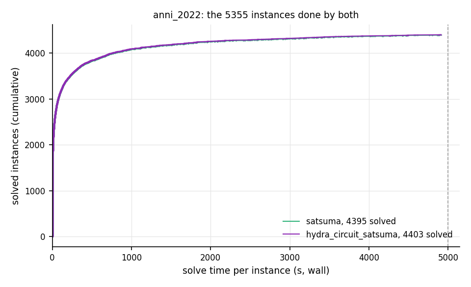

# satsuma vs hydra_circuit_satsuma on anni_2022.jsonl, 5000 s

5355 of 5355 instances done by both; checks off; sat at 59baa26; duo run `/Users/greg/projects/sat_benchmarks/runs/anni_2022_duo`, started 2026-10-04 14:23.

## Changes during the run

- 2026-10-04 17:18: reuse on; hydra_circuit_satsuma runs its own stages only and takes satsuma's result on a hand-off (rows marked reused_from).
- 2026-10-04 22:15 (sat 8494d15, after 164 of these instances were done by both; jobs started later use it): circuit stage check 3x cheaper with identical results (orientation's gates reused, generic extraction without per-candidate hash maps); hydra_circuit_satsuma jobs started from now on use it
- 2026-10-06 08:17 (sat a803481, after 1250 of these instances were done by both; jobs started later use it): cores 9 for about an hour: the freed slot times kissat sc2022-bulky (the 2022 most-solved solver, gcc build in the satsuma image) on 20 anniversary instances to measure this Mac's per-job speed against the 2022 StarExec CPU times; back to 10 after
- 2026-10-06 08:48 (sat a803481, after 1271 of these instances were done by both; jobs started later use it): calibration done, cores back to 10: kissat sc2022-bulky ran a median 3.0x faster per job here than its 2022 StarExec CPU times (20 instances, range 1.96-3.85, all verdicts as in 2022)
- 2026-10-06 08:48 (sat a803481, after 1271 of these instances were done by both; jobs started later use it): correction to the previous note: per-instance range 1.82-3.83 (median 2.99, quartiles 2.79-3.12)
- 2026-10-06 19:59 (sat 03c17d4, after 1640 of these instances were done by both; jobs started later use it): duo.py fix (commit after a803481): a reuse target's stage-only job is charged its host side alone, not vm + host; the running scheduler keeps the old charge until it restarts, and giant_stage_watch.py in the run dir raises the host budget for the one instance still affected, 6g_5color_164_100_01 at #3851
- 2026-10-09 14:11 (sat e8b8ad8, after 3841 of these instances were done by both; jobs started later use it): host budget 30 GB while the stage-only job for 6g_5color_164_100_01 runs (old scheduler charges it vm+host)
- 2026-10-09 14:12 (sat e8b8ad8, after 3842 of these instances were done by both; jobs started later use it): host budget back to 20 GB: the stage-only job for 6g_5color_164_100_01 is done

## Score on the instances done by both

| backend | solved | SAT | UNSAT | timeout | other | PAR-2 | unique |
|---|---|---|---|---|---|---|---|
| satsuma | 4395 | 1990 | 2405 | 960 | 0 | 1999.3 | 0 |
| hydra_circuit_satsuma | 4403 | 1991 | 2412 | 952 | 0 | 1982.7 | 8 |

unique: solved by that backend and not by the other; PAR-2: the mean over these instances of the solve time, 10000 s for an unsolved one.

Time hydra_circuit_satsuma / satsuma on the 2543 instances both solved in at least 5 s: geometric mean 1.042.

### Solved by hydra_circuit_satsuma only (8)

| instance | family | hydra_circuit_satsuma | satsuma |
|---|---|---|---|
| mod2-rand3bip-sat-300-3.shuffled-as.sat05-2295 | tseitin-formulas | SAT 0.0 s | TIMEOUT |
| mchess_19 | mutilated-chessboard | UNSAT 0.0 s | TIMEOUT |
| mchess_20 | mutilated-chessboard | UNSAT 0.0 s | TIMEOUT |
| eulcbip-7-UNSAT.shuffled-as.sat05-3936 | long-learned-clauses | UNSAT 0.0 s | TIMEOUT |
| eulcbip-8-UNSAT.sat05-3937.reshuffled-07 | long-learned-clauses | UNSAT 0.0 s | TIMEOUT |
| pmg-14-UNSAT.sat05-3942.reshuffled-07 | long-learned-clauses | UNSAT 0.0 s | TIMEOUT |
| eulcbip-9-UNSAT.shuffled-as.sat05-3938 | long-learned-clauses | UNSAT 0.0 s | TIMEOUT |
| pmg-13-UNSAT.sat05-3941.reshuffled-07 | long-learned-clauses | UNSAT 0.0 s | TIMEOUT |

### Where hydra_circuit_satsuma is fastest relative to the other (both solved, at least 5 s)

| instance | family | satsuma | hydra_circuit_satsuma | hydra_circuit_satsuma / satsuma |
|---|---|---|---|---|
| SGI_30_70_27_50_3-dir.shuffled-as.sat03-169 | subgraph-isomorphism | 1501.6 s | 1442.3 s | 0.96 |
| f8bidw | hardware-verification | 93.9 s | 93.3 s | 0.99 |
| 003-23-80 | cryptography | 402.3 s | 400.0 s | 0.99 |
| ctl_4291_567_7_unsat | scheduling | 302.5 s | 301.5 s | 1.00 |
| T107.2.0 | cril-misc | 217.5 s | 216.9 s | 1.00 |

### Where satsuma is fastest relative to the other (both solved, at least 5 s)

| instance | family | satsuma | hydra_circuit_satsuma | hydra_circuit_satsuma / satsuma |
|---|---|---|---|---|
| shift1add.26949 | bitvector | 6.8 s | 62.4 s | 9.19 |
| bvadd_27966 | bitvector | 17.8 s | 139.1 s | 7.82 |
| shift1add.21964 | bitvector | 6.1 s | 42.9 s | 7.02 |
| bvadd_29740 | bitvector | 25.8 s | 163.0 s | 6.31 |
| bvadd_27079 | bitvector | 21.0 s | 132.0 s | 6.29 |
| shift1add.19970 | bitvector | 12.9 s | 44.6 s | 3.45 |
| bvult_16967 | bitvector | 89.8 s | 292.6 s | 3.26 |
| hard-15-U-10652 | software-verification | 6.5 s | 21.1 s | 3.25 |
| Problem14_label20_true-unreach-call.c | software-verification | 6.8 s | 19.8 s | 2.93 |
| bvadd_17322 | bitvector | 27.6 s | 73.2 s | 2.65 |

## By family

| family | n | satsuma solved | satsuma PAR-2 | hydra_circuit_satsuma solved | hydra_circuit_satsuma PAR-2 |
|---|---|---|---|---|---|
| hardware-verification | 356 | 336 | 700 | 336 | 702 |
| planning | 334 | 308 | 913 | 308 | 914 |
| cryptography | 313 | 225 | 3148 | 225 | 3149 |
| miter | 280 | 259 | 948 | 259 | 948 |
| coloring | 243 | 176 | 2864 | 176 | 2864 |
| bitvector | 216 | 176 | 2026 | 176 | 2034 |
| quasigroup-completion | 212 | 205 | 365 | 205 | 365 |
| tseitin-formulas | 195 | 185 | 546 | 186 | 467 |
| subgraph-isomorphism | 177 | 124 | 3490 | 124 | 3490 |
| scheduling | 160 | 123 | 2572 | 123 | 2575 |
| software-verification | 124 | 120 | 431 | 120 | 433 |
| pigeon-hole | 122 | 116 | 551 | 116 | 550 |
| diagnosis | 114 | 99 | 1425 | 99 | 1427 |
| rbsat | 113 | 57 | 5309 | 57 | 5309 |
| fpga-routing | 72 | 72 | 25 | 72 | 25 |
| unknown | 71 | 52 | 3039 | 52 | 3039 |
| sgen | 63 | 27 | 6048 | 27 | 6048 |
| graph-isomorphism | 62 | 51 | 1847 | 51 | 1848 |
| cril-misc | 59 | 57 | 813 | 57 | 815 |
| random-modularity | 57 | 54 | 616 | 54 | 616 |
| termination-analysis | 55 | 52 | 700 | 52 | 701 |
| prime-factoring | 51 | 39 | 2507 | 39 | 2505 |
| prime-testing | 51 | 42 | 1778 | 42 | 1778 |
| fdmus | 50 | 50 | 0 | 50 | 0 |
| bioinformatics | 48 | 41 | 1546 | 41 | 1547 |
| auto-correlation | 47 | 31 | 3974 | 31 | 3974 |
| polynomial-multiplication | 46 | 33 | 3410 | 33 | 3411 |
| edge-matching | 45 | 34 | 2709 | 34 | 2710 |
| generic-csp | 45 | 32 | 3244 | 32 | 3244 |
| hgen | 45 | 23 | 5104 | 23 | 5104 |
| waerden | 43 | 27 | 4349 | 27 | 4349 |
| pebbling | 42 | 42 | 31 | 42 | 31 |
| popularity-similarity | 40 | 9 | 8022 | 9 | 8022 |
| stedman-triples | 40 | 25 | 4004 | 25 | 4004 |
| cellular-automata | 35 | 35 | 373 | 35 | 377 |
| gray_codes | 34 | 34 | 92 | 34 | 93 |
| relativized-pigeon-hole | 33 | 33 | 0 | 33 | 0 |
| battleship | 32 | 32 | 142 | 32 | 142 |
| mosoi-289 | 31 | 14 | 5505 | 14 | 5505 |
| matrix-multiplication | 29 | 17 | 4148 | 17 | 4148 |
| ordering-principle | 29 | 29 | 9 | 29 | 10 |
| argumentation | 28 | 28 | 222 | 28 | 222 |
| parity-games | 28 | 27 | 390 | 27 | 391 |
| rooks | 28 | 26 | 1811 | 26 | 1812 |
| dining-philosophers | 27 | 27 | 4 | 27 | 4 |
| fixed-shape-random | 27 | 26 | 535 | 26 | 535 |
| hypertree-decomposition | 27 | 26 | 1002 | 26 | 1003 |
| 2d-strip-packing | 26 | 26 | 91 | 26 | 91 |
| clique-width | 26 | 12 | 5973 | 12 | 5974 |
| petrinet-concurrency | 25 | 18 | 2817 | 18 | 2819 |
| tree-decomposition | 24 | 18 | 3075 | 18 | 3077 |
| random-csp | 23 | 17 | 3028 | 17 | 3028 |
| xor-chain | 22 | 14 | 3637 | 14 | 3637 |
| pythagorean-triples | 21 | 16 | 2669 | 16 | 2669 |
| erdos-discrepancy | 20 | 7 | 6530 | 7 | 6530 |
| knights-problem | 20 | 10 | 5164 | 10 | 5165 |
| puzzle | 20 | 20 | 16 | 20 | 16 |
| sorting-networks | 20 | 16 | 2237 | 16 | 2240 |
| crafted-cec | 19 | 19 | 78 | 19 | 78 |
| grandtour-puzzle | 19 | 9 | 5281 | 9 | 5281 |
| random-clustered | 18 | 12 | 3559 | 12 | 3559 |
| clustered-random | 17 | 17 | 29 | 17 | 29 |
| modcircuits | 17 | 10 | 4301 | 10 | 4301 |
| phnf | 17 | 11 | 3664 | 11 | 3665 |
| minimal-disagreement-parity | 16 | 7 | 5896 | 7 | 5896 |
| cardinality-constraints | 15 | 15 | 63 | 15 | 63 |
| hidoku | 15 | 11 | 2695 | 11 | 2695 |
| purdom-instances | 15 | 15 | 56 | 15 | 6 |
| core-based-generator | 14 | 14 | 415 | 14 | 430 |
| dimacs-sorter | 14 | 14 | 37 | 14 | 37 |
| influence-maximization | 14 | 13 | 1114 | 13 | 1114 |
| testpattern-generation | 14 | 14 | 0 | 14 | 0 |
| antibandwidth | 13 | 8 | 4407 | 8 | 4410 |
| baseball-lineup | 13 | 13 | 506 | 13 | 518 |
| bounded-model-checking | 13 | 13 | 1 | 13 | 1 |
| coloring-mycielski-graph | 13 | 8 | 4001 | 8 | 4003 |
| cover | 13 | 4 | 6923 | 4 | 6923 |
| edit-distance | 13 | 13 | 550 | 13 | 550 |
| ensemble-computation | 13 | 13 | 66 | 13 | 68 |
| hamiltonian-cycle | 13 | 13 | 561 | 13 | 562 |
| hardware-model-checking | 13 | 13 | 63 | 13 | 63 |
| maxsat-optimum | 13 | 13 | 435 | 13 | 436 |
| minimal-superpermutation | 13 | 13 | 806 | 13 | 806 |
| test-configuration | 13 | 8 | 4295 | 8 | 4295 |
| at-least-two-sol | 12 | 12 | 259 | 12 | 262 |
| genurq | 12 | 10 | 1669 | 10 | 1669 |
| ktf | 12 | 7 | 4418 | 7 | 4418 |
| station-repacking | 12 | 12 | 765 | 12 | 766 |
| automata-synchronization | 11 | 9 | 1833 | 9 | 1833 |
| long-learned-clauses | 11 | 2 | 8485 | 7 | 3636 |
| sliding-puzzle | 11 | 6 | 5480 | 6 | 5481 |
| stone | 11 | 9 | 2818 | 9 | 2820 |
| tournament | 11 | 0 | 10000 | 0 | 10000 |
| cryptography-cbmc | 10 | 10 | 89 | 10 | 90 |
| equivalence-chain | 10 | 0 | 10000 | 0 | 10000 |
| greentao | 10 | 3 | 7015 | 3 | 7015 |
| hardware-bmc | 10 | 9 | 1461 | 9 | 1465 |
| mutilated-chessboard | 10 | 8 | 2487 | 10 | 0 |
| relational-dependencies | 10 | 10 | 5 | 10 | 6 |
| software-bmc | 10 | 10 | 29 | 10 | 31 |
| subset-cardinality | 10 | 10 | 517 | 10 | 517 |
| sum-of-3-cubes | 10 | 4 | 6034 | 4 | 6034 |
| circuit-multiplier | 9 | 9 | 1217 | 9 | 1217 |
| finite-state-machines | 9 | 9 | 4 | 9 | 5 |
| perfect-matching | 9 | 3 | 7508 | 3 | 7508 |
| rubikcube | 9 | 5 | 5337 | 5 | 5337 |
| social-golfer | 9 | 3 | 6756 | 3 | 6756 |
| linvrinv | 8 | 4 | 5074 | 4 | 5074 |
| random | 8 | 8 | 8 | 8 | 8 |
| random-mus | 8 | 8 | 461 | 8 | 461 |
| theorem-proving | 8 | 8 | 1 | 8 | 1 |
| discrete-logarithm | 7 | 5 | 2990 | 5 | 2990 |
| misc-satex | 7 | 6 | 1532 | 6 | 1532 |
| ramseycube | 7 | 6 | 1429 | 6 | 1429 |
| alloy-vpn-models | 6 | 6 | 60 | 6 | 63 |
| lam-discrete-geometry | 6 | 6 | 262 | 6 | 263 |
| fermat | 5 | 4 | 2581 | 4 | 2581 |
| hanoi | 5 | 5 | 1 | 5 | 1 |
| product-configuration | 5 | 5 | 0 | 5 | 0 |
| railway-safety | 3 | 0 | 10000 | 0 | 10000 |
| ramsey | 3 | 3 | 1074 | 3 | 1074 |
| random-hiddenmodel | 3 | 0 | 10000 | 0 | 10000 |
| sgen-balanced | 3 | 3 | 227 | 3 | 227 |
| tensors | 3 | 3 | 527 | 3 | 527 |
| 01-integer-programming | 2 | 1 | 5303 | 1 | 5307 |
| circuit-minimization | 2 | 0 | 10000 | 0 | 10000 |
| design-debugging | 2 | 2 | 1 | 2 | 2 |
| karatsuba-multiplication | 2 | 2 | 132 | 2 | 132 |
| maximum-constraint-partition | 2 | 2 | 17 | 2 | 20 |
| philips | 2 | 2 | 81 | 2 | 81 |
| ssp-0 | 2 | 1 | 5157 | 1 | 5160 |
| coloring-clique | 1 | 1 | 0 | 1 | 0 |
| glassy-gen | 1 | 1 | 1 | 1 | 1 |

## Against the reference field: SC2022 anniversary track, 28 sequential solvers

The same 5355 instances; its times are on the competition's machines, so the counts compare and the PAR-2 values only roughly. Over the whole set its virtual best solved 4345 of 5355; its winner by PAR-2, Kissat_MAB_ESA, 4028; its most solved, kissat-sc2022-bulky, 4037.

| solver | solved | SAT | UNSAT | PAR-2 |
|---|---|---|---|---|
| satsuma (here) | 4395 | 1990 | 2405 | 1999.3 |
| hydra_circuit_satsuma (here) | 4403 | 1991 | 2412 | 1982.7 |
| virtual best (reference) | 4345 | 2140 | 2205 | 2108.5 |
| Kissat_MAB_ESA, winner (reference) | 4028 | 1951 | 2077 | 2806.4 |
| kissat-sc2022-bulky, most solved (reference) | 4037 | 1962 | 2075 | 2811.0 |

### Solved by satsuma, by no solver of the reference (242)

| instance | family | satsuma |
|---|---|---|
| clqcolor-12-08-10.shuffled-as.sat05-1259 | coloring | UNSAT 0.3 s |
| easier-php-035-029.sat05-1179.reshuffled-07 | pigeon-hole | UNSAT 0.3 s |
| urq55 | tseitin-formulas | UNSAT 0.3 s |
| harder-fphp-018-017.sat05-1231.reshuffled-07 | pigeon-hole | UNSAT 0.3 s |
| fphp-020-015.shuffled-as.sat05-1218 | pigeon-hole | UNSAT 0.3 s |
| x2_72.shuffled-as.sat03-1604 | xor-chain | UNSAT 0.3 s |
| Pb-chnl15-16_c18 | unknown | UNSAT 0.3 s |
| Urquhart-s5-b6.shuffled | tseitin-formulas | UNSAT 0.3 s |
| fphp-025-020.shuffled-as.sat05-1219 | pigeon-hole | UNSAT 0.3 s |
| Urquhart-s4-b5.shuffled | tseitin-formulas | UNSAT 0.3 s |
| x1.1_64.shuffled-as.sat03-1585 | xor-chain | UNSAT 0.3 s |
| php-018-014.shuffled-as.sat05-1175 | pigeon-hole | UNSAT 0.3 s |
| php-020-015.shuffled-as.sat05-1176 | pigeon-hole | UNSAT 0.3 s |
| fphp-045-035.shuffled-as.sat05-1223 | pigeon-hole | UNSAT 0.3 s |
| marg5x5.shuffled-as.sat03-1455 | tseitin-formulas | UNSAT 0.3 s |
| fphp-030-025.shuffled-as.sat05-1220 | pigeon-hole | UNSAT 0.3 s |
| fclqcolor-14-09-12.shuffled-as.sat05-1284 | coloring | UNSAT 0.3 s |
| Urquhart-s5-b3.shuffled-as.sat03-1572 | tseitin-formulas | UNSAT 0.3 s |
| php-016-013.shuffled-as.sat05-1174 | pigeon-hole | UNSAT 0.3 s |
| php12e12 | pigeon-hole | UNSAT 0.3 s |
| Urquhart-s5-b10.shuffled | tseitin-formulas | UNSAT 0.3 s |
| urqh3x5.shuffled-as.sat03-1478 | tseitin-formulas | UNSAT 0.3 s |
| urqh3x6.shuffled-as.sat03-1479 | tseitin-formulas | UNSAT 0.3 s |
| rphp5_080_shuffled | relativized-pigeon-hole | UNSAT 0.3 s |
| x2_80.shuffled | xor-chain | UNSAT 0.3 s |
| urquhart4_25.shuffled | tseitin-formulas | UNSAT 0.3 s |
| fphp-016-013.shuffled-as.sat05-1216 | pigeon-hole | UNSAT 0.3 s |
| harder-fphp-016-015.sat05-1230.reshuffled-07 | pigeon-hole | UNSAT 0.3 s |
| Urquhart-s5-b2.shuffled-as.sat03-1571 | tseitin-formulas | UNSAT 0.3 s |
| urquhart4_25bis.shuffled | tseitin-formulas | UNSAT 0.3 s |
| x2_56.shuffled | xor-chain | UNSAT 0.3 s |
| php-025-020.shuffled-as.sat05-1177 | pigeon-hole | UNSAT 0.3 s |
| clqcolor-14-09-12.shuffled-as.sat05-1260 | coloring | UNSAT 0.3 s |
| fphp-025-024.shuffled-as.sat05-1233 | pigeon-hole | UNSAT 0.3 s |
| Urquhart-s5-b5.shuffled | tseitin-formulas | UNSAT 0.3 s |
| x1_96.shuffled-as.sat03-1597 | xor-chain | UNSAT 0.3 s |
| easier-fphp-035-029.sat05-1221.reshuffled-07 | pigeon-hole | UNSAT 0.3 s |
| php-020-019.shuffled-as.sat05-1190 | pigeon-hole | UNSAT 0.3 s |
| Urquhart-s5-b7.shuffled | tseitin-formulas | UNSAT 0.3 s |
| unsat-set-a-fclqcolor-20-13-14.sat05-1278.reshuffled-07-sc2007 | coloring | UNSAT 0.3 s |
| Urquhart-s5-b9.shuffled | tseitin-formulas | UNSAT 0.3 s |
| php-030-025.shuffled-as.sat05-1178 | pigeon-hole | UNSAT 0.3 s |
| php-035-034.shuffled-as.sat05-1193 | pigeon-hole | UNSAT 0.3 s |
| tph9 | pigeon-hole | UNSAT 0.3 s |
| tph10 | pigeon-hole | UNSAT 0.3 s |
| php-018-017.shuffled-as.sat05-1189 | pigeon-hole | UNSAT 0.3 s |
| tph8 | pigeon-hole | UNSAT 0.3 s |
| rphp5_090_shuffled | relativized-pigeon-hole | UNSAT 0.3 s |
| Urquhart-s5-b8.shuffled | tseitin-formulas | UNSAT 0.3 s |
| php14e14 | pigeon-hole | UNSAT 0.3 s |
| rphp5_070_shuffled | relativized-pigeon-hole | UNSAT 0.3 s |
| php-050-040.shuffled-as.sat05-1182 | pigeon-hole | UNSAT 0.3 s |
| php-030-029.shuffled-as.sat05-1192 | pigeon-hole | UNSAT 0.3 s |
| rphp5_055_shuffled | relativized-pigeon-hole | UNSAT 0.3 s |
| clqcolor-16-10-11.shuffled-as.sat05-1253 | coloring | UNSAT 0.3 s |
| php-016-015.shuffled-as.sat05-1188 | pigeon-hole | UNSAT 0.3 s |
| fclqcolor-14-08-09.shuffled-as.sat05-1276 | coloring-clique | UNSAT 0.3 s |
| php-045-035.shuffled-as.sat05-1181 | pigeon-hole | UNSAT 0.3 s |
| Urquhart-s4-b4.shuffled | tseitin-formulas | UNSAT 0.3 s |
| rphp5_075_shuffled | relativized-pigeon-hole | UNSAT 0.3 s |
| fclqcolor-12-08-10.shuffled-as.sat05-1283 | coloring | UNSAT 0.3 s |
| urqh1c3x6.shuffled-as.sat03-1466 | tseitin-formulas | UNSAT 0.3 s |
| fphp-040-032.shuffled-as.sat05-1222 | pigeon-hole | UNSAT 0.3 s |
| rphp5_095_shuffled | relativized-pigeon-hole | UNSAT 0.3 s |
| rphp5_100_shuffled | relativized-pigeon-hole | UNSAT 0.4 s |
| marg6x6.shuffled-as.sat03-1456 | tseitin-formulas | UNSAT 0.4 s |
| php-040-032.shuffled-as.sat05-1180 | pigeon-hole | UNSAT 0.4 s |
| fphp-035-034.shuffled-as.sat05-1235 | pigeon-hole | UNSAT 0.4 s |
| fclqcolor-16-10-11.shuffled-as.sat05-1277 | coloring | UNSAT 0.4 s |
| Urquhart-s5-b1.shuffled-as.sat03-1570 | tseitin-formulas | UNSAT 0.4 s |
| Urquhart-s5-b4.shuffled | tseitin-formulas | UNSAT 0.4 s |
| hypercube6.shuffled-as.sat03-1436 | tseitin-formulas | UNSAT 0.4 s |
| php-025-024.shuffled-as.sat05-1191 | pigeon-hole | UNSAT 0.4 s |
| fclqcolor-16-11-14.shuffled-as.sat05-1285 | coloring | UNSAT 0.4 s |
| clqcolor-14-08-09.shuffled-as.sat05-1252 | coloring | UNSAT 0.4 s |
| ccp-s6-facto2 | coloring | UNSAT 0.4 s |
| Pb-chnl20-21_c18 | unknown | UNSAT 0.4 s |
| fphp-040-039.shuffled-as.sat05-1236 | pigeon-hole | UNSAT 0.4 s |
| urqh1c6x6.shuffled-as.sat03-1469 | tseitin-formulas | UNSAT 0.4 s |
| urqh5x5.shuffled-as.sat03-1481 | tseitin-formulas | UNSAT 0.4 s |
| tph11 | pigeon-hole | UNSAT 0.4 s |
| ccp-s7-facto2 | coloring | UNSAT 0.4 s |
| fphp-018-014.shuffled-as.sat05-1217 | pigeon-hole | UNSAT 0.4 s |
| clqcolor-20-13-14.shuffled-as.sat05-1254 | coloring | UNSAT 0.4 s |
| php-050-049.shuffled-as.sat05-1196 | pigeon-hole | UNSAT 0.4 s |
| php-045-044.shuffled-as.sat05-1195 | pigeon-hole | UNSAT 0.4 s |
| rphp4_115_shuffled | relativized-pigeon-hole | UNSAT 0.4 s |
| rphp5_085_shuffled | relativized-pigeon-hole | UNSAT 0.4 s |
| fphp-050-040.shuffled-as.sat05-1224 | pigeon-hole | UNSAT 0.4 s |
| fphp-045-044.shuffled-as.sat05-1237 | pigeon-hole | UNSAT 0.4 s |
| mod2-3cage-unsat-12.shuffled-as.sat05-2571 | tseitin-formulas | UNSAT 0.4 s |
| rphp4_135_shuffled | relativized-pigeon-hole | UNSAT 0.4 s |
| ccp-s6-facto3 | coloring | UNSAT 0.4 s |
| le450_15b.col.15-sc2018 | coloring | UNSAT 0.4 s |
| urqh6x6.shuffled-as.sat03-1482 | tseitin-formulas | UNSAT 0.4 s |
| fphp-030-029.shuffled-as.sat05-1234 | pigeon-hole | UNSAT 0.4 s |
| rphp4_125_shuffled | relativized-pigeon-hole | UNSAT 0.4 s |
| php-040-039.shuffled-as.sat05-1194 | pigeon-hole | UNSAT 0.4 s |
| rphp4_140_shuffled | relativized-pigeon-hole | UNSAT 0.4 s |
| clqcolor-20-15-18.shuffled-as.sat05-1262 | coloring | UNSAT 0.4 s |
| harder-fphp-050-049.sat05-1238.reshuffled-07 | pigeon-hole | UNSAT 0.4 s |
| rphp4_155_shuffled | relativized-pigeon-hole | UNSAT 0.4 s |
| rphp4_145_shuffled | relativized-pigeon-hole | UNSAT 0.4 s |
| bevhcube5.shuffled-as.sat03-1427 | tseitin-formulas | UNSAT 0.4 s |
| x2_128.shuffled-as.sat03-1598 | xor-chain | UNSAT 0.4 s |
| fclqcolor-20-15-18.shuffled-as.sat05-1286 | coloring | UNSAT 0.4 s |
| ccp-s8-facto2 | coloring | UNSAT 0.4 s |
| school1_nsh.col.14 | coloring | UNSAT 0.5 s |
| bevhcube6.shuffled-as.sat03-1428 | tseitin-formulas | UNSAT 0.5 s |
| hcb4.shuffled-as.sat03-1432 | tseitin-formulas | UNSAT 0.5 s |
| urqh4x4.shuffled-as.sat03-1480 | tseitin-formulas | UNSAT 0.5 s |
| rphp4_160_shuffled | relativized-pigeon-hole | UNSAT 0.5 s |
| mod2-3cage-unsat-11.shuffled-as.sat05-2572 | tseitin-formulas | UNSAT 0.5 s |
| rphp4_150_shuffled | relativized-pigeon-hole | UNSAT 0.5 s |
| school1.col.14 | coloring | UNSAT 0.5 s |
| rphp5_060_shuffled | relativized-pigeon-hole | UNSAT 0.5 s |
| php-060-048.shuffled-as.sat05-1183 | pigeon-hole | UNSAT 0.5 s |
| fphp-060-048.shuffled-as.sat05-1225 | pigeon-hole | UNSAT 0.5 s |
| hcb5.shuffled-as.sat03-1433 | tseitin-formulas | UNSAT 0.5 s |
| clqcolor-25-16-17.shuffled-as.sat05-1255 | coloring | UNSAT 0.5 s |
| urqh1c5x5.shuffled-as.sat03-1468 | tseitin-formulas | UNSAT 0.5 s |
| fphp-060-059.shuffled-as.sat05-1239 | pigeon-hole | UNSAT 0.5 s |
| fclqcolor-25-16-17.shuffled-as.sat05-1279 | coloring | UNSAT 0.5 s |
| tph14 | pigeon-hole | UNSAT 0.6 s |
| php-060-059.shuffled-as.sat05-1197 | pigeon-hole | UNSAT 0.6 s |
| php-070-057.shuffled-as.sat05-1184 | pigeon-hole | UNSAT 0.6 s |
| le450_25a.col.25 | coloring | UNSAT 0.6 s |
| rphp4_120_shuffled | relativized-pigeon-hole | UNSAT 0.6 s |
| ccp-s7-facto3 | coloring | UNSAT 0.6 s |
| le450_25b.col.25 | coloring | UNSAT 0.6 s |
| ccp-s9-facto2 | coloring | UNSAT 0.6 s |
| tph15 | pigeon-hole | UNSAT 0.6 s |
| ccp-s6-facto4 | coloring | UNSAT 0.6 s |
| tph12 | pigeon-hole | UNSAT 0.6 s |
| php-070-069.shuffled-as.sat05-1198 | pigeon-hole | UNSAT 0.6 s |
| harder-fphp-070-069.sat05-1240.reshuffled-07 | pigeon-hole | UNSAT 0.7 s |
| le450_25c.col.25 | coloring | UNSAT 0.7 s |
| tph16 | pigeon-hole | UNSAT 0.7 s |
| hypercube7.shuffled-as.sat03-1437 | tseitin-formulas | UNSAT 0.7 s |
| ccp-s10-facto2 | coloring | UNSAT 0.7 s |
| fphp-070-057.shuffled-as.sat05-1226 | pigeon-hole | UNSAT 0.8 s |
| clqcolor-25-18-23.shuffled-as.sat05-1263 | coloring | UNSAT 0.8 s |
| fclqcolor-30-19-20.shuffled-as.sat05-1280 | coloring | UNSAT 0.8 s |
| clqcolor-30-19-20.shuffled-as.sat05-1256 | coloring | UNSAT 0.8 s |
| ccp-s8-facto3 | coloring | UNSAT 0.8 s |
| tph17 | pigeon-hole | UNSAT 0.8 s |
| unsat-set-b-fclqcolor-25-18-23.sat05-1287.reshuffled-07 | coloring | UNSAT 0.8 s |
| ak064modbtmodbtisc | miter | UNSAT 0.9 s |
| tph18 | pigeon-hole | UNSAT 1.0 s |
| ccp-s7-facto4 | coloring | UNSAT 1.0 s |
| ak064boothboothisc | miter | UNSAT 1.1 s |
| tph19 | pigeon-hole | UNSAT 1.2 s |
| bv-term-small-rw_848.smt2 | bitvector | UNSAT 1.2 s |
| ccp-s9-facto3 | coloring | UNSAT 1.2 s |
| tph20 | pigeon-hole | UNSAT 1.4 s |
| fclqcolor-30-20-26.shuffled-as.sat05-1288 | coloring | UNSAT 1.6 s |
| ccp-s8-facto4 | coloring | UNSAT 1.8 s |
| g2-ak128diagodiagoisc | miter | UNSAT 2.1 s |
| ccp-s10-facto3 | coloring | UNSAT 2.2 s |
| ccp-s9-facto4 | coloring | UNSAT 3.3 s |
| ak128boothboothisc | miter | UNSAT 3.4 s |
| tseitingrid7x120_shuffled | tseitin-formulas | UNSAT 6.2 s |
| battleship-15-15-unsat | battleship | UNSAT 6.3 s |
| tseitingrid7x130_shuffled | tseitin-formulas | UNSAT 7.2 s |
| tseitingrid7x125_shuffled | tseitin-formulas | UNSAT 8.0 s |
| tseitingrid6x145_shuffled | tseitin-formulas | UNSAT 8.4 s |
| tseitingrid7x135_shuffled | tseitin-formulas | UNSAT 8.7 s |
| tseitingrid6x160_shuffled | tseitin-formulas | UNSAT 8.9 s |
| tseitingrid6x165_shuffled | tseitin-formulas | UNSAT 9.3 s |
| tseitingrid6x155_shuffled | tseitin-formulas | UNSAT 9.6 s |
| tseitingrid7x185_shuffled | tseitin-formulas | UNSAT 9.6 s |
| tseitingrid7x180_shuffled | tseitin-formulas | UNSAT 9.7 s |
| tseitingrid7x195_shuffled | tseitin-formulas | UNSAT 10.0 s |
| tseitingrid7x165_shuffled | tseitin-formulas | UNSAT 10.1 s |
| tseitingrid6x170_shuffled | tseitin-formulas | UNSAT 10.2 s |
| tseitingrid7x160_shuffled-sc2016 | tseitin-formulas | UNSAT 10.5 s |
| tseitingrid7x175_shuffled | tseitin-formulas | UNSAT 11.2 s |
| tseitingrid7x140_shuffled | tseitin-formulas | UNSAT 11.3 s |
| tseitingrid6x190_shuffled | tseitin-formulas | UNSAT 11.4 s |
| tseitingrid6x180_shuffled | tseitin-formulas | UNSAT 11.5 s |
| tseitingrid6x200_shuffled | tseitin-formulas | UNSAT 11.5 s |
| tseitingrid7x200_shuffled | tseitin-formulas | UNSAT 11.9 s |
| tseitingrid7x155_shuffled | tseitin-formulas | UNSAT 13.7 s |
| tseitingrid6x185_shuffled | tseitin-formulas | UNSAT 13.7 s |
| tseitingrid6x175_shuffled | tseitin-formulas | UNSAT 13.8 s |
| ndhf_xits_10_UNSAT | bioinformatics | UNSAT 14.0 s |
| tseitingrid7x170_shuffled | tseitin-formulas | UNSAT 14.2 s |
| tseitingrid6x195_shuffled | tseitin-formulas | UNSAT 15.2 s |
| tseitingrid7x190_shuffled | tseitin-formulas | UNSAT 15.5 s |
| rpoc_xits_10_UNKNOWN | bioinformatics | UNSAT 16.3 s |
| ndhf_xits_11_UNSAT | bioinformatics | UNSAT 68.7 s |
| rbcl_xits_10_UNKNOWN | bioinformatics | UNSAT 73.7 s |
| rpoc_xits_11_UNKNOWN | bioinformatics | UNSAT 152.3 s |
| Schur_160_5_d21 | coloring | SAT 221.8 s |
| ndhf_xits_12_UNSAT | bioinformatics | UNSAT 306.1 s |
| rbcl_xits_11_UNKNOWN | bioinformatics | UNSAT 447.5 s |
| phnf-size10-exclusive-myciel6-cn.used-as.sat04-319.shuffled-as.sat05-4201 | phnf | UNSAT 482.4 s |
| SGI_30_80_17_90_7-dir.shuffled-as.sat03-189 | subgraph-isomorphism | UNSAT 674.3 s |
| mod2c-rand3bip-unsat-150-2.shuffled-as.sat05-2369 | tseitin-formulas | UNSAT 781.2 s |
| phnf-size10-exclusive-myciel6-c.used-as.sat04-318.shuffled-as.sat05-4199 | phnf | UNSAT 804.8 s |
| MD5-28-3 | cryptography | SAT 973.8 s |
| ak032modbtsimpbisc | miter | UNSAT 1012.4 s |
| rpoc_xits_12_UNKNOWN | bioinformatics | UNSAT 1110.1 s |
| SGI_30_80_16_90_1-log.shuffled-as.sat03-188 | subgraph-isomorphism | UNSAT 1353.6 s |
| sgen1-unsat-109-100.mis-81.debugged | sgen | UNSAT 1525.4 s |
| ndhf_xits_13_UNSAT | bioinformatics | UNSAT 1617.2 s |
| Schur_161_5_d39 | coloring | UNSAT 1620.8 s |
| 58bits_11.dimacs | prime-factoring | SAT 1819.1 s |
| IBM_FV_2004_rule_batch_2_31_2_SAT_dat.k45.debugged-sc2012 | hardware-verification | UNSAT 2086.9 s |
| SGI_30_80_16_90_1-dir.shuffled-as.sat03-187 | subgraph-isomorphism | UNSAT 2144.8 s |
| g2-gss-30-s100 | cryptography | SAT 2176.0 s |
| frb56-25-1.used-as.sat04-889 | random-csp | SAT 2283.9 s |
| SGI_30_60_19_60_6-log.shuffled-as.sat03-113 | subgraph-isomorphism | UNSAT 2323.3 s |
| SGI_30_80_17_90_7-log.shuffled-as.sat03-190 | subgraph-isomorphism | UNSAT 2492.7 s |
| randomG-n17-d05 | perfect-matching | UNSAT 2506.6 s |
| SGI_30_70_20_60_10-log.shuffled-as.sat03-145 | subgraph-isomorphism | UNSAT 2523.8 s |
| 2bitmax_6.mis-133.debugged | unknown | UNSAT 2722.5 s |
| SGI_30_40_30_20_2-log.shuffled-as.sat03-105 | subgraph-isomorphism | UNSAT 2786.3 s |
| SGI_30_70_18_80_10-log.shuffled-as.sat03-141 | subgraph-isomorphism | UNSAT 2956.8 s |
| cruxmiter32seed4 | miter | UNSAT 2966.6 s |
| ctl_4291_567_11_unsat | scheduling | UNSAT 3057.4 s |
| pmg-12-UNSAT.sat05-3940.reshuffled-07 | long-learned-clauses | UNSAT 3063.3 s |
| mp1-ps_5000_21250_3_0_0.8_0_1.55_4 | popularity-similarity | UNSAT 3114.2 s |
| ramsey.sat05-511.reshuffled-07 | ramsey | UNSAT 3207.2 s |
| SGI_30_70_21_70_7-dir.shuffled-as.sat03-152 | subgraph-isomorphism | UNSAT 3302.3 s |
| mp1-ps_5000_21250_3_0_0.8_0_1.55_6 | popularity-similarity | UNSAT 3306.9 s |
| connm-ue-csp-sat-n800-d0.04-s1788334438.shuffled-as.sat05-543 | generic-csp | UNSAT 3394.3 s |
| eqsparcl12bpwtrc12 | hardware-verification | UNSAT 3402.4 s |
| SGI_30_70_25_50_7-log.shuffled-as.sat03-162 | subgraph-isomorphism | UNSAT 3510.5 s |
| Schur_161_5_d38 | coloring | UNSAT 3550.1 s |
| eqsparrc12bpdtlf12 | hardware-verification | UNSAT 3742.1 s |
| custmulsb2x32o | miter | UNSAT 3786.9 s |
| mp1-ps_5000_21250_3_0_0.8_0_1.55_0 | popularity-similarity | UNSAT 3912.7 s |
| mp1-rubikcube512 | rubikcube | UNSAT 3919.6 s |
| SGI_30_80_26_70_4-dir.shuffled-as.sat03-207 | subgraph-isomorphism | UNSAT 4037.9 s |
| Sz512_15127_6.smt2-stp212 | bitvector | UNSAT 4257.1 s |
| SGI_30_70_30_40_3-log.shuffled-as.sat03-182 | subgraph-isomorphism | UNSAT 4419.7 s |
| eqspctbk12bpwtrc12 | hardware-verification | UNSAT 4476.1 s |
| MD5-28-5 | cryptography | SAT 4482.6 s |
| SGI_30_70_21_60_7-log.shuffled-as.sat03-151 | subgraph-isomorphism | UNSAT 4494.0 s |
| eqbparrc12spctbk12 | hardware-verification | UNSAT 4801.5 s |
| VanDerWaerden_2-3-14_186 | waerden | UNSAT 4893.0 s |

### Solved by hydra_circuit_satsuma, by no solver of the reference (248)

| instance | family | hydra_circuit_satsuma |
|---|---|---|
| x2_56.shuffled | xor-chain | UNSAT 0.0 s |
| mchess_19 | mutilated-chessboard | UNSAT 0.0 s |
| marg5x5.shuffled-as.sat03-1455 | tseitin-formulas | UNSAT 0.0 s |
| x1.1_64.shuffled-as.sat03-1585 | xor-chain | UNSAT 0.0 s |
| x2_72.shuffled-as.sat03-1604 | xor-chain | UNSAT 0.0 s |
| php-016-013.shuffled-as.sat05-1174 | pigeon-hole | UNSAT 0.0 s |
| ccp-s6-facto2 | coloring | UNSAT 0.0 s |
| php-016-015.shuffled-as.sat05-1188 | pigeon-hole | UNSAT 0.0 s |
| x2_80.shuffled | xor-chain | UNSAT 0.0 s |
| fphp-016-013.shuffled-as.sat05-1216 | pigeon-hole | UNSAT 0.0 s |
| fphp-018-014.shuffled-as.sat05-1217 | pigeon-hole | UNSAT 0.0 s |
| harder-fphp-016-015.sat05-1230.reshuffled-07 | pigeon-hole | UNSAT 0.0 s |
| x2_128.shuffled-as.sat03-1598 | xor-chain | UNSAT 0.0 s |
| Urquhart-s4-b4.shuffled | tseitin-formulas | UNSAT 0.0 s |
| harder-fphp-018-017.sat05-1231.reshuffled-07 | pigeon-hole | UNSAT 0.0 s |
| php-018-014.shuffled-as.sat05-1175 | pigeon-hole | UNSAT 0.0 s |
| php-025-024.shuffled-as.sat05-1191 | pigeon-hole | UNSAT 0.0 s |
| php-020-015.shuffled-as.sat05-1176 | pigeon-hole | UNSAT 0.0 s |
| fphp-020-015.shuffled-as.sat05-1218 | pigeon-hole | UNSAT 0.0 s |
| mod2-3cage-unsat-11.shuffled-as.sat05-2572 | tseitin-formulas | UNSAT 0.0 s |
| php-018-017.shuffled-as.sat05-1189 | pigeon-hole | UNSAT 0.0 s |
| mod2-3cage-unsat-12.shuffled-as.sat05-2571 | tseitin-formulas | UNSAT 0.0 s |
| urq55 | tseitin-formulas | UNSAT 0.0 s |
| pmg-12-UNSAT.sat05-3940.reshuffled-07 | long-learned-clauses | UNSAT 0.0 s |
| Urquhart-s5-b3.shuffled-as.sat03-1572 | tseitin-formulas | UNSAT 0.0 s |
| urquhart4_25bis.shuffled | tseitin-formulas | UNSAT 0.0 s |
| urqh1c3x6.shuffled-as.sat03-1466 | tseitin-formulas | UNSAT 0.0 s |
| Urquhart-s5-b7.shuffled | tseitin-formulas | UNSAT 0.0 s |
| eulcbip-7-UNSAT.shuffled-as.sat05-3936 | long-learned-clauses | UNSAT 0.0 s |
| php-020-019.shuffled-as.sat05-1190 | pigeon-hole | UNSAT 0.0 s |
| bevhcube5.shuffled-as.sat03-1427 | tseitin-formulas | UNSAT 0.0 s |
| Urquhart-s5-b1.shuffled-as.sat03-1570 | tseitin-formulas | UNSAT 0.0 s |
| eulcbip-8-UNSAT.sat05-3937.reshuffled-07 | long-learned-clauses | UNSAT 0.0 s |
| x1_96.shuffled-as.sat03-1597 | xor-chain | UNSAT 0.0 s |
| marg6x6.shuffled-as.sat03-1456 | tseitin-formulas | UNSAT 0.0 s |
| urquhart4_25.shuffled | tseitin-formulas | UNSAT 0.0 s |
| easier-php-035-029.sat05-1179.reshuffled-07 | pigeon-hole | UNSAT 0.0 s |
| Urquhart-s4-b5.shuffled | tseitin-formulas | UNSAT 0.0 s |
| pmg-14-UNSAT.sat05-3942.reshuffled-07 | long-learned-clauses | UNSAT 0.0 s |
| fphp-025-020.shuffled-as.sat05-1219 | pigeon-hole | UNSAT 0.0 s |
| php-025-020.shuffled-as.sat05-1177 | pigeon-hole | UNSAT 0.0 s |
| Urquhart-s5-b6.shuffled | tseitin-formulas | UNSAT 0.0 s |
| Urquhart-s5-b4.shuffled | tseitin-formulas | UNSAT 0.0 s |
| eulcbip-9-UNSAT.shuffled-as.sat05-3938 | long-learned-clauses | UNSAT 0.0 s |
| Urquhart-s5-b10.shuffled | tseitin-formulas | UNSAT 0.0 s |
| pmg-13-UNSAT.sat05-3941.reshuffled-07 | long-learned-clauses | UNSAT 0.0 s |
| urqh3x5.shuffled-as.sat03-1478 | tseitin-formulas | UNSAT 0.0 s |
| fphp-025-024.shuffled-as.sat05-1233 | pigeon-hole | UNSAT 0.0 s |
| urqh4x4.shuffled-as.sat03-1480 | tseitin-formulas | UNSAT 0.0 s |
| Urquhart-s5-b8.shuffled | tseitin-formulas | UNSAT 0.0 s |
| Urquhart-s5-b2.shuffled-as.sat03-1571 | tseitin-formulas | UNSAT 0.0 s |
| bevhcube6.shuffled-as.sat03-1428 | tseitin-formulas | UNSAT 0.0 s |
| ccp-s7-facto2 | coloring | UNSAT 0.0 s |
| urqh1c5x5.shuffled-as.sat03-1468 | tseitin-formulas | UNSAT 0.0 s |
| ccp-s6-facto3 | coloring | UNSAT 0.0 s |
| Urquhart-s5-b9.shuffled | tseitin-formulas | UNSAT 0.0 s |
| urqh3x6.shuffled-as.sat03-1479 | tseitin-formulas | UNSAT 0.0 s |
| fphp-030-025.shuffled-as.sat05-1220 | pigeon-hole | UNSAT 0.0 s |
| php-030-029.shuffled-as.sat05-1192 | pigeon-hole | UNSAT 0.0 s |
| easier-fphp-035-029.sat05-1221.reshuffled-07 | pigeon-hole | UNSAT 0.0 s |
| fphp-035-034.shuffled-as.sat05-1235 | pigeon-hole | UNSAT 0.0 s |
| php-030-025.shuffled-as.sat05-1178 | pigeon-hole | UNSAT 0.0 s |
| fphp-040-032.shuffled-as.sat05-1222 | pigeon-hole | UNSAT 0.0 s |
| php-035-034.shuffled-as.sat05-1193 | pigeon-hole | UNSAT 0.0 s |
| Urquhart-s5-b5.shuffled | tseitin-formulas | UNSAT 0.0 s |
| ccp-s6-facto4 | coloring | UNSAT 0.0 s |
| php-040-039.shuffled-as.sat05-1194 | pigeon-hole | UNSAT 0.0 s |
| urqh1c6x6.shuffled-as.sat03-1469 | tseitin-formulas | UNSAT 0.0 s |
| php-040-032.shuffled-as.sat05-1180 | pigeon-hole | UNSAT 0.0 s |
| ccp-s8-facto2 | coloring | UNSAT 0.0 s |
| fphp-030-029.shuffled-as.sat05-1234 | pigeon-hole | UNSAT 0.0 s |
| ccp-s7-facto3 | coloring | UNSAT 0.0 s |
| hypercube6.shuffled-as.sat03-1436 | tseitin-formulas | UNSAT 0.0 s |
| ccp-s8-facto3 | coloring | UNSAT 0.0 s |
| hcb4.shuffled-as.sat03-1432 | tseitin-formulas | UNSAT 0.0 s |
| fphp-045-035.shuffled-as.sat05-1223 | pigeon-hole | UNSAT 0.0 s |
| php-045-035.shuffled-as.sat05-1181 | pigeon-hole | UNSAT 0.0 s |
| fphp-040-039.shuffled-as.sat05-1236 | pigeon-hole | UNSAT 0.0 s |
| urqh5x5.shuffled-as.sat03-1481 | tseitin-formulas | UNSAT 0.0 s |
| ccp-s7-facto4 | coloring | UNSAT 0.0 s |
| php-045-044.shuffled-as.sat05-1195 | pigeon-hole | UNSAT 0.0 s |
| ccp-s9-facto2 | coloring | UNSAT 0.0 s |
| php-050-040.shuffled-as.sat05-1182 | pigeon-hole | UNSAT 0.0 s |
| fphp-045-044.shuffled-as.sat05-1237 | pigeon-hole | UNSAT 0.0 s |
| urqh6x6.shuffled-as.sat03-1482 | tseitin-formulas | UNSAT 0.0 s |
| fphp-050-040.shuffled-as.sat05-1224 | pigeon-hole | UNSAT 0.0 s |
| php-050-049.shuffled-as.sat05-1196 | pigeon-hole | UNSAT 0.0 s |
| ccp-s10-facto2 | coloring | UNSAT 0.0 s |
| tseitingrid7x140_shuffled | tseitin-formulas | UNSAT 0.0 s |
| tseitingrid6x155_shuffled | tseitin-formulas | UNSAT 0.0 s |
| tseitingrid7x120_shuffled | tseitin-formulas | UNSAT 0.0 s |
| ccp-s9-facto3 | coloring | UNSAT 0.0 s |
| tseitingrid6x145_shuffled | tseitin-formulas | UNSAT 0.0 s |
| hypercube7.shuffled-as.sat03-1437 | tseitin-formulas | UNSAT 0.0 s |
| tseitingrid6x190_shuffled | tseitin-formulas | UNSAT 0.0 s |
| tseitingrid7x125_shuffled | tseitin-formulas | UNSAT 0.0 s |
| ccp-s8-facto4 | coloring | UNSAT 0.0 s |
| tseitingrid6x165_shuffled | tseitin-formulas | UNSAT 0.0 s |
| tseitingrid7x130_shuffled | tseitin-formulas | UNSAT 0.0 s |
| tseitingrid6x180_shuffled | tseitin-formulas | UNSAT 0.0 s |
| tseitingrid6x170_shuffled | tseitin-formulas | UNSAT 0.0 s |
| tseitingrid6x160_shuffled | tseitin-formulas | UNSAT 0.0 s |
| tseitingrid6x175_shuffled | tseitin-formulas | UNSAT 0.0 s |
| php-060-048.shuffled-as.sat05-1183 | pigeon-hole | UNSAT 0.0 s |
| tseitingrid7x135_shuffled | tseitin-formulas | UNSAT 0.0 s |
| harder-fphp-050-049.sat05-1238.reshuffled-07 | pigeon-hole | UNSAT 0.0 s |
| tseitingrid7x160_shuffled-sc2016 | tseitin-formulas | UNSAT 0.0 s |
| tseitingrid7x165_shuffled | tseitin-formulas | UNSAT 0.0 s |
| tseitingrid7x155_shuffled | tseitin-formulas | UNSAT 0.0 s |
| tseitingrid7x170_shuffled | tseitin-formulas | UNSAT 0.0 s |
| tseitingrid7x180_shuffled | tseitin-formulas | UNSAT 0.0 s |
| tseitingrid6x195_shuffled | tseitin-formulas | UNSAT 0.0 s |
| fphp-060-048.shuffled-as.sat05-1225 | pigeon-hole | UNSAT 0.0 s |
| tseitingrid7x185_shuffled | tseitin-formulas | UNSAT 0.0 s |
| tseitingrid7x190_shuffled | tseitin-formulas | UNSAT 0.0 s |
| tseitingrid6x185_shuffled | tseitin-formulas | UNSAT 0.0 s |
| tseitingrid7x175_shuffled | tseitin-formulas | UNSAT 0.0 s |
| php-060-059.shuffled-as.sat05-1197 | pigeon-hole | UNSAT 0.0 s |
| tseitingrid6x200_shuffled | tseitin-formulas | UNSAT 0.0 s |
| tseitingrid7x195_shuffled | tseitin-formulas | UNSAT 0.0 s |
| tseitingrid7x200_shuffled | tseitin-formulas | UNSAT 0.0 s |
| fphp-060-059.shuffled-as.sat05-1239 | pigeon-hole | UNSAT 0.0 s |
| hcb5.shuffled-as.sat03-1433 | tseitin-formulas | UNSAT 0.0 s |
| ccp-s9-facto4 | coloring | UNSAT 0.0 s |
| php-070-057.shuffled-as.sat05-1184 | pigeon-hole | UNSAT 0.0 s |
| ccp-s10-facto3 | coloring | UNSAT 0.0 s |
| php-070-069.shuffled-as.sat05-1198 | pigeon-hole | UNSAT 0.1 s |
| fphp-070-057.shuffled-as.sat05-1226 | pigeon-hole | UNSAT 0.1 s |
| harder-fphp-070-069.sat05-1240.reshuffled-07 | pigeon-hole | UNSAT 0.1 s |
| clqcolor-12-08-10.shuffled-as.sat05-1259 | coloring | UNSAT 0.3 s |
| Pb-chnl15-16_c18 | unknown | UNSAT 0.3 s |
| php12e12 | pigeon-hole | UNSAT 0.3 s |
| fclqcolor-14-09-12.shuffled-as.sat05-1284 | coloring | UNSAT 0.3 s |
| rphp5_080_shuffled | relativized-pigeon-hole | UNSAT 0.3 s |
| clqcolor-14-09-12.shuffled-as.sat05-1260 | coloring | UNSAT 0.3 s |
| php14e14 | pigeon-hole | UNSAT 0.3 s |
| tph9 | pigeon-hole | UNSAT 0.3 s |
| tph8 | pigeon-hole | UNSAT 0.3 s |
| tph10 | pigeon-hole | UNSAT 0.3 s |
| rphp5_055_shuffled | relativized-pigeon-hole | UNSAT 0.4 s |
| rphp5_070_shuffled | relativized-pigeon-hole | UNSAT 0.4 s |
| fclqcolor-12-08-10.shuffled-as.sat05-1283 | coloring | UNSAT 0.4 s |
| clqcolor-16-10-11.shuffled-as.sat05-1253 | coloring | UNSAT 0.4 s |
| fclqcolor-14-08-09.shuffled-as.sat05-1276 | coloring-clique | UNSAT 0.4 s |
| rphp5_090_shuffled | relativized-pigeon-hole | UNSAT 0.4 s |
| rphp5_075_shuffled | relativized-pigeon-hole | UNSAT 0.4 s |
| Pb-chnl20-21_c18 | unknown | UNSAT 0.4 s |
| clqcolor-14-08-09.shuffled-as.sat05-1252 | coloring | UNSAT 0.4 s |
| rphp5_095_shuffled | relativized-pigeon-hole | UNSAT 0.4 s |
| fclqcolor-16-10-11.shuffled-as.sat05-1277 | coloring | UNSAT 0.4 s |
| rphp5_100_shuffled | relativized-pigeon-hole | UNSAT 0.4 s |
| tph11 | pigeon-hole | UNSAT 0.4 s |
| fclqcolor-16-11-14.shuffled-as.sat05-1285 | coloring | UNSAT 0.4 s |
| rphp5_085_shuffled | relativized-pigeon-hole | UNSAT 0.4 s |
| rphp4_115_shuffled | relativized-pigeon-hole | UNSAT 0.4 s |
| clqcolor-20-13-14.shuffled-as.sat05-1254 | coloring | UNSAT 0.4 s |
| rphp4_135_shuffled | relativized-pigeon-hole | UNSAT 0.4 s |
| unsat-set-a-fclqcolor-20-13-14.sat05-1278.reshuffled-07-sc2007 | coloring | UNSAT 0.5 s |
| rphp4_125_shuffled | relativized-pigeon-hole | UNSAT 0.5 s |
| rphp4_145_shuffled | relativized-pigeon-hole | UNSAT 0.5 s |
| rphp4_140_shuffled | relativized-pigeon-hole | UNSAT 0.5 s |
| rphp4_155_shuffled | relativized-pigeon-hole | UNSAT 0.5 s |
| rphp5_060_shuffled | relativized-pigeon-hole | UNSAT 0.5 s |
| clqcolor-20-15-18.shuffled-as.sat05-1262 | coloring | UNSAT 0.5 s |
| le450_15b.col.15-sc2018 | coloring | UNSAT 0.5 s |
| fclqcolor-20-15-18.shuffled-as.sat05-1286 | coloring | UNSAT 0.5 s |
| rphp4_150_shuffled | relativized-pigeon-hole | UNSAT 0.5 s |
| rphp4_160_shuffled | relativized-pigeon-hole | UNSAT 0.5 s |
| school1_nsh.col.14 | coloring | UNSAT 0.6 s |
| tph14 | pigeon-hole | UNSAT 0.6 s |
| clqcolor-25-16-17.shuffled-as.sat05-1255 | coloring | UNSAT 0.6 s |
| rphp4_120_shuffled | relativized-pigeon-hole | UNSAT 0.6 s |
| tph12 | pigeon-hole | UNSAT 0.6 s |
| fclqcolor-25-16-17.shuffled-as.sat05-1279 | coloring | UNSAT 0.7 s |
| tph15 | pigeon-hole | UNSAT 0.7 s |
| school1.col.14 | coloring | UNSAT 0.7 s |
| le450_25a.col.25 | coloring | UNSAT 0.8 s |
| le450_25b.col.25 | coloring | UNSAT 0.8 s |
| tph16 | pigeon-hole | UNSAT 0.8 s |
| tph17 | pigeon-hole | UNSAT 0.9 s |
| clqcolor-25-18-23.shuffled-as.sat05-1263 | coloring | UNSAT 1.0 s |
| le450_25c.col.25 | coloring | UNSAT 1.0 s |
| clqcolor-30-19-20.shuffled-as.sat05-1256 | coloring | UNSAT 1.1 s |
| fclqcolor-30-19-20.shuffled-as.sat05-1280 | coloring | UNSAT 1.1 s |
| unsat-set-b-fclqcolor-25-18-23.sat05-1287.reshuffled-07 | coloring | UNSAT 1.1 s |
| tph18 | pigeon-hole | UNSAT 1.1 s |
| bv-term-small-rw_848.smt2 | bitvector | UNSAT 1.2 s |
| tph19 | pigeon-hole | UNSAT 1.3 s |
| ak064boothboothisc | miter | UNSAT 1.4 s |
| tph20 | pigeon-hole | UNSAT 1.6 s |
| fclqcolor-30-20-26.shuffled-as.sat05-1288 | coloring | UNSAT 2.1 s |
| g2-ak128diagodiagoisc | miter | UNSAT 2.9 s |
| ak064modbtmodbtisc | miter | UNSAT 4.8 s |
| ak128boothboothisc | miter | UNSAT 5.0 s |
| battleship-15-15-unsat | battleship | UNSAT 6.3 s |
| ndhf_xits_10_UNSAT | bioinformatics | UNSAT 14.2 s |
| rpoc_xits_10_UNKNOWN | bioinformatics | UNSAT 16.4 s |
| ndhf_xits_11_UNSAT | bioinformatics | UNSAT 68.9 s |
| rbcl_xits_10_UNKNOWN | bioinformatics | UNSAT 73.8 s |
| rpoc_xits_11_UNKNOWN | bioinformatics | UNSAT 152.4 s |
| Schur_160_5_d21 | coloring | SAT 221.9 s |
| ndhf_xits_12_UNSAT | bioinformatics | UNSAT 306.4 s |
| rbcl_xits_11_UNKNOWN | bioinformatics | UNSAT 447.6 s |
| phnf-size10-exclusive-myciel6-cn.used-as.sat04-319.shuffled-as.sat05-4201 | phnf | UNSAT 483.4 s |
| SGI_30_80_17_90_7-dir.shuffled-as.sat03-189 | subgraph-isomorphism | UNSAT 674.4 s |
| mod2c-rand3bip-unsat-150-2.shuffled-as.sat05-2369 | tseitin-formulas | UNSAT 781.2 s |
| phnf-size10-exclusive-myciel6-c.used-as.sat04-318.shuffled-as.sat05-4199 | phnf | UNSAT 808.6 s |
| MD5-28-3 | cryptography | SAT 973.9 s |
| ak032modbtsimpbisc | miter | UNSAT 1012.6 s |
| rpoc_xits_12_UNKNOWN | bioinformatics | UNSAT 1110.2 s |
| SGI_30_80_16_90_1-log.shuffled-as.sat03-188 | subgraph-isomorphism | UNSAT 1353.6 s |
| sgen1-unsat-109-100.mis-81.debugged | sgen | UNSAT 1525.4 s |
| ndhf_xits_13_UNSAT | bioinformatics | UNSAT 1617.4 s |
| Schur_161_5_d39 | coloring | UNSAT 1620.8 s |
| 58bits_11.dimacs | prime-factoring | SAT 1819.2 s |
| IBM_FV_2004_rule_batch_2_31_2_SAT_dat.k45.debugged-sc2012 | hardware-verification | UNSAT 2087.7 s |
| SGI_30_80_16_90_1-dir.shuffled-as.sat03-187 | subgraph-isomorphism | UNSAT 2144.8 s |
| g2-gss-30-s100 | cryptography | SAT 2176.1 s |
| frb56-25-1.used-as.sat04-889 | random-csp | SAT 2284.0 s |
| SGI_30_60_19_60_6-log.shuffled-as.sat03-113 | subgraph-isomorphism | UNSAT 2323.4 s |
| SGI_30_80_17_90_7-log.shuffled-as.sat03-190 | subgraph-isomorphism | UNSAT 2492.7 s |
| randomG-n17-d05 | perfect-matching | UNSAT 2506.6 s |
| SGI_30_70_20_60_10-log.shuffled-as.sat03-145 | subgraph-isomorphism | UNSAT 2523.9 s |
| 2bitmax_6.mis-133.debugged | unknown | UNSAT 2722.6 s |
| SGI_30_40_30_20_2-log.shuffled-as.sat03-105 | subgraph-isomorphism | UNSAT 2786.4 s |
| SGI_30_70_18_80_10-log.shuffled-as.sat03-141 | subgraph-isomorphism | UNSAT 2956.9 s |
| cruxmiter32seed4 | miter | UNSAT 2966.6 s |
| ctl_4291_567_11_unsat | scheduling | UNSAT 3057.6 s |
| mp1-ps_5000_21250_3_0_0.8_0_1.55_4 | popularity-similarity | UNSAT 3114.2 s |
| ramsey.sat05-511.reshuffled-07 | ramsey | UNSAT 3207.2 s |
| SGI_30_70_21_70_7-dir.shuffled-as.sat03-152 | subgraph-isomorphism | UNSAT 3302.3 s |
| mp1-ps_5000_21250_3_0_0.8_0_1.55_6 | popularity-similarity | UNSAT 3307.0 s |
| connm-ue-csp-sat-n800-d0.04-s1788334438.shuffled-as.sat05-543 | generic-csp | UNSAT 3394.3 s |
| eqsparcl12bpwtrc12 | hardware-verification | UNSAT 3402.4 s |
| SGI_30_70_25_50_7-log.shuffled-as.sat03-162 | subgraph-isomorphism | UNSAT 3510.5 s |
| Schur_161_5_d38 | coloring | UNSAT 3550.1 s |
| eqsparrc12bpdtlf12 | hardware-verification | UNSAT 3742.1 s |
| custmulsb2x32o | miter | UNSAT 3786.9 s |
| mp1-ps_5000_21250_3_0_0.8_0_1.55_0 | popularity-similarity | UNSAT 3912.7 s |
| mp1-rubikcube512 | rubikcube | UNSAT 3919.7 s |
| SGI_30_80_26_70_4-dir.shuffled-as.sat03-207 | subgraph-isomorphism | UNSAT 4038.0 s |
| Sz512_15127_6.smt2-stp212 | bitvector | UNSAT 4257.2 s |
| SGI_30_70_30_40_3-log.shuffled-as.sat03-182 | subgraph-isomorphism | UNSAT 4419.7 s |
| eqspctbk12bpwtrc12 | hardware-verification | UNSAT 4476.1 s |
| MD5-28-5 | cryptography | SAT 4482.7 s |
| SGI_30_70_21_60_7-log.shuffled-as.sat03-151 | subgraph-isomorphism | UNSAT 4494.0 s |
| eqbparrc12spctbk12 | hardware-verification | UNSAT 4801.5 s |
| VanDerWaerden_2-3-14_186 | waerden | UNSAT 4893.1 s |

## Soundness

Mismatches with the recorded status: none.
Runs without a verdict and a nonzero exit: none.

## Cactus plot

